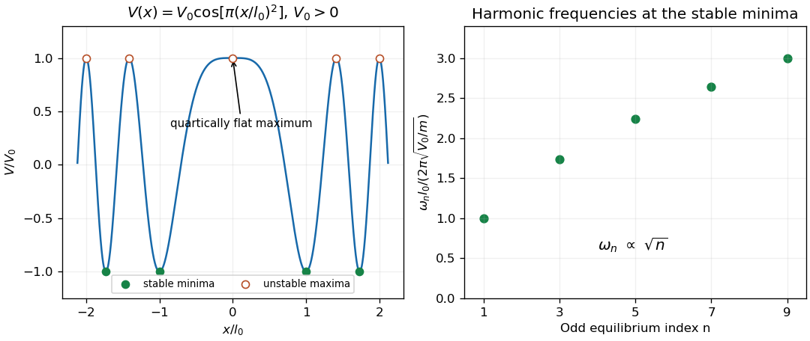

<h1 id="s7/1/2/solution">Solution</h1>

↑ **Parent:** [2](../2.md)

Write $u=\pi x^2/l_0^2$ and assume $V_0>0$. The derivative of the potential is $V'(x)=-2\pi V_0x\sin u/l_0^2$. Its equilibrium positions are zero and $x=\pm l_0\sqrt n$ for positive integers $n$. At a nonzero equilibrium,

$$
V''=-\frac{4\pi^2V_0n}{l_0^2}(-1)^n.
$$

Thus the stable equilibria and their small-oscillation [normal mode frequencies](../../../../../eigenfrequency.md) are

$$
\boxed{x_n=\pm l_0\sqrt n,\quad\omega_n=\frac{2\pi}{l_0}\sqrt{\frac{nV_0}{m}},\quad n=1,3,5,\ldots.}
$$

Even positive $n$ give unstable maxima. At zero the quadratic term vanishes but $V(x)=V_0-V_0\pi^2x^4/(2l_0^4)+\cdots$, so the equilibrium is still unstable; a zero linearized frequency does not prove stability. If the unspecified sign of $V_0$ were chosen negative, even-$n$ positions would be stable instead, together with a degenerate quartic minimum at zero whose frequency tends to zero with oscillation amplitude.

**[Figure 4](#s7/1/2/image-stable-minima-of-the-cosine-of-square-potential-and-their-small-oscillation-frequencies). Stable minima of the cosine-of-square potential and their small-oscillation frequencies**.

## ↑ Ancestors (12)

1. [2](../2.md)
2. [1](../../1.md)
3. [S7](../../../s7.md)
4. [2015](../../../../2015-split.md)
5. [Past exam of the short options paper shared by Prelims and Parts A and B of the physics course of the University of Oxford](../../../../split.md)
6. [Short options paper shared by Prelims and Parts A and B of the physics course of the University of Oxford](../../../../../short-options-paper-shared-by-prelims-and-parts-a-and-b-of-the-physics-course-of-the-university-of-oxford.md)
7. [Physics course of the University of Oxford](../../../../../physics-course-of-the-university-of-oxford.md)
8. [Undergraduate course of the University of Oxford](../../../../../undergraduate-course-of-the-university-of-oxford.md)
9. [Course of the University of Oxford](../../../../../course-of-the-university-of-oxford.md)
10. [University of Oxford](../../../../../university-of-oxford-split.md)
11. [List of universities](../../../../../list-of-universities.md)
12. [Codex Wiki](../../../../../split.md)
