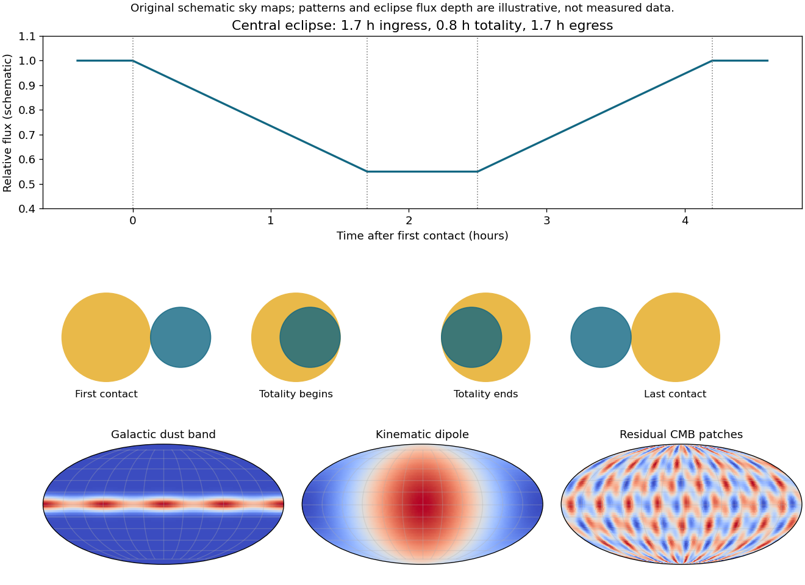
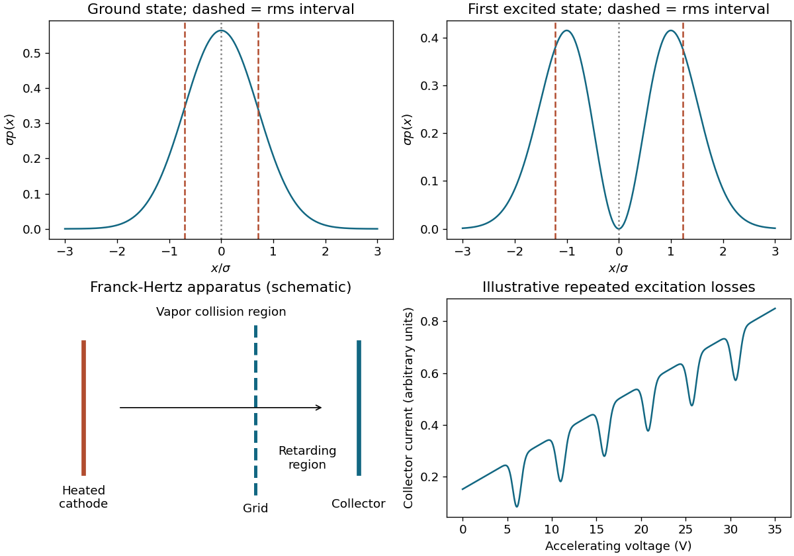
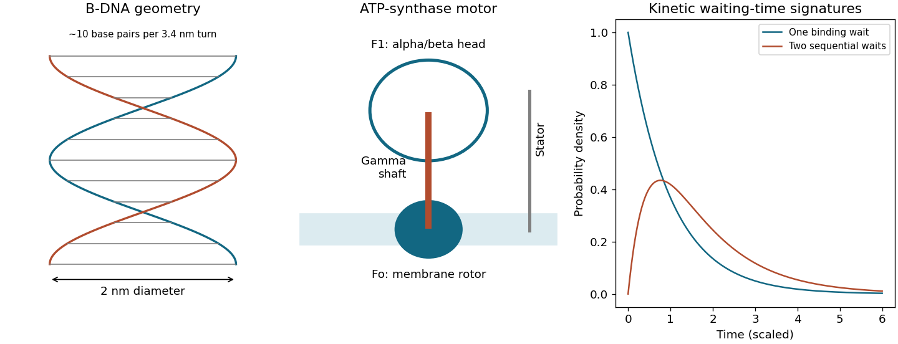
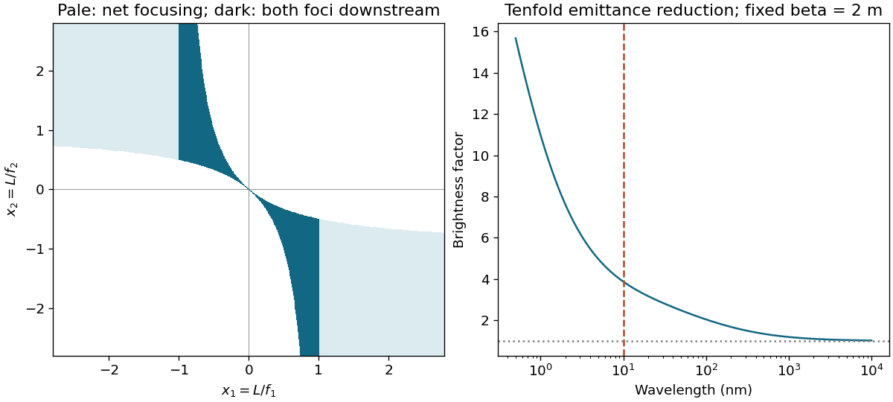
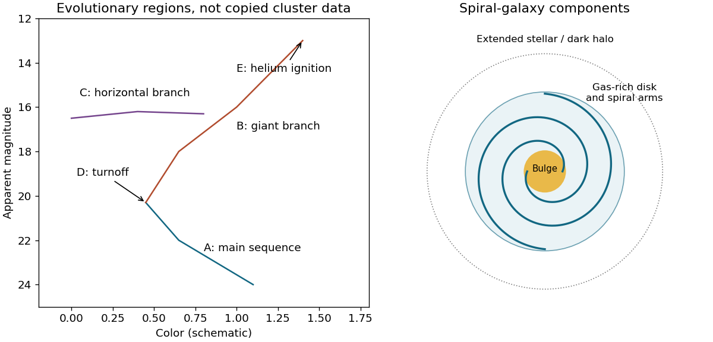
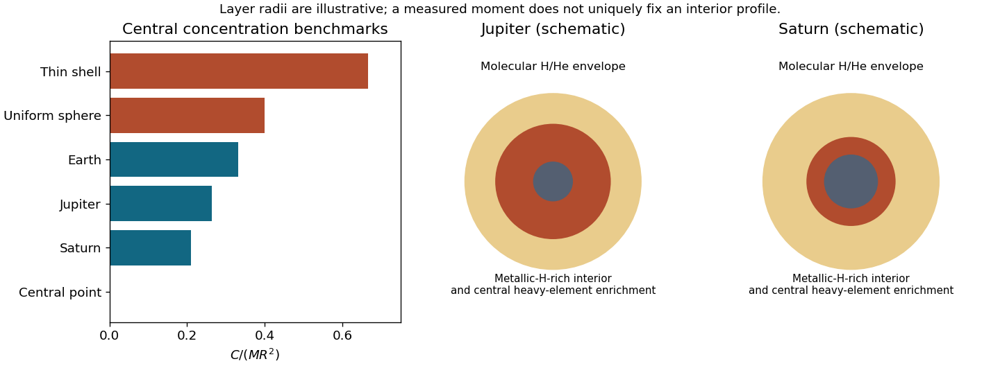

# 2016

↑ **Parent:** [Past exam of the short options paper shared by Prelims and Parts A and B of the physics course of the University of Oxford](../past-exam-of-the-short-options-paper-shared-by-prelims-and-parts-a-and-b-of-the-physics-course-of-the-university-of-oxford.md)

Source paper: [https://www.whatdotheyknow.com/request/physics_past_exam_papers_2015_16/response/973997/attach/3/Cowell%20Attachment.zip?cookie_passthrough=1.](https://www.whatdotheyknow.com/request/physics_past_exam_papers_2015_16/response/973997/attach/3/Cowell%20Attachment.zip?cookie_passthrough=1.) The dated cover identifies Trinity Term 2016, 14 June. Unlettered marked requests are numbered in source order; explicit letters are retained. All optional [Energy](../energy.md) Studies alternatives are addressed. S18 is intentionally excluded from new solutions because complete official answers match that section.

**Table of contents**

- [S1](#s1)
  - [1](#s1/1)
    - [1](#s1/1/1)
      - [Solution](#s1/1/1/solution)
    - [2](#s1/1/2)
      - [Solution](#s1/1/2/solution)
    - [3](#s1/1/3)
      - [Solution](#s1/1/3/solution)
  - [2](#s1/2)
    - [1](#s1/2/1)
      - [Solution](#s1/2/1/solution)
    - [2](#s1/2/2)
      - [Solution](#s1/2/2/solution)
    - [3](#s1/2/3)
      - [Solution](#s1/2/3/solution)
    - [4](#s1/2/4)
      - [Solution](#s1/2/4/solution)
  - [3](#s1/3)
    - [a](#s1/3/a)
      - [Solution](#s1/3/a/solution)
    - [b](#s1/3/b)
      - [1](#s1/3/b/1)
        - [Solution](#s1/3/b/1/solution)
      - [2](#s1/3/b/2)
        - [Solution](#s1/3/b/2/solution)
- [S2](#s2)
  - [1](#s2/1)
    - [1](#s2/1/1)
      - [Solution](#s2/1/1/solution)
    - [2](#s2/1/2)
      - [Solution](#s2/1/2/solution)
    - [3](#s2/1/3)
      - [Solution](#s2/1/3/solution)
  - [2](#s2/2)
    - [1](#s2/2/1)
      - [Solution](#s2/2/1/solution)
    - [2](#s2/2/2)
      - [Solution](#s2/2/2/solution)
  - [3](#s2/3)
    - [a](#s2/3/a)
      - [Solution](#s2/3/a/solution)
    - [b](#s2/3/b)
      - [Solution](#s2/3/b/solution)
    - [c](#s2/3/c)
      - [Solution](#s2/3/c/solution)
    - [1](#s2/3/1)
      - [Solution](#s2/3/1/solution)
    - [2](#s2/3/2)
      - [Solution](#s2/3/2/solution)
- [S3](#s3)
  - [1](#s3/1)
    - [1](#s3/1/1)
      - [Solution](#s3/1/1/solution)
    - [2](#s3/1/2)
      - [Solution](#s3/1/2/solution)
    - [3](#s3/1/3)
      - [Solution](#s3/1/3/solution)
    - [4](#s3/1/4)
      - [Solution](#s3/1/4/solution)
    - [5](#s3/1/5)
      - [Solution](#s3/1/5/solution)
  - [2](#s3/2)
    - [1](#s3/2/1)
      - [Solution](#s3/2/1/solution)
    - [a](#s3/2/a)
      - [Solution](#s3/2/a/solution)
    - [b](#s3/2/b)
      - [Solution](#s3/2/b/solution)
    - [c](#s3/2/c)
      - [Solution](#s3/2/c/solution)
    - [d](#s3/2/d)
      - [Solution](#s3/2/d/solution)
    - [e](#s3/2/e)
      - [Solution](#s3/2/e/solution)
  - [3](#s3/3)
    - [1](#s3/3/1)
      - [Solution](#s3/3/1/solution)
    - [2](#s3/3/2)
      - [Solution](#s3/3/2/solution)
    - [3](#s3/3/3)
      - [Solution](#s3/3/3/solution)
    - [4](#s3/3/4)
      - [Solution](#s3/3/4/solution)
    - [5](#s3/3/5)
      - [a](#s3/3/5/a)
        - [Solution](#s3/3/5/a/solution)
      - [b](#s3/3/5/b)
        - [Solution](#s3/3/5/b/solution)
- [S4](#s4)
  - [1](#s4/1)
    - [1](#s4/1/1)
      - [Solution](#s4/1/1/solution)
    - [2](#s4/1/2)
      - [Solution](#s4/1/2/solution)
    - [3](#s4/1/3)
      - [Solution](#s4/1/3/solution)
    - [4](#s4/1/4)
      - [Solution](#s4/1/4/solution)
  - [2](#s4/2)
    - [1](#s4/2/1)
      - [Solution](#s4/2/1/solution)
    - [2](#s4/2/2)
      - [Solution](#s4/2/2/solution)
    - [3](#s4/2/3)
      - [Solution](#s4/2/3/solution)
  - [3](#s4/3)
    - [a](#s4/3/a)
      - [Solution](#s4/3/a/solution)
    - [b](#s4/3/b)
      - [Solution](#s4/3/b/solution)
    - [c](#s4/3/c)
      - [Solution](#s4/3/c/solution)
    - [d](#s4/3/d)
      - [Solution](#s4/3/d/solution)
    - [e](#s4/3/e)
      - [Solution](#s4/3/e/solution)
    - [f](#s4/3/f)
      - [Solution](#s4/3/f/solution)
    - [g](#s4/3/g)
      - [Solution](#s4/3/g/solution)
- [S7](#s7)
  - [1](#s7/1)
    - [1](#s7/1/1)
      - [Solution](#s7/1/1/solution)
    - [2](#s7/1/2)
      - [Solution](#s7/1/2/solution)
    - [3](#s7/1/3)
      - [Solution](#s7/1/3/solution)
    - [4](#s7/1/4)
      - [Solution](#s7/1/4/solution)
  - [2](#s7/2)
    - [1](#s7/2/1)
      - [Solution](#s7/2/1/solution)
    - [a](#s7/2/a)
      - [Solution](#s7/2/a/solution)
    - [b](#s7/2/b)
      - [Solution](#s7/2/b/solution)
    - [c](#s7/2/c)
      - [Solution](#s7/2/c/solution)
  - [3](#s7/3)
    - [1](#s7/3/1)
      - [Solution](#s7/3/1/solution)
    - [2](#s7/3/2)
      - [Solution](#s7/3/2/solution)
    - [3](#s7/3/3)
      - [Solution](#s7/3/3/solution)
    - [4](#s7/3/4)
      - [Solution](#s7/3/4/solution)
- [S12](#s12)
  - [1](#s12/1)
    - [Solution](#s12/1/solution)
  - [2](#s12/2)
    - [1](#s12/2/1)
      - [Solution](#s12/2/1/solution)
    - [2](#s12/2/2)
      - [Solution](#s12/2/2/solution)
    - [3](#s12/2/3)
      - [Solution](#s12/2/3/solution)
    - [4](#s12/2/4)
      - [Solution](#s12/2/4/solution)
  - [3](#s12/3)
    - [1](#s12/3/1)
      - [Solution](#s12/3/1/solution)
    - [2](#s12/3/2)
      - [Solution](#s12/3/2/solution)
- [S16](#s16)
  - [1](#s16/1)
    - [1](#s16/1/1)
      - [Solution](#s16/1/1/solution)
    - [2](#s16/1/2)
      - [Solution](#s16/1/2/solution)
    - [3](#s16/1/3)
      - [Solution](#s16/1/3/solution)
  - [2](#s16/2)
    - [1](#s16/2/1)
      - [Solution](#s16/2/1/solution)
    - [2](#s16/2/2)
      - [Solution](#s16/2/2/solution)
    - [3](#s16/2/3)
      - [Solution](#s16/2/3/solution)
    - [4](#s16/2/4)
      - [Solution](#s16/2/4/solution)
  - [3](#s16/3)
    - [1](#s16/3/1)
      - [Solution](#s16/3/1/solution)
    - [2](#s16/3/2)
      - [Solution](#s16/3/2/solution)
    - [3](#s16/3/3)
      - [Solution](#s16/3/3/solution)
- [S18](#s18)
- [S19](#s19)
  - [1](#s19/1)
    - [a](#s19/1/a)
      - [Solution](#s19/1/a/solution)
    - [b](#s19/1/b)
      - [Solution](#s19/1/b/solution)
    - [c](#s19/1/c)
      - [Solution](#s19/1/c/solution)
  - [2](#s19/2)
    - [a](#s19/2/a)
      - [Solution](#s19/2/a/solution)
    - [b](#s19/2/b)
      - [Solution](#s19/2/b/solution)
    - [c](#s19/2/c)
      - [Solution](#s19/2/c/solution)
    - [d](#s19/2/d)
      - [Solution](#s19/2/d/solution)
    - [e](#s19/2/e)
      - [Solution](#s19/2/e/solution)
    - [f](#s19/2/f)
      - [Solution](#s19/2/f/solution)
  - [3](#s19/3)
    - [a](#s19/3/a)
      - [Solution](#s19/3/a/solution)
    - [b](#s19/3/b)
      - [Solution](#s19/3/b/solution)
    - [c](#s19/3/c)
      - [Solution](#s19/3/c/solution)
    - [d](#s19/3/d)
      - [Solution](#s19/3/d/solution)
- [S26](#s26)
  - [1](#s26/1)
    - [1](#s26/1/1)
      - [Solution](#s26/1/1/solution)
    - [2](#s26/1/2)
      - [Solution](#s26/1/2/solution)
    - [3](#s26/1/3)
      - [a](#s26/1/3/a)
        - [Solution](#s26/1/3/a/solution)
      - [b](#s26/1/3/b)
        - [Solution](#s26/1/3/b/solution)
      - [Solution](#s26/1/3/solution)
    - [4](#s26/1/4)
      - [Solution](#s26/1/4/solution)
  - [2](#s26/2)
    - [1](#s26/2/1)
      - [Solution](#s26/2/1/solution)
    - [2](#s26/2/2)
      - [Solution](#s26/2/2/solution)
    - [3](#s26/2/3)
      - [Solution](#s26/2/3/solution)
    - [4](#s26/2/4)
      - [Solution](#s26/2/4/solution)
  - [3](#s26/3)
    - [1](#s26/3/1)
      - [Solution](#s26/3/1/solution)
    - [2](#s26/3/2)
      - [Solution](#s26/3/2/solution)
    - [3](#s26/3/3)
      - [Solution](#s26/3/3/solution)
    - [4](#s26/3/4)
      - [Solution](#s26/3/4/solution)
- [S27](#s27)
  - [1](#s27/1)
    - [Solution](#s27/1/solution)
  - [2](#s27/2)
    - [Solution](#s27/2/solution)
  - [3](#s27/3)
    - [Solution](#s27/3/solution)
  - [4](#s27/4)
    - [Solution](#s27/4/solution)
  - [5](#s27/5)
    - [Solution](#s27/5/solution)
- [S28](#s28)
  - [1](#s28/1)
    - [Solution](#s28/1/solution)
  - [2](#s28/2)
    - [Solution](#s28/2/solution)
  - [3](#s28/3)
    - [Solution](#s28/3/solution)
  - [4](#s28/4)
    - [Solution](#s28/4/solution)
  - [5](#s28/5)
    - [Solution](#s28/5/solution)
- [S29](#s29)
  - [1](#s29/1)
    - [1](#s29/1/1)
      - [Solution](#s29/1/1/solution)
    - [2](#s29/1/2)
      - [Solution](#s29/1/2/solution)
    - [3](#s29/1/3)
      - [Solution](#s29/1/3/solution)
    - [4](#s29/1/4)
      - [a](#s29/1/4/a)
        - [Solution](#s29/1/4/a/solution)
      - [b](#s29/1/4/b)
        - [Solution](#s29/1/4/b/solution)
    - [5](#s29/1/5)
      - [Solution](#s29/1/5/solution)
  - [2](#s29/2)
    - [1](#s29/2/1)
      - [Solution](#s29/2/1/solution)
    - [2](#s29/2/2)
      - [Solution](#s29/2/2/solution)
    - [3](#s29/2/3)
      - [Solution](#s29/2/3/solution)
    - [4](#s29/2/4)
      - [Solution](#s29/2/4/solution)
    - [5](#s29/2/5)
      - [Solution](#s29/2/5/solution)
  - [3](#s29/3)
    - [a](#s29/3/a)
      - [Solution](#s29/3/a/solution)
    - [b](#s29/3/b)
      - [Solution](#s29/3/b/solution)
    - [c](#s29/3/c)
      - [Solution](#s29/3/c/solution)
    - [2](#s29/3/2)
      - [Solution](#s29/3/2/solution)
    - [3](#s29/3/3)
      - [Solution](#s29/3/3/solution)
    - [4](#s29/3/4)
      - [Solution](#s29/3/4/solution)
    - [5](#s29/3/5)
      - [Solution](#s29/3/5/solution)

## S1

↑ **Parent:** [2016](2016.md)

<h3 id="s1/1">1</h3>

↑ **Parent:** [S1](#s1)

<h4 id="s1/1/1">1</h4>

↑ **Parent:** [1](#s1/1)

<h5 id="s1/1/1/solution">Solution</h5>

↑ **Parent:** [1](#s1/1/1)

The [simple poles](../isolated-singularity.md#simple-pole) occur at $z=n-\alpha$, $n\in\mathbb Z$, since the [derivative](../calculus.md#derivative) of the sine there is $\pi(-1)^n$. Thus

$$
\boxed{\operatorname{Res}_{n-\alpha}f=\frac{(-1)^n}{\pi(n-\alpha)^2}.}
$$

There is also a [double pole](../isolated-singularity.md#double-pole) at zero, not included in that list because $0<\alpha<1$. Its [residue](../analysis.md#residue), needed for the next [contour](../complex-analysis.md#complex-integration-contour) calculation, is the [derivative](../calculus.md#derivative) of $\csc\pi(z+\alpha)$ at zero, namely $-\pi\csc(\pi\alpha)\cot(\pi\alpha)$.

<h4 id="s1/1/2">2</h4>

↑ **Parent:** [1](#s1/1)

<h5 id="s1/1/2/solution">Solution</h5>

↑ **Parent:** [2](#s1/1/2)

On the square, $|z|\geq N$. The identity $|\sin\pi(x+\alpha+iy)|^2=\sin^2\pi(x+\alpha)+\sinh^2\pi y$ bounds the sine away from zero on the vertical sides because $x=\pm N$; on horizontal sides it grows exponentially. Therefore the whole [contour integral](../complex-analysis.md#contour-integral) is $O(N^{-1})$ or smaller and vanishes. The [residue theorem](../analysis.md#residue-theorem) then gives

$$
0=2\pi i\left[-\pi\csc\pi\alpha\cot\pi\alpha+\sum_{n\in\mathbb Z}\frac{(-1)^n}{\pi(n-\alpha)^2}\right],
$$

which proves $\boxed{\sum_{n\in\mathbb Z}(-1)^n/(n-\alpha)^2=\pi^2\csc\pi\alpha\cot\pi\alpha}$. [Absolute convergence](../sequence-and-series.md#absolute-convergence) justifies the limiting [residue](../analysis.md#residue) sum.

<h4 id="s1/1/3">3</h4>

↑ **Parent:** [1](#s1/1)

<h5 id="s1/1/3/solution">Solution</h5>

↑ **Parent:** [3](#s1/1/3)

Separate the $n=0$ term and pair $n$ with $-n$. For small $\alpha$,

$$
\frac{(-1)^n}{(n-\alpha)^2}+\frac{(-1)^n}{(n+\alpha)^2}=\frac{2(-1)^n}{n^2}+\frac{6\alpha^2(-1)^n}{n^4}+O(\alpha^4/n^6).
$$

Compare the constant and quadratic coefficients with the supplied expansion after subtracting $\alpha^{-2}$. It follows that

$$
\boxed{\sum_{n\geq1}\frac{(-1)^n}{n^2}=-\frac{\pi^2}{12},\qquad\sum_{n\geq1}\frac{(-1)^n}{n^4}=-\frac{7\pi^4}{720}.}
$$

The paired expansion is uniformly summable on any sufficiently small [closed interval](../real-analysis.md#closed-real-interval) of $\alpha$, so coefficient comparison is legitimate.

<h3 id="s1/2">2</h3>

↑ **Parent:** [S1](#s1)

<h4 id="s1/2/1">1</h4>

↑ **Parent:** [2](#s1/2)

<h5 id="s1/2/1/solution">Solution</h5>

↑ **Parent:** [1](#s1/2/1)

A [conformal map](../geometry-and-topology.md#conformal-map) preserves local oriented angles and has a nonzero local [scale factor](../euclidean-geometry.md#geometric-scale-factor). For an orientation-preserving complex map this is equivalent to [holomorphy](../holomorphic-function.md) with $f'(z)\ne0$ at the point concerned. Infinitesimal figures are rotated and uniformly scaled there, but finite shapes need not be preserved: [derivative](../calculus.md#derivative) magnitude and direction can vary across a region. [Antiholomorphic maps](../holomorphic-function.md#antiholomorphic-function) preserve unoriented angles while reversing orientation; the convention being used must be stated.

<h4 id="s1/2/2">2</h4>

↑ **Parent:** [2](#s1/2)

<h5 id="s1/2/2/solution">Solution</h5>

↑ **Parent:** [2](#s1/2/2)

For real $x\ne-1$, $w=1-2/(x+1)$ is real. Its finite image is the entire [real axis](../complex-analysis.md#real-axis) except $w=1$, which is approached only as $x\to\pm\infty$. The point $x=-1$ maps to infinity. On the extended [complex plane](../complex-analysis.md#complex-plane) the extended [real axis](../complex-analysis.md#real-axis) maps onto itself, with $z=\infty$ mapping to one.

<h4 id="s1/2/3">3</h4>

↑ **Parent:** [2](#s1/2)

<h5 id="s1/2/3/solution">Solution</h5>

↑ **Parent:** [3](#s1/2/3)

The identity $w-1=-2/(z+1)$ gives $\boxed{|w-1|=2/r}$ on $|z+1|=r$. Thus the image circle has center one and [radius](../topology.md#radius) $2/r$. Points strictly inside the original circle satisfy $|w-1|>2/r$; the center itself maps to infinity. The interior therefore becomes the exterior together with infinity on the [Riemann sphere](../riemann-surfaces.md#riemann-sphere), rather than the interior of the image circle. This inversion is a useful warning against assuming conformality preserves global inside/outside assignments.

<h4 id="s1/2/4">4</h4>

↑ **Parent:** [2](#s1/2)

<h5 id="s1/2/4/solution">Solution</h5>

↑ **Parent:** [4](#s1/2/4)

For $z=e^{i\theta}$, $w=i\tan(\theta/2)$, which is purely imaginary; $z=-1$ supplies the point at infinity. Conversely, the [inverse map](../function.md#inverse-function) is $z=(1+w)/(1-w)$. Requiring $|w|=1$ is equivalent to $|z-1|=|z+1|$, hence $\boxed{\operatorname{Re}z=0}$, including the appropriate infinite point in the extended-plane formulation. The [unit circle](../complex-analysis.md#complex-unit-circle) and [imaginary axis](../complex-analysis.md#imaginary-axis) are exchanged, but the [real axis](../complex-analysis.md#real-axis) is not.

<h3 id="s1/3">3</h3>

↑ **Parent:** [S1](#s1)

<h4 id="s1/3/a">a</h4>

↑ **Parent:** [3](#s1/3)

<h5 id="s1/3/a/solution">Solution</h5>

↑ **Parent:** [A](#s1/3/a)

Set $z=e^{i\theta}$. The [integral](../integral.md) becomes

$$
\oint_{|z|=1}\frac{dz}{i[(1-i/2)z^2+3z+(1+i/2)]}.
$$

The roots are $z=(-3\pm2)/(2-i)$, only $z_+=-1/(2-i)$ lying inside. The [derivative](../calculus.md#derivative) of the quadratic at $z_+$ is two, so the [residue](../analysis.md#residue) is $1/(2i)$. Consequently $\boxed{\int_0^{2\pi}d\theta/(3+2\cos\theta+\sin\theta)=\pi}$. The denominator is positive since $3>\sqrt5$, so no principal-value qualification is required.

<h4 id="s1/3/b">b</h4>

↑ **Parent:** [3](#s1/3)

<h5 id="s1/3/b/1">1</h5>

↑ **Parent:** [B](#s1/3/b)

<h6 id="s1/3/b/1/solution">Solution</h6>

↑ **Parent:** [1](#s1/3/b/1)

Cauchy's theorem says that a [holomorphic function](../holomorphic-function.md) integrates to zero around a closed [contour](../complex-analysis.md#complex-integration-contour) homologous to zero in its domain. Thus deforming one [contour](../complex-analysis.md#complex-integration-contour) into another without crossing a singularity preserves the [integral](../integral.md). More generally for a [meromorphic](../isolated-singularity.md#meromorphic-function) $f$, the exact condition is

$$
\boxed{\sum_a[n_\Gamma(a)-n_{\Gamma'}(a)]\operatorname{Res}_a f=0.}
$$

Equal [winding numbers](../complex-analysis.md#winding-number) about every singularity are sufficient. They are not necessary for one particular function because [residues](../analysis.md#residue) can cancel; even arbitrary [contours](../complex-analysis.md#complex-integration-contour) have equal [integrals](../integral.md) for $f=0$. A topological deformation criterion must not be confused with a necessary condition for accidental equality.

<h5 id="s1/3/b/2">2</h5>

↑ **Parent:** [B](#s1/3/b)

<h6 id="s1/3/b/2/solution">Solution</h6>

↑ **Parent:** [2](#s1/3/b/2)

The finite singularities are square-root [branch points](../complex-analysis.md#branch-point) at $z=\pm1$. Choose the cut between them and the branch $f(z)\sim z$ at infinity. The two banks then have values $+i\sqrt{1-x^2}$ above and $-i\sqrt{1-x^2}$ below. A counterclockwise loop around the cut traverses its upper bank right-to-left, so its [integral](../integral.md) is $-2iI$, where $I$ is the required real [integral](../integral.md). At large [radius](../topology.md#radius),

$$
f(z)=z-\frac1{2z}+O(z^{-3}),\qquad\oint f(z)dz=-\pi i.
$$

Therefore $\boxed{I=\pi/2}$. Infinity is not another square-root [branch point](../complex-analysis.md#branch-point): this branch has an ordinary [pole](../isolated-singularity.md#pole) there on its sheet. Small detours about the finite endpoints vanish as their [radius](../topology.md#radius) to power $3/2$.

## S2

↑ **Parent:** [2016](2016.md)

<h3 id="s2/1">1</h3>

↑ **Parent:** [S2](#s2)

<h4 id="s2/1/1">1</h4>

↑ **Parent:** [1](#s2/1)

<h5 id="s2/1/1/solution">Solution</h5>

↑ **Parent:** [1](#s2/1/1)

The first law gives elliptical relative [orbits](../dynamical-systems.md#orbit-dynamical-system) with the center of [force](../force.md) at a focus; the second gives equal swept areas in equal times, expressing angular-momentum conservation. For circular binary motion, let $r_1+r_2=a$ and $M_1r_1=M_2r_2$. The [force](../force.md) equation $M_1(2\pi/P)^2r_1=GM_1M_2/a^2$ gives

$$
\boxed{\frac{a^3}{P^2}=\frac{G(M_1+M_2)}{4\pi^2}.}
$$

The corresponding relation for ellipses uses the relative [semimajor axis](../celestial-mechanics.md#semi-major-axis) rather than instantaneous separation.

<h4 id="s2/1/2">2</h4>

↑ **Parent:** [1](#s2/1)

<h5 id="s2/1/2/solution">Solution</h5>

↑ **Parent:** [2](#s2/1/2)

Eclipses justify an approximately [edge-on orbit](../celestial-mechanics.md#edge-on-orbit), and equal [velocity](../classical-mechanics.md#velocity) [amplitudes](../wave.md#wave-amplitude) imply equal masses. The relative [speed](../classical-mechanics.md#speed) is 200 km s$^{-1}$, so $a=(v_1+v_2)P/(2\pi)\simeq1.50\times10^{10}$ m, or $\boxed{a\simeq0.100\ \mathrm{AU}}$. Substitution in the binary period law gives $M_1+M_2\simeq4.52M_\odot$, hence $\boxed{M_1=M_2\simeq2.26M_\odot}$. Inclination corrections scale the dynamical masses as $\sin^{-3}i$ if exact edge-on viewing is relaxed.

<h4 id="s2/1/3">3</h4>

↑ **Parent:** [1](#s2/1)

<h5 id="s2/1/3/solution">Solution</h5>

↑ **Parent:** [3](#s2/1/3)

Assume a central eclipse and nearly uniform projected [speed](../classical-mechanics.md#speed) during it. Let $r$ be the smaller [radius](../topology.md#radius) and $R$ the larger. First-to-second contact requires travel $2r$, whereas the totality interval requires $2(R-r)$. With relative [speed](../classical-mechanics.md#speed) 200 km s$^{-1}$,

$$
\boxed{r=\frac{v(1.7\ \mathrm h)}2\simeq6.12\times10^5\ \mathrm{km},\qquad R=r+\frac{v(0.8\ \mathrm h)}2\simeq9.00\times10^5\ \mathrm{km}.}
$$

The [light curve](../astrophysics.md#light-curve) has ingress, flat minimum and egress lasting 1.7, 0.8 and 1.7 hours. At the four contacts the projected center separations are $R+r,R-r,R-r,R+r$. A noncentral chord would require an [impact parameter](../classical-mechanics.md#impact-parameter) and changes the inferred radii; the data alone do not fix that geometry exactly. For comparable masses in an ordinary coeval system, a component larger than its [main sequence](../stellar-astrophysics.md#main-sequence) companion suggests expansion away from the [main sequence](../stellar-astrophysics.md#main-sequence), conventionally toward a subgiant/early giant track. That is a conditional evolutionary interpretation: neither [effective temperature](../stellar-structure.md#effective-temperature) nor a bolometric flux is supplied, so a unique position on the [Hertzsprung-Russell diagram](../stellar-astrophysics.md#hertzsprung-russell-diagram) cannot be inferred from these radii alone. Binary interactions and the assumed central chord also matter; these numbers do not establish an ordinary single-star evolutionary model.

**[Figure 1](#s2/1/3/image-central-eclipse-contact-geometry-and-schematic-microwave-sky-components). Central-eclipse contact geometry and schematic microwave sky components**.

<h3 id="s2/2">2</h3>

↑ **Parent:** [S2](#s2)

<h4 id="s2/2/1">1</h4>

↑ **Parent:** [2](#s2/2)

<h5 id="s2/2/1/solution">Solution</h5>

↑ **Parent:** [1](#s2/2/1)

[Hydrostatic balance](../fluid-mechanics.md#hydrostatic-balance) is $dP/dr=-GM(r)\rho/r^2$. A free-fall estimate gives $t_{\mathrm{dyn}}\sim\sqrt{R_\odot^3/(GM_\odot)}\simeq1.6\times10^3$ s; a [test particle](../classical-mechanics.md#test-particle) falling in a fixed point-mass field adds factor $\pi/(2\sqrt2)$, giving about 30 minutes.

For an ideal nonrelativistic gas with negligible boundary [pressure](../pressure.md), the [virial theorem](../classical-mechanics.md#virial-theorem) is $2U+\Omega=0$, so total [energy](../energy.md) is $\Omega/2$. Since $\Omega=-\int_0^M Gm\,dm/r(m)$ and $r\leq R$, $|\Omega|\geq GM^2/(2R)$. This is a _minimum magnitude_, not a [lower bound](../set.md#lower-bound-in-a-partially-ordered-set) on the negative [energy](../energy.md): unrestricted central concentration can make the latter arbitrarily negative. A uniform-density estimate gives $\Omega=-3GM^2/(5R)$ and available contraction [energy](../energy.md) $3GM^2/(10R)$. Its release at present solar [luminosity](../astrophysics.md#luminosity) lasts $\boxed{t\sim10^7\ \mathrm{yr}}$ (order $10^7$–$10^8$ years for alternative structural estimates), much less than a nuclear-burning lifetime.

<h4 id="s2/2/2">2</h4>

↑ **Parent:** [2](#s2/2)

<h5 id="s2/2/2/solution">Solution</h5>

↑ **Parent:** [2](#s2/2/2)

Using the supplied atomic masses consistently includes the net [electron](../physics.md#electron) bookkeeping after [positron annihilation](../relativistic-quantum-field.md#electron-positron-annihilation). The released fraction is $\eta=(4m_H-m_{He})/(4m_H)\simeq0.0071$, corresponding to about 26.7 MeV per [helium](../chemical-substance.md#helium) nucleus. If 10% of the [solar mass](../stellar-astrophysics.md#solar-mass) is processed and [luminosity](../astrophysics.md#luminosity) stays constant, $t\simeq0.1\eta M_\odot c^2/L_\odot\simeq10^{10}$ years.

At separation one femtometre the [proton](../physics.md#proton) Coulomb [energy](../energy.md) is 1.44 MeV. At $2\times10^7$ K, mean thermal [kinetic energy](../energy.md#kinetic-energy) $3k_BT/2\simeq2.59$ keV, making their ratio about $5.6\times10^2$. Classical over-barrier collisions are therefore extremely improbable. [Quantum tunnelling](../quantum-mechanics.md#quantum-tunnelling) through the [Coulomb barrier](../physics.md#coulomb-barrier) and the high-energy distribution tail allow fusion, with the slow weak-interaction step regulating the proton-proton chain. The reaction summary is a net [energy](../energy.md)/matter balance, not one simultaneous four-proton collision.

<h3 id="s2/3">3</h3>

↑ **Parent:** [S2](#s2)

<h4 id="s2/3/a">a</h4>

↑ **Parent:** [3](#s2/3)

<h5 id="s2/3/a/solution">Solution</h5>

↑ **Parent:** [A](#s2/3/a)

Galactic dust emission is concentrated in a bright band along the Galactic plane, with clumps associated with dust-rich regions. It is a foreground with a [spectrum](../fourier-analysis.md#frequency-spectrum) different from a 2.7 K blackbody, so multi-frequency observations can help separate it from the CMB. The schematic below illustrates its geometry rather than reproducing observed sky data.

<h4 id="s2/3/b">b</h4>

↑ **Parent:** [3](#s2/3)

<h5 id="s2/3/b/solution">Solution</h5>

↑ **Parent:** [B](#s2/3/b)

Motion relative to an isotropic [radiation field](../wave-equation.md#radiation-field) produces a dipole: one broad hot hemisphere and an opposite cool hemisphere. To first order $T(\theta)=T_0[1+(v/c)\cos\theta]$, where $\theta=0$ is the forward direction. This is not a narrow Galactic-plane feature and is not the intrinsic small-scale CMB pattern.

<h4 id="s2/3/c">c</h4>

↑ **Parent:** [3](#s2/3)

<h5 id="s2/3/c/solution">Solution</h5>

↑ **Parent:** [C](#s2/3/c)

After foreground and dipole removal, primordial CMB anisotropies are small hot and cold patches across the sky, with characteristic correlated angular scales and [amplitudes](../wave.md#wave-amplitude) of order $10^{-5}$ of the mean [temperature](../temperature.md). They trace perturbations at [photon decoupling](../cosmology.md#photon-decoupling) and subsequent propagation, not simply the current distribution of [Milky Way](../galaxy.md#milky-way) dust.

<h4 id="s2/3/1">1</h4>

↑ **Parent:** [3](#s2/3)

<h5 id="s2/3/1/solution">Solution</h5>

↑ **Parent:** [1](#s2/3/1)

Expansion redshifts [photon](../quantum-mechanics.md#photon) energies and preserves a [blackbody spectrum](../statistical-physics.md#blackbody-spectrum), so a [comoving observer](../cosmology.md#comoving-observer) at $z=2$ sees $T=T_0(1+z)\simeq8.18$ K. A one-sided dipole excess of 0.105% means $v/c=0.00105$, hence $\boxed{v\simeq315\ \mathrm{km\,s^{-1}}}$. Motion is toward the hotter region. The peak-to-peak contrast is twice this, so using 0.210% for $v/c$ would double the inferred [speed](../classical-mechanics.md#speed) incorrectly.

<h4 id="s2/3/2">2</h4>

↑ **Parent:** [3](#s2/3)

<h5 id="s2/3/2/solution">Solution</h5>

↑ **Parent:** [2](#s2/3/2)

The given calibration yields $M_V=-3.5\log_{10}50\simeq-5.946$. The [distance modulus](../astrophysics.md#distance-modulus) is $31.446$, giving $\boxed{d\simeq19.5\ \mathrm{Mpc}}$ if extinction is negligible. [Hubble's law](../cosmology.md#hubble-s-law) predicts $v_H\simeq1400$ km s$^{-1}$, compared with 1150 km s$^{-1}$ observed. The approximately $-250$ km s$^{-1}$ difference can be a line-of-sight [peculiar velocity](../cosmology.md#peculiar-velocity) of the cluster and observer, together with distance-calibration uncertainties. The [local flow](../smooth-manifold.md#local-flow) need not follow a perfectly smooth expansion law.

## S3

↑ **Parent:** [2016](2016.md)

<h3 id="s3/1">1</h3>

↑ **Parent:** [S3](#s3)

<h4 id="s3/1/1">1</h4>

↑ **Parent:** [1](#s3/1)

<h5 id="s3/1/1/solution">Solution</h5>

↑ **Parent:** [1](#s3/1/1)

[Blackbody radiation](../statistical-physics.md#black-body-radiation) defeated classical equipartition because it predicts excessive short-wavelength emission. Quantized oscillator [energy](../energy.md) exchange $h\nu$, and ultimately the [photon](../quantum-mechanics.md#photon) occupation law, gives the [Planck spectrum](../statistical-physics.md#blackbody-spectrum). In the [photoelectric effect](../quantum-mechanics.md#photoelectric-effect), [electron](../physics.md#electron) [energy](../energy.md) follows light [frequency](../wave.md#frequency) with a threshold, rather than simply increasing with beam intensity; individual [photons](../quantum-mechanics.md#photon) supply $h\nu$ and the maximum [kinetic energy](../energy.md#kinetic-energy) is $h\nu-W$. Intensity chiefly changes the event rate at a fixed [frequency](../wave.md#frequency). These explain two distinct failures of a purely continuous classical wave-plus-matter model, while retaining [wave propagation](../wave.md#wave-propagation) and interference.

<h4 id="s3/1/2">2</h4>

↑ **Parent:** [1](#s3/1)

<h5 id="s3/1/2/solution">Solution</h5>

↑ **Parent:** [2](#s3/1/2)

Approximate [helium](../chemical-substance.md#helium) [mass](../classical-mechanics.md#mass) by $2m_p+2m_n\simeq6.69\times10^{-27}$ kg. Nonrelativistic [momentum](../momentum.md) is $p=\sqrt{2mT}$, giving $\boxed{\lambda=h/p\simeq0.203\ \mathrm{nm}}$. A transverse width of one micrometre implies a characteristic [position uncertainty](../quantum-system.md#position-uncertainty) of that order and a minimum [momentum](../momentum.md) uncertainty of order $\hbar/a\sim10^{-28}$ kg m s$^{-1}$, with factors depending on profile convention. For a uniform interval $\Delta x=a/\sqrt{12}$, but an exactly abrupt rectangular [wavefunction](../wave-function.md) actually has infinite rms [momentum](../momentum.md) spread. Width alone does not uniquely specify both rms uncertainties; a smooth near-minimum-uncertainty beam is needed for a finite order-of-magnitude estimate.

<h4 id="s3/1/3">3</h4>

↑ **Parent:** [1](#s3/1)

<h5 id="s3/1/3/solution">Solution</h5>

↑ **Parent:** [3](#s3/1/3)

Immediately after a uniformly illuminated hard slit, the normalized transmitted state is $\psi(x)=w^{-1/2}$ for $|x|<w/2$, zero elsewhere. With Fourier convention $\widetilde\psi(p)=(2\pi\hbar)^{-1/2}\int e^{-ipx/\hbar}\psi(x)dx$,

$$
\boxed{\widetilde\psi(p_x)=\sqrt{\frac{w}{2\pi\hbar}}\operatorname{sinc}\frac{p_xw}{2\hbar},\quad \widetilde p(p_x)=\frac1{\delta p_x}\operatorname{sinc}^2\frac{\pi p_x}{\delta p_x},\quad\delta p_x=\frac hw.}
$$

The supplied sinc [integral](../integral.md) verifies unit [normalization](../mathematics.md#normalization). The first zeros occur at $\pm\delta p_x$, but this finite central-lobe width is not the rms uncertainty: $p_x^2\widetilde p$ fails to have a convergent [integral](../integral.md).

<h4 id="s3/1/4">4</h4>

↑ **Parent:** [1](#s3/1)

<h5 id="s3/1/4/solution">Solution</h5>

↑ **Parent:** [4](#s3/1/4)

For an aligned narrower slit placed immediately after the first, uniform illumination gives [transmission probability](../partial-differential-equation.md#transmission-coefficient) $\boxed{d/w}$. Conditional on passage the same normalized formula applies with $w$ replaced by $d$ and central-lobe [momentum](../momentum.md) scale $h/d$. Position rms is $d/\sqrt{12}$, while the exact hard-edge rms $\Delta p_x$ is infinite. Thus the source's finite “uncertainty” can only mean a characteristic diffraction width; the rigorous Heisenberg inequality is not violated, and smoothing the edges restores finite rms moments satisfying it.

A 10 keV X-ray has $\lambda\simeq0.124$ nm. The ideal position-filter [probability](../probability-theory.md#probability) and [momentum](../momentum.md) formula at fixed aperture widths are unchanged, since the [Fourier transform](../fourier-transform.md) involves $h$ and the aperture geometry. Its larger total [momentum](../momentum.md) makes the angular diffraction width smaller, approximately $\lambda/d$. Real slit-material transmission and absorption are additional experimental issues.

<h4 id="s3/1/5">5</h4>

↑ **Parent:** [1](#s3/1)

<h5 id="s3/1/5/solution">Solution</h5>

↑ **Parent:** [5](#s3/1/5)

To distinguish $2^b$ equal transverse bins across width $w$, $\boxed{d=w/2^b}$. Six bits gives one-nanometre pixels; ten gives 0.0625 nm, below the [helium](../chemical-substance.md#helium) wavelength. In the stipulated fixed-energy freely propagating beam, the latter entails transverse diffraction [momenta](../momentum.md) comparable to or exceeding the available total [momentum](../momentum.md) and lies outside the paraxial aperture model. Six-bit localization is less demanding, although fine detector resolution and losses remain practical constraints. This is not a universal theorem that an [atom](../physics.md#atom-physics) can carry at most six bits in every encoding: accessible modes, [energy](../energy.md), aperture, measurements and success probabilities define the channel.

<h3 id="s3/2">2</h3>

↑ **Parent:** [S3](#s3)

<h4 id="s3/2/1">1</h4>

↑ **Parent:** [2](#s3/2)

<h5 id="s3/2/1/solution">Solution</h5>

↑ **Parent:** [1](#s3/2/1)

The equation is $i\hbar\partial_t\psi=[-\hbar^2\partial_x^2/(2m)+V(x)]\psi$. The generator of [time evolution](../physics.md#time-evolution) is the sum of kinetic and [potential energy](../energy.md#potential-energy) operators. For a sharp stationary [energy](../energy.md), insert $\psi(x,t)=\phi(x)e^{-iEt/\hbar}$ to obtain $[-\hbar^2\phi''/(2m)+V\phi]=E\phi$. The [probability](../probability-theory.md#probability) in $dx$ is $|\psi|^2dx$, normalized to one; hence a normalized one-dimensional [wavefunction](../wave-function.md) has dimensions length$^{-1/2}$. Its overall phase is unobservable, but [relative phase](../quantum-system.md#relative-quantum-phase) affects interference.

<h4 id="s3/2/a">a</h4>

↑ **Parent:** [2](#s3/2)

<h5 id="s3/2/a/solution">Solution</h5>

↑ **Parent:** [A](#s3/2/a)

Integrating $F=-kx$ gives $V=kx^2/2$ up to a constant. Thus $\boxed{-\hbar^2\phi''/(2m)+m\omega^2x^2\phi/2=E\phi}$, with $\omega=\sqrt{k/m}$. The potential is a symmetric upward parabola and tends to infinity in both directions; normalizable states decay at large $|x|$.

<h4 id="s3/2/b">b</h4>

↑ **Parent:** [2](#s3/2)

<h5 id="s3/2/b/solution">Solution</h5>

↑ **Parent:** [B](#s3/2/b)

For the Gaussian, $\phi_0''=(x^2/\sigma^4-1/\sigma^2)\phi_0$. Using $\hbar/(m\omega)=\sigma^2$, the $x^2$ terms cancel and leave $E_0=\hbar\omega/2$. For $\phi_1\propto x\phi_0$, [differentiation](../calculus.md#differentiation) gives $\phi_1''=(x^2/\sigma^4-3/\sigma^2)\phi_1$, and the same cancellation gives $\boxed{E_1=3\hbar\omega/2}$. The [normalization constants](../continuous-probability-distribution.md#normalizing-constant) do not affect these [eigenvalue equations](../linear-operator-theory.md#eigenvalue-equation).

<h4 id="s3/2/c">c</h4>

↑ **Parent:** [2](#s3/2)

<h5 id="s3/2/c/solution">Solution</h5>

↑ **Parent:** [C](#s3/2/c)

Squaring the states gives $\boxed{p_0=e^{-x^2/\sigma^2}/(\sqrt\pi\sigma),\quad p_1=2x^2e^{-x^2/\sigma^2}/(\sqrt\pi\sigma^3)}$. The first peaks at zero; the second has a node there and peaks at $x=\pm\sigma$. For a centered interval of width $\delta x\ll\sigma$, $P_0\simeq\delta x/(\sqrt\pi\sigma)$, whereas $P_1\simeq(\delta x)^3/(6\sqrt\pi\sigma^3)$. Its leading linear term vanishes, but the [probability](../probability-theory.md#probability) in a finite interval is not exactly zero.

**[Figure 2](#s3/2/c/image-ground-and-first-excited-oscillator-distributions-and-an-original-franck-hertz-apparatus-and-signal-schematic). Ground and first-excited oscillator distributions, and an original Franck-Hertz apparatus and signal schematic**.

<h4 id="s3/2/d">d</h4>

↑ **Parent:** [2](#s3/2)

<h5 id="s3/2/d/solution">Solution</h5>

↑ **Parent:** [D](#s3/2/d)

Both [probability](../probability-theory.md#probability) densities are even, so $\langle x\rangle=0$. The supplied Gaussian moments give $\langle x^2\rangle_0=\sigma^2/2$ and $\langle x^2\rangle_1=3\sigma^2/2$. Therefore $\boxed{\Delta x_0=\sigma/\sqrt2,\quad\Delta x_1=\sqrt{3/2}\sigma}$. The original plots mark these two symmetric rms intervals around the common mean.

<h4 id="s3/2/e">e</h4>

↑ **Parent:** [2](#s3/2)

<h5 id="s3/2/e/solution">Solution</h5>

↑ **Parent:** [E](#s3/2/e)

[Time evolution](../physics.md#time-evolution) gives $e^{-iE_0t/\hbar}[\phi_0+e^{-i\omega t}\phi_1]/\sqrt2$. It becomes the opposite relative-sign [superposition](../vector-space.md#superposition-principle) when $e^{-i\omega t}=-1$, first at $\boxed{t_{\min}=\pi/\omega}$. The overlap with the initial state is proportional to $1+e^{-i\omega t}$ and vanishes then; [global phase](../quantum-system.md#global-phase) is immaterial.

<h3 id="s3/3">3</h3>

↑ **Parent:** [S3](#s3)

<h4 id="s3/3/1">1</h4>

↑ **Parent:** [3](#s3/3)

<h5 id="s3/3/1/solution">Solution</h5>

↑ **Parent:** [1](#s3/3/1)

A heated cathode emits [electrons](../physics.md#electron) into low-pressure atomic vapor, and a variable accelerating [voltage](../random-walk.md#voltage) gives them [kinetic energy](../energy.md#kinetic-energy). A grid and small retarding region precede the collecting anode. Below the first excitation threshold most collisions are elastic; above it, [electrons](../physics.md#electron) can transfer a definite [excitation energy](../quantum-mechanics.md#excitation-energy) to [atoms](../physics.md#atom-physics) and may then fail to overcome the collector's retarding field. Collector current develops repeated minima as accelerating [voltage](../random-walk.md#voltage) increases, separated by roughly the same excitation [voltage](../random-walk.md#voltage), approximately 4.9 V for mercury. Contact potentials and [energy](../energy.md) spreads shift or smear the minima without removing their characteristic spacing. A smooth loss mechanism would not produce these repeated fixed-energy thresholds.[1914, accelerated-electron energy losses in mercury](../physics-bibliography.md#uber-zusammenstosse-zwischen-elektronen-und-den-molekulen-des-quecksilberdampfes-und-die-ionisierungsspannung-desselben-by-james-franck-and-gustav-ludwig-hertz)

<h4 id="s3/3/2">2</h4>

↑ **Parent:** [3](#s3/3)

<h5 id="s3/3/2/solution">Solution</h5>

↑ **Parent:** [2](#s3/3/2)

A classically accelerating Coulomb [electron](../physics.md#electron) radiates and loses [orbital energy](../celestial-mechanics.md#orbital-energy), so a stable nonradiating [orbit](../dynamical-systems.md#orbit-dynamical-system) is impossible within that unmodified theory. Bohr instead postulates stationary nonradiating [orbits](../dynamical-systems.md#orbit-dynamical-system), quantized [angular momentum](../momentum.md#angular-momentum) $\mu vr=n\hbar$ and [photon emission](../quantum-mechanics.md#photon-emission)/absorption with $h\nu=E_i-E_f$. Here $\mu=m_eM/(m_e+M)$ describes [relative motion](../classical-mechanics.md#relative-motion). The angular-momentum condition is the standing-wave relation $\boxed{2\pi r=n\lambda_{\mathrm{dB}}}$ for the relative [orbit](../dynamical-systems.md#orbit-dynamical-system). These are additional quantum postulates, not consequences of classical radiation theory.

<h4 id="s3/3/3">3</h4>

↑ **Parent:** [3](#s3/3)

<h5 id="s3/3/3/solution">Solution</h5>

↑ **Parent:** [3](#s3/3/3)

Coulomb centripetal balance and $\mu vr=n\hbar$ give

$$
\boxed{r_n=\frac{m_e}{\mu}\frac{a_0n^2}{Z},\qquad E_n=-\frac{\mu}{m_e}\frac{Z^2\mathrm{Ry}}{n^2}.}
$$

The [radius](../topology.md#radius) is the electron-nucleus separation. For positronium, $Z=1$ and $\mu=m_e/2$, so $r_n=2a_0n^2$ and $E_n=-\mathrm{Ry}/(2n^2)$. Each constituent's [radius](../topology.md#radius) about the [center of mass](../classical-mechanics.md#center-of-mass) is half the separation; calling both that [radius](../topology.md#radius) and $r_n$ the [orbital radius](../dynamical-systems.md#orbital-radius) without distinction would create another factor-two error.

<h4 id="s3/3/4">4</h4>

↑ **Parent:** [3](#s3/3)

<h5 id="s3/3/4/solution">Solution</h5>

↑ **Parent:** [4](#s3/3/4)

The relative [orbital speed](../celestial-mechanics.md#orbital-speed) is $Ze^2/(4\pi\epsilon_0\hbar n)$. Divide the circumference by this [speed](../classical-mechanics.md#speed) to find

$$
\boxed{T_n=\frac{4\epsilon_0^2h^3n^3}{Z^2\mu e^4}.}
$$

Positronium has twice the [hydrogen](../chemical-substance.md#hydrogen) period at the same [principal quantum number](../mathematical-physics.md#principal-quantum-number). The symbol $n$ here labels principal levels with $n=1$ the [ground state](../quantum-mechanics.md#ground-state); if “nth [excited state](../energy-eigenvalue.md#excited-state)” is read literally as excitation count, replace $n$ by $n+1$.

<h4 id="s3/3/5">5</h4>

↑ **Parent:** [3](#s3/3)

<h5 id="s3/3/5/a">a</h5>

↑ **Parent:** [5](#s3/3/5)

<h6 id="s3/3/5/a/solution">Solution</h6>

↑ **Parent:** [A](#s3/3/5/a)

The Lyman-alpha gap is $3Z^2(\mu/m_e)\mathrm{Ry}/4$, giving $\lambda=4hc/[3Z^2(\mu/m_e)\mathrm{Ry}]$. For heavy lithium nucleus and $Z=3$, $\boxed{\lambda\simeq13.5\ \mathrm{nm}}$. A specified lithium isotope would permit the small reduced-mass correction; no isotope is supplied.

<h5 id="s3/3/5/b">b</h5>

↑ **Parent:** [5](#s3/3/5)

<h6 id="s3/3/5/b/solution">Solution</h6>

↑ **Parent:** [B](#s3/3/5/b)

Positronium has $Z=1$ and half the [hydrogen](../chemical-substance.md#hydrogen) reduced-mass [energy](../energy.md) scale, so $\boxed{\lambda\simeq243\ \mathrm{nm}}$. The large contrast with lithium is mainly $Z^2$ Coulomb scaling, with an additional factor two from the moving positron's equal [mass](../classical-mechanics.md#mass). It is not explained by a different [photon](../quantum-mechanics.md#photon) propagation law.

## S4

↑ **Parent:** [2016](2016.md)

<h3 id="s4/1">1</h3>

↑ **Parent:** [S4](#s4)

<h4 id="s4/1/1">1</h4>

↑ **Parent:** [1](#s4/1)

<h5 id="s4/1/1/solution">Solution</h5>

↑ **Parent:** [1](#s4/1/1)

A tokamak confines a hot, approximately toroidal [plasma](../physics.md#plasma-physics) using a strong [toroidal magnetic field](../magnetohydrodynamics.md#toroidal-magnetic-field) and a poloidal field associated with [plasma](../physics.md#plasma-physics) current and external coils. Helical field lines and suitable magnetic surfaces reduce rapid transverse escape. D-T fusion releases 17.6 MeV, mostly in an uncharged [neutron](../neutron.md) that escapes magnetic confinement and transfers [energy](../energy.md) to a surrounding blanket. A [heat exchanger](../heat.md#heat-exchanger) and thermal power cycle convert some of that [energy](../energy.md) into electricity.

Essential systems include the vacuum vessel, toroidal and poloidal magnets, current-drive/transformer and auxiliary heating equipment, fueling and exhaust systems, divertor for concentrated [heat](../heat.md) and particle removal, neutron-absorbing/breeding blanket and shielding. [Alpha particles](../atomic-nucleus.md#alpha-particle) retained in the [plasma](../physics.md#plasma-physics) contribute self-heating. Confinement and controlled exhaust are as important as reaching a high [temperature](../temperature.md); a [magnetic field](../magnetic-field.md) does not confine the [neutrons](../neutron.md) or make material [heat](../heat.md) loads vanish.

<h4 id="s4/1/2">2</h4>

↑ **Parent:** [1](#s4/1)

<h5 id="s4/1/2/solution">Solution</h5>

↑ **Parent:** [2](#s4/1/2)

Lithium in the blanket breeds tritium through [neutron](../neutron.md) reactions, notably $^6\mathrm{Li}+n\to{}^4\mathrm{He}+T$. Tritium is not abundant enough in nature to supply a large reactor fleet without breeding. The blanket must also transfer [heat](../heat.md) and manage [neutron](../neutron.md) damage and losses, and the breeding ratio must exceed consumption after accounting for processing and inventory. Lithium is therefore a fuel-cycle resource rather than the primary charged [plasma](../physics.md#plasma-physics) reactant in the D-T core.

<h4 id="s4/1/3">3</h4>

↑ **Parent:** [1](#s4/1)

<h5 id="s4/1/3/solution">Solution</h5>

↑ **Parent:** [3](#s4/1/3)

Extraction [energy](../energy.md) is $6000\ \mathrm{kg}\times2500\ \mathrm{kWh\,kg^{-1}}=15$ GWh per year. A continuously operating 2 GW electrical plant generates 17.5 TWh per year, so lithium extraction consumes about $\boxed{0.086\%}$ of its output under the stated estimate. This is energetically favorable even before claiming anything about capital costs or extraction feasibility.

For an ocean [mass](../classical-mechanics.md#mass) about $1.4\times10^{21}$ kg, concentration 0.17 ppm implies about $2.4\times10^{14}$ kg lithium. At the specified consumption/output ratio, a hypothetical 20 TW electric world would use $6\times10^7$ kg annually, giving roughly $4\times10^6$ years. For 3 TW the corresponding scale is $3\times10^7$ years. State the assumed demand: “power the world” does not uniquely specify electric demand versus primary-energy use. These are inventory quotients ignoring growth, accessible fraction, ecological constraints and processing throughput.

<h4 id="s4/1/4">4</h4>

↑ **Parent:** [1](#s4/1)

<h5 id="s4/1/4/solution">Solution</h5>

↑ **Parent:** [4](#s4/1/4)

Mean [kinetic energy](../energy.md#kinetic-energy) $3k_BT/2=12.9$ keV means $T=8.6$ keV, not 12.9 keV. For fully ionized D-T with equal [electron](../physics.md#electron) and [ion](../chemistry.md#ion) [temperatures](../temperature.md), $p=2n_i k_BT$ gives $n_i\simeq4.90\times10^{19}$ m$^{-3}$. Thus

$$
\boxed{n_i\tau_ET\simeq1.05\times10^{21}\ \mathrm{m^{-3}\,s\,keV},}
$$

only about one third of the stated requirement. The specified [operating point](../electrical-circuit.md#operating-point) therefore does not meet that criterion and requires improved confinement/[pressure](../pressure.md) or continuing external heating. If the criterion's $n$ counts all thermal particles instead of [ions](../chemistry.md#ion), the product doubles but remains below its given threshold. A precise fusion gain or [duty cycle](../electrical-circuit.md#duty-cycle) cannot be inferred from the [triple product](../multivariable-calculus.md#triple-product) alone.

<h3 id="s4/2">2</h3>

↑ **Parent:** [S4](#s4)

<h4 id="s4/2/1">1</h4>

↑ **Parent:** [2](#s4/2)

<h5 id="s4/2/1/solution">Solution</h5>

↑ **Parent:** [1](#s4/2/1)

Neglect upstream [speed](../classical-mechanics.md#speed) and hydraulic losses. If $H$ is the upstream free-surface height above the crest, the [specific energy](../energy.md#specific-energy) at the crest is $H=y+v^2/(2g)$ and flow per unit width is $Q=yv$. At the critical broad-crested control section, extremizing $Q^2=2gy^2(H-y)$ gives $y=2H/3$ and $v^2=gy$. Therefore

$$
\boxed{Q=\sqrt g\left(\frac{2H}{3}\right)^{3/2}.}
$$

Finite approach [speed](../classical-mechanics.md#speed), [friction](../newtonian-mechanics.md#friction) and contraction introduce measured [discharge coefficients](../fluid-mechanics.md#discharge-coefficient); the ideal result assumes a long enough crest for the near-hydrostatic critical-flow approximation.

<h4 id="s4/2/2">2</h4>

↑ **Parent:** [2](#s4/2)

<h5 id="s4/2/2/solution">Solution</h5>

↑ **Parent:** [2](#s4/2/2)

A Pelton wheel splits and turns a free jet through nearly 180 degrees in moving buckets, transferring [momentum](../momentum.md) to the runner. For ideal bucket [speed](../classical-mechanics.md#speed) $V$, the absolute exit [speed](../classical-mechanics.md#speed) is $2V-u$ and [force](../force.md) is $2\rho Q(u-V)$. Power $2\rho QV(u-V)$ is maximized at $V=u/2$, giving $P_{\max}=\rho Qu^2/2$. If the same inflow must now pass a slit of height $d$, continuity gives $u=Q/d$. Using the preceding flow rate with $H=y_{\min}$,

$$
\boxed{P_{\max}=\frac{\rho Q^3}{2d^2}=\frac{\rho g^{3/2}}{2d^2}\left(\frac23y_{\min}\right)^{9/2}.}
$$

The head must actually be sufficient to supply this jet [speed](../classical-mechanics.md#speed): $u^2/(2g)$ cannot exceed the available hydraulic drop. An arbitrarily small slit cannot produce infinite power from a fixed-height reservoir; it would reduce discharge or raise water until another outlet, including overtopping, operates. The printed scaling presupposes compatible head and fixed-flow conditions.

<h4 id="s4/2/3">3</h4>

↑ **Parent:** [2](#s4/2)

<h5 id="s4/2/3/solution">Solution</h5>

↑ **Parent:** [3](#s4/2/3)

Hydropower can convert a renewable water flux efficiently, has low operating fuel requirements, and reservoir schemes can provide rapid dispatch, [inertia](../classical-mechanics.md#inertia) and storage. Long plant lifetimes can make capital expenditure worthwhile, while [pumped storage](../energy.md#pumped-storage-hydroelectricity) shifts [energy](../energy.md) rather than producing a new primary resource.

Limitations include finite favorable sites, seasonal drought, sedimentation, [habitat fragmentation](../ecology.md#habitat-fragmentation), blocked fish migration, displaced populations and major civil-engineering/failure risks. Reservoir evaporation and methane emissions can matter, especially in warm flooded landscapes, so life-cycle emissions are not uniformly zero. Run-of-river plants avoid some reservoir impacts but offer less controllable output. A project assessment must compare useful annual [energy](../energy.md) and firm capacity, ecological and social costs, and the counterfactual electricity system.

<h3 id="s4/3">3</h3>

↑ **Parent:** [S4](#s4)

<h4 id="s4/3/a">a</h4>

↑ **Parent:** [3](#s4/3)

<h5 id="s4/3/a/solution">Solution</h5>

↑ **Parent:** [A](#s4/3/a)

“Never” cannot be established by one present price comparison. A useful comparison is levelized cost with common financing, capacity and system boundaries. For illustration, solar capital cost 1000 currency units/kW, annual capital-plus-maintenance charge 8%, and [capacity factor](../physics.md#capacity-factor) 0.15 imply about 61 units/MWh. A coal plant with fuel, maintenance and capital costs of the same order is not separated by an immutable physical barrier. These are illustrative inputs, not current price quotations. Carbon costs and air pollution can worsen coal's comparison; intermittency, land and balancing costs can worsen solar's. Compare delivered services as well as panel-level [energy](../energy.md). The defensible conclusion is contingent competition, not a universal impossibility.

<h4 id="s4/3/b">b</h4>

↑ **Parent:** [3](#s4/3)

<h5 id="s4/3/b/solution">Solution</h5>

↑ **Parent:** [B](#s4/3/b)

Electricity is a strong early decarbonization target because large stationary sources are comparatively accessible and a low-carbon grid enables cleaner vehicles, [heat pumps](../thermodynamics.md#heat-pump) and industry. For example a [heat pump](../thermodynamics.md#heat-pump) with [coefficient of performance](../thermodynamics.md#coefficient-of-performance) three divides electricity-related [heat](../heat.md) emissions by three per unit useful [heat](../heat.md). But grid decarbonization does not automatically outrank every efficiency, methane, land-use or industrial intervention. Marginal abatement cost, cumulative emissions, construction time and available technology determine priorities. A very coal-intensive grid makes electrification alone less effective; a clean grid does not remove aviation or process emissions. The statement is a plausible strategic emphasis, not a deduction valid for every country and timescale.

<h4 id="s4/3/c">c</h4>

↑ **Parent:** [3](#s4/3)

<h5 id="s4/3/c/solution">Solution</h5>

↑ **Parent:** [C](#s4/3/c)

For a generous illustrative roof area 100 m$^2$, annual rain depth one metre and five-metre usable fall, maximum [potential energy](../energy.md#potential-energy) is $\rho A h_{\mathrm{rain}}gH\simeq4.9$ MJ, only 1.36 kWh per year before conversion losses. Even 25 million roofs give only about 34 GWh annually, around $10^{-4}$ of a 300 TWh electricity system. Tiny intermittent flows and installation embodied [energy](../energy.md) make the practical result worse. Household roof-rain generation is therefore a very small carbon-saving resource under realistic domestic heights; the small gravitational drop and water flux explain why, without needing to assume an inefficient turbine.

<h4 id="s4/3/d">d</h4>

↑ **Parent:** [3](#s4/3)

<h5 id="s4/3/d/solution">Solution</h5>

↑ **Parent:** [D](#s4/3/d)

A constant renewable contribution can come from geothermal resources, some hydro schemes and sustainably supplied biomass; variable resources can also contribute to firm supply through geographic diversity, storage, interconnection and demand management. These examples refute the absolute “never.” They do not show that every renewable mix can economically supply an unchanged constant demand without additional resources. Baseload is a load/system service rather than an intrinsic virtue of one generator. Long low-wind periods and seasonal storage require energy-capacity accounting, while dispatchable clean systems may make an inflexible minimum-output plant less desirable.

<h4 id="s4/3/e">e</h4>

↑ **Parent:** [3](#s4/3)

<h5 id="s4/3/e/solution">Solution</h5>

↑ **Parent:** [E](#s4/3/e)

At fixed electrical output, improving efficiency from $\eta_0$ to $\eta_1$ reduces fuel and associated combustion emissions by $1-\eta_0/\eta_1$. A change from 0.33 to 0.45 saves about 27%. If an illustrative large coal fleet emits 3.6 Gt annually, that is nearly 1 Gt, exceeding a hypothetical 0.5 Gt national total and far exceeding a 0.1 Gt electricity-sector total. Thus the comparison can be true on reasonable scale assumptions. It is not established by the words “state of the art”: fleet sizes, existing efficiencies, feasible retrofit fractions and whether UK electricity or all UK [energy](../energy.md) is meant must be specified. Continued growth and rebound can offset technical savings, and the options are not mutually exclusive.

<h4 id="s4/3/f">f</h4>

↑ **Parent:** [3](#s4/3)

<h5 id="s4/3/f/solution">Solution</h5>

↑ **Parent:** [F](#s4/3/f)

Storage has multiple performance measures: [energy](../energy.md) and power [density](../fluid-mechanics.md#density), efficiency, cycle/calendar life, duration, cost, materials, safety and siting. Lithium-ion batteries offer high [round-trip efficiency](../energy.md#round-trip-efficiency), fast response and compactness, making them useful for vehicles and short-duration grid services. That does not make them optimal for every duty. Pumped hydro can suit large stationary [energy](../energy.md) stores where geography permits; thermal stores can serve [heat](../heat.md) directly; [chemical fuels](../chemistry.md#chemical-fuel) or other long-duration systems can trade efficiency for cheap [energy](../energy.md) capacity. A technology that is excellent per kilogram may be poor for seasonal storage. “Best” requires a specified service and life-cycle comparison.

<h4 id="s4/3/g">g</h4>

↑ **Parent:** [3](#s4/3)

<h5 id="s4/3/g/solution">Solution</h5>

↑ **Parent:** [G](#s4/3/g)

Fission power combines dense fuel and low direct carbon emissions with high capital commitments, long build schedules, financing risk and expensive decommissioning. Environmental assessment must include mining, enrichment and fabrication, cooling-water demands, normal releases, severe-accident risk and comparison with avoided fossil pollution. None of these is captured by operational carbon emissions alone.

Waste requires containment and isolation appropriate to activity, [heat](../heat.md) production and decay times. Short-lived operational waste and spent fuel have different handling needs, while geological disposal depends on engineered and natural barriers plus credible institutions. Recycling changes inventories and resource use but does not remove all waste or proliferation concerns. Public consent, transparent regulation, security and intergenerational responsibility are part of the challenge. Quantitative comparisons should specify reactor type, financing and waste policy rather than treating either zero risk or inevitable catastrophe as a [physical law](../physics.md#physical-law).

## S7

↑ **Parent:** [2016](2016.md)

<h3 id="s7/1">1</h3>

↑ **Parent:** [S7](#s7)

<h4 id="s7/1/1">1</h4>

↑ **Parent:** [1](#s7/1)

<h5 id="s7/1/1/solution">Solution</h5>

↑ **Parent:** [1](#s7/1/1)

In a frame rotating with [angular velocity](../rigid-body-dynamics.md#angular-velocity) $\boldsymbol\Omega$, the [Coriolis force](../mathematical-physics.md#coriolis-force) is $\mathbf F_C=-2m\boldsymbol\Omega\times\mathbf v_{\mathrm{rot}}$. In the northern hemisphere horizontal flow is deflected to the right: balanced circulation is counterclockwise about a low-pressure center and clockwise about a high-pressure center. The deflection reverses in the southern hemisphere. Jupiter's counterclockwise southern Great Red Spot is consequently anticyclonic, a high-pressure system. These statements assume a large-scale rotating atmosphere; they do not explain tiny vortices dominated by local [boundary conditions](../differential-equation.md#boundary-condition).

<h4 id="s7/1/2">2</h4>

↑ **Parent:** [1](#s7/1)

<h5 id="s7/1/2/solution">Solution</h5>

↑ **Parent:** [2](#s7/1/2)

The cup's rotation relative to the radial basis has [angular speed](../rigid-body-dynamics.md#angular-speed) $\phi$, so its absolute orientation has [speed](../classical-mechanics.md#speed) $\alpha=\Omega+\phi$. With $\mathcal R(\theta)$ the [planar rotation](../linear-algebra.md#planar-rotation) matrix,

$$
\boxed{\binom{x}{y}=R\binom{\cos\Omega t}{\sin\Omega t}+\mathcal R(\alpha t)\binom{x_1}{y_1}.}
$$

At $\phi=-\Omega$, $\alpha=0$: the cup translates on a circle while its axes remain parallel to fixed inertial axes. Thus $x=R\cos\Omega t+x_1$, $y=R\sin\Omega t+y_1$. Cancellation of orientation rotation does not remove [acceleration](../classical-mechanics.md#acceleration) of the cup's center.

<h4 id="s7/1/3">3</h4>

↑ **Parent:** [1](#s7/1)

<h5 id="s7/1/3/solution">Solution</h5>

↑ **Parent:** [3](#s7/1/3)

The floor contributes [gravitational potential](../newton-s-law-of-universal-gravitation.md#newtonian-potential-of-a-point-mass) $mgz=m\omega^2(x_1^2+y_1^2)/2$. Neglecting [vertical velocity](../fluid-mechanics.md#vertical-velocity) as specified, for the nonrotating cup orientation $\phi=-\Omega$ the [Lagrangian](../calculus-of-variations.md#lagrangian) is

$$
\boxed{L=\frac m2[(\dot x_1-R\Omega\sin\Omega t)^2+(\dot y_1+R\Omega\cos\Omega t)^2]-\frac{m\omega^2}{2}(x_1^2+y_1^2).}
$$

For general $\alpha=\Omega+\phi$, replace the [velocity](../classical-mechanics.md#velocity) components by $\dot x_1-\alpha y_1+R\Omega\sin\phi t$ and $\dot y_1+\alpha x_1+R\Omega\cos\phi t$. The potential remains the same because the paraboloid is axisymmetric.

<h4 id="s7/1/4">4</h4>

↑ **Parent:** [1](#s7/1)

<h5 id="s7/1/4/solution">Solution</h5>

↑ **Parent:** [4](#s7/1/4)

For $\phi=-\Omega$, $p_1=m(\dot x_1-R\Omega\sin\Omega t)$ and $p_2=m(\dot y_1+R\Omega\cos\Omega t)$. The equations are $\ddot x_1+\omega^2x_1=R\Omega^2\cos\Omega t$, $\ddot y_1+\omega^2y_1=R\Omega^2\sin\Omega t$. For $\Omega\ne\omega$,

$$
\boxed{x_1=A\cos\omega t+B\sin\omega t+\frac{R\Omega^2}{\omega^2-\Omega^2}\cos\Omega t,\quad
y_1=C\cos\omega t+D\sin\omega t+\frac{R\Omega^2}{\omega^2-\Omega^2}\sin\Omega t.}
$$

At [resonance](../dynamical-systems.md#resonance) the forced terms are $R\omega t\sin\omega t/2$ and $-R\omega t\cos\omega t/2$. Constants depend on the marble's initial position and [velocity](../classical-mechanics.md#velocity). A general cup orientation is obtained by multiplying the vector solution by $\mathcal R(-\alpha t)$; the physical inertial solution is unchanged by relabeling the cup axes. Resonant growth eventually invalidates the small-horizontal-motion/neglected-vertical-speed approximation.

<h3 id="s7/2">2</h3>

↑ **Parent:** [S7](#s7)

<h4 id="s7/2/1">1</h4>

↑ **Parent:** [2](#s7/2)

<h5 id="s7/2/1/solution">Solution</h5>

↑ **Parent:** [1](#s7/2/1)

A [constant of motion](../hamiltonian-mechanics.md#conserved-quantity) has zero [total derivative](../calculus.md#total-derivative) on every solution, and may explicitly depend on time. For an infinitesimal transformation $\delta q_i=\epsilon\xi_i$ with $\delta L=\epsilon dF/dt$, the on-shell [first variation](../calculus-of-variations.md#first-variation) is $\delta L=\epsilon d(\sum_i p_i\xi_i)/dt$. Therefore $\boxed{I=\sum_i p_i\xi_i-F}$ is conserved. Including a time shift $\delta t=\epsilon\tau$ gives the corresponding $I=\sum_i p_i\xi_i-H\tau-F$. This proves [Noether's theorem](../calculus-of-variations.md#noether-conserved-quantity-for-a-mechanical-point-symmetry) in its usual point-transformation form. A [symmetry](../physics.md#symmetry-physics) of the action up to a [boundary term](../calculus.md#boundary-term) is sufficient; exact invariance of the displayed [Lagrangian](../calculus-of-variations.md#lagrangian) is stronger than necessary. Discrete transformations by themselves do not give this continuous-charge construction.

<h4 id="s7/2/a">a</h4>

↑ **Parent:** [2](#s7/2)

<h5 id="s7/2/a/solution">Solution</h5>

↑ **Parent:** [A](#s7/2/a)

The separability of the printed [Lagrangian](../calculus-of-variations.md#lagrangian) is important. Every $x_i$ is an independent oscillator of the same [frequency](../wave.md#frequency), irrespective of [mass](../classical-mechanics.md#mass). Define $X_i=\sqrt{m_i}x_i$, $P_i=p_{x_i}/\sqrt{m_i}$. Then the complete constant matrix $Q_{ij}=P_iP_j+\omega^2X_iX_j$, and angular quantities $J_{ij}=X_iP_j-X_jP_i$, include each oscillator [energy](../energy.md) and the rotational symmetries of this mass-weighted oscillator space. Alternatively its explicitly time-dependent constants are $X_i\cos\omega t-P_i\sin\omega t/\omega$ and $X_i\sin\omega t+P_i\cos\omega t/\omega$.

[Translations](../geometry-and-topology.md#translation-geometry) in all $y_i$ give conserved $P_y=\sum p_{y_i}$. [Translation](../geometry-and-topology.md#translation-geometry) of $z_1,z_2$ together gives $P_{z12}=p_{z_1}+p_{z_2}$; $z_3$ is free and gives $p_{z_3}$. Their center-of-mass positions minus the associated constant velocities times $t$ are boost constants. The decoupled relative $z_1-z_2$ motion conserves $E_{z,\mathrm{rel}}=(p_{z_1}/m_1-p_{z_2}/m_2)^2\mu_{12}/2+V(z_1-z_2)$, where $\mu_{12}=m_1m_2/(m_1+m_2)$. In mass-weighted versions, the three free center coordinates also have conserved mutual [angular momenta](../momentum.md#angular-momentum). These families are not all [functionally independent](../multivariable-calculus.md#functionally-independent-functions).

The $y$ relative subsystem alone is driven through $\cos[\lambda(m_1-m_2)t]$. For generic nonzero $\lambda(m_1-m_2)$ its [energy](../energy.md), and hence the total [energy](../energy.md), is not conserved. Omitting the [mass-weighted oscillator symmetries](../calculus-of-variations.md#mass-weighted-oscillator-symmetries) simply because the physical masses differ would miss genuine symmetries of this particular model.

<h4 id="s7/2/b">b</h4>

↑ **Parent:** [2](#s7/2)

<h5 id="s7/2/b/solution">Solution</h5>

↑ **Parent:** [B](#s7/2/b)

When $m_1=m_2$, the cosine becomes one and the previously driven $y$ relative subsystem becomes autonomous. Its [energy](../energy.md) is one new generic independent time-independent [integral](../hamiltonian-mechanics.md#conserved-quantity); equivalently total [energy](../energy.md) becomes conserved because the remaining subsystem energies already were. Making $m_3$ equal as well introduces **no further generic [continuous symmetry](../physics.md#continuous-symmetry)** in the printed model. The arbitrary $U_{13}$ and $V_{12}$ distinguish particle labels and directions, so equal masses alone do not create a permutation or physical-rotation invariance.

A finite “number of conserved quantities” must mean independent generators/[integrals](../hamiltonian-mechanics.md#conserved-quantity): arbitrary functions of any [integral](../hamiltonian-mechanics.md#conserved-quantity) give infinitely many. Mass-weighted rotations and free-coordinate symmetries identified in part a already exist at unequal masses. Thus the justified generic increment is one at $m_1=m_2$, and zero further at complete equality. Special potentials or $\lambda=0$ can change the count, but were not stipulated.

<h4 id="s7/2/c">c</h4>

↑ **Parent:** [2](#s7/2)

<h5 id="s7/2/c/solution">Solution</h5>

↑ **Parent:** [C](#s7/2/c)

For equal masses $m$, the newly conserved relative $y$ [energy](../energy.md) is

$$
\boxed{E_{y,\mathrm{rel}}=\sum_i\frac{p_{y_i}^2}{2m}-\frac{(\sum_i p_{y_i})^2}{6m}+U_{12}(y_1-y_2)+U_{13}(y_1-y_3).}
$$

It is [kinetic energy](../energy.md#kinetic-energy) relative to the free $y$ [center of mass](../classical-mechanics.md#center-of-mass) plus the two interactions. Adding its constant center [kinetic energy](../energy.md#kinetic-energy) and the already conserved $x,z$ energies gives the total [Hamiltonian](../hamiltonian-mechanics.md#hamiltonian). The equal-mass oscillator rotations simplify to $J_{ij}=x_i p_{x_j}-x_jp_{x_i}$, but are not new: for unequal masses their conserved predecessors contain the mass-weight factors. As a concrete check, independent transformations of $X_i=\sqrt{m_i}x_i$ rotate an isotropic oscillator at _any_ positive masses. Complete [mass](../classical-mechanics.md#mass) equality does not magically make generic $U_{12}(y_1-y_2)+U_{13}(y_1-y_3)+V(z_1-z_2)$ invariant under rotations of physical space.

<h3 id="s7/3">3</h3>

↑ **Parent:** [S7](#s7)

<h4 id="s7/3/1">1</h4>

↑ **Parent:** [3](#s7/3)

<h5 id="s7/3/1/solution">Solution</h5>

↑ **Parent:** [1](#s7/3/1)

Vary $S=\int L(q,\dot q,t)dt$ with fixed endpoints. [Integration by parts](../calculus.md#integration-by-parts) gives $\delta S=\int\sum_i[L_{q_i}-dL_{\dot q_i}/dt]\delta q_i\,dt$, hence the [Euler-Lagrange equations](../analysis.md#euler-lagrange-equation). Define $p_i=L_{\dot q_i}$ and, assuming an invertible velocity-momentum relation, $H=p\cdot\dot q-L$. The equivalent action is $\int(p\cdot\dot q-H)dt$. Independent variations of $p$ and $q$ yield

$$
\boxed{\dot q_i=H_{p_i},\qquad\dot p_i=-H_{q_i}.}
$$

[Boundary terms](../calculus.md#boundary-term) vanish for fixed endpoint coordinates; constraining [momenta](../momentum.md) independently at the same endpoints is unnecessary. Singular [Lagrangians](../calculus-of-variations.md#lagrangian) require constraint analysis instead of this unconstrained [Legendre transform](../convex-optimization.md#convex-conjugate).

<h4 id="s7/3/2">2</h4>

↑ **Parent:** [3](#s7/3)

<h5 id="s7/3/2/solution">Solution</h5>

↑ **Parent:** [2](#s7/3/2)

[Phase space](../hamiltonian-mechanics.md#phase-space) combines all independent [canonical coordinates](../hamiltonian-mechanics.md#canonical-variables) and [momenta](../momentum.md). Its [Hamiltonian](../hamiltonian-mechanics.md#hamiltonian) [velocity](../classical-mechanics.md#velocity) has divergence $\sum_i[\partial_{q_i}H_{p_i}-\partial_{p_i}H_{q_i}]=0$ by equality of mixed [derivatives](../calculus.md#derivative). Thus an infinitesimal material phase volume has zero fractional rate of change. This is [Liouville's theorem](../complex-analysis.md#liouville-theorem), valid also for explicitly time-dependent [Hamiltonians](../hamiltonian-mechanics.md#hamiltonian). It preserves fine-grained volume, not necessarily the area of any projected coordinate pair.

<h4 id="s7/3/3">3</h4>

↑ **Parent:** [3](#s7/3)

<h5 id="s7/3/3/solution">Solution</h5>

↑ **Parent:** [3](#s7/3/3)

The oscillator flow is

$$
\binom{x(t)}{p(t)}=\begin{pmatrix}\cos\omega t&\sin\omega t/(m\omega)\\-m\omega\sin\omega t&\cos\omega t\end{pmatrix}\binom{x(0)}{p(0)}.
$$

Its [determinant](../multilinear-algebra.md#determinant) is $\cos^2\omega t+\sin^2\omega t=1$, explicitly preserving area. The [orbits](../dynamical-systems.md#orbit-dynamical-system) are [energy](../energy.md) ellipses; stretching one coordinate during transport is compensated by the conjugate direction.

<h4 id="s7/3/4">4</h4>

↑ **Parent:** [3](#s7/3)

<h5 id="s7/3/4/solution">Solution</h5>

↑ **Parent:** [4](#s7/3/4)

Lossless [Hamiltonian](../hamiltonian-mechanics.md#hamiltonian) focusing can reduce a beam's transverse position width at the expense of [momentum](../momentum.md) spread, but cannot reduce its occupied canonical phase volume. Coupling to the longitudinal direction can redistribute projected emittance without reducing total emittance. True cooling requires exporting [entropy](../entropy.md) to additional [degrees of freedom](../classical-mechanics.md#degree-of-freedom) or discarding particles: stochastic feedback, [electron cooling](../particle-accelerator.md#electron-cooling) or radiative damping coupled to an external environment provide possible mechanisms, with very different efficiency for high-energy [protons](../physics.md#proton). Collimation shrinks the accepted distribution at the cost of intensity. [Acceleration](../classical-mechanics.md#acceleration) also reduces angular divergence at fixed [normalized emittance](../particle-accelerator.md#normalized-emittance), an apparent geometrical cooling rather than a violation of [Liouville's theorem](../complex-analysis.md#liouville-theorem). The apparatus and radiation cannot be omitted from the accounting when the bunch is no longer an isolated [Hamiltonian](../hamiltonian-mechanics.md#hamiltonian) subsystem.

## S12

↑ **Parent:** [2016](2016.md)

<h3 id="s12/1">1</h3>

↑ **Parent:** [S12](#s12)

<h4 id="s12/1/solution">Solution</h4>

↑ **Parent:** [1](#s12/1)

[Nucleic acids](../polymer.md#nucleic-acid) are directional sugar-phosphate polymers whose base sequences store information. Complementary antiparallel [DNA](../polymer.md#deoxyribonucleic-acid) strands provide templates for [replication](../design-of-experiments.md#replication-in-experimental-design) and repair, while [base stacking](../polymer.md#base-stacking) and pairing stabilize the usual double helix. [DNA](../polymer.md#deoxyribonucleic-acid) sequence also specifies recognition sites that regulate when information is used. [RNA](../polymer.md#ribonucleic-acid) generally has [ribose](../chemical-substance.md#ribose) and [uracil](../molecule.md#uracil) and can fold through internal pairing into functional structures: [messenger RNA](../polymer.md#messenger-rna) carries coding information, [transfer RNA](../polymer.md#transfer-rna) links [codons](../molecular-genetics.md#codon) with [amino acids](../chemical-substance.md#amino-acid), and [ribosomal RNA](../polymer.md#ribosomal-rna) contributes catalytic machinery. Not all [RNA](../polymer.md#ribonucleic-acid) is a passive messenger.

[Proteins](../protein.md) have peptide-linked amino-acid sequences with chemically diverse [side chains](../molecule.md#side-chain). Their primary sequence constrains secondary structures, tertiary folding and multi-subunit assembly, producing binding pockets, catalytic sites, structural fibers, channels and [molecular motors](../biology.md#molecular-motor). Function depends on conformational dynamics, chemical context and interactions; a linear sequence is not itself a complete account of an active structure. Folding errors and modifications illustrate the need to connect multiple organizational levels.

The central dogma concerns directional transfer of _sequence information_. [DNA](../polymer.md#deoxyribonucleic-acid) can be copied, transcribed into [RNA](../polymer.md#ribonucleic-acid), and coding [RNA](../polymer.md#ribonucleic-acid) translated into [protein](../protein.md). [Reverse transcription](../molecular-genetics.md#reverse-transcription) is compatible with its careful formulation: RNA-to-DNA transfer does not entail extracting an arbitrary [protein](../protein.md)'s amino-acid sequence back into a nucleic-acid template. [RNA replication](../polymer.md#rna-replication) also occurs. The simple slogan “[DNA](../polymer.md#deoxyribonucleic-acid) makes [RNA](../polymer.md#ribonucleic-acid) makes [protein](../protein.md)” is useful but incomplete if taken to prohibit those transfers or to deny [RNA](../polymer.md#ribonucleic-acid) catalysis, regulatory feedback or environmental effects on expression.

Amino-acid sequence is encoded through a triplet [genetic code](../molecular-genetics.md#genetic-code), with tRNAs and [ribosomes](../biological-cell.md#ribosome) mediating [translation](../molecular-genetics.md#translation-biology) rather than direct chemical affinity between each [codon](../molecular-genetics.md#codon) and its [amino acid](../chemical-substance.md#amino-acid). Complementary copying gives inherited continuity, while [mutation](../genetics.md#mutation) and selection allow sequence and functional changes. Thus molecular structure supports both stable heredity and adaptable biochemical machinery without making every cellular process a one-way causal chain.[Chapters 3–6, protein structure, nucleic acids and sequence-information transfer](../cell-biology-bibliography.md#molecular-biology-of-the-cell-4th-edition-by-bruce-alberts-and-others)

<h3 id="s12/2">2</h3>

↑ **Parent:** [S12](#s12)

<h4 id="s12/2/1">1</h4>

↑ **Parent:** [2](#s12/2)

<h5 id="s12/2/1/solution">Solution</h5>

↑ **Parent:** [1](#s12/2/1)

[Natural selection](../evolution.md#natural-selection) requires variation among individuals, heritable contributions to that variation, and differences in [reproductive success](../evolution.md#reproductive-success) associated with it. Given those conditions, variant frequencies can change across generations. Competition and finite resources help make [reproductive success](../evolution.md#reproductive-success) unequal, but selection does not require every interaction to be direct combat. [Mutation](../genetics.md#mutation) and [recombination](../genetics.md#genetic-recombination) supply variation; they do not generally arise because an organism needs a particular adaptation. Drift also changes frequencies, and common ancestry and branching descent connect population changes to the evolution of species. Selection is a mechanism within evolution, not a synonym for every evolutionary change.[Chapters III–IV, struggle for existence and natural selection](../ecology-and-evolution-bibliography.md#on-the-origin-of-species-by-charles-darwin)

<h4 id="s12/2/2">2</h4>

↑ **Parent:** [2](#s12/2)

<h5 id="s12/2/2/solution">Solution</h5>

↑ **Parent:** [2](#s12/2/2)

The chemical mismatch types are A–C and G–T, with either strand acting as template. In the fixed ring alignment shown, A–C has no correct [hydrogen bonds](../chemical-bond.md#hydrogen-bond) while G–T retains one. Relative probabilities must specify the _template_: template A loses two bonds versus A–T, giving $e^{-10}$; template G loses two versus G–C, giving $e^{-10}$; template C loses three versus C–G, giving $e^{-15}$; template T loses one versus T–A, giving $e^{-5}$. Equal incoming activities and $5k_BT$ per bond give approximate relative weights $4.5\times10^{-5},4.5\times10^{-5},3.1\times10^{-7},6.7\times10^{-3}$ respectively.

For roughly equal template frequencies the mean error [probability](../probability-theory.md#probability) is order $1.7\times10^{-3}$, or several million errors across $3\times10^9$ copied [base pairs](../polymer.md#base-pair). Restricting the estimate to [purine](../molecule.md#purine) templates instead gives order $10^5$ errors; neither is an accurate [replication](../design-of-experiments.md#replication-in-experimental-design) model. Both greatly exceed the source's order-one surviving [mutation](../genetics.md#mutation) input. Polymerase kinetic discrimination, proofreading and mismatch repair suppress errors, and a transient mismatch need not become an inherited [mutation](../genetics.md#mutation). Ring relaxation, stacking, solvent and rare tautomers are missing from this simple hydrogen-bond calculation. Real G–T wobble geometry can form additional bonds. The source's [mutation rate](../genetics.md#mutation-rate) is illustrative, not a universal measured human rate.[Chapter 5, DNA Replication Mechanisms: multiple proofreading mechanisms](../cell-biology-bibliography.md#molecular-biology-of-the-cell-4th-edition-by-bruce-alberts-and-others)

<h4 id="s12/2/3">3</h4>

↑ **Parent:** [2](#s12/2)

<h5 id="s12/2/3/solution">Solution</h5>

↑ **Parent:** [3](#s12/2/3)

A [base pair](../polymer.md#base-pair) has four possible sequence identities, hence two bits, not four bits from treating complementary strands as independent. B-DNA has diameter approximately 2 nm, axial rise 0.34 nm per [base pair](../polymer.md#base-pair) and about ten [base pairs](../polymer.md#base-pair) per helical turn. The tightly packed-cylinder upper [density](../fluid-mechanics.md#density) is therefore

$$
\boxed{\frac{2}{\pi(1\ \mathrm{nm})^2(0.34\ \mathrm{nm})}\simeq1.9\times10^{27}\ \mathrm{bits\,m^{-3}}.}
$$

A haploid human genome has about $6\times10^9$ raw bits; in a nucleus of several hundred cubic micrometres its bulk [density](../fluid-mechanics.md#density) is order $10^{25}$ bits m$^{-3}$, far lower. Cellular [DNA](../polymer.md#deoxyribonucleic-acid) must allow hydration, packaging, regulatory access and copying/repair machinery, and cannot fill a cell as parallel bare cylinders. Diploidy and repeated or constrained sequence also reduce _independent functional information_ compared with the raw four-letter capacity; those concepts should not be confused with geometric storage [density](../fluid-mechanics.md#density).

The original molecular figure in question 3 shows the approximate helical dimensions.

<h4 id="s12/2/4">4</h4>

↑ **Parent:** [2](#s12/2)

<h5 id="s12/2/4/solution">Solution</h5>

↑ **Parent:** [4](#s12/2/4)

For independent equiprobable bases there are $4^3=64$ [codons](../molecular-genetics.md#codon), three of them stops, so $p_{\mathrm{stop}}=3/64$. In a fixed [reading frame](../molecular-genetics.md#reading-frame), and conditional on starting [translation](../molecular-genetics.md#translation-biology), surviving at least $L$ successive non-stop [codons](../molecular-genetics.md#codon) has [probability](../probability-theory.md#probability) $\boxed{(61/64)^L}$. For 300 it is about $5.6\times10^{-7}$. Strictly “exceeding 300” requires 301 non-stop [codons](../molecular-genetics.md#codon), giving $(61/64)^{301}$. A specified [start codon](../molecular-genetics.md#start-codon), [codon](../molecular-genetics.md#codon) bias, correlations or looking for a long sequence anywhere in a large genome changes the sampling problem and cannot be silently folded into this single-frame [probability](../probability-theory.md#probability).

<h3 id="s12/3">3</h3>

↑ **Parent:** [S12](#s12)

<h4 id="s12/3/1">1</h4>

↑ **Parent:** [3](#s12/3)

<h5 id="s12/3/1/solution">Solution</h5>

↑ **Parent:** [1](#s12/3/1)

[ATP synthase](../enzyme.md#atp-synthase) combines a [membrane](../cell-membrane.md) $F_o$ proton-conducting rotor with an $F_1$ catalytic head. The c-ring and central gamma shaft rotate relative to a stator and the alpha/beta head. [Proton](../physics.md#proton) flow down its [electrochemical potential](../chemical-potential.md#electrochemical-potential) can drive conformational changes in three beta catalytic sites to bind substrates, form and release [ATP](../molecule.md#adenosine-triphosphate). Reverse operation uses [ATP hydrolysis](../chemical-reaction.md#atp-hydrolysis) to turn the shaft and pump [protons](../physics.md#proton). The immobilized $F_1$ assay isolates this latter rotation; it does not require the [membrane](../cell-membrane.md) [proton](../physics.md#proton) motor to be present.

**[Figure 3](#s12/3/1/image-atp-synthase-organization-and-single-step-versus-two-step-waiting-time-distributions). ATP-synthase organization and single-step versus two-step waiting-time distributions**.

<h4 id="s12/3/2">2</h4>

↑ **Parent:** [3](#s12/3)

<h5 id="s12/3/2/solution">Solution</h5>

↑ **Parent:** [2](#s12/3/2)

An ATP-binding step with pseudo-first-order rate $k_1c$ has [survival probability](../markov-chain.md#survival-probability) $S_1=e^{-k_1ct}$ and waiting [density](../fluid-mechanics.md#density) $P_1=-S_1'=k_1ce^{-k_1ct}$. It decreases from a finite value at zero, integrates to one and has mean $1/(k_1c)$. Its concentration dependence suggests binding-limited waiting before the large 80-degree substep.

Two independent sequential exponential steps of rates $k_a,k_b$ give the convolution

$$
\boxed{P_2(t)=\int_0^t k_ae^{-k_as}k_be^{-k_b(t-s)}ds=\frac{k_ak_b}{k_a-k_b}(e^{-k_bt}-e^{-k_at}).}
$$

It begins at zero, rises to a maximum at $\log(k_a/k_b)/(k_a-k_b)$ and decays; its mean is $k_a^{-1}+k_b^{-1}$. At equal rates it becomes $k^2te^{-kt}$. This supports at least two kinetic events during the waiting associated with the 40-degree substep, plausibly chemical transformation/product release and conformational changes. It does not uniquely identify which rate belongs to hydrolysis or a particular product: different hidden-state networks can have the same waiting distribution. Three 120-degree [catalytic cycles](../chemical-kinetics.md#catalytic-cycle) per revolution, partitioned into 80 and 40 degrees in the assay, are consistent with three catalytic sites.

## S16

↑ **Parent:** [2016](2016.md)

<h3 id="s16/1">1</h3>

↑ **Parent:** [S16](#s16)

<h4 id="s16/1/1">1</h4>

↑ **Parent:** [1](#s16/1)

<h5 id="s16/1/1/solution">Solution</h5>

↑ **Parent:** [1](#s16/1/1)

Assume dilute, nondegenerate ideal [electrons](../physics.md#electron), [protons](../physics.md#proton) and neutral [atoms](../physics.md#atom-physics) in thermal and [chemical equilibrium](../chemical-potential.md#chemical-equilibrium), with [charge neutrality](../electric-charge.md#charge-neutrality) $n_p=n_e$. Set $\mu_H=\mu_p+\mu_e$, using each ideal species' translational factor $n\lambda_{\mathrm{th}}^3/g$ and [hydrogen](../chemical-substance.md#hydrogen) ground-state [binding energy](../energy.md#binding-energy) $-R$. Neglect [excited states](../energy-eigenvalue.md#excited-state) and take the heavy [proton](../physics.md#proton)/[atom](../physics.md#atom-physics) thermal-wavelength ratio as one. With [electron spin](../angular-momentum-operator.md#electron-spin) and neutral-atom degeneracies treated in the convention of the source, the remaining factor is

$$
\boxed{\frac{n_e^2}{n_H}=\left(\frac{2\pi m_ek_BT}{h^2}\right)^{3/2}e^{-R/(k_BT)}.}
$$

Different partition-degeneracy conventions must be propagated consistently. Screening, dense-plasma level dissolution and departures from [local thermodynamic equilibrium](../astrophysics.md#local-thermodynamic-equilibrium) lie outside this derivation.

<h4 id="s16/1/2">2</h4>

↑ **Parent:** [1](#s16/1)

<h5 id="s16/1/2/solution">Solution</h5>

↑ **Parent:** [2](#s16/1/2)

For total nuclear [density](../fluid-mechanics.md#density) $n$, $n_e=n\zeta$ and $n_H=n(1-\zeta)$. Saha's equation becomes $n\zeta^2/(1-\zeta)=C T^{3/2}e^{-R/(k_BT)}$. At $\zeta\ll1$,

$$
\boxed{\zeta\simeq\sqrt{C/n}\,T^{3/4}e^{-T_H/T},\quad m=\tfrac34,\quad T_H=\frac R{2k_B}\simeq7.89\times10^4\ \mathrm K.}
$$

The factor two in the exponent follows from taking a [square root](../algebra.md#square-root); using the full ionization [temperature](../temperature.md) would double the predicted logarithmic slope.

<h4 id="s16/1/3">3</h4>

↑ **Parent:** [1](#s16/1)

<h5 id="s16/1/3/solution">Solution</h5>

↑ **Parent:** [3](#s16/1/3)

Write $u=1/T$. Then $\log\zeta=\mathrm{constant}-(3/4)\log u-T_Hu$, giving local slope $d\log_{10}\zeta/du=-(T_H+3T/4)/\log10$. At 5000–6000 K its magnitude is about $3.6\times10^4$ K. The low-ionization tail in the original graph drops roughly one decade per $2.8\times10^{-5}$ K$^{-1}$, consistent with this value.

At $u=2.0\times10^{-4}$ K$^{-1}$, the graph gives $T\simeq5000$ K and $\zeta\simeq0.004$. Invert the full equation to get $n=C T^{3/2}e^{-R/(k_BT)}(1-\zeta)/\zeta^2$, yielding $\boxed{n\sim10^{18}\ \mathrm{m^{-3}}}$. The neighboring tail markers give the same order; plotting precision and the squared dependence on the read [ionization fraction](../atomic-physics.md#ionization-fraction) preclude claiming many significant digits.

<h3 id="s16/2">2</h3>

↑ **Parent:** [S16](#s16)

<h4 id="s16/2/1">1</h4>

↑ **Parent:** [2](#s16/2)

<h5 id="s16/2/1/solution">Solution</h5>

↑ **Parent:** [1](#s16/2/1)

For weak potentials, Boltzmann [electrons](../physics.md#electron) give $\delta n_e=n_ee\phi/(k_BT)$ against fixed [ions](../chemistry.md#ion). [Poisson's equation](../partial-differential-equation.md#poisson-s-equation) becomes $\nabla^2\phi=\phi/\lambda_D^2$ outside a test [charge](../electric-charge.md), giving a [Yukawa potential](../electromagnetism.md#yukawa-potential) with $\boxed{\lambda_D=\sqrt{\epsilon_0k_BT/(n_ee^2)}}$. For a small [electron](../physics.md#electron) displacement $x$ relative to fixed [ions](../chemistry.md#ion), [charge](../electric-charge.md) separation produces restoring field $E=n_eex/\epsilon_0$, so $m\ddot x=-n_ee^2x/\epsilon_0$. Hence $\boxed{\omega_p=\sqrt{n_ee^2/(\epsilon_0m_e)}}$. The two formulas respectively encode thermal screening and [electron](../physics.md#electron) [inertia](../classical-mechanics.md#inertia).

<h4 id="s16/2/2">2</h4>

↑ **Parent:** [2](#s16/2)

<h5 id="s16/2/2/solution">Solution</h5>

↑ **Parent:** [2](#s16/2/2)

Choose $N_D=(4\pi/3)n_e\lambda_D^3$. The stipulated estimate then gives

$$
\tau\simeq\frac{4\pi\epsilon_0^2\sqrt{m_e}(k_BT)^{3/2}}{3Z n_ee^4},\qquad
\boxed{\sigma\simeq\frac{4\pi\epsilon_0^2(k_BT)^{3/2}}{3Z e^2\sqrt{m_e}}.}
$$

Thus [density](../fluid-mechanics.md#density) cancels and conductivity grows as $T^{3/2}$ at fixed [ion](../chemistry.md#ion) [charge](../electric-charge.md). Physically faster [electrons](../physics.md#electron) are less effectively deflected by Coulomb encounters. Numerical factors depend on the Debye-volume convention, and a realistic collision calculation introduces a [Coulomb logarithm](../physics.md#coulomb-logarithm) and evolving ionization; the cancellation is approximate rather than exact for every real [plasma](../physics.md#plasma-physics).

<h4 id="s16/2/3">3</h4>

↑ **Parent:** [2](#s16/2)

<h5 id="s16/2/3/solution">Solution</h5>

↑ **Parent:** [3](#s16/2/3)

In the cold solid, [phonon scattering](../quantum-ideal-gas-statistics.md#phonon-scattering) makes $\tau\propto T^{-1}$ and therefore conductivity falls as [temperature](../temperature.md) rises, at roughly fixed [carrier density](../electric-charge.md#carrier-density). After melting and ionization, the character of scattering changes; a hot Coulomb [plasma](../physics.md#plasma-physics) eventually follows an increasing $T^{3/2}$ branch. A minimum in the crossover region is natural, but a weakly coupled [plasma](../physics.md#plasma-physics) formula is not quantitatively justified throughout the warm dense regime.

<h4 id="s16/2/4">4</h4>

↑ **Parent:** [2](#s16/2)

<h5 id="s16/2/4/solution">Solution</h5>

↑ **Parent:** [4](#s16/2/4)

Room [temperature](../temperature.md) corresponds to about 0.026 eV, or $2.6\times10^{-5}$ keV. Read the left-hand branch there and draw a horizontal line to the rising hot branch. The original graph gives a return [temperature](../temperature.md) of order $\boxed{k_BT'\sim1\text{–}2\ \mathrm{keV}}$, with graph-reading uncertainty, not the [temperature](../temperature.md) of minimum conductivity.

At full ionization $n_e=13\rho/(27m_u)\simeq7.8\times10^{29}$ m$^{-3}$. Inserting the inferred [temperature](../temperature.md) into $N_D=(4\pi/3)n_e[\epsilon_0k_BT'/(n_ee^2)]^{3/2}$ gives a Debye-sphere occupancy of order $60$–$170$. This is much greater than one and supports a collective weak-coupling description more than the conductivity-minimum region does. The approximate collision-time formula and omitted [Coulomb logarithm](../physics.md#coulomb-logarithm) do not warrant forcing the entire plotted conductivity curve to have its exact prefactor.

<h3 id="s16/3">3</h3>

↑ **Parent:** [S16](#s16)

<h4 id="s16/3/1">1</h4>

↑ **Parent:** [3](#s16/3)

<h5 id="s16/3/1/solution">Solution</h5>

↑ **Parent:** [1](#s16/3/1)

Take electrostatic perturbations proportional to $e^{i(kz-\omega t)}$, with [ions](../chemistry.md#ion) immobile on the fast [electron](../physics.md#electron) [time scale](../mathematical-physics.md#time-scale). Linearized Vlasov gives $f_1=-i(qE_1/m)(\partial f_0/\partial v_z)/(\omega-kv_z)$. Integrating over transverse velocities gives $F_0(v_z)=n_0\sqrt{m/(2\pi k_BT)}e^{-mv_z^2/(2k_BT)}$. Combine the perturbed [charge density](../electric-charge.md#charge-density) with [Poisson's equation](../partial-differential-equation.md#poisson-s-equation):

$$
1+\frac{e^2}{\epsilon_0mk}\int\frac{F_0'(v_z)}{\omega-kv_z}dv_z=0.
$$

Since $F_0'=-mv_zF_0/(k_BT)$, this is precisely

$$
\boxed{1-\frac{2n_0e^2}{\sqrt\pi\epsilon_0mk}\left(\frac m{2k_BT}\right)^{3/2}\int\frac{v_ze^{-mv_z^2/(2k_BT)}}{\omega-kv_z}dv_z=0.}
$$

The [pole](../isolated-singularity.md#pole) selects particles moving at [phase speed](../dispersion-relation.md#phase-speed). A causal initial-value prescription specifies how the [contour](../complex-analysis.md#complex-integration-contour) passes it and produces resonant [energy](../energy.md) exchange, including [Landau damping](../physics.md#landau-damping) for a decreasing Maxwellian. A bare real [improper integral](../real-analysis.md#improper-integral) without that prescription is incomplete. The unclosed brace in the printed Maxwellian exponent is typographical; the normalized Gaussian above fixes its meaning.

<h4 id="s16/3/2">2</h4>

↑ **Parent:** [3](#s16/3)

<h5 id="s16/3/2/solution">Solution</h5>

↑ **Parent:** [2](#s16/3/2)

When $|kv_z/\omega|\ll1$ over the populated velocities, expand the denominator in powers of $kv_z/\omega$. Odd Gaussian moments vanish. The first two nonzero terms use $\langle v_z^2\rangle=v_{th}^2$ and $\langle v_z^4\rangle=3v_{th}^4$, yielding $1-\omega_p^2/\omega^2-3\omega_p^2k^2v_{th}^2/\omega^4+\cdots=0$. Solving consistently to order $k^2$ gives

$$
\boxed{\omega^2\simeq\omega_p^2+3k^2v_{th}^2.}
$$

This is a long-wavelength/high-phase-speed approximation, not an exact Maxwellian [dispersion relation](../dispersion-relation.md) at arbitrary $k$.

<h4 id="s16/3/3">3</h4>

↑ **Parent:** [3](#s16/3)

<h5 id="s16/3/3/solution">Solution</h5>

↑ **Parent:** [3](#s16/3/3)

Differentiate the approximate dispersion: $v_g=3kv_{th}^2/\omega$, while $v_\phi=\omega/k$. Therefore $\boxed{v_gv_\phi=3v_{th}^2}$. In the high-phase-speed regime that justified the approximation, the group [speed](../classical-mechanics.md#speed) is correspondingly small. Trying to make $v_g$ much larger than $v_{th}$ would put the [phase speed](../dispersion-relation.md#phase-speed) into the thermally populated distribution, where resonant [Landau damping](../physics.md#landau-damping) is strong and the undamped-fluid estimate becomes unreliable. This explains the stated tendency for these [electron](../physics.md#electron) electrostatic [waves](../wave.md), not a universal prohibition on fast [electromagnetic waves](../electromagnetic-wave.md) in [plasma](../physics.md#plasma-physics).

## S18

↑ **Parent:** [2016](2016.md)

Complete official worked answers: [https://www-thphys.physics.ox.ac.uk/people/AndreiStarinets/aqm_exam_solutions_2016.pdf.](https://www-thphys.physics.ox.ac.uk/people/AndreiStarinets/aqm_exam_solutions_2016.pdf.) The separately held Oxford S18 extract matches questions 1–3 on booklet pages 19–21; this section is intentionally skipped under the existing-answers policy, not left as a source-data TODO.

## S19

↑ **Parent:** [2016](2016.md)

<h3 id="s19/1">1</h3>

↑ **Parent:** [S19](#s19)

<h4 id="s19/1/a">a</h4>

↑ **Parent:** [1](#s19/1)

<h5 id="s19/1/a/solution">Solution</h5>

↑ **Parent:** [A](#s19/1/a)

Let $x_i=L/f_i$, with positive $f$ focusing in the first transverse plane. The doublet matrix is $M=Q_2D(L)Q_1$, with $Q_i=\bigl(\begin{smallmatrix}1&0\\-1/f_i&1\end{smallmatrix}\bigr)$. Its lower-left entry is $C_x=-(x_1+x_2-x_1x_2)/L$. In the other plane both quadrupole signs reverse, giving $C_y=-(-x_1-x_2-x_1x_2)/L$. Thus positive effective focusing power in both planes requires

$$
\boxed{x_1x_2<-|x_1+x_2|.}
$$

For a parallel incident ray bundle, actual downstream focal distances are $\ell_x=L(1-x_1)/(x_1+x_2-x_1x_2)$ and $\ell_y=L(1+x_1)/(-x_1-x_2-x_1x_2)$. Requiring _both_ foci downstream adds $|x_1|<1$. Positive effective power alone need not imply a [real image](../optics.md#real-image) after the final element. The original schematic below distinguishes these conditions.

**[Figure 4](#s19/1/a/image-doublet-focusing-region-and-wavelength-dependent-emittance-benefit-under-fixed-source-optics). Doublet focusing region and wavelength-dependent emittance benefit under fixed source optics**.

<h4 id="s19/1/b">b</h4>

↑ **Parent:** [1](#s19/1)

<h5 id="s19/1/b/solution">Solution</h5>

↑ **Parent:** [B](#s19/1/b)

The beam rigidity is $B\rho\simeq p/(0.2998\ \mathrm{GeV}/(c\,\mathrm{T\,m}))\simeq1.67\times10^5$ T m. Equal opposing strengths have $f=B\rho/(GL_q)$, and weak separated-doublet net power is $1/F\simeq L/f^2$. Taking $F\sim L^*=50$ m gives the design family

$$
\boxed{L_q^2L\sim\frac{(B\rho/G)^2}{L^*}\simeq6.2\times10^3\ \mathrm{m^3}.}
$$

There is not a unique pair $(L_q,L)$ without a spacing/layout choice. A compact estimate $L\sim L_q$ gives about 18 m for each, showing immediately that neither is extremely small compared with 50 m and the advertised asymptotic approximation is only rough. For example $L=30$ m gives $L_q\sim14$ m in the same estimate.

An equal-strength doublet also has exact parallel-input focal distances $f^2/L-f$ and $f^2/L+f$: it is astigmatic, so a single exact common 50 m focus cannot be imposed without specifying incoming optical functions or allowing unequal strengths. The family above is a scale estimate of net focusing, not a complete collider final-focus design.

<h4 id="s19/1/c">c</h4>

↑ **Parent:** [1](#s19/1)

<h5 id="s19/1/c/solution">Solution</h5>

↑ **Parent:** [C](#s19/1/c)

A uniform nonrelativistic [electron](../physics.md#electron) column has radial [electric field](../electric-field.md) $E_r=-n_ee r/(2\epsilon_0)$ inside its [radius](../topology.md#radius). A relativistic [proton](../physics.md#proton) therefore has focusing strength $K=e^2n_e/(2\epsilon_0pv)$ per unit length. Electron-current magnetic effects are small under the stated nonrelativistic assumption. To change the nominal doublet strength $1/L^*$ by $10^{-4}$ requires

$$
\boxed{n_eL_e=\frac{2\epsilon_0pv}{e^2}\frac{10^{-4}}{L^*}\simeq1.1\times10^{16}\ \mathrm{m^{-2}}.}
$$

One illustrative choice is a one-metre lens with $n_e\simeq1.1\times10^{16}$ m$^{-3}$; other density-length combinations [work](../energy.md#work). The [electron](../physics.md#electron) beam must cover the [proton](../physics.md#proton) beam and have a sufficiently uniform profile. Its placement changes the detailed transfer-map correction; the estimate treats the required additional integrated focusing at the entrance and does not claim a uniquely specified electron-lens engineering design.

<h3 id="s19/2">2</h3>

↑ **Parent:** [S19](#s19)

<h4 id="s19/2/a">a</h4>

↑ **Parent:** [2](#s19/2)

<h5 id="s19/2/a/solution">Solution</h5>

↑ **Parent:** [A](#s19/2/a)

At zero dispersion and $\alpha=0$, $\sigma=\sqrt{\epsilon\beta}$ and $\sigma'=\sqrt{\epsilon/\beta}$. The results are

$$
\boxed{\sigma_x=77.5\ \mu\mathrm m,\quad\sigma'_x=38.7\ \mu\mathrm{rad},\quad\sigma_y=7.75\ \mu\mathrm m,\quad\sigma'_y=3.87\ \mu\mathrm{rad}.}
$$

The repeated $D_x,D_y$ entries in the source are interpreted as intended vanishing dispersion and its slope. If dispersion slopes were not zero, [energy](../energy.md) spread would contribute to divergence and further data would be needed.

<h4 id="s19/2/b">b</h4>

↑ **Parent:** [2](#s19/2)

<h5 id="s19/2/b/solution">Solution</h5>

↑ **Parent:** [B](#s19/2/b)

State a radiation-width convention. For rms Gaussian-equivalent single-electron undulator radiation take $\sigma_r=\sqrt{\lambda L}/(4\pi)$ and $\sigma_r'=\sqrt{\lambda/L}$, so the diffraction emittance is $\lambda/(4\pi)$. These give 11.3 micrometres and 70.7 microradians. Convolve independent [electron](../physics.md#electron) and radiation widths in quadrature. The total [photon](../quantum-mechanics.md#photon) source is then

$$
\boxed{\Sigma_x\simeq78.3\ \mu\mathrm m,\quad\Sigma'_x\simeq80.6\ \mu\mathrm{rad},\quad\Sigma_y\simeq13.7\ \mu\mathrm m,\quad\Sigma'_y\simeq70.8\ \mu\mathrm{rad}.}
$$

Some approximate undulator width conventions differ by order-one factors; these must be kept consistent in the following brightness comparison.

<h4 id="s19/2/c">c</h4>

↑ **Parent:** [2](#s19/2)

<h5 id="s19/2/c/solution">Solution</h5>

↑ **Parent:** [C](#s19/2/c)

At fixed flux and bandwidth, brightness is inversely proportional to $\Sigma_x\Sigma'_x\Sigma_y\Sigma'_y$. Lowering both [geometric emittances](../particle-accelerator.md#geometric-emittance) by ten makes the [electron](../physics.md#electron) rms widths and divergences smaller by $\sqrt{10}$. Add the unchanged radiation widths in quadrature again and divide the old phase-space product by the new one. The resulting brightness factor is approximately $\boxed{3.87}$, an increase of about $287\%$, rather than the factor 100 that would follow if diffraction were negligible in both planes. The exact value under the adopted width convention is given by the accompanying check and plot.

<h4 id="s19/2/d">d</h4>

↑ **Parent:** [2](#s19/2)

<h5 id="s19/2/d/solution">Solution</h5>

↑ **Parent:** [D](#s19/2/d)

Emittance reduction has little effect when radiation dominates every source width and divergence. At fixed $\beta=L=2$ m, the strongest condition is $\lambda L/(16\pi^2)\gg\epsilon_x\beta$, or $\boxed{\lambda\gg4.7\times10^{-7}\ \mathrm m}$. The divergence condition only requires $\lambda\gg\epsilon_xL/\beta=3$ nm. There is no sharp “negligible” cutoff without an allowed percentage. If the [optics](../optics.md) were reoptimized to match diffraction instead, the weaker comparison $\lambda/(4\pi)\gg\epsilon_x$ would set the relevant scale; it is not the same fixed-beta problem.

<h4 id="s19/2/e">e</h4>

↑ **Parent:** [2](#s19/2)

<h5 id="s19/2/e/solution">Solution</h5>

↑ **Parent:** [E](#s19/2/e)

For the same lattice radiation-integral ratio, natural [geometric emittance](../particle-accelerator.md#geometric-emittance) scales as $\gamma^2$. A factor-ten decrease therefore requires $\boxed{E'=3/\sqrt{10}\simeq0.949\ \mathrm{GeV}}$. Keeping coupling ratio fixed reduces the [vertical emittance](../particle-accelerator.md#vertical-emittance) by the same factor, within that ideal scaling model.

<h4 id="s19/2/f">f</h4>

↑ **Parent:** [2](#s19/2)

<h5 id="s19/2/f/solution">Solution</h5>

↑ **Parent:** [F](#s19/2/f)

Lower [energy](../energy.md) changes the source [spectrum](../fourier-analysis.md#frequency-spectrum) as well as emittance. At fixed bending geometry, bending-radiation critical [energy](../energy.md) scales as $\gamma^3$, so it falls by $10^{3/2}$; for fixed undulator period and deflection parameter the fundamental wavelength grows as $\gamma^{-2}$, by ten. A smaller [electron](../physics.md#electron) emittance therefore does not automatically improve brightness at the original 10 nm wavelength: the device may no longer radiate there on its fundamental, flux and [harmonic](../partial-differential-equation.md#harmonic-function) operation change, and diffraction remains. Lattice redesign can retain beam [energy](../energy.md) and target [spectrum](../fourier-analysis.md#frequency-spectrum) while reducing emittance, which is why [energy](../energy.md) reduction alone is not a generally satisfactory substitute.

<h3 id="s19/3">3</h3>

↑ **Parent:** [S19](#s19)

<h4 id="s19/3/a">a</h4>

↑ **Parent:** [3](#s19/3)

<h5 id="s19/3/a/solution">Solution</h5>

↑ **Parent:** [A](#s19/3/a)

**TODO — the source does not supply the longitudinal position-energy correlation, imposed chirp, or chicane dispersion/geometry needed for a unique compressed bunch length.** A four-bend drawing and an uncorrelated [energy](../energy.md) spread are insufficient. In [linear optics](../optics.md#linear-optics),

$$
\sigma_{zf}^2=\sigma_z^2+2R_{56}\operatorname{Cov}(z,\delta)+R_{56}^2\sigma_\delta^2.
$$

If the given spread is uncorrelated, the minimum is the unchanged 0.2 m, not a compressed submillimetre bunch. If a chirp is supplied, optimal $R_{56}$ depends on it and on the uncorrelated residual spread.

A sometimes intended _phase-space lower-bound_ estimate conserves longitudinal emittance and permits final [relative energy](../galaxy.md#relative-energy) spread of order unity, giving $\sigma_{zf}\gtrsim\sigma_z\sigma_\delta\sim20\ \mu$m. This is an additional extreme energy-spread allowance, not a consequence of an unspecified magnetic chicane. If one _illustratively_ matches a [plasma](../physics.md#plasma-physics) scale $k_p\sigma_{zf}\sim1$, then $n_e\sim\epsilon_0m_ec^2/(e^2\sigma_{zf}^2)\simeq7\times10^{22}$ m$^{-3}$. Matching to a whole wavelength instead changes this by $4\pi^2$. The parametric [density](../fluid-mechanics.md#density) relation is valid; the unique requested numerical compression is not established by the source.

<h4 id="s19/3/b">b</h4>

↑ **Parent:** [3](#s19/3)

<h5 id="s19/3/b/solution">Solution</h5>

↑ **Parent:** [B](#s19/3/b)

The required [energy](../energy.md) increment is 9.9 TeV. If the usable longitudinal [gradient](../multivariable-calculus.md#gradient) is $\eta E_0$, with $E_0=m_ec\omega_p/e$, the channel length is

$$
\boxed{L_p=\frac{9.9\ \mathrm{TeV}}{\eta m_ec\omega_p}.}
$$

Under the _illustrative_ preceding $\sigma_{zf}=20\ \mu$m and $k_p\sigma_{zf}=1$ choices, $E_0\simeq25.6$ GV m$^{-1}$ and $L_p\simeq390/\eta$ m. **TODO — a unique numerical length inherits the missing compression/[density](../fluid-mechanics.md#density) specification and additionally requires a usable wake [amplitude](../wave.md#wave-amplitude)/loading factor $\eta$ or driver information.** A driver [energy](../energy.md) per [proton](../physics.md#proton) alone does not fix its bunch population or accelerating [gradient](../multivariable-calculus.md#gradient).

<h4 id="s19/3/c">c</h4>

↑ **Parent:** [3](#s19/3)

<h5 id="s19/3/c/solution">Solution</h5>

↑ **Parent:** [C](#s19/3/c)

Propagation through an already formed cold [plasma](../physics.md#plasma-physics) requires $\omega_L>\omega_p$, hence $\boxed{\lambda_L<\lambda_p=2\pi c/\omega_p}$. For the illustrative [density](../fluid-mechanics.md#density) above, that is a cutoff near 126 micrometres. It is a propagation ceiling, not a sufficient condition for producing ionization.

**TODO — the unique cutoff inherits the unspecified [density](../fluid-mechanics.md#density), and a literal maximum wavelength for gas ionization also needs gas species, laser intensity and the ionization mechanism.** A single-photon threshold would impose $hc/\lambda\geq I_{\mathrm{ion}}$; strong-field or multiphoton ionization is a different criterion. None of those data is supplied. The density-dependent propagation condition is the part determined symbolically.

<h4 id="s19/3/d">d</h4>

↑ **Parent:** [3](#s19/3)

<h5 id="s19/3/d/solution">Solution</h5>

↑ **Parent:** [D](#s19/3/d)

For a 1 micrometre laser, $n_c\simeq1.1\times10^{27}$ m$^{-3}$ and a cold underdense [wave](../wave.md) has $\gamma_\phi^2\simeq n_c/n_e$. At peak [wave](../wave.md) scale $E_0$, optimal passage through an accelerating half-cycle gives ideal stage gain $\Delta\mathcal E\sim4(n_c/n_e)m_ec^2$; crest-to-zero injection gives half that. With the illustrative $n_e\simeq7\times10^{22}$ m$^{-3}$, the optimal ideal gain is about 32 GeV and a 9.9 TeV increment needs order 300 stages, or order 600 with the crest convention.

**TODO — no unique stage count follows without the missing [density](../fluid-mechanics.md#density) and laser/wake [amplitude](../wave.md#wave-amplitude) assumptions.** Depletion, diffraction, guiding, beam loading, injection, [energy](../energy.md) spread, driver evolution and interstage losses can all increase or otherwise alter the requirement. The parametric count is $N\gtrsim\Delta\mathcal E_{\mathrm{total}}/[4\eta(n_c/n_e)m_ec^2]$, with the phase and field conventions explicitly retained.

## S26

↑ **Parent:** [2016](2016.md)

<h3 id="s26/1">1</h3>

↑ **Parent:** [S26](#s26)

<h4 id="s26/1/1">1</h4>

↑ **Parent:** [1](#s26/1)

<h5 id="s26/1/1/solution">Solution</h5>

↑ **Parent:** [1](#s26/1/1)

Dust condenses in cool stellar outflows and ejecta and is processed and grown in interstellar clouds. It absorbs and scatters starlight, usually more efficiently at blue wavelengths, making a background star fainter and redder. RR Lyrae variables are old horizontal-branch pulsators with approximately calibrated absolute luminosities, so their recognizable [light curves](../astrophysics.md#light-curve) and standard-candle relation provide distances after metallicity and extinction corrections. They are not exactly identical-luminosity objects in every population.

<h4 id="s26/1/2">2</h4>

↑ **Parent:** [1](#s26/1)

<h5 id="s26/1/2/solution">Solution</h5>

↑ **Parent:** [2](#s26/1/2)

The [color excess](../galaxy.md#color-excess) is $E(B-V)=0.3-0.2=0.10$ mag, hence $A_V=0.31$ mag. The observed modulus $V-M_V$ is 15.4, while the extinction-corrected modulus is $\boxed{\mu_0=15.09}$. Thus $\boxed{d=10^{(\mu_0+5)/5}\simeq1.04\times10^4\ \mathrm{pc}}$. Distinguishing the apparent and true moduli avoids treating extinction as extra distance.

<h4 id="s26/1/3">3</h4>

↑ **Parent:** [1](#s26/1)

<h5 id="s26/1/3/a">a</h5>

↑ **Parent:** [3](#s26/1/3)

<h6 id="s26/1/3/a/solution">Solution</h6>

↑ **Parent:** [A](#s26/1/3/a)

Hot bright stars lie toward the upper left: smaller $B-V$ means bluer/hotter, and smaller numerical $V$ means brighter. The vertical axis is inverted in the original diagram. The plot shows [apparent magnitudes](../astrophysics.md#apparent-magnitude), but cluster members at a common distance permit relative [luminosity](../astrophysics.md#luminosity) comparisons.

<h5 id="s26/1/3/b">b</h5>

↑ **Parent:** [3](#s26/1/3)

<h6 id="s26/1/3/b/solution">Solution</h6>

↑ **Parent:** [B](#s26/1/3/b)

Cool faint stars lie toward the lower right. Redder color and larger magnitude identify that corner, subject to common extinction and the atmospheric color-temperature relation. A color-magnitude diagram is not a geometrical map of where the stars are located within the cluster.

<h5 id="s26/1/3/solution">Solution</h5>

↑ **Parent:** [3](#s26/1/3)

An isochrone is the locus of stars of a common age and composition over a range of initial masses. A real cluster diagram approximates it, with scatter from binaries, [measurement errors](../probability-and-statistics.md#measurement-error), composition spread and differential reddening. Region A is the hydrogen-core-burning [main sequence](../stellar-astrophysics.md#main-sequence). Region B contains evolved subgiant/red-giant stars, typically with hydrogen-shell burning around an increasingly helium-rich core. Region C is the [horizontal branch](../stellar-astrophysics.md#horizontal-branch), occupied by core-helium-burning stars; RR Lyrae lie in its [instability strip](../stellar-astrophysics.md#instability-strip).

Point D is the [main-sequence turnoff](../stellar-astrophysics.md#main-sequence-turnoff): core [hydrogen](../chemical-substance.md#hydrogen) exhaustion drives structural readjustment toward shell burning and expansion. Point E is the tip of the red-giant branch, where a low-mass star ignites [helium](../chemical-substance.md#helium) in its degenerate core, the [helium flash](../stellar-astrophysics.md#helium-flash), and subsequently moves toward horizontal-branch conditions. The two labeled events are different evolutionary transitions, not merely changes in apparent color from dust.

<h4 id="s26/1/4">4</h4>

↑ **Parent:** [1](#s26/1)

<h5 id="s26/1/4/solution">Solution</h5>

↑ **Parent:** [4](#s26/1/4)

At D, $M_V=20.3-15.09=5.21$. Ignoring differential [bolometric corrections](../astrophysics.md#bolometric-correction), $L/L_\odot\simeq10^{-0.4(5.21-4.74)}\simeq0.65$, and $L\propto M^4$ gives $\boxed{M_D\simeq0.90M_\odot}$. If accessible fuel fraction is similar, lifetime scales as $M/L\propto M^{-3}$. Normalizing to a solar [main-sequence lifetime](../stellar-astrophysics.md#main-sequence-lifetime) about 10 Gyr gives an age near $\boxed{14\ \mathrm{Gyr}}$.

This is much older than the Sun's current approximately 4.6 Gyr and close to the cosmological age scale. The approximate estimate is not evidence for a cluster older than the Universe: [bolometric corrections](../astrophysics.md#bolometric-correction), abundance, accessible [hydrogen](../chemical-substance.md#hydrogen) fraction and the crude [mass-luminosity](../stellar-structure.md#mass-luminosity-relation) law limit precision. The stated 26.7 MeV conversion and an assumed core fuel fraction can supply the order-of-magnitude solar lifetime; they do not by themselves specify the burned fraction or composition precisely.

<h3 id="s26/2">2</h3>

↑ **Parent:** [S26](#s26)

<h4 id="s26/2/1">1</h4>

↑ **Parent:** [2](#s26/2)

<h5 id="s26/2/1/solution">Solution</h5>

↑ **Parent:** [1](#s26/2/1)

For a thin [spherical shell](../euclidean-geometry.md#spherical-shell), outward [pressure force](../pressure.md#pressure-force) is $-4\pi r^2(dP/dr)dr$ and inward weight is $GM(r)\rho(4\pi r^2dr)/r^2$. Balance gives $\boxed{dP/dr=-GM(r)\rho/r^2}$. This assumes approximately spherical, slowly evolving structure without important rotational or magnetic support.

<h4 id="s26/2/2">2</h4>

↑ **Parent:** [2](#s26/2)

<h5 id="s26/2/2/solution">Solution</h5>

↑ **Parent:** [2](#s26/2/2)

A [white dwarf](../stellar-astrophysics.md#white-dwarf) is a compact [stellar remnant](../stellar-astrophysics.md#stellar-remnant) supported primarily by [electron degeneracy pressure](../quantum-ideal-gas-statistics.md#electron-degeneracy-pressure), radiating stored [thermal energy](../thermodynamics.md#thermal-energy) rather than sustained [main-sequence](../stellar-astrophysics.md#main-sequence) fusion. At zero-temperature leading order, filling [electron](../physics.md#electron) [momentum](../momentum.md) states gives $n_e=p_F^3/(3\pi^2\hbar^3)$ and $P=p_F^5/(15\pi^2\hbar^3m_e)$. Fully ionized [hydrogen mass fraction](../stellar-astrophysics.md#hydrogen-mass-fraction) $X$, with other nuclei approximately one [electron](../physics.md#electron) per two nucleons, implies $n_e=(1+X)\rho/(2m_u)$. Therefore

$$
\boxed{P=K_1(1+X)^{5/3}\rho^{5/3},\quad K_1=\frac{\hbar^2(3\pi^2)^{2/3}}{5m_e(2m_u)^{5/3}}.}
$$

This is an $n=3/2$ polytrope. Solving hydrostatic structure with a zero-pressure surface gives $R=2.357K_1(1+X)^{5/3}M^{-1/3}/G$; the numerical factor uses $\xi_1=3.65375$ and $-\xi_1^2\theta'(\xi_1)=2.71406$ of that Lane-Emden solution. Thus $R\propto M^{-1/3}$. For $X=0$, $M=M_\odot$, $R$ is about $9\times10^3$ km. A uniform-density scaling gives the same [mass](../classical-mechanics.md#mass) dependence but a different order-one coefficient and should be identified as such.

Independently, $R/R_\odot=\sqrt{0.056}(T_\odot/25000)^2\simeq0.0126$, or about $8.8\times10^3$ km. Agreement is good at this level; relativistic degeneracy becomes relevant for accurate modeling near one [solar mass](../stellar-astrophysics.md#solar-mass) and eventually invalidates an unlimited nonrelativistic mass-radius law.

<h4 id="s26/2/3">3</h4>

↑ **Parent:** [2](#s26/2)

<h5 id="s26/2/3/solution">Solution</h5>

↑ **Parent:** [3](#s26/2/3)

Degenerate [electrons](../physics.md#electron) conduct [heat](../heat.md) efficiently, making most of the interior nearly isothermal while an outer nondegenerate insulating envelope sustains a large [temperature gradient](../heat.md#temperature-gradient). Nuclei have much larger masses and much smaller [thermal de Broglie wavelengths](../canonical-ensemble.md#thermal-de-broglie-wavelength) than [electrons](../physics.md#electron), so their [quantum degeneracy](../quantum-mechanics.md#degenerate-energy-levels) is weak at these [temperatures](../temperature.md)/densities, although [Coulomb coupling](../physics.md#coulomb-coupling) and crystallization can matter. Under the stipulated classical ideal-carbon-ion approximation,

$$
\boxed{U=\frac32\frac{M}{12m_u}k_BT_c=\frac{Mk_BT_c}{8m_u}.}
$$

This excludes crystallization, [latent heat](../thermodynamic-potential.md#latent-heat) and low-temperature heat-capacity changes; nondegenerate does not automatically mean weakly interacting.

<h4 id="s26/2/4">4</h4>

↑ **Parent:** [2](#s26/2)

<h5 id="s26/2/4/solution">Solution</h5>

↑ **Parent:** [4](#s26/2/4)

The given cooling law yields $T_{c,i}=[0.056L_\odot/0.09]^{2/7}\simeq3.4\times10^7$ K. Combine it with the [ion](../chemistry.md#ion) [thermal energy](../thermodynamics.md#thermal-energy) to obtain

$$
\boxed{\Delta t=\frac{k_BM_\odot}{8m_u(0.09)}\frac25\left(T_{c,f}^{-5/2}-T_{c,i}^{-5/2}\right).}
$$

For $T_{c,f}=0.1T_{c,i}$ this is about $1.32\times10^{10}$ years; the exact value is retained in the independent numerical check. At approximately fixed [radius](../topology.md#radius), $T_{\mathrm{eff}}\propto L^{1/4}\propto T_c^{7/8}$, giving $\boxed{T_{\mathrm{eff},f}\simeq3.3\times10^3\ \mathrm K}$. The required cooling time is comparable to the cosmic age and leaves little time for progenitor evolution. Such objects would also be very faint. This explains scarcity in the toy model, rather than a universal prohibition on observing ultracool [white dwarfs](../stellar-astrophysics.md#white-dwarf). The source's categorical absence claim is too strong; detailed cooling histories can differ. The ideal-ion [heat capacity](../heat.md#heat-capacity) and [luminosity](../astrophysics.md#luminosity) law are being extrapolated into regimes where crystallization, atmosphere physics and other corrections matter, so this is not a precision cooling age.

A concrete observational counterexample to a categorical absence in this [temperature](../temperature.md) regime is the observed ultracool population including LHS 1402, LHS 3250 and SDSS J1337+00, with published atmosphere fits spanning about 3240–3480 K. [Section 3.3.4, Ultracool WDs: observed objects and [temperature](../temperature.md) fits](https://doi.org/10.1088/0067-0049/190/1/77)

<h3 id="s26/3">3</h3>

↑ **Parent:** [S26](#s26)

<h4 id="s26/3/1">1</h4>

↑ **Parent:** [3](#s26/3)

<h5 id="s26/3/1/solution">Solution</h5>

↑ **Parent:** [1](#s26/3/1)

A [spiral galaxy](../galaxy.md#spiral-galaxy) has a rotating stellar/gas disk with spiral structure, central bulge, extended halo and [globular clusters](../galaxy.md#globular-cluster), embedded in a still larger dark-matter distribution. For the [Milky Way](../galaxy.md#milky-way) useful rough scales are a stellar-disk diameter of a few tens of kiloparsecs, a thin-disk thickness of a few hundred parsecs, a bulge scale of kiloparsecs and a halo extending tens to hundreds of kiloparsecs depending on tracer. Young stars follow gas-rich star-forming disk regions and [spiral arms](../galaxy.md#spiral-arm). Very old stars are prominent in [globular clusters](../galaxy.md#globular-cluster), halo and bulge, though the disk also contains old populations. These are distributions with overlapping ages, not disjoint bins.

**[Figure 5](#s26/3/1/image-schematic-stellar-evolutionary-regions-and-spiral-galaxy-components-used-in-the-solutions). Schematic stellar evolutionary regions and spiral-galaxy components used in the solutions**.

<h4 id="s26/3/2">2</h4>

↑ **Parent:** [3](#s26/3)

<h5 id="s26/3/2/solution">Solution</h5>

↑ **Parent:** [2](#s26/3/2)

The 21.1 cm line is neutral [hydrogen](../chemical-substance.md#hydrogen)'s hyperfine spin-flip transition, observed with [radio telescopes](../astrophysics.md#radio-telescope) and interferometers in the cool/warm neutral gas disk, often beyond the bright stellar disk. The mean wavelength gives $z=22.0/21.1-1\simeq0.0427$ and, using the stated low-redshift Hubble approximation, $d\simeq180$ Mpc. A 16-arcsecond angular [radius](../topology.md#radius) gives $R\simeq14$ kpc. For a thin circular disk, $\cos i=8/32$, so $i\simeq75.5^\circ$ from face-on.

The original [spectrum](../fourier-analysis.md#frequency-spectrum) reaches roughly 21.98 and 22.02 cm: $v_{\mathrm{los,max}}\simeq c(0.02/22.0)\simeq273$ km s$^{-1}$. Deprojecting gives $\boxed{v_{\max}\simeq282\ \mathrm{km\,s^{-1}}}$. A spherical dynamical estimate $M(<R)\simeq v^2R/G$ gives $\boxed{M\sim2.6\times10^{11}M_\odot}$. A thin massive disk is not spherical: its exact rotation-to-total-mass coefficient depends on radial [mass](../classical-mechanics.md#mass) profile. The no-exterior-matter assumption does not uniquely fix that coefficient, so the quoted result is the conventional order-of-magnitude dynamical estimate. Cosmological [luminosity](../astrophysics.md#luminosity) and angular-diameter distances differ at this redshift; the source's simple Hubble-distance convention is being used consistently.

<h4 id="s26/3/3">3</h4>

↑ **Parent:** [3](#s26/3)

<h5 id="s26/3/3/solution">Solution</h5>

↑ **Parent:** [3](#s26/3/3)

The low-redshift distance gives modulus about 36.28, so $M_V\simeq-20.28$ and $\boxed{L_V\simeq10^{10}L_\odot}$. A stellar [mass-to-light ratio](../galaxy.md#mass-to-light-ratio) of order one to a few would imply only $10^{10}$–several $10^{10}M_\odot$ in stars, below the dynamical estimate. Gas and a dark component can supply additional [mass](../classical-mechanics.md#mass); the precise stellar estimate requires a population-dependent [mass-to-light ratio](../galaxy.md#mass-to-light-ratio) and extinction correction.

An exponential luminous disk has most of its [mass](../classical-mechanics.md#mass) within a few scale lengths. Outside that concentration a mass-traces-light model tends toward a declining, approximately Keplerian [speed](../classical-mechanics.md#speed), not an extended flat curve. Adding a spatially extended [mass distribution](../classical-mechanics.md#mass-distribution) explains the mismatch more naturally than merely rescaling the same concentrated light profile.

<h4 id="s26/3/4">4</h4>

↑ **Parent:** [3](#s26/3)

<h5 id="s26/3/4/solution">Solution</h5>

↑ **Parent:** [4](#s26/3/4)

Use an explicit Tully-Fisher-type scaling $L\propto v_{\max}^4$ for comparable spiral populations and photometric band. Relative to the preceding galaxy,

$$
\boxed{L_2\sim10^{10}(100/282)^4L_\odot\sim1.6\times10^8L_\odot.}
$$

The exponent and [normalization](../mathematics.md#normalization) are empirical and have scatter; one galaxy alone does not establish the relation. Different [stellar populations](../stellar-astrophysics.md#stellar-population), inclination errors and extinction change the photometric inference.

## S27

↑ **Parent:** [2016](2016.md)

<h3 id="s27/1">1</h3>

↑ **Parent:** [S27](#s27)

<h4 id="s27/1/solution">Solution</h4>

↑ **Parent:** [1](#s27/1)

[Homogeneity](../real-analysis.md#homogeneity) makes the inertial transformation linear. Align origins at $t=t'=0$, let the second origin have [velocity](../classical-mechanics.md#velocity) $v$, and impose [isotropy](../continuum-mechanics.md#isotropy) and reciprocity. Then $x'=\gamma(v)(x-vt)$, $y'=y$, $z'=z$. If the same limiting signal [speed](../classical-mechanics.md#speed) $c$ has trajectories $x=\pm ct$ in both systems, substituting these two trajectories fixes $t'=\gamma(v)(t-vx/c^2)$. Requiring the inverse to have the same form with $-v$ fixes $\gamma^2(1-v^2/c^2)=1$. Continuity at rest selects the positive [square root](../algebra.md#square-root):

$$
\boxed{x'=\frac{x-vt}{\sqrt{1-v^2/c^2}},\quad t'=\frac{t-vx/c^2}{\sqrt{1-v^2/c^2}},\quad y'=y,\ z'=z.}
$$

Light enters this derivation through the empirical/in-principle operational identification of the invariant [speed](../classical-mechanics.md#speed) and [Einstein synchronization](../special-relativity.md#einstein-synchronisation). Group, [homogeneity](../real-analysis.md#homogeneity) and [isotropy](../continuum-mechanics.md#isotropy) arguments can instead derive a family with a universal parameter $K$, $t'=\gamma(t-Kvx)$ and $\gamma=(1-Kv^2)^{-1/2}$. They do not by themselves determine whether $K=0$ or a positive finite value. Empirical light propagation or other relativistic dynamics identifies $K=1/c^2$ for our world. Consequently a derivation need not assume light as its first premise, but it must acquire the physical invariant-speed structure somewhere rather than extract it from linearity alone.[1905, section 3, derivation of the coordinate transformation](../physics-bibliography.md#on-the-electrodynamics-of-moving-bodies-by-albert-einstein)

In this argument, [homogeneity](../real-analysis.md#homogeneity), [isotropy](../continuum-mechanics.md#isotropy), equivalence of [inertial frames](../mathematical-physics.md#inertial-frame) and the existence/identification of an invariant [speed](../classical-mechanics.md#speed) are physical structural posits. Coordinate origins, axis orientation and clock-unit choices are conventions. [Einstein synchronization](../special-relativity.md#einstein-synchronisation) stipulates equal one-way signal times for outward and return paths; the empirical two-way light behavior and material-clock comparisons are not made true merely by that stipulation. Other [synchronization](../special-relativity.md#einstein-synchronisation) coordinates can describe the same operational observations with a different displayed one-way light [speed](../classical-mechanics.md#speed) and transformed formula. Distinguishing those choices from the physical invariant structure is essential to the derivation.

<h3 id="s27/2">2</h3>

↑ **Parent:** [S27](#s27)

<h4 id="s27/2/solution">Solution</h4>

↑ **Parent:** [2](#s27/2)

[Newton's first law](../force.md#newton-s-first-law) identifies a class of [inertial frames](../mathematical-physics.md#inertial-frame) in which isolated bodies move uniformly, while the second relates changes of [momentum](../momentum.md) to resultant [force](../force.md). Both have definition-like roles: the first helps characterize an [inertial frame](../mathematical-physics.md#inertial-frame), and the second can be used to calibrate [force](../force.md) given independently measured [mass](../classical-mechanics.md#mass) and [acceleration](../classical-mechanics.md#acceleration). That does not make the whole scheme an [empty set](../set.md#empty-set) of definitions.

If [force](../force.md) meant nothing except whatever product $m\mathbf a$ happens to be observed, the second law alone would have little independent predictive content. Actual mechanics also specifies gravitational, elastic and other interactions with independently constrained parameters, [superposition](../vector-space.md#superposition-principle) rules and reaction relations. The combined framework predicts the [accelerations](../classical-mechanics.md#acceleration) of new arrangements. One cannot arbitrarily change one body's [mass](../classical-mechanics.md#mass) or redefine every unexplained [acceleration](../classical-mechanics.md#acceleration) as a different [force](../force.md) without affecting those cross-system comparisons.

Likewise, an [inertial frame](../mathematical-physics.md#inertial-frame) cannot be separately tailored to make each trajectory straight while retaining a common interaction account. A [rotating frame](../mathematical-physics.md#rotating-reference-frame) introduces coordinated velocity-dependent [accelerations](../classical-mechanics.md#acceleration) for different freely moving bodies. The empirical claim is that a common family of frames exists with the prescribed relations, at least over the applicable domain. Tests involve judgments about isolation, clocks, geometry and interaction laws, so they are not independent of all auxiliary assumptions.

Thus definitions organize the theory but do not exhaust its content. Whether one calls $\mathbf F=d\mathbf p/dt$ a definition or a dynamical postulate depends partly on how the remaining [force](../force.md) concepts are introduced. What is testable is the consistent package that connects independently characterized interactions, [mass](../classical-mechanics.md#mass) ratios and motion. Relativity and gravitation show how that package can be revised when its domain is exceeded.[Axioms or Laws of Motion, Laws I–II and their corollaries](../physics-bibliography.md#the-mathematical-principles-of-natural-philosophy-by-isaac-newton-1846-edition)

<h3 id="s27/3">3</h3>

↑ **Parent:** [S27](#s27)

<h4 id="s27/3/solution">Solution</h4>

↑ **Parent:** [3](#s27/3)

[Relativity of simultaneity](../special-relativity.md#relativity-of-simultaneity) concerns separated events. Under Einstein-synchronized inertial coordinates, $\Delta t'=\gamma(\Delta t-v\Delta x/c^2)$. Two events with $\Delta t=0$ and $\Delta x\ne0$ are therefore generally nonsimultaneous in a relatively moving frame. The distinction is compatible with invariant coincidence at one event and with invariant temporal order for timelike-separated events. It is [spacelike separation](../special-relativity.md#spacelike-separation) that permits differing coordinate order.

Conventionality enters when defining distant [clock](../classical-mechanics.md#clock) [synchronization](../special-relativity.md#einstein-synchronisation). A send-and-return signal experiment measures a round-trip duration, but assigning a time to reflection at the distant [clock](../classical-mechanics.md#clock) requires a rule. Einstein's convention assigns equal outward and return times. Alternative admissible [synchronizations](../special-relativity.md#einstein-synchronisation) can reassign the one-way coordinate [speeds](../classical-mechanics.md#speed) while preserving the observed two-way timings and local [clock](../classical-mechanics.md#clock) readings. These alternatives do not permit changing measured [proper time](../special-relativity.md#proper-time) at will or making any two causally ordered events operationally interchangeable.

The physical conclusion and convention claim should therefore be separated. No preferred inertial simultaneity relation is selected by the ordinary [Lorentz-invariant](../special-relativity.md#lorentz-invariance) structure. Once the standard [synchronization](../special-relativity.md#einstein-synchronisation) is fixed, relativity between [inertial frames](../mathematical-physics.md#inertial-frame) follows quantitatively. Reparameterizing distant times shows a conventional element in their coordinate representation; it does not eliminate every empirical constraint from relativity. Matter dynamics, causal cones and [clock](../classical-mechanics.md#clock) transport still restrict what counts as an equivalent description.

A claim that simultaneity is simply unreal overlooks its well-defined local and frame-relative uses. A claim that it is entirely conventional overlooks the invariant difference between causal and [spacelike separation](../special-relativity.md#spacelike-separation). The defensible account distinguishes those uses rather than expecting one slogan to settle them all.[1905, sections 1–3, clock synchronization and coordinate transformation](../physics-bibliography.md#on-the-electrodynamics-of-moving-bodies-by-albert-einstein)

<h3 id="s27/4">4</h3>

↑ **Parent:** [S27](#s27)

<h4 id="s27/4/solution">Solution</h4>

↑ **Parent:** [4](#s27/4)

The age difference is the difference between [proper times](../special-relativity.md#proper-time) along two worldlines joining the same departure and reunion events. In the inertial Earth frame a traveler who spends total coordinate time $T$ moving at [speed](../classical-mechanics.md#speed) magnitude $v$, with negligible-duration turnaround, accumulates $T\sqrt{1-v^2/c^2}$ while the stay-at-home [clock](../classical-mechanics.md#clock) accumulates $T$. These are invariant readings at reunion. [Acceleration](../classical-mechanics.md#acceleration) permits the change of traveling [inertial frame](../mathematical-physics.md#inertial-frame), but the result is determined by the whole path, not a universal rule that [acceleration](../classical-mechanics.md#acceleration) itself slows clocks.

[Relativity of simultaneity](../special-relativity.md#relativity-of-simultaneity) is important when explaining the same result using the traveler's successive inertial coordinates. At the turnaround, the traveler changes which distant Earth event is assigned the same time. The simultaneity slice changes, producing a jump in the coordinate time attributed to Earth in the ideal instantaneous limit. On each long inertial leg the traveler can assign a slow rate to the distant Earth [clock](../classical-mechanics.md#clock) without contradicting Earth's larger total elapsed time, because those assignments do not cover the reunion comparison with a single simultaneity convention.

The key distinction is between explaining a coordinate-based apparent [symmetry](../physics.md#symmetry-physics) and deriving an invariant result. One can calculate both proper-time [integrals](../integral.md) in one [inertial frame](../mathematical-physics.md#inertial-frame) without ever using the traveler's simultaneity jump. Conversely, claiming that each twin must simply see the other younger confuses two reciprocal comparisons between different sets of simultaneous distant events. Radar signals and [Doppler shifts](../wave.md#doppler-effect) provide an operational account with finite signal [travel times](../dispersion-relation.md#travel-time) and the same reunion readings.

Thus [relativity of simultaneity](../special-relativity.md#relativity-of-simultaneity) resolves a specific misleading inference in the paradox, but is not an extra physical mechanism that changes a [clock](../classical-mechanics.md#clock) at a distance. The worldline asymmetry and the invariant proper-time calculation suffice for the prediction; simultaneity explains why reciprocal inertial time-dilation statements cannot be pasted together indiscriminately.[1905, sections 1–4: synchronization, coordinate transformations and moving clocks](../physics-bibliography.md#on-the-electrodynamics-of-moving-bodies-by-albert-einstein)

The geometrical explanation uses $d\tau^2=dt^2-d\mathbf x^2/c^2$ along each timelike path. In flat [spacetime](../special-relativity.md#spacetime) an inertial path between fixed timelike endpoints locally maximizes [proper time](../special-relativity.md#proper-time), unlike the familiar shortest-path property of [Euclidean distance](../topological-analysis.md#euclidean-distance). This is a physical metric property tested by clocks, not an appeal to a diagram alone. The explanation is satisfactory insofar as it connects that metric, specified worldlines and actual [clock](../classical-mechanics.md#clock) behavior; it does not require an absolute flow of time or a special clock-damaging action at the turnaround.

<h3 id="s27/5">5</h3>

↑ **Parent:** [S27](#s27)

<h4 id="s27/5/solution">Solution</h4>

↑ **Parent:** [5](#s27/5)

A [constructive theory](../physics.md#constructive-theory) attempts to build observed phenomena from a specified underlying mechanism or constitution. [Kinetic theory](../kinetic-theory.md), for example, explains [gas pressure](../pressure.md#gas-pressure) and thermal behavior through molecular motions and interactions. A [principle theory](../physics.md#principle-theory) begins from general constraints that processes must satisfy and derives restrictions on possible descriptions, rather than first proposing a detailed microscopic mechanism. [Thermodynamics](../thermodynamics.md) is an example through its conservation and transformation principles.

Einstein presented [special relativity](../special-relativity.md) in the principle style: equivalence of [inertial frames](../mathematical-physics.md#inertial-frame) and the light-speed principle constrain the kinematics and the form of admissible laws. The strategy was useful because existing accounts of electromagnetic phenomena and moving matter were in tension, while a trustworthy constructive account of all rods, clocks and binding [forces](../force.md) was unavailable. It allowed broad conclusions without assuming a detailed ether mechanism whose observable effects had not been established.

The distinction is methodological rather than a division between empirical and nonempirical theories. Principles need empirical motivation and coherent interpretation, while constructive models also rely on general assumptions. Nor does a successful [principle theory](../physics.md#principle-theory) make questions about the dynamics of rods and clocks illegitimate. A constructive account may explain how particular material systems realize the constraints, provided it reproduces the same operational relations.

Einstein's reason for introducing the distinction was therefore partly to explain the character and limitations of the relativistic strategy. It supplied a way to unify and constrain [physical laws](../physics.md#physical-law) without prematurely asserting an underlying mechanical model. It was not a proof that constructive explanations can never be valuable or that relativistic effects are only coordinate conventions.[1919, constructive versus principle theories and the thermodynamic analogy](../physics-bibliography.md#what-is-the-theory-of-relativity-by-albert-einstein)

## S28

↑ **Parent:** [2016](2016.md)

<h3 id="s28/1">1</h3>

↑ **Parent:** [S28](#s28)

<h4 id="s28/1/solution">Solution</h4>

↑ **Parent:** [1](#s28/1)

The [measurement problem](../quantum-theory.md#measurement-problem) arises from applying quantum dynamics to both a measured system and a physical apparatus. If $|0\rangle|M_*\rangle\to|0\rangle|M_0\rangle$ and $|1\rangle|M_*\rangle\to|1\rangle|M_1\rangle$, linearity maps a [superposition](../vector-space.md#superposition-principle) to $\alpha|0,M_0\rangle+\beta|1,M_1\rangle$. That is generally not one selected apparatus record, although ordinary experience and the usual stochastic outcome rule assign a definite record in each run.

The conflict concerns the combination of a complete [wavefunction](../wave-function.md) description, universal [unitary](../vector-bundle.md#unitary-connection) evolution and a unique ordinary outcome. They cannot all be used naively in the indicated example. Declaring that a measurement collapses the state can be a practical predictive rule, but a complete physical account must say when that nonunitary rule applies and why the apparatus is exempt from the system's ordinary equation.

[Decoherence](../quantum-theory.md#quantum-decoherence) helps by correlating records with a large environment and suppressing observable interference between them. It explains approximate stability of record bases and why coherent reversals are hard, but the [reduced density matrix](../bell-state.md#reduced-density-matrix) is an [improper mixture](../density-matrix.md#improper-mixture) arising from an [entangled state](../bell-state.md#entangled-state). Suppression of off-diagonal terms alone does not select one global component.

Physicists can make excellent laboratory predictions while leaving this issue open. It still matters when extending the theory to universal systems, precision tests of collapse, or claims about what the state represents. Responses include new configurations and guidance, modified stochastic dynamics or branch-relative outcomes in a [unitary](../vector-bundle.md#unitary-connection) theory. These differ in what they assert physically and sometimes in additional testable effects. The problem is therefore not simply ignorance of which detector clicked, but the relation between a purportedly universal law and the definite evidence used to test it.

<h3 id="s28/2">2</h3>

↑ **Parent:** [S28](#s28)

<h4 id="s28/2/solution">Solution</h4>

↑ **Parent:** [2](#s28/2)

In the [many-worlds interpretation](../foundations-of-quantum-mechanics.md#many-worlds-interpretation), the universal state evolves unitarily. A measurement transforms $(\alpha|0\rangle+\beta|1\rangle)|M_*\rangle$ into $\alpha|0,M_0\rangle+\beta|1,M_1\rangle$. [Environmental decoherence](../quantum-theory.md#quantum-decoherence) suppresses interference between macroscopically distinct records, so each branch contains a consistent observer record of one outcome. There is no stochastic selection of a unique global result in that dynamics. Thus fundamental indeterministic collapse is not recovered; it is deliberately absent.

The appearance of indeterminism can nevertheless be described branch-relatively. Before examining a record, an observer lacks information about which recorded result will be encountered in a future branch-relative history. After measurement, each descendant has one stable record and experiences a definite result. This is more than saying that a classical observer does not know a predetermined hidden bit, because the global state includes multiple continuing record structures rather than one unknown selected trajectory.

The hard question is why uncertainty or rational expectation should follow the [Born weights](../wave-function.md#born-rule) $|\alpha|^2,|\beta|^2$. [Decoherence](../quantum-theory.md#quantum-decoherence) explains approximately autonomous records and a preferred coarse-grained basis, but does not by itself turn all branch counts into a unique measure. Literal counting is ill-defined because branches do not have a uniquely fixed number. Decision-theoretic, [symmetry](../physics.md#symmetry-physics) or typicality arguments try to justify squared-amplitude weights and their role in observed frequencies, but their auxiliary assumptions must be assessed rather than silently called consequences of [unitary](../vector-bundle.md#unitary-connection) dynamics alone.

The interpretation can therefore account structurally for the appearance of definite unpredictable outcomes without adding dynamical randomness. Whether that completely accounts for [probability](../probability-theory.md#probability) depends on a successful connection from branch weights to expectation and confirmation. Its strength is a uniform dynamical law for system and observer; its cost is an ontology and [probability](../probability-theory.md#probability) account that go beyond the experience of one apparently unique outcome.[1957, measurement correlations, relative states and statistical predictions](../physics-bibliography.md#relative-state-formulation-of-quantum-mechanics-by-hugh-everett-iii)

<h3 id="s28/3">3</h3>

↑ **Parent:** [S28](#s28)

<h4 id="s28/3/solution">Solution</h4>

↑ **Parent:** [3](#s28/3)

[Bohmian mechanics](../foundations-of-quantum-mechanics.md#de-broglie-bohm-theory) retains definite particle positions and deterministic trajectories, which makes it resemble [classical mechanics](../classical-mechanics.md) at one level. But the guiding dynamics depends on a [wavefunction](../wave-function.md) obeying the [Schrödinger equation](../mathematical-physics.md#schrodinger-equation), with [velocity](../classical-mechanics.md#velocity) schematically $\dot Q_i=(\hbar/m_i)\operatorname{Im}(\nabla_i\psi/\psi)(Q)$. For many particles this [wavefunction](../wave-function.md) is defined on [configuration space](../classical-mechanics.md#mechanical-configuration-space) and can be entangled. The [velocity](../classical-mechanics.md#velocity) of one particle can consequently depend on the configuration of distant particles. Classical-looking trajectories therefore do not entail classical locality or separability.

Writing $\psi=R e^{iS/\hbar}$ also yields a Hamilton-Jacobi-like equation with [quantum potential](../foundations-of-quantum-mechanics.md#quantum-potential) $Q=-\sum_i\hbar^2\nabla_i^2R/(2m_iR)$. The [quantum potential](../foundations-of-quantum-mechanics.md#quantum-potential) is not generally a sum of ordinary [pair potentials](../statistical-physics.md#pair-potential) in three-space; its configuration dependence carries the nonclassical correlations. A stationary real bound-state [wavefunction](../wave-function.md) can give a stationary particle configuration, unlike the [orbit](../dynamical-systems.md#orbit-dynamical-system) one might infer from a classical Coulomb picture. Measurement outcomes are contextual: the actual apparatus interaction helps determine which position record is produced.

With the quantum-equilibrium distribution $\rho=|\psi|^2$, the guidance and [wave equations](../wave-equation.md) preserve that distribution and reproduce the usual [quantum statistics](../quantum-ideal-gas-statistics.md). Determinism alone does not establish that distribution; [equilibrium](../dynamical-systems.md#equilibrium-point-of-a-dynamical-system) or typicality is an additional explanatory component. The theory also leaves philosophical choices about whether the [wavefunction](../wave-function.md) is a physical field, a law-like object or part of a broader ontology.

The significant departure is therefore not simply replacing chance by hidden classical motion. It is the entangled guiding structure, nonlocal dependence and contextual relation between measurements and properties. The retained particles make the account continuous with some classical intuitions, while its actual law and ontology depart substantially from classical many-body mechanics.[1952, guidance dynamics and quantum potential](../physics-bibliography.md#a-suggested-interpretation-of-the-quantum-theory-in-terms-of-hidden-variables-i-by-david-bohm)[1952, measurement and statistical interpretation](../physics-bibliography.md#a-suggested-interpretation-of-the-quantum-theory-in-terms-of-hidden-variables-ii-by-david-bohm)

For a measurement specifically, the apparatus configuration occupies one region associated with a record. The guidance law evolves that actual configuration into one branch of the entangled system-apparatus [wavefunction](../wave-function.md); disjoint unoccupied branches do not contain the actual pointer. In quantum [equilibrium](../dynamical-systems.md#equilibrium-point-of-a-dynamical-system) the distribution of those occupied outcome regions is the Born distribution. Thus the account supplies a definite record without requiring stochastic [wavefunction](../wave-function.md) collapse, while paying the costs of added configuration ontology, nonlocal guidance and a justified [equilibrium](../dynamical-systems.md#equilibrium-point-of-a-dynamical-system) measure.

<h3 id="s28/4">4</h3>

↑ **Parent:** [S28](#s28)

<h4 id="s28/4/solution">Solution</h4>

↑ **Parent:** [4](#s28/4)

For local dichotomic outcomes define $A(a,\lambda),B(b,\lambda)=\pm1$ and a setting-independent normalized distribution $\rho(\lambda)$. At each $\lambda$,

$$
A(a)[B(b)+B(b')]+A(a')[B(b)-B(b')]=\pm2,
$$

because exactly one bracket vanishes and the other is $\pm2$. Integrating and using the [triangle inequality](../topological-analysis.md#triangle-inequality) yields

$$
\boxed{|E(a,b)+E(a,b')+E(a',b)-E(a',b')|\leq2.}
$$

For stochastic local response functions the same bound follows by replacing outcomes with [conditional means](../measure-theory.md#conditional-expectation) in $[-1,1]$, or by including local randomness in $\lambda$. The important locality condition is factorization of joint conditional outcome probabilities, together with independence of the setting distribution and $\lambda$.

The [spin singlet](../bell-state.md#spin-singlet-state) instead predicts $E(a,b)=-a\cdot b$. Two orthogonal directions at one wing and directions halfway between them at the other give $|S|=2\sqrt2$. Therefore reproducing the quantum predictions requires giving up at least one of the stated premises. In the perfect-anticorrelation version, $B(a,\lambda)=-A(a,\lambda)$ gives Bell's three-setting form $|E(a,b)-E(a,c)|\leq1+E(b,c)$ by the same algebra.

This does not establish that all deterministic or hidden-variable theories are impossible: nonlocal guidance is a counterexample to that reading. Nor does it equate Bell locality with no-signalling; averaging quantum outcomes can preserve setting-independent local marginals despite nonfactorizing correlations. The theorem is significant because it turns a local-completeness dispute into incompatible quantitative correlation bounds, not because it refutes every possible meaning of physical reality.[1964, assumptions and three-setting inequality](../physics-bibliography.md#on-the-einstein-podolsky-rosen-paradox-by-john-stewart-bell)

<h3 id="s28/5">5</h3>

↑ **Parent:** [S28](#s28)

<h4 id="s28/5/solution">Solution</h4>

↑ **Parent:** [5](#s28/5)

The absence of visibly strange superposed records is an observational constraint, but it does not by itself uniquely confirm a physical collapse law. A macroscopic [superposition](../vector-space.md#superposition-principle) in the global state need not mean that an observer sees two contradictory records simultaneously. [Decoherence](../quantum-theory.md#quantum-decoherence) can suppress interference between record branches, and interpretations with additional configurations or branch-relative observers can reproduce definite experiences without stochastic collapse of the universal [wavefunction](../wave-function.md).

Conversely, simply invoking [decoherence](../quantum-theory.md#quantum-decoherence) does not prove that one global outcome has been selected. A [reduced density matrix](../bell-state.md#reduced-density-matrix) diagonal in a [pointer basis](../quantum-theory.md#pointer-basis) gives the same local statistics as a classical mixture but can arise from an entangled [pure state](../quantum-theory.md#pure-state). That distinction is central to the [measurement problem](../quantum-theory.md#measurement-problem). The adequacy of a no-collapse account requires its own explanation of observers, records and their probabilities, rather than the assertion that small off-diagonal terms settle everything.

To distinguish dynamical collapse empirically one seeks consequences beyond the common prediction of stable records, such as a specified loss of interference with [mass](../classical-mechanics.md#mass) or separation, anomalous heating or spontaneous radiation. Those predictions depend on collapse parameters and how the law couples to matter. Experiments can constrain those models while ordinary everyday definiteness alone underdetermines the alternative laws.

Thus familiar outcomes are evidence that any acceptable theory must explain. They support collapse over a naive theory that literally predicts an experienced unresolved [superposition](../vector-space.md#superposition-principle) without a record account, but not over every developed no-collapse interpretation with the same outcome statistics. A fair comparison tests the full alternatives and their likelihoods, rather than treating interpretive disagreement as an observation of collapse itself.[1986, explicit stochastic localization dynamics](../physics-bibliography.md#unified-dynamics-for-microscopic-and-macroscopic-systems-by-giancarlo-ghirardi-and-others)

## S29

↑ **Parent:** [2016](2016.md)

<h3 id="s29/1">1</h3>

↑ **Parent:** [S29](#s29)

<h4 id="s29/1/1">1</h4>

↑ **Parent:** [1](#s29/1)

<h5 id="s29/1/1/solution">Solution</h5>

↑ **Parent:** [1](#s29/1/1)

[Radiative equilibrium](../heat.md#radiative-equilibrium) balances absorbed solar power against emitted thermal power, with no net [energy](../energy.md) accumulation. A spherical body's [projected area](../radiometry.md#projected-area) absorbs $\pi r^2F_S(1-A)/R_{AU}^2$; its full area emits $4\pi r^2\epsilon\sigma T^4$. Hence

$$
\boxed{T_{eq}=\left[\frac{F_S(1-A)}{4\epsilon\sigma R_{AU}^2}\right]^{1/4}.}
$$

Here $A$ is bolometric [Bond albedo](../exoplanet.md#bond-albedo), not a [geometric albedo](../exoplanet.md#geometric-albedo) measured at one phase or wavelength. The [radius](../topology.md#radius) cancels because the absorption and emission areas scale together.

<h4 id="s29/1/2">2</h4>

↑ **Parent:** [1](#s29/1)

<h5 id="s29/1/2/solution">Solution</h5>

↑ **Parent:** [2](#s29/1/2)

The formula assumes [spherical geometry](../geometry-and-topology.md#spherical-geometry), an effective uniform emission [temperature](../temperature.md), steady balance, specified bolometric emissivity, no important internal heating and appropriate redistribution or averaging. An atmosphere is not mathematically required: for any surface-temperature pattern the same global balance holds with $T_{eq}^4=\langle T^4\rangle$ if emissivity is uniform. Without redistribution on an ideal airless surface, local dayside [equilibrium](../dynamical-systems.md#equilibrium-point-of-a-dynamical-system) instead gives $T(\zeta)=[F_S(1-A)\cos\zeta/(\epsilon\sigma R_{AU}^2)]^{1/4}$ and the instantaneous night side would approach zero in the no-storage limit. Atmospheric absence alone does not justify replacing the factor four by one for a _global_ [temperature](../temperature.md).

<h4 id="s29/1/3">3</h4>

↑ **Parent:** [1](#s29/1)

<h5 id="s29/1/3/solution">Solution</h5>

↑ **Parent:** [3](#s29/1/3)

For $F_S=1360$ W m$^{-2}$ and emissivity one, the estimates are

$$
\boxed{T_{eq,\oplus}\simeq254\ \mathrm K,\quad T_{eq,\mathrm{Moon}}\simeq270\ \mathrm K,\quad T_{eq,\mathrm{Io}}\simeq99\ \mathrm K,\quad T_{eq,\mathrm{Jupiter}}\simeq111\ \mathrm K.}
$$

These are effective fourth-power averages set by absorbed sunlight, not automatic surface [thermometer](../temperature.md#thermometer) readings. Uncertainty in actual albedo, emissivity and redistribution changes a more detailed model.

<h4 id="s29/1/4">4</h4>

↑ **Parent:** [1](#s29/1)

<h5 id="s29/1/4/a">a</h5>

↑ **Parent:** [4](#s29/1/4)

<h6 id="s29/1/4/a/solution">Solution</h6>

↑ **Parent:** [A](#s29/1/4/a)

The Moon's mean equatorial [temperature](../temperature.md) near 206 K is well below the approximately 270 K global effective radiative [temperature](../temperature.md). The surface has a large day-night range and finite [thermal inertia](../heat.md#thermal-inertia); $\langle T^4\rangle^{1/4}$ exceeds $\langle T\rangle$, so comparing those two differently averaged quantities as though they were equal is invalid. The discrepancy need not imply a missing atmospheric [greenhouse effect](../exoplanet.md#greenhouse-effect) on an airless Moon.

<h5 id="s29/1/4/b">b</h5>

↑ **Parent:** [4](#s29/1/4)

<h6 id="s29/1/4/b/solution">Solution</h6>

↑ **Parent:** [B](#s29/1/4/b)

Jupiter emits at about 130 K rather than the solar-only estimate around 111 K. Intrinsic [heat](../heat.md) contributes additional outgoing flux, so $\sigma T_{\mathrm{emit}}^4=F_{\mathrm{absorbed}}+F_{\mathrm{internal}}$. The difference of [fourth powers](../arithmetic.md#fourth-power) is the relevant [energy](../energy.md) excess, not their direct [temperature](../temperature.md) difference. Cooling and contraction of the interior provide the main physical motivation for including this extra term.

<h4 id="s29/1/5">5</h4>

↑ **Parent:** [1](#s29/1)

<h5 id="s29/1/5/solution">Solution</h5>

↑ **Parent:** [5](#s29/1/5)

Io's volcanic structures and young resurfaced regions indicate strong ongoing geological activity, despite a low sunlight-set [equilibrium](../dynamical-systems.md#equilibrium-point-of-a-dynamical-system) [temperature](../temperature.md). [Tidal dissipation](../planetary-science.md#tidal-dissipation) forced by its orbital interactions supplies interior [energy](../energy.md). Europa's fractured relatively lightly cratered ice indicates resurfacing and a mechanically active ice shell on geological timescales, with [tidal heating](../planetary-science.md#tidal-heating) a plausible contributor; surface appearance alone does not prove every fracture is currently opening. Ganymede has both older cratered regions and grooved younger terrain, indicating a more varied resurfacing history; primordial/radiogenic [heat](../heat.md) and past tides can matter. Callisto's heavily cratered surface suggests much less extensive recent resurfacing, without proving that all interior activity or subsurface liquid is absent.

The comparison is between surface ages and possible [energy](../energy.md) sources, not simply “warmer means active.” Surface irradiation is too cold to explain silicate volcanism, while internal [heat](../heat.md), tidal [work](../energy.md#work) and material-dependent melting [temperatures](../temperature.md) can sustain processes below a cold surface. The NASA images in the source are evidence to interpret; no exam illustration is reproduced.

<h3 id="s29/2">2</h3>

↑ **Parent:** [S29](#s29)

<h4 id="s29/2/1">1</h4>

↑ **Parent:** [2](#s29/2)

<h5 id="s29/2/1/solution">Solution</h5>

↑ **Parent:** [1](#s29/2/1)

Impact cratering begins with contact and compression, in which a shock rapidly [heats](../heat.md) and compresses target and impactor. During excavation, material moves outward and upward, producing a transient cavity and ejecta. Modification then involves [gravitational collapse](../astrophysics.md#gravitational-collapse), wall slumping, fallback and, for large structures, rebound and central features. The stages overlap in time; crater size and morphology depend on gravity, impact conditions and target strength, not just the projectile's geometric hole size.

<h4 id="s29/2/2">2</h4>

↑ **Parent:** [2](#s29/2)

<h5 id="s29/2/2/solution">Solution</h5>

↑ **Parent:** [2](#s29/2/2)

For a locally flat airless surface, constant gravity and equal launch/landing heights, $x=v\cos\theta\,t$ and $z=v\sin\theta\,t-gt^2/2$. The positive flight time is $2v\sin\theta/g$. Thus

$$
\boxed{r=\frac{v_{ej}^2}{g_p}\sin2\theta,\qquad r_{\max}=v_{ej}^2/g_p\ \text{at}\ \theta=45^\circ.}
$$

Neglected effects include [curvature](../differential-geometry.md#curvature), varying gravity, rotation and terrain. At ranges comparable to the body's [radius](../topology.md#radius) a spherical ballistic calculation is necessary.

<h4 id="s29/2/3">3</h4>

↑ **Parent:** [2](#s29/2)

<h5 id="s29/2/3/solution">Solution</h5>

↑ **Parent:** [3](#s29/2/3)

In a gravity-dominated excavation model, displaced [mass](../classical-mechanics.md#mass) scales as $\rho D^3$ and lifting it through a distance of order $D$ costs order $\rho gD^4$. If a comparable fraction of impact [energy](../energy.md) supplies this [work](../energy.md#work) across similar impacts, $\boxed{D\propto E_{\mathrm{impact}}^{1/4}}$. This is a scaling justification, not a universal crater law: strength-dominated small craters or varying coupling efficiencies can have different [exponents](../arithmetic.md#exponent).

<h4 id="s29/2/4">4</h4>

↑ **Parent:** [2](#s29/2)

<h5 id="s29/2/4/solution">Solution</h5>

↑ **Parent:** [4](#s29/2/4)

At fixed projectile [mass](../classical-mechanics.md#mass) and the assumed common quarter-power law, changing diameter from 30 to 75 m increases [energy](../energy.md) by $(75/30)^4$ and [speed](../classical-mechanics.md#speed) by $(75/30)^2=6.25$. The corresponding primary impact [speed](../classical-mechanics.md#speed) is about 15.6 km s$^{-1}$. Five percent transferred to secondary-forming ejecta gives $v_{ej}\simeq781$ m s$^{-1}$. Therefore

$$
\boxed{r_{\max}\simeq\frac{781^2}{1.622}\simeq3.76\times10^5\ \mathrm m\approx380\ \mathrm{km}.}
$$

This assumes a 45-degree launch and similar target properties/coupling, as well as the source's fixed [mass](../classical-mechanics.md#mass) and velocity-transfer rules. Such a range is a noticeable fraction of the lunar [radius](../topology.md#radius), so [curvature](../differential-geometry.md#curvature) would produce a correction; the supplied flat-surface formula is an estimate rather than exact lunar [orbit](../dynamical-systems.md#orbit-dynamical-system) dynamics.

<h4 id="s29/2/5">5</h4>

↑ **Parent:** [2](#s29/2)

<h5 id="s29/2/5/solution">Solution</h5>

↑ **Parent:** [5](#s29/2/5)

Permanently shadowed polar craters can remain cold enough to trap water ice and other volatiles for long periods. LCROSS used an impact plume to expose and spectroscopically sample material from such a cold trap, testing the interpretation of polar [hydrogen](../chemical-substance.md#hydrogen) signatures and the availability/history of lunar volatiles. Shadow was therefore a physical target-selection criterion, not merely an observational inconvenience.[Mission objective and the 9 October 2009 Cabeus impacts](../physics-bibliography.md#lcross-by-nasa)

<h3 id="s29/3">3</h3>

↑ **Parent:** [S29](#s29)

<h4 id="s29/3/a">a</h4>

↑ **Parent:** [3](#s29/3)

<h5 id="s29/3/a/solution">Solution</h5>

↑ **Parent:** [A](#s29/3/a)

For a thin uniform [spherical shell](../euclidean-geometry.md#spherical-shell), $dC=(R\sin\theta)^2dm$ and angular averaging gives $\langle\sin^2\theta\rangle=2/3$. Thus $\boxed{C=2MR^2/3}$. The printed formula requires a negligibly thin outer shell. For a _finite-thickness_ hollow sphere of [uniform density](../continuous-probability-distribution.md#continuous-uniform-distribution) between $r_0$ and $R$,

$$
C=\frac25M\frac{R^5-r_0^5}{R^3-r_0^3}.
$$

For example $r_0=R/2$ gives $C/(MR^2)=31/70$, not $2/3$. The thin-shell limit $r_0\to R$ restores the printed result. A uniform outer layer of unspecified thickness does not by itself establish it.

<h4 id="s29/3/b">b</h4>

↑ **Parent:** [3](#s29/3)

<h5 id="s29/3/b/solution">Solution</h5>

↑ **Parent:** [B](#s29/3/b)

Build a solid uniform sphere from thin shells: $dC=(2/3)r^2(4\pi\rho r^2dr)$. [Integration](../integral.md) gives $C=8\pi\rho R^5/15$, while $M=4\pi\rho R^3/3$. Hence $\boxed{C=2MR^2/5}$. This is a spherical uniform-density model; planetary flattening modifies the exact relation.

<h4 id="s29/3/c">c</h4>

↑ **Parent:** [3](#s29/3)

<h5 id="s29/3/c/solution">Solution</h5>

↑ **Parent:** [C](#s29/3/c)

A [point mass](../classical-mechanics.md#point-mass) at the rotation center has zero perpendicular distance to the axis, so $\boxed{C=\int r_\perp^2dm=0}$. More generally, moving a fixed [mass](../classical-mechanics.md#mass) inward lowers its moment even if its total gravitational monopole and outer [radius](../topology.md#radius) remain fixed.

<h4 id="s29/3/2">2</h4>

↑ **Parent:** [3](#s29/3)

<h5 id="s29/3/2/solution">Solution</h5>

↑ **Parent:** [2](#s29/3/2)

Rotation rate, oblateness and measured external gravitational multipoles provide constraints beyond [mass](../classical-mechanics.md#mass) and [radius](../topology.md#radius); spin-axis precession/nutation and satellite dynamics can add moment-related information. For a giant planet the deep rotation rate and [hydrostatic approximation](../fluid-mechanics.md#hydrostatic-approximation) matter. These measurements require an interior model or supplementary constraints for an accurate moment: a [spherically symmetric](../geometry-and-topology.md#spherical-symmetry) body's exterior monopole alone cannot reveal its radial [density](../fluid-mechanics.md#density) distribution. An exact moment cannot generally be inferred just by labeling a measured $J_2$ as $C$.

<h4 id="s29/3/3">3</h4>

↑ **Parent:** [3](#s29/3)

<h5 id="s29/3/3/solution">Solution</h5>

↑ **Parent:** [3](#s29/3/3)

All three measured factors are below the uniform-sphere value 0.4, indicating central concentration. Earth at 0.331 is consistent with a dense core and less dense mantle; Jupiter at 0.264 and Saturn at 0.21 have still more centrally concentrated normalized distributions, with Saturn especially concentrated relative to its outer [radius](../topology.md#radius). These numbers do not uniquely determine core masses, chemical boundaries or [density profiles](../fluid-mechanics.md#density-profile).

<h4 id="s29/3/4">4</h4>

↑ **Parent:** [3](#s29/3)

<h5 id="s29/3/4/solution">Solution</h5>

↑ **Parent:** [4](#s29/3/4)

A qualitative sketch has [molecular hydrogen](../chemical-substance.md#molecular-hydrogen)/[helium](../chemical-substance.md#helium) outside, increasing [pressure](../pressure.md) into a conducting metallic-hydrogen-rich interior, and centrally enhanced heavy elements, possibly distributed rather than confined to a sharp solid core. Saturn's lower [mass](../classical-mechanics.md#mass) produces different [pressure](../pressure.md)/[temperature](../temperature.md) transitions and a larger relative role for central concentration. Both can have compositional [gradients](../multivariable-calculus.md#gradient) and [helium](../chemical-substance.md#helium) separation; the moment alone does not decide whether any boundary is sharp.

**[Figure 6](#s29/3/4/image-moment-of-inertia-benchmarks-and-qualitative-giant-planet-interior-structures). Moment-of-inertia benchmarks and qualitative giant-planet interior structures**.

<h4 id="s29/3/5">5</h4>

↑ **Parent:** [3](#s29/3)

<h5 id="s29/3/5/solution">Solution</h5>

↑ **Parent:** [5](#s29/3/5)

[Helium](../chemical-substance.md#helium) becoming partially immiscible in dense [hydrogen](../chemical-substance.md#hydrogen) can form helium-rich droplets that settle inward. [Gravitational energy](../energy.md#gravitational-energy) release and associated thermal evolution can supply extra [luminosity](../astrophysics.md#luminosity), while the upper [hydrogen](../chemical-substance.md#hydrogen) envelope becomes [helium](../chemical-substance.md#helium) depleted. Different interior temperature-pressure histories can make separation stronger in Saturn than in Jupiter.

**The source's ratio is reversed for this intended explanation.** Depleting [helium](../chemical-substance.md#helium) lowers He/H and raises H/He. For a concrete example, keeping ten [hydrogen](../chemical-substance.md#hydrogen) units while reducing one [helium](../chemical-substance.md#helium) unit to one half changes H/He from ten to twenty, not to a lower value. Thus the literal statement that Saturn has _lower H/He_ cannot simultaneously be used as evidence for the stated upper-envelope helium-depletion mechanism. If the intended comparison is lower He/H, the observations and extra [heat](../heat.md) are mutually consistent with [helium](../chemical-substance.md#helium) rain. Composition measurements and interior modeling are still needed; excess [heat](../heat.md) alone does not uniquely prove that process.[Background on Saturn: helium-to-molecular-hydrogen ratio and helium migration as a heat source](../physics-bibliography.md#cassini-mission-press-kit-by-nasa)

## ↑ Ancestors (8)

1. [Past exam of the short options paper shared by Prelims and Parts A and B of the physics course of the University of Oxford](../past-exam-of-the-short-options-paper-shared-by-prelims-and-parts-a-and-b-of-the-physics-course-of-the-university-of-oxford.md)
2. [Short options paper shared by Prelims and Parts A and B of the physics course of the University of Oxford](../university-of-oxford.md#short-options-paper-shared-by-prelims-and-parts-a-and-b-of-the-physics-course-of-the-university-of-oxford)
3. [Physics course of the University of Oxford](../university-of-oxford.md#physics-course-of-the-university-of-oxford)
4. [Undergraduate course of the University of Oxford](../university-of-oxford.md#undergraduate-course-of-the-university-of-oxford)
5. [Course of the University of Oxford](../university-of-oxford.md#course-of-the-university-of-oxford)
6. [University of Oxford](../university-of-oxford.md)
7. [List of universities](../README.md#list-of-universities)
8. [Codex Wiki](../README.md)
