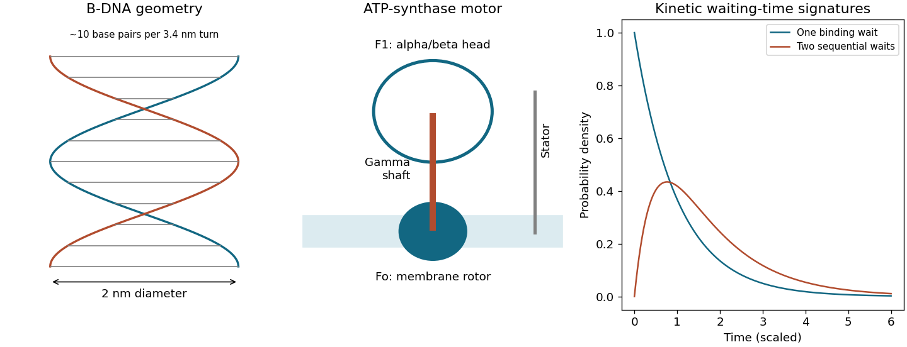

<h1 id="s12/3/1/solution">Solution</h1>

↑ **Parent:** [1](../1.md)

[ATP synthase](../../../../../atp-synthase.md) combines a [membrane](../../../../../cell-membrane-split.md) $F_o$ proton-conducting rotor with an $F_1$ catalytic head. The c-ring and central gamma shaft rotate relative to a stator and the alpha/beta head. [Proton](../../../../../proton.md) flow down its [electrochemical potential](../../../../../electrochemical-potential.md) can drive conformational changes in three beta catalytic sites to bind substrates, form and release [ATP](../../../../../adenosine-triphosphate.md). Reverse operation uses [ATP hydrolysis](../../../../../atp-hydrolysis.md) to turn the shaft and pump [protons](../../../../../proton.md). The immobilized $F_1$ assay isolates this latter rotation; it does not require the [membrane](../../../../../cell-membrane-split.md) [proton](../../../../../proton.md) motor to be present.

**[Figure 3](#s12/3/1/image-atp-synthase-organization-and-single-step-versus-two-step-waiting-time-distributions). ATP-synthase organization and single-step versus two-step waiting-time distributions**.

## ↑ Ancestors (12)

1. [1](../1.md)
2. [3](../../3.md)
3. [S12](../../../s12.md)
4. [2016](../../../../2016-split.md)
5. [Past exam of the short options paper shared by Prelims and Parts A and B of the physics course of the University of Oxford](../../../../split.md)
6. [Short options paper shared by Prelims and Parts A and B of the physics course of the University of Oxford](../../../../../short-options-paper-shared-by-prelims-and-parts-a-and-b-of-the-physics-course-of-the-university-of-oxford.md)
7. [Physics course of the University of Oxford](../../../../../physics-course-of-the-university-of-oxford.md)
8. [Undergraduate course of the University of Oxford](../../../../../undergraduate-course-of-the-university-of-oxford.md)
9. [Course of the University of Oxford](../../../../../course-of-the-university-of-oxford.md)
10. [University of Oxford](../../../../../university-of-oxford-split.md)
11. [List of universities](../../../../../list-of-universities.md)
12. [Codex Wiki](../../../../../split.md)
