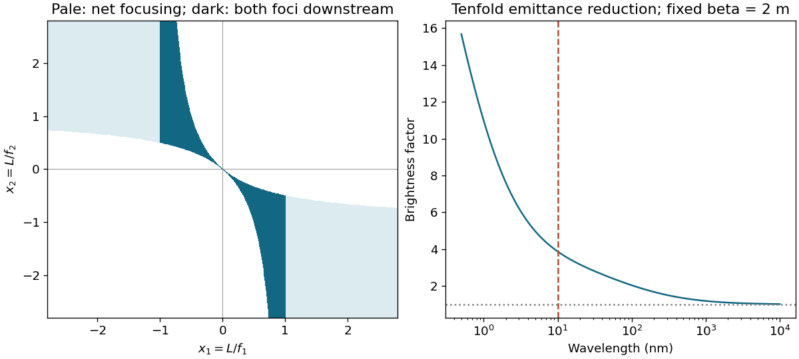

<h1 id="s19/1/a/solution">Solution</h1>

↑ **Parent:** [A](../a.md)

Let $x_i=L/f_i$, with positive $f$ focusing in the first transverse plane. The doublet matrix is $M=Q_2D(L)Q_1$, with $Q_i=\bigl(\begin{smallmatrix}1&0\\-1/f_i&1\end{smallmatrix}\bigr)$. Its lower-left entry is $C_x=-(x_1+x_2-x_1x_2)/L$. In the other plane both quadrupole signs reverse, giving $C_y=-(-x_1-x_2-x_1x_2)/L$. Thus positive effective focusing power in both planes requires

$$
\boxed{x_1x_2<-|x_1+x_2|.}
$$

For a parallel incident ray bundle, actual downstream focal distances are $\ell_x=L(1-x_1)/(x_1+x_2-x_1x_2)$ and $\ell_y=L(1+x_1)/(-x_1-x_2-x_1x_2)$. Requiring _both_ foci downstream adds $|x_1|<1$. Positive effective power alone need not imply a [real image](../../../../../real-image.md) after the final element. The original schematic below distinguishes these conditions.

**[Figure 4](#s19/1/a/image-doublet-focusing-region-and-wavelength-dependent-emittance-benefit-under-fixed-source-optics). Doublet focusing region and wavelength-dependent emittance benefit under fixed source optics**.

## ↑ Ancestors (12)

1. [A](../a.md)
2. [1](../../1.md)
3. [S19](../../../s19.md)
4. [2016](../../../../2016-split.md)
5. [Past exam of the short options paper shared by Prelims and Parts A and B of the physics course of the University of Oxford](../../../../split.md)
6. [Short options paper shared by Prelims and Parts A and B of the physics course of the University of Oxford](../../../../../short-options-paper-shared-by-prelims-and-parts-a-and-b-of-the-physics-course-of-the-university-of-oxford.md)
7. [Physics course of the University of Oxford](../../../../../physics-course-of-the-university-of-oxford.md)
8. [Undergraduate course of the University of Oxford](../../../../../undergraduate-course-of-the-university-of-oxford.md)
9. [Course of the University of Oxford](../../../../../course-of-the-university-of-oxford.md)
10. [University of Oxford](../../../../../university-of-oxford-split.md)
11. [List of universities](../../../../../list-of-universities.md)
12. [Codex Wiki](../../../../../split.md)
