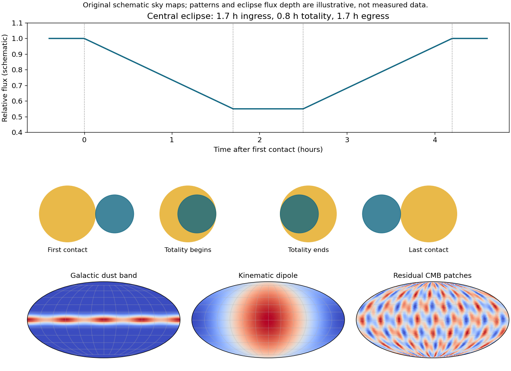

<h1 id="s2/1/3/solution">Solution</h1>

↑ **Parent:** [3](../3.md)

Assume a central eclipse and nearly uniform projected [speed](../../../../../speed.md) during it. Let $r$ be the smaller [radius](../../../../../radius.md) and $R$ the larger. First-to-second contact requires travel $2r$, whereas the totality interval requires $2(R-r)$. With relative [speed](../../../../../speed.md) 200 km s$^{-1}$,

$$
\boxed{r=\frac{v(1.7\ \mathrm h)}2\simeq6.12\times10^5\ \mathrm{km},\qquad R=r+\frac{v(0.8\ \mathrm h)}2\simeq9.00\times10^5\ \mathrm{km}.}
$$

The [light curve](../../../../../light-curve.md) has ingress, flat minimum and egress lasting 1.7, 0.8 and 1.7 hours. At the four contacts the projected center separations are $R+r,R-r,R-r,R+r$. A noncentral chord would require an [impact parameter](../../../../../impact-parameter.md) and changes the inferred radii; the data alone do not fix that geometry exactly. For comparable masses in an ordinary coeval system, a component larger than its [main sequence](../../../../../main-sequence.md) companion suggests expansion away from the [main sequence](../../../../../main-sequence.md), conventionally toward a subgiant/early giant track. That is a conditional evolutionary interpretation: neither [effective temperature](../../../../../effective-temperature.md) nor a bolometric flux is supplied, so a unique position on the [Hertzsprung-Russell diagram](../../../../../hertzsprung-russell-diagram.md) cannot be inferred from these radii alone. Binary interactions and the assumed central chord also matter; these numbers do not establish an ordinary single-star evolutionary model.

**[Figure 1](#s2/1/3/image-central-eclipse-contact-geometry-and-schematic-microwave-sky-components). Central-eclipse contact geometry and schematic microwave sky components**.

## ↑ Ancestors (12)

1. [3](../3.md)
2. [1](../../1.md)
3. [S2](../../../s2.md)
4. [2016](../../../../2016-split.md)
5. [Past exam of the short options paper shared by Prelims and Parts A and B of the physics course of the University of Oxford](../../../../split.md)
6. [Short options paper shared by Prelims and Parts A and B of the physics course of the University of Oxford](../../../../../short-options-paper-shared-by-prelims-and-parts-a-and-b-of-the-physics-course-of-the-university-of-oxford.md)
7. [Physics course of the University of Oxford](../../../../../physics-course-of-the-university-of-oxford.md)
8. [Undergraduate course of the University of Oxford](../../../../../undergraduate-course-of-the-university-of-oxford.md)
9. [Course of the University of Oxford](../../../../../course-of-the-university-of-oxford.md)
10. [University of Oxford](../../../../../university-of-oxford-split.md)
11. [List of universities](../../../../../list-of-universities.md)
12. [Codex Wiki](../../../../../split.md)
