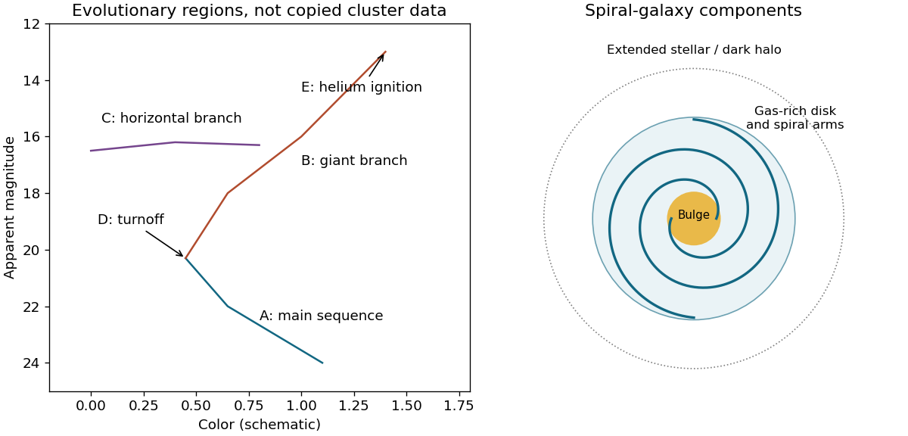

<h1 id="s26/3/1/solution">Solution</h1>

↑ **Parent:** [1](../1.md)

A [spiral galaxy](../../../../../spiral-galaxy.md) has a rotating stellar/gas disk with spiral structure, central bulge, extended halo and [globular clusters](../../../../../globular-cluster.md), embedded in a still larger dark-matter distribution. For the [Milky Way](../../../../../milky-way.md) useful rough scales are a stellar-disk diameter of a few tens of kiloparsecs, a thin-disk thickness of a few hundred parsecs, a bulge scale of kiloparsecs and a halo extending tens to hundreds of kiloparsecs depending on tracer. Young stars follow gas-rich star-forming disk regions and [spiral arms](../../../../../spiral-arm.md). Very old stars are prominent in [globular clusters](../../../../../globular-cluster.md), halo and bulge, though the disk also contains old populations. These are distributions with overlapping ages, not disjoint bins.

**[Figure 5](#s26/3/1/image-schematic-stellar-evolutionary-regions-and-spiral-galaxy-components-used-in-the-solutions). Schematic stellar evolutionary regions and spiral-galaxy components used in the solutions**.

## ↑ Ancestors (12)

1. [1](../1.md)
2. [3](../../3.md)
3. [S26](../../../s26.md)
4. [2016](../../../../2016-split.md)
5. [Past exam of the short options paper shared by Prelims and Parts A and B of the physics course of the University of Oxford](../../../../split.md)
6. [Short options paper shared by Prelims and Parts A and B of the physics course of the University of Oxford](../../../../../short-options-paper-shared-by-prelims-and-parts-a-and-b-of-the-physics-course-of-the-university-of-oxford.md)
7. [Physics course of the University of Oxford](../../../../../physics-course-of-the-university-of-oxford.md)
8. [Undergraduate course of the University of Oxford](../../../../../undergraduate-course-of-the-university-of-oxford.md)
9. [Course of the University of Oxford](../../../../../course-of-the-university-of-oxford.md)
10. [University of Oxford](../../../../../university-of-oxford-split.md)
11. [List of universities](../../../../../list-of-universities.md)
12. [Codex Wiki](../../../../../split.md)
