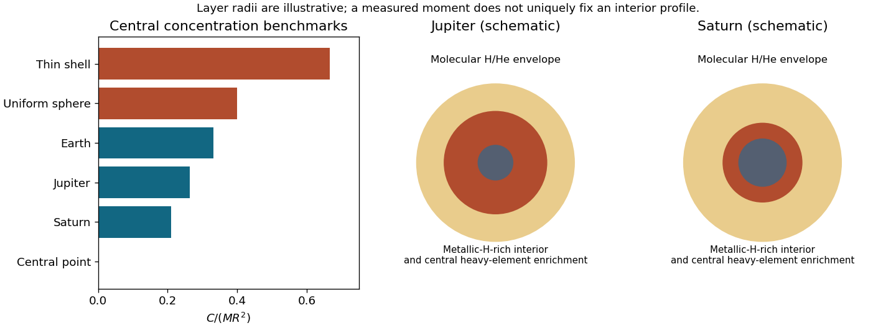

<h1 id="s29/3/4/solution">Solution</h1>

↑ **Parent:** [4](../4.md)

A qualitative sketch has [molecular hydrogen](../../../../../molecular-hydrogen.md)/[helium](../../../../../helium.md) outside, increasing [pressure](../../../../../pressure-split.md) into a conducting metallic-hydrogen-rich interior, and centrally enhanced heavy elements, possibly distributed rather than confined to a sharp solid core. Saturn's lower [mass](../../../../../mass.md) produces different [pressure](../../../../../pressure-split.md)/[temperature](../../../../../temperature-split.md) transitions and a larger relative role for central concentration. Both can have compositional [gradients](../../../../../gradient.md) and [helium](../../../../../helium.md) separation; the moment alone does not decide whether any boundary is sharp.

**[Figure 6](#s29/3/4/image-moment-of-inertia-benchmarks-and-qualitative-giant-planet-interior-structures). Moment-of-inertia benchmarks and qualitative giant-planet interior structures**.

## ↑ Ancestors (12)

1. [4](../4.md)
2. [3](../../3.md)
3. [S29](../../../s29.md)
4. [2016](../../../../2016-split.md)
5. [Past exam of the short options paper shared by Prelims and Parts A and B of the physics course of the University of Oxford](../../../../split.md)
6. [Short options paper shared by Prelims and Parts A and B of the physics course of the University of Oxford](../../../../../short-options-paper-shared-by-prelims-and-parts-a-and-b-of-the-physics-course-of-the-university-of-oxford.md)
7. [Physics course of the University of Oxford](../../../../../physics-course-of-the-university-of-oxford.md)
8. [Undergraduate course of the University of Oxford](../../../../../undergraduate-course-of-the-university-of-oxford.md)
9. [Course of the University of Oxford](../../../../../course-of-the-university-of-oxford.md)
10. [University of Oxford](../../../../../university-of-oxford-split.md)
11. [List of universities](../../../../../list-of-universities.md)
12. [Codex Wiki](../../../../../split.md)
