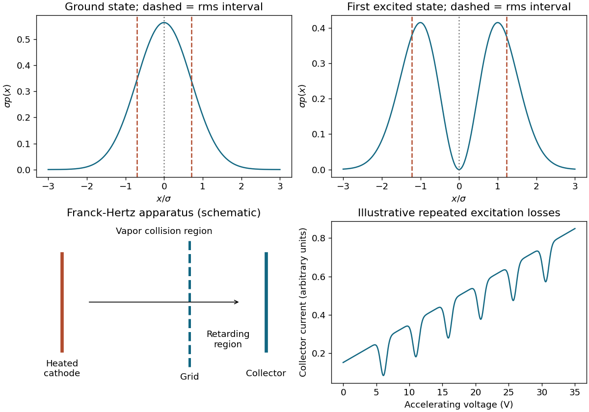

<h1 id="s3/2/c/solution">Solution</h1>

↑ **Parent:** [C](../c.md)

Squaring the states gives $\boxed{p_0=e^{-x^2/\sigma^2}/(\sqrt\pi\sigma),\quad p_1=2x^2e^{-x^2/\sigma^2}/(\sqrt\pi\sigma^3)}$. The first peaks at zero; the second has a node there and peaks at $x=\pm\sigma$. For a centered interval of width $\delta x\ll\sigma$, $P_0\simeq\delta x/(\sqrt\pi\sigma)$, whereas $P_1\simeq(\delta x)^3/(6\sqrt\pi\sigma^3)$. Its leading linear term vanishes, but the [probability](../../../../../probability.md) in a finite interval is not exactly zero.

**[Figure 2](#s3/2/c/image-ground-and-first-excited-oscillator-distributions-and-an-original-franck-hertz-apparatus-and-signal-schematic). Ground and first-excited oscillator distributions, and an original Franck-Hertz apparatus and signal schematic**.

## ↑ Ancestors (12)

1. [C](../c.md)
2. [2](../../2.md)
3. [S3](../../../s3.md)
4. [2016](../../../../2016-split.md)
5. [Past exam of the short options paper shared by Prelims and Parts A and B of the physics course of the University of Oxford](../../../../split.md)
6. [Short options paper shared by Prelims and Parts A and B of the physics course of the University of Oxford](../../../../../short-options-paper-shared-by-prelims-and-parts-a-and-b-of-the-physics-course-of-the-university-of-oxford.md)
7. [Physics course of the University of Oxford](../../../../../physics-course-of-the-university-of-oxford.md)
8. [Undergraduate course of the University of Oxford](../../../../../undergraduate-course-of-the-university-of-oxford.md)
9. [Course of the University of Oxford](../../../../../course-of-the-university-of-oxford.md)
10. [University of Oxford](../../../../../university-of-oxford-split.md)
11. [List of universities](../../../../../list-of-universities.md)
12. [Codex Wiki](../../../../../split.md)
