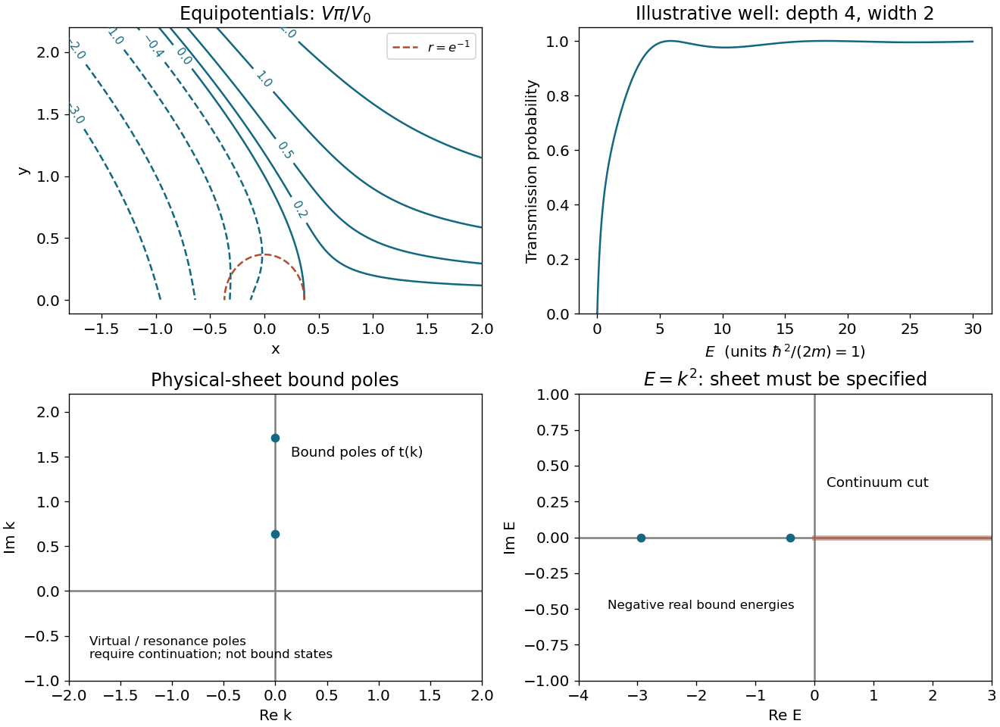
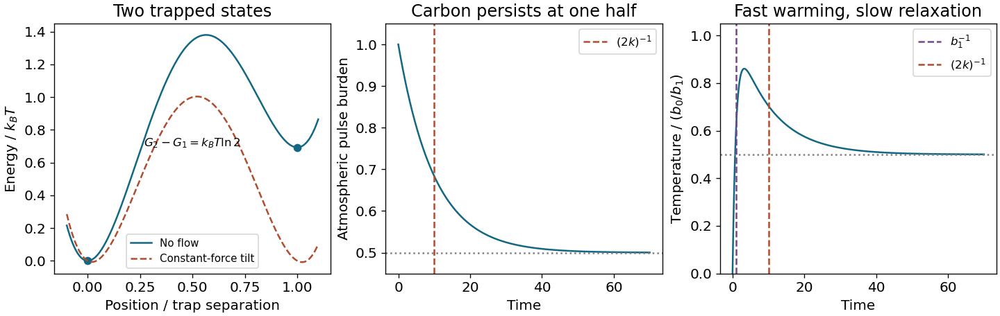
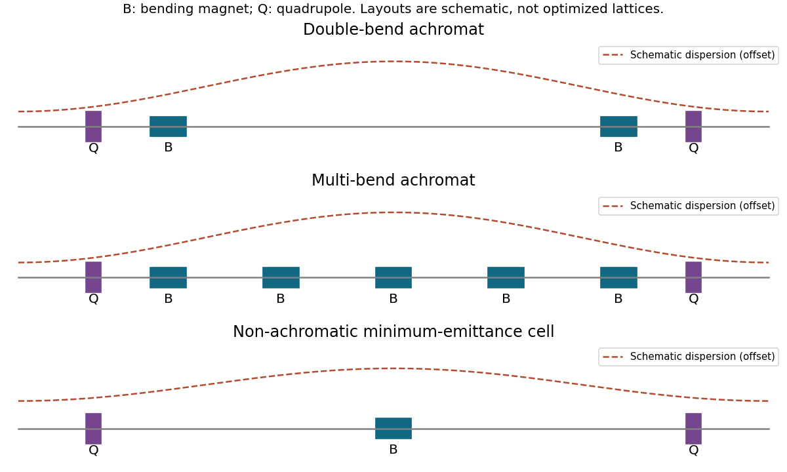
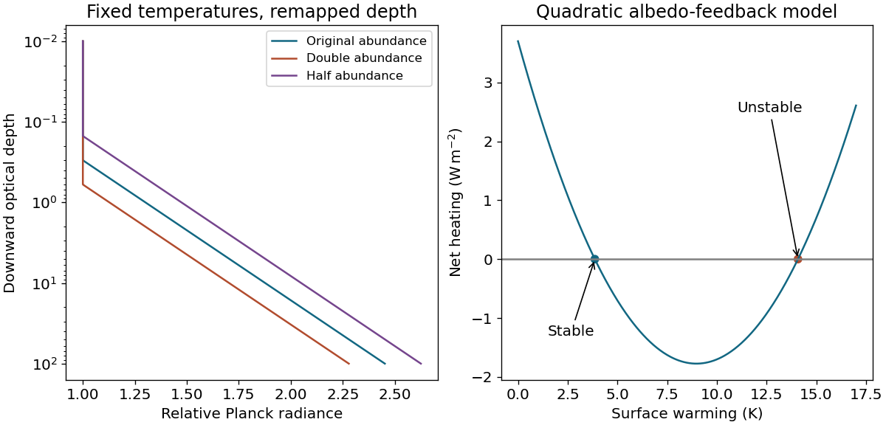

# 2017

↑ **Parent:** [Past exam of the short options paper shared by Prelims and Parts A and B of the physics course of the University of Oxford](../past-exam-of-the-short-options-paper-shared-by-prelims-and-parts-a-and-b-of-the-physics-course-of-the-university-of-oxford.md)

Source paper: [https://www.whatdotheyknow.com/request/oxford_physics_past_papers_2/response/2340696/attach/5/Physics%20Papers%202016.pdf?cookie_passthrough=1.](https://www.whatdotheyknow.com/request/oxford_physics_past_papers_2/response/2340696/attach/5/Physics%20Papers%202016.pdf?cookie_passthrough=1.) The cover dates the whole booklet to Trinity Term 2017, 13 June; the 2016 bundle filename does not control the year. Unlettered marked requests are numbered in their source order; explicitly lettered requests retain their letters. Section S18 has publicly advertised answer notes, which cover only that option rather than this twelve-option booklet.

**Table of contents**

- [S1](#s1)
  - [1](#s1/1)
    - [1](#s1/1/1)
      - [Solution](#s1/1/1/solution)
    - [2](#s1/1/2)
      - [Solution](#s1/1/2/solution)
    - [3](#s1/1/3)
      - [Solution](#s1/1/3/solution)
    - [4](#s1/1/4)
      - [Solution](#s1/1/4/solution)
  - [2](#s1/2)
    - [1](#s1/2/1)
      - [Solution](#s1/2/1/solution)
    - [2](#s1/2/2)
      - [Solution](#s1/2/2/solution)
    - [3](#s1/2/3)
      - [Solution](#s1/2/3/solution)
    - [4](#s1/2/4)
      - [Solution](#s1/2/4/solution)
  - [3](#s1/3)
    - [1](#s1/3/1)
      - [Solution](#s1/3/1/solution)
    - [2](#s1/3/2)
      - [Solution](#s1/3/2/solution)
    - [3](#s1/3/3)
      - [Solution](#s1/3/3/solution)
    - [4](#s1/3/4)
      - [Solution](#s1/3/4/solution)
- [S2](#s2)
  - [1](#s2/1)
    - [1](#s2/1/1)
      - [Solution](#s2/1/1/solution)
    - [2](#s2/1/2)
      - [Solution](#s2/1/2/solution)
    - [3](#s2/1/3)
      - [Solution](#s2/1/3/solution)
  - [2](#s2/2)
    - [1](#s2/2/1)
      - [Solution](#s2/2/1/solution)
    - [2](#s2/2/2)
      - [Solution](#s2/2/2/solution)
    - [3](#s2/2/3)
      - [Solution](#s2/2/3/solution)
  - [3](#s2/3)
    - [1](#s2/3/1)
      - [Solution](#s2/3/1/solution)
    - [2](#s2/3/2)
      - [Solution](#s2/3/2/solution)
    - [3](#s2/3/3)
      - [Solution](#s2/3/3/solution)
- [S3](#s3)
  - [1](#s3/1)
    - [1](#s3/1/1)
      - [Solution](#s3/1/1/solution)
    - [a](#s3/1/a)
      - [Solution](#s3/1/a/solution)
    - [b](#s3/1/b)
      - [Solution](#s3/1/b/solution)
    - [c](#s3/1/c)
      - [Solution](#s3/1/c/solution)
  - [2](#s3/2)
    - [1](#s3/2/1)
      - [Solution](#s3/2/1/solution)
    - [2](#s3/2/2)
      - [Solution](#s3/2/2/solution)
    - [3](#s3/2/3)
      - [Solution](#s3/2/3/solution)
  - [3](#s3/3)
    - [1](#s3/3/1)
      - [Solution](#s3/3/1/solution)
    - [2](#s3/3/2)
      - [Solution](#s3/3/2/solution)
    - [3](#s3/3/3)
      - [Solution](#s3/3/3/solution)
    - [4](#s3/3/4)
      - [Solution](#s3/3/4/solution)
- [S7](#s7)
  - [1](#s7/1)
    - [a](#s7/1/a)
      - [Solution](#s7/1/a/solution)
    - [b](#s7/1/b)
      - [Solution](#s7/1/b/solution)
    - [c](#s7/1/c)
      - [Solution](#s7/1/c/solution)
    - [d](#s7/1/d)
      - [Solution](#s7/1/d/solution)
    - [e](#s7/1/e)
      - [Solution](#s7/1/e/solution)
  - [2](#s7/2)
    - [a](#s7/2/a)
      - [Solution](#s7/2/a/solution)
    - [b](#s7/2/b)
      - [Solution](#s7/2/b/solution)
    - [c](#s7/2/c)
      - [Solution](#s7/2/c/solution)
    - [d](#s7/2/d)
      - [Solution](#s7/2/d/solution)
  - [3](#s7/3)
    - [a](#s7/3/a)
      - [Solution](#s7/3/a/solution)
    - [b](#s7/3/b)
      - [Solution](#s7/3/b/solution)
    - [c](#s7/3/c)
      - [Solution](#s7/3/c/solution)
    - [d](#s7/3/d)
      - [Solution](#s7/3/d/solution)
    - [e](#s7/3/e)
      - [Solution](#s7/3/e/solution)
- [S12](#s12)
  - [1](#s12/1)
    - [Solution](#s12/1/solution)
  - [2](#s12/2)
    - [1](#s12/2/1)
      - [Solution](#s12/2/1/solution)
    - [2](#s12/2/2)
      - [Solution](#s12/2/2/solution)
    - [3](#s12/2/3)
      - [Solution](#s12/2/3/solution)
    - [4](#s12/2/4)
      - [Solution](#s12/2/4/solution)
  - [3](#s12/3)
    - [1](#s12/3/1)
      - [Solution](#s12/3/1/solution)
    - [2](#s12/3/2)
      - [Solution](#s12/3/2/solution)
    - [3](#s12/3/3)
      - [Solution](#s12/3/3/solution)
- [S14](#s14)
  - [1](#s14/1)
    - [Solution](#s14/1/solution)
  - [2](#s14/2)
    - [Solution](#s14/2/solution)
  - [3](#s14/3)
    - [Solution](#s14/3/solution)
  - [4](#s14/4)
    - [Solution](#s14/4/solution)
  - [5](#s14/5)
    - [Solution](#s14/5/solution)
- [S16](#s16)
  - [1](#s16/1)
    - [1](#s16/1/1)
      - [Solution](#s16/1/1/solution)
    - [2](#s16/1/2)
      - [Solution](#s16/1/2/solution)
    - [3](#s16/1/3)
      - [Solution](#s16/1/3/solution)
    - [4](#s16/1/4)
      - [Solution](#s16/1/4/solution)
    - [5](#s16/1/5)
      - [Solution](#s16/1/5/solution)
  - [2](#s16/2)
    - [1](#s16/2/1)
      - [Solution](#s16/2/1/solution)
    - [2](#s16/2/2)
      - [Solution](#s16/2/2/solution)
    - [3](#s16/2/3)
      - [Solution](#s16/2/3/solution)
  - [3](#s16/3)
    - [1](#s16/3/1)
      - [Solution](#s16/3/1/solution)
    - [2](#s16/3/2)
      - [Solution](#s16/3/2/solution)
    - [3](#s16/3/3)
      - [Solution](#s16/3/3/solution)
    - [4](#s16/3/4)
      - [Solution](#s16/3/4/solution)
- [S18](#s18)
  - [1](#s18/1)
    - [1](#s18/1/1)
      - [Solution](#s18/1/1/solution)
    - [2](#s18/1/2)
      - [Solution](#s18/1/2/solution)
    - [3](#s18/1/3)
      - [Solution](#s18/1/3/solution)
    - [4](#s18/1/4)
      - [Solution](#s18/1/4/solution)
    - [5](#s18/1/5)
      - [Solution](#s18/1/5/solution)
    - [6](#s18/1/6)
      - [Solution](#s18/1/6/solution)
    - [7](#s18/1/7)
      - [Solution](#s18/1/7/solution)
  - [2](#s18/2)
    - [1](#s18/2/1)
      - [Solution](#s18/2/1/solution)
    - [2](#s18/2/2)
      - [Solution](#s18/2/2/solution)
    - [a](#s18/2/a)
      - [Solution](#s18/2/a/solution)
    - [b](#s18/2/b)
      - [Solution](#s18/2/b/solution)
    - [c](#s18/2/c)
      - [Solution](#s18/2/c/solution)
    - [d](#s18/2/d)
      - [Solution](#s18/2/d/solution)
    - [e](#s18/2/e)
      - [Solution](#s18/2/e/solution)
    - [f](#s18/2/f)
      - [Solution](#s18/2/f/solution)
  - [3](#s18/3)
    - [1](#s18/3/1)
      - [Solution](#s18/3/1/solution)
    - [2](#s18/3/2)
      - [Solution](#s18/3/2/solution)
    - [3](#s18/3/3)
      - [Solution](#s18/3/3/solution)
    - [4](#s18/3/4)
      - [Solution](#s18/3/4/solution)
    - [5](#s18/3/5)
      - [Solution](#s18/3/5/solution)
    - [6](#s18/3/6)
      - [Solution](#s18/3/6/solution)
- [S19](#s19)
  - [1](#s19/1)
    - [a](#s19/1/a)
      - [Solution](#s19/1/a/solution)
    - [b](#s19/1/b)
      - [Solution](#s19/1/b/solution)
    - [c](#s19/1/c)
      - [Solution](#s19/1/c/solution)
  - [2](#s19/2)
    - [a](#s19/2/a)
      - [Solution](#s19/2/a/solution)
    - [b](#s19/2/b)
      - [Solution](#s19/2/b/solution)
    - [c](#s19/2/c)
      - [Solution](#s19/2/c/solution)
  - [3](#s19/3)
    - [a](#s19/3/a)
      - [Solution](#s19/3/a/solution)
    - [b](#s19/3/b)
      - [Solution](#s19/3/b/solution)
    - [c](#s19/3/c)
      - [Solution](#s19/3/c/solution)
    - [d](#s19/3/d)
      - [Solution](#s19/3/d/solution)
    - [e](#s19/3/e)
      - [Solution](#s19/3/e/solution)
- [S25](#s25)
  - [1](#s25/1)
    - [1](#s25/1/1)
      - [Solution](#s25/1/1/solution)
      - [a](#s25/1/1/a)
        - [Solution](#s25/1/1/a/solution)
      - [b](#s25/1/1/b)
        - [Solution](#s25/1/1/b/solution)
    - [2](#s25/1/2)
      - [Solution](#s25/1/2/solution)
    - [3](#s25/1/3)
      - [Solution](#s25/1/3/solution)
    - [4](#s25/1/4)
      - [Solution](#s25/1/4/solution)
  - [2](#s25/2)
    - [1](#s25/2/1)
      - [Solution](#s25/2/1/solution)
    - [2](#s25/2/2)
      - [Solution](#s25/2/2/solution)
    - [3](#s25/2/3)
      - [Solution](#s25/2/3/solution)
    - [4](#s25/2/4)
      - [Solution](#s25/2/4/solution)
  - [3](#s25/3)
    - [1](#s25/3/1)
      - [Solution](#s25/3/1/solution)
    - [2](#s25/3/2)
      - [Solution](#s25/3/2/solution)
      - [a](#s25/3/2/a)
        - [Solution](#s25/3/2/a/solution)
      - [b](#s25/3/2/b)
        - [Solution](#s25/3/2/b/solution)
    - [3](#s25/3/3)
      - [Solution](#s25/3/3/solution)
    - [4](#s25/3/4)
      - [Solution](#s25/3/4/solution)
- [S27](#s27)
  - [1](#s27/1)
    - [Solution](#s27/1/solution)
  - [2](#s27/2)
    - [Solution](#s27/2/solution)
  - [3](#s27/3)
    - [a](#s27/3/a)
      - [Solution](#s27/3/a/solution)
    - [b](#s27/3/b)
      - [Solution](#s27/3/b/solution)
  - [4](#s27/4)
    - [Solution](#s27/4/solution)
- [S28](#s28)
  - [1](#s28/1)
    - [Solution](#s28/1/solution)
  - [2](#s28/2)
    - [Solution](#s28/2/solution)
  - [3](#s28/3)
    - [Solution](#s28/3/solution)
  - [4](#s28/4)
    - [Solution](#s28/4/solution)
  - [5](#s28/5)
    - [Solution](#s28/5/solution)

## S1

↑ **Parent:** [2017](2017.md)

<h3 id="s1/1">1</h3>

↑ **Parent:** [S1](#s1)

<h4 id="s1/1/1">1</h4>

↑ **Parent:** [1](#s1/1)

<h5 id="s1/1/1/solution">Solution</h5>

↑ **Parent:** [1](#s1/1/1)

[Complex differentiability](../holomorphic-function.md#complex-differentiability) gives $u_x=v_y$, $u_y=-v_x$. Differentiating once more, for [continuously differentiable](../multivariable-calculus.md#continuously-differentiable-function) first [derivatives](../calculus.md#derivative) with the needed [second derivatives](../calculus.md#second-derivative), yields $u_{xx}+u_{yy}=v_{yx}-v_{xy}=0$ and $v_{xx}+v_{yy}=-u_{yx}+u_{xy}=0$. Thus both components satisfy [Laplace's equation](../partial-differential-equation.md#laplace-equation). The result is local on the domain of [holomorphy](../holomorphic-function.md); it makes no assertion across a [branch cut](../analysis.md#branch-cut).

<h4 id="s1/1/2">2</h4>

↑ **Parent:** [1](#s1/1)

<h5 id="s1/1/2/solution">Solution</h5>

↑ **Parent:** [2](#s1/1/2)

Choose a continuous [argument](../complex-analysis.md#argument-complex-analysis) $\theta$ on a [simply connected domain](../complex-analysis.md#simply-connected-domain) avoiding zero, and put $r=\sqrt{x^2+y^2}$. With $u=x\log r-y\theta$, direct [differentiation](../calculus.md#differentiation) gives

$$
u_x=1+\log r,\quad u_y=-\theta,\quad u_{xx}=x/r^2,\quad u_{yy}=-x/r^2.
$$

Here $\theta_x=-y/r^2$, $\theta_y=x/r^2$; these identities specify the branch needed in the written [arctangent](../geometry-and-topology.md#inverse-tangent). Integrating the [Cauchy-Riemann equations](../analysis.md#cauchy-riemann-equations) gives

$$
\boxed{f(z)=z\operatorname{Log}z+iC,\qquad v=y\log r+x\theta+C,\quad C\in\mathbb R.}
$$

The literal principal $\arctan(y/x)$ works only separately on suitable half-planes. It cannot stand for a single continuous [argument](../complex-analysis.md#argument-complex-analysis) across the [imaginary axis](../complex-analysis.md#imaginary-axis).

<h4 id="s1/1/3">3</h4>

↑ **Parent:** [1](#s1/1)

<h5 id="s1/1/3/solution">Solution</h5>

↑ **Parent:** [3](#s1/1/3)

For the [upper half-plane](../complex-analysis.md#upper-half-plane-complex-analysis) use $0<\theta<\pi$, and interpret the source's [arctangent](../geometry-and-topology.md#inverse-tangent) as this [argument](../complex-analysis.md#argument-complex-analysis). Then $V=(V_0/\pi)\operatorname{Im}(z\operatorname{Log}z)$ is [harmonic](../partial-differential-equation.md#harmonic-function), so $\mathbf E=-\nabla V$ has zero curl and divergence where there is no [charge](../electric-charge.md). On the positive boundary $\theta\to0$ and $y\log r\to0$; on the negative boundary $\theta\to\pi$. Hence the two [boundary values](../differential-equation.md#boundary-value) are respectively zero and $V_0x$.

**Branch qualification:** the principal real [arctangent](../geometry-and-topology.md#inverse-tangent) alone gives zero on _both_ sides of $y=0$, contradicting the stated negative-axis [boundary condition](../differential-equation.md#boundary-condition), for example at $x=-1$. The continuous upper-half-plane [argument](../complex-analysis.md#argument-complex-analysis) repairs this notation; it is not an optional [additive constant](../integral.md#additive-constant).

<h4 id="s1/1/4">4</h4>

↑ **Parent:** [1](#s1/1)

<h5 id="s1/1/4/solution">Solution</h5>

↑ **Parent:** [4](#s1/1/4)

Along a [level curve](../topology.md#level-curve), $V_x dx+V_y dy=0$, with $V_x=V_0\theta/\pi$ and $V_y=V_0(1+\log r)/\pi$. Therefore

$$
\boxed{\frac{dy}{dx}=-\frac{\theta}{1+\log r}.}
$$

In the intended [upper half-plane](../complex-analysis.md#upper-half-plane-complex-analysis) $0<\theta<\pi$, the slope is positive for $0<r<e^{-1}$, vertical at $r=e^{-1}$, and negative for $r>e^{-1}$. At the positive real boundary $\theta=0$ the slope is zero except at the [stationary point](../calculus-of-variations.md#stationary-point) $(e^{-1},0)$, where both [derivatives](../calculus.md#derivative) vanish and the quotient is indeterminate. More generally, outside the chosen [half-plane](../geometry-and-topology.md#half-plane) its sign is the sign of $-\theta(1+\log r)$, with the [argument](../complex-analysis.md#argument-complex-analysis) branch held fixed. A convenient parametric description of the curves to sketch is $V\pi/V_0=r(\sin\theta\log r+\theta\cos\theta)$.

**[Figure 1](#s1/1/4/image-equipotentials-for-the-upper-half-plane-logarithm-branch-and-illustrative-square-well-transmission). Equipotentials for the upper-half-plane logarithm branch and illustrative square-well transmission**.

<h3 id="s1/2">2</h3>

↑ **Parent:** [S1](#s1)

<h4 id="s1/2/1">1</h4>

↑ **Parent:** [2](#s1/2)

<h5 id="s1/2/1/solution">Solution</h5>

↑ **Parent:** [1](#s1/2/1)

A [branch point](../complex-analysis.md#branch-point) obstructs a single-valued [analytic continuation](../holomorphic-function.md#analytic-continuation) around a closed circuit. Continuing $\log z=\log|z|+i\theta$ once around zero increases its value by $2\pi i$. A [branch cut](../analysis.md#branch-cut) removes a curve joining [branch points](../complex-analysis.md#branch-point) or extending to infinity so that a continuous [argument](../complex-analysis.md#argument-complex-analysis) can be chosen on the remainder. Zero and infinity are [logarithmic branch points](../complex-analysis.md#logarithmic-branch-point); the positive-axis cut used here selects $0<\arg z<2\pi$. The cut is a choice of representation, not a line of [poles](../isolated-singularity.md#pole) of the multivalued [logarithm](../calculus.md#logarithm).

<h4 id="s1/2/2">2</h4>

↑ **Parent:** [2](#s1/2)

<h5 id="s1/2/2/solution">Solution</h5>

↑ **Parent:** [2](#s1/2/2)

The large circle contributes $O((\log R)^n/R)$ and the small circle contributes $O(\epsilon|\log\epsilon|^n)$, so both disappear. The enclosed [simple poles](../isolated-singularity.md#simple-pole) are $i$ and $-i$, with [logarithms](../calculus.md#logarithm) $i\pi/2$ and $3i\pi/2$. Their [residues](../analysis.md#residue) are $(i\pi/2)^n/(2i)$ and $-(3i\pi/2)^n/(2i)$. The positive orientation of the keyhole therefore gives

$$
\boxed{\oint_\Gamma\frac{(\operatorname{Log}z)^n}{1+z^2}\,dz
=\pi^{n+1}(i/2)^n(1-3^n).}
$$

The upper bank runs outward and the lower bank inward. Their [logarithms](../calculus.md#logarithm) differ by $2\pi i$; keeping that orientation is essential for the sign.

<h4 id="s1/2/3">3</h4>

↑ **Parent:** [2](#s1/2)

<h5 id="s1/2/3/solution">Solution</h5>

↑ **Parent:** [3](#s1/2/3)

Taking the difference of the two bank [integrals](../integral.md) at $n=2$ gives

$$
\int_0^\infty\frac{(\log x)^2-(\log x+2\pi i)^2}{1+x^2}\,dx
=4\pi^2 I_0-4\pi i I_1=2\pi^3.
$$

The $I_j$ are real and convergent. Comparing real and [imaginary parts](../complex-analysis.md#imaginary-part) proves $\boxed{I_0=\pi/2,\ I_1=0}$. Independently, $x\mapsto1/x$ changes the sign of each odd logarithmic moment and preserves the measure, so every odd $I_j$ vanishes.

<h4 id="s1/2/4">4</h4>

↑ **Parent:** [2](#s1/2)

<h5 id="s1/2/4/solution">Solution</h5>

↑ **Parent:** [4](#s1/2/4)

At $n=3$ the bank difference is $-6\pi i I_2+12\pi^2 I_1+8\pi^3 i I_0$, while the [residue](../analysis.md#residue) result is $13i\pi^4/4$. Substitution of $I_0,I_1$ yields $I_2=\pi^3/8$.

At $n=5$, the odd moments vanish and the remaining relation is

$$
-10\pi i I_4+80\pi^3 i I_2-32\pi^5 i I_0=-\frac{121}{16}i\pi^6.
$$

Thus

$$
\boxed{I_2=\frac{\pi^3}{8},\qquad I_4=\frac{5\pi^5}{32}.}
$$

As an independent generating-function check, $F(s)=\int_0^\infty x^s/(1+x^2)\,dx=\pi/[2\cos(\pi s/2)]$ for $|\operatorname{Re}s|<1$. Differentiating twice and four times at zero gives the same moments.

<h3 id="s1/3">3</h3>

↑ **Parent:** [S1](#s1)

<h4 id="s1/3/1">1</h4>

↑ **Parent:** [3](#s1/3)

<h5 id="s1/3/1/solution">Solution</h5>

↑ **Parent:** [1](#s1/3/1)

For a [meromorphic function](../isolated-singularity.md#meromorphic-function) with no [poles](../isolated-singularity.md#pole) on a positively oriented closed [contour](../complex-analysis.md#complex-integration-contour), the [contour integral](../complex-analysis.md#contour-integral) equals $2\pi i$ times the sum of enclosed [residues](../analysis.md#residue), weighted by [winding number](../complex-analysis.md#winding-number) for a general [contour](../complex-analysis.md#complex-integration-contour). At a [simple pole](../isolated-singularity.md#simple-pole) $a$, the [residue](../analysis.md#residue) is $\lim_{z\to a}(z-a)f(z)$. [Analyticity](../sequence-and-series.md#analyticity) on the [contour](../complex-analysis.md#complex-integration-contour) and the absence of other interior singularities are necessary hypotheses.

<h4 id="s1/3/2">2</h4>

↑ **Parent:** [3](#s1/3)

<h5 id="s1/3/2/solution">Solution</h5>

↑ **Parent:** [2](#s1/3/2)

Put $z=e^{i\theta}$, so $d\theta=dz/(iz)$, $\cos\theta=(z+z^{-1})/2$ and $\sin\theta=(z-z^{-1})/(2i)$. Rational expressions in these [trigonometric functions](../geometry-and-topology.md#trigonometric-function) become rational [contour](../complex-analysis.md#complex-integration-contour) integrands on the [unit circle](../complex-analysis.md#complex-unit-circle). The method is especially useful when the resulting denominator has a small number of identifiable [poles](../isolated-singularity.md#pole). A [pole](../isolated-singularity.md#pole) on the [integration](../integral.md) circle requires a separately specified [principal value](../complex-analysis.md#cauchy-principal-value) or indentation; the [residue theorem](../analysis.md#residue-theorem) does not automatically assign an ordinary [integral](../integral.md) there.

<h4 id="s1/3/3">3</h4>

↑ **Parent:** [3](#s1/3)

<h5 id="s1/3/3/solution">Solution</h5>

↑ **Parent:** [3](#s1/3/3)

First remove the removable singularities introduced by tangent and secant: the integrand is $\cos\theta/(3+\cos\theta+2\sin\theta)$. The denominator stays positive since $3>\sqrt5$. With $z=e^{i\theta}$ the [contour](../complex-analysis.md#complex-integration-contour) integrand is

$$
\frac{z^2+1}{iz\{(1-2i)z^2+6z+(1+2i)\}}.
$$

Its interior [poles](../isolated-singularity.md#pole) are zero and $r=-1/(1-2i)$; the other quadratic root is $-5/(1-2i)$ and lies outside. The [residues](../analysis.md#residue) are $1/[i(1+2i)]$ and $(r^2+1)/(4ir)$, whose sum is $i/10$. Consequently

$$
\boxed{\int_0^{2\pi}\frac{d\theta}{1+2\tan\theta+3\sec\theta}=-\frac\pi5.}
$$

Assigning arbitrary finite values at the isolated removable points does not change the [integral](../integral.md).

<h4 id="s1/3/4">4</h4>

↑ **Parent:** [3](#s1/3)

<h5 id="s1/3/4/solution">Solution</h5>

↑ **Parent:** [4](#s1/3/4)

Split the sine into exponentials. The $e^{iz}$ term closes in the [upper half-plane](../complex-analysis.md#upper-half-plane-complex-analysis) and picks up the [pole](../isolated-singularity.md#pole) $ia$, giving $2\pi i e^{-a}$; the $e^{-iz}$ term closes clockwise below and encloses no [pole](../isolated-singularity.md#pole). [Jordan's lemma](../complex-analysis.md#jordan-s-lemma) applies to these separate [contours](../complex-analysis.md#complex-integration-contour). Hence

$$
\boxed{\int_{-\infty}^\infty\frac{\sin x}{x-ia}\,dx=\pi e^{-a},\quad a>0.}
$$

To pass to $a\downarrow0$ without an invalid dominated-convergence [argument](../complex-analysis.md#argument-complex-analysis) on an infinite interval, pair positive and negative $x$ first: the [imaginary part](../complex-analysis.md#imaginary-part) is odd and the [real part](../complex-analysis.md#real-part) is $2\int_0^\infty x\sin x/(x^2+a^2)dx$. On a bounded interval the limit is harmless, while [integration by parts](../calculus.md#integration-by-parts) bounds the oscillatory tail uniformly for $0<a\leq1$. This gives the convergent improper [Dirichlet integral](../fourier-analysis.md#dirichlet-integral) $\boxed{\int_{-\infty}^\infty\sin x/x\,dx=\pi}$.

## S2

↑ **Parent:** [2017](2017.md)

<h3 id="s2/1">1</h3>

↑ **Parent:** [S2](#s2)

<h4 id="s2/1/1">1</h4>

↑ **Parent:** [1](#s2/1)

<h5 id="s2/1/1/solution">Solution</h5>

↑ **Parent:** [1](#s2/1/1)

For two [isolated point](../topological-analysis.md#isolated-point) masses in a Newtonian [bound orbit](../dynamical-systems.md#bound-orbit), $\boxed{P^2=4\pi^2a^3/[G(M_s+M_p)]}$, where $a$ is the relative [orbit](../dynamical-systems.md#orbit-dynamical-system)'s [semimajor axis](../celestial-mechanics.md#semi-major-axis). For a negligible planet [mass](../classical-mechanics.md#mass), using years, [astronomical units](../planetary-science.md#astronomical-unit) and solar masses gives $(P/\mathrm{yr})^2=(a/\mathrm{AU})^3/(M_s/M_\odot)$. The [mass](../classical-mechanics.md#mass) in the denominator is the total gravitating [mass](../classical-mechanics.md#mass), not the planet's [mass](../classical-mechanics.md#mass) alone.

<h4 id="s2/1/2">2</h4>

↑ **Parent:** [1](#s2/1)

<h5 id="s2/1/2/solution">Solution</h5>

↑ **Parent:** [2](#s2/1/2)

Circular edge-on motion gives $V_s=2\pi a_s/P$ and center-of-mass balance gives $a_s=aM_p/(M_s+M_p)$. Eliminate $a$ using the preceding period relation:

$$
\frac{M_p^3}{(M_s+M_p)^2}=\frac{PV_s^3}{2\pi G}.
$$

Thus $\boxed{M_p^3\simeq PV_s^3M_s^2/(2\pi G)}$ when $M_p\ll M_s$. For a non-edge-on [orbit](../dynamical-systems.md#orbit-dynamical-system) the measured [velocity](../classical-mechanics.md#velocity) instead determines $M_p\sin i$ to this accuracy; neglecting eccentricity is also part of the stipulated model.

<h4 id="s2/1/3">3</h4>

↑ **Parent:** [1](#s2/1)

<h5 id="s2/1/3/solution">Solution</h5>

↑ **Parent:** [3](#s2/1/3)

A [luminosity](../astrophysics.md#luminosity) does not determine a stellar [mass](../classical-mechanics.md#mass) without a [mass-luminosity](../stellar-structure.md#mass-luminosity-relation) [calibration](../differential-geometry.md#calibration-differential-geometry). Using the usual approximate [main-sequence](../stellar-astrophysics.md#main-sequence) law $L/L_\odot=(M_s/M_\odot)^\alpha$ gives $M_s=3^{1/\alpha}M_\odot$. With $\alpha=3.5$, the numerical results are

$$
\boxed{M_s\simeq1.37M_\odot,\quad M_p\simeq0.39M_J,\quad a\simeq0.101\ \mathrm{AU},\quad \vartheta\simeq2.46\times10^{-4}\ \mathrm{arcsec}.}
$$

The angular [radius](../topology.md#radius) follows directly from $a(\mathrm{AU})/d(\mathrm{pc})$. Taking $\alpha=4$ changes these estimates by only a few percent, but the [calibration](../differential-geometry.md#calibration-differential-geometry) must be stated. Hubble's 2.4 m aperture has visible-light diffraction scale $1.22\lambda/D\simeq0.05$ arcsec at 500 nm, hundreds of times larger. The separation is therefore unresolved even before the severe star/planet contrast is considered.

<h3 id="s2/2">2</h3>

↑ **Parent:** [S2](#s2)

<h4 id="s2/2/1">1</h4>

↑ **Parent:** [2](#s2/2)

<h5 id="s2/2/1/solution">Solution</h5>

↑ **Parent:** [1](#s2/2/1)

The [effective temperature](../stellar-structure.md#effective-temperature) is defined by $\boxed{L=4\pi R_*^2\sigma T_{\mathrm{eff}}^4}$, with [bolometric luminosity](../astrophysics.md#luminosity) $L$, photospheric [radius](../topology.md#radius) $R_*$ and [Stefan-Boltzmann constant](../heat.md#stefan-boltzmann-constant) $\sigma$. It is the blackbody [temperature](../temperature.md) giving the same total [surface flux](../multivariable-calculus.md#flux-integral), not a claim that each [spectral line](../stellar-astrophysics.md#spectral-line) forms at that [temperature](../temperature.md).

<h4 id="s2/2/2">2</h4>

↑ **Parent:** [2](#s2/2)

<h5 id="s2/2/2/solution">Solution</h5>

↑ **Parent:** [2](#s2/2/2)

The parallax gives $d=20$ pc and the [distance modulus](../astrophysics.md#distance-modulus) gives $M_{\mathrm{bol}}=-0.641-5\log_{10}2=-2.146$. Therefore $L/L_\odot=10^{(4.72-M_{\mathrm{bol}})/2.5}\simeq558$. Taking $T_\odot\simeq5772$ K,

$$
\boxed{\frac{R_*}{R_\odot}=\sqrt{L/L_\odot}(T_\odot/3900)^2\simeq52.}
$$

This is a cool luminous giant, in the red-giant region of the [Hertzsprung-Russell diagram](../stellar-astrophysics.md#hertzsprung-russell-diagram). On the usual first-ascent interpretation, [luminosity](../astrophysics.md#luminosity) comes predominantly from [hydrogen](../chemical-substance.md#hydrogen) shell burning around an inert [helium](../chemical-substance.md#helium) core, with gravitational adjustment also contributing. The two measured quantities alone do not uniquely determine evolutionary history: a later giant phase can overlap this region, so they do not prove the precise core-burning state.

<h4 id="s2/2/3">3</h4>

↑ **Parent:** [2](#s2/2)

<h5 id="s2/2/3/solution">Solution</h5>

↑ **Parent:** [3](#s2/2/3)

A continuum peak gives a color [temperature](../temperature.md) through Wien's law, provided the continuum is approximately Planckian and extinction is corrected. Broad-band colors or a fitted [spectral energy distribution](../astrophysics.md#spectral-energy-distribution) compare flux ratios with model atmospheres; they require a reddening estimate, abundance and gravity assumptions, and calibrated passbands. Spectroscopic line ratios or excitation/ionization balances provide another [thermometer](../temperature.md#thermometer), requiring atomic data and a suitable atmosphere model, often [local thermodynamic equilibrium](../astrophysics.md#local-thermodynamic-equilibrium).

For this cool giant, line blanketing and molecular absorption substantially distort a simple continuum peak, so Wien's law is the least reliable of these approximations. A detailed spectroscopic analysis, checked against a multi-band atmosphere fit, would generally be the strongest of the three if good data and model parameters are available. There is no unconditional accuracy ranking without [measurement errors](../probability-and-statistics.md#measurement-error) and model systematics; an accurately measured [angular diameter](../geometry-and-topology.md#angular-diameter) plus bolometric flux would offer a more direct effective-temperature determination, if obtainable.

<h3 id="s2/3">3</h3>

↑ **Parent:** [S2](#s2)

<h4 id="s2/3/1">1</h4>

↑ **Parent:** [3](#s2/3)

<h5 id="s2/3/1/solution">Solution</h5>

↑ **Parent:** [1](#s2/3/1)

At a fixed cosmological time, homogeneous expansion has $\mathbf v=H(t)\mathbf r$. A comoving galaxy has $\mathbf r=R(t)\mathbf x$ with constant $\mathbf x$, hence $\mathbf v=\dot R\mathbf x=(\dot R/R)\mathbf r$. Thus $\boxed{H=\dot R/R}$. Peculiar velocities must be removed before applying this ideal relation to individual galaxies.

<h4 id="s2/3/2">2</h4>

↑ **Parent:** [3](#s2/3)

<h5 id="s2/3/2/solution">Solution</h5>

↑ **Parent:** [2](#s2/3/2)

Set the spatial-curvature constant to zero in the stipulated matter-only [Friedmann equation](../cosmology.md#friedmann-equations) to get $\rho_c=3H^2/(8\pi G)$. Conservation of [pressureless matter](../cosmology.md#pressureless-matter) with $R(t_0)=1$ gives $\rho=\rho_0/R^3$, and therefore

$$
\dot R^2=\frac{8\pi G\rho_0}{3R},\qquad R^{3/2}=\frac32\sqrt{\frac{8\pi G\rho_0}{3}}\,t.
$$

Choosing the [Big Bang](../cosmology.md#big-bang) as $t=0$ yields $R=(t/t_0)^{2/3}$ and $H=2/(3t)$. Consequently $\boxed{t_0=2/(3H_0)\simeq9.3\ \mathrm{Gyr}}$ for the supplied $H_0$. This is the age of the flat pressureless model without a [cosmological constant](../cosmology.md#cosmological-constant), not a determination in the current multi-component cosmological model.

<h4 id="s2/3/3">3</h4>

↑ **Parent:** [3](#s2/3)

<h5 id="s2/3/3/solution">Solution</h5>

↑ **Parent:** [3](#s2/3/3)

The matter rest-energy [density](../fluid-mechanics.md#density) is $\rho_m c^2\simeq2.25\times10^{-10}$ J m$^{-3}$, whereas the given [photon](../quantum-mechanics.md#photon) [density](../fluid-mechanics.md#density) is $8.01\times10^{-14}$ J m$^{-3}$. Their present ratio is about $2.8\times10^3$. Matter scales as $(1+z)^3$ and freely redshifting radiation as $(1+z)^4$, so

$$
\boxed{1+z_{\mathrm{eq}}=\frac{\rho_{m0}c^2}{u_{\gamma0}}\simeq2.8\times10^3.}
$$

This compares matter specifically with the supplied CMB [photons](../quantum-mechanics.md#photon). Adding relativistic neutrinos changes the total radiation equality redshift; it is not included in these data.

## S3

↑ **Parent:** [2017](2017.md)

<h3 id="s3/1">1</h3>

↑ **Parent:** [S3](#s3)

<h4 id="s3/1/1">1</h4>

↑ **Parent:** [1](#s3/1)

<h5 id="s3/1/1/solution">Solution</h5>

↑ **Parent:** [1](#s3/1/1)

The [Bohr model](../mathematical-physics.md#bohr-model) assumes Coulomb attraction and classical [circular motion](../classical-mechanics.md#circular-motion) between transitions; selected stationary [orbits](../dynamical-systems.md#orbit-dynamical-system) do not radiate; their [angular momentum](../momentum.md#angular-momentum) is $mvr=n\hbar$; and a transition exchanges a [photon](../quantum-mechanics.md#photon) of [energy](../energy.md) $h\nu=E_i-E_f$. The first two [dynamical equations](../dynamical-systems.md#dynamical-equation) give

$$
\frac{mv^2}r=\frac{e^2}{4\pi\epsilon_0r^2},\qquad mvr=n\hbar
\quad\Longrightarrow\quad
\boxed{r_n=\frac{4\pi\epsilon_0\hbar^2n^2}{me^2}.}
$$

Here $n=1,2,\ldots$, $m$ is the [electron mass](../physics.md#electron-mass) under the fixed-proton approximation, $e$ its [charge](../electric-charge.md) magnitude, and $\epsilon_0$ the [vacuum permittivity](../permittivity.md#vacuum-permittivity). The stationary-orbit postulate deliberately suspends the classical radiation prediction; this is a historical model, not a consistent deduction from classical electrodynamics.

<h4 id="s3/1/a">a</h4>

↑ **Parent:** [1](#s3/1)

<h5 id="s3/1/a/solution">Solution</h5>

↑ **Parent:** [A](#s3/1/a)

Substitute the quantized [radius](../topology.md#radius) in $mvr=n\hbar$ to get $v_n=e^2/(4\pi\epsilon_0\hbar n)$. [Coulomb potential energy](../electrostatics.md#coulomb-potential-energy) is $-e^2/(4\pi\epsilon_0r_n)$ and the stipulated virial relation makes the total one half of this value. Hence

$$
\boxed{v_n=\frac{\alpha c}{n},\qquad E_n=-\frac{me^4}{2(4\pi\epsilon_0)^2\hbar^2n^2}=-\frac{\mathrm{Ry}}{n^2}.}
$$

The negative sign means a [bound state](../quantum-system.md#bound-state) relative to a separated stationary [proton](../physics.md#proton) and [electron](../physics.md#electron).

<h4 id="s3/1/b">b</h4>

↑ **Parent:** [1](#s3/1)

<h5 id="s3/1/b/solution">Solution</h5>

↑ **Parent:** [B](#s3/1/b)

The emitted [photon](../quantum-mechanics.md#photon) has [energy](../energy.md) $E_3-E_2=\mathrm{Ry}(1/4-1/9)=5\mathrm{Ry}/36$. Therefore

$$
\boxed{\lambda=\frac{36hc}{5\mathrm{Ry}}\simeq656\ \mathrm{nm}.}
$$

This is the Balmer-alpha transition in this approximation. Absorption in the reverse direction has the same [photon energy](../quantum-mechanics.md#photon-energy); [fine structure](../atomic-physics.md#fine-structure) and [radiative corrections](../perturbative-quantum-field-theory.md#radiative-correction) are beyond the model.

<h4 id="s3/1/c">c</h4>

↑ **Parent:** [1](#s3/1)

<h5 id="s3/1/c/solution">Solution</h5>

↑ **Parent:** [C](#s3/1/c)

Separate [center-of-mass motion](../classical-mechanics.md#center-of-mass-motion) and replace $m$ by the [reduced mass](../classical-mechanics.md#reduced-mass) $\mu=mM/(m+M)$ in the relative-coordinate formulas. Then $r_n$ is the proton-electron separation, [energy levels](../quantum-mechanics.md#energy-level) and the Rydberg constant scale by $\mu/m$, and transition wavelengths increase by $m/\mu$. The [electron](../physics.md#electron)'s own [orbital radius](../dynamical-systems.md#orbital-radius) about the [center of mass](../classical-mechanics.md#center-of-mass) is $Mr_n/(M+m)$; the [proton](../physics.md#proton) [radius](../topology.md#radius) is $mr_n/(M+m)$. The relative [speed](../classical-mechanics.md#speed) retains $\alpha c/n$, while the [electron](../physics.md#electron)'s individual [speed](../classical-mechanics.md#speed) acquires $M/(M+m)$. Replacing the [mass](../classical-mechanics.md#mass) in the [radius](../topology.md#radius) alone but leaving energies unchanged would be inconsistent.

<h3 id="s3/2">2</h3>

↑ **Parent:** [S3](#s3)

<h4 id="s3/2/1">1</h4>

↑ **Parent:** [2](#s3/2)

<h5 id="s3/2/1/solution">Solution</h5>

↑ **Parent:** [1](#s3/2/1)

For a stationary nonrelativistic state, $\boxed{[-\hbar^2\nabla^2/(2m)+V(\mathbf r)]\psi=E\psi}$. The [wavefunction](../wave-function.md) $\psi$ is a [probability amplitude](../wave-function.md#probability-amplitude), $m$ the particle [mass](../classical-mechanics.md#mass) and $E$ its [energy eigenvalue](../energy-eigenvalue.md); the [potential energy](../energy.md#potential-energy) $V$ is measured in the same [energy](../energy.md) units. In one dimension the [Laplacian](../multivariable-calculus.md#laplacian) becomes $d^2/dx^2$.

<h4 id="s3/2/2">2</h4>

↑ **Parent:** [2](#s3/2)

<h5 id="s3/2/2/solution">Solution</h5>

↑ **Parent:** [2](#s3/2/2)

Inside the well, $\psi''+k^2\psi=0$. Vanishing at zero removes the cosine term; vanishing at $L$ requires $k_nL=n\pi$. The nonzero states have [positive integer](../integer.md#positive-integer) $n$ because $n=0$ gives the [zero function](../computability-theory.md#zero-function) and negative $n$ only repeats a state up to sign. [Normalization](../mathematics.md#normalization) follows from $\int_0^L\sin^2(n\pi x/L)dx=L/2$. Thus

$$
\boxed{\psi_n=\sqrt{2/L}\sin(n\pi x/L),\qquad E_n=\hbar^2\pi^2n^2/(2mL^2).}
$$

The [wavefunction](../wave-function.md) vanishes outside the infinite barriers, so there is no additional contribution to its [norm](../normed-vector-space.md#norm).

<h4 id="s3/2/3">3</h4>

↑ **Parent:** [2](#s3/2)

<h5 id="s3/2/3/solution">Solution</h5>

↑ **Parent:** [3](#s3/2/3)

A sudden wall displacement leaves the initial [wavefunction](../wave-function.md) unchanged: it is $\sqrt{2/L}\sin(\pi x/L)$ on $[0,L]$ and zero on $(L,2L]$. It is not an [eigenfunction](../linear-operator-theory.md#eigenfunction) of the new [Hamiltonian](../hamiltonian-mechanics.md#hamiltonian), so there is **no single certain new [energy](../energy.md)**. Its [energy expectation](../quantum-measurement.md#energy-expectation) immediately afterward remains $E_1^{\mathrm{old}}$, as seen from $\hbar^2\int|\psi'|^2/(2m)$; the measurement outcomes are $E_n^{\mathrm{new}}=n^2E_1^{\mathrm{old}}/4$.

The new [ground state](../quantum-mechanics.md#ground-state) is $L^{-1/2}\sin(\pi x/(2L))$. Its overlap is $4\sqrt2/(3\pi)$, so

$$
\boxed{P_{\mathrm{new\ ground}}=\frac{32}{9\pi^2}\simeq0.360.}
$$

The discontinuity of the [derivative](../calculus.md#derivative) at the former wall does not invalidate the finite quadratic-form expectation, although it matters when applying the differential [Hamiltonian](../hamiltonian-mechanics.md#hamiltonian) pointwise. [Adiabatic expansion](../first-law-of-thermodynamics.md#adiabatic-expansion) would instead keep the state in the ground level and reduce its [energy](../energy.md) by four.

<h3 id="s3/3">3</h3>

↑ **Parent:** [S3](#s3)

<h4 id="s3/3/1">1</h4>

↑ **Parent:** [3](#s3/3)

<h5 id="s3/3/1/solution">Solution</h5>

↑ **Parent:** [1](#s3/3/1)

For a fixed propagation direction and spatial mode, a [photon](../quantum-mechanics.md#photon) has two independent [transverse polarization](../wave-equation.md#transverse-polarization) [amplitudes](../wave.md#wave-amplitude). Orthogonal horizontal and vertical states span its two-dimensional [Hilbert space](../hilbert-space.md): $\alpha|H\rangle+\beta|V\rangle$, with $|\alpha|^2+|\beta|^2=1$. [Polarization](../wave.md#polarization-waves) analyzers measure bases in this space, and [phase plates](../optical-instrument.md#phase-plate) implement transformations of its relative [amplitudes](../wave.md#wave-amplitude). Additional spatial or [frequency](../wave.md#frequency) modes enlarge the space and must not be silently discarded.

<h4 id="s3/3/2">2</h4>

↑ **Parent:** [3](#s3/3)

<h5 id="s3/3/2/solution">Solution</h5>

↑ **Parent:** [2](#s3/3/2)

Choose the upper route for horizontal [polarization](../wave.md#polarization-waves), the lower route for vertical [polarization](../wave.md#polarization-waves), and absorb fixed optical phases into the path kets. The normalized output is

$$
\boxed{\frac{|H\rangle|\uparrow_1\rangle+|V\rangle|\downarrow_1\rangle}{\sqrt2}.}
$$

This is [entanglement](../bell-state.md#entangled-state) between two [degrees of freedom](../classical-mechanics.md#degree-of-freedom) of one [photon](../quantum-mechanics.md#photon). Interchanging the path convention interchanges the labels but not any probabilities.

<h4 id="s3/3/3">3</h4>

↑ **Parent:** [3](#s3/3)

<h5 id="s3/3/3/solution">Solution</h5>

↑ **Parent:** [3](#s3/3/3)

Orthogonal path projectors give an upper-path [probability](../probability-theory.md#probability) $1/2$. A successful non-destructive lower-path detection projects onto $|V\rangle|\downarrow_1\rangle$ and its conditional [polarization](../wave.md#polarization-waves) is therefore pure vertical. Retaining the detection record removes the upper [amplitude](../wave.md#wave-amplitude) for that run; it would be incorrect to continue evolving the original coherent two-path state as though the detection had not occurred.

<h4 id="s3/3/4">4</h4>

↑ **Parent:** [3](#s3/3)

<h5 id="s3/3/4/solution">Solution</h5>

↑ **Parent:** [4](#s3/3/4)

A [quarter-wave plate](../maxwell-equations.md#waveplate) needs a specified axis angle. If its fast axis makes angle $\eta$ to horizontal, choose its [Jones matrix](../wave.md#jones-matrix) $Q=R(\eta)\operatorname{diag}(1,i)R(-\eta)$. Then

$$
Q|V\rangle=a|H\rangle+b|V\rangle,\quad a=(1-i)\sin\eta\cos\eta,\quad b=\sin^2\eta+i\cos^2\eta.
$$

After the preceding successful lower-path detection the total state is $(aH+bV)|\downarrow_1\rangle$. The next crystal sends it to

$$
\boxed{a|H,\uparrow_2\rangle+b|V,\downarrow_2\rangle,\quad P(\downarrow_2\mid\downarrow_1)=|b|^2.}
$$

For axes at $45^\circ$, the state before splitting is circular up to phase, $a=(1-i)/2$, $b=(1+i)/2$, and the [probability](../probability-theory.md#probability) is $1/2$. Detection in $\downarrow_2$ always leaves vertical [polarization](../wave.md#polarization-waves). If no earlier lower-path measurement was actually performed, retain the untouched upper [amplitude](../wave.md#wave-amplitude): the final state is $(|H,\uparrow_1\rangle+a|H,\uparrow_2\rangle+b|V,\downarrow_2\rangle)/\sqrt2$, and the last [probability](../probability-theory.md#probability) is $|b|^2/2$, or $1/4$ at $45^\circ$. At axis angle zero the [conditional probability](../probability-theory.md#conditional-probability) is instead one, a concrete demonstration that an unspecified orientation does not determine a unique number.

## S7

↑ **Parent:** [2017](2017.md)

<h3 id="s7/1">1</h3>

↑ **Parent:** [S7](#s7)

<h4 id="s7/1/a">a</h4>

↑ **Parent:** [1](#s7/1)

<h5 id="s7/1/a/solution">Solution</h5>

↑ **Parent:** [A](#s7/1/a)

In [cylindrical coordinates](../multivariable-calculus.md#cylindrical-coordinate-system) the orthogonal [velocity](../classical-mechanics.md#velocity) components are $\dot r$, $r\dot\theta$, $\dot z$. Their squared magnitudes add, and $\dot{\mathbf r}\cdot\mathbf A=\dot z A(r)$. Thus $\boxed{\mathcal L=m(\dot r^2+r^2\dot\theta^2+\dot z^2)/2+q\dot z A(r)}$. Taking the curl gives $B_\theta=-A'(r)$, consistent with the prescribed field.

<h4 id="s7/1/b">b</h4>

↑ **Parent:** [1](#s7/1)

<h5 id="s7/1/b/solution">Solution</h5>

↑ **Parent:** [B](#s7/1/b)

[Velocity](../classical-mechanics.md#velocity) [differentiation](../calculus.md#differentiation) gives $\boxed{p_r=m\dot r,\ p_\theta=mr^2\dot\theta,\ p_z=m\dot z+qA(r)}$. The coordinates $\theta$ and $z$ are cyclic, so $p_\theta,p_z$ are conserved. The radial [momentum](../momentum.md) generally changes. In particular the conserved axial [canonical momentum](../hamiltonian-mechanics.md#canonical-momentum) differs from the axial [mechanical momentum](../momentum.md#mechanical-momentum) by $qA$.

<h4 id="s7/1/c">c</h4>

↑ **Parent:** [1](#s7/1)

<h5 id="s7/1/c/solution">Solution</h5>

↑ **Parent:** [C](#s7/1/c)

The [Legendre transform](../convex-optimization.md#convex-conjugate) cancels the velocity-linear magnetic term. Expressing velocities in terms of [momenta](../momentum.md) gives

$$
\boxed{H=\frac{p_r^2}{2m}+\frac{p_\theta^2}{2mr^2}+\frac{[p_z-qA(r)]^2}{2m}.}
$$

The [Hamiltonian](../hamiltonian-mechanics.md#hamiltonian) is time independent and hence conserved. It equals [kinetic energy](../energy.md#kinetic-energy) because a static [magnetic field](../magnetic-field.md) does no [work](../energy.md#work); its dependence on $A$ is through the [mechanical momentum](../momentum.md#mechanical-momentum) combination.

<h4 id="s7/1/d">d</h4>

↑ **Parent:** [1](#s7/1)

<h5 id="s7/1/d/solution">Solution</h5>

↑ **Parent:** [D](#s7/1/d)

The [initial condition](../differential-equation.md#initial-condition) makes $p_\theta=0$ at all times. Accessible radii obey $|p_z-qA(r)|\leq\sqrt{2mH}$. For $q>0$ and $p_z>\sqrt{2mH}$, monotonicity of $A$ gives exactly the two stated turning equations and confinement to the interval between their unique roots.

The squared condition alone omits a sign qualification. More generally both [positive roots](../semisimple-lie-algebra.md#positive-root) require $p_z/q>0$, and are the sorted roots $A(r)=(p_z\pm\sqrt{2mH})/q$. For example $q=-1$, $A=r$, $p_z=-3$, $2mH=1$ confines the [orbit](../dynamical-systems.md#orbit-dynamical-system) to $2\leq r\leq4$, but the source's named $r_1,r_2$ equations reverse those labels. This is a convention issue, not a failure of confinement.

<h4 id="s7/1/e">e</h4>

↑ **Parent:** [1](#s7/1)

<h5 id="s7/1/e/solution">Solution</h5>

↑ **Parent:** [E](#s7/1/e)

Expand $A(r)=A(r_0)+A'(r_0)s+O(s^2)$ about $qA(r_0)=p_z$. Then $p_z-qA\simeq-qA'(r_0)s$ and [conservation of energy](../mathematical-physics.md#conservation-of-energy) gives

$$
\boxed{\dot s^2+\Omega^2s^2=\frac{2H}{m}=\Omega^2\rho^2,\quad \rho=\frac{\sqrt{2H/m}}{|\Omega|},\quad s(t)=\rho\cos(|\Omega|t+\phi).}
$$

Here $\Omega=qA'(r_0)/m$ can be signed, but the physical [oscillation](../wave.md#oscillation) [frequency](../wave.md#frequency) and [amplitude](../wave.md#wave-amplitude) are nonnegative. The small-energy condition ensures that this local expansion samples only a narrow range about $r_0$, provided the field varies smoothly there.

<h3 id="s7/2">2</h3>

↑ **Parent:** [S7](#s7)

<h4 id="s7/2/a">a</h4>

↑ **Parent:** [2](#s7/2)

<h5 id="s7/2/a/solution">Solution</h5>

↑ **Parent:** [A](#s7/2/a)

Use rotating [basis vectors](../vector-space.md#basis-vector) with $\dot{\mathbf e}_1=\Omega\mathbf e_2$, $\dot{\mathbf e}_2=-\Omega\mathbf e_1$. The inertial [velocity](../classical-mechanics.md#velocity) is $(\dot x_1-\Omega x_2)\mathbf e_1+(\dot x_2+\Omega x_1)\mathbf e_2$. The two fixed rotating anchors are $(0,\pm a)$, so the spring lengths are $\ell_\pm=\sqrt{x_1^2+(x_2\mp a)^2}$. Combining kinetic and elastic energies gives

$$
\boxed{\mathcal L=\frac m2[(\dot x_1-\Omega x_2)^2+(\dot x_2+\Omega x_1)^2]-\frac k2[(\ell_+-l_0)^2+(\ell_--l_0)^2].}
$$

A constant elastic offset has no dynamical effect.

<h4 id="s7/2/b">b</h4>

↑ **Parent:** [2](#s7/2)

<h5 id="s7/2/b/solution">Solution</h5>

↑ **Parent:** [B](#s7/2/b)

Differentiate the [quadratic Lagrangian](../quantum-field-theory.md#quadratic-lagrangian) with respect to coordinates and velocities. The equations are

$$
\boxed{\ddot x_1-2\Omega\dot x_2+(2k'/m-\Omega^2)x_1=0,\qquad
\ddot x_2+2\Omega\dot x_1+(2k/m-\Omega^2)x_2=0.}
$$

The velocity-cross terms are [Coriolis accelerations](../mathematical-physics.md#coriolis-acceleration); moving $-\Omega^2x_i$ to the [force](../force.md) side identifies the outward [centrifugal acceleration](../mathematical-physics.md#centrifugal-acceleration). The remaining terms are elastic [restoring forces](../force.md#restoring-force). The sign pair is fixed by the rotating-basis convention in part a.

<h4 id="s7/2/c">c</h4>

↑ **Parent:** [2](#s7/2)

<h5 id="s7/2/c/solution">Solution</h5>

↑ **Parent:** [C](#s7/2/c)

Substitution of the exponential ansatz gives the homogeneous [amplitude](../wave.md#wave-amplitude) system

$$
\begin{pmatrix}\omega_1^2-\omega^2&2i\Omega\omega\\-2i\Omega\omega&\omega_2^2-\omega^2\end{pmatrix}\begin{pmatrix}\bar x_1\\\bar x_2\end{pmatrix}=0.
$$

A nonzero mode requires zero [determinant](../multilinear-algebra.md#determinant). Thus $\boxed{(\omega_1^2-\omega^2)(\omega_2^2-\omega^2)=4\Omega^2\omega^2}$ with the stated two effective stiffnesses. The off-diagonal product is positive, which determines the sign on the right.

<h4 id="s7/2/d">d</h4>

↑ **Parent:** [2](#s7/2)

<h5 id="s7/2/d/solution">Solution</h5>

↑ **Parent:** [D](#s7/2/d)

Put $X=\omega^2$ and $S=\omega_1^2+\omega_2^2+4\Omega^2$. Its equation is $X^2-SX+\omega_1^2\omega_2^2=0$. If both effective stiffnesses are positive, the sum and product of roots are positive and $S^2-4\omega_1^2\omega_2^2\geq0$, so both roots are positive. They can coincide in a degenerate zero-rotation isotropic case; “two” need not mean distinct.

If $\omega_1^2<0<\omega_2^2$, the product is negative, so one root is negative. Its imaginary [frequency](../wave.md#frequency) gives a growing exponential displacement: [centrifugal](../mathematical-physics.md#centrifugal-force) softening has overwhelmed one elastic restoring direction, making the central configuration unstable. [Coriolis](../mathematical-physics.md#coriolis-force) coupling mixes the two coordinates but does not remove this negative-product instability.

<h3 id="s7/3">3</h3>

↑ **Parent:** [S7](#s7)

<h4 id="s7/3/a">a</h4>

↑ **Parent:** [3](#s7/3)

<h5 id="s7/3/a/solution">Solution</h5>

↑ **Parent:** [A](#s7/3/a)

[Hamilton's equations](../hamiltonian-mechanics.md#hamilton-s-equations) define phase-space [velocity](../classical-mechanics.md#velocity) $(\dot q_i,\dot p_i)=(H_{p_i},-H_{q_i})$. Its divergence is

$$
\sum_i(\partial_{q_i}\dot q_i+\partial_{p_i}\dot p_i)=\sum_i(H_{q_ip_i}-H_{p_iq_i})=0.
$$

Thus infinitesimal [phase-space volumes](../symplectic-geometry.md#symplectic-volume-form) are preserved, assuming sufficient differentiability. This is [Liouville's theorem](../complex-analysis.md#liouville-theorem); spatial [density](../fluid-mechanics.md#density) alone need not be incompressible because the statement concerns the combined coordinate-momentum space.

<h4 id="s7/3/b">b</h4>

↑ **Parent:** [3](#s7/3)

<h5 id="s7/3/b/solution">Solution</h5>

↑ **Parent:** [B](#s7/3/b)

To match the source's order define $[a,b]=\sum_i(a_{p_i}b_{q_i}-a_{q_i}b_{p_i})$. The [chain rule](../calculus.md#chain-rule) and [Hamilton's equations](../hamiltonian-mechanics.md#hamilton-s-equations) then give

$$
\boxed{\frac{dg}{dt}=g_t+[H,g].}
$$

Antisymmetry implies $[H,H]=0$, hence $dH/dt=H_t$, which vanishes for a time-independent [Hamiltonian](../hamiltonian-mechanics.md#hamiltonian). With the alternative common convention $\{a,b\}=\sum_i(a_{q_i}b_{p_i}-a_{p_i}b_{q_i})$, the same law is $dg/dt=g_t+\{g,H\}$; mixing the two orders would reverse the physical [time evolution](../physics.md#time-evolution).

<h4 id="s7/3/c">c</h4>

↑ **Parent:** [3](#s7/3)

<h5 id="s7/3/c/solution">Solution</h5>

↑ **Parent:** [C](#s7/3/c)

Conservation of [probability](../probability-theory.md#probability) obeys $\partial_t f+\nabla_{q,p}\cdot(f\mathbf v)=0$. Expand the divergence and use incompressibility to obtain $\partial_t f+\mathbf v\cdot\nabla_{q,p}f=0$, or $\boxed{df/dt=0}$. This is fine-grained transport for [Hamiltonian](../hamiltonian-mechanics.md#hamiltonian) trajectories without sources or collisions. Coarse graining can obscure this constancy without contradicting it.

<h4 id="s7/3/d">d</h4>

↑ **Parent:** [3](#s7/3)

<h5 id="s7/3/d/solution">Solution</h5>

↑ **Parent:** [D](#s7/3/d)

For $f=F(H)$ with no explicit time dependence, $\partial_t f=0$ and $[H,F(H)]=F'(H)[H,H]=0$. It therefore solves the stationary [transport equation](../transport-equation.md). Normalizability and the accessible [energy](../energy.md) region still have to be checked for a proposed [probability distribution](../probability-distribution.md).

<h4 id="s7/3/e">e</h4>

↑ **Parent:** [3](#s7/3)

<h5 id="s7/3/e/solution">Solution</h5>

↑ **Parent:** [E](#s7/3/e)

Axisymmetry supplies conserved $p_\theta$ in addition to conserved [energy](../energy.md). Consequently $\boxed{f=F(H,p_\theta)}$ is a more general [stationary solution](../differential-equation.md#stationary-solution), since both [arguments](../complex-analysis.md#argument-complex-analysis) are constant on every trajectory. Additional independent [integrals](../integral.md) may permit still more general distributions. This is a sufficient construction, not a claim that every [stationary distribution](../markov-chain.md#stationary-distribution) must have exactly these two [arguments](../complex-analysis.md#argument-complex-analysis).

## S12

↑ **Parent:** [2017](2017.md)

<h3 id="s12/1">1</h3>

↑ **Parent:** [S12](#s12)

<h4 id="s12/1/solution">Solution</h4>

↑ **Parent:** [1](#s12/1)

[DNA](../polymer.md#deoxyribonucleic-acid) is a directional polymer with a sugar-phosphate backbone linked by [phosphodiester bonds](../covalent-bond.md#phosphodiester-bond). Its [deoxyribose](../chemical-substance.md#deoxyribose) sugars carry [adenine](../molecule.md#adenine), [thymine](../molecule.md#thymine), [guanine](../molecule.md#guanine) or [cytosine](../molecule.md#cytosine). In the usual cellular duplex, antiparallel strands form a double helix with complementary A–T and G–C pairing, stabilized by [base stacking](../polymer.md#base-stacking) as well as [hydrogen bonding](../chemical-bond.md#hydrogen-bonding). The sequence can vary without changing the basic backbone, allowing a large information capacity. Complementarity provides a template for copying and repair; the two strands are not merely two redundant lists stored without a copying mechanism. Major and [minor grooves](../polymer.md#minor-groove) permit [proteins](../protein.md) to recognize sequence-dependent chemical patterns. Eukaryotic [chromosomes](../genetics.md#chromosome) package [DNA](../polymer.md#deoxyribonucleic-acid) around [histones](../protein.md#histone), while bacterial [chromosomes](../genetics.md#chromosome) are usually supercoiled and associated with other [proteins](../protein.md); not all cellular [DNA](../polymer.md#deoxyribonucleic-acid) is nuclear or linear.

[RNA](../polymer.md#ribonucleic-acid) uses [ribose](../chemical-substance.md#ribose) with a reactive 2-prime hydroxyl and usually [uracil](../molecule.md#uracil) in place of [thymine](../molecule.md#thymine). It is often a single chain, but intramolecular complementary segments form stems, loops and elaborate three-dimensional folds. [Messenger RNA](../polymer.md#messenger-rna) conveys coding information to [ribosomes](../biological-cell.md#ribosome); [transfer RNA](../polymer.md#transfer-rna) combines an [anticodon](../polymer.md#anticodon) with an amino-acid attachment site; [ribosomal RNA](../polymer.md#ribosomal-rna) has structural and catalytic roles in [translation](../geometry-and-topology.md#translation-geometry). Regulatory and catalytic [RNAs](../polymer.md#ribonucleic-acid) show why it is inadequate to describe [RNA](../polymer.md#ribonucleic-acid) solely as a transient [DNA](../polymer.md#deoxyribonucleic-acid) copy. [RNA](../polymer.md#ribonucleic-acid)'s local pairing and folding let sequence encode both information and molecular machinery. [DNA](../polymer.md#deoxyribonucleic-acid)'s chemical stability and duplex repair make it especially suitable for long-term inheritance.

[Replication](../design-of-experiments.md#replication-in-experimental-design) is highly faithful but imperfect. Heritable sequence changes, [recombination](../cosmology.md#recombination-cosmology) and [gene duplication](../molecular-genetics.md#gene-duplication) create variation, and selection, [Genetic drift](../population-genetics.md#genetic-drift) and population history determine its spread. Thus the same chemistry explains both continuity of lineages and their divergence; [mutation](../genetics.md#mutation) is not directed toward what an organism needs. Conserved genes, homologous sequences and the widely shared [genetic code](../molecular-genetics.md#genetic-code) support common ancestry. [RNA](../polymer.md#ribonucleic-acid) catalysis makes an early RNA-based stage of [evolution](../evolution.md) a plausible hypothesis, not a direct historical observation or a deduction that all modern [RNA](../polymer.md#ribonucleic-acid) preceded [DNA](../polymer.md#deoxyribonucleic-acid) in a demonstrated sequence. Structure constrains function and evolutionary possibilities without uniquely determining a species' history.[Chapter 4, The Structure and Function of DNA; Chapter 6, RNA structure and translation](../cell-biology-bibliography.md#molecular-biology-of-the-cell-4th-edition-by-bruce-alberts-and-others)

<h3 id="s12/2">2</h3>

↑ **Parent:** [S12](#s12)

<h4 id="s12/2/1">1</h4>

↑ **Parent:** [2](#s12/2)

<h5 id="s12/2/1/solution">Solution</h5>

↑ **Parent:** [1](#s12/2/1)

Let $U(x)$ be the static potential and $\gamma$ the [drag coefficient](../fluid-mechanics.md#drag-coefficient), so terminal [Genetic drift](../population-genetics.md#genetic-drift) under [force](../force.md) $-U'$ is $v=-U'/\gamma$. The [probability current](../wave-function.md#probability-flux) is $J=-DU'p/(k_BT)$ only after imposing the desired relation; instead start independently from $J=-Dp'-U'p/\gamma$. At [thermal equilibrium](../thermal-equilibrium.md) $p\propto e^{-U/(k_BT)}$ and [detailed balance](../markov-chain.md#detailed-balance) requires $J=0$. Substitution yields

$$
\boxed{D=\frac{k_BT}{\gamma}=\frac{k_BT}{6\pi\eta a}.}
$$

At 298 K with $a=0.5\ \mu$m, this gives approximately $4.37\times10^{-13}$ m$^2$ s$^{-1}$. The [argument](../complex-analysis.md#argument-complex-analysis) assumes an overdamped particle in an [equilibrium](../dynamical-systems.md#equilibrium-point-of-a-dynamical-system) thermal bath, rather than arbitrary driven [diffusion](../thermodynamics.md#diffusion).

<h4 id="s12/2/2">2</h4>

↑ **Parent:** [2](#s12/2)

<h5 id="s12/2/2/solution">Solution</h5>

↑ **Parent:** [2](#s12/2/2)

Write the displacement after $m$ independent isotropic zero-mean steps as $\mathbf R=\sum_j\mathbf s_j$. Cross terms vanish, giving $\boxed{\langle R^2\rangle=m\Delta}$ when $\Delta=\langle|\mathbf s|^2\rangle$. [Isotropy](../continuum-mechanics.md#isotropy) makes each Cartesian [variance](../variance.md) one third of this. Since $m\simeq kt$ and $\langle R^2\rangle=6Dt$, $\boxed{D=k\Delta/6}$. If “[step size](../convex-optimization.md#step-size)” were instead defined as a single-coordinate mean square, the corresponding expression would be $k\Delta/2$; the factor of three is purely the stated three-dimensional convention.

<h4 id="s12/2/3">3</h4>

↑ **Parent:** [2](#s12/2)

<h5 id="s12/2/3/solution">Solution</h5>

↑ **Parent:** [3](#s12/2/3)

The stationary occupation ratio is $p_1/p_2=2$. Balance of the two [probability currents](../wave-function.md#probability-flux) gives $p_1k_{12}=p_2k_{21}$, and [Boltzmann occupation](../thermodynamics.md#boltzmann-distribution) of the trapped macrostates gives $p_2/p_1=e^{-(G_2-G_1)/(k_BT)}$. Therefore

$$
\boxed{\frac{k_{12}}{k_{21}}=\frac12,\qquad G_2-G_1=k_BT\log2.}
$$

The sketch has two wells separated by 1 micrometre, with the second free-energy level higher by $k_BT\log2$ and an intervening escape barrier. [Free energy](../thermodynamic-potential.md#thermodynamic-free-energy) includes the volume of each trapped basin; equal minimum potential heights alone would not ensure equal occupations if basin shapes differed.

**[Figure 2](#s12/2/3/image-two-state-free-energy-tilt-and-the-distinct-fast-and-slow-timescales-of-a-carbon-pulse-response). Two-state free-energy tilt and the distinct fast and slow timescales of a carbon-pulse response**.

<h4 id="s12/2/4">4</h4>

↑ **Parent:** [2](#s12/2)

<h5 id="s12/2/4/solution">Solution</h5>

↑ **Parent:** [4](#s12/2/4)

In a sufficiently [uniform flow](../fluid-mechanics.md#uniform-flow) the [Stokes force](../stokes-flow.md#stokes-s-law) is $F=\gamma v$ toward trap 2. Its [work](../energy.md#work) over separation $d$ lowers the second effective well by $Fd$. Equal effective free energies require $\gamma vd=k_BT\log2$. Hence

$$
\boxed{v=\frac{k_BT\log2}{6\pi\eta a d}\simeq3.0\times10^{-7}\ \mathrm{m\,s^{-1}}}
$$

at 298 K. The [temperature](../temperature.md) was not specified, so the numerical result scales as $T/298\ \mathrm K$. This approximation treats a weak uniform [drag](../fluid-mechanics.md#drag-physics) as a constant tilt and neglects changes in barrier shape and [hydrodynamic interactions](../stokes-flow.md#hydrodynamic-interaction) with boundaries.

<h3 id="s12/3">3</h3>

↑ **Parent:** [S12](#s12)

<h4 id="s12/3/1">1</h4>

↑ **Parent:** [3](#s12/3)

<h5 id="s12/3/1/solution">Solution</h5>

↑ **Parent:** [1](#s12/3/1)

Cells store usable [free energy](../thermodynamic-potential.md#thermodynamic-free-energy) in chemical disequilibria: reduced carbon compounds, [redox](../chemical-reaction.md#redox) carriers such as [NADH](../chemical-substance.md#nadh), [ATP](../molecule.md#adenosine-triphosphate) relative to [ADP](../molecule.md#adenosine-diphosphate) and [inorganic phosphate](../chemical-substance.md#inorganic-phosphate), [ion](../chemistry.md#ion) [concentration gradients](../mathematical-physics.md#concentration-gradient) and [membrane](../cell-membrane.md) [voltage](../random-walk.md#voltage). These reservoirs are maintained away from [equilibrium](../dynamical-systems.md#equilibrium-point-of-a-dynamical-system); the useful quantity is the chemical or [electrochemical potential](../chemical-potential.md#electrochemical-potential) difference, not simply a bond's isolated [energy](../energy.md). Some ATP-consuming reactions can be driven because a coupled overall reaction decreases [Gibbs free energy](../thermodynamic-potential.md#gibbs-free-energy), even when the uncoupled synthesis would not.

Oxidation of nutrients transfers reducing equivalents to [electron carriers](../biochemistry.md#electron-carrier) and then to an [electron-transport chain](../biochemistry.md#electron-transport-chain). Coupled [proton](../physics.md#proton) pumping converts part of the [redox](../chemical-reaction.md#redox) free-energy drop into a [protonmotive force](../chemical-potential.md#proton-motive-force). [ATP synthase](../enzyme.md#atp-synthase) can convert that [force](../force.md) into [ATP](../molecule.md#adenosine-triphosphate) [chemical potential](../chemical-potential.md), and [ATP hydrolysis](../chemical-reaction.md#atp-hydrolysis) drives [biosynthesis](../metabolism.md#biosynthesis), transport and mechanical motion. [Substrate-level phosphorylation](../biochemistry.md#substrate-level-phosphorylation) is another [ATP](../molecule.md#adenosine-triphosphate) source; photosynthetic cells can initially supply the disequilibrium with absorbed light. These are flows with unavoidable dissipation and [heat](../heat.md) release, not independent energy-creation processes. A reservoir is depleted unless metabolism replenishes it.

<h4 id="s12/3/2">2</h4>

↑ **Parent:** [3](#s12/3)

<h5 id="s12/3/2/solution">Solution</h5>

↑ **Parent:** [2](#s12/3/2)

The cylindrical part has length 2 micrometres and [radius](../topology.md#radius) 0.5 micrometres. Including both hemispherical ends gives area $A=2\pi rL+4\pi r^2=3\pi\times10^{-12}$ m$^2$. The [membrane capacitance](../neuroscience.md#membrane-capacitance) is $C=\epsilon_0\epsilon_rA/d\simeq4.17\times10^{-14}$ F. Define the signed inward electrochemical drop per unit positive [charge](../electric-charge.md) as

$$
\boxed{\Delta p=(\psi_{\mathrm{in}}-\psi_{\mathrm{out}})-\frac{2.303k_BT}{e}(\mathrm{pH}_{\mathrm{in}}-\mathrm{pH}_{\mathrm{out}}).}
$$

There is a factor-of-two ambiguity in the wording of the [charge](../electric-charge.md) data. If the stated excess means the inner [capacitor](../electromagnetism.md#capacitor) [charge](../electric-charge.md) $Q=-40000e$, then $\Delta\psi=Q/C=-0.154$ V and $\Delta p\simeq-0.183$ V at 298 K. If “inside minus outside” is taken literally as $Q_{\mathrm{in}}-Q_{\mathrm{out}}=-40000e$ for opposite [capacitor](../electromagnetism.md#capacitor) [charges](../electric-charge.md), the inner plate has $-20000e$, giving $\Delta\psi=-0.0768$ V and $\Delta p\simeq-0.106$ V. The latter is the literal charge-difference interpretation; the former is the commonly intended excess-charge convention. In either case inward [proton](../physics.md#proton) motion is favorable, and the positive available driving magnitude is $-\Delta p$.

<h4 id="s12/3/3">3</h4>

↑ **Parent:** [3](#s12/3)

<h5 id="s12/3/3/solution">Solution</h5>

↑ **Parent:** [3](#s12/3/3)

An [electron-transport chain](../biochemistry.md#electron-transport-chain) couples favorable [redox](../chemical-reaction.md#redox) transfers to pumping [protons](../physics.md#proton) outward, producing the [voltage](../random-walk.md#voltage) and concentration terms of the [protonmotive force](../chemical-potential.md#proton-motive-force). The [membrane](../cell-membrane.md)'s low [proton](../physics.md#proton) permeability prevents immediate equilibration. The membrane-embedded $F_o$ part of [ATP synthase](../enzyme.md#atp-synthase) provides a controlled return pathway: protonation and deprotonation of rotor sites couple [proton](../physics.md#proton) flow to rotation of the c-ring and central shaft. The soluble $F_1$ catalytic head has sites that change affinity and conformation as this shaft turns. [ADP](../molecule.md#adenosine-diphosphate) and [phosphate](../chemical-substance.md#phosphate) bind, [ATP](../molecule.md#adenosine-triphosphate) forms, and the conformational cycle permits [ATP](../molecule.md#adenosine-triphosphate) release; the mechanical coupling is essential because [ATP](../molecule.md#adenosine-triphosphate) synthesis is thermodynamically uphill under cellular concentrations.

If $n_H$ [protons](../physics.md#proton) traverse the machine per [ATP](../molecule.md#adenosine-triphosphate), reversibly available [work](../energy.md#work) requires $n_He(-\Delta p)\geq\Delta G_{\mathrm{ATP}}$, with extra dissipation and [transport costs](../mathematical-optimization.md#transport-cost-function) in a real cell. Ring stoichiometry makes $n_H$ organism dependent, rather than a universal integer inferred from the [membrane](../cell-membrane.md) [voltage](../random-walk.md#voltage) alone. [ATP synthase](../enzyme.md#atp-synthase) is reversible: sufficient [ATP](../molecule.md#adenosine-triphosphate) [chemical potential](../chemical-potential.md) can drive reverse rotation and [proton](../physics.md#proton) pumping. Uncoupling agents dissipate the [gradient](../multivariable-calculus.md#gradient) without corresponding [ATP](../molecule.md#adenosine-triphosphate) production, illustrating that respiration alone does not guarantee phosphorylation.[Chapter 14, Electron-Transport Chains and Their Proton Pumps: chemiosmotic coupling and ATP synthase](../cell-biology-bibliography.md#molecular-biology-of-the-cell-4th-edition-by-bruce-alberts-and-others)

## S14

↑ **Parent:** [2017](2017.md)

<h3 id="s14/1">1</h3>

↑ **Parent:** [S14](#s14)

<h4 id="s14/1/solution">Solution</h4>

↑ **Parent:** [1](#s14/1)

Instruments changed both what natural philosophers could observe and what counted as a credible observation. A [telescope](../physics.md#telescope) enlarged access to celestial detail; a [microscope](../general-relativity.md#microscope-satellite) opened a small-scale domain; an [air pump](../fluid-mechanics.md#air-pump) created conditions unlike ordinary open-air experience. These were interventions with assumptions about manufacture and operation, not transparent windows through which nature spoke without interpretation.

The telescopic observations of [Galileo Galilei](../physicist.md#galileo-galilei) illustrate the distinction between a novel sight and a warranted claim. Lunar relief and the phases of Venus challenged an unchanging heaven and a simple Earth-centered arrangement, but the phases did not by themselves discriminate every rival cosmological system. Critics could question optical artifacts, observer skill or the reliability of an unfamiliar device. Repeated observations, geometrical [arguments](../complex-analysis.md#argument-complex-analysis) and demonstrations helped stabilize the evidence. [Robert Boyle](../chemistry.md#robert-boyle)'s air-pump [work](../energy.md#work) similarly made [pressure](../pressure.md) variation experimentally manageable while making the apparatus, seals, leakage and the credibility of witnesses part of the [argument](../complex-analysis.md#argument-complex-analysis).

Instruments also reorganized knowledge quantitatively. Scales, clocks and calibrated [thermometers](../temperature.md#thermometer) enabled measurements to be compared, corrected and transported between sites. Reproducibility depended on written procedures and skilled craftsmanship, so it could initially be limited to particular laboratories rather than automatic across observers. Precision could reveal discrepancies that ordinary sensation could not discriminate; it also created new questions about [systematic error](../physics.md#systematic-error) and standards.

The transformation was therefore epistemic and social as well as visual. Specialist makers and trained operators became important contributors, and public demonstrations or correspondence could extend trust beyond direct witnessing. Older reasoning and unaided observations continued to matter. A strong historical conclusion is that instrumental practice expanded possible phenomena and reshaped standards of evidence, rather than instantly replacing speculative [natural philosophy](../history-of-science.md#natural-philosophy) with a single modern experimental method.

<h3 id="s14/2">2</h3>

↑ **Parent:** [S14](#s14)

<h4 id="s14/2/solution">Solution</h4>

↑ **Parent:** [2](#s14/2)

[Isaac Newton](../mathematics.md#isaac-newton)'s distinctive achievement was a tightly organized mathematical connection between terrestrial mechanics and celestial motions. Three laws of motion supplied a general dynamical framework, and universal gravitation made the same inverse-square interaction relevant to falling bodies, satellites and planets. Instead of merely fitting planetary positions, the theory related observed motions to [forces](../force.md) and showed what consequences followed for [orbits](../dynamical-systems.md#orbit-dynamical-system), tides and perturbations.

The novelty was not that mathematics, [inertia](../classical-mechanics.md#inertia) or heliocentrism appeared for the first time. Earlier [work](../energy.md#work) had supplied essential components. Newton's synthesis made interaction quantitative through [mass](../classical-mechanics.md#mass), [force](../force.md) and [acceleration](../classical-mechanics.md#acceleration), treated mutual action rather than merely a prescribed planetary path, and offered comparisons extending across phenomena. An ideal two-body inverse-square system has conic-section relative [orbits](../dynamical-systems.md#orbit-dynamical-system), while systematic departures can indicate perturbing bodies or inadequate approximations. This made residual discrepancies informative rather than simply inconvenient.

His account of light also connected experiment and theoretical inference. Prism experiments distinguished the refrangibility of rays and explained the colors of white light through their composition. The claim depended on controlling the geometry and interpretation of [refraction](../optics.md#refraction), not just producing an attractive [spectrum](../algebraic-topology.md#spectrum-topology). In both mechanics and [optics](../optics.md), idealized mathematical objects were related to imperfect observations by explicit [arguments](../complex-analysis.md#argument-complex-analysis).

There were limits to the unification. An [inverse-square law](../physics.md#inverse-square-law) specified the gravitational interaction without furnishing an accepted mechanical medium that produced it. Absolute time and space were conceptual commitments, and the empirical success of a [force law](../force.md#force-law) did not automatically settle every metaphysical question about them. The significant novelty was a powerful structure for deriving and testing relations among motions, rather than a completed explanation of every physical cause.[Axioms or Laws of Motion; Book III on the system of the world](../physics-bibliography.md#the-mathematical-principles-of-natural-philosophy-by-isaac-newton-1846-edition)[Book I, prism experiments and different refrangibility](../physics-bibliography.md#opticks-by-isaac-newton)

<h3 id="s14/3">3</h3>

↑ **Parent:** [S14](#s14)

<h4 id="s14/3/solution">Solution</h4>

↑ **Parent:** [3](#s14/3)

[Sadi Carnot](../physics-author.md#nicolas-leonard-sadi-carnot)'s ideal engine was motivated by the practical problem of obtaining mechanical [work](../energy.md#work) economically from [heat](../heat.md). Existing engines made [temperature](../temperature.md) differences, boilers, condensers and the waste associated with cooling impossible to ignore. His use of a cyclic working substance and two [thermal reservoirs](../thermal-equilibrium.md#heat-bath) therefore retained decisive features of real engine operation. An engine that has to be reset after each stroke cannot be assessed by considering expansion alone.

His crucial step was to strip away [friction](../newtonian-mechanics.md#friction) and uncontrolled [heat transfer](../heat.md#heat-transfer) and ask for a limiting cycle that could be reversed. Combining a putatively better engine with a reversed ideal engine would produce an unacceptable result without a compensating thermal change; the comparison makes the maximum performance depend on reservoir [temperatures](../temperature.md) rather than the identity of the working substance. This is a theoretical limit against which imperfect machines can be judged, not a blueprint that an actual engine can execute at finite power without losses.

There is a historically important separation between this reasoning and its modern reformulation. Carnot worked substantially within a [caloric](../thermodynamics.md#caloric) framework in which [heat](../heat.md) was treated as conserved in transfer. Modern [thermodynamics](../thermodynamics.md) instead distinguishes [heat](../heat.md) input, [work](../energy.md#work) output and [heat](../heat.md) rejected, with $W=Q_h-Q_c$ and reversible efficiency $1-T_c/T_h$. It would be anachronistic to attribute the complete modern energy-and-entropy analysis to his 1824 text.

Practical experience thus supplied the problem, relevant constraints and examples of irreversibility, while idealization supplied a result that experience alone could not establish by testing finitely many engines. The ideal engine's importance lies precisely in exceeding any particular machine without pretending that its limiting operation is practically attainable at useful power.[1824, comparison of reversible heat engines and independence of working substance](../physics-bibliography.md#reflexions-sur-la-puissance-motrice-du-feu-et-sur-les-machines-propres-a-developper-cette-puissance-by-sadi-carnot)

<h3 id="s14/4">4</h3>

↑ **Parent:** [S14](#s14)

<h4 id="s14/4/solution">Solution</h4>

↑ **Parent:** [4](#s14/4)

[William Thomson](../physicist.md#william-thomson-1st-baron-kelvin) had to reconcile a successful constraint on engine performance with evidence that mechanical [work](../energy.md#work) could be converted into [heat](../heat.md). [Count Rumford](../physicist.md#benjamin-thompson)'s cannon-boring observations challenged a finite store of [caloric](../thermodynamics.md#caloric) by showing sustained production of [heat](../heat.md) through mechanical action. [James Prescott Joule](../physicist.md#james-prescott-joule) made the connection quantitative through controlled comparisons of mechanical or electrical input and thermal output. Neither result alone supplied the general limit on converting [heat](../heat.md) back into useful [work](../energy.md#work).

Carnot's reversible-engine reasoning supplied that second ingredient, but its conservation-of-caloric interpretation could not simply coexist unchanged with the mechanical equivalent of [heat](../heat.md). The synthesis retains [energy conservation](../mathematical-physics.md#conservation-of-energy) while replacing [caloric](../thermodynamics.md#caloric) conservation: in a cycle, the [heat](../heat.md) received equals [work](../energy.md#work) produced plus [heat](../heat.md) rejected. A second principle restricts what transformations of that conserved [energy](../energy.md) are possible. In the Thomson formulation, a cyclic device cannot have as its sole result the extraction of [heat](../heat.md) from one reservoir and its complete conversion into [work](../energy.md#work). A reversible engine between two [temperatures](../temperature.md) sets the [upper bound](../set.md#upper-bound-in-a-partially-ordered-set); an irreversible one performs worse.

This separation explains why the first law does not imply the second. An imagined perfect converter of [heat](../heat.md) from a single reservoir could conserve total [energy](../energy.md) and still violate the required directionality. Conversely, observing [heat](../heat.md) from [friction](../newtonian-mechanics.md#friction) does not prove that every reverse conversion can occur without additional change. Absolute [thermodynamic temperature](../second-law-of-thermodynamics.md#thermodynamic-temperature) gives the reversible comparison an operational scale independent of any particular [thermometer](../temperature.md#thermometer) substance.

Thomson's contribution was a developing reconciliation, not the immediate acceptance of a finished package. Experimental [work](../energy.md#work), revised theoretical commitments and collaboration and disagreement with contemporaries all mattered. The resulting laws harmonized work-heat equivalence with limits on cyclic conversion while preserving the useful core, rather than every premise, of Carnot's [argument](../complex-analysis.md#argument-complex-analysis).[1850, mechanical work and measured heating](../physics-bibliography.md#on-the-mechanical-equivalent-of-heat-by-james-prescott-joule)[1851, fundamental propositions and their relation to Carnot's principle](../physics-bibliography.md#dynamical-theory-of-heat-by-william-thomson)

<h3 id="s14/5">5</h3>

↑ **Parent:** [S14](#s14)

<h4 id="s14/5/solution">Solution</h4>

↑ **Parent:** [5](#s14/5)

[Big science](../physics.md#big-science) is distinguished by the scale and organization needed to sustain a research system: expensive apparatus, teams with specialized roles, substantial institutional funding and long planning horizons. An accelerator laboratory makes the point concretely. Its beam source, magnets, vacuum system, detectors, computing and maintenance have to operate together before an individual physical measurement can be made. Discovery is distributed across theorists, experimentalists, engineers, technicians and administrators.

The change is not just a larger apparatus. Funding agencies and governments influence which long-term projects are feasible; collaborations need procedures for allocating beam time, sharing data and assigning credit. Research instruments can become shared facilities that outlive a single experiment. The physical question and the technological capability co-evolve: a new [energy](../energy.md) or precision range opens questions that could not previously be tested, while those questions justify new infrastructure.

Wartime mobilization and subsequent state support accelerated these arrangements, but large coordinated observatories, surveys and prewar laboratories show that it was not created from nothing in one year. Nor did every scientific field become organized identically. A small group can depend on a large facility, and an institutionally large program can still contain individual conceptual innovations.

The benefits include access to rare processes, reproducible high-quality data and technical resources beyond one investigator's reach. Costs include bureaucratic dependence, competition over large budgets, barriers to entry and the risk that expensive infrastructure directs the questions asked. The useful historical category identifies this changing relation between knowledge, technology and collective institutions; it is not a claim that scale itself guarantees better science.[1945, chapters 3–6 on research support, personnel and institutions](../history-of-science.md#science-the-endless-frontier-by-vannevar-bush)

## S16

↑ **Parent:** [2017](2017.md)

<h3 id="s16/1">1</h3>

↑ **Parent:** [S16](#s16)

<h4 id="s16/1/1">1</h4>

↑ **Parent:** [1](#s16/1)

<h5 id="s16/1/1/solution">Solution</h5>

↑ **Parent:** [1](#s16/1/1)

A weak positive potential perturbs Boltzmann [electrons](../physics.md#electron) as $n_e\simeq n_0[1+e\phi/(k_BT)]$ against nearly fixed [ions](../chemistry.md#ion). [Poisson's equation](../partial-differential-equation.md#poisson-s-equation) outside the test [charge](../electric-charge.md) becomes $\nabla^2\phi=\phi/\lambda_D^2$, with

$$
\boxed{\lambda_D=\sqrt{\epsilon_0k_BT/(n_ee^2)}.}
$$

The resulting potential is proportional to $e^{-r/\lambda_D}/r$. The [Debye length](../physics.md#debye-length) is the screening distance over which [charge](../electric-charge.md) imbalance is suppressed, within this classical weak-perturbation model.

<h4 id="s16/1/2">2</h4>

↑ **Parent:** [1](#s16/1)

<h5 id="s16/1/2/solution">Solution</h5>

↑ **Parent:** [2](#s16/1/2)

Define the [plasma parameter](../physics.md#plasma-parameter) as the number in a [Debye sphere](../physics.md#debye-sphere), $N_D=(4\pi/3)n_e\lambda_D^3$; some conventions omit $4\pi/3$. A good classical [plasma](../physics.md#plasma-physics) has many particles in a screening volume, $N_D\gg1$, and a system size much larger than $\lambda_D$, so collective fields dominate individual encounters.

A collision here means cumulative Coulomb deflection that significantly changes a particle's [velocity](../classical-mechanics.md#velocity), not necessarily a literal hard-sphere impact. A collisionless description requires the phenomenon's timescale to be short compared with the appropriate collision time, and its length scale short compared with the [mean free path](../ideal-gas.md#mean-free-path). Parametrically $\boxed{\omega_p t_c\sim N_D/\log\Lambda}$ up to convention-dependent constants, with [Coulomb logarithm](../physics.md#coulomb-logarithm) $\log\Lambda$ representing the range of [impact parameters](../classical-mechanics.md#impact-parameter). Many [oscillations](../wave.md#oscillation) can then occur before collisional relaxation. The formula itself presupposes the weak-coupling regime.

<h4 id="s16/1/3">3</h4>

↑ **Parent:** [1](#s16/1)

<h5 id="s16/1/3/solution">Solution</h5>

↑ **Parent:** [3](#s16/1/3)

Rapid longitudinal [oscillations](../wave.md#oscillation) in a weakly collisional [plasma](../physics.md#plasma-physics) compress the [velocity](../classical-mechanics.md#velocity) distribution primarily along one direction. There is insufficient time for collisions to redistribute that [energy](../energy.md) among three directions; the effective one-dimensional [adiabatic exponent](../ideal-gas.md#heat-capacity-ratio) is $1+2/1=3$. Ordinary monatomic-gas sound with local collisional [equilibrium](../dynamical-systems.md#equilibrium-point-of-a-dynamical-system) has three translational [degrees of freedom](../classical-mechanics.md#degree-of-freedom), giving $1+2/3=5/3$. Thus $\Gamma=3$ belongs to the stated kinetic/time-scale limit, not to every [thermodynamic process](../thermodynamics.md#thermodynamic-process) involving ionized gas.

<h4 id="s16/1/4">4</h4>

↑ **Parent:** [1](#s16/1)

<h5 id="s16/1/4/solution">Solution</h5>

↑ **Parent:** [4](#s16/1/4)

The [ion](../chemistry.md#ion) [density](../fluid-mechanics.md#density) is $\rho/(9m_u)$ and double ionization gives $n_e\simeq2.48\times10^{29}$ m$^{-3}$. Therefore $\hbar\omega_p\simeq18.5$ eV. The [photon energy](../quantum-mechanics.md#photon-energy) loss gives $\hbar\omega=30$ eV, while [momentum conservation](../momentum.md#momentum-conservation) gives

$$
k=\frac{\sqrt{E_i^2+E_f^2-2E_iE_f\cos(\pi/4)}}{\hbar c}\simeq1.14\times10^{10}\ \mathrm{m^{-1}}.
$$

Inverting the stipulated dispersion law gives

$$
\boxed{k_BT=\frac{m_e(\omega^2-\omega_p^2)}{3k^2}\simeq18.7\ \mathrm{eV}.}
$$

An [angular frequency](../lagrangian-mechanics.md#angular-frequency) expressed “in eV” means $\hbar\omega$, not the [frequency](../wave.md#frequency) itself. The [temperature](../temperature.md) is a formal inference conditional on the dispersion model, whose validity is tested next.

<h4 id="s16/1/5">5</h4>

↑ **Parent:** [1](#s16/1)

<h5 id="s16/1/5/solution">Solution</h5>

↑ **Parent:** [5](#s16/1/5)

The inferred parameters give $\lambda_D\simeq6.46\times10^{-11}$ m and $\boxed{N_D\simeq0.28}$, or $n_e\lambda_D^3\simeq0.067$ without the spherical factor. Neither is much larger than one. Thus a good classical weakly coupled [plasma](../physics.md#plasma-physics) approximation is not justified. Correlations, collisions and potentially degeneracy matter at this [density](../fluid-mechanics.md#density); treating the preceding 18.7 eV as a reliable [temperature](../temperature.md) measurement would overstate what this simple model establishes.

<h3 id="s16/2">2</h3>

↑ **Parent:** [S16](#s16)

<h4 id="s16/2/1">1</h4>

↑ **Parent:** [2](#s16/2)

<h5 id="s16/2/1/solution">Solution</h5>

↑ **Parent:** [1](#s16/2/1)

At half ionization, [electron](../physics.md#electron) and neutral densities are each $n_0/2$, so the left side of Saha's equation is $n_0/2$. Its [logarithm](../calculus.md#logarithm) changes by $d\log n_0=(3/2+R/(k_BT'))d\log T'$. To first order,

$$
\boxed{\frac{\Delta n_0}{n_0}\simeq\left(\frac32+\frac R{k_BT'}\right)\frac{\Delta T'}{T'}.}
$$

This holds for small fractional changes and the supplied ground-state partition approximation, not an exact finite-difference identity.

<h4 id="s16/2/2">2</h4>

↑ **Parent:** [2](#s16/2)

<h5 id="s16/2/2/solution">Solution</h5>

↑ **Parent:** [2](#s16/2/2)

The measured ratio is ten, so $R/(k_BT')=8.5$. Taking $R=13.6$ eV gives $k_BT'=1.60$ eV or $T'\simeq1.86\times10^4$ K. Substitute into Saha's equation:

$$
\boxed{n_0=2\frac{(2\pi m_ek_BT')^{3/2}}{h^3}e^{-8.5}\simeq2.49\times10^{24}\ \mathrm{m^{-3}}.}
$$

Higher [density](../fluid-mechanics.md#density) favors [recombination](../cosmology.md#recombination-cosmology) and reduces the [entropy](../entropy.md) advantage of free [electrons](../physics.md#electron) at a fixed ionized fraction, so a higher [temperature](../temperature.md) is required. The ratio 8.5 means half ionization does not require $k_BT$ to equal the [ionization energy](../mathematical-physics.md#ionization-energy): translational [phase space](../hamiltonian-mechanics.md#phase-space) and the exponential tail are important.

<h4 id="s16/2/3">3</h4>

↑ **Parent:** [2](#s16/2)

<h5 id="s16/2/3/solution">Solution</h5>

↑ **Parent:** [3](#s16/2/3)

[Hydrogen](../chemical-substance.md#hydrogen)'s $n=2$ [excitation energy](../quantum-mechanics.md#excitation-energy) is $3R/4=10.2$ eV. With electronic degeneracy ratio $g_2/g_1=4$, its relative population is $4e^{-10.2/1.60}\simeq6.8\times10^{-3}$. Thus the first excited manifold contributes below one percent of the ground population at the inferred [temperature](../temperature.md), explaining the leading ground-state approximation.

There is a qualification to extending this [argument](../complex-analysis.md#argument-complex-analysis) to infinitely many Rydberg states: the isolated-atom partition sum with degeneracy $2n^2$ formally diverges. [Plasma screening](../physics.md#plasma-screening) and level dissolution impose a physical cutoff. The small low-lying populations justify the simple approximation in its intended regime, not an unrestricted infinite partition sum.

<h3 id="s16/3">3</h3>

↑ **Parent:** [S16](#s16)

<h4 id="s16/3/1">1</h4>

↑ **Parent:** [3](#s16/3)

<h5 id="s16/3/1/solution">Solution</h5>

↑ **Parent:** [1](#s16/3/1)

Use a steady planar sonic ablation model with absorbed intensity $I_a$, critical [mass density](../fluid-mechanics.md#density) $\rho_c=(A_i/Z)m_u n_c$, and $n_c=\epsilon_0m_e(2\pi c/\lambda)^2/e^2$. In the usual isothermal-electron sonic balance, $I_a\simeq4\rho_c c_s^3$ and the ablation [pressure](../pressure.md) is $P_A\simeq2\rho_c c_s^2$. Eliminating $c_s$ gives

$$
\boxed{P_A\simeq C(I_a/\lambda)^{2/3},\quad C=\left[\frac{A_i}{Z}\frac{m_u\epsilon_0m_e(2\pi c)^2}{2e^2}\right]^{1/3}.}
$$

For $A_i/Z\simeq2$ and complete absorption, the supplied laser parameters give about $1.15\times10^{13}$ Pa, or $115$ Mbar. Mach one alone fixes neither the material [mass](../classical-mechanics.md#mass) per [electron](../physics.md#electron) nor the [enthalpy](../enthalpy.md)/[absorption coefficient](../astrophysics.md#absorption-coefficient). Different sonic-flow closures change the order-one constant; incomplete absorption multiplies the estimate by its fraction to power $2/3$. The robust result is the two-thirds scaling, rather than a material-independent numerical [pressure](../pressure.md).

<h4 id="s16/3/2">2</h4>

↑ **Parent:** [3](#s16/3)

<h5 id="s16/3/2/solution">Solution</h5>

↑ **Parent:** [2](#s16/3/2)

An inertially confined sphere disassembles on approximately $\tau\sim r/c_s$, while $n_i=\rho/\bar m_i$. Substitute these in the given number-density confinement product to get

$$
\boxed{\rho r\gtrsim10^{20}\bar m_i c_s\equiv A.}
$$

For an equal D-T mix, $\bar m_i\simeq2.5m_u$. Taking $c_s\sim\sqrt{2k_BT/\bar m_i}$ at 10 keV gives $A\simeq0.365$ kg m$^{-2}=0.0365$ g cm$^{-2}$. An adiabatic sound-speed convention changes this by an order-one factor. This estimate implements the _supplied_ Lawson product and is not the separate, more stringent alpha-stopping areal-density criterion.

<h4 id="s16/3/3">3</h4>

↑ **Parent:** [3](#s16/3)

<h5 id="s16/3/3/solution">Solution</h5>

↑ **Parent:** [3](#s16/3/3)

The final [radius](../topology.md#radius) is $r_f=0.5\ \mathrm{mm}/15=33.3\ \mu$m. For a 3.5 MeV [alpha particle](../atomic-nucleus.md#alpha-particle), $p\simeq\sqrt{2m_\alpha E_\alpha}$ and the largest perpendicular gyroradius is $p/(2eB_f)$. Setting it equal to the core [radius](../topology.md#radius) gives

$$
\boxed{B_f\sim8.1\times10^3\ \mathrm T,\qquad B_i=B_f/15^2\sim36\ \mathrm T.}
$$

This is an order-of-magnitude onset estimate for magnetic deflection, assuming flux freezing and a suitably oriented field. A small gyroradius alone does not ensure complete confinement along open field lines or efficient deposition for every pitch angle.

<h4 id="s16/3/4">4</h4>

↑ **Parent:** [3](#s16/3)

<h5 id="s16/3/4/solution">Solution</h5>

↑ **Parent:** [4](#s16/3/4)

[Magnetic pressure](../magnetohydrodynamics.md#magnetic-pressure) is the field [energy density](../statistical-physics.md#energy-density) $P_B=B_f^2/(2\mu_0)$. Using the preceding final field gives $\boxed{P_B\simeq2.6\times10^{13}\ \mathrm{Pa}\simeq260\ \mathrm{Mbar}}$. This uses the compressed field, not the initial 36 T field; substituting the latter would omit the square of the already squared convergence amplification.

## S18

↑ **Parent:** [2017](2017.md)

<h3 id="s18/1">1</h3>

↑ **Parent:** [S18](#s18)

<h4 id="s18/1/1">1</h4>

↑ **Parent:** [1](#s18/1)

<h5 id="s18/1/1/solution">Solution</h5>

↑ **Parent:** [1](#s18/1/1)

Away from $x=x'$, an outgoing solution has form $G=C e^{ik|x-x'|}$. Integrate the [differential equation](../differential-equation.md) across $x'$ to get $G'_+-G'_-=-2m/\hbar^2$. Since the [derivative](../calculus.md#derivative) jump is $2ikC$, $C=im/(k\hbar^2)$. Thus

$$
\boxed{G^+(x,x')=\frac{im}{k\hbar^2}e^{ik|x-x'|}.}
$$

Continuity excludes a derivative-of-delta contribution. The outgoing condition, equivalently the appropriate limiting resolvent, removes the arbitrary incoming [homogeneous solution](../linear-ordinary-differential-equation.md#homogeneous-solution).

<h4 id="s18/1/2">2</h4>

↑ **Parent:** [1](#s18/1)

<h5 id="s18/1/2/solution">Solution</h5>

↑ **Parent:** [2](#s18/1/2)

Write the full equation as $L\psi_s=-U\psi_s$. Apply the outgoing inverse of $L$ and add the incident [homogeneous solution](../linear-ordinary-differential-equation.md#homogeneous-solution) with unit left-incident [amplitude](../wave.md#wave-amplitude). This gives

$$
\boxed{\psi_s(x)=e^{ikx}-\frac{im}{k\hbar^2}\int e^{ik|x-x'|}U(x')\psi_s(x')dx'.}
$$

For sufficiently short-range potentials this is the outgoing [Lippmann-Schwinger equation](../quantum-scattering.md#lippmann-schwinger-equation). The minus sign follows from the definition $L=H_0-E$, rather than $E-H_0$.

<h4 id="s18/1/3">3</h4>

↑ **Parent:** [1](#s18/1)

<h5 id="s18/1/3/solution">Solution</h5>

↑ **Parent:** [3](#s18/1/3)

As $x\to-\infty$, the scattered kernel is $e^{-ikx}e^{ikx'}$; as $x\to+\infty$, it is $e^{ikx}e^{-ikx'}$. Therefore $\psi_s\sim e^{ikx}+r e^{-ikx}$ on the left and $t e^{ikx}$ on the right, with

$$
r=-\frac{im}{k\hbar^2}\int e^{ikx'}U(x')\psi_s(x')dx',\quad
 t=1-\frac{im}{k\hbar^2}\int e^{-ikx'}U(x')\psi_s(x')dx'.
$$

Equal asymptotic wavenumbers give $R=|r|^2$, $T=|t|^2$. Squaring the first [amplitude](../wave.md#wave-amplitude) proves the requested expression. These are current ratios, which would require a [velocity](../classical-mechanics.md#velocity) factor if the two asymptotic potentials differed.

<h4 id="s18/1/4">4</h4>

↑ **Parent:** [1](#s18/1)

<h5 id="s18/1/4/solution">Solution</h5>

↑ **Parent:** [4](#s18/1/4)

Put $\beta=m\alpha/\hbar^2$. The delta interaction reduces the [integral equation](../analysis.md#integral-equation) to $\psi_s=e^{ikx}+i\beta e^{ik|x|}\psi_s(0)/k$. At zero, $\psi_s(0)=(1-i\beta/k)^{-1}$. Hence

$$
\boxed{t=\frac{k}{k-i\beta},\qquad r=\frac{i\beta}{k-i\beta},\qquad T=\frac{k^2}{k^2+\beta^2},\quad R=\frac{\beta^2}{k^2+\beta^2}.}
$$

Their sum is one, as required for a real potential. The explicit [wave](../wave.md) is the indicated incident-plus-reflected form for $x<0$ and $t e^{ikx}$ for $x>0$; it is continuous and has [derivative](../calculus.md#derivative) jump $-2\beta\psi(0)$.

<h4 id="s18/1/5">5</h4>

↑ **Parent:** [1](#s18/1)

<h5 id="s18/1/5/solution">Solution</h5>

↑ **Parent:** [5](#s18/1/5)

The [first Born approximation](../quantum-theory.md#born-approximation) substitutes the [incident wave](../wave.md#incident-wave) for the exact [wave](../wave.md) inside the scattering [integral](../integral.md). Thus

$$
\boxed{R_{\mathrm B}=\frac{m^2}{k^2\hbar^4}\left|\int e^{2ikx}U(x)dx\right|^2.}
$$

For the attractive delta this is $\beta^2/k^2$, the leading small-$\beta/k$ expansion of the exact result. Physically one neglects the distortion of the incident state by repeated interaction with the potential. At low $k$ the Born result can exceed one, while the exact reflection remains bounded and approaches one; it is not valid in that limit.

<h4 id="s18/1/6">6</h4>

↑ **Parent:** [1](#s18/1)

<h5 id="s18/1/6/solution">Solution</h5>

↑ **Parent:** [6](#s18/1/6)

For $E=-\hbar^2\kappa^2/(2m)$, the decaying [Green's function](../green-s-function.md) is $m e^{-\kappa|x-x'|}/(\kappa\hbar^2)$, with the same [derivative](../calculus.md#derivative) jump as before. A normalizable negative-energy state has no incident homogeneous part. Applying the inverse to $L\psi=-U\psi$ gives

$$
\boxed{\psi(x)=-\frac m{\kappa\hbar^2}\int e^{-\kappa|x-x'|}U(x')\psi(x')dx'.}
$$

The condition $\kappa>0$ is necessary for decay on both sides.

<h4 id="s18/1/7">7</h4>

↑ **Parent:** [1](#s18/1)

<h5 id="s18/1/7/solution">Solution</h5>

↑ **Parent:** [7](#s18/1/7)

At the [delta potential](../quantum-mechanics.md#delta-potential), the bound equation becomes $\psi(x)=\beta\psi(0)e^{-\kappa|x|}/\kappa$. A nonzero solution therefore requires $\kappa=\beta$, giving

$$
\boxed{E_b=-\frac{m\alpha^2}{2\hbar^2},\qquad\psi_b(x)=\sqrt\beta e^{-\beta|x|}.}
$$

There is one bound level. The transmission _[amplitude](../wave.md#wave-amplitude)_ $t(k)$ has its physical-sheet [pole](../isolated-singularity.md#pole) at $k=i\beta$, which produces exactly this decaying state. The real-axis [probability](../probability-theory.md#probability)'s rational continuation $T(k)=k^2/(k^2+\beta^2)$ has both $+i\beta$ and $-i\beta$ [poles](../isolated-singularity.md#pole); the lower [pole](../isolated-singularity.md#pole) is not an additional [bound state](../quantum-system.md#bound-state). It is essential to distinguish the analytic [amplitude](../wave.md#wave-amplitude) from an even continuation of its modulus squared.

<h3 id="s18/2">2</h3>

↑ **Parent:** [S18](#s18)

<h4 id="s18/2/1">1</h4>

↑ **Parent:** [2](#s18/2)

<h5 id="s18/2/1/solution">Solution</h5>

↑ **Parent:** [1](#s18/2/1)

For $E<0$, impose decay and continuity on $G=C e^{-\kappa|x-x'|}$. Its [derivative](../calculus.md#derivative) jump is $-2\kappa C$, so $-\hbar^2(G'_+-G'_-)/(2m)=1$ requires

$$
\boxed{G(x,x')=\frac m{\kappa\hbar^2}e^{-\kappa|x-x'|},\quad\kappa=\sqrt{-2mE}/\hbar.}
$$

There is no nonzero free solution decaying at both infinities that can be added without spoiling the [derivative](../calculus.md#derivative) condition.

<h4 id="s18/2/2">2</h4>

↑ **Parent:** [2](#s18/2)

<h5 id="s18/2/2/solution">Solution</h5>

↑ **Parent:** [2](#s18/2/2)

The full equation rearranges to $L\psi=-U\psi$. Since a [bound state](../quantum-system.md#bound-state) has no incoming free [wave](../wave.md), convolution with the decaying inverse gives $\boxed{\psi(x)=-m\int e^{-\kappa|x-x'|}U(x')\psi(x')dx'/(\kappa\hbar^2)}$. Applying $L$ to this identity recovers the [differential equation](../differential-equation.md) and the decay [boundary conditions](../differential-equation.md#boundary-condition).

<h4 id="s18/2/a">a</h4>

↑ **Parent:** [2](#s18/2)

<h5 id="s18/2/a/solution">Solution</h5>

↑ **Parent:** [A](#s18/2/a)

Let $b=a/2$, $q=\sqrt{2m(U_0-|E|)}/\hbar$ and $\kappa=\sqrt{2m|E|}/\hbar$. Bound levels have $-U_0<E<0$. Up to [normalization](../mathematics.md#normalization), parity gives

$$
\psi_e(x)=\begin{cases}A\cos(qx),&|x|\leq b,\\A\cos(qb)e^{-\kappa(|x|-b)},&|x|>b,\end{cases}
$$

$$
\psi_o(x)=\begin{cases}A\sin(qx),&|x|\leq b,\\A\operatorname{sgn}(x)\sin(qb)e^{-\kappa(|x|-b)},&|x|>b.\end{cases}
$$

The respective inverse squared [normalization constants](../continuous-probability-distribution.md#normalizing-constant) are $b+\sin(2qb)/(2q)+\cos^2(qb)/\kappa$ and $b-\sin(2qb)/(2q)+\sin^2(qb)/\kappa$. These include both exponential tails.

<h4 id="s18/2/b">b</h4>

↑ **Parent:** [2](#s18/2)

<h5 id="s18/2/b/solution">Solution</h5>

↑ **Parent:** [B](#s18/2/b)

Continuity has already been built into these forms. At $b$, [derivative](../calculus.md#derivative) continuity requires $-q\sin(qb)=-\kappa\cos(qb)$ for even parity and $q\cos(qb)=-\kappa\sin(qb)$ for odd parity. Thus

$$
\boxed{q\tan(qb)=\kappa\quad\text{or}\quad-q\cot(qb)=\kappa.}
$$

Use $q/\kappa=\sqrt{U_0/|E|-1}$ to obtain the two printed equations. The right side is positive, so only the corresponding allowed tangent/cotangent branches can describe a [bound state](../quantum-system.md#bound-state); squaring without retaining this sign restriction adds spurious roots.

<h4 id="s18/2/c">c</h4>

↑ **Parent:** [2](#s18/2)

<h5 id="s18/2/c/solution">Solution</h5>

↑ **Parent:** [C](#s18/2/c)

Matching $\psi$ and $\psi'$ at both walls, or propagating the pair $(\psi,\psi')$ through the interior by the matrix $\bigl(\begin{smallmatrix}\cos\zeta a&\sin\zeta a/\zeta\\-\zeta\sin\zeta a&\cos\zeta a\end{smallmatrix}\bigr)$, gives

$$
t(k)=\frac{e^{-ika}}{D(k)},\qquad D(k)=\cos(\zeta a)-i\frac{k^2+\zeta^2}{2k\zeta}\sin(\zeta a).
$$

Here $\zeta^2=k^2+2mU_0/\hbar^2$. For real positive $k$, taking the modulus gives

$$
\boxed{T=\left[\cos^2\zeta a+\frac{(k^2+\zeta^2)^2}{4k^2\zeta^2}\sin^2\zeta a\right]^{-1}.}
$$

The equal exterior velocities make this also the current [transmission coefficient](../partial-differential-equation.md#transmission-coefficient).

<h4 id="s18/2/d">d</h4>

↑ **Parent:** [2](#s18/2)

<h5 id="s18/2/d/solution">Solution</h5>

↑ **Parent:** [D](#s18/2/d)

For the _[amplitude](../wave.md#wave-amplitude)_ continue to $k=i\kappa$ on the decaying physical sheet. Then $\zeta=q$ and $D=\cos(qa)+(\kappa^2-q^2)\sin(qa)/(2\kappa q)$. The double-angle identity factors its zero condition into the even and odd [matching conditions](../singular-perturbation.md#asymptotic-matching-condition) $\kappa=q\tan(qb)$ and $\kappa=-q\cot(qb)$. Thus physical upper-half-plane [amplitude](../wave.md#wave-amplitude) [poles](../isolated-singularity.md#pole) are exactly the bound energies.

**The literal statement for the [probability](../probability-theory.md#probability) requires correction.** The displayed real-axis expression continued algebraically is $1/[D(k)D(-k)]$, and includes [poles](../isolated-singularity.md#pole) of the opposite-boundary-condition [amplitude](../wave.md#wave-amplitude) too. A concrete counterexample uses $\hbar^2/(2m)=1$, $a=2$, $q=1$, $\kappa=\cot1$ and $U_0=1+\cot^2 1$. Its continued [probability](../probability-theory.md#probability) denominator vanishes at $k=i\cot1$, because $D(-k)=0$. But neither $\kappa=\tan1$ nor $\kappa=-\cot1$ holds, so $E=-\cot^2 1$ is not a bound [energy](../energy.md). Keeping the [amplitude](../wave.md#wave-amplitude) and the decaying [boundary condition](../differential-equation.md#boundary-condition) removes this spurious identification.

<h4 id="s18/2/e">e</h4>

↑ **Parent:** [2](#s18/2)

<h5 id="s18/2/e/solution">Solution</h5>

↑ **Parent:** [E](#s18/2/e)

Rewrite the real-energy [probability](../probability-theory.md#probability) as $T=[1+U_0^2\sin^2(\zeta a)/(4E(E+U_0))]^{-1}$. Thus $\boxed{T_{\max}=1}$ at $\zeta a=j\pi$, namely $E_j=\hbar^2j^2\pi^2/(2ma^2)-U_0\geq0$, with a strictly positive [resonance](../covalent-bond.md#resonance-chemistry) [energy](../energy.md) in the ordinary scattering problem. Between [resonances](../covalent-bond.md#resonance-chemistry) it is less than one and its [oscillations](../wave.md#oscillation) approach one as [energy](../energy.md) increases. Generically $T(0^+)=0$; a well tuned to a zero-energy [resonance](../covalent-bond.md#resonance-chemistry) instead has $T(0^+)=1$. The original transmission plot in S1 illustrates these maxima for a chosen well, not a universal specified depth.

<h4 id="s18/2/f">f</h4>

↑ **Parent:** [2](#s18/2)

<h5 id="s18/2/f/solution">Solution</h5>

↑ **Parent:** [F](#s18/2/f)

On the physical sheet the bound-state [amplitude](../wave.md#wave-amplitude) [poles](../isolated-singularity.md#pole) lie at $k=i\kappa_j$, $\kappa_j>0$, and map to real negative $E_j=-\hbar^2\kappa_j^2/(2m)$. The square-root map has two sheets meeting at the continuum threshold. [Analytic continuation](../holomorphic-function.md#analytic-continuation) can also have virtual-state [poles](../isolated-singularity.md#pole) on the negative imaginary $k$ axis and [resonance poles](../quantum-scattering.md#resonance-pole) in the [lower half-plane](../complex-analysis.md#lower-half-plane); these are not normalizable [bound states](../quantum-system.md#bound-state). In the [energy](../energy.md) plane the [resonances](../covalent-bond.md#resonance-chemistry) belong to the nonphysical sheet, rather than additional negative-axis bound levels.

For the algebraically continued _[probability](../probability-theory.md#probability)_, include the mirror [poles](../isolated-singularity.md#pole) contributed by $D(-k)$ as explained in part d; the two $k$ signs map to the same numerical [energy](../energy.md) but need not impose the same [boundary condition](../differential-equation.md#boundary-condition). A sketch must label the sheet or the [amplitude](../wave.md#wave-amplitude) being plotted, rather than treating every singularity as a [bound state](../quantum-system.md#bound-state).

<h3 id="s18/3">3</h3>

↑ **Parent:** [S18](#s18)

<h4 id="s18/3/1">1</h4>

↑ **Parent:** [3](#s18/3)

<h5 id="s18/3/1/solution">Solution</h5>

↑ **Parent:** [1](#s18/3/1)

In the source's Gaussian electromagnetic units, set $\boldsymbol\Pi=-i\hbar\boldsymbol\nabla-e\mathbf A/c$ and take $\Phi=0$. Then

$$
\boxed{H_D=c\boldsymbol\alpha\cdot\boldsymbol\Pi+\beta mc^2=
\begin{pmatrix}mc^2I&c\boldsymbol\sigma\cdot\boldsymbol\Pi\\c\boldsymbol\sigma\cdot\boldsymbol\Pi&-mc^2I\end{pmatrix}.}
$$

The chosen gauge is independent of $x,z,t$, so simultaneous [energy](../energy.md) and canonical $p_x,p_z$ [eigenstates](../energy-eigenvalue.md#eigenstate) justify the exponential ansatz. On the remaining spinors use $\Pi_x=p_x+eBy/c$, $\Pi_y=-i\hbar d/dy$, $\Pi_z=p_z$. The coupled equations are $(E-mc^2)\varphi=c\sigma\cdot\Pi\chi$ and $(E+mc^2)\chi=c\sigma\cdot\Pi\varphi$.

<h4 id="s18/3/2">2</h4>

↑ **Parent:** [3](#s18/3)

<h5 id="s18/3/2/solution">Solution</h5>

↑ **Parent:** [2](#s18/3/2)

Eliminate the lower component to get $(E^2-m^2c^4)\varphi=c^2(\sigma\cdot\Pi)^2\varphi$. Since $[\Pi_x,\Pi_y]=ie\hbar B/c$, the Pauli identity gives $(\sigma\cdot\Pi)^2=\Pi^2-e\hbar B\sigma_3/c$. Substitute the three [momenta](../momentum.md) and rearrange:

$$
\boxed{\left[\frac{d^2}{dy^2}-\frac{(p_xc+eBy)^2}{\hbar^2c^2}+\frac{E^2-m^2c^4}{\hbar^2c^2}-\frac{p_z^2}{\hbar^2}+\frac{eB}{\hbar c}\sigma_3\right]\varphi=0.}
$$

The spin-field sign follows from the [charge](../electric-charge.md) convention and commutator, not an independent assignment.

<h4 id="s18/3/3">3</h4>

↑ **Parent:** [3](#s18/3)

<h5 id="s18/3/3/solution">Solution</h5>

↑ **Parent:** [3](#s18/3/3)

A simpler physical coordinate is $Y=y+p_xc/(eB)$. For $\sigma_3$ [eigenvalue](../linear-operator-theory.md#eigenvalue) $s_z=\pm1$, the equation becomes an oscillator of [mass](../classical-mechanics.md#mass) $m$, [frequency](../wave.md#frequency) $\omega_c=|eB|/(mc)$, and auxiliary [energy](../energy.md)

$$
\varepsilon=\frac{E^2-m^2c^4-p_z^2c^2+e\hbar Bc\,s_z}{2mc^2}.
$$

If the source's variable $\xi=(p_xc+eBy)/(\hbar c)=b_B Y$ is used literally, $b_B=eB/(\hbar c)$, then the same canonical oscillator form has $\boxed{M=m/b_B^2,\ \omega=\omega_c}$ and the same $\varepsilon$. Because $\xi$ is an inverse length, this auxiliary $M$ is not a physical particle [mass](../classical-mechanics.md#mass) with ordinary [mass dimensions](../perturbative-quantum-field-theory.md#mass-dimension); the rescaling must be carried through both kinetic and potential terms.

<h4 id="s18/3/4">4</h4>

↑ **Parent:** [3](#s18/3)

<h5 id="s18/3/4/solution">Solution</h5>

↑ **Parent:** [4](#s18/3/4)

Using $\varepsilon=\hbar\omega_c(n+1/2)$ gives the charge-explicit result

$$
\boxed{E^2=m^2c^4+p_z^2c^2+|e|\hbar|B|c(2n+1)-e\hbar Bc\,s_z.}
$$

For $B>0$ the two spin signs are equivalently $m^2c^4+2mc^2[p_z^2/(2m)+\mu B(2n+1)\pm\mu B]$. Both positive and negative [relativistic energy](../special-relativity.md#relativistic-energy) branches arise from this squared equation; an actual [Dirac spinor](../relativistic-quantum-field.md#dirac-spinor) must still be reconstructed from the coupled equations, especially at exceptional values where division by $E+mc^2$ is unavailable.

<h4 id="s18/3/5">5</h4>

↑ **Parent:** [3](#s18/3)

<h5 id="s18/3/5/solution">Solution</h5>

↑ **Parent:** [5](#s18/3/5)

Separate $x,z$ [plane waves](../wave-function.md#plane-wave) in the spinless equation. The transverse operator is $-\hbar^2d^2/dy^2+(p_x+eBy/c)^2$, the same shifted oscillator without a [Pauli term](../perturbative-quantum-field-theory.md#pauli-term). Its [eigenvalues](../linear-operator-theory.md#eigenvalue) are $|e|\hbar|B|(2n+1)/c$. Thus

$$
\boxed{E^2=m^2c^4+p_z^2c^2+|e|\hbar|B|c(2n+1),}
$$

which is the printed formula for $B>0$. The absence of the spin splitting is the substantive difference from the Dirac result.

<h4 id="s18/3/6">6</h4>

↑ **Parent:** [3](#s18/3)

<h5 id="s18/3/6/solution">Solution</h5>

↑ **Parent:** [6](#s18/3/6)

A plausible extension **assuming [gyromagnetic ratio](../electromagnetism.md#gyromagnetic-ratio) two** is

$$
E^2=m^2c^4+p_z^2c^2+|e|\hbar|B|c(2n+1-2m_s),\qquad m_s=-s,\ldots,s,
$$

where the spin projection is aligned with the charge-field sign. For spin one the lowest aligned mode has $E^2=m^2c^4-|e|\hbar|B|c$ at $p_z=0$. Above $|eB|>m^2c^3/\hbar$, this is negative: [linear time](../theoretical-computer-science.md#linear-time) [evolution](../evolution.md) has exponentially growing/decaying modes, signaling an instability of the assumed background.

Spin alone does not fix a [magnetic moment](../electromagnetism.md#magnetic-dipole-moment). The scalar and Dirac examples cannot establish this formula for every higher-spin particle; the stated instability belongs to the specified $g=2$ field model and its regime of applicability. Interactions and backreaction are needed to describe its eventual outcome.

## S19

↑ **Parent:** [2017](2017.md)

<h3 id="s19/1">1</h3>

↑ **Parent:** [S19](#s19)

<h4 id="s19/1/a">a</h4>

↑ **Parent:** [1](#s19/1)

<h5 id="s19/1/a/solution">Solution</h5>

↑ **Parent:** [A](#s19/1/a)

Take a reference point immediately before the focusing quadrupole and let matrices act on $(x,x')$ from the right. With $q=1/f$, define $Q_F=\bigl(\begin{smallmatrix}1&0\\-q&1\end{smallmatrix}\bigr)$, $Q_D=\bigl(\begin{smallmatrix}1&0\\q&1\end{smallmatrix}\bigr)$ and $D(L)=\bigl(\begin{smallmatrix}1&L\\0&1\end{smallmatrix}\bigr)$. One cell is

$$
\boxed{M=D(L_2)Q_DD(L_1)Q_F=
\begin{pmatrix}1-L_1q-L_1L_2q^2&L_1+L_2+L_1L_2q\\-L_1q^2&1+L_1q\end{pmatrix}.}
$$

Its [determinant](../multilinear-algebra.md#determinant) is one. A different starting point gives a conjugate matrix with the same trace and stability; the orthogonal transverse plane replaces $q$ by $-q$.

<h4 id="s19/1/b">b</h4>

↑ **Parent:** [1](#s19/1)

<h5 id="s19/1/b/solution">Solution</h5>

↑ **Parent:** [B](#s19/1/b)

For a periodic uncoupled lattice, $\operatorname{tr}M=2\cos\mu$ in the Twiss representation. Here $\cos\mu=1-L_1L_2q^2/2$, so bounded nondegenerate cell motion requires

$$
\boxed{0<L_1L_2q^2<4,\qquad |\!\int G\,ds|<\frac{2B\rho}{\sqrt{L_1L_2}}.}
$$

The zero-strength endpoint is only marginal and usually gives a drifting [Jordan block](../linear-operator-theory.md#jordan-block). The phase advance increases from zero to $\pi$ on the positive-strength stable branch. Repeating the cell $N$ times gives ring [eigenvalues](../linear-operator-theory.md#eigenvalue) $e^{\pm iN\mu}$ and tune $N\mu/(2\pi)$; it does not enlarge the stable strength interval. Integer ring phase advances can be resonance-sensitive in the presence of errors even when the ideal repeated matrix is bounded.

<h4 id="s19/1/c">c</h4>

↑ **Parent:** [1](#s19/1)

<h5 id="s19/1/c/solution">Solution</h5>

↑ **Parent:** [C](#s19/1/c)

For fixed quadrupole fields and fractional [momentum](../momentum.md) offset $\delta$, $q(\delta)=q_0/(1+\delta)$. Differentiate $\cos\mu=1-L_1L_2q^2/2$ at zero to obtain $d\mu/d\delta=-L_1L_2q_0^2/\sin\mu=-2\tan(\mu/2)$. Thus

$$
\boxed{\xi_{\mathrm{cell}}=\frac1{2\pi}\frac{d\mu}{d\delta}=-\frac1\pi\tan\frac\mu2.}
$$

Both transverse planes have the same natural result; the ring value is $N$ times this. It vanishes only in the zero-focusing limit, outside robust stable operation. Additional correcting elements, such as sextupoles where dispersion is nonzero, are required for zero corrected chromaticity.

<h3 id="s19/2">2</h3>

↑ **Parent:** [S19](#s19)

<h4 id="s19/2/a">a</h4>

↑ **Parent:** [2](#s19/2)

<h5 id="s19/2/a/solution">Solution</h5>

↑ **Parent:** [A](#s19/2/a)

For identical uniform bends in an ideal [double-bend achromat](../particle-accelerator.md#double-bend-achromat), the standard minimum is $\epsilon_{x,\min}=C_q\gamma^2\theta^3/(4\sqrt{15}J_x)$, with bend angle $\theta=2\pi/48$ and $\gamma\simeq3000/0.511$. Hence $\boxed{\epsilon_{x,\min}\simeq1.92\ \mathrm{nm\,rad}}$. This uses the achromat constraint; the unconstrained theoretical-minimum-emittance coefficient is three times smaller.

The bending-magnet [critical photon energy](../electromagnetic-radiation.md#synchrotron-radiation) is $E_c=3\hbar c\gamma^3/(2\rho)\simeq0.665 E_{\mathrm{GeV}}^2B_{\mathrm T}$ keV, giving $\boxed{E_c\simeq8.38\ \mathrm{keV}}$.

<h4 id="s19/2/b">b</h4>

↑ **Parent:** [2](#s19/2)

<h5 id="s19/2/b/solution">Solution</h5>

↑ **Parent:** [B](#s19/2/b)

Doubling the number of identical-angle bends halves each angle. The minimum emittance scales as $\theta^3$, so it becomes $\boxed{0.240\ \mathrm{nm\,rad}}$. At unchanged [energy](../energy.md) and unchanged individual magnet length, the bending [radius](../topology.md#radius) doubles and field halves, giving $B=0.70$ T and $\boxed{E_c\simeq4.19\ \mathrm{keV}}$.

At fixed stored current the loss per turn, proportional to $E^4\oint ds/\rho^2$, halves: twice as many equal-length bends each have one quarter of the original contribution. Total radiation power therefore halves. The [spectrum](../algebraic-topology.md#spectrum-topology) softens by the factor-two critical-energy change. The characteristic high-energy vertical opening angle remains of order $1/\gamma$ at fixed [energy](../energy.md), while each magnet's horizontal sweep halves. At a _fixed absolute_ [photon energy](../quantum-mechanics.md#photon-energy) the normalized spectral position changes, so a claim that every [angular distribution](../quantum-scattering.md#angular-distribution) is identical would be too strong. Lower emittance also reduces the [electron](../physics.md#electron) source size/divergence subject to the optical functions.

<h4 id="s19/2/c">c</h4>

↑ **Parent:** [2](#s19/2)

<h5 id="s19/2/c/solution">Solution</h5>

↑ **Parent:** [C](#s19/2/c)

[Equilibrium](../dynamical-systems.md#equilibrium-point-of-a-dynamical-system) emittance obeys $\epsilon_x=C_q\gamma^2I_5/(J_xI_2)$, with $I_5=\oint H(s)|\rho|^{-3}ds$, $H=\gamma_x\eta^2+2\alpha_x\eta\eta'+\beta_x\eta'^2$. Thus reduce both bend angles and the dispersion invariant inside bends, rather than merely focusing to a small beam size elsewhere. The damping partition can also be adjusted within stability constraints.

A DBA uses two bends and quadrupoles to return dispersion and its slope to zero at the cell boundaries; this provides dispersion-free insertion straights, at some emittance cost. A multi-bend achromat distributes the total angle over more weak bends and carefully controls the interior dispersion. A non-achromatic theoretical-minimum-emittance cell permits nonzero boundary dispersion and chooses the [beta function](../complex-analysis.md#beta-function) and dispersion near a bend's optimum; longitudinal-gradient or reverse bends offer further control of radiation [integrals](../integral.md). [Strong focusing](../particle-accelerator.md#strong-focusing) and dispersion suppression can increase natural chromaticity and sextupole demands, compromising dynamic aperture and [momentum](../momentum.md) acceptance.

**[Figure 3](#s19/2/c/image-schematic-double-bend-multi-bend-and-non-achromatic-emittance-design-strategies). Schematic double-bend, multi-bend and non-achromatic emittance-design strategies**.

<h3 id="s19/3">3</h3>

↑ **Parent:** [S19](#s19)

<h4 id="s19/3/a">a</h4>

↑ **Parent:** [3](#s19/3)

<h5 id="s19/3/a/solution">Solution</h5>

↑ **Parent:** [A](#s19/3/a)

Use the explicit equation $n/n_c=0.002$; the surrounding phrase reverses the verbal ratio. It gives $n_c=2.0\times10^{21}$ cm$^{-3}$. From $\omega_0^2=n_ce^2/(\epsilon_0m_e)$,

$$
\boxed{\lambda=2\pi c\sqrt{\epsilon_0m_e/(n_ce^2)}\simeq0.747\ \mu\mathrm m.}
$$

This is an underdense optical [plasma](../physics.md#plasma-physics). Treating the ratio as $n_c/n=0.002$ would instead contradict the specified underdense condition.

<h4 id="s19/3/b">b</h4>

↑ **Parent:** [3](#s19/3)

<h5 id="s19/3/b/solution">Solution</h5>

↑ **Parent:** [B](#s19/3/b)

The supplied [density](../fluid-mechanics.md#density) is $4\times10^{24}$ m$^{-3}$. Therefore

$$
\boxed{\omega_p\simeq1.13\times10^{14}\ \mathrm{s^{-1}},\quad \lambda_p=2\pi c/\omega_p\simeq16.7\ \mu\mathrm m.}
$$

The cold relativistic field scale is $E_0=m_ec\omega_p/e\simeq1.92\times10^{11}$ V m$^{-1}$, corresponding to an [energy](../energy.md) [gradient](../multivariable-calculus.md#gradient) $\boxed{eE_0\simeq192\ \mathrm{GeV\,m^{-1}}}$. It is an upper scale for the stipulated large-amplitude [wave](../wave.md), not proof that the particular weak driver produces that field.

<h4 id="s19/3/c">c</h4>

↑ **Parent:** [3](#s19/3)

<h5 id="s19/3/c/solution">Solution</h5>

↑ **Parent:** [C](#s19/3/c)

The laser driver should occupy at most roughly half a [plasma](../physics.md#plasma-physics) period to excite the accelerating [density](../fluid-mechanics.md#density) response effectively. Interpreting pulse length as full significant spatial duration gives $\boxed{\ell_{\max}\sim\lambda_p/2\simeq8.35\ \mu\mathrm m,\quad\tau_{\max}\sim27.8\ \mathrm{fs}}$. If the source's $\sigma$ denotes the rms width of a Gaussian envelope instead, the resonant scale is commonly $k_p\sigma\sim1$, or $\sigma\sim2.66\ \mu$m and $8.9$ fs; full duration and rms width cannot be assigned the same numerical value without a pulse-shape convention. The robust condition is a sub-plasma-period pulse.

<h4 id="s19/3/d">d</h4>

↑ **Parent:** [3](#s19/3)

<h5 id="s19/3/d/solution">Solution</h5>

↑ **Parent:** [D](#s19/3/d)

For [linear polarization](../electromagnetic-wave.md#linear-polarization), $a_0=eE_L/(m_ec\omega_0)$ and $I=\epsilon_0cE_L^2/2$. Substitution gives $a_0\simeq0.855\lambda_{\mu\mathrm m}\sqrt{I/(10^{18}\ \mathrm{W\,cm^{-2}})}\simeq0.64$. Thus the specified peak [electron](../physics.md#electron) quiver motion is at most mildly relativistic, not highly relativistic. Its quiver [Lorentz factor](../special-relativity.md#lorentz-factor) is of order $\sqrt{1+a_0^2}\simeq1.19$. The supplied 40 TW fixes a focal area through $P/I$, but does not increase $a_0$ once the intensity is specified. This exposes a limitation of assuming a strongly nonlinear, fully wavebreaking wake in the preceding estimates.

<h4 id="s19/3/e">e</h4>

↑ **Parent:** [3](#s19/3)

<h5 id="s19/3/e/solution">Solution</h5>

↑ **Parent:** [E](#s19/3/e)

In the cold underdense model, $1-v_g/c\simeq n/(2n_c)$ and $\gamma_\phi^2\simeq n_c/n=500$. A relativistic [electron](../physics.md#electron) slips through half an accelerating sinusoidal wavelength over $L_d\simeq\gamma_\phi^2\lambda_p\simeq8.35$ mm. For $E_z=E_0\sin\phi$ and injection at the start of that half-cycle, [integration](../integral.md) over $0<\phi<\pi$ gives

$$
\boxed{\Delta E_{\max}\simeq4\gamma_\phi^2m_ec^2\simeq1.0\ \mathrm{GeV}.}
$$

Injection at the field crest and [acceleration](../classical-mechanics.md#acceleration) only to its next zero gives half this value, about 0.51 GeV; this explains a common factor-two convention in dephasing estimates. Multiplying the peak field by the entire dephasing length is instead an [upper bound](../set.md#upper-bound-in-a-partially-ordered-set), not the sinusoid's actual [integral](../integral.md). These are ideal wave-amplitude estimates: $a_0<1$ need not excite $E_0$, and finite pump depletion, pulse [evolution](../evolution.md) and injection physics may reduce the gain. Without a specified nonlinear wake shape, the data warrant an order-GeV cold-wave upper scale, not a unique precision maximum for an actual experiment.

## S25

↑ **Parent:** [2017](2017.md)

<h3 id="s25/1">1</h3>

↑ **Parent:** [S25](#s25)

<h4 id="s25/1/1">1</h4>

↑ **Parent:** [1](#s25/1)

<h5 id="s25/1/1/solution">Solution</h5>

↑ **Parent:** [1](#s25/1/1)

[Optical depth](../astrophysics.md#optical-depth) increases downward because $d\tau=-k\rho dz$. Along an upward ray the beam loses irradiance by absorption, as in Beer-Lambert attenuation, and gains it from local thermal emission. Kirchhoff's law equates emissivity and absorptivity in [local thermodynamic equilibrium](../astrophysics.md#local-thermodynamic-equilibrium), giving source term $\pi B$. Thus $-dI/d\tau=-I+\pi B$, equivalently the given equation. The factor $\pi$ converts isotropic radiance into hemispheric irradiance in the stipulated diffuse approximation. The following two limits hold for the same downward optical-depth coordinate.

<h5 id="s25/1/1/a">a</h5>

↑ **Parent:** [1](#s25/1/1)

<h6 id="s25/1/1/a/solution">Solution</h6>

↑ **Parent:** [A](#s25/1/1/a)

With negligible atmospheric emission, $dI/d\tau=I$. If the warm surface is at $\tau_s$, $\boxed{I(\tau)=I_s e^{-(\tau_s-\tau)}}$. Irradiance decreases as the beam travels upward to smaller $\tau$, and $I(0)=I_s e^{-\tau_s}$. The positive [derivative](../calculus.md#derivative) with respect to downward [optical depth](../astrophysics.md#optical-depth) is consistent with attenuation, not amplification along propagation.

<h5 id="s25/1/1/b">b</h5>

↑ **Parent:** [1](#s25/1/1)

<h6 id="s25/1/1/b/solution">Solution</h6>

↑ **Parent:** [B](#s25/1/1/b)

For an infinitely deep [isothermal atmosphere](../statistical-physics.md#isothermal-atmosphere) the bounded solution is $\boxed{I(\tau)=\pi B}$. A more general formal solution contains $Ce^\tau$, excluded by the bounded deep [boundary condition](../differential-equation.md#boundary-condition). Emission exactly replenishes absorption, so the emergent [spectrum](../algebraic-topology.md#spectrum-topology) is blackbody in this idealized wavelength-by-wavelength thermal model.

<h4 id="s25/1/2">2</h4>

↑ **Parent:** [1](#s25/1)

<h5 id="s25/1/2/solution">Solution</h5>

↑ **Parent:** [2](#s25/1/2)

Multiplying $I'-I=-\pi B$ by $e^{-\tau}$ gives $(I e^{-\tau})'=-\pi B e^{-\tau}$. Integrating to depth $T$ yields $I(0)=I(T)e^{-T}+\pi\int_0^TB(t)e^{-t}dt$. If the first term vanishes as $T\to\infty$,

$$
\boxed{I_0=\pi\int_0^\infty B(\tau)e^{-\tau}d\tau.}
$$

Each layer emits in proportion to $B\,d\tau$ and is attenuated by its overlying [optical depth](../astrophysics.md#optical-depth). The normalized exponential weighting emphasizes [optical depths](../astrophysics.md#optical-depth) of order unity, while retaining contributions from a range of heights.

<h4 id="s25/1/3">3</h4>

↑ **Parent:** [1](#s25/1)

<h5 id="s25/1/3/solution">Solution</h5>

↑ **Parent:** [3](#s25/1/3)

[Hydrostatic balance](../fluid-mechanics.md#hydrostatic-balance) and the [ideal gas law](../ideal-gas.md#ideal-gas-law) give $dp/dz=-p g/(R_aT)$, hence approximately $p=p_0e^{-z/H}$ with $H=R_aT/g$ for weak [temperature](../temperature.md) variation. For well-mixed absorber abundance, $\rho_{\mathrm{abs}}\propto p/T$, while [pressure broadening](../stellar-astrophysics.md#pressure-broadening) gives $k\propto p$. Thus $k\rho_{\mathrm{abs}}\propto e^{-2z/H}$ and its [integral](../integral.md) above height $z$ has the same scale. Therefore

$$
\boxed{\tau(z)\propto e^{-z/H_\tau},\qquad H_\tau=R_aT/(2g).}
$$

The factor two depends on both [pressure](../pressure.md) dependence of absorption and constant [mixing ratio](../chemistry.md#atmospheric-mixing-ratio); it is not the ordinary [density](../fluid-mechanics.md#density) [scale height](../statistical-physics.md#scale-height).

<h4 id="s25/1/4">4</h4>

↑ **Parent:** [1](#s25/1)

<h5 id="s25/1/4/solution">Solution</h5>

↑ **Parent:** [4](#s25/1/4)

Let $\tau_t$ be the tropopause [optical depth](../astrophysics.md#optical-depth) and linearize $B$ with positive [derivative](../calculus.md#derivative) $B_T$. In the troposphere $T=T_t+\Gamma H_\tau\log(\tau/\tau_t)$, so the requested schematic is

$$
B(\tau)=\begin{cases}B_t,&\tau\leq\tau_t,\\B_t+B_T\Gamma H_\tau\log(\tau/\tau_t),&\tau>\tau_t.\end{cases}
$$

It is constant in the isothermal stratosphere and rises linearly with $\log\tau$ below it. At unchanged [temperatures](../temperature.md) and a multiplicative abundance change $a$, [optical depth](../astrophysics.md#optical-depth) at each height changes to $a\tau$, hence $\boxed{B_a(\tau)=B_{\mathrm{old}}(\tau/a)}$. Doubling moves the tropopause kink to $2\tau_t$ and gives colder emission [temperatures](../temperature.md) at a fixed [optical depth](../astrophysics.md#optical-depth); halving does the opposite.

**[Figure 4](#s25/1/4/image-optical-depth-remapping-of-atmospheric-emission-and-stable-versus-unstable-climate-feedback-equilibria). Optical-depth remapping of atmospheric emission and stable versus unstable climate-feedback equilibria**.

<h3 id="s25/2">2</h3>

↑ **Parent:** [S25](#s25)

<h4 id="s25/2/1">1</h4>

↑ **Parent:** [2](#s25/2)

<h5 id="s25/2/1/solution">Solution</h5>

↑ **Parent:** [1](#s25/2/1)

For dry ascent, $c_pdT=Vdp$ and [hydrostatic pressure](../fluid-mechanics.md#hydrostatic-pressure) change is $dp/dz=-\rho g=-g/V$, so $\boxed{\Gamma_d=-dT/dz=g/c_p}$. During condensation $dq<0$, and $-Ldq>0$ offsets expansion cooling, making the saturated ascent less steep.

For a saturated parcel with $q=q_s(T,p)$, use $dq=q_TdT+q_pdp$ to obtain

$$
\Gamma_m=\frac{g(1-Lq_p/V)}{c_p+Lq_T}.
$$

With dilute vapor, $q_p\simeq-q_s/p$ and $q_T\simeq Lq_s/(R_vT^2)$, this becomes $\Gamma_d[1+Lq_s/(R_aT)]/[1+L^2q_s/(c_pR_vT^2)]$. In terrestrial conditions the denominator's latent-heating correction dominates. Warming increases saturation humidity strongly, so [latent heat](../thermodynamic-potential.md#latent-heat) increasingly compensates expansion cooling and the moist [lapse rate](../exoplanet.md#lapse-rate-atmosphere) falls. This is a statement about saturated [convective adjustment](../geophysics.md#convective-adjustment), not every instantaneous environmental [temperature](../temperature.md) profile.

<h4 id="s25/2/2">2</h4>

↑ **Parent:** [2](#s25/2)

<h5 id="s25/2/2/solution">Solution</h5>

↑ **Parent:** [2](#s25/2/2)

Effective emission [temperature](../temperature.md) satisfies $\sigma T_e^4=S_0(1-\alpha)/4$: absorbed sunlight over the planetary disc balances radiation over the whole sphere. Thus $T_e=[S_0(1-\alpha)/(4\sigma)]^{1/4}$. Taking $S_0=1360$ W m$^{-2}$ gives about 254.5 K. If only a uniform atmospheric/[surface temperature](../planetary-science.md#surface-temperature) shift is allowed, the blackbody response coefficient is $\lambda_P=4\sigma T_e^3\simeq3.74$ W m$^{-2}$ K$^{-1}$. Hence

$$
\boxed{\Delta T\simeq3.7/\lambda_P\simeq0.99\ \mathrm K.}
$$

The surface and troposphere shift together under this fixed-profile approximation; their absolute [temperatures](../temperature.md) need not equal $T_e$. A more detailed spectral [Planck feedback](../geophysics.md#planck-feedback) requires additional information not supplied by the simple model.

<h4 id="s25/2/3">3</h4>

↑ **Parent:** [2](#s25/2)

<h5 id="s25/2/3/solution">Solution</h5>

↑ **Parent:** [3](#s25/2/3)

At a fixed surface warming, a smaller [lapse rate](../exoplanet.md#lapse-rate-atmosphere) makes the upper troposphere warmer than in an unchanged-lapse profile. Its emission to space therefore increases, giving a [negative feedback](../signal-transduction.md#negative-feedback). [Water vapor](../chemical-substance.md#water-vapor) has the opposite effect under the given coefficients. The net restoring coefficient is $\lambda_P-2+0.5\simeq2.24$ W m$^{-2}$ K$^{-1}$, so $\boxed{\Delta T\simeq1.65\ \mathrm K}$. This calculation uses the same $S_0$ and linearized Planck model as the preceding part.

<h4 id="s25/2/4">4</h4>

↑ **Parent:** [2](#s25/2)

<h5 id="s25/2/4/solution">Solution</h5>

↑ **Parent:** [4](#s25/2/4)

Albedo reduction increases absorbed short-wave flux by $S_0(a_1T+a_2T^2)/4$. Define $A=\lambda_P-1.5-S_0a_1/4$ and $B=S_0a_2/4$. The perturbation [energy balance](../mathematical-physics.md#energy-balance) is $N(T)=F-AT+BT^2$, where $F=3.7$ W m$^{-2}$ for doubling. With the preceding constants, $A\simeq1.220$ W m$^{-2}$ K$^{-1}$ and $B=0.068$ W m$^{-2}$ K$^{-2}$. The two roots are

$$
\boxed{T_{\mathrm{stable}}\simeq3.86\ \mathrm K,\qquad T_{\mathrm{unstable}}\simeq14.1\ \mathrm K.}
$$

Stability follows from $N'(T)=-A+2BT<0$ at the lower root. They merge at $T=A/(2B)\simeq8.97$ K and $F_{\max}=A^2/(4B)\simeq5.47$ W m$^{-2}$; at equality the [equilibrium](../dynamical-systems.md#equilibrium-point-of-a-dynamical-system) is marginal, not [linearly stable](../dynamical-systems.md#linear-stability).

Assuming the usual logarithmic forcing extension $F=3.7\log(C/280)/\log2$ gives a stable branch only for $\boxed{C<C_{\mathrm{crit}}\simeq7.8\times10^2\ \mathrm{ppm}}$. This “maximum” is the supremum of stable concentrations in the stated quadratic, linearized model. It is not a physical prediction of a real-world runaway threshold; extrapolating its feedback laws far beyond their small-change regime is an additional assumption.

<h3 id="s25/3">3</h3>

↑ **Parent:** [S25](#s25)

<h4 id="s25/3/1">1</h4>

↑ **Parent:** [3](#s25/3)

<h5 id="s25/3/1/solution">Solution</h5>

↑ **Parent:** [1](#s25/3/1)

The second box represents a reservoir exchanging carbon with the atmosphere, with equal capacity in the chosen concentration units. For a unit atmospheric pulse, $C(0^+)=1$, $C_1(0^+)=0$ and no subsequent emissions, total $C+C_1=1$ is conserved while $d(C-C_1)/dt=-2k(C-C_1)$. Thus

$$
\boxed{C(t)=\tfrac12(1+e^{-2kt}),\qquad C_1(t)=\tfrac12(1-e^{-2kt}).}
$$

The atmospheric burden falls from one to one half with [time constant](../analysis.md#time-constant) $(2k)^{-1}$, not $k^{-1}$. The model has a permanent airborne fraction because neither box contains an external sink. The carbon-response panel of the original figure in S12 shows this explicitly.

<h4 id="s25/3/2">2</h4>

↑ **Parent:** [3](#s25/3)

<h5 id="s25/3/2/solution">Solution</h5>

↑ **Parent:** [2](#s25/3/2)

For a small additional carbon [mass](../classical-mechanics.md#mass), logarithmic forcing has [derivative](../calculus.md#derivative) inversely proportional to the background atmospheric carbon inventory. With other conversion factors fixed, $b_0$ therefore decreases as background concentration rises. Solve the [temperature](../temperature.md) equation using an [integrating factor](../linear-ordinary-differential-equation.md#integrating-factor) and the pulse burden:

$$
T(t)=\frac{b_0}{2}\left[\frac{1-e^{-b_1t}}{b_1}+\frac{e^{-2kt}-e^{-b_1t}}{b_1-2k}\right].
$$

At $b_1=2k$ the second term is its continuous limit $te^{-b_1t}$. For $0<k\ll b_1$, [temperature](../temperature.md) initially rises over $b_1^{-1}$ toward roughly $b_0/b_1$, then relaxes over $(2k)^{-1}$ toward half that value. This produces an overshoot, rather than permanent growth. The two numerical limits requested separately below also follow directly from the [differential equation](../differential-equation.md).

<h5 id="s25/3/2/a">a</h5>

↑ **Parent:** [2](#s25/3/2)

<h6 id="s25/3/2/a/solution">Solution</h6>

↑ **Parent:** [A](#s25/3/2/a)

[Temperature](../temperature.md) is continuous through an instantaneous carbon injection. With $T(0)=0$ and $C(0^+)=1$, $\boxed{\dot T(0^+)=b_0}$. Its initial slope is finite; the emission pulse makes the carbon burden jump but does not give this first-order thermal model an instantaneous [temperature jump](../chemical-kinetics.md#temperature-jump).

<h5 id="s25/3/2/b">b</h5>

↑ **Parent:** [2](#s25/3/2)

<h6 id="s25/3/2/b/solution">Solution</h6>

↑ **Parent:** [B](#s25/3/2/b)

At late times $C\to1/2$ and thermal equilibration requires $b_0C-b_1T=0$. Hence $\boxed{T(\infty)=b_0/(2b_1)}$. Both $t\gg k^{-1}$ and $t\gg b_1^{-1}$ ensure that the exchange and thermal transients have decayed.

<h4 id="s25/3/3">3</h4>

↑ **Parent:** [3](#s25/3)

<h5 id="s25/3/3/solution">Solution</h5>

↑ **Parent:** [3](#s25/3/3)

For constant marginal annual damage $D'$ and positive [discount rate](../mathematical-finance.md#discount-rate) $r$, use the [Laplace transform](../integral-transform.md#laplace-transform) of the preceding equations:

$$
\widetilde C(r)=\frac{r+k}{r(r+2k)},\qquad
\boxed{\mathrm{SC\!-CO_2}=\frac{D'b_0(r+k)}{r(r+2k)(r+b_1)}
\simeq\frac{D'b_0}{2b_1}\left(\frac1r+\frac1{r+2k}\right).}
$$

The approximation uses $r\ll b_1$ but does not require choosing an order between $r$ and $k$. At zero [discount rate](../mathematical-finance.md#discount-rate) the [integral](../integral.md) diverges in this model because the pulse leaves permanent positive warming and damages remain constant per degree.

<h4 id="s25/3/4">4</h4>

↑ **Parent:** [3](#s25/3)

<h5 id="s25/3/4/solution">Solution</h5>

↑ **Parent:** [4](#s25/3/4)

If economic activity is adapted to the old climate, additional warming generally pushes [temperatures](../temperature.md), water availability and extremes further from that adapted range. With convex aggregate damages, marginal annual damage per degree $D'$ therefore tends to rise as the world warms. This is an argued expectation under the stated adaptation baseline, not a theorem: adaptation, wealth changes, regional benefits and thresholds alter both the level and [curvature](../differential-geometry.md#curvature) of damages. A constant $D'$ in the preceding [integration](../integral.md) is a simplifying local approximation, and may understate later losses when convexity dominates.

## S27

↑ **Parent:** [2017](2017.md)

<h3 id="s27/1">1</h3>

↑ **Parent:** [S27](#s27)

<h4 id="s27/1/solution">Solution</h4>

↑ **Parent:** [1](#s27/1)

The age difference is the difference between [proper times](../special-relativity.md#proper-time) along two worldlines joining the same departure and reunion events. In the inertial Earth frame a traveler who spends total coordinate time $T$ moving at [speed](../classical-mechanics.md#speed) magnitude $v$, with negligible-duration turnaround, accumulates $T\sqrt{1-v^2/c^2}$ while the stay-at-home [clock](../classical-mechanics.md#clock) accumulates $T$. These are invariant readings at reunion. [Acceleration](../classical-mechanics.md#acceleration) permits the change of traveling [inertial frame](../mathematical-physics.md#inertial-frame), but the result is determined by the whole path, not a universal rule that [acceleration](../classical-mechanics.md#acceleration) itself slows clocks.

[Relativity of simultaneity](../special-relativity.md#relativity-of-simultaneity) is important when explaining the same result using the traveler's successive inertial coordinates. At the turnaround, the traveler changes which distant Earth event is assigned the same time. The simultaneity slice changes, producing a jump in the coordinate time attributed to Earth in the ideal instantaneous limit. On each long inertial leg the traveler can assign a slow rate to the distant Earth [clock](../classical-mechanics.md#clock) without contradicting Earth's larger total elapsed time, because those assignments do not cover the reunion comparison with a single simultaneity convention.

The key distinction is between explaining a coordinate-based apparent [symmetry](../physics.md#symmetry-physics) and deriving an invariant result. One can calculate both proper-time [integrals](../integral.md) in one [inertial frame](../mathematical-physics.md#inertial-frame) without ever using the traveler's simultaneity jump. Conversely, claiming that each twin must simply see the other younger confuses two reciprocal comparisons between different sets of simultaneous distant events. Radar signals and [Doppler shifts](../wave.md#doppler-effect) provide an operational account with finite signal [travel times](../dispersion-relation.md#travel-time) and the same reunion readings.

Thus [relativity of simultaneity](../special-relativity.md#relativity-of-simultaneity) resolves a specific misleading inference in the paradox, but is not an extra physical mechanism that changes a [clock](../classical-mechanics.md#clock) at a distance. The worldline asymmetry and the invariant proper-time calculation suffice for the prediction; simultaneity explains why reciprocal inertial time-dilation statements cannot be pasted together indiscriminately.[1905, sections 1–4: synchronization, coordinate transformations and moving clocks](../physics-bibliography.md#on-the-electrodynamics-of-moving-bodies-by-albert-einstein)

<h3 id="s27/2">2</h3>

↑ **Parent:** [S27](#s27)

<h4 id="s27/2/solution">Solution</h4>

↑ **Parent:** [2](#s27/2)

[Special relativity](../special-relativity.md) supplies a tenseless mathematical representation: events have [spacetime](../special-relativity.md#spacetime) relations, proper-time intervals and causal order whether or not a coordinate labels one event “now.” For [spacelike separated](../special-relativity.md#spacelike-separation) events, different [inertial frames](../mathematical-physics.md#inertial-frame) disagree about simultaneity and temporal order. The invariant structure therefore does not select a global present consisting of all and only events simultaneous with an observer's current event.

That supports an [argument](../complex-analysis.md#argument-complex-analysis) for [eternalism](../physics.md#eternalism-philosophy-of-time) if one adds that what exists should not depend on an arbitrary [inertial frame](../mathematical-physics.md#inertial-frame) and that no extra preferred foliation is available. On those assumptions, restricting existence to a frame-dependent simultaneity plane looks unjustified. A [spacetime](../special-relativity.md#spacetime) account can instead represent an observer's temporal location as it represents spatial location, without introducing an objective moving present.

The conclusion is not a formal derivation of metaphysics from the [Lorentz transformations](../special-relativity.md#lorentz-transformation) alone. Relativity establishes the metric and its symmetries, not a complete semantics for existence, becoming or experience. A presentist could add a preferred but empirically hidden slicing, though this adds structure unsupported by ordinary relativistic predictions. Local becoming along a worldline or causal [partial orders](../set.md#partially-ordered-set) are other possibilities, and do not reinstate a unique invariant global simultaneity relation.

A tenseless description also does not erase every temporal distinction. Timelike-separated events retain invariant order, [light cones](../special-relativity.md#light-cone) distinguish causal possibilities, and clocks measure nonzero proper durations. The absence of a global privileged “now” does not identify past and future dynamically or explain the thermodynamic arrow. Relativity strongly constrains a global present and makes a block representation natural; whether that representation exhausts temporal reality requires additional philosophical premises.

<h3 id="s27/3">3</h3>

↑ **Parent:** [S27](#s27)

<h4 id="s27/3/a">a</h4>

↑ **Parent:** [3](#s27/3)

<h5 id="s27/3/a/solution">Solution</h5>

↑ **Parent:** [A](#s27/3/a)

A [coordinate transformation](../differential-geometry.md#smooth-transition-map) considered solely as a relabeling of events has no independent observable outcome: changing labels changes neither a detector record nor a [clock](../classical-mechanics.md#clock) comparison. But the [Lorentz transformations](../special-relativity.md#lorentz-transformation) also express substantive relations between operationally realized inertial coordinates. With clocks and rulers specified, their velocity-dependent [time dilation](../special-relativity.md#time-dilation), length relations and [velocity](../classical-mechanics.md#velocity) composition make testable claims about how material systems and electromagnetic signals behave.

The distinction matters for [synchronization](../operating-system.md#synchronization-computing). One-way coordinate light [speed](../classical-mechanics.md#speed) depends on how distant clocks are synchronized; a conventional alteration changes the displayed transformation law while leaving two-way timing observations unchanged. It would therefore be incorrect to regard every coefficient in an unspecified coordinate formula as a separately measurable physical fact. Testable content comes from the transformation together with the protocol and dynamical behavior of the systems implementing the coordinates.

Tests can compare [clock](../classical-mechanics.md#clock) [proper times](../special-relativity.md#proper-time), decay lifetimes or [resonance](../covalent-bond.md#resonance-chemistry) behavior across [relative motion](../classical-mechanics.md#relative-motion) and orientation. Agreement supports [Lorentz-invariant](../special-relativity.md#lorentz-invariance) kinematics and the associated matter dynamics over the range tested; it does not prove exact invariance at every possible scale. A rival theory with an undetectable preferred frame can reproduce the same observations by changing its explanatory commitments. [Empirical equivalence](../README.md#empirical-equivalence) of that rival does not make the observable [clock](../classical-mechanics.md#clock) relations untestable.

Thus the answer is qualified: transformations as passive mathematical changes are not experiments, while Lorentzian relations among specified measuring procedures have substantial empirical consequences. Separating these roles avoids both treating coordinate convention as a measured [force](../force.md) and declaring the entire relativistic structure immune to evidence.

<h4 id="s27/3/b">b</h4>

↑ **Parent:** [3](#s27/3)

<h5 id="s27/3/b/solution">Solution</h5>

↑ **Parent:** [B](#s27/3/b)

[Homogeneity](../real-analysis.md#homogeneity) makes the inertial transformation linear. Align origins at $t=t'=0$, let the second origin have [velocity](../classical-mechanics.md#velocity) $v$, and impose [isotropy](../continuum-mechanics.md#isotropy) and reciprocity. Then $x'=\gamma(v)(x-vt)$, $y'=y$, $z'=z$. If the same limiting signal [speed](../classical-mechanics.md#speed) $c$ has trajectories $x=\pm ct$ in both systems, substituting these two trajectories fixes $t'=\gamma(v)(t-vx/c^2)$. Requiring the inverse to have the same form with $-v$ fixes $\gamma^2(1-v^2/c^2)=1$. Continuity at rest selects the positive [square root](../algebra.md#square-root):

$$
\boxed{x'=\frac{x-vt}{\sqrt{1-v^2/c^2}},\quad t'=\frac{t-vx/c^2}{\sqrt{1-v^2/c^2}},\quad y'=y,\ z'=z.}
$$

Light enters this derivation through the empirical/in-principle operational identification of the invariant [speed](../classical-mechanics.md#speed) and [Einstein synchronization](../special-relativity.md#einstein-synchronisation). Group, [homogeneity](../real-analysis.md#homogeneity) and [isotropy](../continuum-mechanics.md#isotropy) [arguments](../complex-analysis.md#argument-complex-analysis) can instead derive a family with a universal parameter $K$, $t'=\gamma(t-Kvx)$ and $\gamma=(1-Kv^2)^{-1/2}$. They do not by themselves determine whether $K=0$ or a positive finite value. Empirical light propagation or other relativistic dynamics identifies $K=1/c^2$ for our world. Consequently a derivation need not assume light as its first premise, but it must acquire the physical invariant-speed structure somewhere rather than extract it from linearity alone.[1905, section 3, derivation of the coordinate transformation](../physics-bibliography.md#on-the-electrodynamics-of-moving-bodies-by-albert-einstein)

<h3 id="s27/4">4</h3>

↑ **Parent:** [S27](#s27)

<h4 id="s27/4/solution">Solution</h4>

↑ **Parent:** [4](#s27/4)

[Newton's first law](../force.md#newton-s-first-law) says that an unforced body maintains uniform straight-line motion in an [inertial frame](../mathematical-physics.md#inertial-frame). It can function partly as a criterion for identifying [inertial frames](../mathematical-physics.md#inertial-frame), but that does not automatically empty it of empirical content. The substantive claim is that there is a common class of frames in which independently isolated bodies have this behavior, rather than needing a different accelerated frame for each trajectory.

Testing requires auxiliary judgments about [forces](../force.md) and measurement. If every unexpected [acceleration](../classical-mechanics.md#acceleration) is redescribed as an unknown [force](../force.md), or if a new [coordinate system](../geometry-and-topology.md#coordinate-system) is tailored to every body, the law becomes insulated by construction. In practice [forces](../force.md) are investigated independently through interactions, shielding, environmental changes and comparison among bodies. Reducing [drag](../fluid-mechanics.md#drag-physics) and varying external influences allow extrapolation toward the ideal. Mutually consistent force-free trajectories and the success of the broader [dynamical system](../dynamical-systems.md#dynamical-system) then support the inertial-frame hypothesis.

A simple counter to the claim that any coordinate choice suffices is a rotating laboratory: free bodies generally have velocity-dependent [Coriolis accelerations](../mathematical-physics.md#coriolis-acceleration) and cannot all be made uniformly rectilinear by calling that [rotating frame](../mathematical-physics.md#rotating-reference-frame) inertial while retaining the same [force](../force.md) account. Conversely, no finite experiment establishes complete isolation or exact uniform motion forever. The law is tested as part of a network of [force laws](../force.md#force-law), geometrical assumptions and [clock](../classical-mechanics.md#clock)/ruler procedures, and may have local rather than global validity in a gravitational theory.

The first law is therefore neither an independently observed slogan with no definitions nor a mere tautology. Its definition-like role fixes a useful framework, while its applicability and the consistency of that framework across systems are answerable to experience.[Axioms or Laws of Motion, Law I and Corollary V](../physics-bibliography.md#the-mathematical-principles-of-natural-philosophy-by-isaac-newton-1846-edition)

## S28

↑ **Parent:** [2017](2017.md)

<h3 id="s28/1">1</h3>

↑ **Parent:** [S28](#s28)

<h4 id="s28/1/solution">Solution</h4>

↑ **Parent:** [1](#s28/1)

Bell's theorem makes precise an obstruction to reproducing quantum correlations with a local causal completion. Let measurement settings be $a,b$, outcomes $A,B=\pm1$ and a more complete state $\lambda$. Bell locality factorizes $P(A,B|a,b,\lambda)=P(A|a,\lambda)P(B|b,\lambda)$; setting independence takes the distribution of $\lambda$ to be independent of the freely chosen settings. These assumptions imply a [Bell inequality](../foundations-of-quantum-mechanics.md#bell-inequality). For example deterministic assignments satisfy $|A(B+B')+A'(B-B')|\leq2$, and averaging gives the [CHSH](../foundations-of-quantum-mechanics.md#chsh-inequality) bound $|S|\leq2$. The stochastic version follows by averaging local response probabilities too.

An entangled [spin singlet](../bell-state.md#spin-singlet-state) predicts $E(a,b)=-a\cdot b$ and suitable four directions give $|S|=2\sqrt2$. Thus the quantum predictions are incompatible with the stated local model, not merely with an unnecessarily specific mechanical hidden-variable proposal. Perfect anticorrelation in the EPR [argument](../complex-analysis.md#argument-complex-analysis) had motivated inferring pre-existing properties from remote predictions under locality and a completeness criterion. Bell shows that retaining such a local completion cannot recover the broader quantum correlation pattern.

It would overstate the result to say that it proves the impossibility of every hidden-variable theory. [Bohmian mechanics](../foundations-of-quantum-mechanics.md#de-broglie-bohm-theory) supplies a nonlocal example, and rejecting setting independence or changing the causal model changes the theorem's premises. It would also be wrong to equate Bell locality with operational no-signalling. Quantum outcome probabilities at either wing can remain independent of the distant setting after averaging, even though the joint correlations have no local factorized explanation.

The theorem therefore sharpens the EPR dilemma: one cannot preserve all of the local causal assumptions and the quantum predictions. Empirical Bell violations bear on that conjunction. They do not alone choose one interpretation, make controllable superluminal communication available, or settle every philosophical sense of “realism.”[1964, locality assumption and derived inequality](../physics-bibliography.md#on-the-einstein-podolsky-rosen-paradox-by-john-stewart-bell)[1935, locality, prediction with certainty and completeness argument](../physics-bibliography.md#can-quantum-mechanical-description-of-physical-reality-be-considered-complete-by-albert-einstein-and-others)

<h3 id="s28/2">2</h3>

↑ **Parent:** [S28](#s28)

<h4 id="s28/2/solution">Solution</h4>

↑ **Parent:** [2](#s28/2)

In the [many-worlds interpretation](../foundations-of-quantum-mechanics.md#many-worlds-interpretation), the universal state evolves unitarily. A measurement transforms $(\alpha|0\rangle+\beta|1\rangle)|M_*\rangle$ into $\alpha|0,M_0\rangle+\beta|1,M_1\rangle$. [Environmental decoherence](../quantum-theory.md#quantum-decoherence) suppresses interference between macroscopically distinct records, so each branch contains a consistent observer record of one outcome. There is no stochastic selection of a unique global result in that dynamics. Thus fundamental indeterministic collapse is not recovered; it is deliberately absent.

The appearance of indeterminism can nevertheless be described branch-relatively. Before examining a record, an observer lacks information about which recorded result will be encountered in a future branch-relative history. After measurement, each descendant has one stable record and experiences a definite result. This is more than saying that a classical observer does not know a predetermined hidden bit, because the global state includes multiple continuing record structures rather than one unknown selected trajectory.

The hard question is why uncertainty or rational expectation should follow the [Born weights](../wave-function.md#born-rule) $|\alpha|^2,|\beta|^2$. [Decoherence](../quantum-theory.md#quantum-decoherence) explains approximately autonomous records and a preferred coarse-grained basis, but does not by itself turn all branch counts into a unique measure. Literal counting is ill-defined because branches do not have a uniquely fixed number. Decision-theoretic, [symmetry](../physics.md#symmetry-physics) or typicality [arguments](../complex-analysis.md#argument-complex-analysis) try to justify squared-amplitude weights and their role in observed frequencies, but their auxiliary assumptions must be assessed rather than silently called consequences of [unitary](../vector-bundle.md#unitary-connection) dynamics alone.

The interpretation can therefore account structurally for the appearance of definite unpredictable outcomes without adding dynamical randomness. Whether that completely accounts for [probability](../probability-theory.md#probability) depends on a successful connection from branch weights to expectation and confirmation. Its strength is a uniform dynamical law for system and observer; its cost is an ontology and [probability](../probability-theory.md#probability) account that go beyond the experience of one apparently unique outcome.[1957, measurement correlations, relative states and statistical predictions](../physics-bibliography.md#relative-state-formulation-of-quantum-mechanics-by-hugh-everett-iii)

<h3 id="s28/3">3</h3>

↑ **Parent:** [S28](#s28)

<h4 id="s28/3/solution">Solution</h4>

↑ **Parent:** [3](#s28/3)

[Bohmian mechanics](../foundations-of-quantum-mechanics.md#de-broglie-bohm-theory) retains definite particle positions and deterministic trajectories, which makes it resemble [classical mechanics](../classical-mechanics.md) at one level. But the guiding dynamics depends on a [wavefunction](../wave-function.md) obeying the [Schrödinger equation](../mathematical-physics.md#schrodinger-equation), with [velocity](../classical-mechanics.md#velocity) schematically $\dot Q_i=(\hbar/m_i)\operatorname{Im}(\nabla_i\psi/\psi)(Q)$. For many particles this [wavefunction](../wave-function.md) is defined on [configuration space](../classical-mechanics.md#mechanical-configuration-space) and can be entangled. The [velocity](../classical-mechanics.md#velocity) of one particle can consequently depend on the configuration of distant particles. Classical-looking trajectories therefore do not entail classical locality or separability.

Writing $\psi=R e^{iS/\hbar}$ also yields a Hamilton-Jacobi-like equation with [quantum potential](../foundations-of-quantum-mechanics.md#quantum-potential) $Q=-\sum_i\hbar^2\nabla_i^2R/(2m_iR)$. The [quantum potential](../foundations-of-quantum-mechanics.md#quantum-potential) is not generally a sum of ordinary [pair potentials](../statistical-physics.md#pair-potential) in three-space; its configuration dependence carries the nonclassical correlations. A stationary real bound-state [wavefunction](../wave-function.md) can give a stationary particle configuration, unlike the [orbit](../dynamical-systems.md#orbit-dynamical-system) one might infer from a classical Coulomb picture. Measurement outcomes are contextual: the actual apparatus interaction helps determine which position record is produced.

With the quantum-equilibrium distribution $\rho=|\psi|^2$, the guidance and [wave equations](../wave-equation.md) preserve that distribution and reproduce the usual [quantum statistics](../quantum-ideal-gas-statistics.md). Determinism alone does not establish that distribution; [equilibrium](../dynamical-systems.md#equilibrium-point-of-a-dynamical-system) or typicality is an additional explanatory component. The theory also leaves philosophical choices about whether the [wavefunction](../wave-function.md) is a physical field, a law-like object or part of a broader ontology.

The significant departure is therefore not simply replacing chance by hidden classical motion. It is the entangled guiding structure, nonlocal dependence and contextual relation between measurements and properties. The retained particles make the account continuous with some classical intuitions, while its actual law and ontology depart substantially from classical many-body mechanics.[1952, guidance dynamics and quantum potential](../physics-bibliography.md#a-suggested-interpretation-of-the-quantum-theory-in-terms-of-hidden-variables-i-by-david-bohm)[1952, measurement and statistical interpretation](../physics-bibliography.md#a-suggested-interpretation-of-the-quantum-theory-in-terms-of-hidden-variables-ii-by-david-bohm)

<h3 id="s28/4">4</h3>

↑ **Parent:** [S28](#s28)

<h4 id="s28/4/solution">Solution</h4>

↑ **Parent:** [4](#s28/4)

[Quantum mechanics](../quantum-mechanics.md) has a highly successful predictive calculus, but its standard informal presentation does not transparently supply one consistent physical description of all processes. An [isolated system](../thermodynamics.md#isolated-system) evolves unitarily, while a measurement is often said to select one outcome stochastically. If both the apparatus and the system are physical and governed by the same [unitary](../vector-bundle.md#unitary-connection) dynamics, their interaction generally produces an entangled [superposition](../vector-space.md#superposition-principle) of records. Explaining how this relates to an experienced definite result is the [measurement problem](../quantum-theory.md#measurement-problem).

For a limited laboratory task, an operational rule can assign probabilities to recorded outcomes without first resolving every ontological question. In that pragmatic sense, a calculation need not await agreement on interpretation. But specifying what counts as an intervention, a record and an outcome still supplies a relation between the mathematics and practice; calling this “no interpretation” may merely leave it implicit.

The need becomes sharper in cosmology or a universal theory, where an external classical observer cannot simply be assumed. Distinct responses change what is physically asserted: collapse theories alter dynamics, [Bohmian mechanics](../foundations-of-quantum-mechanics.md#de-broglie-bohm-theory) adds configurations and guidance, and many-worlds accounts keep [unitary](../vector-bundle.md#unitary-connection) dynamics and branch-relative records. Some proposals are [empirically equivalent](../README.md#empirical-equivalence) in standard regimes, whereas modified collapse models can have additional testable noise or heating. Interpretation is therefore not always an idle choice among verbal paraphrases of one unchanged theory.

The appropriate conclusion distinguishes applications from completeness. One can make reliable conditional predictions using a modest operational account, but a claim to describe the physical world requires saying what the formal state and its alternatives represent and how definite evidence arises. That need does not prove that any particular realist interpretation is correct, or that every philosophical dispute must be settled before doing useful physics.

<h3 id="s28/5">5</h3>

↑ **Parent:** [S28](#s28)

<h4 id="s28/5/solution">Solution</h4>

↑ **Parent:** [5](#s28/5)

A dynamical collapse law specifies stochastic changes of the [wavefunction](../wave-function.md), including a rate, localization scale and probabilities. Such changes can suppress macroscopic [superpositions](../vector-space.md#superposition-principle), but a law for a mathematical state does not automatically identify the stuff composing a macroscopic table. If the [wavefunction](../wave-function.md) is on [configuration space](../classical-mechanics.md#mechanical-configuration-space), one must still explain how it represents a three-dimensional distribution of matter and records.

One option defines [mass density](../fluid-mechanics.md#density) in ordinary space by $m(\mathbf x,t)=\sum_i m_i\int dq\,|\psi(q,t)|^2\delta(\mathbf x-\mathbf q_i)$. A localization then changes this [density](../fluid-mechanics.md#density) so that a single dominant macroscopic pattern remains. The formula is additional interpretive structure, even if it introduces no independent evolving variable beyond the [wavefunction](../wave-function.md). Another option takes discrete [spacetime](../special-relativity.md#spacetime) localization events as the primitive ontology. These two proposals can accompany closely related [wavefunction](../wave-function.md) dynamics while telling different stories about what matter is.

This is why [mass density](../fluid-mechanics.md#density) in particular is not logically mandatory, but some account of the relation between collapse and ordinary physical objects is required if the theory is offered as a complete ontology. A wavefunction-only view may argue that no further primitive stuff is necessary, yet it owes an explanation of spatial localization and records on that basis. Merely asserting that interference terms become small is not that explanation.

Additional posits can also have costs: small [wavefunction](../wave-function.md) tails survive finite localization, and the ontology must say what their tiny matter components or corresponding events mean. Choosing primitive ontology and handling such tails are distinct from specifying the stochastic dynamical law. A defensible collapse interpretation therefore makes both commitments explicit rather than suggesting that adding randomness alone solves every part of the [measurement problem](../quantum-theory.md#measurement-problem).[1986, stochastic localization dynamics](../physics-bibliography.md#unified-dynamics-for-microscopic-and-macroscopic-systems-by-giancarlo-ghirardi-and-others)[primitive ontology and alternative mass-density/event descriptions](../physics-bibliography.md#on-the-common-structure-of-bohmian-mechanics-and-the-ghirardi-rimini-weber-theory-by-valia-allori-and-others)

## ↑ Ancestors (8)

1. [Past exam of the short options paper shared by Prelims and Parts A and B of the physics course of the University of Oxford](../past-exam-of-the-short-options-paper-shared-by-prelims-and-parts-a-and-b-of-the-physics-course-of-the-university-of-oxford.md)
2. [Short options paper shared by Prelims and Parts A and B of the physics course of the University of Oxford](../university-of-oxford.md#short-options-paper-shared-by-prelims-and-parts-a-and-b-of-the-physics-course-of-the-university-of-oxford)
3. [Physics course of the University of Oxford](../university-of-oxford.md#physics-course-of-the-university-of-oxford)
4. [Undergraduate course of the University of Oxford](../university-of-oxford.md#undergraduate-course-of-the-university-of-oxford)
5. [Course of the University of Oxford](../university-of-oxford.md#course-of-the-university-of-oxford)
6. [University of Oxford](../university-of-oxford.md)
7. [List of universities](../README.md#list-of-universities)
8. [Codex Wiki](../README.md)

## ← Incoming links (1)

- [2017](../past-exam-of-the-advanced-quantum-mechanics-short-option-of-the-physics-course-of-the-university-of-oxford/2017.md)
