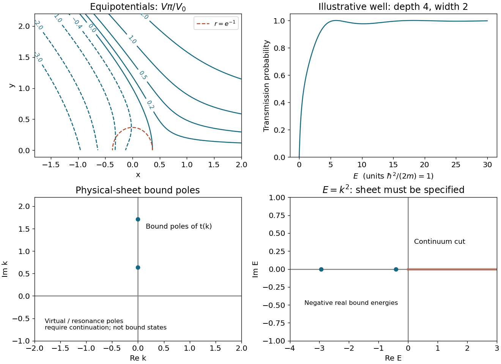

<h1 id="s1/1/4/solution">Solution</h1>

↑ **Parent:** [4](../4.md)

Along a [level curve](../../../../../level-curve.md), $V_x dx+V_y dy=0$, with $V_x=V_0\theta/\pi$ and $V_y=V_0(1+\log r)/\pi$. Therefore

$$
\boxed{\frac{dy}{dx}=-\frac{\theta}{1+\log r}.}
$$

In the intended [upper half-plane](../../../../../upper-half-plane-complex-analysis.md) $0<\theta<\pi$, the slope is positive for $0<r<e^{-1}$, vertical at $r=e^{-1}$, and negative for $r>e^{-1}$. At the positive real boundary $\theta=0$ the slope is zero except at the [stationary point](../../../../../stationary-point.md) $(e^{-1},0)$, where both [derivatives](../../../../../derivative.md) vanish and the quotient is indeterminate. More generally, outside the chosen [half-plane](../../../../../half-plane.md) its sign is the sign of $-\theta(1+\log r)$, with the [argument](../../../../../argument-complex-analysis.md) branch held fixed. A convenient parametric description of the curves to sketch is $V\pi/V_0=r(\sin\theta\log r+\theta\cos\theta)$.

**[Figure 1](#s1/1/4/image-equipotentials-for-the-upper-half-plane-logarithm-branch-and-illustrative-square-well-transmission). Equipotentials for the upper-half-plane logarithm branch and illustrative square-well transmission**.

## ↑ Ancestors (12)

1. [4](../4.md)
2. [1](../../1.md)
3. [S1](../../../s1.md)
4. [2017](../../../../2017-split.md)
5. [Past exam of the short options paper shared by Prelims and Parts A and B of the physics course of the University of Oxford](../../../../split.md)
6. [Short options paper shared by Prelims and Parts A and B of the physics course of the University of Oxford](../../../../../short-options-paper-shared-by-prelims-and-parts-a-and-b-of-the-physics-course-of-the-university-of-oxford.md)
7. [Physics course of the University of Oxford](../../../../../physics-course-of-the-university-of-oxford.md)
8. [Undergraduate course of the University of Oxford](../../../../../undergraduate-course-of-the-university-of-oxford.md)
9. [Course of the University of Oxford](../../../../../course-of-the-university-of-oxford.md)
10. [University of Oxford](../../../../../university-of-oxford-split.md)
11. [List of universities](../../../../../list-of-universities.md)
12. [Codex Wiki](../../../../../split.md)
