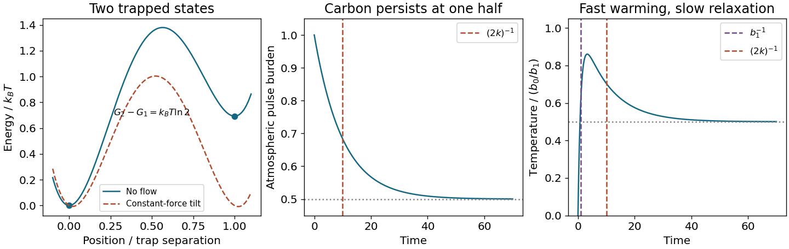

<h1 id="s12/2/3/solution">Solution</h1>

↑ **Parent:** [3](../3.md)

The stationary occupation ratio is $p_1/p_2=2$. Balance of the two [probability currents](../../../../../probability-flux.md) gives $p_1k_{12}=p_2k_{21}$, and [Boltzmann occupation](../../../../../boltzmann-distribution.md) of the trapped macrostates gives $p_2/p_1=e^{-(G_2-G_1)/(k_BT)}$. Therefore

$$
\boxed{\frac{k_{12}}{k_{21}}=\frac12,\qquad G_2-G_1=k_BT\log2.}
$$

The sketch has two wells separated by 1 micrometre, with the second free-energy level higher by $k_BT\log2$ and an intervening escape barrier. [Free energy](../../../../../thermodynamic-free-energy.md) includes the volume of each trapped basin; equal minimum potential heights alone would not ensure equal occupations if basin shapes differed.

**[Figure 2](#s12/2/3/image-two-state-free-energy-tilt-and-the-distinct-fast-and-slow-timescales-of-a-carbon-pulse-response). Two-state free-energy tilt and the distinct fast and slow timescales of a carbon-pulse response**.

## ↑ Ancestors (12)

1. [3](../3.md)
2. [2](../../2.md)
3. [S12](../../../s12.md)
4. [2017](../../../../2017-split.md)
5. [Past exam of the short options paper shared by Prelims and Parts A and B of the physics course of the University of Oxford](../../../../split.md)
6. [Short options paper shared by Prelims and Parts A and B of the physics course of the University of Oxford](../../../../../short-options-paper-shared-by-prelims-and-parts-a-and-b-of-the-physics-course-of-the-university-of-oxford.md)
7. [Physics course of the University of Oxford](../../../../../physics-course-of-the-university-of-oxford.md)
8. [Undergraduate course of the University of Oxford](../../../../../undergraduate-course-of-the-university-of-oxford.md)
9. [Course of the University of Oxford](../../../../../course-of-the-university-of-oxford.md)
10. [University of Oxford](../../../../../university-of-oxford-split.md)
11. [List of universities](../../../../../list-of-universities.md)
12. [Codex Wiki](../../../../../split.md)
