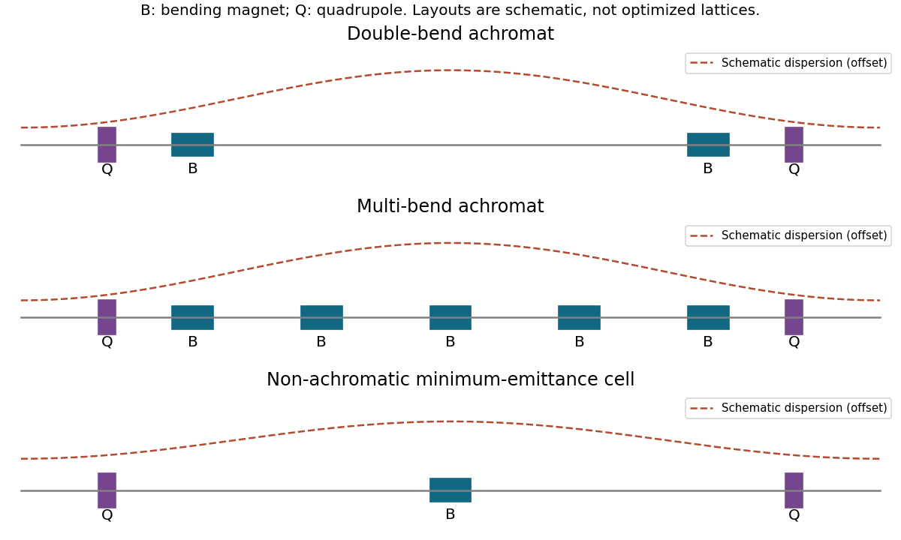

<h1 id="s19/2/c/solution">Solution</h1>

↑ **Parent:** [C](../c.md)

[Equilibrium](../../../../../equilibrium-point-of-a-dynamical-system.md) emittance obeys $\epsilon_x=C_q\gamma^2I_5/(J_xI_2)$, with $I_5=\oint H(s)|\rho|^{-3}ds$, $H=\gamma_x\eta^2+2\alpha_x\eta\eta'+\beta_x\eta'^2$. Thus reduce both bend angles and the dispersion invariant inside bends, rather than merely focusing to a small beam size elsewhere. The damping partition can also be adjusted within stability constraints.

A DBA uses two bends and quadrupoles to return dispersion and its slope to zero at the cell boundaries; this provides dispersion-free insertion straights, at some emittance cost. A multi-bend achromat distributes the total angle over more weak bends and carefully controls the interior dispersion. A non-achromatic theoretical-minimum-emittance cell permits nonzero boundary dispersion and chooses the [beta function](../../../../../beta-function.md) and dispersion near a bend's optimum; longitudinal-gradient or reverse bends offer further control of radiation [integrals](../../../../../integral-split.md). [Strong focusing](../../../../../strong-focusing.md) and dispersion suppression can increase natural chromaticity and sextupole demands, compromising dynamic aperture and [momentum](../../../../../momentum-split.md) acceptance.

**[Figure 3](#s19/2/c/image-schematic-double-bend-multi-bend-and-non-achromatic-emittance-design-strategies). Schematic double-bend, multi-bend and non-achromatic emittance-design strategies**.

## ↑ Ancestors (12)

1. [C](../c.md)
2. [2](../../2.md)
3. [S19](../../../s19.md)
4. [2017](../../../../2017-split.md)
5. [Past exam of the short options paper shared by Prelims and Parts A and B of the physics course of the University of Oxford](../../../../split.md)
6. [Short options paper shared by Prelims and Parts A and B of the physics course of the University of Oxford](../../../../../short-options-paper-shared-by-prelims-and-parts-a-and-b-of-the-physics-course-of-the-university-of-oxford.md)
7. [Physics course of the University of Oxford](../../../../../physics-course-of-the-university-of-oxford.md)
8. [Undergraduate course of the University of Oxford](../../../../../undergraduate-course-of-the-university-of-oxford.md)
9. [Course of the University of Oxford](../../../../../course-of-the-university-of-oxford.md)
10. [University of Oxford](../../../../../university-of-oxford-split.md)
11. [List of universities](../../../../../list-of-universities.md)
12. [Codex Wiki](../../../../../split.md)
