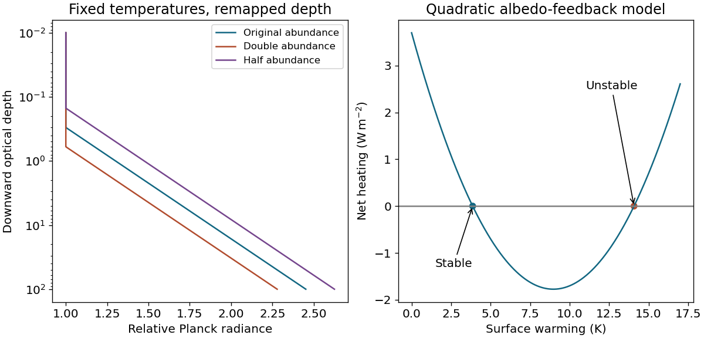

<h1 id="s25/1/4/solution">Solution</h1>

↑ **Parent:** [4](../4.md)

Let $\tau_t$ be the tropopause [optical depth](../../../../../optical-depth.md) and linearize $B$ with positive [derivative](../../../../../derivative.md) $B_T$. In the troposphere $T=T_t+\Gamma H_\tau\log(\tau/\tau_t)$, so the requested schematic is

$$
B(\tau)=\begin{cases}B_t,&\tau\leq\tau_t,\\B_t+B_T\Gamma H_\tau\log(\tau/\tau_t),&\tau>\tau_t.\end{cases}
$$

It is constant in the isothermal stratosphere and rises linearly with $\log\tau$ below it. At unchanged [temperatures](../../../../../temperature-split.md) and a multiplicative abundance change $a$, [optical depth](../../../../../optical-depth.md) at each height changes to $a\tau$, hence $\boxed{B_a(\tau)=B_{\mathrm{old}}(\tau/a)}$. Doubling moves the tropopause kink to $2\tau_t$ and gives colder emission [temperatures](../../../../../temperature-split.md) at a fixed [optical depth](../../../../../optical-depth.md); halving does the opposite.

**[Figure 4](#s25/1/4/image-optical-depth-remapping-of-atmospheric-emission-and-stable-versus-unstable-climate-feedback-equilibria). Optical-depth remapping of atmospheric emission and stable versus unstable climate-feedback equilibria**.

## ↑ Ancestors (12)

1. [4](../4.md)
2. [1](../../1.md)
3. [S25](../../../s25.md)
4. [2017](../../../../2017-split.md)
5. [Past exam of the short options paper shared by Prelims and Parts A and B of the physics course of the University of Oxford](../../../../split.md)
6. [Short options paper shared by Prelims and Parts A and B of the physics course of the University of Oxford](../../../../../short-options-paper-shared-by-prelims-and-parts-a-and-b-of-the-physics-course-of-the-university-of-oxford.md)
7. [Physics course of the University of Oxford](../../../../../physics-course-of-the-university-of-oxford.md)
8. [Undergraduate course of the University of Oxford](../../../../../undergraduate-course-of-the-university-of-oxford.md)
9. [Course of the University of Oxford](../../../../../course-of-the-university-of-oxford.md)
10. [University of Oxford](../../../../../university-of-oxford-split.md)
11. [List of universities](../../../../../list-of-universities.md)
12. [Codex Wiki](../../../../../split.md)
