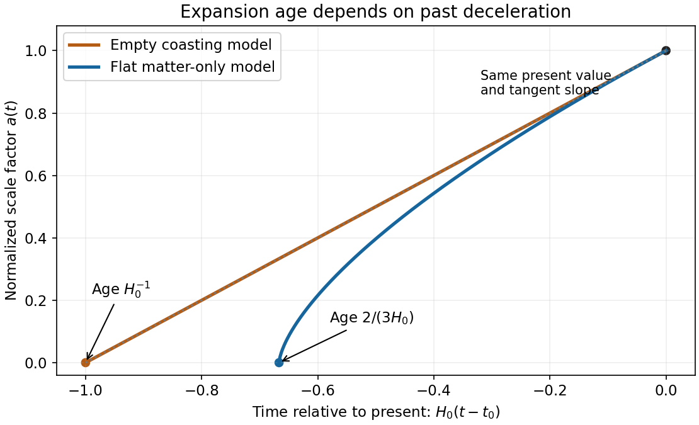
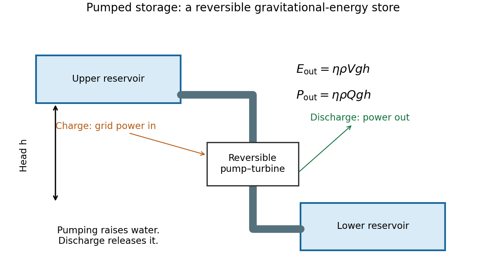
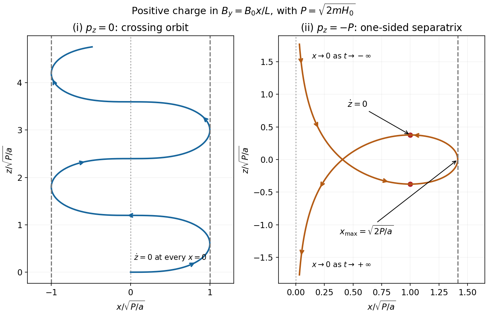
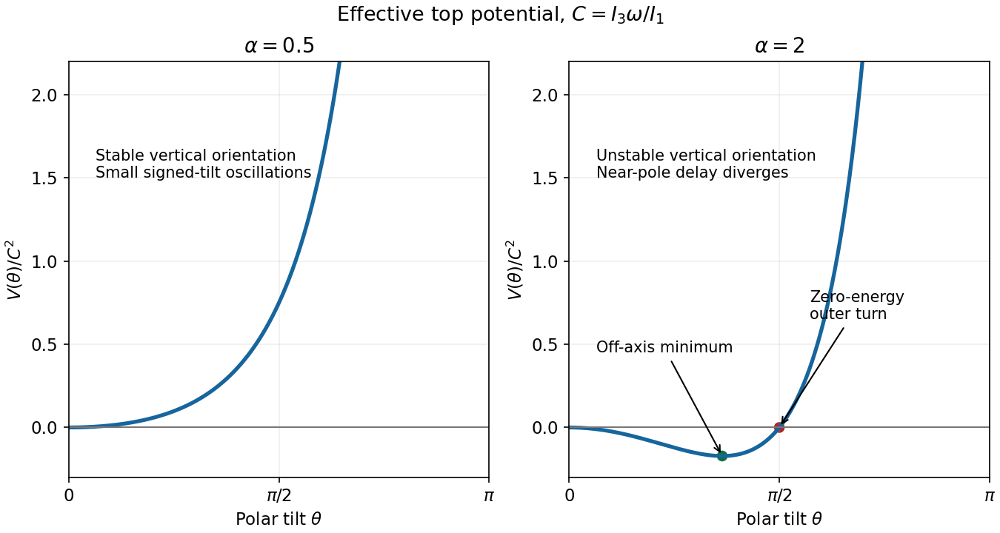
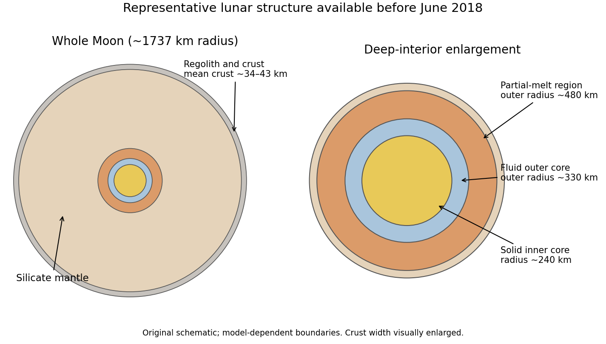

# 2018

↑ **Parent:** [Past exam of the short options paper shared by Prelims and Parts A and B of the physics course of the University of Oxford](../past-exam-of-the-short-options-paper-shared-by-prelims-and-parts-a-and-b-of-the-physics-course-of-the-university-of-oxford.md)

Source paper: [https://www.whatdotheyknow.com/request/oxford_physics_past_papers_2/response/2340696/attach/6/Physics%20Papers%202017.pdf?cookie_passthrough=1](https://www.whatdotheyknow.com/request/oxford_physics_past_papers_2/response/2340696/attach/6/Physics%20Papers%202017.pdf?cookie_passthrough=1)

**Table of contents**

- [S1](#s1)
  - [1](#s1/1)
    - [Solution](#s1/1/solution)
  - [2](#s1/2)
    - [a](#s1/2/a)
      - [Solution](#s1/2/a/solution)
    - [b](#s1/2/b)
      - [Solution](#s1/2/b/solution)
  - [3](#s1/3)
    - [Solution](#s1/3/solution)
- [S2](#s2)
  - [1](#s2/1)
    - [a](#s2/1/a)
      - [Solution](#s2/1/a/solution)
    - [b](#s2/1/b)
      - [Solution](#s2/1/b/solution)
    - [c](#s2/1/c)
      - [Solution](#s2/1/c/solution)
    - [d](#s2/1/d)
      - [Solution](#s2/1/d/solution)
  - [2](#s2/2)
    - [a](#s2/2/a)
      - [Solution](#s2/2/a/solution)
    - [b](#s2/2/b)
      - [Solution](#s2/2/b/solution)
    - [c](#s2/2/c)
      - [Solution](#s2/2/c/solution)
    - [d](#s2/2/d)
      - [Solution](#s2/2/d/solution)
  - [3](#s2/3)
    - [a](#s2/3/a)
      - [Solution](#s2/3/a/solution)
    - [b](#s2/3/b)
      - [Solution](#s2/3/b/solution)
    - [c](#s2/3/c)
      - [Solution](#s2/3/c/solution)
    - [d](#s2/3/d)
      - [Solution](#s2/3/d/solution)
- [S3](#s3)
  - [1](#s3/1)
    - [a](#s3/1/a)
      - [Solution](#s3/1/a/solution)
    - [b](#s3/1/b)
      - [Solution](#s3/1/b/solution)
    - [c](#s3/1/c)
      - [Solution](#s3/1/c/solution)
    - [d](#s3/1/d)
      - [Solution](#s3/1/d/solution)
    - [e](#s3/1/e)
      - [Solution](#s3/1/e/solution)
  - [2](#s3/2)
    - [a](#s3/2/a)
      - [Solution](#s3/2/a/solution)
    - [b](#s3/2/b)
      - [Solution](#s3/2/b/solution)
    - [c](#s3/2/c)
      - [Solution](#s3/2/c/solution)
    - [d](#s3/2/d)
      - [Solution](#s3/2/d/solution)
    - [e](#s3/2/e)
      - [Solution](#s3/2/e/solution)
  - [3](#s3/3)
    - [a](#s3/3/a)
      - [Solution](#s3/3/a/solution)
    - [b](#s3/3/b)
      - [Solution](#s3/3/b/solution)
    - [c](#s3/3/c)
      - [Solution](#s3/3/c/solution)
    - [d](#s3/3/d)
      - [Solution](#s3/3/d/solution)
- [S4](#s4)
  - [1](#s4/1)
    - [Solution](#s4/1/solution)
  - [2](#s4/2)
    - [Solution](#s4/2/solution)
  - [3](#s4/3)
    - [a](#s4/3/a)
      - [Solution](#s4/3/a/solution)
    - [b](#s4/3/b)
      - [Solution](#s4/3/b/solution)
    - [c](#s4/3/c)
      - [Solution](#s4/3/c/solution)
    - [d](#s4/3/d)
      - [Solution](#s4/3/d/solution)
    - [e](#s4/3/e)
      - [Solution](#s4/3/e/solution)
    - [f](#s4/3/f)
      - [Solution](#s4/3/f/solution)
    - [g](#s4/3/g)
      - [Solution](#s4/3/g/solution)
- [S7](#s7)
  - [1](#s7/1)
    - [a](#s7/1/a)
      - [Solution](#s7/1/a/solution)
    - [b](#s7/1/b)
      - [Solution](#s7/1/b/solution)
    - [c](#s7/1/c)
      - [Solution](#s7/1/c/solution)
    - [d](#s7/1/d)
      - [Solution](#s7/1/d/solution)
    - [e](#s7/1/e)
      - [Solution](#s7/1/e/solution)
    - [f](#s7/1/f)
      - [i](#s7/1/f/i)
        - [Solution](#s7/1/f/i/solution)
      - [ii](#s7/1/f/ii)
        - [Solution](#s7/1/f/ii/solution)
  - [2](#s7/2)
    - [a](#s7/2/a)
      - [Solution](#s7/2/a/solution)
    - [b](#s7/2/b)
      - [Solution](#s7/2/b/solution)
    - [c](#s7/2/c)
      - [Solution](#s7/2/c/solution)
    - [d](#s7/2/d)
      - [i](#s7/2/d/i)
        - [Solution](#s7/2/d/i/solution)
      - [ii](#s7/2/d/ii)
        - [Solution](#s7/2/d/ii/solution)
  - [3](#s7/3)
    - [a](#s7/3/a)
      - [Solution](#s7/3/a/solution)
    - [b](#s7/3/b)
      - [Solution](#s7/3/b/solution)
    - [c](#s7/3/c)
      - [Solution](#s7/3/c/solution)
    - [d](#s7/3/d)
      - [Solution](#s7/3/d/solution)
    - [e](#s7/3/e)
      - [Solution](#s7/3/e/solution)
- [S14](#s14)
  - [1](#s14/1)
    - [Solution](#s14/1/solution)
  - [2](#s14/2)
    - [Solution](#s14/2/solution)
  - [3](#s14/3)
    - [Solution](#s14/3/solution)
  - [4](#s14/4)
    - [Solution](#s14/4/solution)
  - [5](#s14/5)
    - [Solution](#s14/5/solution)
- [S16](#s16)
  - [1](#s16/1)
    - [Solution](#s16/1/solution)
  - [2](#s16/2)
    - [Solution](#s16/2/solution)
  - [3](#s16/3)
    - [Solution](#s16/3/solution)
- [S18](#s18)
  - [1](#s18/1)
    - [a](#s18/1/a)
      - [Solution](#s18/1/a/solution)
    - [b](#s18/1/b)
      - [Solution](#s18/1/b/solution)
    - [c](#s18/1/c)
      - [Solution](#s18/1/c/solution)
    - [d](#s18/1/d)
      - [i](#s18/1/d/i)
        - [Solution](#s18/1/d/i/solution)
      - [ii](#s18/1/d/ii)
        - [Solution](#s18/1/d/ii/solution)
      - [iii](#s18/1/d/iii)
        - [Solution](#s18/1/d/iii/solution)
      - [iv](#s18/1/d/iv)
        - [Solution](#s18/1/d/iv/solution)
  - [2](#s18/2)
    - [a](#s18/2/a)
      - [Solution](#s18/2/a/solution)
    - [b](#s18/2/b)
      - [Solution](#s18/2/b/solution)
    - [c](#s18/2/c)
      - [Solution](#s18/2/c/solution)
    - [d](#s18/2/d)
      - [Solution](#s18/2/d/solution)
    - [e](#s18/2/e)
      - [Solution](#s18/2/e/solution)
  - [3](#s18/3)
    - [a](#s18/3/a)
      - [i](#s18/3/a/i)
        - [Solution](#s18/3/a/i/solution)
      - [ii](#s18/3/a/ii)
        - [Solution](#s18/3/a/ii/solution)
      - [iii](#s18/3/a/iii)
        - [Solution](#s18/3/a/iii/solution)
      - [iv](#s18/3/a/iv)
        - [Solution](#s18/3/a/iv/solution)
    - [b](#s18/3/b)
      - [Solution](#s18/3/b/solution)
    - [c](#s18/3/c)
      - [Solution](#s18/3/c/solution)
    - [d](#s18/3/d)
      - [Solution](#s18/3/d/solution)
- [S19](#s19)
  - [1](#s19/1)
    - [a](#s19/1/a)
      - [Solution](#s19/1/a/solution)
    - [b](#s19/1/b)
      - [Solution](#s19/1/b/solution)
    - [c](#s19/1/c)
      - [Solution](#s19/1/c/solution)
  - [2](#s19/2)
    - [a](#s19/2/a)
      - [Solution](#s19/2/a/solution)
    - [b](#s19/2/b)
      - [Solution](#s19/2/b/solution)
    - [c](#s19/2/c)
      - [Solution](#s19/2/c/solution)
    - [d](#s19/2/d)
      - [Solution](#s19/2/d/solution)
    - [e](#s19/2/e)
      - [Solution](#s19/2/e/solution)
  - [3](#s19/3)
    - [a](#s19/3/a)
      - [Solution](#s19/3/a/solution)
    - [b](#s19/3/b)
      - [Solution](#s19/3/b/solution)
    - [c](#s19/3/c)
      - [Solution](#s19/3/c/solution)
    - [d](#s19/3/d)
      - [Solution](#s19/3/d/solution)
    - [e](#s19/3/e)
      - [Solution](#s19/3/e/solution)
- [S26](#s26)
  - [1](#s26/1)
    - [a](#s26/1/a)
      - [Solution](#s26/1/a/solution)
    - [b](#s26/1/b)
      - [Solution](#s26/1/b/solution)
    - [c](#s26/1/c)
      - [Solution](#s26/1/c/solution)
  - [2](#s26/2)
    - [a](#s26/2/a)
      - [Solution](#s26/2/a/solution)
    - [b](#s26/2/b)
      - [Solution](#s26/2/b/solution)
    - [c](#s26/2/c)
      - [i](#s26/2/c/i)
        - [Solution](#s26/2/c/i/solution)
      - [ii](#s26/2/c/ii)
        - [Solution](#s26/2/c/ii/solution)
    - [d](#s26/2/d)
      - [Solution](#s26/2/d/solution)
  - [3](#s26/3)
    - [a](#s26/3/a)
      - [Solution](#s26/3/a/solution)
    - [b](#s26/3/b)
      - [Solution](#s26/3/b/solution)
    - [c](#s26/3/c)
      - [Solution](#s26/3/c/solution)
    - [d](#s26/3/d)
      - [Solution](#s26/3/d/solution)
- [S29](#s29)
  - [1](#s29/1)
    - [Solution](#s29/1/solution)
  - [2](#s29/2)
    - [Solution](#s29/2/solution)
  - [3](#s29/3)
    - [Solution](#s29/3/solution)

## S1

↑ **Parent:** [2018](2018.md)

<h3 id="s1/1">1</h3>

↑ **Parent:** [S1](#s1)

<h4 id="s1/1/solution">Solution</h4>

↑ **Parent:** [1](#s1/1)

A [branch point](../complex-analysis.md#branch-point) is a point around which [analytic continuation](../holomorphic-function.md#analytic-continuation) changes the value of a multivalued function. For $z^{1/2}=r^{1/2}e^{i\theta/2}$, one circuit around zero changes the sign. A [branch cut](../analysis.md#branch-cut) removes paths producing this ambiguity; for example $-\pi<\arg z<\pi$ gives a single holomorphic [square root](../algebra.md#square-root) off the nonpositive [real axis](../complex-analysis.md#real-axis). The [position](../classical-mechanics.md#position) of a cut is a convention, while the [branch point](../complex-analysis.md#branch-point) is intrinsic.

Set $q(z)=(z-1)/(z+1)$. For $z$ outside the closed segment joining $-1$ to $1$, $q(z)$ avoids the nonpositive [real axis](../complex-analysis.md#real-axis). Therefore the [principal square root](../analysis.md#principal-square-root-of-a-complex-number) of $q$ defines a [holomorphic function](../holomorphic-function.md) there, with the [normalization](../mathematics.md#normalization) $f(\infty)=1$. The endpoints are [branch points](../complex-analysis.md#branch-point). Expanding at infinity,

$$
f(z)=\left(1-\frac2{z+1}\right)^{1/2}=1-\frac1z+O(z^{-2}).
$$

For a positively oriented contour surrounding the cut, its [integral](../integral.md) equals the [integral](../integral.md) on a sufficiently large positively oriented circle, since the intervening annulus is holomorphic. Thus

$$
\boxed{I_\Gamma=-2\pi i.}
$$

On the upper and lower banks, $f_+(x)=+i\sqrt{(1-x)/(1+x)}$ and $f_-(x)=-i\sqrt{(1-x)/(1+x)}$. The upper bank is traversed from $1$ to $-1$, and the lower bank from $-1$ to $1$. Their sum is $-2i$ [times](../classical-mechanics.md#time-in-physics) the required real [integral](../integral.md). Small endpoint arcs vanish because their singularities have exponent less than one. Consequently

$$
\boxed{\int_{-1}^{1}\sqrt{\frac{1-x}{1+x}}\,dx=\pi.}
$$

For $\alpha=1/n$, use $f_\alpha=q^\alpha$ with the same [normalization](../mathematics.md#normalization). Its expansion is $1-2\alpha/z+O(z^{-2})$, and its bank values are $e^{\pm i\pi\alpha}[(1-x)/(1+x)]^\alpha$. Equating the [contour integral](../complex-analysis.md#contour-integral) $-4\pi i\alpha$ with $-2i\sin(\pi\alpha)$ [times](../classical-mechanics.md#time-in-physics) the real [integral](../integral.md) gives

$$
\boxed{\int_{-1}^{1}\left(\frac{1-x}{1+x}\right)^{1/n}dx
=\frac{2\pi}{n\sin(\pi/n)}.}
$$

The condition $n\ge2$ ensures endpoint integrability. Choosing the other square-root branch reverses $I_\Gamma$, but also reverses both bank values, leaving the real [integral](../integral.md) unchanged.

<h3 id="s1/2">2</h3>

↑ **Parent:** [S1](#s1)

<h4 id="s1/2/a">a</h4>

↑ **Parent:** [2](#s1/2)

<h5 id="s1/2/a/solution">Solution</h5>

↑ **Parent:** [A](#s1/2/a)

Integrate $e^{iz}/z$ around an upper semicircle, indenting the origin by a small upper semicircle traversed clockwise. The integrand is holomorphic inside the indented contour. The large arc vanishes by [Jordan's lemma](../complex-analysis.md#jordan-s-lemma), and the small arc contributes $-i\pi$, so

$$
\operatorname{PV}\int_{-\infty}^{\infty}\frac{e^{ix}}x\,dx=i\pi.
$$

Taking imaginary and real parts yields

$$
\boxed{\int_{-\infty}^{\infty}\frac{\sin x}{x}\,dx=\pi,\qquad
\operatorname{PV}\int_{-\infty}^{\infty}\frac{\cos x}{x}\,dx=0.}
$$

The first integrand has a removable singularity at zero and its tails converge conditionally by [Dirichlet test for improper integrals](../real-analysis.md#dirichlet-test-for-improper-integrals). The second [integral](../integral.md) needs a [principal value](../complex-analysis.md#cauchy-principal-value) at zero; its zero also follows from oddness with symmetric exclusion. One must not assign an ordinary convergent [integral](../integral.md) to its singularity.

<h4 id="s1/2/b">b</h4>

↑ **Parent:** [2](#s1/2)

<h5 id="s1/2/b/solution">Solution</h5>

↑ **Parent:** [B](#s1/2/b)

Put $z=e^{i\theta}$, so $\sin\theta=(z-z^{-1})/(2i)$ and $d\theta=dz/(iz)$. The [integral](../integral.md) becomes

$$
\oint_{|z|=1}\frac{dz}{6z^2+13iz-6}.
$$

The poles are $-2i/3$ and $-3i/2$; only the first is inside the unit circle. The [derivative](../calculus.md#derivative) of the denominator there is $12(-2i/3)+13i=5i$. The [residue theorem](../analysis.md#residue-theorem) therefore gives

$$
\boxed{\int_0^{2\pi}\frac{d\theta}{13+12\sin\theta}=\frac{2\pi}{5}.}
$$

There are no poles on the contour because the real denominator is at least one.

<h3 id="s1/3">3</h3>

↑ **Parent:** [S1](#s1)

<h4 id="s1/3/solution">Solution</h4>

↑ **Parent:** [3](#s1/3)

At a regular point, $f(z_0+\zeta)-f(z_0)=f'(z_0)\zeta+O(\zeta^2)$. Multiplication by a nonzero [complex number](../complex-analysis.md#complex-number) rotates every tangent by the same angle and multiplies every [length](../physics.md#length) by the same positive factor. Oriented angles are preserved. If the first [derivative](../calculus.md#derivative) vanishes but the second does not, the leading term is $f''(z_0)\zeta^2/2$: tangent arguments are doubled, so angles are doubled, modulo the identification of rays. This is a local statement; [holomorphy](../holomorphic-function.md) alone does not imply global [injectivity](../algebra.md#injective-function).

Write $z=x+iy$. Then

$$
w=\sin\frac{\pi x}{2}\cosh\frac{\pi y}{2}
+i\cos\frac{\pi x}{2}\sinh\frac{\pi y}{2}.
$$

For $-1<x<1$ and $y>0$, the imaginary part is positive. The bottom edge maps monotonically to $[-1,1]$; the left and right vertical edges map to $(-\infty,-1]$ and $[1,\infty)$ respectively. The inverse below establishes that every point of the open upper half-plane occurs exactly once. At fixed $y=a$, putting $u=\operatorname{Re}w$, $v=\operatorname{Im}w$, one obtains

$$
\boxed{\frac{u^2}{\cosh^2(\pi a/2)}+
\frac{v^2}{\sinh^2(\pi a/2)}=1,\qquad v\ge0.}
$$

This is the upper half of an [ellipse](../euclidean-geometry.md#ellipse), traversed from its left endpoint to its right endpoint.

Choose the branch $s(w)=\sqrt{1-w^2}$ analytic in the upper half-plane and positive on the boundary interval $(-1,1)$. Then the inverse branch into the strip is

$$
\boxed{z=-\frac{2i}{\pi}\log\bigl(iw+s(w)\bigr).}
$$

The [logarithm](../calculus.md#logarithm) is chosen continuously so that $-1<\operatorname{Re}z<1$ and $\operatorname{Im}z>0$; for instance $w=iv$, $v>0$, gives $z=(2i/\pi)\operatorname{arsinh}v$. Differentiation gives $dz/dw=2/(\pi\sqrt{1-w^2})$. The only zeros of the original [derivative](../calculus.md#derivative) in the closed strip are $z=\pm1$, with images $w=\pm1$. The inverse has square-root [branch points](../complex-analysis.md#branch-point) there, and cannot extend holomorphically across them. At either corner the original map doubles the right angle to a straight angle; a holomorphic inverse with nonzero [derivative](../calculus.md#derivative) could not halve it. The open strip interior has no such failure.

## S2

↑ **Parent:** [2018](2018.md)

<h3 id="s2/1">1</h3>

↑ **Parent:** [S2](#s2)

<h4 id="s2/1/a">a</h4>

↑ **Parent:** [1](#s2/1)

<h5 id="s2/1/a/solution">Solution</h5>

↑ **Parent:** [A](#s2/1/a)

The [distance modulus](../astrophysics.md#distance-modulus) at $100\,\mathrm{pc}$ is five magnitudes. Thus the two approximate main-sequence endpoints read from the original figure, $m_V\simeq0,20$, correspond to $M_V\simeq-5,15$. With the given solar reference,

$$
\frac{L_V}{L_{V,\odot}}=10^{-0.4(M_V-5)}\simeq10^4,10^{-4}.
$$

Use the figure's approximate endpoint [effective temperatures](../stellar-structure.md#effective-temperature) $25{,}000$ K and $2500$ K. If $V$-band [luminosity](../astrophysics.md#luminosity) is used as a rough bolometric proxy, the [Stefan–Boltzmann law](../heat.md#stefan-boltzmann-law) gives

$$
\frac{R_*}{R_\odot}\simeq
\left(\frac L{L_\odot}\right)^{1/2}\left(\frac{T_\odot}{T_{\rm eff}}\right)^2.
$$

Taking $T_\odot\simeq5800$ K gives

$$
\boxed{R_{\rm small}\simeq0.054R_\odot,\qquad
R_{\rm large}\simeq5.4R_\odot.}
$$

These are schematic estimates, not precision [radii](../topology.md#radius). The diagram supplies $V$ magnitudes rather than bolometric [luminosities](../astrophysics.md#luminosity), and hot and cool endpoints need different [bolometric corrections](../astrophysics.md#bolometric-correction). The exact range cannot be recovered without those corrections; the quoted values state the intended approximation explicitly.

<h4 id="s2/1/b">b</h4>

↑ **Parent:** [1](#s2/1)

<h5 id="s2/1/b/solution">Solution</h5>

↑ **Parent:** [B](#s2/1/b)

Integrating $dP/dr=-GM_r\rho/r^2$ in order of magnitude, with $\rho\sim M_*/R_*^3$, gives

$$
P_c\sim\frac{GM_*^2}{R_*^4}.
$$

The [ideal gas law](../ideal-gas.md#ideal-gas-law) independently gives $P_c\sim M_*k_BT_c/(\mu m_HR_*^3)$. Equating the two estimates yields

$$
\boxed{R_*\sim\frac{G\mu m_H}{k_BT_c}M_*.}
$$

For similar composition and an approximately fixed hydrogen-burning [central temperature](../stellar-structure.md#central-stellar-temperature), $R_*\propto M_*$. Calibrating this rough relation on the Sun and using part [a](#s2/1/a) gives a nominal [mass](../classical-mechanics.md#mass) range of about $0.05$ to $5\,M_\odot$.

The endpoint [luminosity](../astrophysics.md#luminosity) ratio is $10^8$, whereas the inferred [mass](../classical-mechanics.md#mass) ratio is about $10^2$, giving $L\propto M^4$ across that range. The _exponent_ is therefore consistent at this schematic level. The solar [normalization](../mathematics.md#normalization) and individual endpoint [masses](../classical-mechanics.md#mass) are much less reliable: using the [luminosity](../astrophysics.md#luminosity) relation itself gives approximately $0.1$ to $10\,M_\odot$. [Central temperatures](../stellar-structure.md#central-stellar-temperature) are not truly constant, low-mass stellar structure differs, and the uncorrected $V$ [luminosities](../astrophysics.md#luminosity) in the diagram are not bolometric. These limitations prevent treating the rough radius-based [masses](../classical-mechanics.md#mass) as a contradictory precision measurement.

<h4 id="s2/1/c">c</h4>

↑ **Parent:** [1](#s2/1)

<h5 id="s2/1/c/solution">Solution</h5>

↑ **Parent:** [C](#s2/1/c)

If radiation dominates the [central pressure](../stellar-structure.md#central-pressure), equate $P_c\sim GM_*^2/R_*^4$ to $aT_c^4/3$. This gives

$$
\boxed{R_*\sim\left(\frac{3G}{a}\right)^{1/4}\frac{M_*^{1/2}}{T_c}.}
$$

At roughly fixed burning [temperature](../temperature.md), the corresponding mass-radius scaling is $R_*\propto M_*^{1/2}$, rather than the gas-pressure estimate $R_*\propto M_*$. [Radiation pressure](../pressure.md#radiation-pressure) alone does not determine a unique [radius](../topology.md#radius) at a specified [mass](../classical-mechanics.md#mass): a thermal or nuclear-burning condition is still needed to specify $T_c$. The relation is a homology estimate, not a universal exact law for all massive [stars](../stellar-astrophysics.md#star).

<h4 id="s2/1/d">d</h4>

↑ **Parent:** [1](#s2/1)

<h5 id="s2/1/d/solution">Solution</h5>

↑ **Parent:** [D](#s2/1/d)

The numbered features in the original [colour-magnitude diagram](../stellar-astrophysics.md#colour-magnitude-diagram) have the following interpretation.

- **1:** the [main sequence](../stellar-astrophysics.md#main-sequence), where core [hydrogen](../chemical-substance.md#hydrogen) fusion supplies the [luminosity](../astrophysics.md#luminosity); [stars](../stellar-astrophysics.md#star) span a range of [masses](../classical-mechanics.md#mass) and [effective temperatures](../stellar-structure.md#effective-temperature).
- **2:** the [subgiant](../stellar-astrophysics.md#subgiant) region, following core [hydrogen](../chemical-substance.md#hydrogen) exhaustion, with a contracting helium-rich core and increasing hydrogen-shell burning.
- **3:** the [red giant branch](../stellar-astrophysics.md#red-giant-branch), with an extended cool envelope and a compact [helium](../chemical-substance.md#helium) core fed by hydrogen-shell burning.
- **4:** the roughly horizontal core-helium-burning branch, or its red-clump part, reached after [helium](../chemical-substance.md#helium) ignition; hydrogen-shell burning can continue outside the core.
- **5:** the white-dwarf cooling sequence, consisting of compact remnants supported mainly by [electron degeneracy pressure](../quantum-ideal-gas-statistics.md#electron-degeneracy-pressure) and radiating stored [heat](../heat.md).

Continuous [star](../stellar-astrophysics.md#star) formation explains the coexistence of newly formed massive main-sequence [stars](../stellar-astrophysics.md#star) with evolved low-mass remnants; interpreting a single sharp turnoff as the age of a coeval cluster would be inappropriate here.

<h3 id="s2/2">2</h3>

↑ **Parent:** [S2](#s2)

<h4 id="s2/2/a">a</h4>

↑ **Parent:** [2](#s2/2)

<h5 id="s2/2/a/solution">Solution</h5>

↑ **Parent:** [A](#s2/2/a)

At this small [redshift](../optics.md#redshift), $D\simeq cz/H_0\simeq20.0$ Mpc. The outer angular [radius](../topology.md#radius) gives $R_{\rm out}\simeq D\theta\simeq21.3$ kpc. Approximating the dynamical [mass](../classical-mechanics.md#mass) by a spherical equivalent,

$$
\boxed{M_{\rm dyn}(<R_{\rm out})\simeq\frac{V_{\rm rot}^2R_{\rm out}}G
\simeq4.9\times10^{11}M_\odot.}
$$

The supplied [Tully-Fisher relation](../galaxy.md#tully-fisher-relation) gives $M_V\simeq-22.49$, and hence $L_V\simeq9.9\times10^{10}L_{V,\odot}$. Treating the population as solar-like gives the estimate $\Upsilon_V\simeq1\,M_\odot/L_{V,\odot}$, so

$$
\boxed{M_{\rm luminous}\simeq1.0\times10^{11}M_\odot.}
$$

The dynamical estimate exceeds that by about a factor of five; a massive extended dark-matter component is the natural interpretation. Solar-like spectra do not exactly fix the population [mass-to-light ratio](../galaxy.md#mass-to-light-ratio), and a disk is not spherical, but order-unity corrections do not remove this large outer [mass](../classical-mechanics.md#mass) excess under the stated estimate.

<h4 id="s2/2/b">b</h4>

↑ **Parent:** [2](#s2/2)

<h5 id="s2/2/b/solution">Solution</h5>

↑ **Parent:** [B](#s2/2/b)

The [effective radius](../galaxy.md#effective-radius) is one tenth of the optical outer [radius](../topology.md#radius): $R_e\simeq2.13$ kpc. A flat [rotation](../riemannian-geometry.md#rotation-mathematics) [speed](../classical-mechanics.md#speed) then gives $M_{\rm dyn}(<R_e)\simeq4.9\times10^{10}M_\odot$. Half the [luminosity](../astrophysics.md#luminosity), with the same [mass-to-light ratio](../galaxy.md#mass-to-light-ratio), implies $M_{\rm luminous}(<R_e)\simeq4.9\times10^{10}M_\odot$.

$$
\boxed{\text{The inner mass budget does not require a large dark-matter fraction.}}
$$

The concentration of light into a small fraction of the optical [radius](../topology.md#radius) suggests a high-surface-brightness, centrally concentrated disk [galaxy](../galaxy.md), plausibly an early-type spiral or lenticular with a substantial bulge. The kinematic and photometric data do not uniquely distinguish those morphologies. Disk geometry, an unknown inclination correction, or a varying stellar [mass-to-light ratio](../galaxy.md#mass-to-light-ratio) would alter the exact numerical inner comparison.

<h4 id="s2/2/c">c</h4>

↑ **Parent:** [2](#s2/2)

<h5 id="s2/2/c/solution">Solution</h5>

↑ **Parent:** [C](#s2/2/c)

Using the same [luminosity](../astrophysics.md#luminosity) estimate, the [distance modulus](../astrophysics.md#distance-modulus) is $12.5-(-22.49)=34.99$, implying $D\simeq99.4$ Mpc. Pure Hubble expansion at that distance predicts about $7450\,\mathrm{km\,s^{-1}}$. The measured [velocity](../classical-mechanics.md#velocity) therefore implies

$$
\boxed{v_{\rm pec,los}\simeq6500-7450\simeq-950\,\mathrm{km\,s^{-1}}.}
$$

Its line-of-sight [peculiar velocity](../cosmology.md#peculiar-velocity) is toward us, of the order expected for orbital motions in a rich [galaxy](../galaxy.md) cluster. A [galaxy](../galaxy.md) falling toward a cluster centre from its far side could have this sign. Its actual front/back location or three-dimensional orbit is not determined without the cluster's mean [velocity](../classical-mechanics.md#velocity), distance and projected [position](../classical-mechanics.md#position). Tully-Fisher scatter and the assumption of identical [luminosities](../astrophysics.md#luminosity) also limit that inference.

<h4 id="s2/2/d">d</h4>

↑ **Parent:** [2](#s2/2)

<h5 id="s2/2/d/solution">Solution</h5>

↑ **Parent:** [D](#s2/2/d)

Let $I$ denote a characteristic [surface brightness](../astrophysics.md#surface-brightness) and $\Upsilon=M/L$ the relevant dynamical [mass-to-light ratio](../galaxy.md#mass-to-light-ratio). With comparable profiles, $L\propto IR^2$ and $M\propto V^2R/G$. Eliminating $R$ gives

$$
\boxed{L\propto\frac{V^4}{G^2\Upsilon^2 I}.}
$$

If both $I$ and $\Upsilon$ are independent of [speed](../classical-mechanics.md#speed), converting [luminosity](../astrophysics.md#luminosity) to magnitude gives $M_V=\text{constant}-10\log_{10}V$. The empirical coefficient $-8$ instead means $L\propto V^{3.2}$, and therefore

$$
\boxed{\Upsilon^2 I\propto V^{0.8}.}
$$

For constant [surface brightness](../astrophysics.md#surface-brightness) this requires $\Upsilon\propto V^{0.4}$; for constant [mass-to-light ratio](../galaxy.md#mass-to-light-ratio) it requires $I\propto V^{0.8}$. A mixture of these changes, including varying stellar populations or dark-matter fractions, can give the same observed slope. The simple derivation assumes comparable characteristic [radii](../topology.md#radius) and structural coefficients.

<h3 id="s2/3">3</h3>

↑ **Parent:** [S2](#s2)

<h4 id="s2/3/a">a</h4>

↑ **Parent:** [3](#s2/3)

<h5 id="s2/3/a/solution">Solution</h5>

↑ **Parent:** [A](#s2/3/a)

The curvature constant specifies the intrinsic spatial curvature of homogeneous constant-time slices. Positive curvature has spherical geometry, zero curvature Euclidean geometry, and negative curvature hyperbolic geometry. A conventional coordinate [normalization](../mathematics.md#normalization) uses $k=+1,0,-1$, with the [scale factor](../cosmology.md#scale-factor-cosmology) carrying the curvature [radius](../topology.md#radius); rescaling that factor changes the numerical magnitude assigned to a dimensional curvature coefficient.

The sign alone does not determine the future expansion once a [cosmological constant](../cosmology.md#cosmological-constant) is admitted. Nor does negative or zero local curvature by itself determine the global topology: quotient spaces can share the same local curvature.

<h4 id="s2/3/b">b</h4>

↑ **Parent:** [3](#s2/3)

<h5 id="s2/3/b/solution">Solution</h5>

↑ **Parent:** [B](#s2/3/b)

For conserved nonrelativistic matter, $\rho_M=\rho_{M0}a^{-3}$, where $a=R/R_0$ and $a_0=1$. Substitution into the [Friedmann equation](../cosmology.md#friedmann-equations) gives

$$
H^2=H_0^2\left(\Omega_Ma^{-3}+\Omega_ka^{-2}+\Omega_\Lambda\right),
$$

with

$$
\boxed{\Omega_M=\frac{8\pi G\rho_{M0}}{3H_0^2},\qquad
\Omega_k=-\frac{kc^2}{H_0^2R_0^2},\qquad
\Omega_\Lambda=\frac{\Lambda}{3H_0^2}.}
$$

The source writes the dimensionless normalized factor as $R$ in its final expression; this is equivalent to setting $R_0=1$ consistently in the curvature coefficient. Evaluating today gives $\Omega_M+\Omega_k+\Omega_\Lambda=1$. Here the printed $\Lambda$ already has dimensions of inverse [time](../classical-mechanics.md#time-in-physics) squared. If the [cosmological constant](../cosmology.md#cosmological-constant) is instead defined geometrically with inverse-length-squared units, replace this $\Lambda$ by $\Lambda_{\rm geom}c^2$.

<h4 id="s2/3/c">c</h4>

↑ **Parent:** [3](#s2/3)

<h5 id="s2/3/c/solution">Solution</h5>

↑ **Parent:** [C](#s2/3/c)

With zero curvature and no [cosmological constant](../cosmology.md#cosmological-constant), the present [normalization](../mathematics.md#normalization) requires $\Omega_M=1$. Thus $\dot a=H_0a^{-1/2}$, and choosing the big bang as $t=0$ gives

$$
\boxed{a(t)=\left(\frac{3H_0t}{2}\right)^{2/3},\qquad t_0=\frac2{3H_0}.}
$$

For an empty expanding model, $\Omega_k=1$ and the curvature must be negative. The equation becomes $\dot a=H_0$, giving

$$
\boxed{a(t)=H_0t,\qquad t_0=H_0^{-1}.}
$$

The latter is the Milne slicing of flat spacetime; its zero-scale-factor origin is not a matter-density curvature singularity. In the matter model, [gravity](../physics.md#gravity) decelerates expansion, so the earlier slope was greater than the present slope and the same present size was reached in less [time](../classical-mechanics.md#time-in-physics). With the stipulated $H_0$, the two model ages are approximately $8.69$ and $13.0$ Gyr.

**[Figure 1](#s2/3/c/image-equal-present-expansion-rates-give-different-ages-when-matter-decelerates-expansion). Equal present expansion rates give different ages when matter decelerates expansion**. Both normalized scale factors reach one at the present and have the same slope there. The matter-only curve begins two thirds of a Hubble time before the present; the empty coasting curve begins one Hubble time before it.

<h4 id="s2/3/d">d</h4>

↑ **Parent:** [3](#s2/3)

<h5 id="s2/3/d/solution">Solution</h5>

↑ **Parent:** [D](#s2/3/d)

Adiabatic photon redshifting gives $T\propto a^{-1}$. Using the stipulated [temperatures](../temperature.md),

$$
\boxed{1+z_{\rm rec}\simeq1000,\qquad z_{\rm rec}\simeq999.}
$$

In the flat dust approximation of part [c](#s2/3/c), $t=t_0a^{3/2}$, so $t_{\rm rec}\simeq(2/3H_0)1000^{-3/2}\simeq2.75\times10^5$ years. This approximation omits the significant radiation contribution near the actual [recombination](../cosmology.md#recombination-cosmology) epoch.

The elementary travel-distance estimate is $ct_{\rm rec}\simeq8.4\times10^4$ pc, whose corresponding comoving scale today is about $84$ Mpc. In an expanding universe, however, that is not the exact proper particle-horizon [radius](../topology.md#radius). Integrating the [null geodesic](../special-relativity.md#null-geodesic) gives

$$
d_{\rm hor}(t)=a(t)c\int_0^t\frac{dt'}{a(t')}=3ct
$$

for dust. Thus the proper horizon at this epoch is about $0.25$ Mpc and its present comoving size about $250$ Mpc. The factor three accounts for expansion during light propagation. These scales describe the limited causal domain in the simple decelerating model. The near-uniform CMB [temperature](../temperature.md) across much more widely separated last-scattering regions motivates the [horizon problem](../cosmology.md#horizon-problem); the question's rough $ct$ estimate and the exact dust horizon should not be conflated.

## S3

↑ **Parent:** [2018](2018.md)

<h3 id="s3/1">1</h3>

↑ **Parent:** [S3](#s3)

<h4 id="s3/1/a">a</h4>

↑ **Parent:** [1](#s3/1)

<h5 id="s3/1/a/solution">Solution</h5>

↑ **Parent:** [A](#s3/1/a)

The [de Broglie hypothesis](../wave-function.md#de-broglie-hypothesis) associates a wave [phase](../wave.md#phase-waves) with a material particle. Its [momentum](../momentum.md) and [energy](../energy.md) set

$$
\boxed{\lambda=\frac hp,\qquad \omega=\frac E\hbar,\qquad \mathbf k=\frac{\mathbf p}{\hbar}.}
$$

This is not a literal extended classical lump of matter oscillating at every point. A [wavefunction](../wave-function.md) gives amplitudes for measurements, and a localized particle is represented by a superposition of [momentum](../momentum.md) waves. [Electron](../physics.md#electron) [diffraction](../quantum-scattering.md#diffraction), for example, exhibits [interference](../physical-optics.md#interference-wave-propagation) at angles set by the same wavelength relation.

<h4 id="s3/1/b">b</h4>

↑ **Parent:** [1](#s3/1)

<h5 id="s3/1/b/solution">Solution</h5>

↑ **Parent:** [B](#s3/1/b)

Using the given one-component equipartition estimate, $p^2=Mk_BT$. Substituting into the de Broglie relation gives

$$
\boxed{\lambda(T)\simeq\frac h{\sqrt{Mk_BT}}.}
$$

Comparison with a confinement [length](../physics.md#length) or interparticle spacing $d$ gives the criterion $T\lesssim h^2/(Mk_Bd^2)$. Numerical factors depend on the convention: the statistical [thermal de Broglie wavelength](../canonical-ensemble.md#thermal-de-broglie-wavelength) is usually $h/\sqrt{2\pi Mk_BT}$, while a three-component root-mean-square [momentum](../momentum.md) introduces a factor $\sqrt3$. The question's specified one-component convention is used consistently here. Once degeneracy becomes important, classical equipartition itself ceases to describe the [electrons](../physics.md#electron) accurately.

<h4 id="s3/1/c">c</h4>

↑ **Parent:** [1](#s3/1)

<h5 id="s3/1/c/solution">Solution</h5>

↑ **Parent:** [C](#s3/1/c)

Set $\lambda\simeq d$ with the convention of part [b](#s3/1/b). Then

$$
\boxed{T_e\simeq\frac{h^2}{m_ek_Bd^2}\simeq3.9\times10^5\,\mathrm K.}
$$

Thus ordinary solid-state [temperatures](../temperature.md) are far below this rough overlap scale. The [electrons](../physics.md#electron) need [quantum statistics](../quantum-ideal-gas-statistics.md) and [quantum states](../quantum-system.md#quantum-state) throughout that regime. The number is an order-of-magnitude wavelength criterion, not an exact [Fermi temperature](../quantum-ideal-gas-statistics.md#fermi-temperature): [electron](../physics.md#electron) [density](../fluid-mechanics.md#density), [electronic band structure](../bloch-s-theorem.md#electronic-band-structure), [effective mass](../bloch-s-theorem.md#band-effective-mass) and the numerical convention all matter.

<h4 id="s3/1/d">d</h4>

↑ **Parent:** [1](#s3/1)

<h5 id="s3/1/d/solution">Solution</h5>

↑ **Parent:** [D](#s3/1/d)

At the same [temperature](../temperature.md), momenta increase as the [square root](../algebra.md#square-root) of [mass](../classical-mechanics.md#mass), so wavelengths decrease as its inverse [square root](../algebra.md#square-root). For a nucleus of [mass](../classical-mechanics.md#mass) $M_N\simeq A m_p$,

$$
\boxed{\frac{\lambda_N}{\lambda_e}=\sqrt{\frac{m_e}{M_N}}
\simeq\frac1{\sqrt{1836A}}.}
$$

At the [electron](../physics.md#electron) overlap threshold, $\lambda_e=d$, the nuclear wavelength is about $7.0\,\mathrm{pm}/\sqrt A$, far below the $0.3$ nm spacing. Nuclear exchange effects are consequently much less important than [electron](../physics.md#electron) exchange effects. This statement about nuclear overlap does not mean lattice vibrations are always classical.

<h4 id="s3/1/e">e</h4>

↑ **Parent:** [1](#s3/1)

<h5 id="s3/1/e/solution">Solution</h5>

↑ **Parent:** [E](#s3/1/e)

At room [temperature](../temperature.md), [electrons](../physics.md#electron) require [quantum mechanics](../quantum-mechanics.md), including their occupied orbitals or bands and [Fermi statistics](../tensor-product-of-quantum-systems.md#fermi-dirac-statistics). Heavy nuclei can often be treated as distinguishable particles near classical equilibrium lattice sites, because their exchange wavelengths are short. Their coupled displacements form [phonons](../quantum-ideal-gas-statistics.md#phonon), however, and the occupation of a vibrational mode is classical only if $k_BT\gg\hbar\omega$ for that mode. Even at room [temperature](../temperature.md) some high-frequency modes remain quantum mechanical.

At $1$ K, quantum lattice vibrations, [zero-point motion](../quantum-harmonic-oscillator.md#zero-point-motion) and the scarcity of thermally excited [phonons](../quantum-ideal-gas-statistics.md#phonon) are essential. Many heavy nuclei still do not have overlapping exchange [wavefunctions](../wave-function.md); quantum vibration and quantum exchange are distinct criteria. For the same spacing, the nuclear overlap threshold from the rough estimate is $T_N\simeq211/A$ K, illustrating why the nuclear [mass](../classical-mechanics.md#mass) cannot be omitted from a blanket low-temperature claim.

<h3 id="s3/2">2</h3>

↑ **Parent:** [S3](#s3)

<h4 id="s3/2/a">a</h4>

↑ **Parent:** [2](#s3/2)

<h5 id="s3/2/a/solution">Solution</h5>

↑ **Parent:** [A](#s3/2/a)

Choose the overall [phase](../wave.md#phase-waves) so that $A$ is positive. [Normalization](../mathematics.md#normalization) requires

$$
1=|A|^2\int_{-a}^a(a^2-x^2)^2dx
=|A|^2\frac{16a^5}{15}.
$$

Therefore

$$
\boxed{A=\frac{\sqrt{15}}{4a^{5/2}}.}
$$

An arbitrary constant [phase](../wave.md#phase-waves) multiplying this answer has no effect on any expectation value.

<h4 id="s3/2/b">b</h4>

↑ **Parent:** [2](#s3/2)

<h5 id="s3/2/b/solution">Solution</h5>

↑ **Parent:** [B](#s3/2/b)

The [probability density](../wave-function.md#probability-density) is even, so its first moment vanishes. Its second moment follows by integrating the polynomial:

$$
\langle x^2\rangle=A^2\left[\frac{2a^7}{3}-\frac{4a^7}{5}+\frac{2a^7}{7}\right].
$$

Using the [normalization](../mathematics.md#normalization) from part [a](#s3/2/a) gives

$$
\boxed{\langle x\rangle=0,\qquad\langle x^2\rangle=\frac{a^2}{7}.}
$$

The [variance](../variance.md) in [position](../classical-mechanics.md#position) is consequently $a^2/7$.

<h4 id="s3/2/c">c</h4>

↑ **Parent:** [2](#s3/2)

<h5 id="s3/2/c/solution">Solution</h5>

↑ **Parent:** [C](#s3/2/c)

The [wavefunction](../wave-function.md) is real and vanishes continuously at both endpoints. Hence

$$
\langle p\rangle=-i\hbar\int\Psi\Psi'\,dx
=-\frac{i\hbar}{2}[\Psi^2]_{-\infty}^{\infty}=0.
$$

The [momentum](../momentum.md) second moment is most safely evaluated from its [quadratic form](../quadratic-form.md):

$$
\langle p^2\rangle=\hbar^2\int|\Psi'|^2dx
=4\hbar^2A^2\int_{-a}^ax^2dx.
$$

Thus

$$
\boxed{\langle p\rangle=0,\qquad\langle p^2\rangle=\frac{5\hbar^2}{2a^2}.}
$$

The [derivative](../calculus.md#derivative) jumps where the [wavefunction](../wave-function.md) joins zero. On the whole real line the strong second-derivative operator therefore produces endpoint delta distributions, so the state is not in the usual operator domain of $p^2$. The finite [momentum](../momentum.md) second moment, equivalently the kinetic-energy [quadratic form](../quadratic-form.md) or the [integral](../integral.md) of $p^2$ against the [momentum](../momentum.md) [probability density](../wave-function.md#probability-density), remains well defined and gives the value above.

<h4 id="s3/2/d">d</h4>

↑ **Parent:** [2](#s3/2)

<h5 id="s3/2/d/solution">Solution</h5>

↑ **Parent:** [D](#s3/2/d)

Both first moments vanish, so the [standard deviations](../variance.md#standard-deviation) follow directly from the second moments:

$$
\boxed{\Delta x\Delta p=\sqrt{\frac{a^2}{7}\frac{5\hbar^2}{2a^2}}
=\hbar\sqrt{\frac5{14}}\simeq0.598\hbar>\frac\hbar2.}
$$

The [Heisenberg uncertainty relation](../quantum-theory.md#heisenberg-uncertainty-relation) is satisfied and is not saturated. A [Gaussian wave packet](../wave-function.md#gaussian-wave-packet) can saturate the position-momentum bound; this compactly supported polynomial is not [Gaussian](../probability-distribution.md#normal-distribution).

<h4 id="s3/2/e">e</h4>

↑ **Parent:** [2](#s3/2)

<h5 id="s3/2/e/solution">Solution</h5>

↑ **Parent:** [E](#s3/2/e)

For a single slit of width $d$, the far-field amplitude is proportional to $\operatorname{sinc}(\pi d\sin\theta/\lambda)$. The first zeros satisfy $d\sin\theta=\pm\lambda$. At small angles the angular width between those zeros is $2\lambda/d$, or $2L\lambda/d$ on a screen a distance $L$ away.

$$
\boxed{\text{Halving the slit width doubles the central-maximum width.}}
$$

The result assumes the wavelength, propagation distance and far-field conditions stay fixed. If the slit becomes comparable to the wavelength, the exact [sine](../geometry-and-topology.md#sine) relation replaces the small-angle scaling.

<h3 id="s3/3">3</h3>

↑ **Parent:** [S3](#s3)

<h4 id="s3/3/a">a</h4>

↑ **Parent:** [3](#s3/3)

<h5 id="s3/3/a/solution">Solution</h5>

↑ **Parent:** [A](#s3/3/a)

[Quantum tunnelling](../quantum-mechanics.md#quantum-tunnelling) is transmission through a region where the particle's [energy](../energy.md) is below the classical [potential energy](../energy.md#potential-energy). The stationary [wavefunction](../wave-function.md) decays within that region but need not vanish at its far boundary, so matching can leave a nonzero transmitted [probability current](../wave-function.md#probability-current).

This does not require a particle to borrow [energy](../energy.md) temporarily. [Energy](../energy.md) is conserved for a time-independent barrier; the classically forbidden region is described by an evanescent wave, with the same stationary [energy](../energy.md) as the incident and transmitted waves.

<h4 id="s3/3/b">b</h4>

↑ **Parent:** [3](#s3/3)

<h5 id="s3/3/b/solution">Solution</h5>

↑ **Parent:** [B](#s3/3/b)

Inside a rectangular barrier with $E<V$, the stationary [Schrödinger equation](../mathematical-physics.md#schrodinger-equation) gives

$$
\Psi''=\frac{2m(V-E)}{\hbar^2}\Psi.
$$

Its independent solutions are $e^{\pm\alpha x}$ with

$$
\boxed{\alpha=\frac{\sqrt{2m(V-E)}}\hbar.}
$$

For an opaque barrier the amplitude is suppressed by approximately $e^{-\alpha L}$ and the probability by $e^{-2\alpha L}$. Matching contributes a prefactor, so this exponential approximation is not an exact [transmission coefficient](../partial-differential-equation.md#transmission-coefficient) for a transparent or very thin barrier. For two moving particles the relative-coordinate [mass](../classical-mechanics.md#mass) is their [reduced mass](../classical-mechanics.md#reduced-mass).

<h4 id="s3/3/c">c</h4>

↑ **Parent:** [3](#s3/3)

<h5 id="s3/3/c/solution">Solution</h5>

↑ **Parent:** [C](#s3/3/c)

At a separation of $1$ fm, the [proton](../physics.md#proton) Coulomb [energy](../energy.md) is approximately $V=e^2/(4\pi\varepsilon_0r)\simeq1.44$ MeV, whereas $k_BT\simeq0.862$ keV at the stated solar-core [temperature](../temperature.md). As a deliberately crude rectangular-barrier estimate, take a width of $1$ fm and use the two-proton [reduced mass](../classical-mechanics.md#reduced-mass) $\mu=m_p/2$. Then

$$
2\alpha L\simeq\frac{2(1\,\mathrm{fm})\sqrt{2(469\,\mathrm{MeV}/c^2)(1.44\,\mathrm{MeV})}}{197.3\,\mathrm{MeV\,fm}/c}
\simeq0.37,
$$

so

$$
\boxed{P_{\rm rectangular}\sim0.69.}
$$

Treating one [proton](../physics.md#proton) as fixed and using $m_p$ instead gives about $0.59$. Both estimates only say that this arbitrarily shortened barrier would be fairly transparent; the opaque-barrier exponential is itself uncontrolled for such a small exponent.

There is an important conditioning issue. If the [protons](../physics.md#proton) have **already** reached a separation of one femtometre, most of the long-range Coulomb suppression has already been overcome. The rectangular estimate cannot represent the probability for thermal [protons](../physics.md#proton) starting far apart. Their classical turning separation at this [energy](../energy.md) is about $1.7\times10^3$ fm, not one femtometre.

<h4 id="s3/3/d">d</h4>

↑ **Parent:** [3](#s3/3)

<h5 id="s3/3/d/solution">Solution</h5>

↑ **Parent:** [D](#s3/3/d)

Two major suppressions are missing from the one-femtometre rectangular estimate. First, the [Coulomb barrier](../physics.md#coulomb-barrier) extends far beyond nuclear distances and is not rectangular. A semiclassical [integral](../integral.md) through it produces the [Gamow factor](../physics.md#gamow-factor) $\exp(-2\pi\eta)$, with $\eta=\alpha_{\rm fs}\sqrt{\mu c^2/(2E)}$; at the illustrative thermal [energy](../energy.md) it is already of order $10^{-11}$. A thermal average additionally weights the high-energy tail and is not the same as evaluating a single thermal [energy](../energy.md).

Second, two [protons](../physics.md#proton) cannot simply form a stable bound diproton. The [proton–proton chain](../stellar-astrophysics.md#proton-proton-chain) starts with a weak-interaction conversion producing a [deuteron](../atomic-nucleus.md#deuteron), a [Positron](../physics.md#positron) and a [neutrino](../standard-model.md#neutrino). The weak transition probability supplies a further very large suppression. Thus the quoted tiny fusion probability is not a pure one-dimensional barrier transmission probability with universal energy-independent meaning.

The Sun contains of order $10^{57}$ nucleons in a hot dense core and offers enormously many encounters over astronomical [times](../classical-mechanics.md#time-in-physics). A very small reaction probability per encounter can therefore supply its [luminosity](../astrophysics.md#luminosity) while consuming only a small fraction of the fuel per unit [time](../classical-mechanics.md#time-in-physics). The small weak reaction rate is also crucial for the long stellar lifetime; a larger core [temperature](../temperature.md) increases burning and triggers expansion and cooling.

## S4

↑ **Parent:** [2018](2018.md)

<h3 id="s4/1">1</h3>

↑ **Parent:** [S4](#s4)

<h4 id="s4/1/solution">Solution</h4>

↑ **Parent:** [1](#s4/1)

The Shockley-Queisser calculation treats a [single-junction solar cell](../quantum-mechanics.md#single-junction-solar-cell) with a single [band gap](../bloch-s-theorem.md#band-gap), in steady state, with one collected [electron-hole pair](../quantum-mechanics.md#electron-hole-pair) per absorbed above-gap photon, an ideal absorption edge, thermalized carriers and [radiative recombination](../atomic-physics.md#radiative-recombination) as the limiting [recombination](../cosmology.md#recombination-cosmology) process. The source spectrum, cell [temperature](../temperature.md), angular acceptance and optical concentration must be specified. Below-gap photons are transmitted; [energy](../energy.md) above the gap is lost during carrier [thermalization](../statistical-physics.md#thermalization); the cell must emit photons by [detailed balance](../markov-chain.md#detailed-balance), producing a [recombination](../cosmology.md#recombination-cosmology) current and an entropy-related voltage loss. Delivering [power](../energy.md#power) at finite current also puts the operating voltage below the [open-circuit voltage](../electrical-engineering.md#open-circuit-voltage). [Nonradiative recombination](../semiconductor.md#nonradiative-recombination), resistance and imperfect collection worsen a real cell but are not required for the ideal limit.

Three ways to change those assumptions are [tandem solar cells](../quantum-mechanics.md#tandem-solar-cell), which divide the spectrum among gaps and reduce both transmission and [thermalization](../statistical-physics.md#thermalization) losses; [hot-carrier solar cells](../quantum-mechanics.md#hot-carrier-solar-cell), which aims to collect excess carrier [energy](../energy.md) before [thermalization](../statistical-physics.md#thermalization); and [carrier multiplication](../quantum-mechanics.md#carrier-multiplication) or spectral conversion, which aims to use a high-energy photon for more than one excitation or combine otherwise unusable sub-gap photons. These concepts have additional practical losses and do not automatically outperform an optimized conventional device. The usual unconcentrated single-junction optimum is approximately one third under a terrestrial solar spectrum, rather than a universal efficiency independent of illumination.

For the geometrical estimate, take the stated horizontal equinox irradiance to set a constant direct-normal reference. The equinox solar-noon elevation is $\alpha_e=90^\circ-51.75^\circ=38.25^\circ$, so this reference is $I_n=1/\sin\alpha_e\simeq1.62\,\mathrm{kW\,m^{-2}}$. A south-facing panel with tilt $\beta=41.1^\circ$ has noon incidence factor $\cos(51.75^\circ-\delta-41.1^\circ)$, where $\delta=\pm23.44^\circ$. Relative to the $1\,\mathrm{kW\,m^{-2}}$ plane-of-array rating,

$$
\boxed{P_{\rm June}\simeq5\frac{\cos12.79^\circ}{\sin38.25^\circ}=7.9\,\mathrm{kW},\qquad
P_{\rm December}\simeq5\frac{\cos34.09^\circ}{\sin38.25^\circ}=6.7\,\mathrm{kW}.}
$$

These are the results of that **idealized geometrical [normalization](../mathematics.md#normalization)**, not credible seasonal production forecasts. Its inferred direct-normal irradiance already exceeds the approximately $1.36\,\mathrm{kW\,m^{-2}}$ [solar irradiance](../radiometry.md#solar-irradiance) outside the atmosphere, so the supplied horizontal benchmark cannot describe a purely direct noon beam literally. Real direct and diffuse fractions, atmospheric attenuation at low winter elevation, cell [temperature](../temperature.md) and inverter clipping are unspecified. An alternative assumption of $1\,\mathrm{kW\,m^{-2}}$ direct-normal irradiance gives approximately $4.88$ and $4.14$ kW. A physically unique maximum cannot be inferred without an irradiance model.

The stated annual output corresponds to $4100/5=820$ full-rated hours, an average [power](../energy.md#power) of $0.468$ kW and a [capacity factor](../physics.md#capacity-factor) of $9.4\%$. Night, cloud, seasonal day [length](../physics.md#length) and other losses explain the large difference from an instantaneous sunlit estimate.

For a national scale estimate, take UK area $2.44\times10^{11}\,\mathrm{m^2}$, population $6.6\times10^7$, and annual mean solar input $100\,\mathrm{W\,m^{-2}}$. Covering five percent with twenty-percent-efficient modules gives

$$
\boxed{\frac{E}{N\,\mathrm{day}}\sim
\frac{0.05(2.44\times10^{11})(0.20)(100)(24)}{1000(6.6\times10^7)}
\simeq89\,\mathrm{kWh\,person^{-1}\,day^{-1}}.}
$$

This is comparable with an order-$100$ kWh daily per-person primary-energy budget, and much larger than electricity use alone, of order $10$-$15$ kWh per person per day. It is a gross area-and-flux estimate: access land, shading, seasonal storage, curtailment and conversion between [primary energy](../energy.md#primary-energy) and electrical end use all affect its interpretation.

<h3 id="s4/2">2</h3>

↑ **Parent:** [S4](#s4)

<h4 id="s4/2/solution">Solution</h4>

↑ **Parent:** [2](#s4/2)

A pumped-storage plant moves water uphill using electrical [power](../energy.md#power), then returns it through a turbine and generator when electricity is needed. The upper and lower reservoirs set the usable [volume](../geometry-and-topology.md#volume) and head; pumps, penstocks, valves and reversible pump-turbines set the [power](../energy.md#power) and flow. The plant stores [energy](../energy.md) rather than generating net [energy](../energy.md) over a cycle.

**[Figure 2](#s4/2/image-gravitational-storage-separates-reservoir-energy-capacity-from-pump-and-turbine-power). Gravitational storage separates reservoir energy capacity from pump and turbine power**. An original functional diagram shows an upper and a lower reservoir connected through a penstock and reversible pump-turbine. Charging uses grid electricity to lift water; discharge returns gravitational potential energy through the generator.

For constant head, the gravitational [energy](../energy.md) is $E_g=\rho Vgh$. With the stated generation efficiency,

$$
\boxed{E_{\rm usable}=0.89(1000)(1.4\times10^7)(9.81)(400)
\simeq4.89\times10^{13}\,\mathrm J=13.6\,\mathrm{GWh}.}
$$

At $3$ GW, $P=\eta\rho gQh$ gives

$$
\boxed{Q\simeq8.59\times10^2\,\mathrm{m^3\,s^{-1}},\qquad
 t_{\rm full}=E_{\rm usable}/P\simeq4.53\,\mathrm h.}
$$

Head variation, dead [volume](../geometry-and-topology.md#volume) and hydraulic losses beyond the stipulated efficiency have been neglected.

To deliver $9$ kWh with the same head and efficiency needs $V\simeq9.3\,\mathrm{m^3}$ of water, roughly a $2.1$ m cube, together with a $400$ m elevation difference and a lower reservoir. At a $10$ m head it would need about $370\,\mathrm{m^3}$. This contrasts with the small fuel [volume](../geometry-and-topology.md#volume): the useful [energy](../energy.md) [density](../fluid-mechanics.md#density) of lifted water depends on its external head, not its chemical composition.

[Pumped storage](../energy.md#pumped-storage-hydroelectricity) offers long service life, fast dispatch, substantial [power](../energy.md#power), and separate choices of storage [volume](../geometry-and-topology.md#volume) and turbine rating. Its drawbacks include geographic constraints, construction cost and [time](../classical-mechanics.md#time-in-physics), ecological impacts, evaporation and water requirements, plus round-trip losses. The quoted generation efficiency alone is not the [round-trip efficiency](../energy.md#round-trip-efficiency) because pumping also consumes more than the stored [potential energy](../energy.md#potential-energy).

The rock cylinder has [mass](../classical-mechanics.md#mass) $\rho_r\pi r^2(2r)$ and rises through $r$. Equating its useful [energy](../energy.md) to the reservoir result cancels the common efficiency and [gravity](../physics.md#gravity):

$$
2\pi\rho_r r^4=\rho_wVh,\qquad
\boxed{r=\left[\frac{1000(1.4\times10^7)(400)}{2\pi(3000)}\right]^{1/4}
\simeq131\,\mathrm m.}
$$

Its height is about $262$ m and its lift about $131$ m, ignoring buoyancy as instructed. Stored [energy](../energy.md) scales as $r^4$, excavated [volume](../geometry-and-topology.md#volume) roughly as $r^3$, and lined area as $r^2$. If excavation dominates cost, cost per unit stored [energy](../energy.md) decreases approximately as $r^{-1}$. Seals, increasing [pressure](../pressure.md), geology, leakage, supporting structure and [power](../energy.md#power) equipment can change that scaling; a [volume](../geometry-and-topology.md#volume) law is not a complete cost model.

<h3 id="s4/3">3</h3>

↑ **Parent:** [S4](#s4)

<h4 id="s4/3/a">a</h4>

↑ **Parent:** [3](#s4/3)

<h5 id="s4/3/a/solution">Solution</h5>

↑ **Parent:** [A](#s4/3/a)

Fission divides a heavy nucleus into more tightly bound fragments, releasing [energy](../energy.md) through the increase in [binding energy per nucleon](../atomic-nucleus.md#binding-energy-per-nucleon). A neutron-induced chain reaction can sustain [heat](../heat.md) production in a controlled reactor. Fusion combines light nuclei into more tightly bound products and needs sufficiently high [temperature](../temperature.md) and confinement to obtain a useful reaction rate despite Coulomb repulsion. Both ultimately supply [heat](../heat.md) that must be converted to electricity, unless a different energy-conversion scheme is explicitly introduced.

A typical fission releases about $200$ MeV per event, corresponding to roughly $8\times10^{13}$ J per kilogram of fully fissioned heavy fuel. The deuterium-tritium fusion [energy](../energy.md) of $17.6$ MeV per reaction corresponds to about $3.4\times10^{14}$ J per kilogram of reacting mixture. These are [nuclear reaction](../physics.md#nuclear-reaction) energies, not electricity per kilogram of mined or engineered fuel. Actual fuel use, thermal efficiency, parasitic [power](../energy.md#power) and incomplete burn change plant output.

Fission has substantial operating experience and can provide high-capacity-factor generation, but faces capital, waste, decommissioning, fuel-cycle and safety constraints. Fusion avoids a self-sustaining [neutron](../neutron.md) chain reaction in the fuel, but its systems still face [neutron](../neutron.md) damage, activated materials, tritium management and demanding [heat](../heat.md) extraction. Demonstrating a hot [plasma](../physics.md#plasma-physics) or a favorable reaction-energy balance is not the same as demonstrating economical net electricity. The useful comparison distinguishes scientific feasibility, engineering availability and whole-system cost.

<h4 id="s4/3/b">b</h4>

↑ **Parent:** [3](#s4/3)

<h5 id="s4/3/b/solution">Solution</h5>

↑ **Parent:** [B](#s4/3/b)

Distributed generation changes the shape of infrastructure rather than eliminating it. A $1$ GW [power](../energy.md#power) station is large, but supplying a national mean demand of tens of gigawatts from smaller intermittent generators still requires transmission, distribution, [power](../energy.md#power) conversion, forecasting, balancing and often storage or dispatchable reserve. Geographic diversity can reduce weather correlations only if [power](../energy.md#power) can move between regions.

For scale, delivering $30$ GW through a network is a continuous transfer of $30$ billion joules each second. Even a distributed average installation of $3$ kW per household needs ten million participating households to reach that [power](../energy.md#power), before allowing for [capacity factor](../physics.md#capacity-factor). Solar roofs can reduce some local flows while export peaks or winter deficits increase others. District [heat](../heat.md), offshore wind connections, interconnectors and fuel transport also have economies of scale.

Large centralized assets can introduce single-point failure, slow construction and financing risk; modular systems can be installed incrementally and offer local control. Conversely, network reinforcement and seasonal adequacy cannot be inferred from the size of an individual panel. A defensible conclusion is that an effective mix may combine small generators with large shared infrastructure. The categorical claim that large-scale infrastructure has become obsolete does not follow from the existence of distributed generation.

<h4 id="s4/3/c">c</h4>

↑ **Parent:** [3](#s4/3)

<h5 id="s4/3/c/solution">Solution</h5>

↑ **Parent:** [C](#s4/3/c)

Compare average delivered electrical [power](../energy.md#power) per land area with consistent boundaries. Illustrative values are about $1000\,\mathrm{W\,m^{-2}}$ for the compact plant site of nuclear generation, $5$-$15\,\mathrm{W\,m^{-2}}$ for a UK ground-mounted photovoltaic site, $1$-$3\,\mathrm{W\,m^{-2}}$ across a wind-farm lease area, around $0.5\,\mathrm{W\,m^{-2}}$ for an [energy](../energy.md) crop after conversion, and perhaps $5\,\mathrm{W\,m^{-2}}$ for a reservoir hydroelectric scheme. These are scale estimates, not universal technology constants.

At representative values $1000,10,2,0.5,5\,\mathrm{W\,m^{-2}}$, one average gigawatt requires approximately $1,100,500,2000,200\,\mathrm{km^2}$ respectively. Biomass therefore has substantial land competition even when fuel can be stored. Solar development competes less with farming if placed on roofs or already developed land. Wind's large separation area is not entirely excluded from agriculture; its actual foundations and roads occupy a much smaller area. Reservoir impacts can be extensive and strongly site dependent.

A nuclear-site number excludes mining, cooling constraints, transport and exclusion areas; a wind lease number includes much land still usable for other purposes. Reporting them as identical measures of permanently occupied land would mislead. Deployment decisions need both the average [energy](../energy.md) yield and the consequences of the particular land boundary, ecology, food production and local acceptance.

<h4 id="s4/3/d">d</h4>

↑ **Parent:** [3](#s4/3)

<h5 id="s4/3/d/solution">Solution</h5>

↑ **Parent:** [D](#s4/3/d)

A [battery](../electrical-circuit.md#electric-battery) stores electrochemical free [energy](../energy.md). Representative pack specific [energy](../energy.md) is of order $0.1$-$0.25$ kWh/kg, with electrical [round-trip efficiency](../energy.md#round-trip-efficiency) roughly $85$-$95\%$. It responds rapidly and can be modular, but [energy](../energy.md) capacity requires more active material, and ageing depends on [time](../classical-mechanics.md#time-in-physics), [temperature](../temperature.md) and cycling.

[Pumped storage](../energy.md#pumped-storage-hydroelectricity) stores [gravitational potential energy](../energy.md#gravitational-energy). At a $400$ m head with $89\%$ generation efficiency, useful [energy](../energy.md) is $\eta gh\simeq0.97$ Wh/kg of water. Its low mass-specific [energy](../energy.md) is acceptable when inexpensive water and large reservoirs are available. Storage [volume](../geometry-and-topology.md#volume) and generator rating can be chosen substantially independently, making multi-hour service practical, but suitable sites and civil works are major constraints.

[Hydrogen](../chemical-substance.md#hydrogen) stores chemical [energy](../energy.md), with a lower heating value around $33$ kWh/kg of [hydrogen](../chemical-substance.md#hydrogen) before allowing for tank [mass](../classical-mechanics.md#mass). [Electrolysis](../electrochemistry.md#electrolysis), compression or other storage processing, and conversion back to electricity can reduce electrical [round-trip efficiency](../energy.md#round-trip-efficiency) to roughly $25$-$45\%$, depending on the route. Separate tanks or caverns can make long-duration [energy](../energy.md) capacity less expensive than adding electrochemical cells, but containment, infrastructure, leakage and conversion equipment matter.

The appropriate comparison includes [power](../energy.md#power) rating, [energy](../energy.md) duration, cycle count, system [mass](../classical-mechanics.md#mass) or area, and whether [heat](../heat.md) or electricity is the final useful product. A large fuel heating value does not imply a high electricity-storage efficiency.

<h4 id="s4/3/e">e</h4>

↑ **Parent:** [3](#s4/3)

<h5 id="s4/3/e/solution">Solution</h5>

↑ **Parent:** [E](#s4/3/e)

An [experience curve](../engineering.md#experience-curve-effects) models unit cost as $C(Q)=C_0(Q/Q_0)^{-b}$, where $Q$ is cumulative production. A doubling reduces cost by a fraction $1-2^{-b}$. For an illustrative twenty-percent reduction per doubling, $b=-\log_2(0.8)\simeq0.322$, so four doublings would reduce the fitted cost to $0.8^4\simeq0.41$ of its initial value.

Photovoltaic modules are manufactured in large numbers with repeated designs, so manufacturing yield, scale, automation and material use can all produce observable learning. Wind turbines also benefit from repeated manufacture, but installation, foundations, access, grid connection and site quality form a larger project-specific share; moving into poorer or more difficult sites may offset improvements. [Nuclear reactors](../physics.md#nuclear-reactor) have fewer repetitions, long project [times](../classical-mechanics.md#time-in-physics), changing designs and regulation, and substantial site and financing costs. A cumulative-capacity curve can therefore hide rather than explain changes in nuclear project cost.

A [experience curve](../engineering.md#experience-curve-effects) is an empirical conditional relationship, not a physical law guaranteeing success. Input prices, policy, financing, saturation of a manufacturing improvement and the definition of system boundary all affect extrapolation. Declining cost may encourage deployment, which then increases the cumulative-production variable, so correlation alone does not establish a one-way causal effect. Forecasts should test multiple learning rates and distinguish module or turbine cost from the cost of a reliable delivered electricity system.

<h4 id="s4/3/f">f</h4>

↑ **Parent:** [3](#s4/3)

<h5 id="s4/3/f/solution">Solution</h5>

↑ **Parent:** [F](#s4/3/f)

Take a fully backed-up peak demand of $60$ GW, an illustrative [gas](../thermodynamics.md#gas) capacity capital cost of £$500$/kW, and an annual capital-recovery factor of $0.10$. The installed cost is £$30$ billion, so the annual capital charge is £$3$ billion. Spread over an illustrative annual electricity consumption of $300$ TWh,

$$
\boxed{\Delta c\simeq\frac{£3\times10^9}{3\times10^{11}\,\mathrm{kWh}}
=£0.01/\mathrm{kWh}=1\,\mathrm{pence/kWh}.}
$$

A doubled capital-cost assumption doubles this charge. This estimate counts backup capacity even if it runs rarely, which is why capital rather than fuel can dominate its fixed annual cost.

It is not the total cost of a renewable or [gas](../thermodynamics.md#gas) system. Fuel, emissions, maintenance, staffing, [gas](../thermodynamics.md#gas) supply during correlated cold weather, network capacity, startup constraints and reliability standards remain additional considerations. Backup requirements need not equal the sum of intermittent nameplate ratings; demand correlation, capacity credit, interconnection and storage matter. The arithmetic shows that a large reserve [power](../energy.md#power) rating can have a modest annualized capital charge per unit of total electricity, while leaving substantial practical and environmental constraints unresolved.

<h4 id="s4/3/g">g</h4>

↑ **Parent:** [3](#s4/3)

<h5 id="s4/3/g/solution">Solution</h5>

↑ **Parent:** [G](#s4/3/g)

Use a conventional car consumption of $6$ litres per $100$ km and the supplied fuel-energy scale of $9$ kWh/litre. Driving $20{,}000$ km then consumes approximately $1200$ litres or $10{,}800$ kWh of fuel [energy](../energy.md). If an energy-crop route delivers a net usable fuel [power](../energy.md#power) of $0.5\,\mathrm{W\,m^{-2}}$ averaged over the year, its yield is $4.38\,\mathrm{kWh\,m^{-2}\,yr^{-1}}$, requiring about $2500\,\mathrm{m^2}$ per car.

For an electric car consuming $0.18$ kWh/km, the annual electrical requirement is $3600$ kWh. With an annual incident solar [energy](../energy.md) of $1000\,\mathrm{kWh\,m^{-2}}$ and module efficiency $20\%$, the module-area estimate is

$$
\boxed{A_{\rm PV}\simeq18\,\mathrm{m^2},\qquad A_{\rm biofuel}\sim2500\,\mathrm{m^2}.}
$$

Allowing for spacing, charging and storage losses increases the solar land requirement, perhaps to several tens of square metres, while crop yield and processing losses change the biofuel estimate. Even with such corrections the difference can be many tens to over a hundredfold. The comparison includes the electric drivetrain's lower required input [energy](../energy.md) rather than incorrectly demanding equal fuel heating value from both routes. Agricultural land competition, biodiversity, fertilizer and indirect land-use change also matter for biofuels; solar infrastructure still needs material and seasonal-system assessment.

## S7

↑ **Parent:** [2018](2018.md)

<h3 id="s7/1">1</h3>

↑ **Parent:** [S7](#s7)

<h4 id="s7/1/a">a</h4>

↑ **Parent:** [1](#s7/1)

<h5 id="s7/1/a/solution">Solution</h5>

↑ **Parent:** [A](#s7/1/a)

Only $A_z$ depends on [position](../classical-mechanics.md#position). Taking the [curl](../multivariable-calculus.md#curl),

$$
\boxed{\mathbf B=\nabla\times\mathbf A=\frac{B_0x}{L}\,\hat{\mathbf y}.}
$$

The field reverses across $x=0$. Its [divergence](../multivariable-calculus.md#divergence) is zero, as required for a [magnetic field](../magnetic-field.md); the vanishing field on the midplane is important for the crossing and [separatrix](../dynamical-systems.md#separatrix) [trajectories](../classical-mechanics.md#trajectory) below.

<h4 id="s7/1/b">b</h4>

↑ **Parent:** [1](#s7/1)

<h5 id="s7/1/b/solution">Solution</h5>

↑ **Parent:** [B](#s7/1/b)

With zero scalar potential, the nonrelativistic charged-particle [Lagrangian](../calculus-of-variations.md#lagrangian) in SI units is [kinetic energy](../energy.md#kinetic-energy) plus $q\mathbf A\cdot\dot{\mathbf r}$. Thus

$$
\boxed{\mathcal L=\frac m2(\dot x^2+\dot y^2+\dot z^2)
-\frac{qB_0}{2L}x^2\dot z.}
$$

The velocity-dependent magnetic term changes [canonical momentum](../hamiltonian-mechanics.md#canonical-momentum) but does not contribute to the [mechanical energy](../energy.md#mechanical-energy).

<h4 id="s7/1/c">c</h4>

↑ **Parent:** [1](#s7/1)

<h5 id="s7/1/c/solution">Solution</h5>

↑ **Parent:** [C](#s7/1/c)

Define $a=qB_0/(2L)>0$. Differentiating the [Lagrangian](../calculus-of-variations.md#lagrangian) with respect to each generalized [velocity](../classical-mechanics.md#velocity) gives

$$
\boxed{p_x=m\dot x,\qquad p_y=m\dot y,\qquad p_z=m\dot z-a x^2.}
$$

The coordinates $y$ and $z$ are cyclic, so $p_y$ and $p_z$ are conserved. The [momentum](../momentum.md) $p_x$ is generally not conserved: its equation is $\dot p_x=-2ax\dot z$. In particular, conserved canonical $p_z$ is not the same as conserved mechanical $m\dot z$, which changes as the particle moves across the magnetic-field gradient.

<h4 id="s7/1/d">d</h4>

↑ **Parent:** [1](#s7/1)

<h5 id="s7/1/d/solution">Solution</h5>

↑ **Parent:** [D](#s7/1/d)

The [Legendre transform](../convex-optimization.md#convex-conjugate) cancels the term linear in [velocity](../classical-mechanics.md#velocity) and gives

$$
\boxed{H=\frac{p_x^2+p_y^2+(p_z+ax^2)^2}{2m}.}
$$

It equals the mechanical [kinetic energy](../energy.md#kinetic-energy). The [Hamiltonian](../hamiltonian-mechanics.md#hamiltonian) has no explicit [time](../classical-mechanics.md#time-in-physics) dependence, so $H$ is conserved. This is also a direct consequence of the magnetic [force](../force.md) doing no work: $q\mathbf v\cdot(\mathbf v\times\mathbf B)=0$.

<h4 id="s7/1/e">e</h4>

↑ **Parent:** [1](#s7/1)

<h5 id="s7/1/e/solution">Solution</h5>

↑ **Parent:** [E](#s7/1/e)

Since $p_y=0$ initially and remains constant, the motion stays in a plane of constant $y$. Setting $P=\sqrt{2mH_0}$ and $p=p_{z0}$ gives

$$
\boxed{\dot z=\frac{p+ax^2}{m},\qquad
\dot x=\pm\frac{\sqrt{P^2-(p+ax^2)^2}}m.}
$$

The allowed interval obeys $|p+ax^2|\le P$. The sign of $\dot x$ is set by the initial direction and changes at a turning point. The specified $x_0$ fixes the starting [position](../classical-mechanics.md#position) on the [energy](../energy.md) orbit, but the data do not specify which sign of the initial transverse [velocity](../classical-mechanics.md#velocity) is chosen.

<h4 id="s7/1/f">f</h4>

↑ **Parent:** [1](#s7/1)

<h5 id="s7/1/f/i">i</h5>

↑ **Parent:** [F](#s7/1/f)

<h6 id="s7/1/f/i/solution">Solution</h6>

↑ **Parent:** [I](#s7/1/f/i)

Dividing the two [velocities](../classical-mechanics.md#velocity) gives

$$
\frac{dx}{dz}=\pm\frac{\sqrt{P^2-a^2x^4}}{ax^2},\qquad
\boxed{-X\le x\le X,\quad X=\sqrt{P/a}.}
$$

Here $\dot z=ax^2/m\ge0$: the orbit always advances toward increasing $z$, except for instantaneous zeros at each midplane crossing $x=0$. The transverse motion oscillates between $-X$ and $X$. At these outer turning points $\dot x=0$ and the [trajectory](../classical-mechanics.md#trajectory) is tangent to the $z$ direction; at the midplane $\dot x\ne0$ while $\dot z=0$, so the tangent is along $x$. The sign of the initial $\dot x$ only chooses the [phase](../wave.md#phase-waves) or reflected [trace](../linear-algebra.md#matrix-trace).

**[Figure 3](#s7/1/f/i/image-crossing-and-separatrix-orbits-in-a-reversing-magnetic-field). Crossing and separatrix orbits in a reversing magnetic field**. The left panel shows the orbit with zero conserved axial canonical momentum, advancing monotonically in z. The right panel shows a positive-x separatrix with the negative extreme canonical momentum; its arrows and marked axial-velocity zeros distinguish it from an ordinary periodic orbit. Both panels use dimensionless coordinates.

<h5 id="s7/1/f/ii">ii</h5>

↑ **Parent:** [F](#s7/1/f)

<h6 id="s7/1/f/ii/solution">Solution</h6>

↑ **Parent:** [Ii](#s7/1/f/ii)

With $p=-P$, the allowed range is $|x|\le X_2$, where $X_2=\sqrt{2P/a}$. But an orbit starting with $x\ne0$ never crosses the midplane in finite [time](../classical-mechanics.md#time-in-physics), because

$$
\dot x^2=\frac{a^2}{m^2}x^2(X_2^2-x^2).
$$

One positive-side [separatrix](../dynamical-systems.md#separatrix), with $u=\omega(t-t_c)$ and $\omega=\sqrt{2Pa}/m$, is

$$
\boxed{x=X_2\operatorname{sech}u,\qquad
z=z_c+\frac{P}{m\omega}(2\tanh u-u).}
$$

The negative-side orbit is its reflection in $x=0$. For the positive branch, $x$ rises from zero asymptotically, reaches $X_2$ at $u=0$, then returns asymptotically to zero. Thus the infimum is zero but it is not attained in finite [time](../classical-mechanics.md#time-in-physics) on this nontrivial branch. Since $\dot z=(P/m)(2\operatorname{sech}^2u-1)$, the two axial-velocity zeros occur at $x=\sqrt{P/a}$. Motion is toward decreasing $z$ near either asymptotic midplane tail and toward increasing $z$ near the outer excursion. These directions are marked in part [i](#s7/1/f/i).

The exactly midplane initial state $x=0$, $\dot x=0$ is a separate straight [trajectory](../classical-mechanics.md#trajectory) with $\dot z=-P/m$; it must not be described as a finite-time crossing of the [separatrix](../dynamical-systems.md#separatrix).

<h3 id="s7/2">2</h3>

↑ **Parent:** [S7](#s7)

<h4 id="s7/2/a">a</h4>

↑ **Parent:** [2](#s7/2)

<h5 id="s7/2/a/solution">Solution</h5>

↑ **Parent:** [A](#s7/2/a)

Differentiation gives

$$
\boxed{p_\theta=I_1\dot\theta,\quad
p_\psi=I_3(\dot\psi+\dot\phi\cos\theta),\quad
p_\phi=I_1\dot\phi\sin^2\theta+p_\psi\cos\theta.}
$$

The angles $\phi$ and $\psi$ are cyclic, so their canonical momenta are conserved. The [Lagrangian](../calculus-of-variations.md#lagrangian) is autonomous, so the total [energy](../energy.md) is also conserved. The [momentum](../momentum.md) $p_\theta$ is not generally constant because [gravity](../physics.md#gravity) and the angular kinetic terms depend on $\theta$.

<h4 id="s7/2/b">b</h4>

↑ **Parent:** [2](#s7/2)

<h5 id="s7/2/b/solution">Solution</h5>

↑ **Parent:** [B](#s7/2/b)

At the initially vertical configuration, the two conserved momenta coincide:

$$
\boxed{p_\phi(t)=p_\psi(t)=I_3\omega,\qquad
H(t)=\frac{I_1\omega_0^2}{2}+\frac{I_3\omega^2}{2}+mga.}
$$

The apparent $0/0$ angular term at $\theta=0$ is interpreted by its regular limit with these equal momenta. Substitution into [energy](../energy.md) conservation, followed by $1-\cos\theta=2\sin^2(\theta/2)$, gives

$$
\omega_0^2=\dot\theta^2+
\frac{I_3^2\omega^2}{I_1^2}\tan^2\frac\theta2
-\frac{4mga}{I_1}\sin^2\frac\theta2.
$$

Writing $C=I_3\omega/I_1$ yields

$$
\boxed{V(\theta)=C^2\sin^2\frac\theta2\left[\sec^2\frac\theta2-\alpha\right],\qquad
\alpha=\frac{4mgaI_1}{I_3^2\omega^2}.}
$$

The zero of the potential at the vertical configuration includes the initially specified transverse [kinetic energy](../energy.md#kinetic-energy) separately as $\omega_0^2$.

<h4 id="s7/2/c">c</h4>

↑ **Parent:** [2](#s7/2)

<h5 id="s7/2/c/solution">Solution</h5>

↑ **Parent:** [C](#s7/2/c)

Use the conserved $p_\phi=p_\psi=I_3\omega$ in the canonical-momentum equation. For a nonzero tilt,

$$
I_1\dot\phi\sin^2\theta=I_3\omega(1-\cos\theta).
$$

Cancelling with the half-angle identities gives

$$
\boxed{\dot\phi=\frac{I_3\omega}{I_1(1+\cos\theta)}
=\frac{C}{2\cos^2(\theta/2)}.}
$$

Its regular limit at the north pole is $C/2$, although the azimuth itself is not a uniquely defined coordinate at that pole.

<h4 id="s7/2/d">d</h4>

↑ **Parent:** [2](#s7/2)

<h5 id="s7/2/d/i">i</h5>

↑ **Parent:** [D](#s7/2/d)

<h6 id="s7/2/d/i/solution">Solution</h6>

↑ **Parent:** [I](#s7/2/d/i)

Put $u=\cos^2(\theta/2)$. Then $V/C^2=u^{-1}-1-\alpha+\alpha u$. For $\alpha<1$ it increases from zero at the north pole to infinity as $\theta\to\pi$ and has no interior minimum. The vertical orientation is stable. Near zero,

$$
V\simeq\frac{C^2(1-\alpha)}4\theta^2.
$$

For $\omega_0/C\ll1$, away from the marginal case $\alpha=1$, this gives

$$
\boxed{\theta_{\max}\simeq\frac{2\omega_0}{C\sqrt{1-\alpha}},\qquad
\Omega=\frac C2\sqrt{1-\alpha}.}
$$

The locally signed tilt oscillates at [angular frequency](../lagrangian-mechanics.md#angular-frequency) $\Omega$, while the azimuth precesses approximately at $C/2$. The nonnegative polar coordinate is $\theta\simeq\theta_{\max}|\sin\Omega t|$, so its successive pole-to-pole excursions have period $\pi/\Omega$ and angular repetition [frequency](../wave.md#frequency) $2\Omega$. Stating this convention avoids confusing a signed small displacement with the polar-angle magnitude. The full axis direction combines that excursion with [precession](../rigid-body-dynamics.md#precession).

**[Figure 4](#s7/2/d/i/image-the-vertical-spinning-top-changes-from-a-stable-minimum-to-an-unstable-maximum). The vertical spinning top changes from a stable minimum to an unstable maximum**. Dimensionless effective potentials are shown for alpha equal to 0.5 and 2. The second panel marks the off-axis minimum and the zero-energy turning angle approached by a near-separatrix excursion.

<h5 id="s7/2/d/ii">ii</h5>

↑ **Parent:** [D](#s7/2/d)

<h6 id="s7/2/d/ii/solution">Solution</h6>

↑ **Parent:** [Ii](#s7/2/d/ii)

For $\alpha>1$, $\theta=0$ is an unstable stationary point and the interior minimum satisfies $u=\alpha^{-1/2}$. Hence

$$
\boxed{\theta_{\min}=2\arccos\alpha^{-1/4},\qquad
V_{\min}=-C^2(\sqrt\alpha-1)^2.}
$$

The potential then diverges at $\pi$. For $\epsilon=\omega_0/C$, the turning point is specified exactly by the smaller quadratic root

$$
u_{\rm turn}=\frac{1+\alpha+\epsilon^2-\sqrt{(1+\alpha+\epsilon^2)^2-4\alpha}}{2\alpha},\qquad
\theta_{\max}=2\arccos\sqrt{u_{\rm turn}}.
$$

For small positive $\omega_0$, this approaches $\boxed{\theta_{\max}\simeq2\arccos\alpha^{-1/2}}$, a finite excursion even when the initial impulse is arbitrarily small. An excursion from the north pole to the outer turning angle and back has period

$$
\boxed{T_\theta=2\int_0^{\theta_{\max}}\frac{d\theta}{\sqrt{\omega_0^2-V(\theta)}}.}
$$

Near the unstable pole, $V\simeq-\Omega_u^2\theta^2$ with $\Omega_u=C\sqrt{\alpha-1}/2$. The near-pole contribution gives $T_\theta\sim(2/\Omega_u)\log(\mathrm{constant}\times C/\omega_0)$, so the period diverges logarithmically as $\omega_0\to0$. The exactly unperturbed top can remain at the unstable vertical orientation; the limiting excursions spend ever longer close to it. The direction also precesses according to part [c](#s7/2/c).

<h3 id="s7/3">3</h3>

↑ **Parent:** [S7](#s7)

<h4 id="s7/3/a">a</h4>

↑ **Parent:** [3](#s7/3)

<h5 id="s7/3/a/solution">Solution</h5>

↑ **Parent:** [A](#s7/3/a)

For each canonical coordinate and [momentum](../momentum.md), [Hamilton's equations](../hamiltonian-mechanics.md#hamilton-s-equations) are

$$
\boxed{\dot q_i=\frac{\partial H}{\partial p_i},\qquad
\dot p_i=-\frac{\partial H}{\partial q_i}.}
$$

They use canonical rather than arbitrary mechanical momenta, a distinction important in a [magnetic field](../magnetic-field.md). The bracket convention printed in the source is consistent with $\dot F=[F,H]$ for a function with no explicit [time](../classical-mechanics.md#time-in-physics) dependence.

<h4 id="s7/3/b">b</h4>

↑ **Parent:** [3](#s7/3)

<h5 id="s7/3/b/solution">Solution</h5>

↑ **Parent:** [B](#s7/3/b)

Apply the [chain rule](../calculus.md#chain-rule) to the phase-space function:

$$
\frac{dF}{dt}=\sum_i\left(F_{q_i}\dot q_i+F_{p_i}\dot p_i\right)
=\sum_i(F_{q_i}H_{p_i}-F_{p_i}H_{q_i})=[F,H].
$$

Thus $\boxed{[F,H]=0\Longrightarrow F\text{ is conserved}}$. If an explicitly time-dependent function is allowed, the correct equation is $dF/dt=\partial_tF+[F,H]$, so a vanishing bracket alone would not suffice. The source specifies $F(\mathbf q,\mathbf p)$, for which that extra term is absent.

<h4 id="s7/3/c">c</h4>

↑ **Parent:** [3](#s7/3)

<h5 id="s7/3/c/solution">Solution</h5>

↑ **Parent:** [C](#s7/3/c)

The radial and azimuthal Hamilton equations give

$$
\boxed{\dot r=\frac{p_r}{m},\qquad
\dot\phi=\frac{p_\phi}{mr^2\sin^2\theta},\qquad\dot p_\phi=0.}
$$

Also $\dot\theta=p_\theta/(mr^2)$ and $\dot p_\theta=p_\phi^2\cos\theta/(mr^2\sin^3\theta)$. Differentiating the angular-momentum square,

$$
\frac{dJ^2}{dt}=2p_\theta\dot p_\theta
-\frac{2p_\phi^2\cos\theta}{\sin^3\theta}\dot\theta=0.
$$

Therefore both $p_\phi$ and $\boxed{J^2=p_\theta^2+p_\phi^2/\sin^2\theta}$ are constants. [Rotational symmetry](../linear-algebra.md#rotational-symmetry) conserves the full angular-momentum vector; these are its axial component and squared magnitude in spherical canonical variables.

<h4 id="s7/3/d">d</h4>

↑ **Parent:** [3](#s7/3)

<h5 id="s7/3/d/solution">Solution</h5>

↑ **Parent:** [D](#s7/3/d)

In the equatorial plane,

$$
\dot r=p_r/m,\quad\dot\phi=p_\phi/(mr^2),\quad
\dot p_r=p_\phi^2/(mr^3)-k/r^2,\quad\dot p_\phi=0.
$$

Differentiating the given combination produces a cosine term

$$
-\frac{p_\phi}{m}\left(\frac{p_\phi^2}{mr^3}-\frac{k}{r^2}\right)\cos\phi
+\left(\frac{p_\phi^2}{mr}-k\right)\frac{p_\phi}{mr^2}\cos\phi=0
$$

and a [sine](../geometry-and-topology.md#sine) term $p_rp_\phi\dot\phi\sin\phi/m-p_\phi^2\dot r\sin\phi/(mr^2)=0$. Thus $\boxed{\dot G=0}$. The expression is a Cartesian component of the [Laplace-Runge-Lenz vector](../classical-mechanics.md#laplace-runge-lenz-vector) with a conventional overall [normalization](../mathematics.md#normalization), reflecting the additional [symmetry](../physics.md#symmetry-physics) of the inverse-square-force problem.

<h4 id="s7/3/e">e</h4>

↑ **Parent:** [3](#s7/3)

<h5 id="s7/3/e/solution">Solution</h5>

↑ **Parent:** [E](#s7/3/e)

With the apsidal origin chosen as specified, $G=0$. For $p_\phi\ne0$, rearrangement gives

$$
p_r=\left(\frac{p_\phi}{r}-\frac{mk}{p_\phi}\right)\tan\phi.
$$

Let $u=1/r$. Since $du/d\phi=-p_r/p_\phi$, the equation is $u'=-(u-mk/p_\phi^2)\tan\phi$. Its solution, continued through points where the intermediate division fails, is

$$
\boxed{\frac1r=\frac{mk}{p_\phi^2}+e\cos\phi.}
$$

As printed, $e$ has units of inverse [length](../physics.md#length) and is not the usual dimensionless [eccentricity](../euclidean-geometry.md#eccentricity-of-a-conic). Writing $\ell=p_\phi^2/(mk)$ gives the standard form $r=\ell/(1+\varepsilon\cos\phi)$ with $\varepsilon=e\ell$. The orbit is an [ellipse](../euclidean-geometry.md#ellipse) for $|\varepsilon|<1$, parabolic for unit magnitude and hyperbolic for magnitude greater than one on its allowed angular interval. The purely radial case $p_\phi=0$ must be handled separately and is excluded by these divisions.

## S14

↑ **Parent:** [2018](2018.md)

<h3 id="s14/1">1</h3>

↑ **Parent:** [S14](#s14)

<h4 id="s14/1/solution">Solution</h4>

↑ **Parent:** [1](#s14/1)

A strong explanation treats instruments and mathematical descriptions as mutually reinforcing. New instruments expanded the phenomena available for investigation, while mathematical models determined what could be inferred from their readings. Neither a list of inventions nor an account of abstract ideas alone explains the [Scientific Revolution](../history-of-science.md#scientific-revolution).

The telescope changed astronomy by making lunar surface relief, Jupiter's satellites and the [phases](../wave.md#phase-waves) of Venus observable. [Galileo Galilei](../physicist.md#galileo-galilei)'s observations challenged a sharp physical separation between perfect heavens and an imperfect Earth and showed that not every celestial motion was centred on Earth. The full range of Venusian [phases](../wave.md#phase-waves) contradicted the traditional Ptolemaic arrangement, but could also fit a geoheliocentric model: the observation did not by itself uniquely prove a moving Earth. Interpreting an unfamiliar optical image required repeated observations, comparison between instruments and a convincing account of optical reliability.[comparison of Ptolemaic and geoheliocentric interpretations](../history-of-science.md#phases-of-venus-by-museo-galileo)

Quantitative mechanics also depended on measurement: controlled motion experiments, timing, balances and geometrical reconstruction made relationships such as distance proportional to elapsed-time squared testable. [Johannes Kepler](../astronomy.md#johannes-kepler) used precise positional astronomy to replace uniform circular combinations by mathematical laws of planetary motion. [Isaac Newton](../mathematics.md#isaac-newton) then linked terrestrial falling and celestial orbits through common dynamical laws and universal gravitation. This was more than fitting curves: a small mathematical framework connected otherwise disparate phenomena and generated further predictions.

The air pump, barometer and improved thermometry similarly turned [pressure](../pressure.md) and atmospheric effects into reproducible laboratory subjects. [Robert Boyle](../chemistry.md#robert-boyle)'s pressure-volume relation exemplifies how an engineered apparatus and quantitative regularity could develop together. Such experiments required skilled craft, calibration, environmental control and credible witnesses, not merely a solitary theorist manipulating symbols.

Mathematization was therefore transformative because it replaced many qualitative classifications with quantities, relations and calculable idealizations. It was selective: a frictionless body or point [mass](../classical-mechanics.md#mass) is not an immediate sensory object, and an effective model can abstract from the very imperfections an instrument reveals. Instruments made those abstractions answerable to new evidence. Printing, patronage, observatories, correspondence and learned societies helped stabilize results across different observers. The best assessment gives neither instruments nor mathematics exclusive causal priority; their interaction, within these social arrangements, produced a new style of explanation and evidence.

<h3 id="s14/2">2</h3>

↑ **Parent:** [S14](#s14)

<h4 id="s14/2/solution">Solution</h4>

↑ **Parent:** [2](#s14/2)

Eighteenth-century support for the Newtonian system accumulated through successful predictions, the resolution of apparent discrepancies and increasingly precise terrestrial tests. The relevant system included laws of motion, universal gravitation and a programme of mathematical celestial mechanics; accepting one element did not automatically settle every optical or metaphysical dispute.

[Edmond Halley](../astronomy.md#edmond-halley) identified earlier comet appearances with the same orbit and used Newtonian gravitation to predict a return. Its recovery in 1758, with the subsequent perihelion in 1759 and perturbative corrections for planetary attractions, made an especially persuasive test of a forecast made long before the event. It also brought comets into the same quantitative dynamics as [planets](../planetary-science.md#planet) rather than treating them as exceptional signs.[1705 prediction and eighteenth-century return](../history-of-science.md#halley-s-comet-history-by-nasa)

Geodetic expeditions compared meridian arcs at different latitudes. The observed polar flattening agreed with the qualitative Newtonian expectation for a rotating self-gravitating Earth, against competing prolate interpretations. The inference required both accurate surveying and a theory of how [rotation](../riemannian-geometry.md#rotation-mathematics), [gravity](../physics.md#gravity) and internal [mass](../classical-mechanics.md#mass) distribution affect shape; exact flattening could not be predicted from [rotation](../riemannian-geometry.md#rotation-mathematics) alone without an internal-structure model.[Lapland expedition and oblate-Earth conclusion](../history-of-science.md#the-figure-of-the-earth-expedition-by-academie-des-sciences)

Lunar and planetary perturbation theory provided a sustained, more demanding test than unperturbed Keplerian [ellipses](../euclidean-geometry.md#ellipse). Discrepancies in the Moon's apsidal motion initially appeared troublesome, but improved approximations within inverse-square gravitation recovered the missing contribution. Agreement achieved by a better controlled calculation supported the theory while demonstrating why a failure of an early approximation was not automatically a failure of the [force](../force.md) law.

[James Bradley](../astronomy.md#james-bradley)'s annual stellar aberration furnished evidence for Earth's orbital motion and finite light propagation; later [nutation](../rigid-body-dynamics.md#nutation) measurements also connected careful positional astronomy to the dynamics of Earth's axis. Aberration supports the moving-Earth framework, though it is not by itself a unique test of an inverse-square [force](../force.md).[annual observations and mathematical analysis of stellar motion](../history-of-science.md#letter-from-james-bradley-to-edmond-halley)

Finally, [Henry Cavendish](../physicist.md#henry-cavendish)'s torsion-balance experiment in 1798 measured attraction between laboratory [masses](../classical-mechanics.md#mass) and inferred Earth's mean [density](../fluid-mechanics.md#density). It extended gravitation from celestial fitting to a quantitatively controlled terrestrial attraction; describing the original aim as determining Earth's [density](../fluid-mechanics.md#density) is historically more accurate than saying he set out to measure a modern separately defined $G$. Together these tests supplied converging support across scales. They did not prove Newtonian mechanics exactly or establish every part of Newton's natural philosophy, but they made its gravitational research programme substantially more credible.

<h3 id="s14/3">3</h3>

↑ **Parent:** [S14](#s14)

<h4 id="s14/3/solution">Solution</h4>

↑ **Parent:** [3](#s14/3)

[Michael Faraday](../chemistry.md#michael-faraday) established new electrical phenomena through carefully varied experiments and made the field a central explanatory concept. His achievements were not confined to a single apparatus or to applications later expressed in equations by other researchers.

In 1821 he demonstrated continuous electromagnetic [rotation](../riemannian-geometry.md#rotation-mathematics): a current-carrying conductor could move around a magnet, or a magnet around a conductor, with the current maintained through an appropriate contact. The circular motion was difficult to reduce to an ordinary static attraction along a line and provided an experimental route toward electric-motor action.

In 1831 his induction experiments linked changing magnetic conditions to an induced electrical response. In the ring-coil arrangement, switching current in one winding produced a transient deflection in the other winding rather than a persistent response to a steady current. Moving a magnet relative to a coil produced a related effect. Comparing these arrangements helped identify change of magnetic linkage, rather than mere proximity to a magnet, as the essential feature. His rotating-disc generator showed a further way to obtain electrical output from mechanical motion.[two windings and transient induction response](../physics-bibliography.md#michael-faraday-s-ring-coil-apparatus-by-royal-institution)

His [electrolysis](../electrochemistry.md#electrolysis) studies established quantitative relationships between charge transferred and material deposited or liberated. These supported a connection between chemical change and definite electrical quantities, even though they did not yet amount to a modern atomic theory of charge. His work on dielectrics and [electrostatic shielding](../electrostatics.md#electrostatic-shielding) examined how materials and conducting boundaries influence electrical effects.

In 1845 he observed magnetic [rotation](../riemannian-geometry.md#rotation-mathematics) of the plane of polarization in a material and investigated [diamagnetism](../electromagnetism.md#diamagnetism). The magneto-optical effect gave experimental evidence for a connection between light and magnetism, while [diamagnetism](../electromagnetism.md#diamagnetism) showed a response opposite to ordinary magnetic attraction. Those findings broadened electromagnetism beyond currents and permanent magnets.[chronology of [rotations](../riemannian-geometry.md#rotation-mathematics), induction, [electrolysis](../electrochemistry.md#electrolysis) and the 1845 discoveries](../physics-bibliography.md#michael-faraday-1791-1867)

Faraday's lines of [force](../force.md) emphasized processes in the intervening region rather than only direct action at a distance. [James Clerk Maxwell](../physicist.md#james-clerk-maxwell) subsequently converted crucial parts of that field conception into a mathematical electromagnetic theory. Calling Faraday merely an unmathematical precursor would miss the explanatory and experimental content of his field ideas; crediting him with Maxwell's completed equations would be equally inaccurate. His legacy combines new effects, reproducible experimental techniques, quantitative electrochemistry and a fertile physical picture of fields.

<h3 id="s14/4">4</h3>

↑ **Parent:** [S14](#s14)

<h4 id="s14/4/solution">Solution</h4>

↑ **Parent:** [4](#s14/4)

[Energy](../energy.md) conservation is a strong example of convergent discovery in the 1840s, but only if “simultaneous” means overlapping contributions rather than identical statements made at the same instant. Different researchers reached related conclusions from physiology, engineering, electricity and mechanics, with different evidence and terminology.

[Julius Robert Mayer](../physicist.md#julius-von-mayer) argued in 1842 for an indestructible, interconvertible agency underlying natural processes and related mechanical work to [heat](../heat.md) using thermal properties of [gases](../thermodynamics.md#gas). His physiological motivations and theoretical reasoning differed from a direct precision measurement of a mechanical equivalent. [James Prescott Joule](../physicist.md#james-prescott-joule) investigated electrical heating and mechanical production of [heat](../heat.md), including fluid-friction experiments. By comparing measured work with measured [temperature](../temperature.md) rises, he supplied increasingly persuasive numerical evidence that a reproducible quantity of work corresponded to a quantity of [heat](../heat.md). His later paper describes controls on thermometers and different working fluids, showing that the result depended on experimental metrology, not simply the observation that friction warms things.[description of calibrated thermometers and fluid-friction comparisons](../physics-bibliography.md#on-the-mechanical-equivalent-of-heat-by-james-prescott-joule)

[Ludvig Colding](../engineering.md#ludwig-a-colding) pursued related mechanical and thermal ideas and experiments in the same decade. [Hermann von Helmholtz](../physicist.md#hermann-von-helmholtz)'s 1847 synthesis connected the impossibility of perpetual motion with the interrelation of mechanical, thermal, electrical and physiological processes. These contributions shared a broad conservation programme without having identical conceptual foundations. A modern historian must also distinguish an invariant quantity, its numerical equivalence across processes, and the general claim that the conservation applies to all physical processes.[research abstract comparing the contemporaneous contributions; accompanying translation of Mayer's 1842 paper](../history-of-science.md#mayer-and-energy-conservation-by-roberto-de-andrade-martins)

The convergence was historically intelligible. Engines made the relation of [heat](../heat.md) to work economically important; electrical experiments revealed conversions between previously separate domains; physiology raised questions about animal [heat](../heat.md) and mechanical effort. Measurement practices and interrelated scientific communities supplied common problems. Earlier work on frictional heating and mechanical conservation provided resources, while the caloric account of [heat](../heat.md) and uncertainty about reversible [heat engines](../thermodynamics.md#heat-engine) remained obstacles.

The differences also limit a simple multiple-discovery story. Recognition was uneven, communication changed later formulations, and priority disputes retrospectively compressed a developing research programme into a single discovery. The first law's mature formulation required further clarification of internal [energy](../energy.md), [heat](../heat.md) and work. [Energy](../energy.md) conservation is therefore simultaneously an example of independent convergence, cumulative experimental confirmation and later conceptual unification; assigning the entire achievement to one person or saying everyone discovered precisely the same law would conceal that process.

<h3 id="s14/5">5</h3>

↑ **Parent:** [S14](#s14)

<h4 id="s14/5/solution">Solution</h4>

↑ **Parent:** [5](#s14/5)

American [Big science](../physics.md#big-science) emerged when expensive instruments and team-based research met unusually strong financial, industrial and political support. Its prehistory matters: the Second World War accelerated an existing development rather than creating large laboratories from nothing.

[Ernest Lawrence](../nuclear-physicist.md#ernest-lawrence)'s prewar cyclotron programme illustrates the instrumental [pressure](../pressure.md) toward scale. Increasing accelerator size demanded magnets, [power](../energy.md#power) supplies, vacuum engineering, technical staff and coordinated fundraising. A laboratory could become an organization supporting shared machinery, rather than a professor and a few assistants using tabletop apparatus. Philanthropic and university support helped establish this model before sustained federal patronage expanded it.[prewar Berkeley laboratory, staffing, funding and organizational scale](../history-of-science.md#big-science-by-american-institute-of-physics)

The war then made coordinated scientific work a national priority. Radar and nuclear programmes demonstrated that physicists, engineers, industry and government could combine resources on a scale unavailable to ordinary academic departments. Wartime urgency reduced normal budget constraints and established contractual relationships, facilities and managerial experience. Nuclear weapons added a particularly powerful strategic justification for maintaining those capacities after the war, but should not be taken as the sole origin of large-scale research.

Postwar institutions converted emergency mobilization into durable support. National laboratories provided expensive shared facilities; defense agencies supported research and training; universities expanded; and national prestige became tied to scientific capability. [Vannevar Bush](../engineering.md#vannevar-bush)'s 1945 report argued for continued public support of basic research and scientific talent, while also defending investigator freedom. It was an influential programme for the government-university relationship, not a claim that all research should be centrally directed through enormous projects.[chapters on federal support, basic-research centres, talent and institutional arrangements](../history-of-science.md#science-the-endless-frontier-by-vannevar-bush)

Cold War competition reinforced funding for accelerators, space research, computing and other large undertakings. The United States combined a large industrial economy, relatively intact postwar infrastructure and an expanded university system, making that commitment feasible at an especially high level. The dependence on federal budgets also brought secrecy, strategic priorities and vulnerability to political changes.

[Big science](../physics.md#big-science) did not make small experiments or individual theoretical work obsolete. Large facilities can answer otherwise inaccessible questions, but coordination costs, long lead [times](../classical-mechanics.md#time-in-physics) and concentration of resources can narrow the available research portfolio. The timing is best explained by the interaction of scientific instrument requirements, prewar organizational experiments, wartime mobilization and sustained postwar state patronage, rather than by an inevitable internal law that every science must simply become larger.

## S16

↑ **Parent:** [2018](2018.md)

<h3 id="s16/1">1</h3>

↑ **Parent:** [S16](#s16)

<h4 id="s16/1/solution">Solution</h4>

↑ **Parent:** [1](#s16/1)

Assume a dilute nondegenerate [hydrogen](../chemical-substance.md#hydrogen) [gas](../thermodynamics.md#gas) in thermal and [chemical equilibrium](../chemical-potential.md#chemical-equilibrium), with Maxwell-Boltzmann [translational partition functions](../canonical-ensemble.md#translational-partition-function), ground-state neutral [atoms](../physics.md#atom-physics), single [ionization](../atomic-physics.md#ionization) and [charge neutrality](../electric-charge.md#charge-neutrality) $n_p=n_e$. For $\mathrm H\rightleftharpoons p+e$, [chemical equilibrium](../chemical-potential.md#chemical-equilibrium) gives $\mu_H=\mu_p+\mu_e$. The ideal-gas relation $\mu_i=E_{i0}+k_BT\log(n_i\lambda_i^3/g_i)$, with $E_{H0}=-R$, gives

$$
\frac{n_pn_e}{n_H}=\frac{g_pg_e}{g_H}\frac{\lambda_H^3}{\lambda_p^3\lambda_e^3}e^{-R/k_BT}.
$$

Neglecting the [electron](../physics.md#electron) [mass](../classical-mechanics.md#mass) in $m_H/m_p$ and using the ground-state electronic statistical weights, $g_e=2$ and $g_H=2$ with cancelling nuclear-spin factors, this becomes

$$
\boxed{\frac{n_e^2}{n_H}=S(T)=\frac{(2\pi m_ek_BT)^{3/2}}{h^3}e^{-R/k_BT}.}
$$

Excited neutral states have an [energy](../energy.md) gap of at least $3R/4$ above the ground state. At the [temperatures](../temperature.md) relevant to the plotted maximum their [Boltzmann factors](../canonical-ensemble.md#boltzmann-factor) are very small despite the finite degeneracy increase. Highly excited levels also require a physical [plasma](../physics.md#plasma-physics) cutoff; the untruncated infinite isolated-atom partition sum is not a valid finite-density model. Ground-state dominance is an approximation in this regime, not a theorem at all [temperatures](../temperature.md).

Take the heating process to keep the total hydrogen-nucleus [density](../fluid-mechanics.md#density) fixed, so $n_H+n_e=n_0$. This fixed-density assumption is needed to determine $n_0$ from the curve; freely expanding [gas](../thermodynamics.md#gas) would require its [density](../fluid-mechanics.md#density) history. The excited-to-ground ratio is $n_2/n_H\simeq4e^{-3R/(4k_BT)}$. Therefore

$$
\boxed{f=\frac{n_2}{n_0}\simeq4(1-x)e^{-3R/(4k_BT)}
=\frac4{1+n_e/n_H}e^{-3R/(4k_BT)},\qquad x=n_e/n_0.}
$$

At low [temperature](../temperature.md) excitation is suppressed. At higher [temperature](../temperature.md) excitation grows, but eventually [ionization](../atomic-physics.md#ionization) removes neutral [atoms](../physics.md#atom-physics) and the excited-neutral abundance decreases. To locate the maximum quantitatively, write $u=R/(k_BT)$. From $S/n_0=x^2/(1-x)$,

$$
\frac{dx}{d\log T}=\frac{x(1-x)}{2-x}\left(\frac32+u\right).
$$

Setting $d\log f/d\log T=0$ gives

$$
\boxed{x_{\max}=\frac{6u}{6+7u}.}
$$

Reading the original graph gives $T_{\max}\simeq(7.9\text{–}8.0)\times10^3$ K and $f_{\max}\simeq2.3\times10^{-7}$. With $R=13.6$ eV, this implies $u\simeq20$ and $\boxed{x_{\max}\simeq0.82}$. Substitution into

$$
\boxed{n_0=S(T_{\max})\frac{1-x_{\max}}{x_{\max}^2}}
$$

gives approximately $10^{18}\,\mathrm{m^{-3}}$. The result is particularly temperature-sensitive because of the Saha exponential; using $7900$ K gives about $9\times10^{17}\,\mathrm{m^{-3}}$, while the coarse $8000$ K reading gives about $1.2\times10^{18}\,\mathrm{m^{-3}}$. The plotted height is consistent with this range and should not be used to claim more precision than the source graph provides.

<h3 id="s16/2">2</h3>

↑ **Parent:** [S16](#s16)

<h4 id="s16/2/solution">Solution</h4>

↑ **Parent:** [2](#s16/2)

The [plasma parameter](../physics.md#plasma-parameter) is the mean number of [electrons](../physics.md#electron) in a [Debye sphere](../physics.md#debye-sphere). With [electron](../physics.md#electron) [Debye length](../physics.md#debye-length) $\lambda_D=(\varepsilon_0k_BT/n_ee^2)^{1/2}$,

$$
\boxed{N_D=\frac{4\pi}{3}n_e\lambda_D^3.}
$$

Large $N_D$ describes weakly coupled collective screening; a single [electron](../physics.md#electron) does not dominate its screening cloud. For a small uniform [electron](../physics.md#electron) displacement $\xi$ relative to fixed [ions](../chemistry.md#ion), the restoring field gives $m_e\ddot\xi=-n_ee^2\xi/\varepsilon_0$, hence

$$
\boxed{\omega_p^2=\frac{n_ee^2}{\varepsilon_0m_e}.}
$$

This cold-electron [oscillation](../wave.md#oscillation) estimate neglects thermal dispersion and [ion](../chemistry.md#ion) motion.

Using the stipulated collision-time approximation,

$$
\tau\simeq\frac{N_D}{Z\omega_p}
=\frac{4\pi\varepsilon_0^2(k_BT)^{3/2}}{3Zn_ee^4\sqrt{m_e}}.
$$

With $C\sim3n_ek_B/2$ and $v^2\sim k_BT/m_e$, the kinetic estimate $K=Cv^2\tau/3$ gives

$$
\boxed{K=\frac{B}{Z\sqrt{m_e}}\frac{2\pi k_B\varepsilon_0^2}{3e^4}(k_BT)^{5/2}.}
$$

The elementary single-speed estimate corresponds to $B=1$; [velocity](../classical-mechanics.md#velocity) averaging and the stated collision model are represented by the supplied $B$. A detailed Coulomb transport calculation also contains a [Coulomb logarithm](../physics.md#coulomb-logarithm) and cannot be inferred precisely from this simplified expression.

The [electron](../physics.md#electron) thermal [energy](../energy.md) [density](../fluid-mechanics.md#density) is $3n_ek_BT/2$. Transporting all of it at the thermal [speed](../classical-mechanics.md#speed) gives the free-streaming scale

$$
\boxed{\dot q_{\max}=\frac{3n_ek_BT}{2}\sqrt{\frac{k_BT}{m_e}}.}
$$

For [heat](../heat.md) flowing in the positive $x$ direction, $-dT/dx>0$. Inserting $K$ into $K(-dT/dx)>A\dot q_{\max}$ gives

$$
\boxed{-\frac{dT}{dx}>
\frac{9AZ}{4\pi Bk_BT}\frac{n_ee^4}{k_B\varepsilon_0^2}.}
$$

This flux-limiting criterion expresses the failure of a local diffusive description when an [electron](../physics.md#electron) samples a substantial change in [temperature](../temperature.md) over a transport path.

For the stipulated carbon [plasma](../physics.md#plasma-physics) and $B\simeq10$, setting the gradient equal to $10^{11}\,\mathrm{K\,m^{-1}}$ gives a critical flux fraction of order $A_{\rm crit}\simeq0.05$. Fourier transport is invalid according to this test when $\boxed{A<A_{\rm crit}}$; a still larger actual gradient raises the critical value. Thus the source's request for a **minimum** $A$ has the inequality reversed: the calculation gives an upper threshold, not a positive minimum. An arbitrarily smaller positive $A$ makes the criterion easier to satisfy. The exact numerical threshold is evaluated in the independent check.

<h3 id="s16/3">3</h3>

↑ **Parent:** [S16](#s16)

<h4 id="s16/3/solution">Solution</h4>

↑ **Parent:** [3](#s16/3)

Use positive [angular frequencies](../lagrangian-mechanics.md#angular-frequency) and abbreviate $p=\omega_{pe}$, $b=\omega_{ce}$. The left-handed index is $n_L^2=1-p^2/[\omega(\omega+b)]$. It is negative below its positive zero,

$$
\boxed{\omega_L=\frac{\sqrt{b^2+4p^2}-b}{2}.}
$$

For the right-handed mode, $n_R^2=1-p^2/[\omega(\omega-b)]$. Below the [cyclotron resonance](../quantum-theory.md#cyclotron-resonance) $0<\omega<b$ its denominator is negative and the index square is positive. Just above the resonance it is negative until

$$
\boxed{\omega_R=\frac{b+\sqrt{b^2+4p^2}}2,\qquad
b<\omega<\omega_R\text{ is the stop band}.}
$$

This is the lossless electron-only cold-plasma model. [Ions](../chemistry.md#ion), collisions and resonance absorption matter outside its applicable range.

For a whistler with $\omega\ll b$ and $p^2/(\omega b)\gg1$,

$$
k\simeq\frac p{c\sqrt b}\sqrt\omega,\qquad
v_g=\left(\frac{dk}{d\omega}\right)^{-1}
\simeq\frac{2c\sqrt{b\omega}}p.
$$

The travel [time](../classical-mechanics.md#time-in-physics) through a uniform slab is $t-t_s=Lp\,\omega^{-1/2}/(2c\sqrt b)$. In terms of ordinary [frequency](../wave.md#frequency),

$$
\boxed{\frac{d(f^{-1/2})}{dt}=\frac{2c\sqrt{2\pi b}}{Lp}.}
$$

An arbitrary emission [time](../classical-mechanics.md#time-in-physics) changes the intercept, not the slope. The original figure labels a dispersion constant $D=81\pm0.5\,\mathrm{Hz^{1/2}\,s}$: it is the reciprocal of the plotted slope, not the slope itself. Therefore

$$
p=\frac{2c\sqrt{2\pi b}}L D,
\qquad b=\frac{eB}{m_e}.
$$

For $B=80$ nT and $L=6.0\times10^7$ m this gives $b\simeq1.41\times10^4\,\mathrm{s^{-1}}$, $p\simeq2.41\times10^5\,\mathrm{s^{-1}}$, and

$$
\boxed{n_e=\frac{\varepsilon_0m_ep^2}{e^2}\simeq1.8\times10^7\,\mathrm{m^{-3}}
\simeq18\,\mathrm{cm^{-3}}.}
$$

The resulting forbidden right-handed [frequency](../wave.md#frequency) width is

$$
\boxed{\Delta f=\frac{\omega_R-b}{2\pi}
=\frac{\sqrt{b^2+4p^2}-b}{4\pi}\simeq3.7\times10^4\,\mathrm{Hz}.}
$$

The lower edge is about $2.24$ kHz and the upper edge about $39.5$ kHz. In the real nonuniform [plasma](../physics.md#plasma-physics), the travel-time coefficient measures a path [integral](../integral.md) proportional to $\int\omega_{pe}/\sqrt{\omega_{ce}}\,ds$. The inferred [density](../fluid-mechanics.md#density) is consequently an effective uniform-slab estimate, not a unique local [density](../fluid-mechanics.md#density) at the spacecraft. Uncertainty in the path and [magnetic field](../magnetic-field.md) likely exceeds the formal error in $D$.

## S18

↑ **Parent:** [2018](2018.md)

<h3 id="s18/1">1</h3>

↑ **Parent:** [S18](#s18)

<h4 id="s18/1/a">a</h4>

↑ **Parent:** [1](#s18/1)

<h5 id="s18/1/a/solution">Solution</h5>

↑ **Parent:** [A](#s18/1/a)

Assume a real, time-independent potential with the same zero [asymptote](../topology.md#asymptote) on both sides, so $k=\sqrt{2mE}/\hbar$ is the same incident and transmitted wave number. For unit incoming amplitudes,

$$
\psi_L\sim\begin{cases}e^{ikx}+r_Le^{-ikx},&x\to-\infty,\\t_Le^{ikx},&x\to+\infty,\end{cases}
\qquad
\psi_R\sim\begin{cases}t_Re^{-ikx},&x\to-\infty,\\e^{-ikx}+r_Re^{ikx},&x\to+\infty.\end{cases}
$$

Multiplying the two [Schrödinger equations](../mathematical-physics.md#schrodinger-equation) crosswise and subtracting shows that the [Wronskian](../linear-ordinary-differential-equation.md#wronskian) $W=\psi_L\psi_R'-\psi_L'\psi_R$ is constant. Its two asymptotic values are $-2ikt_R$ and $-2ikt_L$, hence $t_L=t_R$.

For a real potential the [probability current](../wave-function.md#probability-current) $j=(\hbar/m)\operatorname{Im}(\psi^*\psi')$ is conserved, giving $|r_L|^2+|t_L|^2=|r_R|^2+|t_R|^2=1$. Therefore

$$
\boxed{T_L=T_R=|t|^2,\qquad R_L=R_R=1-T.}
$$

The reflection _amplitudes_ can have different [phases](../wave.md#phase-waves). Reality or [self-adjointness](../linear-operator-theory.md#self-adjoint-operator) is essential for the reflection-probability conclusion: a complex absorbing potential need not have equal left and right reflectances. Equal asymptotic [speeds](../classical-mechanics.md#speed) are also used in identifying transmission with the squared amplitude.

<h4 id="s18/1/b">b</h4>

↑ **Parent:** [1](#s18/1)

<h5 id="s18/1/b/solution">Solution</h5>

↑ **Parent:** [B](#s18/1/b)

Away from $x=x'$, the free equation is $G''+k^2G=0$. The [outgoing boundary condition](../quantum-scattering.md#outgoing-boundary-condition) selects $G=Ae^{ik|x-x'|}$, continuous at its source. Integrating the [differential equation](../differential-equation.md) across the source gives the [derivative](../calculus.md#derivative) jump

$$
-\frac{\hbar^2}{2m}\left[G'(x'^+,x')-G'(x'^-,x')\right]=1.
$$

The jump for the proposed form is $2ikA$, so $A=im/(k\hbar^2)$. Thus

$$
\boxed{G(x,x')=\frac{im}{k\hbar^2}e^{ik|x-x'|}.}
$$

For $x$ far to either side, the $x'$-dependent [phase](../wave.md#phase-waves) is absorbed into the outgoing amplitude. The outgoing prescription is equivalently the boundary value of the [resolvent](../functional-analysis.md#resolvent-of-an-operator) with $E\to E+i0$; changing that prescription would give a different [Green function](../green-s-function.md).

<h4 id="s18/1/c">c</h4>

↑ **Parent:** [1](#s18/1)

<h5 id="s18/1/c/solution">Solution</h5>

↑ **Parent:** [C](#s18/1/c)

Write $L_0\psi=-U\psi$ and use the outgoing inverse of $L_0$. Adding the homogeneous incoming wave yields

$$
\psi=e^{ikx}-\frac{im}{k\hbar^2}\int e^{ik|x-x'|}U(x')\psi(x')\,dx'.
$$

For the attractive delta potential, let $\eta=m\alpha/(k\hbar^2)$. The equation reduces to $\psi(x)=e^{ikx}+i\eta e^{ik|x|}\psi(0)$ and $\psi(0)=1/(1-i\eta)$. Separating the two half-lines gives

$$
\boxed{t=\frac1{1-i\eta},\qquad r=\frac{i\eta}{1-i\eta},\qquad
\psi=\begin{cases}e^{ikx}+re^{-ikx},&x<0,\\te^{ikx},&x>0.\end{cases}}
$$

Both sides have the same [group velocity](../dispersion-relation.md#group-velocity), so

$$
\boxed{T=\frac1{1+\eta^2},\qquad R=\frac{\eta^2}{1+\eta^2},\qquad T+R=1.}
$$

The same amplitudes satisfy continuity and the exact delta-potential [derivative](../calculus.md#derivative) jump $\psi'(0^+)-\psi'(0^-)=-2m\alpha\psi(0)/\hbar^2$, providing an independent local check on the sign.

<h4 id="s18/1/d">d</h4>

↑ **Parent:** [1](#s18/1)

<h5 id="s18/1/d/i">i</h5>

↑ **Parent:** [D](#s18/1/d)

<h6 id="s18/1/d/i/solution">Solution</h6>

↑ **Parent:** [I](#s18/1/d/i)

Let $\lambda=mU_0a^2/\hbar^2\ll1$ and $ka\ll1$. Inside a region of size $a$, the [Schrödinger equation](../mathematical-physics.md#schrodinger-equation) estimates the curvature as $a^2\psi''=O(\lambda+(ka)^2)\psi$. Matching to the incoming and reflected waves constrains the slope as well. To leading order the interior wave has nearly constant value $C$, while its small accumulated [derivative](../calculus.md#derivative) change encodes the potential's integrated strength.

This is not a Born assumption that $C$ is close to one. At very low $k$ the wave can be strongly reflected even by a weak potential, and $C$ can be small. The matching solution in the next part gives $C\sim k/(k+i m\gamma/\hbar^2)$. It implies a fractional variation across the range of order $ka+m|\gamma|a/\hbar^2$, which is small under the two specified conditions. Thus

$$
\boxed{\psi(x)=C[1+O(ka,\lambda)]\quad\text{within the potential range}.}
$$

The approximation requires a finite short-range potential with a controlled width and [integral](../integral.md); it does not describe arbitrary long-range tails.

<h5 id="s18/1/d/ii">ii</h5>

↑ **Parent:** [D](#s18/1/d)

<h6 id="s18/1/d/ii/solution">Solution</h6>

↑ **Parent:** [Ii](#s18/1/d/ii)

Replace the slowly varying interior wave by $C$ and $e^{ik|x-x'|}$ by one when both arguments lie within the range. The [integral](../integral.md) equation gives

$$
C=1-\frac{im}{k\hbar^2}\gamma C,\qquad
\gamma=\int_{-\infty}^{\infty}U(x)\,dx.
$$

Hence

$$
\boxed{C=t\simeq\frac1{1+im\gamma/(k\hbar^2)},\qquad r\simeq C-1.}
$$

The integrated strength has dimensions of [energy](../energy.md) [times](../classical-mechanics.md#time-in-physics) [length](../physics.md#length). For $U=-\alpha\delta(x)$, $\gamma=-\alpha$ and this is exactly the result in part [c](#s18/1/c). For a regular weak potential the approximation sums the important ratio $m\gamma/(k\hbar^2)$ without requiring it to be small, which is why it remains useful beyond the naive first Born expansion at small [momentum](../momentum.md).

<h5 id="s18/1/d/iii">iii</h5>

↑ **Parent:** [D](#s18/1/d)

<h6 id="s18/1/d/iii/solution">Solution</h6>

↑ **Parent:** [Iii](#s18/1/d/iii)

Write $\nu=m\gamma/\hbar^2$, so $t(k)\simeq k/(k+i\nu)$. Its nontrivial pole is

$$
\boxed{k_*=-i\nu=-\frac{im\gamma}{\hbar^2},\qquad
E_*=-\frac{m\gamma^2}{2\hbar^2}.}
$$

For negative $\gamma$ this is on the positive imaginary $k$ axis, the physical bound-state sheet. For positive $\gamma$ it lies on the negative imaginary axis and is a virtual-state pole reached by [analytic continuation](../holomorphic-function.md#analytic-continuation) through the continuum cut. These different sheets can have the same negative numerical [energy](../energy.md); specifying only $E_*$ would conceal the distinction. As a function of $E$, the [momentum](../momentum.md) [square root](../algebra.md#square-root) also introduces the continuum threshold [branch point](../complex-analysis.md#branch-point) at zero. If $\gamma=0$, numerator and denominator cancel at this order and no pole is predicted by this leading approximation.

<h5 id="s18/1/d/iv">iv</h5>

↑ **Parent:** [D](#s18/1/d)

<h6 id="s18/1/d/iv/solution">Solution</h6>

↑ **Parent:** [Iv](#s18/1/d/iv)

For a nonzero everywhere attractive weak potential, $\gamma<0$, the pole has $k=i\kappa$ with $\kappa=m|\gamma|/\hbar^2>0$. The exterior waves decay as $e^{-\kappa|x|}$, giving one shallow [bound state](../quantum-system.md#bound-state) to leading weak-coupling order:

$$
\boxed{E_b\simeq-\frac{m}{2\hbar^2}\left(\int U(x)\,dx\right)^2.}
$$

Its size $\kappa^{-1}$ is much larger than the potential range because $\kappa a=O(\lambda)\ll1$. For an everywhere repulsive potential there is no negative-energy [normalizable](../wave-function.md#normalizable-wavefunction) [bound state](../quantum-system.md#bound-state): the kinetic and potential [quadratic forms](../quadratic-form.md) are both nonnegative. Its lower-half-plane pole is a [virtual state](../quantum-scattering.md#virtual-state), not a stable [bound state](../quantum-system.md#bound-state). More complicated sign-changing potentials with a vanishing [integral](../integral.md) require higher-order analysis and are not covered by this simple leading result.

<h3 id="s18/2">2</h3>

↑ **Parent:** [S18](#s18)

<h4 id="s18/2/a">a</h4>

↑ **Parent:** [2](#s18/2)

<h5 id="s18/2/a/solution">Solution</h5>

↑ **Parent:** [A](#s18/2/a)

Let $x_<=\min(x,x')$ and $x_>=\max(x,x')$. A homogeneous solution vanishing at the left wall is $u(x)=\sin[k(x+a/2)]$; one vanishing at the right wall is $v(x)=\sin[k(a/2-x)]$. Their [Wronskian](../linear-ordinary-differential-equation.md#wronskian) is $uv'-u'v=-k\sin ka$. Continuity and the source [derivative](../calculus.md#derivative) jump $G'_+-G'_-=-2m/\hbar^2$ therefore give

$$
\boxed{G(x,x')=\frac{2m}{k\hbar^2\sin ka}
\sin[k(x_<+a/2)]\sin[k(a/2-x_>)].}
$$

This is exactly the printed form because $x_<= (x+x'-|x-x'|)/2$ and $x_>= (x+x'+|x-x'|)/2$, with a minus sign from reversing the argument of the second [sine](../geometry-and-topology.md#sine).

The true poles occur at $k_n=n\pi/a$, $n=1,2,\ldots$, corresponding to

$$
\boxed{E_n=\frac{\hbar^2\pi^2n^2}{2ma^2}.}
$$

The apparent zero at $k=0$ is removable: the numerator and $k\sin ka$ both vanish quadratically. Negative values of $k_n$ duplicate the same energies, rather than describing extra levels. The [boundary conditions](../differential-equation.md#boundary-condition) and source jump uniquely determine the inverse whenever $E$ is not an [eigenvalue](../linear-operator-theory.md#eigenvalue).

<h4 id="s18/2/b">b</h4>

↑ **Parent:** [2](#s18/2)

<h5 id="s18/2/b/solution">Solution</h5>

↑ **Parent:** [B](#s18/2/b)

Expand $G(x,x')$ in a complete [orthonormal](../inner-product.md#orthonormal-set) [eigenbasis](../linear-operator-theory.md#eigenbasis) in its first argument. Applying the operator yields $\sum_n(E_n-E)c_n\varphi_n(x)=\delta(x-x')$. Completeness expands the [Dirac delta distribution](../distribution-theory.md#dirac-delta-function) as $\sum_n\varphi_n(x)\varphi_n^*(x')$, so

$$
\boxed{c_n=\frac{\varphi_n^*(x')}{E_n-E},\qquad
G(x,x')=\sum_n\frac{\varphi_n(x)\varphi_n^*(x')}{E_n-E}.}
$$

Consequently $\lim_{E\to E_n}(E_n-E)G=\varphi_n(x)\varphi_n^*(x')$.

For the explicit formula, use $E_n-E\simeq-(\hbar^2k_n/m)(k-k_n)$ and $\sin ka\simeq(-1)^na(k-k_n)$. Also  
$\sin[k_n(a/2-x)]=(-1)^{n+1}\sin[k_n(x+a/2)]$. The resulting limit is

$$
\boxed{\varphi_n(x)\varphi_n^*(x')=
\frac2a\sin\frac{n\pi(x+a/2)}a\sin\frac{n\pi(x'+a/2)}a.}
$$

The expression is symmetric in $x,x'$ and holds on either side of the source. The usual complex-analysis [residue](../analysis.md#residue) with respect to $E-E_n$ has the opposite sign, since the source requests the limit with $E_n-E$.

<h4 id="s18/2/c">c</h4>

↑ **Parent:** [2](#s18/2)

<h5 id="s18/2/c/solution">Solution</h5>

↑ **Parent:** [C](#s18/2/c)

Factorizing the projector found in part [b](#s18/2/b) gives the normalized [eigenfunctions](../linear-operator-theory.md#eigenfunction)

$$
\boxed{\varphi_n(x)=\sqrt{\frac2a}\sin\frac{n\pi(x+a/2)}a,
\quad -a/2<x<a/2,\quad n\ge1,}
$$

with zero continuation outside. Their squared [integrals](../integral.md) are one and different positive integers give orthogonal functions. These are the familiar infinite-square-well states shifted so that the well centre is at zero. Each [eigenfunction](../linear-operator-theory.md#eigenfunction) has an arbitrary overall constant [phase](../wave.md#phase-waves), which cancels from the projector.

<h4 id="s18/2/d">d</h4>

↑ **Parent:** [2](#s18/2)

<h5 id="s18/2/d/solution">Solution</h5>

↑ **Parent:** [D](#s18/2/d)

For $E<0$, inversion of the free operator gives $G_0(x,y)=m e^{-\kappa|x-y|}/(\kappa\hbar^2)$, with $\kappa=\sqrt{-2mE}/\hbar$. The bound-state equation is $\psi=-G_0U\psi$, hence

$$
\psi(x)=-\frac m{\kappa\hbar^2}\int\!\int e^{-\kappa|x-y|}V(y,z)\psi(z)\,dy\,dz.
$$

For the separable kernel $V(y,z)=-\alpha F(y)F^*(z)$, define

$$
\boxed{C=\int_{-\infty}^{\infty}F^*(z)\psi(z)\,dz.}
$$

Then

$$
\boxed{\psi(x)=\frac{\alpha mC}{\kappa\hbar^2}\int e^{-\kappa|x-y|}F(y)\,dy.}
$$

An overall [normalization](../mathematics.md#normalization) still has to be chosen after finding a permitted [energy](../energy.md). A nontrivial [bound state](../quantum-system.md#bound-state) must have $C\ne0$: if $C=0$, the potential acts as zero and a square-integrable negative-energy free solution on the whole line cannot exist. Decay or square-integrability assumptions on $F$ are needed to make these [integrals](../integral.md) well defined; smoothness alone would not ensure convergence.

<h4 id="s18/2/e">e</h4>

↑ **Parent:** [2](#s18/2)

<h5 id="s18/2/e/solution">Solution</h5>

↑ **Parent:** [E](#s18/2/e)

Multiply the expression for $\psi$ by $F^*(x)$ and integrate. Cancelling the nonzero $C$ gives

$$
1=\frac{\alpha m}{\kappa\hbar^2}\int\!\int F^*(x)F(y)e^{-\kappa|x-y|}\,dx\,dy.
$$

The kernel is real and symmetric, so relabelling the integration variables puts the expression in the printed order:

$$
\boxed{\kappa=\frac{\alpha m}{\hbar^2}\int\!\int F(x)F^*(y)e^{-\kappa|x-y|}\,dx\,dy,
\qquad E=-\frac{\hbar^2\kappa^2}{2m},\quad\kappa>0.}
$$

This is the scalar consistency condition for the rank-one potential, rather than an independent [normalization](../mathematics.md#normalization) equation. The double [integral](../integral.md) is real and nonnegative because the [Fourier transform](../fourier-transform.md) of $e^{-\kappa|x|}$ is $2\kappa/(q^2+\kappa^2)>0$. Thus attractive $\alpha>0$ is needed for a nontrivial solution. Under the usual integrability assumptions the corresponding free [resolvent](../functional-analysis.md#resolvent-of-an-operator) expectation decreases with $\kappa$, giving at most one [bound state](../quantum-system.md#bound-state) for this rank-one attraction.

<h3 id="s18/3">3</h3>

↑ **Parent:** [S18](#s18)

<h4 id="s18/3/a">a</h4>

↑ **Parent:** [3](#s18/3)

<h5 id="s18/3/a/i">i</h5>

↑ **Parent:** [A](#s18/3/a)

<h6 id="s18/3/a/i/solution">Solution</h6>

↑ **Parent:** [I](#s18/3/a/i)

For a free particle the [Dirac matrices](../relativistic-quantum-field.md#dirac-matrices) are constant and the momenta commute. Squaring the [Hamiltonian](../hamiltonian-mechanics.md#hamiltonian) cancels all mixed terms by their [anticommutators](../vector-space.md#anticommutator):

$$
H_D^2=c^2\mathbf p^2+m^2c^4.
$$

Applying another [time](../classical-mechanics.md#time-in-physics) [derivative](../calculus.md#derivative) to the [Dirac equation](../relativistic-quantum-field.md#dirac-equation) therefore gives

$$
\boxed{\left(\frac1{c^2}\partial_t^2-\nabla^2+
\frac{m^2c^2}{\hbar^2}\right)\psi_\alpha=0}
$$

for every component. This is the [Klein-Gordon equation](../wave-equation.md#klein-gordon-equation). Its componentwise satisfaction is a necessary consequence of the first-order [Dirac equation](../relativistic-quantum-field.md#dirac-equation), not a converse selecting all spinor solutions of the squared equation.

<h5 id="s18/3/a/ii">ii</h5>

↑ **Parent:** [A](#s18/3/a)

<h6 id="s18/3/a/ii/solution">Solution</h6>

↑ **Parent:** [Ii](#s18/3/a/ii)

If $Av=\lambda v$ for $A=\alpha_i$ or $\beta$, then $A^2=I$ implies $\lambda^2=1$. The polynomial $x^2-1$ has distinct roots, so such a matrix is diagonalizable and

$$
\boxed{\lambda=+1\text{ or }-1.}
$$

Anticommutation with another invertible Dirac matrix maps a $+1$ eigenspace to a $-1$ eigenspace, so both signs occur with equal multiplicities in a nontrivial representation. A Hermitian operator is appropriate for the physical [Hamiltonian](../hamiltonian-mechanics.md#hamiltonian) and additionally guarantees an [orthonormal](../inner-product.md#orthonormal-set) [eigenbasis](../linear-operator-theory.md#eigenbasis).

<h5 id="s18/3/a/iii">iii</h5>

↑ **Parent:** [A](#s18/3/a)

<h6 id="s18/3/a/iii/solution">Solution</h6>

↑ **Parent:** [Iii](#s18/3/a/iii)

For any one of the four anticommuting matrices $A$, choose another $B$. Since $B^{-1}=B$ and $BAB=-A$, cyclic invariance of the [trace](../linear-algebra.md#matrix-trace) gives

$$
\operatorname{Tr}A=\operatorname{Tr}(B^{-1}AB)=\operatorname{Tr}(-A).
$$

Therefore

$$
\boxed{\operatorname{Tr}\alpha_i=0,\qquad\operatorname{Tr}\beta=0.}
$$

Equivalently, the paired positive and negative unit [eigenvalues](../linear-operator-theory.md#eigenvalue) cancel. This argument does not depend on a particular matrix representation.

<h5 id="s18/3/a/iv">iv</h5>

↑ **Parent:** [A](#s18/3/a)

<h6 id="s18/3/a/iv/solution">Solution</h6>

↑ **Parent:** [Iv](#s18/3/a/iv)

The zero [trace](../linear-algebra.md#matrix-trace) and unit [eigenvalues](../linear-operator-theory.md#eigenvalue) imply equal numbers of $+1$ and $-1$ [eigenvalues](../linear-operator-theory.md#eigenvalue), so $N$ is even. A two-dimensional representation is impossible: all four matrices $\alpha_1,\alpha_2,\alpha_3,\beta$ would be traceless $2\times2$ matrices. Anticommutation gives $\operatorname{Tr}(AB)=0$ for distinct matrices, whereas $\operatorname{Tr}(A^2)=2$. They would therefore be four linearly independent members of the three-dimensional complex space of traceless $2\times2$ matrices, a contradiction.

$$
\boxed{N\text{ is even and }N\ge4.}
$$

The usual irreducible $3+1$ dimensional Dirac representation has $N=4$. Larger representations can contain multiple copies; the requested lower bound is not itself a proof of irreducibility.

<h4 id="s18/3/b">b</h4>

↑ **Parent:** [3](#s18/3)

<h5 id="s18/3/b/solution">Solution</h5>

↑ **Parent:** [B](#s18/3/b)

In two spatial dimensions there are only two kinetic matrices and one [mass](../classical-mechanics.md#mass) matrix. The three [Pauli matrices](../algebra.md#pauli-matrices) square to identity and anticommute pairwise, so

$$
\boxed{H_{2+1}=c\sigma_xp_x+c\sigma_yp_y+mc^2\sigma_z}
$$

is a two-component Dirac [Hamiltonian](../hamiltonian-mechanics.md#hamiltonian) with $H_{2+1}^2=c^2(p_x^2+p_y^2)+m^2c^4$. It therefore reproduces the stated first-order equation and its Klein-Gordon square. Requiring a fourth anticommuting matrix in three spatial dimensions is precisely what prevented this two-component construction above.

**Printed angular-momentum qualification.** Define the dimensionless [spin](../angular-momentum-operator.md#spin) $s_i=-i\varepsilon_{ijk}\alpha_j\alpha_k/4$ and the physical orbital [angular momentum](../momentum.md#angular-momentum) $\ell_i=\varepsilon_{ijk}x_jp_k$, with $[x_i,p_j]=i\hbar\delta_{ij}$. Then

$$
[s_i,s_j]=i\varepsilon_{ijk}s_k,\qquad
[\ell_i,\ell_j]=i\hbar\varepsilon_{ijk}\ell_k,\qquad [\ell_i,s_j]=0.
$$

The source prints $L_i=i\ell_i$ instead. Taken literally, it is anti-Hermitian, has incompatible units with the dimensionless [spin](../angular-momentum-operator.md#spin) when they are added, and gives

$$
\boxed{[L_i,L_j]=-\hbar\varepsilon_{ijk}L_k,\qquad
[J_i,J_j]=\varepsilon_{ijk}(-\hbar L_k+i s_k).}
$$

It cannot yield the requested usual angular-momentum algebra or conservation law. For a concrete counterexample set $\hbar=1$ and take a wave with [momentum](../momentum.md) along $z$. Since

$$
[H_D,\ell_i]=-ic(\boldsymbol\alpha\times\mathbf p)_i,
\qquad [H_D,s_i]=ic(\boldsymbol\alpha\times\mathbf p)_i,
$$

the printed $J_i=i\ell_i+s_i$ obeys $[H_D,J_x]=(1+i)c\alpha_y p_z\ne0$.

The physically consistent operator is $\mathbf J_{\rm phys}=\boldsymbol\ell+\hbar\mathbf s$. It satisfies

$$
\boxed{[J_{{\rm phys},i},J_{{\rm phys},j}]=i\hbar\varepsilon_{ijk}J_{{\rm phys},k},\qquad
[H_D,J_{{\rm phys},i}]=0.}
$$

The cancellation follows directly from the two mixed [commutators](../lie-algebra.md#commutator) above. In a spherical basis the free spinor can be labelled by [energy](../energy.md), $j=1/2,3/2,\ldots$, and $m_j=-j,\ldots,j$, together with a [parity](../quantum-mechanics.md#parity) or equivalent Dirac angular label distinguishing the two orbital couplings $\ell=j\pm1/2$. Alternatively one can choose a [momentum](../momentum.md) and [helicity](../special-relativity.md#helicity) basis. One cannot simultaneously assign all components of [momentum](../momentum.md) and all angular labels as independent commuting observables.

<h4 id="s18/3/c">c</h4>

↑ **Parent:** [3](#s18/3)

<h5 id="s18/3/c/solution">Solution</h5>

↑ **Parent:** [C](#s18/3/c)

Use $\mathbf p=-i\hbar\nabla$ and regard $e$ as the signed charge in the printed [minimal coupling](../quantum-theory.md#minimal-coupling). Multiplying the first [Dirac equation](../relativistic-quantum-field.md#dirac-equation) by $c\gamma^0$ gives $H=c\boldsymbol\alpha\cdot\boldsymbol\pi+\beta mc^2+e\Phi$, with $\boldsymbol\pi=\mathbf p-e\mathbf A/c$. Removing the rest-energy [phase](../wave.md#phase-waves) yields

$$
\boxed{\begin{aligned}
i\hbar\partial_t\tilde\varphi&=e\Phi\tilde\varphi+c\boldsymbol\sigma\cdot\boldsymbol\pi\,\tilde\chi,\\
i\hbar\partial_t\tilde\chi&=c\boldsymbol\sigma\cdot\boldsymbol\pi\,\tilde\varphi+(e\Phi-2mc^2)\tilde\chi.
\end{aligned}}
$$

For the alternative equation use its specified field conventions literally. They give

$$
F_{\mu\nu}\gamma^\mu\gamma^\nu
=\frac2c\boldsymbol\alpha\cdot\mathbf E+2i\boldsymbol\Sigma\cdot\mathbf B,
\qquad \boldsymbol\Sigma=\operatorname{diag}(\boldsymbol\sigma,\boldsymbol\sigma).
$$

Consequently its [Hamiltonian](../hamiltonian-mechanics.md#hamiltonian) is $c\boldsymbol\alpha\cdot\mathbf p+\beta mc^2-\kappa\beta\boldsymbol\Sigma\cdot\mathbf B+(i\kappa/c)\beta\boldsymbol\alpha\cdot\mathbf E$. The two shifted equations are

$$
\boxed{\begin{aligned}
i\hbar\partial_t\tilde\varphi&=-\kappa\boldsymbol\sigma\cdot\mathbf B\,\tilde\varphi
+\left(c\boldsymbol\sigma\cdot\mathbf p+\frac{i\kappa}{c}\boldsymbol\sigma\cdot\mathbf E\right)\tilde\chi,\\
i\hbar\partial_t\tilde\chi&=\left(c\boldsymbol\sigma\cdot\mathbf p-\frac{i\kappa}{c}\boldsymbol\sigma\cdot\mathbf E\right)\tilde\varphi
+\left(-2mc^2+\kappa\boldsymbol\sigma\cdot\mathbf B\right)\tilde\chi.
\end{aligned}}
$$

These electric-field factors depend on the source's convention $E_i=cF_{0i}$; substituting a different [Gaussian](../probability-distribution.md#normal-distribution) or SI definition without changing the equation would give incorrect [powers](../energy.md#power) of $c$.

<h4 id="s18/3/d">d</h4>

↑ **Parent:** [3](#s18/3)

<h5 id="s18/3/d/solution">Solution</h5>

↑ **Parent:** [D](#s18/3/d)

For kinetic and field energies small compared with $mc^2$, the minimally coupled lower spinor is $\tilde\chi\simeq(\boldsymbol\sigma\cdot\boldsymbol\pi)\tilde\varphi/(2mc)$. Inserting it into the upper equation and using $[\pi_i,\pi_j]=i(e\hbar/c)\varepsilon_{ijk}B_k$ gives the [Pauli equation](../mathematical-physics.md#pauli-equation)

$$
\boxed{i\hbar\partial_t\tilde\varphi=
\left[\frac{\boldsymbol\pi^2}{2m}+e\Phi-
\frac{e\hbar}{2mc}\boldsymbol\sigma\cdot\mathbf B\right]\tilde\varphi.}
$$

The [spin](../angular-momentum-operator.md#spin) moment is $e\hbar/(2mc)$ multiplying $\boldsymbol\sigma$, or gyromagnetic factor two relative to physical [spin](../angular-momentum-operator.md#spin) $\hbar\boldsymbol\sigma/2$.

For the alternative equation, elimination gives

$$
\tilde\chi\simeq\frac1{2mc^2}
\left(c\boldsymbol\sigma\cdot\mathbf p-\frac{i\kappa}{c}\boldsymbol\sigma\cdot\mathbf E\right)\tilde\varphi.
$$

To leading kinetic order and leading magnetic interaction this yields

$$
\boxed{i\hbar\partial_t\tilde\varphi=
\left[\frac{\mathbf p^2}{2m}-\kappa\boldsymbol\sigma\cdot\mathbf B\right]\tilde\varphi
+\text{electric-gradient and spin-orbit terms suppressed by }c^{-2}.}
$$

Keeping the source electric coupling during the same elimination writes the kinetic part more explicitly as

$$
\frac1{2m}\left(\boldsymbol\sigma\cdot\mathbf p+\frac{i\kappa}{c^2}\boldsymbol\sigma\cdot\mathbf E\right)
\left(\boldsymbol\sigma\cdot\mathbf p-\frac{i\kappa}{c^2}\boldsymbol\sigma\cdot\mathbf E\right).
$$

This product includes [derivatives](../calculus.md#derivative) acting on the field and must not be treated as an ordinary scalar product of commuting variables. The parameter $\kappa$ is the intrinsic magnetic-moment coefficient: the moment operator is $\kappa\boldsymbol\sigma$. As printed, the alternative equation has no minimal charge coupling, so it can describe a neutral particle carrying a [magnetic moment](../electromagnetism.md#magnetic-dipole-moment). If a Pauli term were added to the charged equation instead, its coefficient would represent an additional, anomalous contribution to the charge-generated Dirac moment.

## S19

↑ **Parent:** [2018](2018.md)

<h3 id="s19/1">1</h3>

↑ **Parent:** [S19](#s19)

<h4 id="s19/1/a">a</h4>

↑ **Parent:** [1](#s19/1)

<h5 id="s19/1/a/solution">Solution</h5>

↑ **Parent:** [A](#s19/1/a)

For geometrically similar FODO optics at fixed beam [energy](../energy.md) and damping partition, the natural [horizontal emittance](../particle-accelerator.md#horizontal-emittance) scales approximately as the cube of the bending angle per cell, $\varepsilon_{x0}\propto\gamma^2\theta_b^3$. This follows from the radiation-integral expression $\varepsilon_{x0}=C_q\gamma^2I_5/(J_xI_2)$: at fixed optical [phase](../wave.md#phase-waves) advance the dispersion-invariant scaling makes the ratio proportional to the cube of the cell bend.

Doubling the number of cells around a fixed circumference halves the bending angle per cell, giving

$$
\boxed{\varepsilon_{x0,\rm new}/\varepsilon_{x0,\rm old}\simeq1/8.}
$$

This estimate assumes the redesigned magnets actually preserve the relevant dimensionless optical structure, the same [energy](../energy.md) and circumference, and no dominant insertion-device emittance contribution. Merely counting twice as many quadrupoles without specifying the lattice would not guarantee the cubic improvement.

<h4 id="s19/1/b">b</h4>

↑ **Parent:** [1](#s19/1)

<h5 id="s19/1/b/solution">Solution</h5>

↑ **Parent:** [B](#s19/1/b)

If the quoted coupling is $k=\varepsilon_y/\varepsilon_x$, then $\varepsilon_y=k\varepsilon_x$. Combining the horizontal factor of eight with $k$ falling from $0.1$ to $0.02$ gives

$$
\boxed{\frac{\varepsilon_{y,\rm new}}{\varepsilon_{y,\rm old}}
\simeq\frac{0.02}{0.1}\frac18=\frac1{40}.}
$$

This is the usual leading estimate treating the [horizontal emittance](../particle-accelerator.md#horizontal-emittance) in part [a](#s19/1/a) as unchanged by small coupling.

If one instead accounts for exact redistribution of a fixed natural-emittance sum, $\varepsilon_x=\varepsilon_0/(1+k)$ and $\varepsilon_y=k\varepsilon_0/(1+k)$. Then the horizontal ratio is $(1/8)(1.1/1.02)\simeq0.1348$ and the vertical ratio is $0.02696$, an improvement by about $37$. These are consistent refinements of the stated approximate factor forty, not a second independent reduction to apply afterward.

<h4 id="s19/1/c">c</h4>

↑ **Parent:** [1](#s19/1)

<h5 id="s19/1/c/solution">Solution</h5>

↑ **Parent:** [C](#s19/1/c)

Far from the [diffraction](../quantum-scattering.md#diffraction) limit, and with negligible dispersion contribution, the source phase-space area scales as $\varepsilon_x\varepsilon_y$. At fixed photon flux, source-point optical functions and spectral conditions, brightness is inversely proportional to that product. The leading estimates therefore give

$$
\boxed{\frac{\mathcal B_{\rm new}}{\mathcal B_{\rm old}}\simeq8\times40=320.}
$$

Using the coupling-partition refinement in part [b](#s19/1/b) consistently gives about $275$ instead. Both estimates assume comparable current, photon flux and insertion devices. They would cease to apply once photon [diffraction](../quantum-scattering.md#diffraction) emittance or other source-size contributions become important; the question specifically excludes that regime.

<h3 id="s19/2">2</h3>

↑ **Parent:** [S19](#s19)

<h4 id="s19/2/a">a</h4>

↑ **Parent:** [2](#s19/2)

<h5 id="s19/2/a/solution">Solution</h5>

↑ **Parent:** [A](#s19/2/a)

The accelerating supply transfers $I_eV=50$ kW into the beam, but the [electrons](../physics.md#electron) need not be discarded with that [kinetic energy](../energy.md#kinetic-energy). An electrostatic recovery system decelerates the used beam before collection and returns most of its [energy](../energy.md) to the [electric field](../electric-field.md) or supply. The net required [power](../energy.md#power) then covers unrecovered beam [energy](../energy.md) and losses, rather than the whole circulating kinetic-energy flux.

For example, $99\%$ recovery leaves $0.01(50\,\mathrm{kW})\simeq500$ W of unrecovered beam [power](../energy.md#power), plus auxiliary loads. This explains the stated two-order-of-magnitude scale. It does not imply that gun heating, vacuum equipment, magnets and all electrical losses are automatically included in a $500$ W total plant budget.

<h4 id="s19/2/b">b</h4>

↑ **Parent:** [2](#s19/2)

<h5 id="s19/2/b/solution">Solution</h5>

↑ **Parent:** [B](#s19/2/b)

Regenerative braking in an electric vehicle converts part of its mechanical [kinetic energy](../energy.md#kinetic-energy) back into electrical [energy](../energy.md) stored in a [battery](../electrical-circuit.md#electric-battery), rather than dissipating it all in friction brakes. An industrial recuperative [heat](../heat.md) exchanger transfers [heat](../heat.md) from a hot exhaust stream to incoming process fluid, reducing the required new [heat](../heat.md) input.

Both recover [energy](../energy.md) that would otherwise be rejected, while remaining subject to conversion losses and limits on the usefulness of the recovered form. Neither is a source of net [energy](../energy.md) over a complete cycle.

<h4 id="s19/2/c">c</h4>

↑ **Parent:** [2](#s19/2)

<h5 id="s19/2/c/solution">Solution</h5>

↑ **Parent:** [C](#s19/2/c)

Express [temperatures](../temperature.md) as energies $\Theta=k_BT$. A longitudinal cathode-energy spread of order $\Theta_c$ remains of that order during an ideal common electrostatic [acceleration](../classical-mechanics.md#acceleration). At final mean [speed](../classical-mechanics.md#speed) $v_0$, a small [energy](../energy.md) spread produces $\delta v_\parallel\simeq\delta E/(m_ev_0)$. In the accompanying beam frame, the corresponding random kinetic-energy scale is

$$
\Theta_\parallel\sim\frac{m_e\delta v_\parallel^2}{2}
\sim\frac{\Theta_c^2}{2m_ev_0^2}
=\boxed{\frac{\Theta_c^2}{4E_e}}.
$$

The last equality uses the nonrelativistic [acceleration](../classical-mechanics.md#acceleration) [energy](../energy.md) $E_e=m_ev_0^2/2$. This is the approximate [temperature](../temperature.md) convention supplied in the hint; exact numerical factors depend on the emitted distribution and the definition of spread. At $50$ keV, relativistic corrections are modest but not strictly zero.

Electrostatic [acceleration](../classical-mechanics.md#acceleration) narrows longitudinal [velocity](../classical-mechanics.md#velocity) spread relative to the fast mean beam even though it does not remove each [electron](../physics.md#electron)'s transverse cathode motion. In ideal magnetized cooling, slow [proton](../physics.md#proton) motion couples to the [electron](../physics.md#electron) guiding-centre dynamics, making this very small longitudinal spread relevant to the attainable [ion](../chemistry.md#ion) [temperature](../temperature.md). Practical voltage ripple, space charge, alignment errors and [ion](../chemistry.md#ion) heating can set much larger limits.

<h4 id="s19/2/d">d</h4>

↑ **Parent:** [2](#s19/2)

<h5 id="s19/2/d/solution">Solution</h5>

↑ **Parent:** [D](#s19/2/d)

The stated conversion gives $\Theta_c\simeq0.10$ eV. Hence the ideal longitudinal bath [temperature](../temperature.md) is

$$
\boxed{\Theta_\parallel\simeq\frac{(0.10\,\mathrm{eV})^2}{4(5.0\times10^4\,\mathrm{eV})}
=5.0\times10^{-8}\,\mathrm{eV},\qquad
T_{p,\rm eq}\sim5.8\times10^{-4}\,\mathrm K.}
$$

This estimate equates the cooled [proton](../physics.md#proton) thermal-energy scale with the effective [electron](../physics.md#electron) bath scale, not the two particles' random [speeds](../classical-mechanics.md#speed). The [proton](../physics.md#proton) root-mean-square [speed](../classical-mechanics.md#speed) for a one-component convention $m_p\sigma_v^2=k_BT$ would be about $2.2\,\mathrm{m\,s^{-1}}$.

The result is an ideal floor under the hinted cooling model. It is not a promise of a sub-millikelvin stored beam in a real ring, where noise, beam self-fields, intrabeam scattering and other [heat](../heat.md) sources enter the balance.

<h4 id="s19/2/e">e</h4>

↑ **Parent:** [2](#s19/2)

<h5 id="s19/2/e/solution">Solution</h5>

↑ **Parent:** [E](#s19/2/e)

A longitudinal accelerating [electric field](../electric-field.md) changes longitudinal [momentum](../momentum.md), but exerts no direct transverse [force](../force.md). With a constant guiding [magnetic field](../magnetic-field.md) and adiabatic transport, the transverse gyro-energy is consequently retained from the cathode:

$$
\boxed{\Theta_\perp\simeq\Theta_c.}
$$

More generally the [magnetic moment](../electromagnetism.md#magnetic-dipole-moment) of the orbit gives $\Theta_\perp/B\simeq\text{constant}$, so the equality assumes the same relevant field strength, not merely that a field is present all along the line.

In the strong-magnetization regime, many [electron](../physics.md#electron) gyro-orbits occur during an important long-range electron-ion interaction and the gyroradius is small. The [ion](../chemistry.md#ion) then interacts predominantly with a [guiding centre](../electromagnetism.md#guiding-center); rapid transverse cyclotron motion does not act like an unmagnetized bath at the full transverse [electron](../physics.md#electron) [temperature](../temperature.md). This allows a [proton](../physics.md#proton) equilibrium scale far below $T_c$ despite the hot transverse gyro-motion.[magnetized-electron enhancement and equilibrium below transverse [electron](../physics.md#electron) [temperature](../temperature.md)](../physics-bibliography.md#theory-of-electron-cooling-by-yaroslav-s-derbenev)

That conclusion is conditional on magnetization and collision scales. A finite gyroradius, nonadiabatic fields or transverse beam errors can restore heating and degrade cooling; it is not generally true that transverse [temperature](../temperature.md) can never affect the cooled beam.

<h3 id="s19/3">3</h3>

↑ **Parent:** [S19](#s19)

<h4 id="s19/3/a">a</h4>

↑ **Parent:** [3](#s19/3)

<h5 id="s19/3/a/solution">Solution</h5>

↑ **Parent:** [A](#s19/3/a)

Let the bunch tail have the higher [energy](../energy.md) so that it catches the head. For an ultrarelativistic [proton](../physics.md#proton), $\delta v/v\simeq(\delta E/E)/(\beta^2\gamma^2)$. A drift of [length](../physics.md#length) $S$ then changes the bunch [length](../physics.md#length) by approximately $S\delta v/v$. Requiring that to match the initial [length](../physics.md#length) gives

$$
\boxed{\frac{\Delta E}{E}\simeq\beta^2\gamma^2\frac{\ell_p}{S_{\rm prop}}.}
$$

Taking $\gamma\simeq62.5/0.938\simeq66.6$, $\beta\simeq1$, and the given [lengths](../physics.md#length) yields $\Delta E/E\simeq0.023$, about $2.3\%$. Treating $62.5$ GeV as kinetic rather than total [energy](../energy.md) changes that by only a few percent.

This is the linear ballistic compression requirement; a real finite-emittance bunch, nonlinear velocity-energy relation, uncorrelated [energy](../energy.md) spread and collective fields prevent exact zero [length](../physics.md#length). The chirp is a correlated full head-to-tail spread, not automatically an rms [energy](../energy.md) spread.

<h4 id="s19/3/b">b</h4>

↑ **Parent:** [3](#s19/3)

<h5 id="s19/3/b/solution">Solution</h5>

↑ **Parent:** [B](#s19/3/b)

The target collision [energy](../energy.md) requires $175$ GeV per lepton beam. Its initial [energy](../energy.md) after the half-linac is $62.5$ GeV, so each lepton must gain $112.5$ GeV. Define the [transformer ratio](../particle-accelerator.md#transformer-ratio) as accelerating field experienced by the witness divided by decelerating field experienced by the driver. If the useful stage [length](../physics.md#length) exhausts the driver's $62.5$ GeV while delivering the required gain, then

$$
\boxed{k_T=\frac{112.5}{62.5}=1.8.}
$$

This matches depletion to [acceleration](../classical-mechanics.md#acceleration) and avoids leaving unused driver [energy](../energy.md) at the witness target. It is an ideal energy-transfer estimate, assuming suitable loading and longitudinal field profiles; a field ratio alone does not specify a practical wake or its efficiency.

<h4 id="s19/3/c">c</h4>

↑ **Parent:** [3](#s19/3)

<h5 id="s19/3/c/solution">Solution</h5>

↑ **Parent:** [C](#s19/3/c)

For ideal transfer of the [proton](../physics.md#proton) bunch's [kinetic energy](../energy.md#kinetic-energy) to the witness bunch,

$$
N_p(62.5\,\mathrm{GeV})=N_e(112.5\,\mathrm{GeV}).
$$

Thus

$$
\boxed{N_p/N_e=1.8.}
$$

This is a minimum driver population for unit efficiency and full depletion under the stated [energy](../energy.md) budget. If only a fraction $\eta$ is usefully transferred, the required ratio becomes $1.8/\eta$. The equality to the [transformer ratio](../particle-accelerator.md#transformer-ratio) uses the same ideal matching assumption as part [b](#s19/3/b).

<h4 id="s19/3/d">d</h4>

↑ **Parent:** [3](#s19/3)

<h5 id="s19/3/d/solution">Solution</h5>

↑ **Parent:** [D](#s19/3/d)

The mean witness gradient must be $112.5\,\mathrm{GeV}/1.1\,\mathrm m\simeq102\,\mathrm{GV\,m^{-1}}$. To turn this into a [density](../fluid-mechanics.md#density) estimate, assume an accelerating wake amplitude of order the cold [plasma](../physics.md#plasma-physics) wave-breaking scale,

$$
E_{\rm w}\sim\frac{m_ec\omega_p}{e},\qquad
\omega_p^2=\frac{n_0e^2}{\varepsilon_0m_e}.
$$

Eliminating $\omega_p$ gives

$$
\boxed{n_0\sim\frac{\varepsilon_0E_{\rm w}^2}{m_ec^2}
\simeq1.1\times10^{24}\,\mathrm{m^{-3}}
\simeq1.1\times10^{18}\,\mathrm{cm^{-3}}.}
$$

The associated [plasma](../physics.md#plasma-physics) wavelength is about $31$ micrometres, illustrating why a short driver structure is required. The given [length](../physics.md#length) and [energy](../energy.md) gain do not uniquely fix [density](../fluid-mechanics.md#density) without an assumption about wake amplitude relative to the [plasma](../physics.md#plasma-physics) scale. Driver shape, beam loading, relativistic wave-breaking corrections and matching to a [Positron](../physics.md#positron) witness are substantive additional issues; the estimate is a scale calculation, not a completed accelerator design.

<h4 id="s19/3/e">e</h4>

↑ **Parent:** [3](#s19/3)

<h5 id="s19/3/e/solution">Solution</h5>

↑ **Parent:** [E](#s19/3/e)

If the driver can be fully depleted with [transformer ratio](../particle-accelerator.md#transformer-ratio) six, the largest ideal witness gain from a $62.5$ GeV [proton](../physics.md#proton) is $375$ GeV. Each lepton then has

$$
E_{e,\max}=62.5+6(62.5)=437.5\,\mathrm{GeV}.
$$

For equal opposing [electron](../physics.md#electron) and [Positron](../physics.md#positron) beam energies,

$$
\boxed{E_{\rm CM,max}=875\,\mathrm{GeV}.}
$$

The associated ideal population ratio would be $N_p/N_e=6$. This energy-budget ceiling ignores wake-generation and transfer losses, staging limits, emittance preservation and the difficulty of accelerating both charge signs with suitable focusing. It is the consequence of the stipulated transformer-ratio bound, not a prediction of an achievable upgrade.

## S26

↑ **Parent:** [2018](2018.md)

<h3 id="s26/1">1</h3>

↑ **Parent:** [S26](#s26)

<h4 id="s26/1/a">a</h4>

↑ **Parent:** [1](#s26/1)

<h5 id="s26/1/a/solution">Solution</h5>

↑ **Parent:** [A](#s26/1/a)

A thin spherical shell of thickness $dr$ has [mass](../classical-mechanics.md#mass) $4\pi r^2\rho\,dr$. Balancing its inward gravitational [force](../force.md) with the [pressure](../pressure.md) difference across its faces gives

$$
\boxed{\frac{dP}{dr}=-\frac{GM_r\rho}{r^2},\qquad
\frac{dM_r}{dr}=4\pi r^2\rho.}
$$

For a transparent estimate take constant [density](../fluid-mechanics.md#density) $\rho=3M_\odot/(4\pi R_\odot^3)$ and negligible surface [pressure](../pressure.md). Then $M_r=M_\odot r^3/R_\odot^3$, so integration gives

$$
\boxed{P_c=\frac{3GM_\odot^2}{8\pi R_\odot^4}\simeq1.3\times10^{14}\,\mathrm{Pa}.}
$$

Combining with the [ideal gas law](../ideal-gas.md#ideal-gas-law) and $\mu\simeq0.6$ yields $T_c\simeq\mu m_HGM_\odot/(2k_BR_\odot)\simeq7\times10^6$ K. The less specific virial scaling gives $T_c\sim\mu m_HGM_\odot/(k_BR_\odot)\sim10^7$ K.

The real Sun is strongly centrally concentrated: a uniform-density model substantially underestimates [central pressure](../stellar-structure.md#central-pressure) and is not a detailed solar model. Its value is a justified scale estimate, while more realistic structure produces [central temperatures](../stellar-structure.md#central-stellar-temperature) of order $1.5\times10^7$ K and [central pressures](../stellar-structure.md#central-pressure) of order $10^{16}$ Pa. [Hydrostatic equilibrium](../statistical-physics.md#hydrostatic-equilibrium) alone does not uniquely determine both profiles without an equation of state and a [density](../fluid-mechanics.md#density)/thermal model.

<h4 id="s26/1/b">b</h4>

↑ **Parent:** [1](#s26/1)

<h5 id="s26/1/b/solution">Solution</h5>

↑ **Parent:** [B](#s26/1/b)

Multiply [hydrostatic equilibrium](../statistical-physics.md#hydrostatic-equilibrium) by $4\pi r^3dr$ and integrate from centre to surface. [Integration by parts](../calculus.md#integration-by-parts), neglecting external surface [pressure](../pressure.md), gives

$$
-3\int P\,dV=-\int_0^M\frac{GM_r}{r}\,dM_r=\Omega.
$$

For an [ideal gas](../ideal-gas.md) with a constant [adiabatic index](../ideal-gas.md#heat-capacity-ratio), $U=\int P\,dV/(\gamma-1)$. Consequently

$$
\boxed{3(\gamma-1)U+\Omega=0.}
$$

A fully ionized, nonrelativistic monatomic [gas](../thermodynamics.md#gas) has $\gamma=5/3$, provided [gas](../thermodynamics.md#gas) rather than radiation or degeneracy dominates the thermal equation of state. It then obeys $\boxed{2U+\Omega=0}$ and $E=U+\Omega=-U=\Omega/2$.

Added nuclear [heat](../heat.md) initially raises [pressure](../pressure.md) and causes expansion. The expansion makes gravitational [energy](../energy.md) less negative and can lower the [temperature](../temperature.md) of the self-gravitating [gas](../thermodynamics.md#gas), reducing the temperature-sensitive fusion rate. Conversely, a small contraction can raise the core [temperature](../temperature.md) and increase burning. This negative feedback explains stable main-sequence burning in an ordinary nondegenerate stellar core; a degenerate core need not respond the same way.

Before [hydrogen](../chemical-substance.md#hydrogen) ignition, a cloud loses [energy](../energy.md) by radiation and contracts. Its gravitational [energy](../energy.md) decreases; for the ideal-gas virial relation, roughly half the released binding [energy](../energy.md) [heats](../heat.md) the [gas](../thermodynamics.md#gas) and half is radiated. Heating continues until [nuclear reactions](../physics.md#nuclear-reaction) can balance the [luminosity](../astrophysics.md#luminosity), explaining the Kelvin-Helmholtz [phase](../wave.md#phase-waves) of pre-main-sequence evolution.

The effective adiabatic response varies with [ionization](../atomic-physics.md#ionization), molecular dissociation, [radiation pressure](../pressure.md#radiation-pressure) and degeneracy. Partial [ionization](../atomic-physics.md#ionization) can absorb compression [energy](../energy.md) and lower the local first adiabatic exponent below $4/3$, encouraging compressibility, convection and pulsational instability. A local outer layer with $\gamma\le4/3$ does **not** by itself prove global collapse: ordinary [stars](../stellar-astrophysics.md#star) have [ionization](../atomic-physics.md#ionization) layers of that kind. The dynamical stability criterion concerns a suitable pressure-weighted global response and its coupling to the eigenmode; an extended [star](../stellar-astrophysics.md#star) with an effectively global exponent below $4/3$ can be dynamically unstable.

<h4 id="s26/1/c">c</h4>

↑ **Parent:** [1](#s26/1)

<h5 id="s26/1/c/solution">Solution</h5>

↑ **Parent:** [C](#s26/1/c)

The [radiation pressure](../pressure.md#radiation-pressure) at a photospheric [temperature](../temperature.md) near $5800$ K is only about $0.3$ Pa. For an illustrative photospheric [gas](../thermodynamics.md#gas) [density](../fluid-mechanics.md#density) $3\times10^{-4}\,\mathrm{kg\,m^{-3}}$ and [mean molecular weight](../ideal-gas.md#mean-molecular-weight) near $1.3$, the [ideal gas](../ideal-gas.md) [pressure](../pressure.md) is about $10^4$ Pa. Thus [gas pressure](../pressure.md#gas-pressure) dominates those outer layers by many orders of magnitude. Both the [temperature](../temperature.md) and [density](../fluid-mechanics.md#density) are needed: low [temperature](../temperature.md) alone is not a complete comparison.

For homologous [stars](../stellar-astrophysics.md#star), hydrostatic and ideal-gas estimates give $T\sim\mu m_HGM/(k_BR)$ and $\rho\sim M/R^3$. Therefore

$$
\frac{P_{\rm rad}}{P_{\rm gas}}=\frac{a\mu m_HT^3}{3\rho k_B}
\propto\boxed{\mu^4M^2},
$$

with a structural coefficient independent of [mass](../classical-mechanics.md#mass) only under the homology assumption. As [mass](../classical-mechanics.md#mass) rises, radiation becomes increasingly important. A rough solar interior [normalization](../mathematics.md#normalization) of $10^{-3}$-$10^{-2}$ suggests equality after a [mass](../classical-mechanics.md#mass) increase by tens, while realistic radiation-dominated structure and composition shift the scale; [stars](../stellar-astrophysics.md#star) of order $10^2M_\odot$ are a useful estimate for strong radiation support. The very small _photospheric_ ratio must not be used as a universal [normalization](../mathematics.md#normalization) for their whole interiors.

Radiation also transfers outward [momentum](../momentum.md). Comparing radiative [acceleration](../classical-mechanics.md#acceleration) $\kappa L/(4\pi r^2c)$ with [gravity](../physics.md#gravity) gives the Eddington [luminosity](../astrophysics.md#luminosity)

$$
\boxed{L_{\rm Edd}=\frac{4\pi cGM}{\kappa}.}
$$

Near this scale, radiatively driven winds and envelope instabilities can remove matter or impede further accretion. [Opacity](../stellar-structure.md#opacity), composition, [rotation](../riemannian-geometry.md#rotation-mathematics), [mass](../classical-mechanics.md#mass) loss and formation history affect the limiting stellar [mass](../classical-mechanics.md#mass). The Eddington condition is a luminosity-to-mass constraint, not a unique composition-independent maximum stellar [mass](../classical-mechanics.md#mass).

<h3 id="s26/2">2</h3>

↑ **Parent:** [S26](#s26)

<h4 id="s26/2/a">a</h4>

↑ **Parent:** [2](#s26/2)

<h5 id="s26/2/a/solution">Solution</h5>

↑ **Parent:** [A](#s26/2/a)

[Opacity](../stellar-structure.md#opacity) is the extinction cross section per unit [mass](../classical-mechanics.md#mass) for radiation; a frequency-dependent value $\kappa_\nu$ gives $dI_\nu/ds=-\kappa_\nu\rho I_\nu$ when emission is considered separately. Stellar radiative diffusion generally uses an appropriately weighted [Rosseland mean opacity](../astrophysics.md#rosseland-mean-opacity). The associated local [mean free path](../ideal-gas.md#mean-free-path) is of order $1/(\kappa\rho)$.

At sufficiently high [temperature](../temperature.md) the material is highly ionized, and scattering by free [electrons](../physics.md#electron) is often dominant for ordinary stellar [densities](../fluid-mechanics.md#density) and photon energies well below the [electron](../physics.md#electron) rest [energy](../energy.md). Bound-bound and bound-free absorption weaken as bound [electrons](../physics.md#electron) disappear; free-free absorption can still matter depending on [temperature](../temperature.md) and [density](../fluid-mechanics.md#density). Thus “high [temperature](../temperature.md)” does not fix the dominant [opacity](../stellar-structure.md#opacity) at every possible [density](../fluid-mechanics.md#density). The next part explicitly imposes a Kramers absorption law as a separate scaling model.

<h4 id="s26/2/b">b</h4>

↑ **Parent:** [2](#s26/2)

<h5 id="s26/2/b/solution">Solution</h5>

↑ **Parent:** [B](#s26/2/b)

Use characteristic stellar values in the supplied radiative [temperature](../temperature.md) gradient: $T_c/R\sim\kappa\rho L/(R^2T_c^3)$. Hence $L\propto T_c^4R/(\kappa\rho)$. With Kramers [opacity](../stellar-structure.md#opacity), $\kappa=\kappa_0\rho T_c^{-3.5}$,

$$
L\propto\kappa_0^{-1}\frac{T_c^{7.5}R}{\rho^2}
\propto\kappa_0^{-1}\frac{T_c^{7.5}R^7}{M_s^2}.
$$

Hydrostatic support by an [ideal gas](../ideal-gas.md) gives $T_c\propto\mu M_s/R$, or $R\propto\mu M_s/T_c$. Substitution then yields

$$
\boxed{L\propto\kappa_0^{-1}\mu^7M_s^5T_c^{1/2}.}
$$

The result assumes homologous [density](../fluid-mechanics.md#density) and [temperature](../temperature.md) profiles, comparable structural constants, gas-pressure support and radiative transport throughout. It is not simultaneously an electron-scattering-opacity result; replacing Kramers [opacity](../stellar-structure.md#opacity) changes the exponents. Convection, degenerate cores or a different [opacity](../stellar-structure.md#opacity) regime limit quantitative application to real evolved [helium](../chemical-substance.md#helium) [stars](../stellar-astrophysics.md#star).

<h4 id="s26/2/c">c</h4>

↑ **Parent:** [2](#s26/2)

<h5 id="s26/2/c/i">i</h5>

↑ **Parent:** [C](#s26/2/c)

<h6 id="s26/2/c/i/solution">Solution</h6>

↑ **Parent:** [I](#s26/2/c/i)

For fully ionized [hydrogen](../chemical-substance.md#hydrogen) with a small metal fraction, there is approximately one [proton](../physics.md#proton) and one [electron](../physics.md#electron) per [hydrogen](../chemical-substance.md#hydrogen) [mass](../classical-mechanics.md#mass), so $\mu_H\simeq1/2$. The Kramers coefficient is proportional to $Z(1+X)\simeq2Z$. Denote this [star](../stellar-astrophysics.md#star)'s [luminosity](../astrophysics.md#luminosity) by $L_H$; the supplied proportionality law alone does not fix its absolute [normalization](../mathematics.md#normalization).

Relative to the helium-dominated comparison [star](../stellar-astrophysics.md#star), the calculation in part [ii](#s26/2/c/ii) gives

$$
\boxed{L_H\simeq L_{\rm He}/155.}
$$

If one uses a roughly solar [luminosity](../astrophysics.md#luminosity) as an illustrative calibration for this roughly solar-mass, solar-central-temperature reference, the [helium](../chemical-substance.md#helium) [star](../stellar-astrophysics.md#star) would be of order a hundred solar [luminosities](../astrophysics.md#luminosity). That calibration is only approximate because a mostly [hydrogen](../chemical-substance.md#hydrogen) composition with $\mu\simeq1/2$ is not the actual solar composition.

<h5 id="s26/2/c/ii">ii</h5>

↑ **Parent:** [C](#s26/2/c)

<h6 id="s26/2/c/ii/solution">Solution</h6>

↑ **Parent:** [Ii](#s26/2/c/ii)

Fully ionized [helium](../chemical-substance.md#helium) supplies three particles per four [hydrogen](../chemical-substance.md#hydrogen) [masses](../classical-mechanics.md#mass), so $\mu_{\rm He}\simeq4/3$. The same small $Z$, but negligible [hydrogen](../chemical-substance.md#hydrogen) fraction, gives $\kappa_{0,\rm He}\propto Z$, half the hydrogen-star coefficient. The relative [luminosity](../astrophysics.md#luminosity) is

$$
\frac{L_{\rm He}}{L_H}
=\frac{\kappa_{0,H}}{\kappa_{0,\rm He}}
\left(\frac{4/3}{1/2}\right)^7
\left(\frac{0.5}{1}\right)^5
\left(\frac{10^8}{1.5\times10^7}\right)^{1/2}.
$$

Consequently

$$
\boxed{L_{\rm He}/L_H\simeq2\left(\frac83\right)^7\frac1{32}\sqrt{\frac{20}3}
\simeq155.}
$$

The very strong molecular-weight dependence outweighs the reduction in [mass](../classical-mechanics.md#mass). Treating the two [opacities](../stellar-structure.md#opacity) as identical would miss a factor two, and using neutral-gas molecular weights would be inconsistent with the stated hot ionized [stars](../stellar-astrophysics.md#star).

<h4 id="s26/2/d">d</h4>

↑ **Parent:** [2](#s26/2)

<h5 id="s26/2/d/solution">Solution</h5>

↑ **Parent:** [D](#s26/2/d)

Core-helium-burning [stars](../stellar-astrophysics.md#star) populate the [horizontal branch](../stellar-astrophysics.md#horizontal-branch) and [red clump](../stellar-astrophysics.md#red-clump); [hot subdwarf](../stellar-astrophysics.md#hot-subdwarf) B [stars](../stellar-astrophysics.md#star) provide examples with a helium-burning core of roughly half a [solar mass](../stellar-astrophysics.md#solar-mass) and a very small remaining [hydrogen](../chemical-substance.md#hydrogen) envelope. Their high [luminosity](../astrophysics.md#luminosity) relative to [mass](../classical-mechanics.md#mass), hot spectra and locations away from an ordinary hydrogen-burning [main sequence](../stellar-astrophysics.md#main-sequence) are observational evidence for such evolved configurations.

A plausible history starts with a hydrogen-burning [star](../stellar-astrophysics.md#star). After central [hydrogen](../chemical-substance.md#hydrogen) exhaustion, hydrogen-shell burning builds a compact [helium](../chemical-substance.md#helium) core and the envelope expands on the [red giant branch](../stellar-astrophysics.md#red-giant-branch). Sufficient core [temperature](../temperature.md) ignites [helium](../chemical-substance.md#helium), often by a [helium flash](../stellar-astrophysics.md#helium-flash) for a low-mass degenerate core. Strong [mass](../classical-mechanics.md#mass) loss or binary interaction can strip most of the [hydrogen](../chemical-substance.md#hydrogen) envelope, exposing a hot helium-burning remnant; retaining a substantial envelope instead gives an ordinary horizontal-branch or red-clump [star](../stellar-astrophysics.md#star).

The simple radiative Kramers scaling estimates a [luminosity](../astrophysics.md#luminosity) contrast but does not uniquely identify one evolutionary state or predict a real subdwarf [luminosity](../astrophysics.md#luminosity) precisely. A similarly low-mass [helium](../chemical-substance.md#helium) [white dwarf](../stellar-astrophysics.md#white-dwarf) would be a cooling, degenerate object rather than the sustained high-temperature helium-burning configuration assumed here.

<h3 id="s26/3">3</h3>

↑ **Parent:** [S26](#s26)

<h4 id="s26/3/a">a</h4>

↑ **Parent:** [3](#s26/3)

<h5 id="s26/3/a/solution">Solution</h5>

↑ **Parent:** [A](#s26/3/a)

The sequence primarily orders [effective temperature](../stellar-structure.md#effective-temperature) rather than chemical composition. Hot O spectra show strong ionized-helium features and highly ionized metals, with relatively weak neutral-hydrogen lines. B [stars](../stellar-astrophysics.md#star) show neutral [helium](../chemical-substance.md#helium) and increasingly prominent [hydrogen](../chemical-substance.md#hydrogen). A [stars](../stellar-astrophysics.md#star) have the strongest Balmer absorption. Through F and G, lower-ionization metal lines and calcium features become prominent. K [stars](../stellar-astrophysics.md#star) have strong low-ionization metal absorption and cool-star features; M [stars](../stellar-astrophysics.md#star) develop strong molecular bands such as TiO, while Balmer absorption is weak.

Line [opacity](../stellar-structure.md#opacity) depends on how many [atoms](../physics.md#atom-physics) occupy both the relevant [ionization](../atomic-physics.md#ionization) stage and the particular lower level. Boltzmann excitation controls the latter and Saha [ionization](../atomic-physics.md#ionization) the former, so equal elemental abundances need not give equal line strengths. [Electron](../physics.md#electron) [pressure](../pressure.md), [surface gravity](../general-relativity.md#surface-gravity), broadening and atmospheric [temperature](../temperature.md) gradients also affect the spectrum.

For Balmer absorption the lower state is $n=2$, $10.2$ eV above the [hydrogen](../chemical-substance.md#hydrogen) ground state. In cool atmospheres its population is exponentially small. At higher [temperatures](../temperature.md) it rises, but at still higher [temperature](../temperature.md) [ionization](../atomic-physics.md#ionization) removes neutral [hydrogen](../chemical-substance.md#hydrogen). The competition gives the maximum in A-type [stars](../stellar-astrophysics.md#star), with [effective temperatures](../stellar-structure.md#effective-temperature) around $9000$-$10{,}000$ K. This is an excitation-and-ionization effect, not evidence that A [stars](../stellar-astrophysics.md#star) have the largest [hydrogen](../chemical-substance.md#hydrogen) abundance.

<h4 id="s26/3/b">b</h4>

↑ **Parent:** [3](#s26/3)

<h5 id="s26/3/b/solution">Solution</h5>

↑ **Parent:** [B](#s26/3/b)

A K-star-like integrated spectrum indicates that old or intermediate-age cool [stars](../stellar-astrophysics.md#star), often luminous [red giants](../stellar-astrophysics.md#red-giant), dominate the observed optical/near-infrared light. It suggests little ongoing formation of very luminous hot O and B [stars](../stellar-astrophysics.md#star). It does not imply that every [star](../stellar-astrophysics.md#star) is K type: faint low-mass dwarfs and remnants can contribute substantial [mass](../classical-mechanics.md#mass) while contributing little light.

Using the reference wavelength printed in the problem,

$$
\boxed{z=\frac{874.0-854.4}{854.4}=0.02294.}
$$

The low-redshift Hubble estimate is

$$
\boxed{D\simeq\frac{cz}{H_0}\simeq96.9\,\mathrm{Mpc}.}
$$

[Peculiar velocities](../cosmology.md#peculiar-velocity) and the distinction between [luminosity](../astrophysics.md#luminosity) and angular-diameter distance introduce percent-level or larger corrections to this simple estimate. The numerical result intentionally uses the supplied calcium reference rather than replacing it with a different tabulated line wavelength.

<h4 id="s26/3/c">c</h4>

↑ **Parent:** [3](#s26/3)

<h5 id="s26/3/c/solution">Solution</h5>

↑ **Parent:** [C](#s26/3/c)

The integrated spectrum combines [stars](../stellar-astrophysics.md#star) moving toward and away from us within the [galaxy](../galaxy.md), broadening their absorption by [Doppler shifts](../wave.md#doppler-effect). Assuming instrumental and individual-stellar widths have been removed or are negligible, the line-of-sight [velocity dispersion](../galaxy.md#velocity-dispersion) is

$$
\boxed{\sigma_v\simeq c\frac{0.4}{874.0}\simeq137\,\mathrm{km\,s^{-1}}.}
$$

The angular [half-light radius](../galaxy.md#effective-radius) at the low-redshift distance is $R_e\simeq2.35$ kpc. For a pressure-supported, approximately isotropic equilibrium spheroid with a standard structural virial coefficient of order five, use

$$
\boxed{M_{\rm dyn}\sim\frac{5R_e\sigma_v^2}G\simeq5.1\times10^{10}M_\odot.}
$$

The coefficient represents assumed [density](../fluid-mechanics.md#density) profile, aperture and orbital structure; a different reasonable [mass](../classical-mechanics.md#mass) estimator changes the result by an order-unity factor. Treating $D$ as a [luminosity](../astrophysics.md#luminosity) distance and using $D_A=D_L/(1+z)^2$ would reduce the [radius](../topology.md#radius) and [mass](../classical-mechanics.md#mass) by about four percent here.

The [distance modulus](../astrophysics.md#distance-modulus) is about $34.93$. The magnitude **within** $R_e$ therefore corresponds to $M_{V,\rm half}\simeq-19.23$ and

$$
L_{\rm half}/L_\odot=10^{0.4(4.7-M_{V,\rm half})}\simeq3.74\times10^9.
$$

Doubling the half-light [luminosity](../astrophysics.md#luminosity) gives

$$
\boxed{L_{V,\rm total}\simeq7.5\times10^9L_{V,\odot},\qquad
\frac{M_{\rm dyn}}{L_{V,\rm total}}\simeq6.9\,\frac{M_\odot}{L_{V,\odot}}.}
$$

This ratio is compatible with an old stellar population plus possible [dark matter](../cosmology.md#dark-matter). It is larger than a solar-like [mass-to-light ratio](../galaxy.md#mass-to-light-ratio), but does not by itself isolate a unique dark-matter fraction: stellar age, initial [mass](../classical-mechanics.md#mass) function, anisotropy and the virial coefficient are not specified. Counting the quoted half-light magnitude as the total would incorrectly double the inferred ratio.

<h4 id="s26/3/d">d</h4>

↑ **Parent:** [3](#s26/3)

<h5 id="s26/3/d/solution">Solution</h5>

↑ **Parent:** [D](#s26/3/d)

A useful empirical profile is the Sérsic law,

$$
I(R)=I_e\exp\left\{-b_n\left[\left(\frac R{R_e}\right)^{1/n}-1\right]\right\},
$$

where $b_n$ is chosen so that $R_e$ encloses half the light. Classical bright [elliptical galaxies](../galaxy.md#elliptical-galaxy) are often approximated by the [de Vaucouleurs's law](../astrophysics.md#de-vaucouleurs-s-law) case $n=4$, with $b_4\simeq7.67$. Real ellipticals span a range of Sérsic indices, so $R^{1/4}$ is not universal.

Their classical luminosity-dispersion scaling is the [Faber-Jackson relation](../galaxy.md#faber-jackson-relation),

$$
\boxed{L\propto\sigma^4}
$$

as an approximate empirical trend with intrinsic scatter and sample-dependent slope. Combining size, [surface brightness](../astrophysics.md#surface-brightness) and dispersion gives the more informative [fundamental plane of elliptical galaxies](../galaxy.md#fundamental-plane-elliptical-galaxies).

## S29

↑ **Parent:** [2018](2018.md)

<h3 id="s29/1">1</h3>

↑ **Parent:** [S29](#s29)

<h4 id="s29/1/solution">Solution</h4>

↑ **Parent:** [1](#s29/1)

[Hydrostatic equilibrium](../statistical-physics.md#hydrostatic-equilibrium) means that the local [pressure](../pressure.md) gradient balances [gravity](../physics.md#gravity), with no large [acceleration](../classical-mechanics.md#acceleration) or strength-supported departure from that balance. In a spherical [planet](../planetary-science.md#planet),

$$
\boxed{\frac{dP}{dr}=-\rho(r)\frac{GM(r)}{r^2}.}
$$

Here $M(r)$ is the enclosed [mass](../classical-mechanics.md#mass), not a constant total [mass](../classical-mechanics.md#mass) at every interior [radius](../topology.md#radius). If composition is uniform and the radial thermodynamic path is adiabatic, the relevant [bulk modulus](../elasticity-physics.md#bulk-modulus) is $K_s=\rho(dP/d\rho)_s$. The [chain rule](../calculus.md#chain-rule) then gives the Adams-Williamson relation

$$
\boxed{\frac{d\rho}{dr}=\frac{\rho}{K_s}\frac{dP}{dr}
=-\frac{GM(r)\rho^2}{K_s r^2}.}
$$

A [phase](../wave.md#phase-waves) transition or composition jump must be treated separately; its [density](../fluid-mechanics.md#density) change is not obtained by integrating one smooth homogeneous-adiabatic equation through it.

The [seismic parameter](../geophysics.md#seismic-parameter) is

$$
\boxed{\Phi=V_P^2-\frac43V_S^2=\frac{K_s}{\rho},\qquad
\frac{d\rho}{dr}=-\frac{GM(r)\rho}{r^2\Phi}.}
$$

The [shear modulus](../elasticity-physics.md#shear-modulus) $\mu$ measures resistance to shear deformation. Solids with $\mu>0$ transmit shear waves; an ideal fluid has zero static [shear modulus](../elasticity-physics.md#shear-modulus), so it cannot carry a bulk [S wave](../wave-equation.md#s-wave), while compressional [P waves](../wave-equation.md#p-wave) can still propagate through its nonzero [bulk modulus](../elasticity-physics.md#bulk-modulus).

Limitations include uncertain seismic coverage, [temperature](../temperature.md) and composition tradeoffs, nonadiabatic boundary layers, [phase](../wave.md#phase-waves) changes, lateral heterogeneity, [rotation](../riemannian-geometry.md#rotation-mathematics) and finite material strength. Small asteroids and comet nuclei commonly retain irregular shapes because their self-gravity is too weak to overcome strength and impact history; a few larger bodies, such as Ceres, are much closer to global hydrostatic figures. A spherical shape alone is not a complete proof of present [hydrostatic equilibrium](../statistical-physics.md#hydrostatic-equilibrium).

Two complementary remote constraints are precise spacecraft tracking, which measures gravitational harmonics and constrains [mass](../classical-mechanics.md#mass) distribution when combined with shape and [rotation](../riemannian-geometry.md#rotation-mathematics); and tidal or rotational measurements, such as [Love numbers](../newton-s-law-of-universal-gravitation.md#love-number), [librations](../planetary-science.md#libration) and [spin](../angular-momentum-operator.md#spin) [precession](../rigid-body-dynamics.md#precession), which constrain deformability, [moment of inertia](../rigid-body-dynamics.md#moment-of-inertia) and possible fluid layers. Magnetic induction measurements in a time-varying external field can provide an additional conductivity constraint, but are not a unique [density](../fluid-mechanics.md#density) inversion.

For the **June 2018** lunar picture, start with a [regolith](../geophysics.md#regolith) and fractured [crust](../geophysics.md#planetary-crust), a largely anorthositic [crust](../geophysics.md#planetary-crust) tens of kilometres thick, a silicate [mantle](../geophysics.md#planetary-mantle), a deep partially molten region and a small iron-rich core. GRAIL and Apollo-based models gave a global mean crustal thickness around $34$-$43$ km.[abstract: mean crustal thickness and [gravity](../physics.md#gravity)/seismic constraints](../physics-bibliography.md#the-crust-of-the-moon-as-seen-by-grail-by-mark-a-wieczorek-and-colleagues) A representative seismic model has a partial-melt boundary near [radius](../topology.md#radius) $480$ km, a liquid outer-core boundary near $330$ km and a solid inner-core [radius](../topology.md#radius) near $240$ km; these are model-dependent **[radii](../topology.md#radius) from the centre**, not depths below the surface.[core-reflection analysis and inferred layer [radii](../topology.md#radius)](../physics-bibliography.md#seismic-detection-of-the-layers-of-the-lunar-core-by-renee-c-weber-and-colleagues)

**[Figure 5](#s29/1/image-a-representative-pre-june-2018-lunar-interior-model). A representative pre-June-2018 lunar interior model**. An original schematic cross-section labels the crust, silicate mantle, deep partial-melt region, fluid outer core and solid inner core. Approximate central layer radii are 480, 330 and 240 kilometres; the thin crust is shown with a visually enlarged width and all boundaries are model dependent.

The long-running Apollo network had only four principal stations on the near side, with poor global coverage and strong scattering in the fractured near-surface material. Far-side structure and weak deep reflected [phases](../wave.md#phase-waves) were therefore difficult to constrain. The historical date matters: the answer does not import later Mars seismology or later lunar-core refinements into the 2018 premise.

<h3 id="s29/2">2</h3>

↑ **Parent:** [S29](#s29)

<h4 id="s29/2/solution">Solution</h4>

↑ **Parent:** [2](#s29/2)

Ancient Martian valley networks, lake basins, deltas, rounded or transported sediments and water-altered minerals show that liquid water was once more widespread than the present cold, low-pressure surface permits. Such evidence motivates a denser early atmosphere and different greenhouse conditions. It does not uniquely establish a continuously warm global ocean: episodic warming, local hydrology and several greenhouse compositions are alternatives that must be tested.

Over [time](../classical-mechanics.md#time-in-physics), volatile loss to space, declining interior activity and changing surface storage altered the atmosphere. Early intense solar ultraviolet radiation could drive escape of light species; [ion](../chemistry.md#ion) pickup, [sputtering](../engineering.md#sputtering) and photochemical processes removed additional material. Reduced dynamo activity changed solar-wind interaction, while water and carbon-bearing material could also be sequestered in ice, adsorbed material or minerals. Impacts can both remove and deliver volatiles. The balance is not reducible to one process or to the simple assertion that a [magnetic field](../magnetic-field.md) perfectly retains an atmosphere.

Surface ages are estimated mainly by crater size-frequency statistics, calibrated through radiometric ages and an assumed impact history. More heavily cratered ancient highlands and younger, resurfaced volcanic plains demonstrate substantial age differences on Mars. Lunar sample calibration must be transferred cautiously; erosion, burial and secondary craters complicate counting. Martian meteorites and the pre-2018 Curiosity potassium-argon measurement add radiometric constraints, but a mineral age need not equal the age of its final sedimentary deposition.[2013 Cumberland measurement and distinction between mineral and depositional ages](../physics-bibliography.md#measuring-the-age-of-a-rock-on-mars-by-nasa)

Let $\Sigma=M_{\rm atm}$ denote the printed **atmospheric [mass](../classical-mechanics.md#mass) per area**. An impactor's projected area intercepts a column $m_{\rm col}=\pi R_{\rm imp}^2\Sigma$. The requested model assigns [energy](../energy.md) $m_{\rm col}V_{\rm imp}^2/2$ to atmospheric removal, and equates it to $GM_{\rm Mars}M_{\rm Esc}/R_{\rm Mars}$. Thus

$$
\boxed{M_{\rm Esc}=\frac{\pi R_{\rm imp}^2\Sigma V_{\rm imp}^2R_{\rm Mars}}{2GM_{\rm Mars}}.}
$$

This uses a thin atmosphere, a uniform column, surface escape [energy](../energy.md), complete useful coupling of that column-energy estimate, and negligible radiative or other losses. It is not a general consequence of the impactor's [kinetic energy](../energy.md#kinetic-energy), which would contain the _impactor [mass](../classical-mechanics.md#mass)_ instead of the column [mass](../classical-mechanics.md#mass). A realistic shock/escape calculation needs a coupling model, impact geometry and atmospheric structure. The expression is evaluated as the stipulated approximate model.

At one bar, $g\simeq3.71\,\mathrm{m\,s^{-2}}$, so $\Sigma=P/g\simeq2.69\times10^4\,\mathrm{kg\,m^{-2}}$ and the total atmospheric [mass](../classical-mechanics.md#mass) is $4\pi R_{\rm Mars}^2\Sigma\simeq3.89\times10^{18}$ kg. With a **[radius](../topology.md#radius)** of $150$ km for the stated diameter,

$$
\boxed{\frac{M_{\rm Esc}}{M_{\rm atmosphere}}
=\frac{R_{\rm imp}^2V_{\rm imp}^2}{8GM_{\rm Mars}R_{\rm Mars}}
\simeq4.38\times10^{-3}\simeq0.44\%,}
$$

corresponding to about $1.7\times10^{16}$ kg. The [pressure](../pressure.md) cancels from this fractional estimate. Confusing diameter with [radius](../topology.md#radius) would overestimate it fourfold.

A single such impact therefore does not remove the bulk of the atmosphere in this model. Repeating an identical fractional loss would require roughly $525$ such events for ninety-percent removal, before allowing for volatile delivery or geological evolution. Craters and basins show that bombardment was substantial, but their presence does not establish that the necessary net loss occurred. Heavy-isotope enrichment, including argon and [hydrogen](../chemical-substance.md#hydrogen) isotopes, demonstrates selective escape and constrains competing processes. MAVEN had already supplied evidence for substantial space loss by 2017.[2017 argon-isotope result and solar-driven escape interpretation](../physics-bibliography.md#nasa-s-maven-reveals-most-of-mars-atmosphere-was-lost-to-space-by-nasa) These signatures are not uniquely diagnostic of impact erosion, which can be relatively bulk-like; they should not be presented as proof of impact dominance.

<h3 id="s29/3">3</h3>

↑ **Parent:** [S29](#s29)

<h4 id="s29/3/solution">Solution</h4>

↑ **Parent:** [3](#s29/3)

In [core accretion](../planetary-science.md#core-accretion), solid material grows from dust and aggregates into planetesimals or rapidly accreted pebbles. A sufficiently large core binds an atmosphere; beyond the snow line, additional condensed volatiles aid solid growth. Cooling allows the envelope to contract and acquire more [gas](../thermodynamics.md#gas). Once [gas](../thermodynamics.md#gas) self-gravity becomes important, rapid [gas](../thermodynamics.md#gas) accretion can build a giant [planet](../planetary-science.md#planet) until disk supply, gap formation or disk dispersal limits growth. Migration and interactions with other bodies can alter its final orbit.

Heavy-element enrichment in giant [planets](../planetary-science.md#planet), evidence for substantial interior heavy material, the prevalence of smaller solid [planets](../planetary-science.md#planet) and the correlation of giant-planet occurrence with host-star metallicity all support an important role for solid accumulation. They do not uniquely establish one growth pathway. A classic difficulty is forming cores and cooling envelopes before a [gas](../thermodynamics.md#gas) disk disperses, especially far from the [star](../stellar-astrophysics.md#star); migration, envelope [opacity](../stellar-structure.md#opacity), solid-delivery rates and fragmentation complicate the calculation. Pebble-assisted growth can change the timescale, and disk gravitational instability remains a distinct possible route in some environments.

[Planetary luminosity](../planetary-science.md#planetary-luminosity) is the total emitted [power](../energy.md#power). For the Kelvin-Helmholtz budget one needs the **intrinsic** [luminosity](../astrophysics.md#luminosity), excluding reradiated absorbed starlight. With orbital distance $r_p$, [Bond albedo](../exoplanet.md#bond-albedo) $A_B$, solar [luminosity](../astrophysics.md#luminosity) $L_\odot$ and present-like [radius](../topology.md#radius) $R_J$,

$$
P_{\rm abs}=(1-A_B)\frac{L_\odot R_J^2}{4r_p^2}.
$$

The given ratio of emitted to absorbed [power](../energy.md#power) is $1.67$, so $L_{\rm int}=0.67P_{\rm abs}$. Using the supplied [radius](../topology.md#radius), $r_p=5.2$ AU and a solar [luminosity](../astrophysics.md#luminosity) around $3.8\times10^{26}$ W gives

$$
\boxed{P_{\rm abs}\simeq5.1\times10^{17}\,\mathrm W,\qquad
L_{\rm int}\simeq3.4\times10^{17}\,\mathrm W,}
$$

consistent with the quoted $3.42\times10^{17}$ W. Taking $1.67P_{\rm abs}$ as intrinsic [power](../energy.md#power) would incorrectly include reradiated sunlight.

The Hill [radius](../topology.md#radius) is the scale at which stellar tidal [acceleration](../classical-mechanics.md#acceleration) competes with the [planet](../planetary-science.md#planet)'s attraction. It bounds the approximate region in which [gas](../thermodynamics.md#gas) can remain gravitationally associated with the [planet](../planetary-science.md#planet) and helps set feeding and envelope boundary scales. With a Jupiter [mass](../classical-mechanics.md#mass),

$$
\boxed{R_H\simeq5.2\,\mathrm{AU}\left(\frac{M_J}{3M_\odot}\right)^{1/3}
\simeq0.355\,\mathrm{AU}\simeq5.3\times10^{10}\,\mathrm m.}
$$

Using this as the stipulated extended proto-planet [radius](../topology.md#radius) and the present-like intrinsic [luminosity](../astrophysics.md#luminosity) gives

$$
\boxed{t_{\rm KH}\sim\frac{GM_J^2}{R_HL_{\rm int}}
\simeq4.2\times10^8\,\mathrm{yr}.}
$$

Using the compact present [radius](../topology.md#radius) instead would give an even longer value, of order $3\times10^{11}$ years at that same [luminosity](../astrophysics.md#luminosity). Neither number is a complete formation [time](../classical-mechanics.md#time-in-physics): [mass](../classical-mechanics.md#mass), [radius](../topology.md#radius), [luminosity](../astrophysics.md#luminosity) and envelope structure evolve together. The Hill [radius](../topology.md#radius) is not automatically the [radius](../topology.md#radius) holding most of the binding [energy](../energy.md).

A constant present-like [luminosity](../astrophysics.md#luminosity) with this simple [energy](../energy.md) budget is too slow compared with a gas-disk lifetime of a few million years. At the Hill-radius [energy](../energy.md) scale, radiating in $3$ Myr would require an average intrinsic [luminosity](../astrophysics.md#luminosity) of order $5\times10^{19}$ W, much brighter than the adopted value. This diagnoses a failure of the constant-current-Jupiter assumptions, not a general disproof of [core accretion](../planetary-science.md#core-accretion). Formation models must compute a much more luminous, evolving accretion and contraction history.

## ↑ Ancestors (8)

1. [Past exam of the short options paper shared by Prelims and Parts A and B of the physics course of the University of Oxford](../past-exam-of-the-short-options-paper-shared-by-prelims-and-parts-a-and-b-of-the-physics-course-of-the-university-of-oxford.md)
2. [Short options paper shared by Prelims and Parts A and B of the physics course of the University of Oxford](../university-of-oxford.md#short-options-paper-shared-by-prelims-and-parts-a-and-b-of-the-physics-course-of-the-university-of-oxford)
3. [Physics course of the University of Oxford](../university-of-oxford.md#physics-course-of-the-university-of-oxford)
4. [Undergraduate course of the University of Oxford](../university-of-oxford.md#undergraduate-course-of-the-university-of-oxford)
5. [Course of the University of Oxford](../university-of-oxford.md#course-of-the-university-of-oxford)
6. [University of Oxford](../university-of-oxford.md)
7. [List of universities](../README.md#list-of-universities)
8. [Codex Wiki](../README.md)
