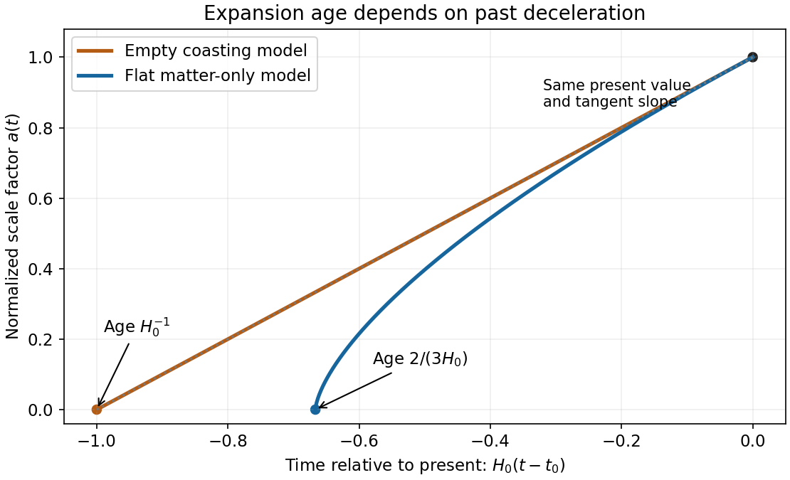

<h1 id="s2/3/c/solution">Solution</h1>

↑ **Parent:** [C](../c.md)

With zero curvature and no [cosmological constant](../../../../../cosmological-constant.md), the present [normalization](../../../../../normalization.md) requires $\Omega_M=1$. Thus $\dot a=H_0a^{-1/2}$, and choosing the big bang as $t=0$ gives

$$
\boxed{a(t)=\left(\frac{3H_0t}{2}\right)^{2/3},\qquad t_0=\frac2{3H_0}.}
$$

For an empty expanding model, $\Omega_k=1$ and the curvature must be negative. The equation becomes $\dot a=H_0$, giving

$$
\boxed{a(t)=H_0t,\qquad t_0=H_0^{-1}.}
$$

The latter is the Milne slicing of flat spacetime; its zero-scale-factor origin is not a matter-density curvature singularity. In the matter model, [gravity](../../../../../gravity.md) decelerates expansion, so the earlier slope was greater than the present slope and the same present size was reached in less [time](../../../../../time-in-physics.md). With the stipulated $H_0$, the two model ages are approximately $8.69$ and $13.0$ Gyr.

**[Figure 1](#s2/3/c/image-equal-present-expansion-rates-give-different-ages-when-matter-decelerates-expansion). Equal present expansion rates give different ages when matter decelerates expansion**. Both normalized scale factors reach one at the present and have the same slope there. The matter-only curve begins two thirds of a Hubble time before the present; the empty coasting curve begins one Hubble time before it.

## ↑ Ancestors (12)

1. [C](../c.md)
2. [3](../../3.md)
3. [S2](../../../s2.md)
4. [2018](../../../../2018-split.md)
5. [Past exam of the short options paper shared by Prelims and Parts A and B of the physics course of the University of Oxford](../../../../split.md)
6. [Short options paper shared by Prelims and Parts A and B of the physics course of the University of Oxford](../../../../../short-options-paper-shared-by-prelims-and-parts-a-and-b-of-the-physics-course-of-the-university-of-oxford.md)
7. [Physics course of the University of Oxford](../../../../../physics-course-of-the-university-of-oxford.md)
8. [Undergraduate course of the University of Oxford](../../../../../undergraduate-course-of-the-university-of-oxford.md)
9. [Course of the University of Oxford](../../../../../course-of-the-university-of-oxford.md)
10. [University of Oxford](../../../../../university-of-oxford-split.md)
11. [List of universities](../../../../../list-of-universities.md)
12. [Codex Wiki](../../../../../split.md)
