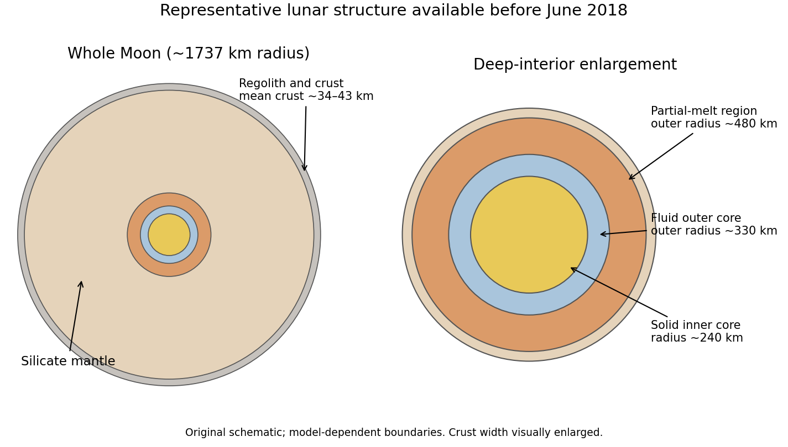

<h1 id="s29/1/solution">Solution</h1>

↑ **Parent:** [1](../1.md)

[Hydrostatic equilibrium](../../../../hydrostatic-equilibrium.md) means that the local [pressure](../../../../pressure-split.md) gradient balances [gravity](../../../../gravity.md), with no large [acceleration](../../../../acceleration.md) or strength-supported departure from that balance. In a spherical [planet](../../../../planet.md),

$$
\boxed{\frac{dP}{dr}=-\rho(r)\frac{GM(r)}{r^2}.}
$$

Here $M(r)$ is the enclosed [mass](../../../../mass.md), not a constant total [mass](../../../../mass.md) at every interior [radius](../../../../radius.md). If composition is uniform and the radial thermodynamic path is adiabatic, the relevant [bulk modulus](../../../../bulk-modulus.md) is $K_s=\rho(dP/d\rho)_s$. The [chain rule](../../../../chain-rule.md) then gives the Adams-Williamson relation

$$
\boxed{\frac{d\rho}{dr}=\frac{\rho}{K_s}\frac{dP}{dr}
=-\frac{GM(r)\rho^2}{K_s r^2}.}
$$

A [phase](../../../../phase-waves.md) transition or composition jump must be treated separately; its [density](../../../../density.md) change is not obtained by integrating one smooth homogeneous-adiabatic equation through it.

The [seismic parameter](../../../../seismic-parameter.md) is

$$
\boxed{\Phi=V_P^2-\frac43V_S^2=\frac{K_s}{\rho},\qquad
\frac{d\rho}{dr}=-\frac{GM(r)\rho}{r^2\Phi}.}
$$

The [shear modulus](../../../../shear-modulus.md) $\mu$ measures resistance to shear deformation. Solids with $\mu>0$ transmit shear waves; an ideal fluid has zero static [shear modulus](../../../../shear-modulus.md), so it cannot carry a bulk [S wave](../../../../s-wave.md), while compressional [P waves](../../../../p-wave.md) can still propagate through its nonzero [bulk modulus](../../../../bulk-modulus.md).

Limitations include uncertain seismic coverage, [temperature](../../../../temperature-split.md) and composition tradeoffs, nonadiabatic boundary layers, [phase](../../../../phase-waves.md) changes, lateral heterogeneity, [rotation](../../../../rotation-mathematics.md) and finite material strength. Small asteroids and comet nuclei commonly retain irregular shapes because their self-gravity is too weak to overcome strength and impact history; a few larger bodies, such as Ceres, are much closer to global hydrostatic figures. A spherical shape alone is not a complete proof of present [hydrostatic equilibrium](../../../../hydrostatic-equilibrium.md).

Two complementary remote constraints are precise spacecraft tracking, which measures gravitational harmonics and constrains [mass](../../../../mass.md) distribution when combined with shape and [rotation](../../../../rotation-mathematics.md); and tidal or rotational measurements, such as [Love numbers](../../../../love-number.md), [librations](../../../../libration.md) and [spin](../../../../spin.md) [precession](../../../../precession.md), which constrain deformability, [moment of inertia](../../../../moment-of-inertia.md) and possible fluid layers. Magnetic induction measurements in a time-varying external field can provide an additional conductivity constraint, but are not a unique [density](../../../../density.md) inversion.

For the **June 2018** lunar picture, start with a [regolith](../../../../regolith.md) and fractured [crust](../../../../planetary-crust.md), a largely anorthositic [crust](../../../../planetary-crust.md) tens of kilometres thick, a silicate [mantle](../../../../planetary-mantle.md), a deep partially molten region and a small iron-rich core. GRAIL and Apollo-based models gave a global mean crustal thickness around $34$-$43$ km.[abstract: mean crustal thickness and [gravity](../../../../gravity.md)/seismic constraints](../../../../the-crust-of-the-moon-as-seen-by-grail-by-mark-a-wieczorek-and-colleagues.md) A representative seismic model has a partial-melt boundary near [radius](../../../../radius.md) $480$ km, a liquid outer-core boundary near $330$ km and a solid inner-core [radius](../../../../radius.md) near $240$ km; these are model-dependent **[radii](../../../../radius.md) from the centre**, not depths below the surface.[core-reflection analysis and inferred layer [radii](../../../../radius.md)](../../../../seismic-detection-of-the-layers-of-the-lunar-core-by-renee-c-weber-and-colleagues.md)

**[Figure 5](#s29/1/image-a-representative-pre-june-2018-lunar-interior-model). A representative pre-June-2018 lunar interior model**. An original schematic cross-section labels the crust, silicate mantle, deep partial-melt region, fluid outer core and solid inner core. Approximate central layer radii are 480, 330 and 240 kilometres; the thin crust is shown with a visually enlarged width and all boundaries are model dependent.

The long-running Apollo network had only four principal stations on the near side, with poor global coverage and strong scattering in the fractured near-surface material. Far-side structure and weak deep reflected [phases](../../../../phase-waves.md) were therefore difficult to constrain. The historical date matters: the answer does not import later Mars seismology or later lunar-core refinements into the 2018 premise.

## ↑ Ancestors (11)

1. [1](../1.md)
2. [S29](../../s29.md)
3. [2018](../../../2018-split.md)
4. [Past exam of the short options paper shared by Prelims and Parts A and B of the physics course of the University of Oxford](../../../split.md)
5. [Short options paper shared by Prelims and Parts A and B of the physics course of the University of Oxford](../../../../short-options-paper-shared-by-prelims-and-parts-a-and-b-of-the-physics-course-of-the-university-of-oxford.md)
6. [Physics course of the University of Oxford](../../../../physics-course-of-the-university-of-oxford.md)
7. [Undergraduate course of the University of Oxford](../../../../undergraduate-course-of-the-university-of-oxford.md)
8. [Course of the University of Oxford](../../../../course-of-the-university-of-oxford.md)
9. [University of Oxford](../../../../university-of-oxford-split.md)
10. [List of universities](../../../../list-of-universities.md)
11. [Codex Wiki](../../../../split.md)
