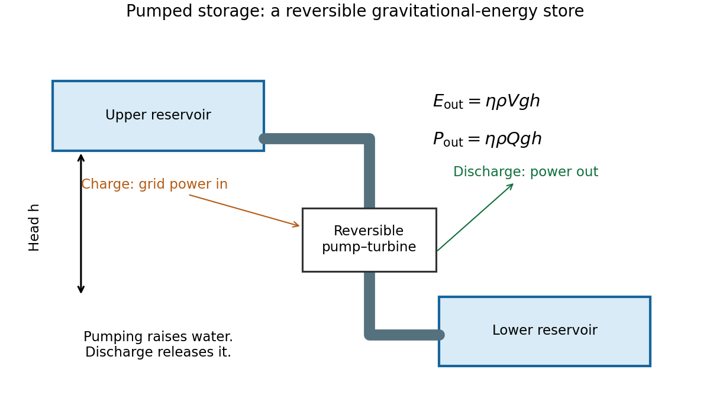

<h1 id="s4/2/solution">Solution</h1>

↑ **Parent:** [2](../2.md)

A pumped-storage plant moves water uphill using electrical [power](../../../../power.md), then returns it through a turbine and generator when electricity is needed. The upper and lower reservoirs set the usable [volume](../../../../volume.md) and head; pumps, penstocks, valves and reversible pump-turbines set the [power](../../../../power.md) and flow. The plant stores [energy](../../../../energy-split.md) rather than generating net [energy](../../../../energy-split.md) over a cycle.

**[Figure 2](#s4/2/image-gravitational-storage-separates-reservoir-energy-capacity-from-pump-and-turbine-power). Gravitational storage separates reservoir energy capacity from pump and turbine power**. An original functional diagram shows an upper and a lower reservoir connected through a penstock and reversible pump-turbine. Charging uses grid electricity to lift water; discharge returns gravitational potential energy through the generator.

For constant head, the gravitational [energy](../../../../energy-split.md) is $E_g=\rho Vgh$. With the stated generation efficiency,

$$
\boxed{E_{\rm usable}=0.89(1000)(1.4\times10^7)(9.81)(400)
\simeq4.89\times10^{13}\,\mathrm J=13.6\,\mathrm{GWh}.}
$$

At $3$ GW, $P=\eta\rho gQh$ gives

$$
\boxed{Q\simeq8.59\times10^2\,\mathrm{m^3\,s^{-1}},\qquad
 t_{\rm full}=E_{\rm usable}/P\simeq4.53\,\mathrm h.}
$$

Head variation, dead [volume](../../../../volume.md) and hydraulic losses beyond the stipulated efficiency have been neglected.

To deliver $9$ kWh with the same head and efficiency needs $V\simeq9.3\,\mathrm{m^3}$ of water, roughly a $2.1$ m cube, together with a $400$ m elevation difference and a lower reservoir. At a $10$ m head it would need about $370\,\mathrm{m^3}$. This contrasts with the small fuel [volume](../../../../volume.md): the useful [energy](../../../../energy-split.md) [density](../../../../density.md) of lifted water depends on its external head, not its chemical composition.

[Pumped storage](../../../../pumped-storage-hydroelectricity.md) offers long service life, fast dispatch, substantial [power](../../../../power.md), and separate choices of storage [volume](../../../../volume.md) and turbine rating. Its drawbacks include geographic constraints, construction cost and [time](../../../../time-in-physics.md), ecological impacts, evaporation and water requirements, plus round-trip losses. The quoted generation efficiency alone is not the [round-trip efficiency](../../../../round-trip-efficiency.md) because pumping also consumes more than the stored [potential energy](../../../../potential-energy.md).

The rock cylinder has [mass](../../../../mass.md) $\rho_r\pi r^2(2r)$ and rises through $r$. Equating its useful [energy](../../../../energy-split.md) to the reservoir result cancels the common efficiency and [gravity](../../../../gravity.md):

$$
2\pi\rho_r r^4=\rho_wVh,\qquad
\boxed{r=\left[\frac{1000(1.4\times10^7)(400)}{2\pi(3000)}\right]^{1/4}
\simeq131\,\mathrm m.}
$$

Its height is about $262$ m and its lift about $131$ m, ignoring buoyancy as instructed. Stored [energy](../../../../energy-split.md) scales as $r^4$, excavated [volume](../../../../volume.md) roughly as $r^3$, and lined area as $r^2$. If excavation dominates cost, cost per unit stored [energy](../../../../energy-split.md) decreases approximately as $r^{-1}$. Seals, increasing [pressure](../../../../pressure-split.md), geology, leakage, supporting structure and [power](../../../../power.md) equipment can change that scaling; a [volume](../../../../volume.md) law is not a complete cost model.

## ↑ Ancestors (11)

1. [2](../2.md)
2. [S4](../../s4.md)
3. [2018](../../../2018-split.md)
4. [Past exam of the short options paper shared by Prelims and Parts A and B of the physics course of the University of Oxford](../../../split.md)
5. [Short options paper shared by Prelims and Parts A and B of the physics course of the University of Oxford](../../../../short-options-paper-shared-by-prelims-and-parts-a-and-b-of-the-physics-course-of-the-university-of-oxford.md)
6. [Physics course of the University of Oxford](../../../../physics-course-of-the-university-of-oxford.md)
7. [Undergraduate course of the University of Oxford](../../../../undergraduate-course-of-the-university-of-oxford.md)
8. [Course of the University of Oxford](../../../../course-of-the-university-of-oxford.md)
9. [University of Oxford](../../../../university-of-oxford-split.md)
10. [List of universities](../../../../list-of-universities.md)
11. [Codex Wiki](../../../../split.md)
