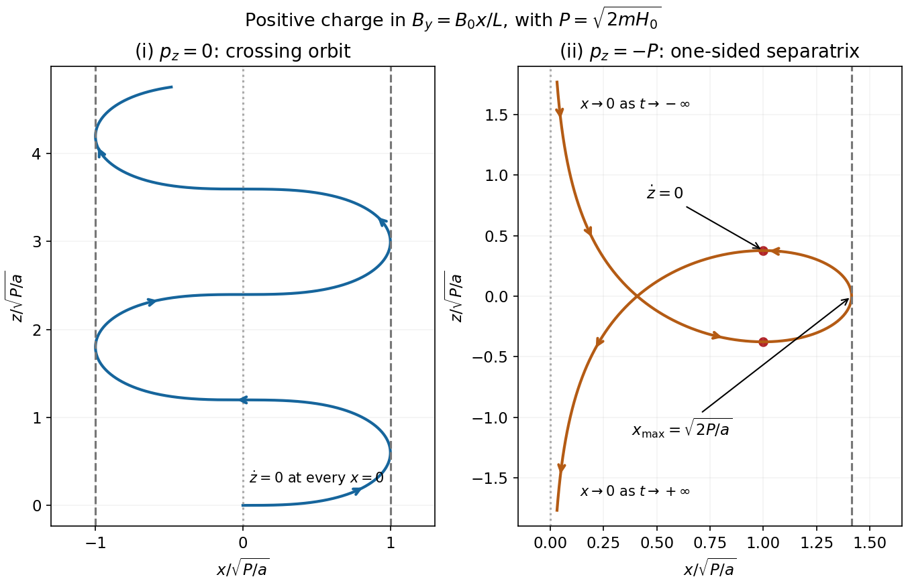

<h1 id="s7/1/f/i/solution">Solution</h1>

↑ **Parent:** [I](../i.md)

Dividing the two [velocities](../../../../../../velocity.md) gives

$$
\frac{dx}{dz}=\pm\frac{\sqrt{P^2-a^2x^4}}{ax^2},\qquad
\boxed{-X\le x\le X,\quad X=\sqrt{P/a}.}
$$

Here $\dot z=ax^2/m\ge0$: the orbit always advances toward increasing $z$, except for instantaneous zeros at each midplane crossing $x=0$. The transverse motion oscillates between $-X$ and $X$. At these outer turning points $\dot x=0$ and the [trajectory](../../../../../../trajectory.md) is tangent to the $z$ direction; at the midplane $\dot x\ne0$ while $\dot z=0$, so the tangent is along $x$. The sign of the initial $\dot x$ only chooses the [phase](../../../../../../phase-waves.md) or reflected [trace](../../../../../../matrix-trace.md).

**[Figure 3](#s7/1/f/i/image-crossing-and-separatrix-orbits-in-a-reversing-magnetic-field). Crossing and separatrix orbits in a reversing magnetic field**. The left panel shows the orbit with zero conserved axial canonical momentum, advancing monotonically in z. The right panel shows a positive-x separatrix with the negative extreme canonical momentum; its arrows and marked axial-velocity zeros distinguish it from an ordinary periodic orbit. Both panels use dimensionless coordinates.

## ↑ Ancestors (13)

1. [I](../i.md)
2. [F](../../f.md)
3. [1](../../../1.md)
4. [S7](../../../../s7.md)
5. [2018](../../../../../2018-split.md)
6. [Past exam of the short options paper shared by Prelims and Parts A and B of the physics course of the University of Oxford](../../../../../split.md)
7. [Short options paper shared by Prelims and Parts A and B of the physics course of the University of Oxford](../../../../../../short-options-paper-shared-by-prelims-and-parts-a-and-b-of-the-physics-course-of-the-university-of-oxford.md)
8. [Physics course of the University of Oxford](../../../../../../physics-course-of-the-university-of-oxford.md)
9. [Undergraduate course of the University of Oxford](../../../../../../undergraduate-course-of-the-university-of-oxford.md)
10. [Course of the University of Oxford](../../../../../../course-of-the-university-of-oxford.md)
11. [University of Oxford](../../../../../../university-of-oxford-split.md)
12. [List of universities](../../../../../../list-of-universities.md)
13. [Codex Wiki](../../../../../../split.md)
