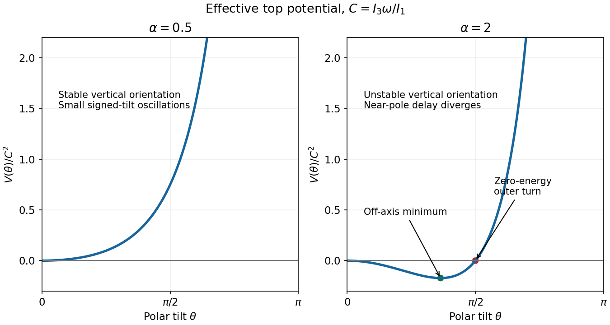

<h1 id="s7/2/d/i/solution">Solution</h1>

↑ **Parent:** [I](../i.md)

Put $u=\cos^2(\theta/2)$. Then $V/C^2=u^{-1}-1-\alpha+\alpha u$. For $\alpha<1$ it increases from zero at the north pole to infinity as $\theta\to\pi$ and has no interior minimum. The vertical orientation is stable. Near zero,

$$
V\simeq\frac{C^2(1-\alpha)}4\theta^2.
$$

For $\omega_0/C\ll1$, away from the marginal case $\alpha=1$, this gives

$$
\boxed{\theta_{\max}\simeq\frac{2\omega_0}{C\sqrt{1-\alpha}},\qquad
\Omega=\frac C2\sqrt{1-\alpha}.}
$$

The locally signed tilt oscillates at [angular frequency](../../../../../../angular-frequency.md) $\Omega$, while the azimuth precesses approximately at $C/2$. The nonnegative polar coordinate is $\theta\simeq\theta_{\max}|\sin\Omega t|$, so its successive pole-to-pole excursions have period $\pi/\Omega$ and angular repetition [frequency](../../../../../../frequency.md) $2\Omega$. Stating this convention avoids confusing a signed small displacement with the polar-angle magnitude. The full axis direction combines that excursion with [precession](../../../../../../precession.md).

**[Figure 4](#s7/2/d/i/image-the-vertical-spinning-top-changes-from-a-stable-minimum-to-an-unstable-maximum). The vertical spinning top changes from a stable minimum to an unstable maximum**. Dimensionless effective potentials are shown for alpha equal to 0.5 and 2. The second panel marks the off-axis minimum and the zero-energy turning angle approached by a near-separatrix excursion.

## ↑ Ancestors (13)

1. [I](../i.md)
2. [D](../../d.md)
3. [2](../../../2.md)
4. [S7](../../../../s7.md)
5. [2018](../../../../../2018-split.md)
6. [Past exam of the short options paper shared by Prelims and Parts A and B of the physics course of the University of Oxford](../../../../../split.md)
7. [Short options paper shared by Prelims and Parts A and B of the physics course of the University of Oxford](../../../../../../short-options-paper-shared-by-prelims-and-parts-a-and-b-of-the-physics-course-of-the-university-of-oxford.md)
8. [Physics course of the University of Oxford](../../../../../../physics-course-of-the-university-of-oxford.md)
9. [Undergraduate course of the University of Oxford](../../../../../../undergraduate-course-of-the-university-of-oxford.md)
10. [Course of the University of Oxford](../../../../../../course-of-the-university-of-oxford.md)
11. [University of Oxford](../../../../../../university-of-oxford-split.md)
12. [List of universities](../../../../../../list-of-universities.md)
13. [Codex Wiki](../../../../../../split.md)
