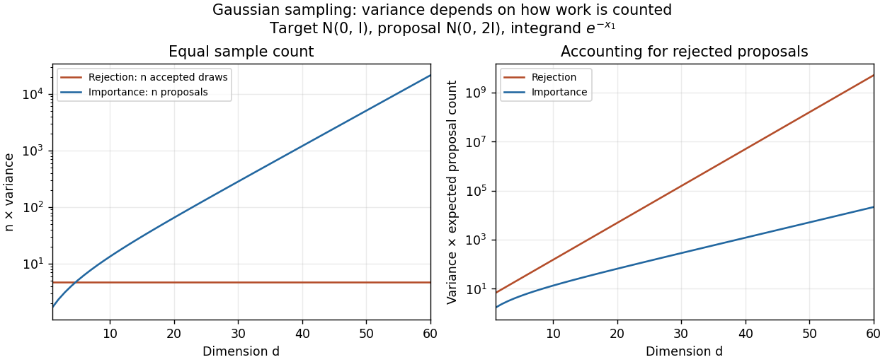

# 2021

↑ **Parent:** [Past exam of the simulation and statistical programming course of the University of Oxford](../past-exam-of-the-simulation-and-statistical-programming-course-of-the-university-of-oxford.md)

Source: [Oxford's released examination PDF, pages 203–206](https://www.whatdotheyknow.com/request/bsc_mathematics_part_a_examinati/response/2820674/attach/3/FOI%20202410%20944%20Data.pdf#page=203), dated 24 June 2021. The cover is on page 203; questions 1, 2 and 3 are on pages 204, 205 and 206 respectively. All three questions and all 19 smallest answer parts are solved below, including the third question although only the best two counted towards the examination mark. The original PDF confirms the inconsistent return-field name in 3(c)(ii), addressed there.

**Table of contents**

- [1](#1)
  - [a](#1/a)
    - [Solution](#1/a/solution)
  - [b](#1/b)
    - [Solution](#1/b/solution)
  - [c](#1/c)
    - [Solution](#1/c/solution)
  - [d](#1/d)
    - [i](#1/d/i)
      - [Solution](#1/d/i/solution)
    - [ii](#1/d/ii)
      - [Solution](#1/d/ii/solution)
    - [iii](#1/d/iii)
      - [Solution](#1/d/iii/solution)
- [2](#2)
  - [a](#2/a)
    - [i](#2/a/i)
      - [Solution](#2/a/i/solution)
    - [ii](#2/a/ii)
      - [Solution](#2/a/ii/solution)
    - [iii](#2/a/iii)
      - [Solution](#2/a/iii/solution)
  - [b](#2/b)
    - [i](#2/b/i)
      - [Solution](#2/b/i/solution)
    - [ii](#2/b/ii)
      - [Solution](#2/b/ii/solution)
- [3](#3)
  - [a](#3/a)
    - [i](#3/a/i)
      - [Solution](#3/a/i/solution)
    - [ii](#3/a/ii)
      - [Solution](#3/a/ii/solution)
    - [iii](#3/a/iii)
      - [Solution](#3/a/iii/solution)
  - [b](#3/b)
    - [i](#3/b/i)
      - [Solution](#3/b/i/solution)
    - [ii](#3/b/ii)
      - [Solution](#3/b/ii/solution)
  - [c](#3/c)
    - [i](#3/c/i)
      - [Solution](#3/c/i/solution)
    - [ii](#3/c/ii)
      - [Solution](#3/c/ii/solution)
    - [iii](#3/c/iii)
      - [Solution](#3/c/iii/solution)

## 1

↑ **Parent:** [2021](2021.md)

<h3 id="1/a">a</h3>

↑ **Parent:** [1](#1)

<h4 id="1/a/solution">Solution</h4>

↑ **Parent:** [A](#1/a)

Write $s=\sigma^2\geq1$. The two [multivariate normal distribution](../probability-and-statistics.md#multivariate-normal-distribution) [probability density functions](../continuous-probability-distribution.md#probability-density-function) have ratio

$$
w(x)=\frac{p(x)}{q(x)}=s^{d/2}\exp\!\left[-\frac12(1-s^{-1})\|x\|^2\right].
$$

Here $\|x\|$ is the [Euclidean norm](../normed-vector-space.md#euclidean-norm). Consequently the smallest [rejection sampling](../monte-carlo-method.md#rejection-sampling) envelope constant, and its acceptance [probability](../probability-theory.md#probability), are

$$
\boxed{M_*=\sup_xw(x)=s^{d/2}=\sigma^d,\qquad \mathbb P(\mathrm{accept})=s^{-d/2}.}
$$

The supremum is attained at $x=0$; hence no smaller constant can dominate the ratio. Draw $Y\sim N(0,sI_d)$ and an [independent](../random-variable.md#independent-random-variables) $U$ from the [uniform distribution](../continuous-probability-distribution.md#continuous-uniform-distribution) on $(0,1)$. Accept $Y$ when

$$
\boxed{U\leq\exp\!\left[-\frac12(1-s^{-1})\|Y\|^2\right];}
$$

otherwise repeat with fresh [independent random variables](../random-variable.md#independent-random-variables). One can generate $Y=\sqrt s\,G$ using a [random vector](../random-variable.md#random-vector) $G$ with [independent](../random-variable.md#independent-random-variables) [standard normal distribution](../probability-distribution.md#standard-normal-distribution) coordinates.

For any [measurable set](../measure-theory.md#measurable-set) $B$, the joint acceptance [probability](../probability-theory.md#probability) is $\int_Bq(y)p(y)/(M_*q(y))\,dy=M_*^{-1}\int_Bp(y)\,dy$. Dividing by $1/M_*$ proves that the returned [random vector](../random-variable.md#random-vector) has [probability density function](../continuous-probability-distribution.md#probability-density-function) $p$. The number of proposals has a [geometric distribution](../discrete-probability-distribution.md#geometric-distribution) on the positive integers, with [expected value](../expected-value.md) $M_*$. When $s=1$, every proposal is accepted.

<h3 id="1/b">b</h3>

↑ **Parent:** [1](#1)

<h4 id="1/b/solution">Solution</h4>

↑ **Parent:** [B](#1/b)

The [moment-generating function](../probability-distribution.md#moment-generating-function) of a [standard normal distribution](../probability-distribution.md#standard-normal-distribution) gives $\mathbb E[e^{tX_j}]=e^{t^2/2}$. Using [independence](../random-variable.md#independent-random-variables) of the coordinates,

$$
\theta=\mathbb E_p[\phi(X)]=\prod_{j=1}^d\mathbb E[e^{-X_j}]=e^{d/2},\qquad
\mathbb E_p[\phi(X)^2]=\prod_{j=1}^d\mathbb E[e^{-2X_j}]=e^{2d}.
$$

The accepted draws are [independent and identically distributed random variables](../random-variable.md#independent-and-identically-distributed-random-variables), so their [sample mean](../variance.md#sample-mean) is an [unbiased estimator](../statistical-modelling.md#unbiased-estimator) and has [variance](../variance.md)

$$
\boxed{\operatorname{Var}(\widehat\theta_n^{\mathrm{RS}})=\frac{e^{2d}-e^d}{n}.}
$$

This counts $n$ accepted draws, requiring $n\sigma^d$ proposals in [expectation](../expected-value.md).

<h3 id="1/c">c</h3>

↑ **Parent:** [1](#1)

<h4 id="1/c/solution">Solution</h4>

↑ **Parent:** [C](#1/c)

An [importance weight](../monte-carlo-method.md#importance-weight) has [expected value](../expected-value.md) $\mathbb E_q[w(Z)]=\int p(z)\,dz=1$. From the ratio in (a),

$$
\mathbb E_q[w(Z)^2]
=s^d\prod_{j=1}^d\mathbb E_{Z_j\sim N(0,s)}\!\left[e^{-(1-s^{-1})Z_j^2}\right].
$$

The supplied [normal distribution](../probability-distribution.md#normal-distribution) transform applies with quadratic coefficient $-(1-s^{-1})$, giving each factor $(2s-1)^{-1/2}$. Thus

$$
\boxed{\operatorname{Var}_q(w(Z))=\left(\frac{s}{\sqrt{2s-1}}\right)^d-1.}
$$

For $s>1$, the base $A:=s/\sqrt{2s-1}$ exceeds one because $s^2-(2s-1)=(s-1)^2>0$: [importance weight](../monte-carlo-method.md#importance-weight) [variance](../variance.md) increases exponentially with dimension. For $s=1$, the [importance weight](../monte-carlo-method.md#importance-weight) is identically one and its [variance](../variance.md) is zero. This calculation concerns the [importance weight](../monte-carlo-method.md#importance-weight), rather than the weighted integrand.

<h3 id="1/d">d</h3>

↑ **Parent:** [1](#1)

<h4 id="1/d/i">i</h4>

↑ **Parent:** [D](#1/d)

<h5 id="1/d/i/solution">Solution</h5>

↑ **Parent:** [I](#1/d/i)

For the new integrand, $\theta=\mathbb E_p[e^{-X_1}]=e^{1/2}$ and $\operatorname{Var}_p(e^{-X_1})=e^2-e$, independently of dimension. [Chebyshev's inequality](../probability-inequality.md#chebyshev-s-inequality) therefore yields

$$
\mathbb P\!\left(|\widehat\theta_n^{\mathrm{RS}}-\theta|\geq\varepsilon\right)
\leq\frac{e^2-e}{n\varepsilon^2}.
$$

A sufficient positive integer sample count is

$$
\boxed{n=\left\lceil\frac{e^2-e}{\delta\varepsilon^2}\right\rceil.}
$$

The [ceiling function](../calculus.md#ceiling-function) ensures that the bound is at most $\delta$, so the strict-error event in the question has [probability](../probability-theory.md#probability) at least $1-\delta$. The required number of accepted draws is independent of $d$; their expected proposal count is $n\sigma^d$.

<h4 id="1/d/ii">ii</h4>

↑ **Parent:** [D](#1/d)

<h5 id="1/d/ii/solution">Solution</h5>

↑ **Parent:** [Ii](#1/d/ii)

**At equal sample count, rejection sampling eventually has smaller variance for fixed $\sigma^2>1$; at equal expected proposal cost, importance sampling eventually wins.** The distinction matters because a sample of the [rejection sampling](../monte-carlo-method.md#rejection-sampling) estimator means an accepted draw.

For the [importance sampling](../monte-carlo-method.md#importance-sampling) estimator, all coordinates contribute to the [importance weight](../monte-carlo-method.md#importance-weight) although only one enters the integrand. The same [normal distribution](../probability-distribution.md#normal-distribution) transform as in (c), now with linear coefficient $-2$ for coordinate one, gives

$$
\mathbb E_q[(w(Z)e^{-Z_1})^2]
=A^d\exp\!\left(\frac{2s}{2s-1}\right),\qquad A=\frac{s}{\sqrt{2s-1}}.
$$

Both estimators are [unbiased estimators](../statistical-modelling.md#unbiased-estimator) of $\sqrt e$, and

$$
\boxed{\operatorname{Var}(\widehat\theta_n^{\mathrm{IS}})
=\frac{A^d e^{2s/(2s-1)}-e}{n},\qquad
\operatorname{Var}(\widehat\theta_n^{\mathrm{RS}})=\frac{e^2-e}{n}.}
$$

For fixed $s>1$, the first [variance](../variance.md) grows exponentially while the second stays constant. This is the benefit of returning exact target draws in [rejection sampling](../monte-carlo-method.md#rejection-sampling). However, obtaining those draws costs $s^{d/2}$ proposals each on average.

To compare computational work, multiply each [variance](../variance.md) by its expected proposal count. For [importance sampling](../monte-carlo-method.md#importance-sampling) that count is $n$; for [rejection sampling](../monte-carlo-method.md#rejection-sampling) it is $ns^{d/2}$. The ratio of the resulting cost-normalized [variances](../variance.md) is

$$
\boxed{\frac{A^d e^{2s/(2s-1)}-e}{s^{d/2}(e^2-e)}\longrightarrow0\quad(d\to\infty),}
$$

because $A/\sqrt s=\sqrt{s/(2s-1)}<1$. Thus [importance sampling](../monte-carlo-method.md#importance-sampling) eventually gives better precision for the same expected number of proposals, assuming comparable work per proposal. This is an asymptotic cost comparison, not a guarantee that a fixed small computing budget produces any accepted draws. Both methods still deteriorate exponentially in this comparison. For $s=1$ they coincide and every proposal is accepted.

<a id="1/d/ii/image-sample-count-and-expected-proposal-cost-comparisons-for-the-one-coordinate-integrand-at-sigma-squared-equal-to-two"></a>


**[Figure 1](#1/d/ii/image-sample-count-and-expected-proposal-cost-comparisons-for-the-one-coordinate-integrand-at-sigma-squared-equal-to-two). Sample-count and expected-proposal-cost comparisons for the one-coordinate integrand at sigma squared equal to two**.

A practical improvement is to exploit the integrand's one-coordinate structure directly: average $e^{-G_1}$ for [standard normal distribution](../probability-distribution.md#standard-normal-distribution) draws $G_1$, without generating unused coordinates. The optimal change of [proposal distribution](../bayesian-statistics.md#proposal-distribution) in (iii) improves further.

<h4 id="1/d/iii">iii</h4>

↑ **Parent:** [D](#1/d)

<h5 id="1/d/iii/solution">Solution</h5>

↑ **Parent:** [Iii](#1/d/iii)

The integrand is positive, so the [minimum-variance importance distribution](../monte-carlo-method.md#minimum-variance-importance-distribution) is its target-weighted [probability density function](../continuous-probability-distribution.md#probability-density-function), normalized by $\theta=\sqrt e$:

$$
\boxed{q^\star(z)=\frac{e^{-z_1}p(z)}{\sqrt e}.}
$$

By [completing the square](../polynomial.md#completing-the-square),

$$
-z_1-\frac12z_1^2-\frac12=-\frac12(z_1+1)^2.
$$

Thus $q^\star$ is the [multivariate normal distribution](../probability-and-statistics.md#multivariate-normal-distribution) $N(-e_1,I_d)$, where $e_1=(1,0,\ldots,0)$ is the first [standard basis](../vector-space.md#standard-basis) vector. Its [importance weight](../monte-carlo-method.md#importance-weight) and weighted integrand are

$$
\boxed{w^\star(z)=e^{z_1+1/2},\qquad
w^\star(z)e^{-z_1}=\sqrt e,\qquad
\min_q\operatorname{Var}(\widehat\theta_n^{\mathrm{IS}})=0.}
$$

A [variance](../variance.md) cannot be negative, and this proposal makes every summand constant, proving optimality directly. It is admissible under the arbitrary-proposal condition even though its [mean vector](../random-variable.md#mean-vector) is not zero. Although optimal proposals usually involve an unknown normalizing integral, here both that integral and the resulting [normal distribution](../probability-distribution.md#normal-distribution) are explicit.

## 2

↑ **Parent:** [2021](2021.md)

<h3 id="2/a">a</h3>

↑ **Parent:** [2](#2)

<h4 id="2/a/i">i</h4>

↑ **Parent:** [A](#2/a)

<h5 id="2/a/i/solution">Solution</h5>

↑ **Parent:** [I](#2/a/i)

For the [exponential distribution](../continuous-probability-distribution.md#exponential-distribution) with rate $\lambda$, the [cumulative distribution function](../probability-distribution.md#cumulative-distribution-function) is $F(x)=1-e^{-\lambda x}$ for $x\geq0$, and zero for $x<0$. Its [quantile function](../probability-distribution.md#quantile-function) is

$$
\boxed{F^{-1}(u)=-\frac{\log(1-u)}{\lambda},\qquad0<u<1.}
$$

For [inverse transform sampling](../probability-distribution.md#inverse-transform-sampling), draw $U$ from the [uniform distribution](../continuous-probability-distribution.md#continuous-uniform-distribution) on $(0,1)$ and return $-\log(1-U)/\lambda$. Equivalently return $-\log U/\lambda$, since $1-U$ has the same [uniform distribution](../continuous-probability-distribution.md#continuous-uniform-distribution). Indeed, for $x\geq0$, $\mathbb P(-\log U/\lambda>x)=\mathbb P(U<e^{-\lambda x})=e^{-\lambda x}$.

<h4 id="2/a/ii">ii</h4>

↑ **Parent:** [A](#2/a)

<h5 id="2/a/ii/solution">Solution</h5>

↑ **Parent:** [Ii](#2/a/ii)

Integrating the [conditional distribution](../probability-theory.md#conditional-distribution) against the [exponential distribution](../continuous-probability-distribution.md#exponential-distribution) [probability density function](../continuous-probability-distribution.md#probability-density-function) gives, for integer $k\geq0$,

$$
\begin{aligned}
\mathbb P(Y=k)
&=\int_0^\infty\frac{e^{-x}x^k}{k!}\lambda e^{-\lambda x}\,dx\\
&=\frac{\lambda}{k!}\frac{\Gamma(k+1)}{(1+\lambda)^{k+1}}
=\frac{\lambda}{1+\lambda}\left(\frac1{1+\lambda}\right)^k.
\end{aligned}
$$

Here the [gamma function](../complex-analysis.md#gamma-function) identity $\Gamma(k+1)=k!$ evaluates the integral. Hence

$$
\boxed{Y\sim\operatorname{Geom}\!\left(\frac{\lambda}{1+\lambda}\right)}
$$

on $\{0,1,2,\ldots\}$. Put $r=1/(1+\lambda)$ and $\rho=1-r$. The [geometric series](../sequence-and-series.md#geometric-series) gives $F(k)=1-r^{k+1}$. Its generalized inverse, the [quantile function](../probability-distribution.md#quantile-function), is

$$
\boxed{F^{-1}(u)=\left\lceil\frac{\log(1-u)}{\log r}\right\rceil-1,\qquad0<u<1.}
$$

This is the smallest nonnegative integer $k$ for which $1-r^{k+1}\geq u$; dividing by $\log r<0$ reverses the inequality. Draw $U$ from the [uniform distribution](../continuous-probability-distribution.md#continuous-uniform-distribution) on $(0,1)$ and use this formula. The commonly used expression $\lfloor\log(1-U)/\log r\rfloor$ has the same [probability distribution](../probability-distribution.md), but differs from the exact generalized inverse when $U$ is precisely a jump value of the [cumulative distribution function](../probability-distribution.md#cumulative-distribution-function). Such values have [probability](../probability-theory.md#probability) zero for an ideal continuous uniform draw.

<h4 id="2/a/iii">iii</h4>

↑ **Parent:** [A](#2/a)

<h5 id="2/a/iii/solution">Solution</h5>

↑ **Parent:** [Iii](#2/a/iii)

Write $t=1-\rho\in(0,1)$. The target [Poisson distribution](../discrete-probability-distribution.md#poisson-distribution) and proposal [geometric distribution](../discrete-probability-distribution.md#geometric-distribution) have [probability mass functions](../probability-distribution.md#probability-mass-function) $p_k=e^{-\lambda}\lambda^k/k!$ and $q_k=(1-t)t^k$. Their ratio is

$$
R_k(t)=\frac{p_k}{q_k}=\frac{e^{-\lambda}}{1-t}\frac{(\lambda/t)^k}{k!}.
$$

The successive ratio $R_{k+1}/R_k=\lambda/[t(k+1)]$ shows that a maximizing integer is $m=\lfloor\lambda/t\rfloor$, with a tie at $m-1$ when $\lambda/t$ is an integer. Thus the tight envelope is

$$
\boxed{M(t)=\frac{e^{-\lambda}}{1-t}\frac{(\lambda/t)^m}{m!},\qquad m=\lfloor\lambda/t\rfloor.}
$$

For any fixed $t$, draw $Y\sim\operatorname{Geom}(1-t)$ using (ii)'s inversion formula with this new parameter, and draw an [independent](../random-variable.md#independent-random-variables) $U$ from the [uniform distribution](../continuous-probability-distribution.md#continuous-uniform-distribution) on $(0,1)$. Accept when

$$
\boxed{U\leq\frac{R_Y(t)}{M(t)}=\frac{m!}{Y!}\left(\frac{\lambda}{t}\right)^{Y-m};}
$$

otherwise restart. The acceptance [probability](../probability-theory.md#probability) is $1/M(t)$ and the expected number of proposals is $M(t)$.

To minimize that expected count, set $K=\lceil\lambda\rceil$. The exact answer is

$$
\boxed{t_* =\min\!\left\{\frac{\lambda}{K},\frac{K}{K+1}\right\},\qquad
\rho_*=1-t_*=\max\!\left\{1-\frac{\lambda}{K},\frac1{K+1}\right\}.}
$$

Here is a proof that includes the changes of maximizing integer. Each $\log R_k(t)$ is a [convex function](../real-analysis.md#convex-function) of $t$, since its second [derivative](../calculus.md#derivative) is $(1-t)^{-2}+k/t^2>0$. Their pointwise maximum $\log M(t)$ is also a [convex function](../real-analysis.md#convex-function). When $m$ is fixed its [derivative](../calculus.md#derivative) is

$$
\frac{d}{dt}\log M(t)=\frac1{1-t}-\frac mt.
$$

If $K-1<\lambda\leq K^2/(K+1)$, take $t_* =\lambda/K$, where $m$ changes from $K$ on the left to $K-1$ on the right. The left [derivative](../calculus.md#derivative) is nonpositive because $\lambda\leq K^2/(K+1)$; the right [derivative](../calculus.md#derivative) is nonnegative because $\lambda\geq K-1$. This is a minimum. If $K^2/(K+1)<\lambda\leq K$, take $t_*=K/(K+1)$. There $K<\lambda/t_*\leq K+1$ and the active branch has $m=K$ except for the endpoint tie; its [derivative](../calculus.md#derivative) vanishes. Convexity again proves the global minimum. The formulas agree at the boundary.

For a fully specified optimal algorithm, compute $K,t_*,\rho_*$ and $m_*=\lfloor\lambda/t_*\rfloor$ once, then use the preceding acceptance test with $t=t_*$ and $m=m_*$. At an integer tie either maximizing integer gives the same test. In code, factorials can be evaluated through the [logarithm](../calculus.md#logarithm) of the [gamma function](../complex-analysis.md#gamma-function):

$$
\log a_Y=\log\Gamma(m_*+1)-\log\Gamma(Y+1)+(Y-m_*)\log(\lambda/t_*),
$$

and acceptance is $\log U\leq\min(0,\log a_Y)$. This avoids overflowing factorials.

The optimum minimizes expected trials, the usual idealization of time when each proposal and test has constant cost. Actual runtime also depends on the implementation of discrete inversion and factorial evaluation. Simply minimizing an upper bound for $M(t)$ would not necessarily give the exact optimum above; see [optimal geometric envelope for a Poisson distribution](../monte-carlo-method.md#optimal-geometric-envelope-for-a-poisson-distribution).

<h3 id="2/b">b</h3>

↑ **Parent:** [2](#2)

<h4 id="2/b/i">i</h4>

↑ **Parent:** [B](#2/b)

<h5 id="2/b/i/solution">Solution</h5>

↑ **Parent:** [I](#2/b/i)

Because $U\in[0,1]$, the conditional acceptance [probability](../probability-theory.md#probability) is $a_k=\min(1,\lambda^k)$, even when the printed threshold exceeds one. Repeating rejected trials gives the [clipped acceptance reweighting identity](../monte-carlo-method.md#clipped-acceptance-reweighting-identity):

$$
\mathbb P(X=k)=\frac{e^{-\lambda}\lambda^k a_k/k!}{\sum_{j\geq0}e^{-\lambda}\lambda^j a_j/j!}.
$$

For $0<\lambda<1$, $a_k=\lambda^k$, including $a_0=1$. The denominator is $e^{-\lambda}\sum_k\lambda^{2k}/k!=e^{\lambda^2-\lambda}$, so

$$
\boxed{X\sim
\begin{cases}
\operatorname{Poisson}(\lambda^2),&0<\lambda<1,\\
\operatorname{Poisson}(\lambda),&\lambda\geq1.
\end{cases}}
$$

For $\lambda\geq1$ every proposal is accepted, so reweighting by $\lambda^k$ would be incorrect. At $\lambda=1$ both formulas agree. Termination has [probability](../probability-theory.md#probability) one since the acceptance [probability](../probability-theory.md#probability) is $e^{\lambda^2-\lambda}>0$ in the first case and one in the second.

<h4 id="2/b/ii">ii</h4>

↑ **Parent:** [B](#2/b)

<h5 id="2/b/ii/solution">Solution</h5>

↑ **Parent:** [Ii](#2/b/ii)

Define $a_y=\min\{1,\lambda^y/7\}$. Given $Y=y$, the direct-return branch has [probability](../probability-theory.md#probability) $a_y$, while the fallback branch distributes its remaining mass uniformly over $0,\ldots,y$. The [law of total probability](../probability-space.md#law-of-total-probability) therefore gives, for integer $x\geq0$,

$$
\boxed{\mathbb P(X=x)
=e^{-\lambda}\frac{\lambda^x}{x!}\min\!\left\{1,\frac{\lambda^x}{7}\right\}
+e^{-\lambda}\sum_{y=x}^{\infty}\frac{\lambda^y}{y!(y+1)}
\left(1-\min\!\left\{1,\frac{\lambda^y}{7}\right\}\right).}
$$

The summation includes $y=x$: a failed direct-return test can still return $x$ through the [discrete uniform distribution](../discrete-probability-distribution.md#discrete-uniform-distribution) draw. There is no rejection loop and no additional normalization. Summing the displayed [probability mass function](../probability-distribution.md#probability-mass-function) over $x$ gives $\sum_yp_y[a_y+(1-a_y)(y+1)/(y+1)]=1$. At $\lambda=1$, for example, $a_y=1/7$ at every $y$; it does not become one. This is an instance of the [accept-or-fallback mixture identity](../probability-space.md#accept-or-fallback-mixture-identity).

## 3

↑ **Parent:** [2021](2021.md)

<h3 id="3/a">a</h3>

↑ **Parent:** [3](#3)

<h4 id="3/a/i">i</h4>

↑ **Parent:** [A](#3/a)

<h5 id="3/a/i/solution">Solution</h5>

↑ **Parent:** [I](#3/a/i)

Let $r=1-p$. Since

$$
\frac{d}{dx}\log(1-r e^{-\beta x})
=\frac{\beta r e^{-\beta x}}{1-r e^{-\beta x}},
$$

integration from zero to $x>0$ gives $F(x)=(C/\beta)[\log(1-r e^{-\beta x})-\log p]$. Letting $x\to\infty$ and imposing unit total [probability](../probability-theory.md#probability) gives

$$
\boxed{C=-\frac{\beta}{\log p}>0,\qquad
F(x)=\begin{cases}
0,&x\leq0,\\
1-\dfrac{\log(1-(1-p)e^{-\beta x})}{\log p},&x>0.
\end{cases}}
$$

The [probability density function](../continuous-probability-distribution.md#probability-density-function) is positive for $x>0$ because $0<(1-p)e^{-\beta x}<1$. Consequently the [cumulative distribution function](../probability-distribution.md#cumulative-distribution-function) is increasing, starts at zero and tends to one. This verifies that the derived [normalizing constant](../continuous-probability-distribution.md#normalizing-constant) defines a [probability distribution](../probability-distribution.md). The family is the [exponential-logarithmic distribution](../continuous-probability-distribution.md#exponential-logarithmic-distribution) with the complementary mixing parameter $r=1-p$.

<h4 id="3/a/ii">ii</h4>

↑ **Parent:** [A](#3/a)

<h5 id="3/a/ii/solution">Solution</h5>

↑ **Parent:** [Ii](#3/a/ii)

Solving $u=F(x)$ gives $1-(1-p)e^{-\beta x}=p^{1-u}$. Hence the [quantile function](../probability-distribution.md#quantile-function) is

$$
\boxed{F^{-1}(u)=-\frac1\beta\log\!\left(\frac{1-p^{1-u}}{1-p}\right),\qquad0<u<1.}
$$

For such $u$, $p<p^{1-u}<1$, making the [logarithm](../calculus.md#logarithm)'s argument lie in $(0,1)$ and the output positive. Its endpoint limits are $F^{-1}(0)=0$ and $F^{-1}(1)=+\infty$. Substitution into (i)'s [cumulative distribution function](../probability-distribution.md#cumulative-distribution-function) recovers $u$.

<h4 id="3/a/iii">iii</h4>

↑ **Parent:** [A](#3/a)

<h5 id="3/a/iii/solution">Solution</h5>

↑ **Parent:** [Iii](#3/a/iii)

The following [R](../programming-language.md#r-programming-language) function performs [inverse transform sampling](../probability-distribution.md#inverse-transform-sampling) with [vectorized numerical computation](../numerical-analysis.md#vectorized-numerical-computation). It checks finite real scalar parameters, including a nonnegative integer sample count, and gives `beta` its requested default.

```
r_sample_f <- function(n, p, beta = 1) {
  scalar <- function(v) {
    is.numeric(v) && !is.complex(v) && length(v) == 1L &&
      is.finite(v)
  }
  if (!scalar(n) || n < 0 || n != floor(n))
    stop("n must be a nonnegative integer")
  if (!scalar(p) || p <= 0 || p >= 1)
    stop("p must lie strictly between 0 and 1")
  if (!scalar(beta) || beta <= 0)
    stop("beta must be positive")
  if (n == 0) return(numeric(0))
  v <- runif(n)
  (log1p(-p) - log(-expm1(v * log(p)))) / beta
}
```

Here $V=1-U$ is again a [uniform distribution](../continuous-probability-distribution.md#continuous-uniform-distribution) draw, so the expression is the [quantile function](../probability-distribution.md#quantile-function) from (ii). The function `expm1(t)` evaluates $e^t-1$ accurately when $t$ is small, avoiding cancellation in $1-p^V$; `log1p(-p)` evaluates $\log(1-p)$. For default bounds, `runif` excludes both endpoints, so this implementation does not deliberately generate the infinite endpoint of the [quantile function](../probability-distribution.md#quantile-function). It returns a numeric [vector](../vector-space.md#vector) of length `n`, including an empty [vector](../vector-space.md#vector) when `n = 0`. [Official R documentation: default runif draws exclude both endpoints](https://stat.ethz.ch/R-manual/R-devel/library/stats/html/Uniform.html) [Official R documentation: log1p and expm1 accurately evaluate small differences](https://stat.ethz.ch/R-manual/R-devel/library/base/html/Log.html)

<h3 id="3/b">b</h3>

↑ **Parent:** [3](#3)

<h4 id="3/b/i">i</h4>

↑ **Parent:** [B](#3/b)

<h5 id="3/b/i/solution">Solution</h5>

↑ **Parent:** [I](#3/b/i)

A numerical [power series](../sequence-and-series.md#power-series) evaluation needs a stopping rule. For $r=|z|<1$ and integer $a\geq0$, the absolute remainder after $N$ terms satisfies the [polylogarithm series remainder bound](../complex-analysis.md#polylogarithm-series-remainder-bound)

$$
\boxed{\left|\operatorname{Li}_a(z)-\sum_{k=1}^{N}\frac{z^k}{k^a}\right|
\leq\frac{r^{N+1}}{(N+1)^a(1-r)}.}
$$

Indeed $k^{-a}\leq(N+1)^{-a}$ for $k>N$, and the remaining powers sum as a [geometric series](../sequence-and-series.md#geometric-series). This also covers negative $z$. The code sums terms in vectors of at most 4096 entries, checking the bound after each block; there is no loop over individual terms.

```
polylog <- function(a, z, tol = 1e-10, max_terms = 1000000) {
  scalar <- function(v) {
    is.numeric(v) && !is.complex(v) && length(v) == 1L &&
      is.finite(v)
  }
  if (!scalar(a) || a < 0 || a != floor(a))
    stop("a must be a nonnegative integer")
  if (!scalar(z) || abs(z) >= 1)
    stop("z must be real with abs(z) < 1")
  if (!scalar(tol) || tol <= 0 || tol >= 1)
    stop("tol must lie strictly between 0 and 1")
  if (!scalar(max_terms) || max_terms < 1 ||
      max_terms != floor(max_terms))
    stop("max_terms must be a positive integer")
  if (z == 0) return(0)
  r <- abs(z)
  N <- 0
  ans <- 0
  repeat {
    if (N >= max_terms)
      stop("requested truncation tolerance not reached")
    B <- min(4096, max_terms - N)
    k <- seq.int(N + 1, N + B)
    ans <- ans + sum(z^k * exp(-a * log(k)))
    N <- N + B
    log_bound <- (N + 1) * log(r) - a * log(N + 1) - log1p(-r)
    if (log_bound <= log(tol)) return(ans)
  }
}
```

This accepts every positive integer order in the question, and also order zero if $0\in\mathbb N$ is the convention adopted. The bound controls absolute truncation error; floating-point rounding is a separate source of error. Close to $|z|=1$, convergence can be slow. If the resource limit is reached, the function reports failure instead of silently claiming the requested accuracy. Useful exact checks are $\operatorname{Li}_1(z)=-\log(1-z)$ and $\operatorname{Li}_0(z)=z/(1-z)$.

<h4 id="3/b/ii">ii</h4>

↑ **Parent:** [B](#3/b)

<h5 id="3/b/ii/solution">Solution</h5>

↑ **Parent:** [Ii](#3/b/ii)

Let $m=\mathbb EX$ and $v=\operatorname{Var}(X)$, evaluated from the given [polylogarithm](../complex-analysis.md#polylogarithm) formulas. Generate a large sample of [independent and identically distributed random variables](../random-variable.md#independent-and-identically-distributed-random-variables) with `r_sample_f`, and compute its [sample mean](../variance.md#sample-mean) $\overline X_n$ and [sample variance](../statistical-inference.md#sample-variance) $S_n^2$ using `mean` and `var`. The [central limit theorem](../convergence-of-random-variables.md#central-limit-theorem) gives the first standardized check:

$$
\boxed{Z_m=\frac{\sqrt n(\overline X_n-m)}{\sqrt v}\ \Rightarrow\ N(0,1).}
$$

For the second check, the correct asymptotic [variance](../variance.md) of the [sample variance](../statistical-inference.md#sample-variance) involves the fourth [central moment](../expected-value.md#central-moment) $\mu_4=\mathbb E[(X-m)^4]$:

$$
\boxed{Z_v=\frac{\sqrt n(S_n^2-v)}{\sqrt{\mu_4-v^2}}\ \Rightarrow\ N(0,1).}
$$

The denominator is not $\sqrt{2v^2}$ unless the [probability distribution](../probability-distribution.md) has the requisite fourth [central moment](../expected-value.md#central-moment), as does the [normal distribution](../probability-distribution.md#normal-distribution). Here the [probability density function](../continuous-probability-distribution.md#probability-density-function) decays exponentially, so all required [moments](../expected-value.md#moment) are finite.

To compute $\mu_4$, expand the denominator of the [probability density function](../continuous-probability-distribution.md#probability-density-function) as a [geometric series](../sequence-and-series.md#geometric-series) and integrate each nonnegative term. The [gamma function](../complex-analysis.md#gamma-function) integral gives the [raw moments](../expected-value.md#raw-moment)

$$
m_j:=\mathbb E[X^j]
=-\frac{j!\operatorname{Li}_{j+1}(1-p)}{\beta^j\log p},\qquad j\geq1.
$$

Thus $v=m_2-m_1^2$ and $\mu_4=m_4-4m_1m_3+6m_1^2m_2-3m_1^4$. The following [R](../programming-language.md#r-programming-language) code implements both checks for chosen interior parameters and large `n`:

```
p <- 0.4
beta <- 1.3
n <- 100000
raw_m <- vapply(1:4, function(j) {
  -factorial(j) * polylog(j + 1, 1 - p) / (beta^j * log(p))
}, numeric(1))
m <- raw_m[1]
v <- raw_m[2] - m^2
mu4 <- raw_m[4] - 4 * m * raw_m[3] +
  6 * m^2 * raw_m[2] - 3 * m^4
x <- r_sample_f(n, p, beta)
c(mean_check = sqrt(n) * (mean(x) - m) / sqrt(v),
  variance_check = sqrt(n) * (var(x) - v) / sqrt(mu4 - v^2))
```

For each check separately, an absolute value below $1.96$ is consistent with its approximate $95\%$ [confidence interval](../statistical-inference.md#confidence-interval). Repeat with many [independent](../random-variable.md#independent-random-variables) samples: the two standardized statistics should each resemble a [standard normal distribution](../probability-distribution.md#standard-normal-distribution), with about $5\%$ outside that range. Also vary $p$, $\beta$ and `n`; a systematic discrepancy that grows with $\sqrt n$ suggests a bias. The two checks from the same sample are generally dependent, so passing both is not itself a joint $95\%$ statement, nor can a finite test prove that a generator is correct.

The second [central limit theorem](../convergence-of-random-variables.md#central-limit-theorem) follows from the [central limit theorem for the sample variance](../statistical-inference.md#central-limit-theorem-for-the-sample-variance): $\sqrt n(S_n^2-v)$ differs by a quantity tending to zero in [probability](../probability-theory.md#probability) from $n^{-1/2}\sum_i[(X_i-m)^2-v]$.

<h3 id="3/c">c</h3>

↑ **Parent:** [3](#3)

<h4 id="3/c/i">i</h4>

↑ **Parent:** [C](#3/c)

<h5 id="3/c/i/solution">Solution</h5>

↑ **Parent:** [I](#3/c/i)

Taking the [logarithm](../calculus.md#logarithm) of the normalized [probability density function](../continuous-probability-distribution.md#probability-density-function), then summing over the [independent](../random-variable.md#independent-random-variables) observations, gives the [log-likelihood](../maximum-likelihood-estimation.md#log-likelihood)

$$
\boxed{\ell(p,\beta;x)
=n\{\log\beta-\log(-\log p)+\log(1-p)\}
-\beta\sum_{i=1}^nx_i
-\sum_{i=1}^n\log\!\left(1-(1-p)e^{-\beta x_i}\right).}
$$

Both $p$ and $\beta$ are parameters being inferred, so their contributions to the [normalizing constant](../continuous-probability-distribution.md#normalizing-constant) must be retained. The following [R](../programming-language.md#r-programming-language) implementation validates the arguments and returns one number:

```
ll_f <- function(p, beta, x) {
  scalar <- function(v) {
    is.numeric(v) && !is.complex(v) && length(v) == 1L &&
      is.finite(v)
  }
  if (!scalar(p) || p <= 0 || p >= 1)
    stop("p must lie strictly between 0 and 1")
  if (!scalar(beta) || beta <= 0)
    stop("beta must be positive")
  if (!is.numeric(x) || is.complex(x) || !is.null(dim(x)) ||
      any(!is.finite(x)) || any(x <= 0))
    stop("x must be a vector of finite positive numbers")
  if (length(x) == 0L) return(0)
  t <- log1p(-p) - beta * x
  length(x) * (log(beta) - log(-log(p))) +
    sum(t - log(-expm1(t)))
}
```

Here $t_i=\log(1-p)-\beta x_i<0$ and `-expm1(t)` computes $1-e^t$ accurately near zero. The empty-data [likelihood function](../maximum-likelihood-estimation.md#likelihood-function) is one, so its [log-likelihood](../maximum-likelihood-estimation.md#log-likelihood) is zero. Invalid parameter values produce errors in this evaluator; the next algorithm rejects candidates outside the parameter [support](../function.md#support) before calling it.

<h4 id="3/c/ii">ii</h4>

↑ **Parent:** [C](#3/c)

<h5 id="3/c/ii/solution">Solution</h5>

↑ **Parent:** [Ii](#3/c/ii)

Assume $a,b,\mu>0$ and a current state with $0<p<1$, $\beta>0$. The unnormalized [posterior density](../bayesian-statistics.md#posterior-density) is

$$
\pi(p,\beta\mid x)\ \propto\
\exp\{\ell(p,\beta;x)\}\,p^{a-1}(1-p)^{b-1}\,\mu^{-1}e^{-\beta/\mu}.
$$

Thus the [log-posterior](../bayesian-statistics.md#log-posterior), up to an additive constant, is the [log-likelihood](../maximum-likelihood-estimation.md#log-likelihood) plus the [beta distribution](../probability-distribution.md#beta-distribution) and [exponential distribution](../continuous-probability-distribution.md#exponential-distribution) log [prior densities](../bayesian-statistics.md#prior-density). The [exponential distribution](../continuous-probability-distribution.md#exponential-distribution) rate is $1/\mu$, since $\mu$ is its mean. [Official R documentation: dbeta arguments and logarithmic density output](https://stat.ethz.ch/R-manual/R-devel/library/stats/html/Beta.html) [Official R documentation: dexp rate parameter and mean equal to inverse rate](https://stat.ethz.ch/R-manual/R-devel/library/stats/html/Exponential.html)

Choose a symmetric joint [random-walk Metropolis algorithm](../bayesian-statistics.md#random-walk-metropolis-algorithm) proposal: $p'=p+0.1G_1$ and $\beta'=\beta+(\mu/2)G_2$, for [independent](../random-variable.md#independent-random-variables) [standard normal distribution](../probability-distribution.md#standard-normal-distribution) draws. Its scale depends only on fixed hyperparameters, so forward and reverse proposal [probability density functions](../continuous-probability-distribution.md#probability-density-function) agree. Reject immediately outside $(0,1)\times(0,\infty)$; otherwise accept with [Metropolis–Hastings acceptance probability](../bayesian-statistics.md#metropolis-hastings-acceptance-probability)

$$
\boxed{\alpha=\min\{1,\exp[\log\pi(p',\beta'\mid x)-\log\pi(p,\beta\mid x)]\}.}
$$

The following function makes exactly one proposal, with rejection retaining both old parameters:

```
MHstep <- function(x, p, beta, a, b, mu) {
  p_new <- rnorm(1, mean = p, sd = 0.1)
  beta_new <- rnorm(1, mean = beta, sd = mu / 2)
  if (p_new <= 0 || p_new >= 1 || beta_new <= 0)
    return(list(p = p, theta = beta))
  logpost <- function(pp, bb) {
    ll_f(pp, bb, x) + dbeta(pp, a, b, log = TRUE) +
      dexp(bb, rate = 1 / mu, log = TRUE)
  }
  logA <- logpost(p_new, beta_new) - logpost(p, beta)
  if (log(runif(1)) <= min(0, logA)) {
    p <- p_new
    beta <- beta_new
  }
  list(p = p, theta = beta)
}
```

**The returned field `theta` contains the updated value of `beta`.** The original PDF really asks for `p` and `theta`, although no parameter $\theta$ is defined in this question. This choice preserves its literal interface while making the intended second parameter explicit. A caller therefore advances with `state <- MHstep(x, p, beta, a, b, mu)`, `p <- state$p`, and `beta <- state$theta`.

The proposal is an unrestricted symmetric [normal distribution](../probability-distribution.md#normal-distribution) followed by rejection outside the [support](../function.md#support). Repeatedly drawing until a valid proposal appears would instead truncate and renormalize the proposal, requiring a proposal-density correction. The code uses immediate rejection and needs no such correction. The displayed scales are valid fixed choices; practical efficiency can be improved using a separate tuning phase.

<h4 id="3/c/iii">iii</h4>

↑ **Parent:** [C](#3/c)

<h5 id="3/c/iii/solution">Solution</h5>

↑ **Parent:** [Iii](#3/c/iii)

Use several complementary [Markov chain Monte Carlo convergence diagnostics](../bayesian-statistics.md#markov-chain-monte-carlo-convergence-diagnostics), monitoring both $p$ and $\beta$ rather than judging the chain solely by its length:

- [Trace plots](../bayesian-statistics.md#trace-plot) of each parameter and the [log-posterior](../bayesian-statistics.md#log-posterior) against iteration, including early iterations and later windows. Look for initial drift, long flat stretches, abrupt switches and sustained changes in spread. Several [independent](../random-variable.md#independent-random-variables) chains started at dispersed points should explore the same region after [burn-in](../bayesian-statistics.md#burn-in).
- Plots of cumulative [sample means](../variance.md#sample-mean) and selected [sample quantiles](../probability-distribution.md#sample-quantile) against iteration. Compare chains and successive long blocks; persistent movement indicates that the estimated [posterior moments](../bayesian-statistics.md#posterior-moment) or tails have not stabilized.
- [Autocorrelation function](../time-series.md#autocorrelation) plots for both parameters after tentative [burn-in](../bayesian-statistics.md#burn-in). Slow decay reveals strong serial dependence and a small [effective sample size of a Markov chain](../bayesian-statistics.md#effective-sample-size-of-a-markov-chain), even when $10^6$ iterations have been generated.
- Overlaid [histograms](../probability-and-statistics.md#histogram) or [kernel density estimation](../nonparametric-statistics.md#kernel-density-estimation) curves from successive retained blocks and from different chains. Their agreement provides evidence of stable marginal [posterior distributions](../bayesian-statistics.md#bayesian-posterior).
- A [scatter plot](../probability-and-statistics.md#scatter-plot) of retained $(p,\beta)$ pairs, colored by time block if helpful. Strong dependence or separate clusters can expose slow joint exploration that marginal plots conceal.

**A million iterations and stable-looking plots do not prove convergence.** Agreement across dispersed chains, exploration of all visible modes and adequate [effective sample size of a Markov chain](../bayesian-statistics.md#effective-sample-size-of-a-markov-chain) provide stronger evidence. Estimate the [Monte Carlo standard error](../monte-carlo-method.md#monte-carlo-standard-error) using the chain's [autocorrelation](../time-series.md#autocorrelation); the [independent random variables](../random-variable.md#independent-random-variables) formula from 3(b)(ii) does not apply directly to these dependent draws.

## ↑ Ancestors (9)

1. [Past exam of the simulation and statistical programming course of the University of Oxford](../past-exam-of-the-simulation-and-statistical-programming-course-of-the-university-of-oxford.md)
2. [Simulation and statistical programming course of the University of Oxford](../university-of-oxford.md#simulation-and-statistical-programming-course-of-the-university-of-oxford)
3. [Year 2 of the mathematics course of the University of Oxford](../university-of-oxford.md#year-2-of-the-mathematics-course-of-the-university-of-oxford)
4. [Mathematics course of the University of Oxford](../university-of-oxford.md#mathematics-course-of-the-university-of-oxford)
5. [Undergraduate course of the University of Oxford](../university-of-oxford.md#undergraduate-course-of-the-university-of-oxford)
6. [Course of the University of Oxford](../university-of-oxford.md#course-of-the-university-of-oxford)
7. [University of Oxford](../university-of-oxford.md)
8. [List of universities](../README.md#list-of-universities)
9. [Codex Wiki](../README.md)
