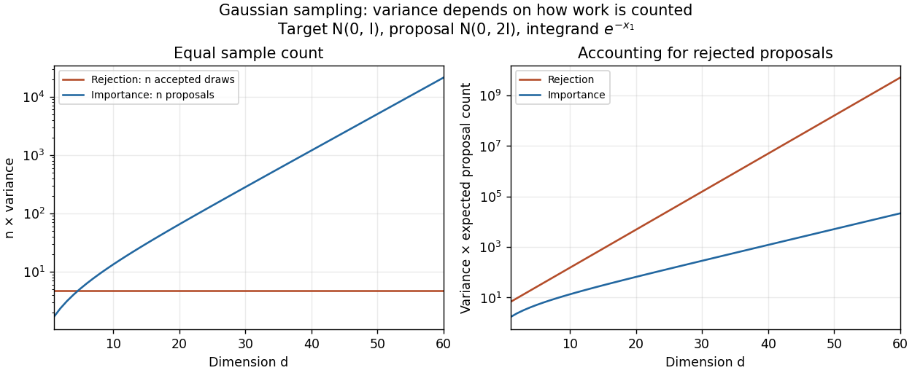

<h1 id="1/d/ii/solution">Solution</h1>

↑ **Parent:** [Ii](../ii.md)

**At equal sample count, rejection sampling eventually has smaller variance for fixed $\sigma^2>1$; at equal expected proposal cost, importance sampling eventually wins.** The distinction matters because a sample of the [rejection sampling](../../../../../rejection-sampling.md) estimator means an accepted draw.

For the [importance sampling](../../../../../importance-sampling.md) estimator, all coordinates contribute to the [importance weight](../../../../../importance-weight.md) although only one enters the integrand. The same [normal distribution](../../../../../normal-distribution.md) transform as in (c), now with linear coefficient $-2$ for coordinate one, gives

$$
\mathbb E_q[(w(Z)e^{-Z_1})^2]
=A^d\exp\!\left(\frac{2s}{2s-1}\right),\qquad A=\frac{s}{\sqrt{2s-1}}.
$$

Both estimators are [unbiased estimators](../../../../../unbiased-estimator.md) of $\sqrt e$, and

$$
\boxed{\operatorname{Var}(\widehat\theta_n^{\mathrm{IS}})
=\frac{A^d e^{2s/(2s-1)}-e}{n},\qquad
\operatorname{Var}(\widehat\theta_n^{\mathrm{RS}})=\frac{e^2-e}{n}.}
$$

For fixed $s>1$, the first [variance](../../../../../variance-split.md) grows exponentially while the second stays constant. This is the benefit of returning exact target draws in [rejection sampling](../../../../../rejection-sampling.md). However, obtaining those draws costs $s^{d/2}$ proposals each on average.

To compare computational work, multiply each [variance](../../../../../variance-split.md) by its expected proposal count. For [importance sampling](../../../../../importance-sampling.md) that count is $n$; for [rejection sampling](../../../../../rejection-sampling.md) it is $ns^{d/2}$. The ratio of the resulting cost-normalized [variances](../../../../../variance-split.md) is

$$
\boxed{\frac{A^d e^{2s/(2s-1)}-e}{s^{d/2}(e^2-e)}\longrightarrow0\quad(d\to\infty),}
$$

because $A/\sqrt s=\sqrt{s/(2s-1)}<1$. Thus [importance sampling](../../../../../importance-sampling.md) eventually gives better precision for the same expected number of proposals, assuming comparable work per proposal. This is an asymptotic cost comparison, not a guarantee that a fixed small computing budget produces any accepted draws. Both methods still deteriorate exponentially in this comparison. For $s=1$ they coincide and every proposal is accepted.

**[Figure 1](#1/d/ii/image-sample-count-and-expected-proposal-cost-comparisons-for-the-one-coordinate-integrand-at-sigma-squared-equal-to-two). Sample-count and expected-proposal-cost comparisons for the one-coordinate integrand at sigma squared equal to two**.

A practical improvement is to exploit the integrand's one-coordinate structure directly: average $e^{-G_1}$ for [standard normal distribution](../../../../../standard-normal-distribution.md) draws $G_1$, without generating unused coordinates. The optimal change of [proposal distribution](../../../../../proposal-distribution.md) in (iii) improves further.

## ↑ Ancestors (13)

1. [Ii](../ii.md)
2. [D](../../d.md)
3. [1](../../../1.md)
4. [2021](../../../../2021-split.md)
5. [Past exam of the simulation and statistical programming course of the University of Oxford](../../../../split.md)
6. [Simulation and statistical programming course of the University of Oxford](../../../../../simulation-and-statistical-programming-course-of-the-university-of-oxford.md)
7. [Year 2 of the mathematics course of the University of Oxford](../../../../../year-2-of-the-mathematics-course-of-the-university-of-oxford.md)
8. [Mathematics course of the University of Oxford](../../../../../mathematics-course-of-the-university-of-oxford.md)
9. [Undergraduate course of the University of Oxford](../../../../../undergraduate-course-of-the-university-of-oxford.md)
10. [Course of the University of Oxford](../../../../../course-of-the-university-of-oxford.md)
11. [University of Oxford](../../../../../university-of-oxford-split.md)
12. [List of universities](../../../../../list-of-universities.md)
13. [Codex Wiki](../../../../../split.md)
