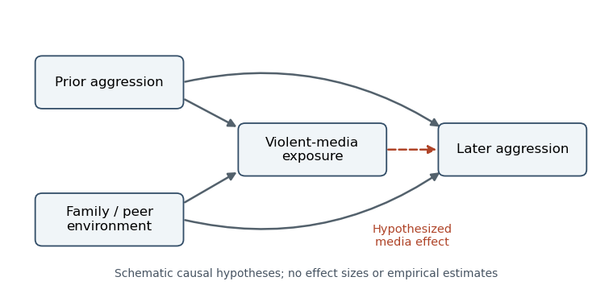
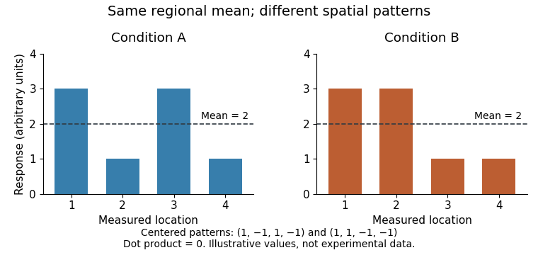

# 2022

↑ **Parent:** [Past exam of the social psychology course of the year 2 of the psychology (experimental) course of the University of Oxford](../past-exam-of-the-social-psychology-course-of-the-year-2-of-the-psychology-experimental-course-of-the-university-of-oxford.md)

Source release: [Oxford-released examination bundle, member a10452w1.pdf](https://www.whatdotheyknow.com/request/experimental_psychology_past_exa/response/2757831/attach/3/New%20Compressed%20zipped%20Folder.zip?cookie_passthrough=1).

The cover carries both the current and old-syllabus codes for this single paper. The examination required one essay, with a 1,500-word limit; all five options are developed separately here. Scientific evidence is restricted to work available by 22 April 2022.

**Table of contents**

- [1](#1)
  - [Solution](#1/solution)
- [2](#2)
  - [Solution](#2/solution)
- [3](#3)
  - [Solution](#3/solution)
- [4](#4)
  - [Solution](#4/solution)
- [5](#5)
  - [Solution](#5/solution)

## 1

↑ **Parent:** [2022](2022.md)

<h3 id="1/solution">Solution</h3>

↑ **Parent:** [1](#1)

**[Dispositional attribution](../psychology.md#dispositional-attribution) is most biased when a person's conduct is easy to encode as a trait but the constraints on that conduct are poorly represented or insufficiently used. The bias is conditional on [attention](../psychology.md#attention), [cognitive load](../psychology.md#cognitive-load), expectations and learned explanatory practices.** Calling an inference biased requires a defensible benchmark: behavior sometimes really is informative about a person's enduring preferences. [Correspondence bias](../psychology.md#correspondence-bias) concerns excessive correspondence between observed conduct and inferred disposition after relevant situational causes are taken into account, rather than the mere existence of a trait judgment.

The classic demonstration separates the direction of a political essay from whether its author chose that position. In the assigned-position condition, readers nevertheless inferred attitudes corresponding to the essay. Readers also distinguished choice from assignment, so the result supports insufficient discounting rather than complete blindness to constraint. The experiment by [Edward E. Jones](../psychologist.md#edward-e-jones) and colleagues makes the situation explicit and therefore challenges the explanation that perceivers simply had no situational information. It does not show that all information in an assigned essay is necessarily nondiagnostic: enthusiasm, wording or willingness to comply could still be informative under a different task model.[Experiment 1; choice, no-choice and essay-position manipulations](../psychology-bibliography.md#the-attribution-of-attitudes-by-edward-e-jones-and-others)

[Conditional diagnosticity in attribution](../psychology.md#conditional-diagnosticity-in-attribution) provides a useful normative benchmark. Let $D$ denote a disposition, $B$ the observed behavior and $S$ the situation. By [Bayes' theorem](../probability-theory.md#bayes-theorem), [posterior odds](../bayesian-statistics.md#posterior-odds) equal prior odds times a conditional [likelihood ratio](../statistical-hypothesis-test.md#likelihood-ratio):

$$
\frac{P(D\mid B,S)}{P(\neg D\mid B,S)}
=\frac{P(D\mid S)}{P(\neg D\mid S)}
\frac{P(B\mid D,S)}{P(B\mid\neg D,S)}.
$$

If assignment makes the same behavior almost equally likely under either disposition, its [likelihood ratio](../statistical-hypothesis-test.md#likelihood-ratio) is near one. Treating this behavior as if it had been freely chosen exaggerates its diagnosticity. Conversely, repeated voluntary actions across varied situations can justify a strong [dispositional attribution](../psychology.md#dispositional-attribution). The benchmark must therefore distinguish an inference from a single constrained act from an inference supported by a history of choices.

One mechanism is asymmetric [attention](../psychology.md#attention). The actor is a discrete, changing object; the constraints can be dispersed across instructions, other people and background circumstances. A perceiver may accurately remember that a constraint existed without representing its causal force when interpreting the action. Explaining a nervous performance as [anxiety](../psychology.md#anxiety) is also economical: one familiar trait compresses many movements, whereas reconstructing an unfamiliar interview situation requires additional assumptions. This reasoning predicts more [correspondence bias](../psychology.md#correspondence-bias) when the actor dominates [attention](../psychology.md#attention), contextual information is ambiguous or perceivers lack relevant situational knowledge. [Social salience](../psychology.md#social-salience) alone, however, does not identify which trait will be inferred; expectations and category knowledge also shape interpretation.

The cognitive-load account receives a more direct test in [Daniel T. Gilbert](../psychologist.md#daniel-t-gilbert) and colleagues' experiments. Participants watched silent videotaped clips of an apparently anxious target, with subtitles describing her discussion topics. Those required to rehearse the topics in order used this situational information less to adjust their trait judgments. The load therefore involved processing the context itself, rather than simply removing that information. Related experiments used constrained speech. The proposed sequence distinguishes identifying the behavior, deriving a characterization and correcting for context; the last step was especially vulnerable to [cognitive load](../psychology.md#cognitive-load). This explains why merely telling observers about a constraint need not remove [correspondence bias](../psychology.md#correspondence-bias).[Experiments 1–2; cognitive busyness and situational correction](../psychology-bibliography.md#on-cognitive-busyness-when-person-perceivers-meet-persons-perceived-by-daniel-t-gilbert-and-others)

The experimental manipulation supports a contribution from limited cognitive resources, but it does not prove that every [social attribution](../psychology.md#social-attribution) follows a rigid three-stage sequence. A concurrent task may also alter [attention](../psychology.md#attention) to instructions or memory for diagnostic details. Context could influence the earliest interpretation when it is obvious and familiar. Thus the strongest claim is that effective situational use can require additional processing in these tasks, rather than that dispositional inference is universally automatic and situational inference universally controlled. A discriminating experiment would measure comprehension of the constraint as well as the final [social attribution](../psychology.md#social-attribution) and vary processing time independently of contextual clarity.

Culture also changes the starting point of explanation. [Michael W. Morris](../psychologist.md#michael-w-morris) and colleagues compared American and Chinese explanations of social and physical events, using animated displays and accounts of killings in newspapers. The social explanations differed in their emphasis on individual characteristics and contextual causes; the comparison with physical events constrained an account based on a general inability to reason about causes. These findings suggest that learned explanatory frameworks influence which causes come readily to mind.[Animated social/physical events and newspaper explanations; domain-specific cultural comparisons](../psychology-bibliography.md#culture-and-cause-american-and-chinese-attributions-for-social-and-physical-events-by-michael-w-morris-and-others)

These comparisons do not warrant treating national populations as uniform psychological types. Nationality was not randomly assigned, newspaper writing is not a transparent measure of private judgment, and language or knowledge of the events can affect the explanations elicited. Their theoretical importance is that a supposedly universal default must accommodate systematic variation. An observer who routinely represents relationships and constraints may need less later correction, rather than merely possessing more cognitive resources. [Cross-cultural psychology](../psychology.md#cross-cultural-psychology) therefore complements the resource account by asking what information is represented before correction becomes necessary.

Motivation matters through the same conditional logic. A consequential decision can encourage searching for alternatives, but a desire for a quick, blame-consistent explanation can instead favor a [dispositional attribution](../psychology.md#dispositional-attribution). Neither effect follows from motivation alone; the relevant question is which information the motive makes useful. Clear constraints, sufficiently understood instructions, time to use them and observations across multiple settings should improve calibration. These are mechanistic predictions, not guarantees that deliberation removes every [cognitive bias](../psychology.md#cognitive-bias).

The evidence is best explained by an interaction between behavioral diagnosticity and the perceiver's representation of context. **[Correspondence bias](../psychology.md#correspondence-bias) is strongest when salient conduct is readily characterized but situational alternatives receive too little weight; it weakens when constraints are understood and effectively incorporated.** This account preserves the genuine usefulness of trait inference while explaining why its accuracy varies across tasks, resources and cultural experience.

## 2

↑ **Parent:** [2022](2022.md)

<h3 id="2/solution">Solution</h3>

↑ **Parent:** [2](#2)

**Cross-cultural agreement can arise from shared facial anatomy, shared sensory functions and recurring social experience without requiring an identical, innate dictionary of [facial expressions](../psychology.md#facial-expression).** The central distinction is between common production mechanisms, agreement about visible features and agreement about the [emotion](../psychology.md#emotion) those features signify. Evidence for one does not establish the others. [Emotion recognition](../psychology.md#emotion-recognition) is an inference about an unobserved state from a signal and its context, rather than a direct reading of a label written on the face.

Shared anatomy constrains the movements that faces can make. Common problems such as obtaining sensory information, avoiding contamination and coordinating approach or withdrawal can make some configurations useful across communities. Similar environments may also teach similar associations between events and expressions. These explanations make different predictions: a biological production constraint predicts similarities even without observing other faces, whereas a culturally learned label predicts sensitivity to language, experience and local conventions. Cross-cultural consistency alone cannot separate these explanations because both can produce agreement.

[Paul Ekman](../psychologist.md#paul-ekman) and colleagues' early work with relatively isolated New Guinea participants reduced the objection that all agreement arose from exposure to Western films. Participants matched narrated situations to posed photographs of [facial expressions](../psychology.md#facial-expression), with substantial agreement on several intended categories. This was an important extension beyond educated Western observers. However, choosing among a small set of photographs after an [emotion](../psychology.md#emotion)-relevant story establishes agreement within that task. It does not show that the same label would arise spontaneously from an ambiguous face without the story.[New Guinea story-matching procedure and cross-cultural recognition results](../psychology-bibliography.md#constants-across-cultures-in-the-face-and-emotion-by-paul-ekman-and-others)

The distinction matters experimentally. A [forced-choice emotion recognition](../psychology.md#forced-choice-emotion-recognition) task supplies candidate interpretations and excludes many alternatives. Translation can make a story more diagnostic of one response than another, and selected posed photographs maximize category contrasts. These features do not make the result meaningless; they specify its evidential scope. Agreement under constrained alternatives is evidence that participants can map those stimuli onto those situations. Strong universality would additionally require similar distinctions with natural expressions, broader response options and comparable meanings of the labels across languages. [Measurement invariance](../psychology.md#measurement-invariance) is therefore a substantive problem, not merely a translation check.

Evidence from expression production provides an independent constraint. [David Matsumoto](../psychologist.md#david-matsumoto) and colleagues coded spontaneous expressions in blind and sighted athletes around competition outcomes. Similarities including congenitally blind athletes weaken the claim that the observed facial patterns require visual imitation of others. The study is especially useful because it examines emotionally significant events rather than only instructions to pose an expression. Nonetheless, blindness does not remove nonvisual [social learning](../animal-behaviour.md#social-learning), and similar production does not establish identical recognition by observers in every culture.[Blind and sighted athletes; facial coding and competition-outcome observations](../psychology-bibliography.md#spontaneous-facial-expressions-of-emotion-of-congenitally-and-noncongenitally-blind-individuals-by-david-matsumoto-and-others)

The distinction between production and interpretation also clarifies a functional explanation. [Joshua M. Susskind](../computer-science.md#joshua-m-susskind) and colleagues asked people to produce [fear](../psychology.md#fear), [disgust](../psychology.md#disgust) and neutral configurations and measured sensory consequences. [Fear](../psychology.md#fear) configurations increased the reported visual field, accelerated target-directed eye movements and altered nasal inspiration in the direction of greater sensory acquisition; [disgust](../psychology.md#disgust) showed an opposing tendency. Eye-movement recordings and respiratory measurements therefore linked expression geometry to a physical function rather than relying only on [emotion](../psychology.md#emotion) labels.[Visual-field, eye-tracking and respiratory experiments](../psychology-bibliography.md#expressing-fear-enhances-sensory-acquisition-by-joshua-m-susskind-and-others)

Such a mechanism could help explain why certain visible signals recur: widening sensory access may be useful during uncertain threat, whereas limiting exposure may help during rejection. This is a functional hypothesis supported by the measured consequences of posed movements. It is not direct evidence that [natural selection](../evolution.md#natural-selection) produced every component for that function, that every fearful person makes that face, or that every observer identifies [fear](../psychology.md#fear) from it. A facial movement can change sensory input, acquire a communicative meaning and be modified by a [display rule](../psychology.md#display-rule); these processes can coexist.

The recognition code itself shows cultural variation. [Rachael E. Jack](../psychologist.md#rachael-e-jack) and colleagues generated dynamic computer faces by varying facial movements and their timing. Fifteen Western and fifteen East Asian observers each categorized thousands of animations. [Reverse correlation](../psychology.md#reverse-correlation) estimated which movements supported each observer's judgments. The resulting representations differed in their separation of the six candidate categories and in the timing and location of cues to intensity, including the importance of early eye movements for the East Asian sample.[Figure 1 and Results; 30 observers, randomized animations and reconstructed expression representations](../psychology-bibliography.md#facial-expressions-of-emotion-are-not-culturally-universal-by-rachael-e-jack-and-others)

This method weakens the assumption that everyone starts with the same six [concept prototypes](../psychology.md#concept-prototype), because the prototypes were estimated from responses rather than selected by the experimenter. It still uses specified labels and small, culturally restricted samples; it cannot establish the absence of every shared component. A shared sensitivity to eye opening or positive versus negative significance could coexist with different category boundaries. Equally, agreement about broad [emotional valence](../psychology.md#emotional-valence) would be weaker than agreement about the exact distinction between [fear](../psychology.md#fear) and surprise. The level of description at which universality is claimed must remain explicit.

A decisive research program would combine production and recognition measures. Natural dynamic expressions should be sampled from comparable situations, with context independently manipulated. Observers should provide open descriptions as well as constrained choices; analyses should test whether translations and response scales support equivalent comparisons. Comparing early and late visual cues could separate common sensitivity to a feature from later category interpretation. Blind participants and culturally diverse populations provide complementary tests rather than interchangeable proof of innateness. These designs also prevent a common error: interpreting disagreement over a category name as absence of any shared perceptual sensitivity.

**The most defensible universal factors are common biological constraints and recurring opportunities to learn useful signals; their contribution does not fix every category boundary or social meaning.** The evidence supports substantial shared structure together with culturally shaped interpretation. A good explanation therefore specifies which feature, judgment or mechanism is shared, instead of treating all cross-cultural agreement as proof of a universal facial code.

## 3

↑ **Parent:** [2022](2022.md)

<h3 id="3/solution">Solution</h3>

↑ **Parent:** [3](#3)

**The evidence supports some prospective associations between violent media exposure and later [aggression](../psychology.md#aggression), but it does not establish a large, general causal effect on serious [violence](../psychology.md#violence) outside the laboratory.** [Aggression](../psychology.md#aggression) is behavior intended to harm; [violence](../psychology.md#violence) is its severe physical subset. Angry thoughts, physiological activation and an [aggression](../psychology.md#aggression)-task score are not interchangeable with either. The relevant claim requires an exposure contrast, an outcome that captures harmful behavior in everyday life, and a design that distinguishes influence from selection.

Laboratory experiments can randomize immediate exposure, but a brief game followed by a noise-blast choice mainly tests a short-term response in an artificial setting. Competition, frustration, difficulty and expectations can differ between games as well as violent content. A statistically detectable laboratory effect therefore needs both [construct validity](../design-of-experiments.md#construct-validity) and [ecological validity](../design-of-experiments.md#ecological-validity) before it supports a claim about everyday [aggression](../psychology.md#aggression). A plausible [social learning](../animal-behaviour.md#social-learning) mechanism supplies a hypothesis about acquiring aggressive responses; it does not by itself demonstrate that media caused a particular real-world outcome.

An important source of evidence is [L. Rowell Huesmann](../psychologist.md#l-rowell-huesmann) and colleagues' follow-up from childhood television viewing to young adulthood. The study related violent television exposure at ages six to ten to later [aggression](../psychology.md#aggression), using follow-up interviews and archival information. Associations persisted after adjustment for measured childhood and family characteristics. Unlike a single laboratory task, the design addressed a long interval and outcomes beyond the immediate viewing session. It also tested exposure before the later outcome, making simple simultaneity an inadequate explanation.[Childhood measures, adult interview/archival outcomes and adjusted longitudinal models](../psychology-bibliography.md#longitudinal-relations-between-children-s-exposure-to-tv-violence-and-their-aggressive-and-violent-behavior-in-young-adulthood-1977-1992-by-l-rowell-huesmann-and-others)

Temporal order is necessary but insufficient for [causal inference](../causal-inference.md). Earlier [aggression](../psychology.md#aggression) may both encourage violent-media selection and persist into adulthood. Family conflict, peer environments or poorly measured dispositions may influence both variables. Adjustment for baseline [aggression](../psychology.md#aggression) helps, but imperfect measurement leaves residual [confounding](../causal-inference.md#confounding), and including a variable in a model does not ensure that its causal role was correctly represented. [Attrition](../causal-inference.md#longitudinal-attrition) can further change the composition of the observed follow-up sample. These limitations qualify the causal interpretation without making the association irrelevant.

**[Figure 1](#3/image-competing-causal-explanations-for-a-prospective-media-aggression-association-arrows-are-hypotheses-rather-than-estimated-effects). Competing causal explanations for a prospective media–aggression association; arrows are hypotheses rather than estimated effects**.

[Andrew K. Przybylski](../psychologist.md#andrew-k-przybylski) and colleagues provide a useful contrasting design: a [registered report](../README.md#registered-report) studied 1,004 adolescent–carer pairs, combining adolescent gaming information and independently rated violent content with carers' reports of aggressive behavior. The confirmatory analysis did not support the predicted positive relationship. Separating the exposure and outcome reporters reduced one source of common-method bias, while [preregistration](../README.md#preregistration) reduced flexibility in choosing an attractive analysis. The design was a [cross-sectional study](../causal-inference.md#cross-sectional-study), however, so it did not estimate a randomized causal effect or settle effects of earlier exposure.[Registered hypotheses, exposure classification and carer-reported aggression analyses](../psychology-bibliography.md#violent-video-game-engagement-is-not-associated-with-adolescents-aggressive-behaviour-evidence-from-a-registered-report-by-andrew-k-przybylski-and-others)

A null finding constrains a claim under the measurements and precision of that study. It does not prove that every form of violent media has exactly zero effect on every child. Conversely, explaining away every null result after observing it makes a general hypothesis difficult to test. The useful question is whether a prespecified exposure–outcome prediction survives an adequately sensitive test, and whether any estimated effect is large enough to matter outside the measurement scale.

Longer experiments strengthen a different part of the argument. [Simone Kühn](../neuroscientist.md#simone-kuhn) and colleagues randomized adults with little recent gaming to a violent game, a nonviolent game or no gaming for two months, with later testing. They did not find the predicted increase in [aggression](../psychology.md#aggression) across their outcome battery. Exposure occurred beyond a brief laboratory session, which improves the relevance of the manipulation. Yet many endpoints were [questionnaires](../psychology.md#questionnaire) or experimental tasks, rather than observed assaults, and the modest adult sample cannot settle small effects in children. The violent and nonviolent games also differed in more than violent content.[Randomization, two-month intervention, outcome battery and follow-up](../psychology-bibliography.md#does-playing-violent-video-games-cause-aggression-a-longitudinal-intervention-study-by-simone-kuhn-and-others)

The distinction between naturalistic exposure and naturalistic outcome is crucial. A home-based [intervention](../causal-inference.md#treatment) can establish a change in a laboratory score without demonstrating everyday harm; a real-world outcome can be valuable even when its exposure is assessed in an [observational study](../causal-inference.md#observational-study). No single study here simultaneously supplies perfectly isolated content, prolonged exposure, representative participants and high-quality measurement of rare [violence](../psychology.md#violence). Triangulation should ask whether the different weaknesses plausibly explain a pattern, rather than counting positive and negative papers as votes.

[Meta-analysis](../statistical-inference.md#meta-analysis) helps estimate that pattern, but pooling does not repair a shared design limitation. [Anna T. Prescott](../psychologist.md#anna-t-prescott) and colleagues combined 24 prospective studies with over 17,000 participants. They found a small positive association between violent-game exposure and later physical [aggression](../psychology.md#aggression) after baseline adjustment; estimates decreased when available additional covariates were included. [Aaron Drummond](../psychologist.md#aaron-drummond) and colleagues' later [meta-analysis](../statistical-inference.md#meta-analysis) emphasized weak associations and their sensitivity to study quality. The disagreement makes inclusion rules, measurement and analytic decisions central to interpretation.[Abstract and adjusted-effect analyses; prospective physical aggression](../psychology-bibliography.md#metaanalysis-of-the-relationship-between-violent-video-game-play-and-physical-aggression-over-time-by-anna-t-prescott-and-others)[Study-quality analyses and discussion of the longitudinal association](../psychology-bibliography.md#do-longitudinal-studies-support-long-term-relationships-between-aggressive-game-play-and-youth-aggressive-behaviour-a-meta-analytic-examination-by-aaron-drummond-and-others)

Even a small, reproducible association would not automatically identify a small causal effect: a consistent confound can also replicate. On the other hand, limited [statistical power](../probability-and-statistics.md#statistical-power) means an individual nonsignificant experiment need not contradict a small association. [Effect sizes](../statistical-inference.md#effect-size) and uncertainty should therefore be compared on compatible outcome scales. [Publication bias](../statistical-inference.md#publication-bias) and selective analysis can favor alarming positive findings, while insensitive measures can hide genuine effects; both possibilities require evidence rather than assertion. The available studies also concern particular media, populations and time intervals, so their conclusions should not be extended automatically to all violent content.

The strongest next tests would preregister longitudinal exposure contrasts, measure baseline behavior carefully, obtain outcomes from independent sources and retain participants across follow-up. Where ethical and practical, [randomization](../causal-inference.md#randomization) to matched content would separate violent imagery from competition and frustration. Everyday [aggression](../psychology.md#aggression) and severe [violence](../psychology.md#violence) would be analyzed separately. **By the examination date, large causal claims about real-world [violence](../psychology.md#violence) exceeded the evidence; small or context-dependent effects on [aggression](../psychology.md#aggression) remained possible and required better identification.** This conclusion takes the positive prospective findings seriously while keeping their causal and behavioral scope explicit.

## 4

↑ **Parent:** [2022](2022.md)

<h3 id="4/solution">Solution</h3>

↑ **Parent:** [4](#4)

**The most useful change is often to make a former [outgroup](../psychology.md#social-outgroup) part of an inclusive “we” while preserving a secure subgroup identity; no category arrangement is best independently of context and outcome.** [Prejudice](../psychology.md#prejudice) is an evaluative attitude toward people because of group membership, [stereotypes](../psychology.md#stereotype) concern attributed group characteristics, and [discrimination](../psychology.md#discrimination) concerns treatment. A reduction in liking differences between small laboratory groups is therefore evidence about one component of [prejudice](../psychology.md#prejudice), not automatically about durable equality in behavior.

[Social categorization](../psychology.md#social-categorization) establishes who counts as an [ingroup](../psychology.md#ingroup) or [outgroup](../psychology.md#social-outgroup). If favorable treatment follows the [ingroup](../psychology.md#ingroup) boundary, changing that boundary can extend favorable treatment to people previously excluded. But [categorization](../psychology.md#categorization) also supports recognition, continuity and shared experience. Erasing a socially meaningful identity may threaten the very people an [intervention](../causal-inference.md#treatment) is intended to include. The best test therefore asks both whether the new representation improves attitudes and whether it preserves enough identity for its benefits to generalize beyond the immediate encounter.

[Decategorization](../psychology.md#decategorization) encourages seeing an interaction partner as a distinctive person rather than merely an [outgroup](../psychology.md#social-outgroup) representative. It can weaken reliance on a [stereotype](../psychology.md#stereotype) and make personal information available. Its weakness is transfer: a liked individual may be treated as an exception while [prejudice](../psychology.md#prejudice) toward the broader [outgroup](../psychology.md#social-outgroup) remains unchanged. It is therefore most convincing when participants later respond more fairly to unfamiliar [outgroup](../psychology.md#social-outgroup) members, not merely when they like the person they just met. Individuation is a useful part of contact, but it need not supply a new inclusive group boundary.

[Recategorization](../psychology.md#recategorization) instead makes a common superordinate category salient. In the [common ingroup identity model](../psychology.md#common-ingroup-identity-model), the former [outgroup](../psychology.md#social-outgroup) is represented as part of a larger [ingroup](../psychology.md#ingroup). [Samuel L. Gaertner](../psychologist.md#samuel-l-gaertner) and colleagues experimentally compared ways of representing interacting participants, including one-group, two-group and individualized arrangements. The results supported a benefit of an inclusive group representation. This is a causal test of a manipulated social arrangement, although the arrangement may change cooperation and expectations together with perceived membership.[Experimental manipulations of one-group, two-group and individual representations](../psychology-bibliography.md#reducing-intergroup-bias-the-benefits-of-recategorization-by-samuel-l-gaertner-and-others)

The distinction between labels and social structure matters. Simply giving participants a common name need not change their expectations about how others will treat them. Shared tasks, balanced interaction and a credible common goal can make the inclusive identity psychologically meaningful. Conversely, if the “common” category is implicitly defined by the dominant subgroup's norms, minorities may experience it as an instruction to assimilate. A successful [intervention](../causal-inference.md#treatment) must therefore assess whose identity is being recognized, rather than taking average category salience as a sufficient explanation.

[John F. Dovidio](../psychologist.md#john-f-dovidio) and colleagues extended the experimental evidence beyond evaluations. After forming two three-person groups, they manipulated an inclusive versus separated representation and measured evaluations, self-disclosure and helping. The inclusive arrangement produced more favorable intergroup responses, with perceived group unity statistically accounting for part of the pattern. Helping is a stronger behavioral extension than an attitude rating alone. However, [statistical mediation](../statistical-modelling.md#statistical-mediation) does not itself prove that perceived unity was the uniquely causal mediator: the manipulation could change additional processes alongside it.[Two three-person groups; evaluations, disclosure, helping and perceived unity](../psychology-bibliography.md#extending-the-benefits-of-recategorization-evaluations-self-disclosure-and-helping-by-john-f-dovidio-and-others)

[Dual identity](../psychology.md#dual-identity) retains the subgroups within the inclusive category. Participants can represent themselves as members of distinct departments within one university, for example. This can combine a shared membership with recognition of meaningful difference. It may also preserve the connection between a positive encounter and the original [outgroup](../psychology.md#social-outgroup), helping the benefit transfer beyond a single partner. The proposal is conditional: constantly emphasizing a hostile division without a credible common category could reinforce the boundary rather than soften it.

[Matthew J. Hornsey](../psychologist.md#matthew-j-hornsey) and colleagues tested subgroup and superordinate-category salience in two university-based experiments, with 178 and 135 participants. Bias was lowest when both identities were salient and highest when the superordinate category alone was emphasized. The design is a useful challenge to an unconditional recommendation to erase subgroups. Its theoretical implication is that an inclusive representation can work better when it accommodates distinctiveness. The precise ordering still needs to be evaluated in the population and relationships being studied.[Experiments 1–2; crossed subgroup and superordinate salience, sample sizes 178 and 135](../psychology-bibliography.md#subgroup-relations-a-comparison-of-mutual-intergroup-differentiation-and-common-ingroup-identity-models-of-prejudice-reduction-by-matthew-j-hornsey-and-others)

[Crossed categorization](../psychology.md#crossed-categorization) offers another possibility: someone may be an [outgroup](../psychology.md#social-outgroup) member on one dimension but an [ingroup](../psychology.md#ingroup) member on another. This weakens a perfectly aligned “us versus them” division when the shared dimension is valued. It does not guarantee inclusion, because people can prioritize one division or reserve the strongest exclusion for those who share neither membership. Thus the number of visible categories is less important than how they organize expected similarity, belonging and cooperation. Which [categorization](../psychology.md#categorization) works best must be an empirical question about those relationships.

[Intergroup contact](../psychology.md#intergroup-contact) provides a wider evidential context. [Thomas F. Pettigrew](../psychologist.md#thomas-f-pettigrew) and colleagues' [meta-analysis](../statistical-inference.md#meta-analysis) of 515 studies and 713 independent samples found that contact generally related to lower [prejudice](../psychology.md#prejudice), with supportive conditions such as equal status and cooperation enhancing the relationship. This broadens the evidence beyond a single laboratory manipulation. It does not rank [categorization](../psychology.md#categorization) strategies directly, and much contact is assessed in observational studies: less prejudiced people may seek it out. Contact can supply an opportunity for category change without establishing that category change alone produced every improvement.[Meta-analysis; contact–prejudice association and facilitating conditions](../psychology-bibliography.md#a-meta-analytic-test-of-intergroup-contact-theory-by-thomas-f-pettigrew-and-others)

A strong comparison would assign otherwise similar cooperative encounters to [decategorization](../psychology.md#decategorization), common identity and [dual identity](../psychology.md#dual-identity) conditions. It would measure perceived inclusion and [identity threat](../psychology.md#identity-threat), then test attitudes and consequential treatment of unfamiliar group members after a delay. Separate subgroup analyses would reveal whether an apparent average benefit concealed a cost to the less powerful subgroup. These measurements make “works best” refer to generalization, persistence and behavior rather than to an immediate favorable rating.

**An inclusive identity that preserves legitimate subgroup distinctiveness is a well-supported candidate, especially where [identity threat](../psychology.md#identity-threat) would undermine simple assimilation.** [Decategorization](../psychology.md#decategorization) and [crossed categorization](../psychology.md#crossed-categorization) remain useful under appropriate conditions. The evidence favors changing how membership supports inclusion, with cooperative and equitable interaction, rather than expecting a verbal relabeling to remove [prejudice](../psychology.md#prejudice) on its own.

## 5

↑ **Parent:** [2022](2022.md)

<h3 id="5/solution">Solution</h3>

↑ **Parent:** [5](#5)

**[Empathy](../psychology.md#empathy) combines partly shared affective mechanisms with computations that represent another person's state; regional overlap does not show that the underlying [neural code](../neuroscience.md#neural-code) is identical.** The answer depends on what [empathy](../psychology.md#empathy) means. [Affective empathy](../psychology.md#affective-empathy) involves sharing something of another's feeling while maintaining a [self-other distinction](../psychology.md#self-other-distinction). [Cognitive empathy](../psychology.md#cognitive-empathy) concerns understanding that person's state and overlaps with [theory of mind](../animal-behaviour.md#theory-of-mind). [Compassion](../psychology.md#compassion) is concern directed toward helping, whereas [personal distress](../psychology.md#personal-distress) is aversive [emotional arousal](../psychology.md#emotional-arousal) centered on oneself. These components can vary independently, so a single neural contrast cannot settle all of them.

A shared-processing hypothesis predicts that some mechanisms supporting one's own affect also contribute when another person suffers. [Tania Singer](../neuroscientist.md#tania-singer) and colleagues compared [functional magnetic resonance imaging](../nuclear-magnetic-resonance.md#functional-magnetic-resonance-imaging) responses to painful electrical stimulation of the participant's hand with responses to a signal that the partner, present in the room, was receiving [pain](../neuroscience.md#pain). [Anterior insula](../neuroscience.md#anterior-insula) and rostral [anterior cingulate cortex](../neuroscience.md#anterior-cingulate-cortex) responded in both conditions, whereas [somatosensory cortex](../neuroscience.md#somatosensory-cortex) responses were more specific to receiving [pain](../neuroscience.md#pain). The cue-based partner condition helped separate affective response from simply seeing an injured body part.[Self-pain versus partner-pain design; shared anterior insula and rostral cingulate responses](../psychology-bibliography.md#empathy-for-pain-involves-the-affective-but-not-sensory-components-of-pain-by-tania-singer-and-others)

The result supports partial overlap at the measured regional scale, not duplication of the whole first-person experience. [Functional magnetic resonance imaging](../nuclear-magnetic-resonance.md#functional-magnetic-resonance-imaging) measures an indirect hemodynamic response; each [voxel](../neuroscience.md#voxel) aggregates information over many [neurons](../neuron.md). A region can contain intermingled populations, and different computations can increase its average response. Moreover, [anterior insula](../neuroscience.md#anterior-insula) and cingulate activation is not uniquely diagnostic of [empathy](../psychology.md#empathy). Inferring [empathy](../psychology.md#empathy) solely because those areas are active is [reverse inference](../neuroscience.md#reverse-inference) unless the alternative processes have been constrained by the design. Anticipation, [attention](../psychology.md#attention) and task relevance are plausible alternatives that require appropriate controls.

[Multivariate pattern analysis](../statistical-learning.md#multivariate-pattern-analysis) asks a stronger representational question: does a pattern that predicts one's own [pain](../neuroscience.md#pain) also predict another's [pain](../neuroscience.md#pain)? [Anjali Krishnan](../neuroscientist.md#anjali-krishnan) and colleagues obtained dissociable patterns for somatic and vicarious [pain](../neuroscience.md#pain), despite some overlapping regional activation. Their cross-prediction results challenged the inference from common active territory to a common [pain](../neuroscience.md#pain) representation. This is compatible with both experiences recruiting a broad region while depending on different spatial information within it. It does not establish that no shared component exists at any scale.[Multivariate prediction and specificity tests for somatic and vicarious pain](../psychology-bibliography.md#somatic-and-vicarious-pain-are-represented-by-dissociable-multivariate-brain-patterns-by-anjali-krishnan-and-others)

The logical distinction can be made without empirical assumptions. Two four-location responses, $(3,1,3,1)$ and $(3,3,1,1)$, each have [mean](../expected-value.md) two and positive activation everywhere. Their [mean](../expected-value.md)-centered patterns are $(1,-1,1,-1)$ and $(1,1,-1,-1)$, whose [dot product](../inner-product.md#dot-product) is zero. Thus identical regional means can conceal different codes. Conversely, failure of cross-prediction may reflect limited [statistical power](../probability-and-statistics.md#statistical-power) or a context-dependent transformation of a shared representation. Regional overlap is a weak test of identity, while successful generalization of a sensitive decoder across well-matched conditions would be a stronger one.

**[Figure 2](#5/image-illustrative-responses-with-the-same-regional-mean-but-orthogonal-centered-patterns-arbitrary-values-not-experimental-data). Illustrative responses with the same regional mean but orthogonal centered patterns; arbitrary values, not experimental data**.

[Intervention](../causal-inference.md#treatment) adds a complementary test. [Markus Rütgen](../neuroscientist.md#markus-rutgen) and colleagues used [placebo analgesia](../psychology.md#placebo-analgesia) to reduce participants' own [pain](../neuroscience.md#pain) and found reduced responses to others' [pain](../neuroscience.md#pain) as well. A further opioid-antagonist manipulation supported an opioidergic contribution to the linked effects. This goes beyond observing that two conditions activate the same region: changing a mechanism relevant to self-[pain](../neuroscience.md#pain) altered a response associated with [empathy](../psychology.md#empathy) for [pain](../neuroscience.md#pain). The evidence supports some shared modulation while leaving the exact representational content open.[Placebo-analgesia manipulation and opioid-antagonist experiment](../psychology-bibliography.md#placebo-analgesia-and-its-opioidergic-regulation-suggest-that-empathy-for-pain-is-grounded-in-self-pain-by-markus-rutgen-and-others)

There are still alternatives to a literal shared-[pain](../neuroscience.md#pain) code. Expectancy can change [attention](../psychology.md#attention), appraisal or response reporting, and a neuromodulatory pathway can regulate two distinct representations. Appropriate comparisons with nonsocial aversive events would help determine how specifically the effect concerns [empathy](../psychology.md#empathy) rather than a broad change in affective processing. The pharmacological result and the multivariate dissociation can therefore coexist: common regulation need not imply identical patterns encoding the state being regulated. Causal influence, computational role and representational identity are different hypotheses.

Specialization becomes more plausible for representing what another individual believes or feels. [Rebecca Saxe](../neuroscientist.md#rebecca-saxe) and colleagues compared stories requiring reasoning about mental states with nonmental stories, including representations such as false photographs. [Temporoparietal junction](../neuroscience.md#temporoparietal-junction) responses distinguished belief reasoning from important control demands. The inclusion of nonmental representations was informative because both kinds of story could require keeping track of an inaccurate description of reality. The contrast supports functional selectivity related to [theory of mind](../animal-behaviour.md#theory-of-mind) rather than an explanation in terms of difficulty alone.[Experiments 1–2; belief reasoning, people descriptions and nonmental representation controls](../psychology-bibliography.md#people-thinking-about-thinking-people-the-role-of-the-temporo-parietal-junction-in-theory-of-mind-by-rebecca-saxe-and-others)

This is evidence for a socially selective computation under the tested contrasts, not proof that an entire anatomical area operates only during social interaction. [Theory of mind](../animal-behaviour.md#theory-of-mind) can contribute to [cognitive empathy](../psychology.md#cognitive-empathy) without producing affect sharing, and [affective empathy](../psychology.md#affective-empathy) can occur without a detailed verbal inference about beliefs. More generally, an empathic task recruits [perception](../neuroscience.md#perception) of the cue, [attention](../psychology.md#attention), [self-other distinction](../psychology.md#self-other-distinction), interpretation and regulation. Some components are useful outside [social cognition](../psychology.md#social-cognition), whereas others depend specifically on representing another mind. The architecture can combine them through interaction rather than locating [empathy](../psychology.md#empathy) in one exclusive system.

Converging tests should separate these hypotheses. Matched social and nonsocial aversive events can test specificity; cross-condition decoding can test representational generalization; and lesion studies or [transcranial magnetic stimulation](../neuroscience.md#transcranial-magnetic-stimulation) can test whether a candidate region makes a necessary contribution under controlled conditions. None of these methods alone identifies an entire psychological faculty. For example, a perturbation that impairs both conditions may disrupt [attention](../psychology.md#attention) rather than a shared affective code, so control tasks must measure the proposed alternative.

**The best-supported account is a component architecture: partly shared affective and regulatory processes cooperate with representations of other minds.** Self-[pain](../neuroscience.md#pain), [empathy](../psychology.md#empathy) for [pain](../neuroscience.md#pain) and [theory of mind](../animal-behaviour.md#theory-of-mind) provide complementary evidence, but they should not be collapsed into a single construct. Generalizing from [pain](../neuroscience.md#pain) to every form of [empathy](../psychology.md#empathy) requires additional tests of other [emotions](../psychology.md#emotion), motivations and social contexts.

## ↑ Ancestors (9)

1. [Past exam of the social psychology course of the year 2 of the psychology (experimental) course of the University of Oxford](../past-exam-of-the-social-psychology-course-of-the-year-2-of-the-psychology-experimental-course-of-the-university-of-oxford.md)
2. [Social psychology course of the year 2 of the psychology (experimental) course of the University of Oxford](../university-of-oxford.md#social-psychology-course-of-the-year-2-of-the-psychology-experimental-course-of-the-university-of-oxford)
3. [Year 2 of the psychology (experimental) course of the University of Oxford](../university-of-oxford.md#year-2-of-the-psychology-experimental-course-of-the-university-of-oxford)
4. [Psychology (experimental) course of the University of Oxford](../university-of-oxford.md#psychology-experimental-course-of-the-university-of-oxford)
5. [Undergraduate course of the University of Oxford](../university-of-oxford.md#undergraduate-course-of-the-university-of-oxford)
6. [Course of the University of Oxford](../university-of-oxford.md#course-of-the-university-of-oxford)
7. [University of Oxford](../university-of-oxford.md)
8. [List of universities](../README.md#list-of-universities)
9. [Codex Wiki](../README.md)
