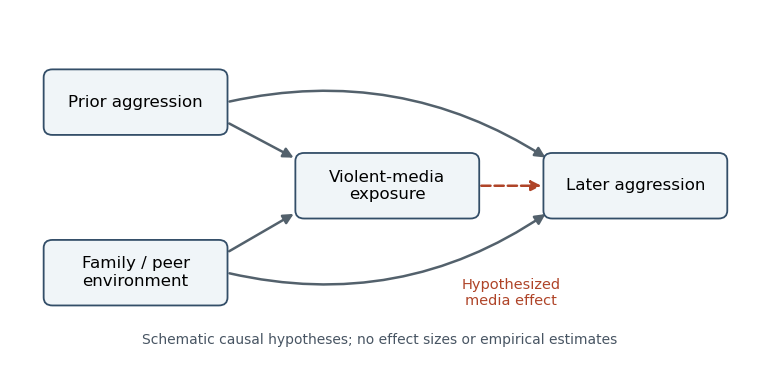

<h1 id="3/solution">Solution</h1>

↑ **Parent:** [3](../3.md)

**The evidence supports some prospective associations between violent media exposure and later [aggression](../../../aggression.md), but it does not establish a large, general causal effect on serious [violence](../../../violence.md) outside the laboratory.** [Aggression](../../../aggression.md) is behavior intended to harm; [violence](../../../violence.md) is its severe physical subset. Angry thoughts, physiological activation and an [aggression](../../../aggression.md)-task score are not interchangeable with either. The relevant claim requires an exposure contrast, an outcome that captures harmful behavior in everyday life, and a design that distinguishes influence from selection.

Laboratory experiments can randomize immediate exposure, but a brief game followed by a noise-blast choice mainly tests a short-term response in an artificial setting. Competition, frustration, difficulty and expectations can differ between games as well as violent content. A statistically detectable laboratory effect therefore needs both [construct validity](../../../construct-validity.md) and [ecological validity](../../../ecological-validity.md) before it supports a claim about everyday [aggression](../../../aggression.md). A plausible [social learning](../../../social-learning.md) mechanism supplies a hypothesis about acquiring aggressive responses; it does not by itself demonstrate that media caused a particular real-world outcome.

An important source of evidence is [L. Rowell Huesmann](../../../l-rowell-huesmann.md) and colleagues' follow-up from childhood television viewing to young adulthood. The study related violent television exposure at ages six to ten to later [aggression](../../../aggression.md), using follow-up interviews and archival information. Associations persisted after adjustment for measured childhood and family characteristics. Unlike a single laboratory task, the design addressed a long interval and outcomes beyond the immediate viewing session. It also tested exposure before the later outcome, making simple simultaneity an inadequate explanation.[Childhood measures, adult interview/archival outcomes and adjusted longitudinal models](../../../longitudinal-relations-between-children-s-exposure-to-tv-violence-and-their-aggressive-and-violent-behavior-in-young-adulthood-1977-1992-by-l-rowell-huesmann-and-others.md)

Temporal order is necessary but insufficient for [causal inference](../../../causal-inference-split.md). Earlier [aggression](../../../aggression.md) may both encourage violent-media selection and persist into adulthood. Family conflict, peer environments or poorly measured dispositions may influence both variables. Adjustment for baseline [aggression](../../../aggression.md) helps, but imperfect measurement leaves residual [confounding](../../../confounding.md), and including a variable in a model does not ensure that its causal role was correctly represented. [Attrition](../../../longitudinal-attrition.md) can further change the composition of the observed follow-up sample. These limitations qualify the causal interpretation without making the association irrelevant.

**[Figure 1](#3/image-competing-causal-explanations-for-a-prospective-media-aggression-association-arrows-are-hypotheses-rather-than-estimated-effects). Competing causal explanations for a prospective media–aggression association; arrows are hypotheses rather than estimated effects**.

[Andrew K. Przybylski](../../../andrew-k-przybylski.md) and colleagues provide a useful contrasting design: a [registered report](../../../registered-report.md) studied 1,004 adolescent–carer pairs, combining adolescent gaming information and independently rated violent content with carers' reports of aggressive behavior. The confirmatory analysis did not support the predicted positive relationship. Separating the exposure and outcome reporters reduced one source of common-method bias, while [preregistration](../../../preregistration.md) reduced flexibility in choosing an attractive analysis. The design was a [cross-sectional study](../../../cross-sectional-study.md), however, so it did not estimate a randomized causal effect or settle effects of earlier exposure.[Registered hypotheses, exposure classification and carer-reported aggression analyses](../../../violent-video-game-engagement-is-not-associated-with-adolescents-aggressive-behaviour-evidence-from-a-registered-report-by-andrew-k-przybylski-and-others.md)

A null finding constrains a claim under the measurements and precision of that study. It does not prove that every form of violent media has exactly zero effect on every child. Conversely, explaining away every null result after observing it makes a general hypothesis difficult to test. The useful question is whether a prespecified exposure–outcome prediction survives an adequately sensitive test, and whether any estimated effect is large enough to matter outside the measurement scale.

Longer experiments strengthen a different part of the argument. [Simone Kühn](../../../simone-kuhn.md) and colleagues randomized adults with little recent gaming to a violent game, a nonviolent game or no gaming for two months, with later testing. They did not find the predicted increase in [aggression](../../../aggression.md) across their outcome battery. Exposure occurred beyond a brief laboratory session, which improves the relevance of the manipulation. Yet many endpoints were [questionnaires](../../../questionnaire.md) or experimental tasks, rather than observed assaults, and the modest adult sample cannot settle small effects in children. The violent and nonviolent games also differed in more than violent content.[Randomization, two-month intervention, outcome battery and follow-up](../../../does-playing-violent-video-games-cause-aggression-a-longitudinal-intervention-study-by-simone-kuhn-and-others.md)

The distinction between naturalistic exposure and naturalistic outcome is crucial. A home-based [intervention](../../../treatment.md) can establish a change in a laboratory score without demonstrating everyday harm; a real-world outcome can be valuable even when its exposure is assessed in an [observational study](../../../observational-study.md). No single study here simultaneously supplies perfectly isolated content, prolonged exposure, representative participants and high-quality measurement of rare [violence](../../../violence.md). Triangulation should ask whether the different weaknesses plausibly explain a pattern, rather than counting positive and negative papers as votes.

[Meta-analysis](../../../meta-analysis.md) helps estimate that pattern, but pooling does not repair a shared design limitation. [Anna T. Prescott](../../../anna-t-prescott.md) and colleagues combined 24 prospective studies with over 17,000 participants. They found a small positive association between violent-game exposure and later physical [aggression](../../../aggression.md) after baseline adjustment; estimates decreased when available additional covariates were included. [Aaron Drummond](../../../aaron-drummond.md) and colleagues' later [meta-analysis](../../../meta-analysis.md) emphasized weak associations and their sensitivity to study quality. The disagreement makes inclusion rules, measurement and analytic decisions central to interpretation.[Abstract and adjusted-effect analyses; prospective physical aggression](../../../metaanalysis-of-the-relationship-between-violent-video-game-play-and-physical-aggression-over-time-by-anna-t-prescott-and-others.md)[Study-quality analyses and discussion of the longitudinal association](../../../do-longitudinal-studies-support-long-term-relationships-between-aggressive-game-play-and-youth-aggressive-behaviour-a-meta-analytic-examination-by-aaron-drummond-and-others.md)

Even a small, reproducible association would not automatically identify a small causal effect: a consistent confound can also replicate. On the other hand, limited [statistical power](../../../statistical-power.md) means an individual nonsignificant experiment need not contradict a small association. [Effect sizes](../../../effect-size.md) and uncertainty should therefore be compared on compatible outcome scales. [Publication bias](../../../publication-bias.md) and selective analysis can favor alarming positive findings, while insensitive measures can hide genuine effects; both possibilities require evidence rather than assertion. The available studies also concern particular media, populations and time intervals, so their conclusions should not be extended automatically to all violent content.

The strongest next tests would preregister longitudinal exposure contrasts, measure baseline behavior carefully, obtain outcomes from independent sources and retain participants across follow-up. Where ethical and practical, [randomization](../../../randomization.md) to matched content would separate violent imagery from competition and frustration. Everyday [aggression](../../../aggression.md) and severe [violence](../../../violence.md) would be analyzed separately. **By the examination date, large causal claims about real-world [violence](../../../violence.md) exceeded the evidence; small or context-dependent effects on [aggression](../../../aggression.md) remained possible and required better identification.** This conclusion takes the positive prospective findings seriously while keeping their causal and behavioral scope explicit.

## ↑ Ancestors (11)

1. [3](../3.md)
2. [2022](../../2022-split.md)
3. [Past exam of the social psychology course of the year 2 of the psychology (experimental) course of the University of Oxford](../../split.md)
4. [Social psychology course of the year 2 of the psychology (experimental) course of the University of Oxford](../../../social-psychology-course-of-the-year-2-of-the-psychology-experimental-course-of-the-university-of-oxford.md)
5. [Year 2 of the psychology (experimental) course of the University of Oxford](../../../year-2-of-the-psychology-experimental-course-of-the-university-of-oxford.md)
6. [Psychology (experimental) course of the University of Oxford](../../../psychology-experimental-course-of-the-university-of-oxford.md)
7. [Undergraduate course of the University of Oxford](../../../undergraduate-course-of-the-university-of-oxford.md)
8. [Course of the University of Oxford](../../../course-of-the-university-of-oxford.md)
9. [University of Oxford](../../../university-of-oxford-split.md)
10. [List of universities](../../../list-of-universities.md)
11. [Codex Wiki](../../../split.md)
