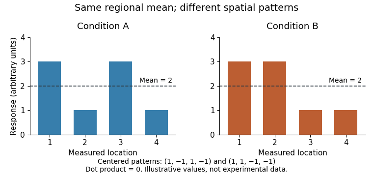

<h1 id="5/solution">Solution</h1>

↑ **Parent:** [5](../5.md)

**[Empathy](../../../empathy.md) combines partly shared affective mechanisms with computations that represent another person's state; regional overlap does not show that the underlying [neural code](../../../neural-code.md) is identical.** The answer depends on what [empathy](../../../empathy.md) means. [Affective empathy](../../../affective-empathy.md) involves sharing something of another's feeling while maintaining a [self-other distinction](../../../self-other-distinction.md). [Cognitive empathy](../../../cognitive-empathy.md) concerns understanding that person's state and overlaps with [theory of mind](../../../theory-of-mind.md). [Compassion](../../../compassion.md) is concern directed toward helping, whereas [personal distress](../../../personal-distress.md) is aversive [emotional arousal](../../../emotional-arousal.md) centered on oneself. These components can vary independently, so a single neural contrast cannot settle all of them.

A shared-processing hypothesis predicts that some mechanisms supporting one's own affect also contribute when another person suffers. [Tania Singer](../../../tania-singer.md) and colleagues compared [functional magnetic resonance imaging](../../../functional-magnetic-resonance-imaging.md) responses to painful electrical stimulation of the participant's hand with responses to a signal that the partner, present in the room, was receiving [pain](../../../pain.md). [Anterior insula](../../../anterior-insula.md) and rostral [anterior cingulate cortex](../../../anterior-cingulate-cortex.md) responded in both conditions, whereas [somatosensory cortex](../../../somatosensory-cortex.md) responses were more specific to receiving [pain](../../../pain.md). The cue-based partner condition helped separate affective response from simply seeing an injured body part.[Self-pain versus partner-pain design; shared anterior insula and rostral cingulate responses](../../../empathy-for-pain-involves-the-affective-but-not-sensory-components-of-pain-by-tania-singer-and-others.md)

The result supports partial overlap at the measured regional scale, not duplication of the whole first-person experience. [Functional magnetic resonance imaging](../../../functional-magnetic-resonance-imaging.md) measures an indirect hemodynamic response; each [voxel](../../../voxel.md) aggregates information over many [neurons](../../../neuron-split.md). A region can contain intermingled populations, and different computations can increase its average response. Moreover, [anterior insula](../../../anterior-insula.md) and cingulate activation is not uniquely diagnostic of [empathy](../../../empathy.md). Inferring [empathy](../../../empathy.md) solely because those areas are active is [reverse inference](../../../reverse-inference.md) unless the alternative processes have been constrained by the design. Anticipation, [attention](../../../attention.md) and task relevance are plausible alternatives that require appropriate controls.

[Multivariate pattern analysis](../../../multivariate-pattern-analysis.md) asks a stronger representational question: does a pattern that predicts one's own [pain](../../../pain.md) also predict another's [pain](../../../pain.md)? [Anjali Krishnan](../../../anjali-krishnan.md) and colleagues obtained dissociable patterns for somatic and vicarious [pain](../../../pain.md), despite some overlapping regional activation. Their cross-prediction results challenged the inference from common active territory to a common [pain](../../../pain.md) representation. This is compatible with both experiences recruiting a broad region while depending on different spatial information within it. It does not establish that no shared component exists at any scale.[Multivariate prediction and specificity tests for somatic and vicarious pain](../../../somatic-and-vicarious-pain-are-represented-by-dissociable-multivariate-brain-patterns-by-anjali-krishnan-and-others.md)

The logical distinction can be made without empirical assumptions. Two four-location responses, $(3,1,3,1)$ and $(3,3,1,1)$, each have [mean](../../../expected-value-split.md) two and positive activation everywhere. Their [mean](../../../expected-value-split.md)-centered patterns are $(1,-1,1,-1)$ and $(1,1,-1,-1)$, whose [dot product](../../../dot-product.md) is zero. Thus identical regional means can conceal different codes. Conversely, failure of cross-prediction may reflect limited [statistical power](../../../statistical-power.md) or a context-dependent transformation of a shared representation. Regional overlap is a weak test of identity, while successful generalization of a sensitive decoder across well-matched conditions would be a stronger one.

**[Figure 2](#5/image-illustrative-responses-with-the-same-regional-mean-but-orthogonal-centered-patterns-arbitrary-values-not-experimental-data). Illustrative responses with the same regional mean but orthogonal centered patterns; arbitrary values, not experimental data**.

[Intervention](../../../treatment.md) adds a complementary test. [Markus Rütgen](../../../markus-rutgen.md) and colleagues used [placebo analgesia](../../../placebo-analgesia.md) to reduce participants' own [pain](../../../pain.md) and found reduced responses to others' [pain](../../../pain.md) as well. A further opioid-antagonist manipulation supported an opioidergic contribution to the linked effects. This goes beyond observing that two conditions activate the same region: changing a mechanism relevant to self-[pain](../../../pain.md) altered a response associated with [empathy](../../../empathy.md) for [pain](../../../pain.md). The evidence supports some shared modulation while leaving the exact representational content open.[Placebo-analgesia manipulation and opioid-antagonist experiment](../../../placebo-analgesia-and-its-opioidergic-regulation-suggest-that-empathy-for-pain-is-grounded-in-self-pain-by-markus-rutgen-and-others.md)

There are still alternatives to a literal shared-[pain](../../../pain.md) code. Expectancy can change [attention](../../../attention.md), appraisal or response reporting, and a neuromodulatory pathway can regulate two distinct representations. Appropriate comparisons with nonsocial aversive events would help determine how specifically the effect concerns [empathy](../../../empathy.md) rather than a broad change in affective processing. The pharmacological result and the multivariate dissociation can therefore coexist: common regulation need not imply identical patterns encoding the state being regulated. Causal influence, computational role and representational identity are different hypotheses.

Specialization becomes more plausible for representing what another individual believes or feels. [Rebecca Saxe](../../../rebecca-saxe.md) and colleagues compared stories requiring reasoning about mental states with nonmental stories, including representations such as false photographs. [Temporoparietal junction](../../../temporoparietal-junction.md) responses distinguished belief reasoning from important control demands. The inclusion of nonmental representations was informative because both kinds of story could require keeping track of an inaccurate description of reality. The contrast supports functional selectivity related to [theory of mind](../../../theory-of-mind.md) rather than an explanation in terms of difficulty alone.[Experiments 1–2; belief reasoning, people descriptions and nonmental representation controls](../../../people-thinking-about-thinking-people-the-role-of-the-temporo-parietal-junction-in-theory-of-mind-by-rebecca-saxe-and-others.md)

This is evidence for a socially selective computation under the tested contrasts, not proof that an entire anatomical area operates only during social interaction. [Theory of mind](../../../theory-of-mind.md) can contribute to [cognitive empathy](../../../cognitive-empathy.md) without producing affect sharing, and [affective empathy](../../../affective-empathy.md) can occur without a detailed verbal inference about beliefs. More generally, an empathic task recruits [perception](../../../perception.md) of the cue, [attention](../../../attention.md), [self-other distinction](../../../self-other-distinction.md), interpretation and regulation. Some components are useful outside [social cognition](../../../social-cognition.md), whereas others depend specifically on representing another mind. The architecture can combine them through interaction rather than locating [empathy](../../../empathy.md) in one exclusive system.

Converging tests should separate these hypotheses. Matched social and nonsocial aversive events can test specificity; cross-condition decoding can test representational generalization; and lesion studies or [transcranial magnetic stimulation](../../../transcranial-magnetic-stimulation.md) can test whether a candidate region makes a necessary contribution under controlled conditions. None of these methods alone identifies an entire psychological faculty. For example, a perturbation that impairs both conditions may disrupt [attention](../../../attention.md) rather than a shared affective code, so control tasks must measure the proposed alternative.

**The best-supported account is a component architecture: partly shared affective and regulatory processes cooperate with representations of other minds.** Self-[pain](../../../pain.md), [empathy](../../../empathy.md) for [pain](../../../pain.md) and [theory of mind](../../../theory-of-mind.md) provide complementary evidence, but they should not be collapsed into a single construct. Generalizing from [pain](../../../pain.md) to every form of [empathy](../../../empathy.md) requires additional tests of other [emotions](../../../emotion.md), motivations and social contexts.

## ↑ Ancestors (11)

1. [5](../5.md)
2. [2022](../../2022-split.md)
3. [Past exam of the social psychology course of the year 2 of the psychology (experimental) course of the University of Oxford](../../split.md)
4. [Social psychology course of the year 2 of the psychology (experimental) course of the University of Oxford](../../../social-psychology-course-of-the-year-2-of-the-psychology-experimental-course-of-the-university-of-oxford.md)
5. [Year 2 of the psychology (experimental) course of the University of Oxford](../../../year-2-of-the-psychology-experimental-course-of-the-university-of-oxford.md)
6. [Psychology (experimental) course of the University of Oxford](../../../psychology-experimental-course-of-the-university-of-oxford.md)
7. [Undergraduate course of the University of Oxford](../../../undergraduate-course-of-the-university-of-oxford.md)
8. [Course of the University of Oxford](../../../course-of-the-university-of-oxford.md)
9. [University of Oxford](../../../university-of-oxford-split.md)
10. [List of universities](../../../list-of-universities.md)
11. [Codex Wiki](../../../split.md)
