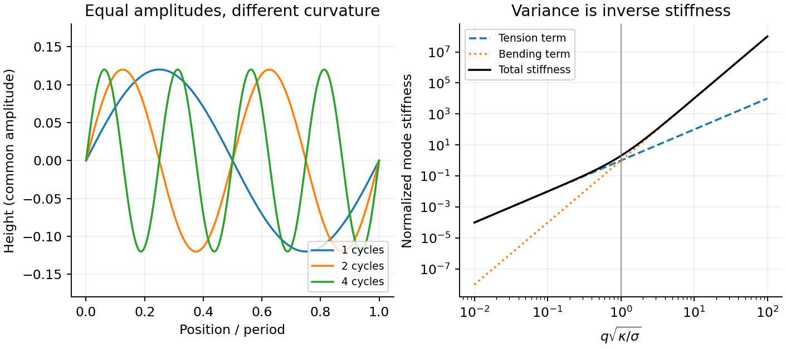
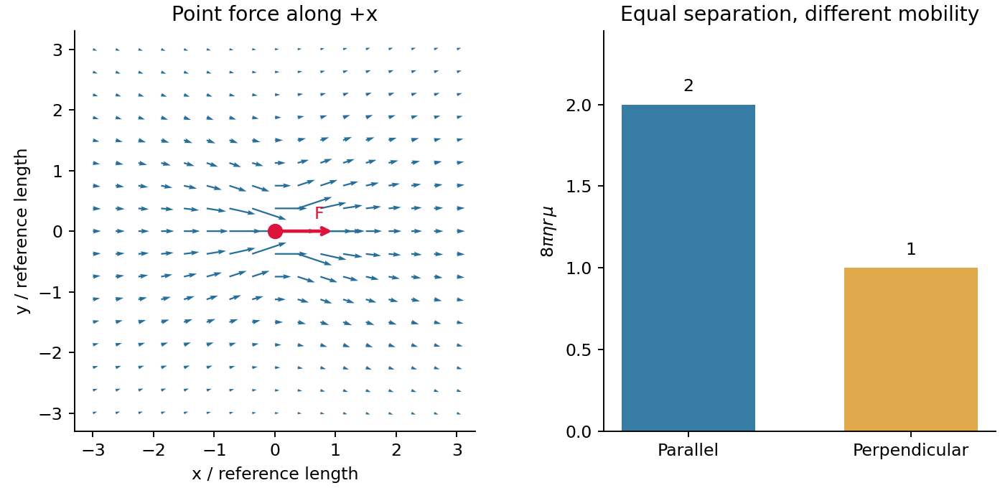

# Paper 1

↑ **Parent:** [2012](../2012.md)

Original paper: [Public original, physical PDF pages 228–231](https://www.whatdotheyknow.com/request/natural_science_tripos_physics_e_2/response/2340776/attach/2/FOI%202023%20399%20Zahid%20materials.pdf?cookie_passthrough=1#page=228).

**Table of contents**

- [1](#1)
  - [a](#1/a)
    - [Solution](#1/a/solution)
  - [b](#1/b)
    - [Solution](#1/b/solution)
  - [c](#1/c)
    - [Solution](#1/c/solution)
- [2](#2)
  - [a](#2/a)
    - [Solution](#2/a/solution)
  - [b](#2/b)
    - [Solution](#2/b/solution)
  - [c](#2/c)
    - [Solution](#2/c/solution)
- [3](#3)
  - [a](#3/a)
    - [Solution](#3/a/solution)
  - [b](#3/b)
    - [Solution](#3/b/solution)
  - [c](#3/c)
    - [Solution](#3/c/solution)
  - [d](#3/d)
    - [Solution](#3/d/solution)
  - [e](#3/e)
    - [Solution](#3/e/solution)
- [4](#4)
  - [a](#4/a)
    - [Solution](#4/a/solution)
  - [b](#4/b)
    - [Solution](#4/b/solution)
  - [c](#4/c)
    - [Solution](#4/c/solution)
  - [d](#4/d)
    - [Solution](#4/d/solution)
  - [e](#4/e)
    - [Solution](#4/e/solution)

## 1

↑ **Parent:** [Paper 1](paper-1.md)

<h3 id="1/a">a</h3>

↑ **Parent:** [1](#1)

<h4 id="1/a/solution">Solution</h4>

↑ **Parent:** [A](#1/a)

Use the squared three-dimensional endpoint [displacements](../../classical-mechanics.md#displacement), not their arithmetic [mean](../../expected-value.md). The [mean squared displacement](../../brownian-motion.md#mean-squared-displacement) estimate and corresponding [diffusion coefficient](../../brownian-motion.md#diffusion-coefficient) are

$$
\widehat{\langle\Delta r^2\rangle}=\frac{31^2+2^2+50^2+65^2+14^2}{5}=1577.2\,\mu\mathrm m^2,
\qquad \widehat D=\frac{1577.2}{6\times60}=4.38\,\mu\mathrm m^2\,\mathrm s^{-1}.
$$

The factor six is for three-dimensional [Brownian motion](../../brownian-motion.md). For an isolated no-slip sphere, the [Stokes–Einstein relation](../../stokes-flow.md#stokes-einstein-relation) gives the [Brownian radius estimate from endpoint displacements](../../stokes-flow.md#brownian-radius-estimate-from-endpoint-displacements):

$$
\boxed{a=\frac{k_BT}{6\pi\eta\widehat D}\simeq5.6\times10^{-8}\,\mathrm m=56\,\mathrm{nm}.}
$$

Here room [temperature](../../temperature.md) is taken as $298\,\mathrm K$; choosing $293\,\mathrm K$ gives $55\,\mathrm{nm}$, a much smaller difference than the sampling uncertainty. Under independent increments with a [normal distribution](../../probability-distribution.md#normal-distribution), $\operatorname{sd}(\widehat D)/D=\sqrt{2/(3n)}\simeq0.37$ for $n=5$. The [sampling uncertainty of an endpoint diffusivity estimate](../../stokes-flow.md#sampling-uncertainty-of-an-endpoint-diffusivity-estimate) therefore makes this a rough [radius](../../topology.md#radius) estimate. It assumes negligible drift and hydrodynamic coupling between probes, the supplied bulk [viscosity](../../dynamic-viscosity.md), and actual three-dimensional tracking. Localization noise adds to the squared [displacements](../../classical-mechanics.md#displacement) and would bias this inferred [radius](../../topology.md#radius) downward if uncorrected.

<h3 id="1/b">b</h3>

↑ **Parent:** [1](#1)

<h4 id="1/b/solution">Solution</h4>

↑ **Parent:** [B](#1/b)

For the three-dimensional [worm-like chain](../../mathematical-biology.md#worm-like-chain), define the bending coefficient $\kappa_b$ by $F_b=(\kappa_b/2)\int|\partial_s\mathbf t|^2ds$. Its [persistence length](../../mathematical-biology.md#persistence-length) is $l_p=\kappa_b/(k_BT)$. Holding that coefficient and the [polymer contour length](../../polymer.md#polymer-contour-length) $L$ fixed gives

$$
\boxed{\frac{l_p(T_2)}{l_p(T_1)}=\frac{T_1}{T_2},\qquad
\frac{\Delta l_p}{l_p(T_1)}=\frac{T_1}{T_2}-1=-\frac{T_2-T_1}{T_2}.}
$$

The [temperatures](../../temperature.md) must be absolute. The [end-to-end distance of a worm-like chain](../../mathematical-biology.md#end-to-end-distance-of-a-worm-like-chain) obeys

$$
\langle R^2\rangle=2Ll_p-2l_p^2(1-e^{-L/l_p}).
$$

For a long flexible chain, $L\gg l_p$, the typical size is $R_{\rm rms}\simeq\sqrt{2Ll_p}$, so **warming contracts the chain**, with $R_{\rm rms}(T_2)/R_{\rm rms}(T_1)\simeq\sqrt{T_1/T_2}$. The finite-length formula also decreases as $l_p$ decreases, but the rod limit $L\ll l_p$ changes very little. A large segment count alone does not guarantee $L\gg l_p$. If the material's bending coefficient itself depends on [temperature](../../temperature.md), replace the first ratio by $[\kappa_b(T_2)/\kappa_b(T_1)]T_1/T_2$; the sign then needs that additional material information. This calculation concerns a generic physical filament, with no biomolecular application.

<h3 id="1/c">c</h3>

↑ **Parent:** [1](#1)

<h4 id="1/c/solution">Solution</h4>

↑ **Parent:** [C](#1/c)

For monovalent mobile ions, the linearized [Debye–Hückel screening length](../../mathematical-biology.md#debye-huckel-screening-length) is

$$
\lambda^2=\frac{\epsilon_0\epsilon_r k_BT}{e^2\sum_i n_i z_i^2}.
$$

Here $n_i$ is a [number density](../../statistical-physics.md#number-density) in $\mathrm{m^{-3}}$, not a [molarity](../../mathematical-physics.md#molar-concentration). Use the question's idealized neutral-water convention, $c_+=c_-=10^{-7}\,\mathrm{mol\,L^{-1}}$, and $T=293.15\,\mathrm K$. Both ion species contribute:

$$
\lambda=\sqrt{\frac{80\epsilon_0k_BT}{2e^2N_A\,10^3\times10^{-7}}},
\qquad \boxed{\lambda_{\rm water}\simeq9.63\times10^{-7}\,\mathrm m\simeq0.96\,\mu\mathrm m.}
$$

For added salt concentration $c_s$ in $\mathrm{mol\,L^{-1}}$, the [ionic strength](../../mixture.md#ionic-strength) in this model is $I=c_s+10^{-7}\,\mathrm{mol\,L^{-1}}$. With the numerical [molarity](../../mathematical-physics.md#molar-concentration) $I_M=I/(1\,\mathrm{mol\,L^{-1}})$,

$$
\lambda=\frac{0.3045\,\mathrm{nm}}{\sqrt{I_M}},\qquad
\boxed{c_s\simeq0.0927\,\mathrm{mol\,L^{-1}}\simeq0.093\,\mathrm M\quad(\lambda=1\,\mathrm{nm}).}
$$

The water contribution is negligible at that salt level. The factor $10^3$ converts molarity into $\mathrm{mol\,m^{-3}}$; omitting it or counting only one ion species gives a wrong screening [length](../../physics.md#length). Exact water autoionization and activities vary with [temperature](../../temperature.md), so the first estimate uses the simplified neutral $10^{-7}\,\mathrm M$ concentrations implied by the question. At the higher salt level, ion-size effects, nonideal activities and changes in [permittivity](../../permittivity.md) limit the numerical accuracy of this continuum estimate.

## 2

↑ **Parent:** [Paper 1](paper-1.md)

<h3 id="2/a">a</h3>

↑ **Parent:** [2](#2)

<h4 id="2/a/solution">Solution</h4>

↑ **Parent:** [A](#2/a)

A [synthetic fluid membrane](../../physics.md#synthetic-fluid-membrane) is a thin, laterally fluid sheet whose components can rearrange in its plane while the sheet resists changes of [area](../../differential-geometry.md#surface-area) and [curvature](../../differential-geometry.md#curvature). Synthetic [amphiphiles](../../physical-chemistry.md#amphiphile) can assemble into two opposed layers with solvent-compatible groups facing outward. Their fluid in-plane response gives no equilibrium static [shear modulus](../../elasticity-physics.md#shear-modulus), but does not imply zero [membrane bending rigidity](../../mathematical-biology.md#membrane-bending-rigidity) or zero area-compression modulus. A thin membrane can therefore bend easily while remaining difficult to stretch. These notes cover generic synthetic interfaces.

TODO: biological, biofluid and biomolecular membrane applications are user-deferred.

A convenient continuum description is the [Helfrich energy](../../mathematical-biology.md#helfrich-energy), augmented by [spontaneous curvature](../../mathematical-biology.md#spontaneous-curvature) and the Gaussian term:

$$
F=\int\left[\frac\kappa2(2H-C_0)^2+\bar\kappa K+\sigma\right]dA.
$$

Here $H$ and $K$ are [mean curvature](../../second-fundamental-form.md#mean-curvature) and [Gaussian curvature](../../second-fundamental-form.md#gaussian-curvature), $C_0$ is preferred [curvature](../../differential-geometry.md#curvature), $\kappa$ and $\bar\kappa$ have [energy](../../energy.md) units, and $\sigma$ is [membrane tension](../../mathematical-biology.md#membrane-tension) with units $\mathrm{N\,m^{-1}}$. Leaflet asymmetry can favor nonzero $C_0$. At fixed topology the integrated Gaussian term is constant for a closed surface by the [Gauss-Bonnet theorem](../../differential-geometry.md#gauss-bonnet-theorem). A symmetric tensionless spherical sheet has mean-curvature bending [energy](../../energy.md) $8\pi\kappa$, independent of its [radius](../../topology.md#radius) in this ideal model. Edge [energy](../../energy.md) can favor closure, while fixed [area](../../differential-geometry.md#surface-area) and enclosed [volume](../../geometry-and-topology.md#volume) constrain the resulting shapes.

For a nearly flat sheet, its [small-slope elastic membrane energy](../../mathematical-biology.md#small-slope-elastic-membrane-energy) becomes

$$
F=\frac12\int[\kappa(\nabla^2h)^2+\sigma|\nabla h|^2]d^2x.
$$

With $h_{\mathbf q}=A^{-1}\int h(\mathbf x)e^{-i\mathbf q\cdot\mathbf x}d^2x$, the [equipartition theorem](../../canonical-ensemble.md#equipartition-theorem) gives the [membrane fluctuation spectrum under tension](../../mathematical-biology.md#membrane-fluctuation-spectrum-under-tension):

$$
\boxed{\langle|h_{\mathbf q}|^2\rangle=\frac{k_BT}{A(\kappa q^4+\sigma q^2)}.}
$$

Bending suppresses short wavelengths, whereas positive tension suppresses the longest undulations. Their crossover is $q\sim\sqrt{\sigma/\kappa}$. Measuring the spectrum can separate these two contributions, provided finite image resolution, projected versus true [area](../../differential-geometry.md#surface-area), and external confinement are accounted for. The drawn modes below are synthetic calculations, not an image of a sample.

**[Figure 1](#2/a/image-membrane-mode-stiffness). Membrane mode stiffness**.

<h3 id="2/b">b</h3>

↑ **Parent:** [2](#2)

<h4 id="2/b/solution">Solution</h4>

↑ **Parent:** [B](#2/b)

For a clean liquid interface at fixed [temperature](../../temperature.md) and composition, [surface tension](../../surface-tension.md) is the reversible free-energy cost per added [area](../../differential-geometry.md#surface-area), $\gamma=(\partial F/\partial A)_{T,V,N}$, so $dF=\gamma\,dA$. Its units are both $\mathrm{J\,m^{-2}}$ and $\mathrm{N\,m^{-1}}$. Molecules at an interface have a different environment from those in the bulk; creating more interface changes their interactions and [entropy](../../entropy.md). For constant $\gamma$, the interfacial [free energy](../../thermodynamic-potential.md#thermodynamic-free-energy) is $\gamma A$ up to a reference constant. This is not generally identical to the internal [surface energy](../../surface-tension.md#surface-energy): the interfacial [entropy](../../entropy.md) density is $-d\gamma/dT$, giving internal-energy density $\gamma-T\,d\gamma/dT$.

A line of [length](../../physics.md#length) $\ell$ in one interface transmits a tangential [force](../../force.md) $\gamma\ell$, perpendicular to the line. A soap film has two interfaces, giving [force](../../force.md) $2\gamma\ell$ on a sliding rim. Quasistatic extension by $dx$ creates total [area](../../differential-geometry.md#surface-area) $2\ell dx$, recovering that [force](../../force.md) from $dF=2\gamma\ell dx$. Uniform positive [surface tension](../../surface-tension.md) favors minimum [area](../../differential-geometry.md#surface-area) at fixed [volume](../../geometry-and-topology.md#volume), hence an isolated spherical droplet when gravity is negligible. [curvature](../../differential-geometry.md#curvature) gives the [Young–Laplace equation](../../surface-tension.md#young-laplace-equation), with outward normal chosen consistently:

$$
\boxed{\Delta p=\gamma\left(\frac1{R_1}+\frac1{R_2}\right).}
$$

A spherical liquid drop has $\Delta p=2\gamma/R$; a thin soap bubble with two similar interfaces has approximately $4\gamma/R$. The [capillary length](../../surface-tension.md#capillary-length) $\sqrt{\gamma/(\Delta\rho g)}$ compares gravity with capillarity. [surface tension](../../surface-tension.md) also restores [capillary waves](../../surface-tension.md#capillary-wave), rather than providing a bulk static [shear modulus](../../elasticity-physics.md#shear-modulus).

Interfacial contamination and added [surfactants](../../surface-tension.md#surfactant) can change $\gamma$ substantially; a nonuniform value produces tangential [Marangoni stress](../../surface-tension.md#marangoni-effect). A rim-force measurement should therefore control [temperature](../../temperature.md), cleanliness and the number of interfaces. Capillary-rise methods additionally need the [contact angle](../../surface-tension.md#contact-angle), because the vertical component is proportional to $\gamma\cos\theta$. An independent frame-force measurement can distinguish a contact-angle change from a true change of [surface tension](../../surface-tension.md).

<h3 id="2/c">c</h3>

↑ **Parent:** [2](#2)

<h4 id="2/c/solution">Solution</h4>

↑ **Parent:** [C](#2/c)

A moving or externally forced colloid disturbs the surrounding fluid, changing the [velocity](../../classical-mechanics.md#velocity) of other colloids even without direct contact. These [hydrodynamic interactions](../../stokes-flow.md#hydrodynamic-interaction) are long-ranged at small [Reynolds number](../../dynamic-viscosity.md#reynolds-number). In an unbounded incompressible Newtonian liquid, the [Stokes flow](../../stokes-flow.md) response to a point [force](../../force.md) is the [Stokeslet](../../stokes-flow.md#stokeslet):

$$
-\nabla p+\eta\nabla^2\mathbf u+\mathbf F\,\delta(\mathbf r)=0,\qquad\nabla\cdot\mathbf u=0,
\qquad u_i(\mathbf r)=\mathsf G_{ij}(\mathbf r)F_j.
$$

Its [Oseen tensor](../../stokes-flow.md#oseen-tensor) is

$$
\boxed{\mathsf G_{ij}(\mathbf r)=\frac1{8\pi\eta r}
\left(\delta_{ij}+\frac{r_ir_j}{r^2}\right).}
$$

This is a mobility tensor, with units [velocity](../../classical-mechanics.md#velocity) per [force](../../force.md), rather than a [stress](../../continuum-mechanics.md#stress) tensor. At separation $r$ the response parallel to the line of centres is $1/(4\pi\eta r)$; the perpendicular response is $1/(8\pi\eta r)$. Flow is not isotropic even though the solvent is. The disturbance decays as $1/r$, so treating all drag [forces](../../force.md) as independent can miss correlated motion.

For well-separated equal spheres of [radius](../../topology.md#radius) $a$, the leading [hydrodynamic mobility matrix](../../stokes-flow.md#hydrodynamic-mobility-matrix) gives

$$
\mathbf V_i=\frac{\mathbf F_i}{6\pi\eta a}
+\sum_{j\ne i}\mathsf G(\mathbf r_i-\mathbf r_j)\mathbf F_j.
$$

The first term is the isolated-sphere self mobility; the remaining terms couple distinct particles. At thermal equilibrium the [fluctuation-dissipation theorem](../../quantum-field-theory.md#fluctuation-dissipation-theorem) also predicts correlated short-time increments, $\langle\Delta r_{i\alpha}\Delta r_{j\beta}\rangle\simeq2k_BT\mu_{i\alpha,j\beta}\Delta t$ with the configuration locally fixed. Thus correlated Brownian [displacements](../../classical-mechanics.md#displacement) can reveal hydrodynamic coupling without an applied [force](../../force.md).

The point-force approximation requires $r\gg a$ and negligible inertia. It diverges at the origin and cannot replace the finite self mobility. Near-contact lubrication, walls, many-body corrections, and a viscoelastic solvent require more complete mobility laws. A force-free particle can instead have a faster-decaying leading disturbance, so the $1/r$ claim specifically concerns a net-force-driven object.

**[Figure 2](#2/c/image-oseen-mobility-directions). Oseen mobility directions**.

## 3

↑ **Parent:** [Paper 1](paper-1.md)

<h3 id="3/a">a</h3>

↑ **Parent:** [3](#3)

<h4 id="3/a/solution">Solution</h4>

↑ **Parent:** [A](#3/a)

The three solvent conditions describe effective interactions between segments of a generic [polymer](../../polymer.md). In a [good solvent](../../mixture.md#good-solvent), solvent contacts favor a swollen, self-avoiding coil with positive [excluded volume](../../statistical-physics.md#excluded-volume). At a [theta solvent](../../mixture.md#theta-solvent) condition, leading pair repulsion and attraction cancel; the chain has approximately ideal random-walk statistics. In a [poor solvent](../../mixture.md#poor-solvent), effective attraction contracts the chain, eventually producing a dense [polymer globule](../../mixture.md#polymer-globule) for a sufficiently long chain.

For $N$ statistical segments of [length](../../physics.md#length) $a$, the [radius of gyration](../../polymer.md#radius-of-gyration) has the scaling

$$
\boxed{R_g\sim\begin{cases}
aN^{3/5},&\text{good solvent},\\
aN^{1/2},&\text{theta/ideal solvent},\\
aN^{1/3},&\text{dense poor-solvent globule}.
\end{cases}}
$$

The good-solvent power $3/5$ is the [Flory approximation](../../polymer.md#flory-approximation); the asymptotic three-dimensional exponent is closer to $0.588$. In the ideal [freely jointed chain](../../mathematical-biology.md#ideal-chain), the more precise result is $R_g^2\simeq Na^2/6$, whereas the end-to-end [mean](../../expected-value.md) square is $Na^2$. Scaling notation suppresses those geometry-dependent factors. The globule power follows from a [volume](../../geometry-and-topology.md#volume) proportional to $N$, and presumes a dense collapsed state away from the theta crossover. The dilute condition excludes overlap with other chains; it does not eliminate contacts between distant segments of the same chain.

<h3 id="3/b">b</h3>

↑ **Parent:** [3](#3)

<h4 id="3/b/solution">Solution</h4>

↑ **Parent:** [B](#3/b)

Use [polymer](../../polymer.md) [volume fraction](../../continuum-mechanics.md#volume-fraction) $\phi$ horizontally and the [Flory interaction parameter](../../mixture.md#flory-interaction-parameter) $\chi$ vertically. Lower $\chi$ gives better solvent quality. The simplest [Flory–Huggins solution theory](../../mixture.md#flory-huggins-solution-theory) assigns the dimensionless mixing [free energy](../../thermodynamic-potential.md#thermodynamic-free-energy) per lattice site

$$
f(\phi)=\frac\phi N\ln\phi+(1-\phi)\ln(1-\phi)+\chi\phi(1-\phi),
\qquad v_{\rm eff}\simeq a^3(1-2\chi).
$$

Thus $\chi<1/2$ gives positive [excluded volume](../../statistical-physics.md#excluded-volume) and a good-solvent coil, $\chi=1/2$ is the long-chain theta condition, and $\chi>1/2$ is the poor-solvent side. It is the net two-segment interaction that vanishes at theta, not every molecular [force](../../force.md).

At fixed good-solvent quality, the [polymer overlap volume fraction](../../mixture.md#polymer-overlap-volume-fraction) $\phi^*\sim Na^3/R_g^3$ separates isolated coils from a [semidilute polymer solution](../../mixture.md#semidilute-polymer-solution). Above overlap, many chains interpenetrate, but there is still solvent on the segment scale. As $\phi$ approaches order unity the solution is concentrated; these concentration-regime boundaries are crossovers, not first-order phase transitions. The overlap fraction increases from order $N^{-4/5}$ in a strong [good solvent](../../mixture.md#good-solvent) toward order $N^{-1/2}$ at theta. The crossover can be expressed as $\phi^*\sim N^{-4/5}(1-2\chi)^{-3/5}$ while $1-2\chi\gg N^{-1/2}$; it saturates at the theta scaling when that condition fails.

On the poor-solvent side there can instead be coexistence of polymer-poor and polymer-rich phases. The [binodal](../../critical-phenomenon.md#binodal) follows a common tangent of $f$; the [spinodal](../../critical-phenomenon.md#spinodal) follows

$$
f''(\phi)=\frac1{N\phi}+\frac1{1-\phi}-2\chi=0.
$$

The [critical point of a Flory–Huggins polymer solution](../../mixture.md#critical-point-of-a-flory-huggins-polymer-solution) is

$$
\boxed{\phi_c=\frac1{1+\sqrt N},\qquad
\chi_c=\frac12(1+N^{-1/2})^2.}
$$

For finite $N$, $\chi_c$ lies above $1/2$. Therefore [poor solvent](../../mixture.md#poor-solvent) does not automatically mean demixing at every concentration, and an overlap line must not be mistaken for a coexistence boundary. The original figure uses the stated ideal model for an illustrative chain [length](../../physics.md#length); it does not assert a measured phase boundary. A vertical [temperature](../../temperature.md) axis would additionally require a material-specific relation $\chi(T)$.

**[Figure 3](#3/b/image-polymer-solution-regimes). Polymer solution regimes**.

<h3 id="3/c">c</h3>

↑ **Parent:** [3](#3)

<h4 id="3/c/solution">Solution</h4>

↑ **Parent:** [C](#3/c)

Overlap means roughly one coil per coil [volume](../../geometry-and-topology.md#volume). With segment [volume](../../geometry-and-topology.md#volume) $a^3$, the corresponding [polymer overlap volume fraction](../../mixture.md#polymer-overlap-volume-fraction) is

$$
\phi^*\sim\frac{Na^3}{R_g^3}.
$$

For a strong [good solvent](../../mixture.md#good-solvent), $R_g\sim aN^{3/5}$, and hence

$$
\boxed{\phi^*\sim N^{-4/5}=(10^4)^{-4/5}\simeq6.3\times10^{-4},}
$$

or about **0.063% by [volume](../../geometry-and-topology.md#volume)** in the unit-prefactor scaling convention. The segment [length](../../physics.md#length) cancels. A coil has no sharply defined boundary, so using $4\pi R_g^3/3$ or retaining a size amplitude changes an order-one prefactor. This calculation is a scaling estimate, not an exact volume-fraction measurement.

<h3 id="3/d">d</h3>

↑ **Parent:** [3](#3)

<h4 id="3/d/solution">Solution</h4>

↑ **Parent:** [D](#3/d)

The [correlation length](../../critical-phenomenon.md#correlation-length) in a semidilute solution is the [concentration blob](../../mixture.md#concentration-blob) size. Below it a chain retains isolated good-solvent statistics; beyond it concentration fluctuations are screened and many chains interpenetrate. It is a local scale, not the total chain [radius](../../topology.md#radius). If a blob contains $g$ segments,

$$
\xi\sim ag^{3/5},\qquad \phi\sim\frac{ga^3}{\xi^3}.
$$

Eliminating $g$ gives the [good-solvent concentration-blob scaling](../../mixture.md#good-solvent-concentration-blob-scaling)

$$
\boxed{g\sim\phi^{-5/4},\qquad\xi\sim a\phi^{-3/4}.}
$$

Using the supplied segment size and concentration,

$$
\boxed{\xi\simeq0.5\,\mathrm{nm}\,(0.01)^{-3/4}\simeq15.8\,\mathrm{nm}.}
$$

Here $g\simeq316$ and $N/g\simeq32$, so there are many segments within each blob and several dozen blobs per chain. Also $\phi/\phi^*\simeq16$, consistent with a semidilute estimate rather than isolated coils. The cancellation of $N$ from $\xi$ is physical: once chains are long enough, the local concentration sets the mesh scale. As throughout the scaling argument, numerical amplitudes are not determined by the given data.

<h3 id="3/e">e</h3>

↑ **Parent:** [3](#3)

<h4 id="3/e/solution">Solution</h4>

↑ **Parent:** [E](#3/e)

In a dilute solution, separate coils diffuse through solvent with long-ranged hydrodynamic coupling among their segments. The [Zimm model](../../polymer.md#zimm-model) gives whole-chain diffusion

$$
\boxed{D_{\rm dilute}\sim\frac{k_BT}{\eta_sR_H}\propto N^{-\nu},\qquad\nu\simeq3/5,}
$$

where $R_H$ is a [hydrodynamic radius](../../mixture.md#hydrodynamic-radius) and $\eta_s$ the solvent [viscosity](../../dynamic-viscosity.md). The coil continually changes shape while its [centre of mass](../../classical-mechanics.md#center-of-mass) performs long-time [Brownian motion](../../brownian-motion.md); treating it as a rigid sphere is only a scaling analogy.

At high concentration, solvent-mediated [hydrodynamic interactions](../../stokes-flow.md#hydrodynamic-interaction) are screened on sufficiently large scales and [times](../../classical-mechanics.md#time-in-physics). If chains are not entangled, additive local or blob friction gives [Rouse model](../../polymer.md#rouse-model) behaviour, $D\propto N^{-1}$ at fixed concentration. For long entangled chains, neighboring chains prevent rapid transverse escape. In the [reptation](../../polymer.md#reptation) tube picture the chain moves mainly along its contour until it renews the surrounding tube. Contour diffusion scales as $N^{-1}$, the tube-renewal [time](../../classical-mechanics.md#time-in-physics) as $N^3$, and the random-coil size squared as $N$. Therefore

$$
\boxed{D_{\rm entangled}\sim\frac{R^2}{\tau_d}\propto N^{-2}.}
$$

Both cases ultimately give diffusive centre-of-mass motion, but entangled concentrated chains move much more slowly and retain constraints for longer. The inequality $\phi\gg\phi^*$ establishes strong overlap, not by itself entanglement: the latter also requires sufficiently many segments relative to an entanglement [length](../../physics.md#length). No numerical entanglement scale or concentrated-solution [diffusion coefficient](../../brownian-motion.md#diffusion-coefficient) is supplied, so only the conditional regimes and scaling exponents can be fixed here.

## 4

↑ **Parent:** [Paper 1](paper-1.md)

<h3 id="4/a">a</h3>

↑ **Parent:** [4](#4)

<h4 id="4/a/solution">Solution</h4>

↑ **Parent:** [A](#4/a)

In [linear viscoelasticity](../../rheology.md#linear-viscoelasticity), [stress](../../continuum-mechanics.md#stress) is a linear functional of past [strain](../../continuum-mechanics.md#strain) increments: scaling the deformation scales the response, and responses to small deformations add. For a time-translation-invariant material, [Boltzmann superposition](../../rheology.md#boltzmann-superposition) writes $\sigma(t)=\int_{-\infty}^tG(t-s)\dot\epsilon(s)ds$, where $G$ is a [relaxation modulus](../../rheology.md#relaxation-modulus). The material combines reversible storage with delayed or dissipative response; the description is restricted to small deformations about the chosen state.

The [Maxwell model](../../rheology.md#linear-maxwell-fluid) places an elastic [spring](../../elasticity-physics.md#spring) and viscous [dashpot](../../rheology.md#dashpot) in series. They carry the same [shear stress](../../viscous-fluid-flow.md#shear-stress) $\sigma$, and their [shear strains](../../continuum-mechanics.md#shear-strain) add:

$$
\epsilon=\epsilon_e+\epsilon_v,\qquad
\epsilon_e=\frac\sigma{G_0},\qquad
\dot\epsilon_v=\frac\sigma\eta.
$$

Differentiating gives

$$
\boxed{\dot\epsilon=\frac{\dot\sigma}{G_0}+\frac\sigma\eta,\qquad\tau=\frac\eta{G_0}.}
$$

Here $\epsilon$ is dimensionless [shear strain](../../continuum-mechanics.md#shear-strain), $\sigma$ [shear stress](../../viscous-fluid-flow.md#shear-stress) in pascals, $G_0$ the [spring](../../elasticity-physics.md#spring) [shear modulus](../../elasticity-physics.md#shear-modulus), $\eta$ [dashpot](../../rheology.md#dashpot) [viscosity](../../dynamic-viscosity.md) in $\mathrm{Pa\,s}$, and $\tau$ the [relaxation time](../../markov-chain.md#relaxation-time). The first term describes changing elastic [strain](../../continuum-mechanics.md#strain); the second is viscous flow. In this model the material flows at long [times](../../classical-mechanics.md#time-in-physics) and has zero static [shear modulus](../../elasticity-physics.md#shear-modulus).

<h3 id="4/b">b</h3>

↑ **Parent:** [4](#4)

<h4 id="4/b/solution">Solution</h4>

↑ **Parent:** [B](#4/b)

A [relaxation modulus](../../rheology.md#relaxation-modulus) is measured by imposing a step of [strain](../../continuum-mechanics.md#strain) and then holding that [strain](../../continuum-mechanics.md#strain) fixed. Let its amplitude be $\epsilon_0$, so the initial [stress](../../continuum-mechanics.md#stress) jump is $\sigma_0=G_0\epsilon_0$. For $t>0$, $\dot\epsilon=0$ and the [Maxwell model](../../rheology.md#linear-maxwell-fluid) gives

$$
\dot\sigma=-\frac{G_0}{\eta}\sigma,
\qquad\sigma(t)=\sigma_0e^{-t/\tau},\qquad
\boxed{G(t)=\frac{\sigma(t)}{\epsilon_0}=G_0e^{-t/\tau},\quad\tau=\eta/G_0.}
$$

The initial [stress](../../continuum-mechanics.md#stress) in the wording must be understood as that produced by the initial deformation. If an external apparatus instead maintains $\sigma=\sigma_0$, the [stress](../../continuum-mechanics.md#stress) does not decay: the experiment is creep, considered below. Merely specifying an initial [stress](../../continuum-mechanics.md#stress) without a subsequent constraint would not uniquely prescribe the relaxation experiment.

<h3 id="4/c">c</h3>

↑ **Parent:** [4](#4)

<h4 id="4/c/solution">Solution</h4>

↑ **Parent:** [C](#4/c)

Choose complex amplitudes proportional to $e^{i\omega t}$ and define $\widetilde\sigma=G^*(\omega)\widetilde\epsilon$. The [Maxwell model](../../rheology.md#linear-maxwell-fluid) gives

$$
i\omega\widetilde\epsilon=\left(\frac{i\omega}{G_0}+\frac1\eta\right)\widetilde\sigma,
\qquad G^*=G_0\frac{i\omega\tau}{1+i\omega\tau}.
$$

Rationalizing the denominator yields the [storage modulus](../../rheology.md#storage-modulus) and [loss modulus](../../rheology.md#loss-modulus):

$$
\boxed{G'=G_0\frac{(\omega\tau)^2}{1+(\omega\tau)^2},\qquad
G''=G_0\frac{\omega\tau}{1+(\omega\tau)^2}.}
$$

For $\omega\tau\ll1$, $G''\simeq\eta\omega$ dominates and $G'\simeq G_0\omega^2\tau^2$ is small: the material has [time](../../classical-mechanics.md#time-in-physics) to flow. For $\omega\tau\gg1$, $G'\to G_0$ and $G''\simeq G_0/(\omega\tau)$: the [dashpot](../../rheology.md#dashpot) scarcely deforms during a cycle and the response is mainly elastic. At $\omega\tau=1$, $G'=G''=G_0/2$, and $G''$ is maximal. The [stress](../../continuum-mechanics.md#stress) leads [strain](../../continuum-mechanics.md#strain) by $\delta=\arctan(G''/G')$, ranging from nearly $\pi/2$ to nearly zero.

For a fixed [strain](../../continuum-mechanics.md#strain) amplitude $\epsilon_a$, dissipation per cycle is $\pi G''\epsilon_a^2$. A peak in $G''$ therefore concerns that normalization. At fixed [stress](../../continuum-mechanics.md#stress) amplitude $\sigma_a$, it is instead $\pi\sigma_a^2/(\eta\omega)$, so it has no finite-frequency maximum in this ideal model. Reversing the Fourier [time](../../classical-mechanics.md#time-in-physics) convention reverses the imaginary-part sign, while the physical dissipated [energy](../../energy.md) remains positive.

**[Figure 4](#4/c/image-maxwell-storage-and-loss). Maxwell storage and loss**.

<h3 id="4/d">d</h3>

↑ **Parent:** [4](#4)

<h4 id="4/d/solution">Solution</h4>

↑ **Parent:** [D](#4/d)

A creep experiment applies a small step of [stress](../../continuum-mechanics.md#stress) and holds it constant while recording [strain](../../continuum-mechanics.md#strain). For $\sigma=\sigma_0H(t)$, the series [spring](../../elasticity-physics.md#spring) jumps by $\sigma_0/G_0$ and the [dashpot](../../rheology.md#dashpot) subsequently flows at constant rate $\sigma_0/\eta$. The [creep compliance](../../rheology.md#creep-compliance) is thus

$$
J(t)=\frac{\epsilon(t)}{\sigma_0}=\frac1{G_0}+\frac t\eta,\qquad t>0.
$$

Using the stipulated effective [stress](../../continuum-mechanics.md#stress) and [strain](../../continuum-mechanics.md#strain) substitutions gives

$$
\frac{\langle r^2(t)\rangle}{a^2}
=\frac{k_BT}{\pi a^3}\left(\frac1{G_0}+\frac t\eta\right),
\qquad
\boxed{\langle r^2(t)\rangle_{\rm model}=\frac{k_BT}{\pi aG_0}+\frac{k_BT}{\pi a\eta}\,t.}
$$

On linear axes the model is a straight line of positive intercept $A=k_BT/(\pi aG_0)$ and slope $A/\tau$. On logarithmic axes it has an approximate elastic plateau for $t\ll\tau$ and slope one for $t\gg\tau$, within the [time](../../classical-mechanics.md#time-in-physics) window where the continuum approximation applies. The long-time slope is $6D$ with $D=k_BT/(6\pi\eta a)$, agreeing with the [Stokes–Einstein relation](../../stokes-flow.md#stokes-einstein-relation).

There is an essential zero-lag convention. A literal lag [displacement](../../classical-mechanics.md#displacement) $\Delta\mathbf r(t)=\mathbf r(t_0+t)-\mathbf r(t_0)$ has $\langle|\Delta\mathbf r(0)|^2\rangle=0$. The nonzero intercept above is the spring-compliance extrapolation of the idealized [microrheology of a Maxwell fluid](../../rheology.md#microrheology-of-a-maxwell-fluid), after unresolved solvent or inertial transients. It must not be interpreted as an instantaneous finite physical [displacement](../../classical-mechanics.md#displacement) at exactly zero lag. The stated mesh condition motivates a continuum probe response; quantitative use is more reliable for $a\gg m$ than merely $a>m$.

**[Figure 5](#4/d/image-maxwell-probe-displacement). Maxwell probe displacement**.

<h3 id="4/e">e</h3>

↑ **Parent:** [4](#4)

<h4 id="4/e/solution">Solution</h4>

↑ **Parent:** [E](#4/e)

For a thermally elastic network, estimate one elastically active element per mesh [volume](../../geometry-and-topology.md#volume). Each contributes an elastic free-energy scale of order $k_BT$, giving the [entropic network modulus](../../polymer.md#entropic-network-modulus)

$$
\boxed{G_0\sim\frac{k_BT}{m^3}\simeq3.3\times10^{-2}\,\mathrm{Pa}}
$$

at $T=298\,\mathrm K$. Mesh size alone would not determine the modulus of an arbitrary bending-dominated or athermal network; this is the entropic scaling assumption needed for the estimate.

The formal elastic intercept in the given model is consequently

$$
\boxed{\langle r^2\rangle_{\rm plateau}\sim\frac{m^3}{\pi a}
=3.98\times10^{-14}\,\mathrm{m^2}=0.0398\,\mu\mathrm m^2.}
$$

The corresponding three-dimensional root-mean-square [displacement](../../classical-mechanics.md#displacement) is about $0.20\,\mu\mathrm m$. The [temperature](../../temperature.md) cancels from this estimate because the assumed modulus is itself proportional to $T$. This is the extrapolated plateau from the preceding part, not a nonzero exact zero-lag [displacement](../../classical-mechanics.md#displacement). Here $m/a=1/2$, so a continuum estimate is only approximate.

In [passive microrheology](../../rheology.md#passive-microrheology), track dilute inert probe spheres by video microscopy and average squared lag [displacements](../../classical-mechanics.md#displacement) over starting [times](../../classical-mechanics.md#time-in-physics) and probes. An isotropic two-dimensional image gives $\langle\Delta r^2\rangle_{3d}=(3/2)\langle\Delta r^2\rangle_{2d}$. Alternatively, [dynamic light scattering](../../biology.md#dynamic-light-scattering) probes ensemble [displacement](../../classical-mechanics.md#displacement) statistics; the original optical [microrheology](../../rheology.md#microrheology) study compared inferred storage and loss moduli with mechanical measurements.[Physical Review Letters 74 (1995), p. 1250, abstract: dynamic light scattering and comparison with mechanical moduli](../../physics-bibliography.md#optical-measurements-of-frequency-dependent-linear-viscoelastic-moduli-of-complex-fluids-by-t-g-mason-and-d-a-weitz)

Remove drift, calibrate spatial scale and frame timing, estimate localization noise using an immobilized-bead control, and account for motion blur. Keep probes away from walls and check that changing probe [radius](../../topology.md#radius) or tracer concentration does not change the inferred bulk response unexpectedly. Noise alone can generate a false short-time intercept, while adsorption or confinement can mimic [elasticity](../../elasticity-physics.md). No numerical long-time slope is fixed because a numerical [viscosity](../../dynamic-viscosity.md) is not supplied.

## ↑ Ancestors (11)

1. [2012](../2012.md)
2. [Past exam of the soft condensed matter course of the University of Cambridge](../../past-exam-of-the-soft-condensed-matter-course-of-the-university-of-cambridge.md)
3. [Soft Condensed Matter course of the University of Cambridge](../../university-of-cambridge.md#soft-condensed-matter-course-of-the-university-of-cambridge)
4. [Physics course of the year 3 of the natural sciences course of the University of Cambridge](../../university-of-cambridge.md#physics-course-of-the-year-3-of-the-natural-sciences-course-of-the-university-of-cambridge)
5. [Year 3 of the natural sciences course of the University of Cambridge](../../university-of-cambridge.md#year-3-of-the-natural-sciences-course-of-the-university-of-cambridge)
6. [Year of the natural sciences course of the University of Cambridge](../../university-of-cambridge.md#year-of-the-natural-sciences-course-of-the-university-of-cambridge)
7. [Natural sciences course of the University of Cambridge](../../university-of-cambridge.md#natural-sciences-course-of-the-university-of-cambridge)
8. [Course of the University of Cambridge](../../university-of-cambridge.md#course-of-the-university-of-cambridge)
9. [University of Cambridge](../../university-of-cambridge.md)
10. [List of universities](../../README.md#list-of-universities)
11. [Codex Wiki](../../README.md)
