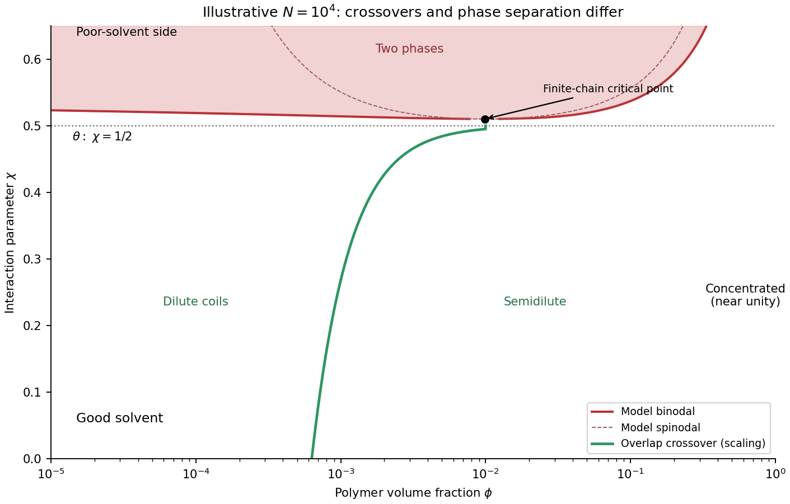

<h1 id="3/b/solution">Solution</h1>

↑ **Parent:** [B](../b.md)

Use [polymer](../../../../../polymer-split.md) [volume fraction](../../../../../volume-fraction.md) $\phi$ horizontally and the [Flory interaction parameter](../../../../../flory-interaction-parameter.md) $\chi$ vertically. Lower $\chi$ gives better solvent quality. The simplest [Flory–Huggins solution theory](../../../../../flory-huggins-solution-theory.md) assigns the dimensionless mixing [free energy](../../../../../thermodynamic-free-energy.md) per lattice site

$$
f(\phi)=\frac\phi N\ln\phi+(1-\phi)\ln(1-\phi)+\chi\phi(1-\phi),
\qquad v_{\rm eff}\simeq a^3(1-2\chi).
$$

Thus $\chi<1/2$ gives positive [excluded volume](../../../../../excluded-volume.md) and a good-solvent coil, $\chi=1/2$ is the long-chain theta condition, and $\chi>1/2$ is the poor-solvent side. It is the net two-segment interaction that vanishes at theta, not every molecular [force](../../../../../force-split.md).

At fixed good-solvent quality, the [polymer overlap volume fraction](../../../../../polymer-overlap-volume-fraction.md) $\phi^*\sim Na^3/R_g^3$ separates isolated coils from a [semidilute polymer solution](../../../../../semidilute-polymer-solution.md). Above overlap, many chains interpenetrate, but there is still solvent on the segment scale. As $\phi$ approaches order unity the solution is concentrated; these concentration-regime boundaries are crossovers, not first-order phase transitions. The overlap fraction increases from order $N^{-4/5}$ in a strong [good solvent](../../../../../good-solvent.md) toward order $N^{-1/2}$ at theta. The crossover can be expressed as $\phi^*\sim N^{-4/5}(1-2\chi)^{-3/5}$ while $1-2\chi\gg N^{-1/2}$; it saturates at the theta scaling when that condition fails.

On the poor-solvent side there can instead be coexistence of polymer-poor and polymer-rich phases. The [binodal](../../../../../binodal.md) follows a common tangent of $f$; the [spinodal](../../../../../spinodal.md) follows

$$
f''(\phi)=\frac1{N\phi}+\frac1{1-\phi}-2\chi=0.
$$

The [critical point of a Flory–Huggins polymer solution](../../../../../critical-point-of-a-flory-huggins-polymer-solution.md) is

$$
\boxed{\phi_c=\frac1{1+\sqrt N},\qquad
\chi_c=\frac12(1+N^{-1/2})^2.}
$$

For finite $N$, $\chi_c$ lies above $1/2$. Therefore [poor solvent](../../../../../poor-solvent.md) does not automatically mean demixing at every concentration, and an overlap line must not be mistaken for a coexistence boundary. The original figure uses the stated ideal model for an illustrative chain [length](../../../../../length.md); it does not assert a measured phase boundary. A vertical [temperature](../../../../../temperature-split.md) axis would additionally require a material-specific relation $\chi(T)$.

**[Figure 3](#3/b/image-polymer-solution-regimes). Polymer solution regimes**.

## ↑ Ancestors (14)

1. [B](../b.md)
2. [3](../../3.md)
3. [Paper 1](../../../paper-1-split.md)
4. [2012](../../../split.md)
5. [Past exam of the soft condensed matter course of the University of Cambridge](../../../../split.md)
6. [Soft Condensed Matter course of the University of Cambridge](../../../../../soft-condensed-matter-course-of-the-university-of-cambridge.md)
7. [Physics course of the year 3 of the natural sciences course of the University of Cambridge](../../../../../physics-course-of-the-year-3-of-the-natural-sciences-course-of-the-university-of-cambridge.md)
8. [Year 3 of the natural sciences course of the University of Cambridge](../../../../../year-3-of-the-natural-sciences-course-of-the-university-of-cambridge.md)
9. [Year of the natural sciences course of the University of Cambridge](../../../../../year-of-the-natural-sciences-course-of-the-university-of-cambridge.md)
10. [Natural sciences course of the University of Cambridge](../../../../../natural-sciences-course-of-the-university-of-cambridge.md)
11. [Course of the University of Cambridge](../../../../../course-of-the-university-of-cambridge.md)
12. [University of Cambridge](../../../../../university-of-cambridge-split.md)
13. [List of universities](../../../../../list-of-universities.md)
14. [Codex Wiki](../../../../../split.md)
