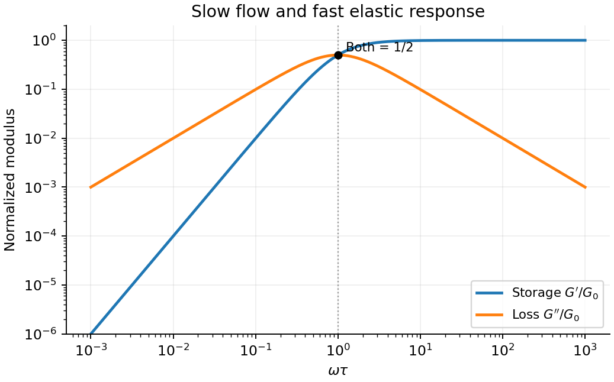

<h1 id="4/c/solution">Solution</h1>

↑ **Parent:** [C](../c.md)

Choose complex amplitudes proportional to $e^{i\omega t}$ and define $\widetilde\sigma=G^*(\omega)\widetilde\epsilon$. The [Maxwell model](../../../../../linear-maxwell-fluid.md) gives

$$
i\omega\widetilde\epsilon=\left(\frac{i\omega}{G_0}+\frac1\eta\right)\widetilde\sigma,
\qquad G^*=G_0\frac{i\omega\tau}{1+i\omega\tau}.
$$

Rationalizing the denominator yields the [storage modulus](../../../../../storage-modulus.md) and [loss modulus](../../../../../loss-modulus.md):

$$
\boxed{G'=G_0\frac{(\omega\tau)^2}{1+(\omega\tau)^2},\qquad
G''=G_0\frac{\omega\tau}{1+(\omega\tau)^2}.}
$$

For $\omega\tau\ll1$, $G''\simeq\eta\omega$ dominates and $G'\simeq G_0\omega^2\tau^2$ is small: the material has [time](../../../../../time-in-physics.md) to flow. For $\omega\tau\gg1$, $G'\to G_0$ and $G''\simeq G_0/(\omega\tau)$: the [dashpot](../../../../../dashpot.md) scarcely deforms during a cycle and the response is mainly elastic. At $\omega\tau=1$, $G'=G''=G_0/2$, and $G''$ is maximal. The [stress](../../../../../stress.md) leads [strain](../../../../../strain.md) by $\delta=\arctan(G''/G')$, ranging from nearly $\pi/2$ to nearly zero.

For a fixed [strain](../../../../../strain.md) amplitude $\epsilon_a$, dissipation per cycle is $\pi G''\epsilon_a^2$. A peak in $G''$ therefore concerns that normalization. At fixed [stress](../../../../../stress.md) amplitude $\sigma_a$, it is instead $\pi\sigma_a^2/(\eta\omega)$, so it has no finite-frequency maximum in this ideal model. Reversing the Fourier [time](../../../../../time-in-physics.md) convention reverses the imaginary-part sign, while the physical dissipated [energy](../../../../../energy-split.md) remains positive.

**[Figure 4](#4/c/image-maxwell-storage-and-loss). Maxwell storage and loss**.

## ↑ Ancestors (14)

1. [C](../c.md)
2. [4](../../4.md)
3. [Paper 1](../../../paper-1-split.md)
4. [2012](../../../split.md)
5. [Past exam of the soft condensed matter course of the University of Cambridge](../../../../split.md)
6. [Soft Condensed Matter course of the University of Cambridge](../../../../../soft-condensed-matter-course-of-the-university-of-cambridge.md)
7. [Physics course of the year 3 of the natural sciences course of the University of Cambridge](../../../../../physics-course-of-the-year-3-of-the-natural-sciences-course-of-the-university-of-cambridge.md)
8. [Year 3 of the natural sciences course of the University of Cambridge](../../../../../year-3-of-the-natural-sciences-course-of-the-university-of-cambridge.md)
9. [Year of the natural sciences course of the University of Cambridge](../../../../../year-of-the-natural-sciences-course-of-the-university-of-cambridge.md)
10. [Natural sciences course of the University of Cambridge](../../../../../natural-sciences-course-of-the-university-of-cambridge.md)
11. [Course of the University of Cambridge](../../../../../course-of-the-university-of-cambridge.md)
12. [University of Cambridge](../../../../../university-of-cambridge-split.md)
13. [List of universities](../../../../../list-of-universities.md)
14. [Codex Wiki](../../../../../split.md)
