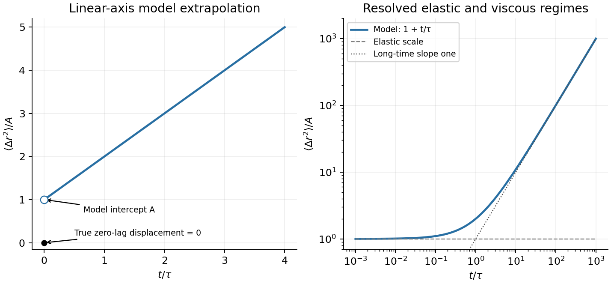

<h1 id="4/d/solution">Solution</h1>

↑ **Parent:** [D](../d.md)

A creep experiment applies a small step of [stress](../../../../../stress.md) and holds it constant while recording [strain](../../../../../strain.md). For $\sigma=\sigma_0H(t)$, the series [spring](../../../../../spring.md) jumps by $\sigma_0/G_0$ and the [dashpot](../../../../../dashpot.md) subsequently flows at constant rate $\sigma_0/\eta$. The [creep compliance](../../../../../creep-compliance.md) is thus

$$
J(t)=\frac{\epsilon(t)}{\sigma_0}=\frac1{G_0}+\frac t\eta,\qquad t>0.
$$

Using the stipulated effective [stress](../../../../../stress.md) and [strain](../../../../../strain.md) substitutions gives

$$
\frac{\langle r^2(t)\rangle}{a^2}
=\frac{k_BT}{\pi a^3}\left(\frac1{G_0}+\frac t\eta\right),
\qquad
\boxed{\langle r^2(t)\rangle_{\rm model}=\frac{k_BT}{\pi aG_0}+\frac{k_BT}{\pi a\eta}\,t.}
$$

On linear axes the model is a straight line of positive intercept $A=k_BT/(\pi aG_0)$ and slope $A/\tau$. On logarithmic axes it has an approximate elastic plateau for $t\ll\tau$ and slope one for $t\gg\tau$, within the [time](../../../../../time-in-physics.md) window where the continuum approximation applies. The long-time slope is $6D$ with $D=k_BT/(6\pi\eta a)$, agreeing with the [Stokes–Einstein relation](../../../../../stokes-einstein-relation.md).

There is an essential zero-lag convention. A literal lag [displacement](../../../../../displacement.md) $\Delta\mathbf r(t)=\mathbf r(t_0+t)-\mathbf r(t_0)$ has $\langle|\Delta\mathbf r(0)|^2\rangle=0$. The nonzero intercept above is the spring-compliance extrapolation of the idealized [microrheology of a Maxwell fluid](../../../../../microrheology-of-a-maxwell-fluid.md), after unresolved solvent or inertial transients. It must not be interpreted as an instantaneous finite physical [displacement](../../../../../displacement.md) at exactly zero lag. The stated mesh condition motivates a continuum probe response; quantitative use is more reliable for $a\gg m$ than merely $a>m$.

**[Figure 5](#4/d/image-maxwell-probe-displacement). Maxwell probe displacement**.

## ↑ Ancestors (14)

1. [D](../d.md)
2. [4](../../4.md)
3. [Paper 1](../../../paper-1-split.md)
4. [2012](../../../split.md)
5. [Past exam of the soft condensed matter course of the University of Cambridge](../../../../split.md)
6. [Soft Condensed Matter course of the University of Cambridge](../../../../../soft-condensed-matter-course-of-the-university-of-cambridge.md)
7. [Physics course of the year 3 of the natural sciences course of the University of Cambridge](../../../../../physics-course-of-the-year-3-of-the-natural-sciences-course-of-the-university-of-cambridge.md)
8. [Year 3 of the natural sciences course of the University of Cambridge](../../../../../year-3-of-the-natural-sciences-course-of-the-university-of-cambridge.md)
9. [Year of the natural sciences course of the University of Cambridge](../../../../../year-of-the-natural-sciences-course-of-the-university-of-cambridge.md)
10. [Natural sciences course of the University of Cambridge](../../../../../natural-sciences-course-of-the-university-of-cambridge.md)
11. [Course of the University of Cambridge](../../../../../course-of-the-university-of-cambridge.md)
12. [University of Cambridge](../../../../../university-of-cambridge-split.md)
13. [List of universities](../../../../../list-of-universities.md)
14. [Codex Wiki](../../../../../split.md)
