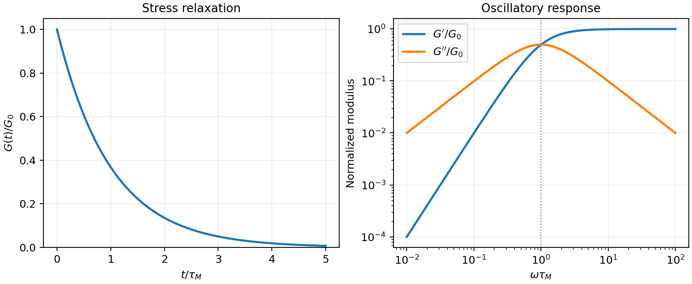
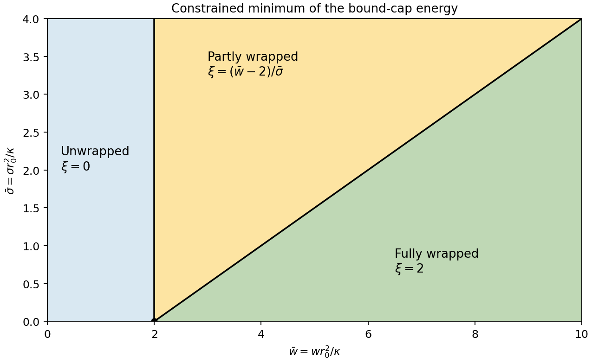

# Paper 1

↑ **Parent:** [2013](../2013.md)

Original paper: [Public original, physical PDF pages 270–273](https://www.whatdotheyknow.com/request/natural_science_tripos_physics_e_2/response/2340776/attach/2/FOI%202023%20399%20Zahid%20materials.pdf?cookie_passthrough=1#page=270).

**Table of contents**

- [1](#1)
  - [a](#1/a)
    - [Solution](#1/a/solution)
  - [b](#1/b)
    - [Solution](#1/b/solution)
  - [c](#1/c)
    - [Solution](#1/c/solution)
- [2](#2)
  - [a](#2/a)
    - [Solution](#2/a/solution)
  - [b](#2/b)
    - [Solution](#2/b/solution)
  - [c](#2/c)
    - [Solution](#2/c/solution)
- [3](#3)
  - [Solution](#3/solution)
- [4](#4)
  - [Solution](#4/solution)

## 1

↑ **Parent:** [Paper 1](paper-1.md)

<h3 id="1/a">a</h3>

↑ **Parent:** [1](#1)

<h4 id="1/a/solution">Solution</h4>

↑ **Parent:** [A](#1/a)

TODO: **user-deferred biological application**. The organism-specific comparison and its three requested rescalings are intentionally left unsolved.

<h3 id="1/b">b</h3>

↑ **Parent:** [1](#1)

<h4 id="1/b/solution">Solution</h4>

↑ **Parent:** [B](#1/b)

The tension is supplied by [Stokes drag](../../stokes-flow.md#stokes-s-law) on the free bead. With bead [radius](../../topology.md#radius) $b=0.5\,\mu\mathrm m$, the stipulated isolated-sphere approximation gives

$$
\boxed{f=6\pi\eta bU=2.83\,\mathrm{pN}.}
$$

The trap also balances drag on the trapped bead, but that bead's drag is not an additional [force](../../force.md) transmitted through the chain. The [polymer contour length](../../polymer.md#polymer-contour-length) is $L=Na=6\,\mu\mathrm m$. Use a room-[temperature](../../temperature.md) estimate $T\simeq300\,\mathrm K$, consistent with the water-viscosity approximation imported from part (a); the expressions below retain the dependence on $T$.

For a [theta solvent](../../mixture.md#theta-solvent), [Gaussian chain](../../mathematical-biology.md#gaussian-chain) [elasticity](../../elasticity-physics.md) gives $F_{\rm el}=3k_BTR^2/(2Na^2)$ and hence

$$
\boxed{R_\theta=\frac{fNa^2}{3k_BT}
=0.819\left(\frac{300\,\mathrm K}{T}\right)\,\mu\mathrm m.}
$$

This is the mean extension along the [force](../../force.md), rather than the unforced [end-to-end distance of a polymer chain](../../polymer.md#end-to-end-distance-of-a-polymer-chain) $a\sqrt N=60\,\mathrm{nm}$. At $300\,\mathrm K$, $fa/(k_BT)=0.410$; the finite-link [freely jointed chain](../../mathematical-biology.md#ideal-chain) result $R=L[\coth(fa/k_BT)-k_BT/(fa)]$ is $0.810\,\mu\mathrm m$, close to the Gaussian estimate.

The [good-solvent force-extension scaling](../../polymer.md#good-solvent-force-extension-scaling) changes the [elasticity](../../elasticity-physics.md). In the [tensile blob](../../polymer.md#tensile-blob) regime, a blob has size $\xi_t=k_BT/f$, contains $g\sim(\xi_t/a)^{5/3}$ segments, and the aligned string of $N/g$ blobs has [length](../../physics.md#length)

$$
\boxed{R_{\rm good}\sim\frac Ng\xi_t
=Na\left(\frac{fa}{k_BT}\right)^{2/3}
\simeq3.31\left(\frac{300\,\mathrm K}{T}\right)^{2/3}\,\mu\mathrm m.}
$$

Only the scaling and order of magnitude of the good-solvent value are determined: solvent-dependent swelling amplitudes are not supplied. The nonlinear [force](../../force.md) law is the essential correction to extrapolating a weak-force coil [spring](../../elasticity-physics.md#spring).[abstract and section I, p. 386: strongly elongated good-solvent chain and restoring force proportional to extension to the power 3/2](../../physics-bibliography.md#excluded-volume-effects-and-stretched-polymer-chains-by-philip-alan-pincus)

To expose the unrealistic extrapolation, the unforced good-solvent size estimate is $R_0\sim aN^{3/5}=151\,\mathrm{nm}$. Treating this coil as a linear [spring](../../elasticity-physics.md#spring) with [spring constant](../../elasticity-physics.md#spring-constant) $3k_BT/R_0^2$ predicts $R\simeq5.17\,\mu\mathrm m$ at $300\,\mathrm K$, although its required condition $fR_0\ll k_BT$ fails by a factor of about $103$. Dropping the order-one factor three, as in the rough estimate $k\sim k_BT/R_0^2$, even gives $R\sim15.5\,\mu\mathrm m>L$. **An extension beyond the [polymer contour length](../../polymer.md#polymer-contour-length) is an artefact of extending the coil's [linear response](../../statistical-physics.md#linear-response-theory) outside its range.** The [tensile blob](../../polymer.md#tensile-blob) estimate avoids that violation but here $\xi_t\simeq1.46\,\mathrm{nm}$ and $g\sim4.4$, so it is only marginally within a many-segment-blob regime. [finite extensibility of a polymer chain](../../polymer.md#finite-extensibility-of-a-polymer-chain), chain drag and flow disturbance by both large beads further limit quantitative realism. The specified neglect of chain drag is a model assumption, not evidence that it is physically negligible.

<h3 id="1/c">c</h3>

↑ **Parent:** [1](#1)

<h4 id="1/c/solution">Solution</h4>

↑ **Parent:** [C](#1/c)

For a [symmetric Flory-Huggins polymer blend](../../mixture.md#symmetric-flory-huggins-polymer-blend), the mixing [free energy](../../thermodynamic-potential.md#thermodynamic-free-energy) per lattice site is

$$
\frac{f}{k_BT}=\frac{\phi\ln\phi+(1-\phi)\ln(1-\phi)}N+\chi\phi(1-\phi).
$$

The critical conditions $f''=0$ and $d^3f/d\phi^3=0$ give $\phi_c=1/2$ and $\chi_c=2/N=0.002$. Therefore

$$
\boxed{T_c=\frac{48.2}{0.032+0.002}=1.418\times10^3\,\mathrm K.}
$$

Since $d\chi/dT<0$, heating improves miscibility: this is an **[upper critical solution temperature](../../thermodynamic-potential.md#upper-critical-solution-temperature)** in the stipulated model. The very high value is an extrapolation of the supplied interaction-parameter fit, not evidence that an intact experimental blend can be brought reversibly to this [temperature](../../temperature.md); chemical stability and the fitted [temperature](../../temperature.md) range must be checked before interpreting it as an accessible transition.

At $293.15\,\mathrm K$, $\chi=0.132421$ and $N\chi\simeq132$, well into strong segregation. For the [polymer-blend interface width](../../mixture.md#polymer-blend-interface-width), state the convention explicitly. In the equal-segment, long-chain square-gradient approximation,

$$
\frac{F}{k_BT\rho_0}=\int dz\left[\chi\phi(1-\phi)+\frac{a^2(\phi')^2}{24\phi(1-\phi)}\right].
$$

Its first integral gives $\phi'=\sqrt{24\chi}\,\phi(1-\phi)/a$, so

$$
\phi(z)=\frac{1+\tanh(z/\ell)}2,\qquad
\ell=\frac{a}{\sqrt{6\chi}}=0.752\,\mathrm{nm}.
$$

The inverse-central-slope width is consequently

$$
\boxed{w\equiv\frac1{\phi'(0)}=2\ell=1.50\,\mathrm{nm}.}
$$

A convention calling the hyperbolic-tangent scale itself the width instead quotes $0.752\,\mathrm{nm}$; these describe the same profile. The predicted interface spans only a few statistical segments, so the [continuum approximation](../../continuum-mechanics.md#continuum-approximation) for gradients is quantitatively marginal. Intrinsic composition width and experimentally broadened width also differ because roughness and finite spatial resolution can broaden a measured profile.

## 2

↑ **Parent:** [Paper 1](paper-1.md)

<h3 id="2/a">a</h3>

↑ **Parent:** [2](#2)

<h4 id="2/a/solution">Solution</h4>

↑ **Parent:** [A](#2/a)

A viscoelastic material stores part of the deformation [energy](../../energy.md) and dissipates part of it. In [linear viscoelasticity](../../rheology.md#linear-viscoelasticity), a small imposed shear [strain](../../continuum-mechanics.md#strain) produces a [stress](../../continuum-mechanics.md#stress) determined by its history, $\tau(t)=\int_{-\infty}^tG(t-t')\dot\gamma(t')\,dt'$. A shear step probes [stress relaxation](../../rheology.md#stress-relaxation); a [stress](../../continuum-mechanics.md#stress) step probes [creep compliance](../../rheology.md#creep-compliance). A purely elastic solid has persistent [stress](../../continuum-mechanics.md#stress) after a held [strain](../../continuum-mechanics.md#strain), while a [Newtonian fluid](../../viscous-fluid-flow.md#newtonian-fluid) relaxes that [stress](../../continuum-mechanics.md#stress) and creeps continuously under constant [stress](../../continuum-mechanics.md#stress).

For a [Maxwell model](../../rheology.md#linear-maxwell-fluid), a [spring](../../elasticity-physics.md#spring) of [shear modulus](../../elasticity-physics.md#shear-modulus) $G_0$ and a [dashpot](../../rheology.md#dashpot) of [viscosity](../../dynamic-viscosity.md) $\eta$ are in series:

$$
\dot\gamma=\frac{\dot\tau}{G_0}+\frac\tau\eta,\qquad
G(t)=G_0e^{-t/\tau_M},\qquad \tau_M=\eta/G_0.
$$

For the convention $\gamma\propto e^{i\omega t}$,

$$
\boxed{G'=G_0\frac{(\omega\tau_M)^2}{1+(\omega\tau_M)^2},\qquad
G''=G_0\frac{\omega\tau_M}{1+(\omega\tau_M)^2}.}
$$

The [storage modulus](../../rheology.md#storage-modulus) dominates at short times or high frequencies; the [loss modulus](../../rheology.md#loss-modulus) dominates at long times or low frequencies. The [energy](../../energy.md) dissipated per cycle per [volume](../../geometry-and-topology.md#volume) is $\pi G''\gamma_0^2$. A [Kelvin-Voigt model](../../rheology.md#kelvin-voigt-model) places [spring](../../elasticity-physics.md#spring) and [dashpot](../../rheology.md#dashpot) in parallel and instead gives bounded creep $J(t)=(1-e^{-G_0t/\eta})/G_0$: a simple illustration of a viscoelastic solid. Real materials can require a spectrum of relaxation times rather than one element.

A small-amplitude oscillatory [rheometer](../../rheology.md#rheometer) measures [stress](../../continuum-mechanics.md#stress) amplitude and phase relative to imposed [strain](../../continuum-mechanics.md#strain), giving $G'=|\tau_0/\gamma_0|\cos\delta$ and $G''=|\tau_0/\gamma_0|\sin\delta$. First sweep [strain](../../continuum-mechanics.md#strain) amplitude to identify the linear range; control [temperature](../../temperature.md), sample ageing, [wall slip](../../fluid-mechanics.md#wall-slip) and instrument inertia. Frequency-dependent phase lag alone is insufficient if these apparatus effects are unresolved.

**[Figure 1](#2/a/image-original-normalized-maxwell-relaxation-and-frequency-response). Original normalized Maxwell relaxation and frequency response**.

<h3 id="2/b">b</h3>

↑ **Parent:** [2](#2)

<h4 id="2/b/solution">Solution</h4>

↑ **Parent:** [B](#2/b)

[DLVO theory](../../mixture.md#dlvo-theory) adds attractive [Van der Waals forces](../../force.md#van-der-waals-force) and [electric double layer](../../electrostatics.md#electric-double-layer) repulsion to obtain an effective [colloid](../../mixture.md#colloid) pair potential. For two identical spheres of [radius](../../topology.md#radius) $b$ at a surface gap $h\ll b$, a useful schematic form is

$$
U(h)\simeq-\frac{A_Hb}{12h}+B e^{-\kappa_Dh},\qquad B>0.
$$

Here $A_H$ is the [Hamaker constant](../../mathematical-biology.md#hamaker-constant). For a symmetric monovalent electrolyte with [number density](../../statistical-physics.md#number-density) $n$ of each ionic species, $\kappa_D^2=2ne^2/(\epsilon k_BT)$. The exponential is a simplified screened repulsion; its amplitude depends on [electric potential](../../electric-field.md#electric-potential) at the surface, [charge regulation](../../electrostatics.md#charge-regulation) and geometry. Constant-charge and constant-potential [boundary conditions](../../differential-equation.md#boundary-condition) need not produce the same close-approach law.

A primary attractive [minimum](../../set.md#minimum-of-a-subset-of-a-total-order) near contact may be separated from dispersed configurations by an [energy](../../energy.md) barrier; a shallower secondary [minimum](../../set.md#minimum-of-a-subset-of-a-total-order) can produce loose reversible aggregation. A barrier much larger than $k_BT$ can give long-lived kinetic stabilization without making the dispersed state the global free-energy [minimum](../../set.md#minimum-of-a-subset-of-a-total-order). Adding salt shortens the [Debye–Hückel screening length](../../mathematical-biology.md#debye-huckel-screening-length) and can lower the barrier, allowing [colloidal coagulation](../../mixture.md#colloidal-coagulation). Changing [pH](../../acid-base-chemistry.md#ph) can alter surface ionization, so screening alone does not determine stability.

One can vary salt [concentration](../../mathematical-physics.md#concentration) while holding particle [concentration](../../mathematical-physics.md#concentration), [temperature](../../temperature.md) and [pH](../../acid-base-chemistry.md#ph) fixed, then follow [particle aggregation](../../mixture.md#particle-aggregation) using [light scattering](../../optics.md#scattering-of-light) or [microscopy](../../optics.md#microscopy). A solvent-only control and an independently measured surface-charge indicator help distinguish a change of screening from [adsorption](../../physical-chemistry.md#adsorption) or [charge reversal](../../electrostatics.md#charge-reversal). Classical [DLVO theory](../../mixture.md#dlvo-theory) omits [steric stabilization](../../mixture.md#steric-stabilization), [hydration forces](../../mixture.md#hydration-force) and strong ionic correlations; the formal attraction diverging at contact is cut off by molecular-scale physics.

**[Figure 2](#2/b/image-original-schematic-pair-potentials-showing-how-a-shorter-screening-length-lowers-a-repulsive-barrier). Original schematic pair potentials showing how a shorter screening length lowers a repulsive barrier**.

<h3 id="2/c">c</h3>

↑ **Parent:** [2](#2)

<h4 id="2/c/solution">Solution</h4>

↑ **Parent:** [C](#2/c)

The [coil-globule transition](../../polymer.md#coil-globule-transition) is the contraction of an isolated flexible [polymer](../../polymer.md) as [solvent quality](../../mixture.md#solvent-quality) worsens. A swollen chain in a [good solvent](../../mixture.md#good-solvent) has size $R\sim aN^{3/5}$ in the [Flory approximation](../../polymer.md#flory-approximation). At the [theta temperature](../../mixture.md#theta-temperature) the effective two-segment [excluded volume](../../statistical-physics.md#excluded-volume) vanishes and $R\sim aN^{1/2}$. A [poor solvent](../../mixture.md#poor-solvent) favors a dense [polymer globule](../../mixture.md#polymer-globule), with $R\propto N^{1/3}$ at fixed internal [density](../../fluid-mechanics.md#density).

The competition is visible in the scaling [free energy](../../thermodynamic-potential.md#thermodynamic-free-energy)

$$
\frac{F}{k_BT}\sim\frac{R^2}{Na^2}+\frac{vN^2}{R^3}+\frac{uN^3}{R^6},\qquad u>0.
$$

For $v>0$, elastic cost balances two-segment repulsion to give the swollen-coil law. At $v=0$, three-segment repulsion stabilizes ideal-chain scaling; for $v<0$, attraction balanced by the positive three-segment term gives $R^3\sim uN/|v|$. The dense [polymer globule](../../mixture.md#polymer-globule) also has an interfacial [free energy](../../thermodynamic-potential.md#thermodynamic-free-energy). The scaling expression explains regimes, not all fluctuation corrections or a detailed finite-chain transition curve. A finite chain crosses over smoothly; the sharp theta-point limit refers to indefinitely long chains.

A dilute-solution light-scattering experiment can follow [radius of gyration](../../polymer.md#radius-of-gyration) while changing [temperature](../../temperature.md) or [solvent](../../mixture.md#solvent) composition. Measure at several concentrations and extrapolate toward isolated chains; check molecular-weight distribution, reversibility and the absence of growing multi-chain aggregates. [dynamic light scattering](../../biology.md#dynamic-light-scattering) measures [hydrodynamic size](../../mixture.md#hydrodynamic-size), which is related to but distinct from [radius of gyration](../../polymer.md#radius-of-gyration). A falling scattering-derived size accompanied by a rising aggregate population cannot by itself establish single-chain collapse. **[solvent quality](../../mixture.md#solvent-quality) controls conformation through the balance of segment interactions and [conformational entropy](../../protein.md#conformational-entropy).**

## 3

↑ **Parent:** [Paper 1](paper-1.md)

<h3 id="3/solution">Solution</h3>

↑ **Parent:** [3](#3)

Write $s$ for the number of grafted chains per unit [area](../../differential-geometry.md#surface-area) and $\Sigma=sa^2$ for its dimensionless form; this separates the physical [grafting density](../../polymer.md#grafting-density) from a dimensionless coverage. A free dilute chain has size $R_0\sim aN^\nu$, with $\nu=1/2$ in a [theta solvent](../../mixture.md#theta-solvent) and approximately $3/5$ in a [good solvent](../../mixture.md#good-solvent). An isolated end-grafted chain loses translations and configurations that cross the substrate, but retains the same leading size exponent if the surface is nonadsorbing. When the lateral graft spacing $D\sim s^{-1/2}$ exceeds $R_0$, the layer consists of [polymer mushrooms](../../polymer.md#polymer-mushroom). When coils overlap, crowding stretches the chains away from the surface into a [polymer brush](../../polymer.md#polymer-brush).

The [polymer mushroom-to-brush crossover](../../polymer.md#polymer-mushroom-to-brush-crossover) is

$$
\boxed{s_*\sim R_0^{-2},\qquad \Sigma_*\sim N^{-2\nu}.}
$$

For the stipulated statistical-segment interpretation of $N$ and $a$, the scaling estimates are

$$
\begin{array}{c|ccc}
 &R_0&D_*&s_*\;(\mathrm{nm^{-2}})\\\hline
\theta&14\,\mathrm{nm}&14\,\mathrm{nm}&5.10\times10^{-3}\\
\text{good}&25.5\,\mathrm{nm}&25.5\,\mathrm{nm}&1.54\times10^{-3}
\end{array}
$$

Thus $\Sigma_*\simeq2.50\times10^{-3}$ and $7.54\times10^{-4}$ respectively. The numerical constants are scaling conventions: using a [radius of gyration](../../polymer.md#radius-of-gyration) rather than an end-to-end size changes order-one amplitudes, not the powers of $N$.

In the [Alexander-de Gennes brush model](../../polymer.md#alexander-de-gennes-brush-model), take blobs of lateral size $D$. Within a blob, $D\sim ag^\nu$; beyond it, the $N/g$ blobs are aligned away from the wall. Thus

$$
g\sim(D/a)^{1/\nu},\qquad
\boxed{H\sim ND/g=Na\Sigma^{(1-\nu)/(2\nu)}.}
$$

With coarse-grained segment [volume](../../geometry-and-topology.md#volume) $a^3$, conservation gives the [polymer-brush volume fraction](../../polymer.md#polymer-brush-volume-fraction) through $\phi H\sim Na^3s$, hence

$$
\boxed{\phi\sim\Sigma^{(3\nu-1)/(2\nu)},\qquad
\begin{array}{c|cc}
&H&\phi\\\hline
\theta&Na\Sigma^{1/2}&\Sigma^{1/2}\\
\text{good}&Na\Sigma^{1/3}&\Sigma^{2/3}
\end{array}}
$$

The [theta-solvent brush height](../../polymer.md#theta-solvent-brush-height) includes three-segment repulsion even though the effective two-segment interaction vanishes. These are scaling estimates for a roughly uniform brush, not an assertion that every chain end lies at the same height in an actual brush.

The many-segment-blob requirement $g\gg1$ gives $D\gg a$, or $\Sigma\ll1$. Together with overlap, the regime is **$N^{-2\nu}\ll\Sigma\ll1$**. At the [dense-brush packing limit](../../polymer.md#dense-brush-packing-limit), $\phi\sim1$, $g\sim1$ and $H\sim Na$. Here $s\sim a^{-2}=2.04\,\mathrm{nm^{-2}}$ and $H\sim280\,\mathrm{nm}$. If one formally continues a dense incompressible layer above this boundary, conservation would instead give

$$
\boxed{\phi\simeq1,\qquad H\simeq Na^3s=Na\Sigma.}
$$

This is the requested formal dense-layer expression, but for $\Sigma>1$ it gives $H>Na$, which violates [finite extensibility of a polymer chain](../../polymer.md#finite-extensibility-of-a-polymer-chain). **There is no physically admissible continuation above this limit in the stated segment-volume model.** A [Kuhn length](../../mathematical-biology.md#kuhn-length) segment is not necessarily a cube of material: with an independently specified material [volume](../../geometry-and-topology.md#volume) $v_0$ per counted segment, the dense-layer law is $H=Nv_0s$, and the packing bound is $s\leq a/v_0$. The data do not determine $v_0$ separately. The simple model therefore establishes its own breakdown, rather than a universal microscopic maximum [grafting density](../../polymer.md#grafting-density).

[grafting-to](../../polymer.md#grafting-to) uses preformed chains whose [lengths](../../physics.md#length) and dispersities can be characterized before attachment. As coverage rises, each incoming coil must penetrate a crowded brush and lose [conformational entropy](../../protein.md#conformational-entropy) to bring its end to the surface; the growing insertion barrier limits achievable coverage. [grafting-from](../../polymer.md#grafting-from) supplies small [monomers](../../polymer.md#monomer) to surface-bound growing chains and avoids insertion of a whole coil. **Choose [grafting-from](../../polymer.md#grafting-from) for high [grafting density](../../polymer.md#grafting-density).** Initiator coverage and reaction control still matter, and inaccessible active sites, termination and unequal growth can broaden the resulting chain-length distribution. Neither route removes the elastic and packing costs of the final brush.

A generic application is [steric stabilization](../../mixture.md#steric-stabilization) of synthetic [colloids](../../mixture.md#colloid) in a [good solvent](../../mixture.md#good-solvent). Bringing coated particles together compresses and interpenetrates their brushes, increasing [osmotic pressure](../../cell-membrane.md#osmotic-pressure) and conformational free-energy cost. This repulsion can oppose aggregation. The chains must remain attached and sufficiently cover the surface; poor-solvent collapse, sparse coverage or interparticle bridging can defeat stabilization.

**[Figure 3](#3/image-original-brush-height-and-volume-fraction-scaling-showing-the-segment-packing-limit). Original brush-height and volume-fraction scaling, showing the segment-packing limit**.

## 4

↑ **Parent:** [Paper 1](paper-1.md)

<h3 id="4/solution">Solution</h3>

↑ **Parent:** [4](#4)

Use the [Monge representation](../../mathematical-biology.md#monge-representation) $\mathbf r(x,y)=(x,y,h(x,y))$ for a single-valued surface without overhangs. Its [area](../../differential-geometry.md#surface-area) element is $dA=\sqrt{1+|\nabla h|^2}\,dx\,dy$; at small slopes, $dA\simeq[1+|\nabla h|^2/2]dx\,dy$ and twice the [mean curvature](../../second-fundamental-form.md#mean-curvature) is $2\mathcal H\simeq\nabla^2h$, up to orientation sign. For zero spontaneous curvature, the quadratic excess [Helfrich energy](../../mathematical-biology.md#helfrich-energy) is

$$
\boxed{F=\frac12\int dx\,dy\,[\kappa(\nabla^2h)^2+\sigma|\nabla h|^2].}
$$

The [fluid membrane shear response](../../mathematical-biology.md#fluid-membrane-shear-response) has no equilibrium static in-plane [shear modulus](../../elasticity-physics.md#shear-modulus): constituents can rearrange to relax shear. Bending and isotropic tension still cost [energy](../../energy.md); viscous [shear stresses](../../viscous-fluid-flow.md#shear-stress) can matter during motion. A [Gaussian curvature](../../second-fundamental-form.md#gaussian-curvature) term is omitted under the stated approximation; for fixed closed-surface [topology](../../topology.md) its integral is constant, but boundaries and [topology](../../topology.md) changes require care. The small-slope Monge expression describes weak deformations, not an entire fully wrapped sphere.[section II.C, equation (12), p. 695: curvature-elastic energy; only the generic continuum mechanics is used here](../../physics-bibliography.md#elastic-properties-of-lipid-bilayers-theory-and-possible-experiments-by-wolfgang-helfrich)

For [spherical-particle wrapping by a fluid membrane](../../mathematical-biology.md#spherical-particle-wrapping-by-a-fluid-membrane), integrate the spherical [area](../../differential-geometry.md#surface-area) element from polar angle $0$ to $\alpha$:

$$
A=\int_0^{2\pi}d\varphi\int_0^\alpha r_0^2\sin\theta\,d\theta
=2\pi r_0^2(1-\cos\alpha)=2\pi r_0^2\xi.
$$

Its footprint [radius](../../topology.md#radius) is $r_\parallel=r_0\sin\alpha$, so

$$
A_\parallel=\pi r_0^2(2\xi-\xi^2),\qquad
\boxed{\Delta A=\pi r_0^2\xi^2.}
$$

For a spherical surface $2\mathcal H=2/r_0$, making the bending cost $\kappa(2/r_0)^2A/2=4\pi\kappa\xi$. [adhesion](../../continuum-mechanics.md#adhesion) contributes $-2\pi wr_0^2\xi$, and tension contributes $\sigma\Delta A$. Therefore

$$
\boxed{\frac{E}{\pi\kappa}=(4-2\bar w)\xi+\bar\sigma\xi^2,\qquad
\bar w=\frac{wr_0^2}{\kappa},\quad\bar\sigma=\frac{\sigma r_0^2}{\kappa}.}
$$

All three contributions are energies; $\bar w$ and $\bar\sigma$ are dimensionless. This is the specified bound-patch model: deformation of the free membrane and the neck is omitted.

The allowed interval $0\leq\xi\leq2$ corresponds to no [adhesion](../../continuum-mechanics.md#adhesion), partial wrapping and full wrapping. At $\xi=2$, the cap covers a whole sphere and its footprint shrinks to zero. This is a closed neck in the geometric limit. It does not by itself prove membrane scission: creating a detached enclosure changes [topology](../../topology.md) and involves neck physics absent from this [energy](../../energy.md).

For positive [membrane tension](../../mathematical-biology.md#membrane-tension), $E''/(\pi\kappa)=2\bar\sigma>0$. Projecting the unconstrained [minimum](../../set.md#minimum-of-a-subset-of-a-total-order) $(\bar w-2)/\bar\sigma$ onto the allowed interval gives

$$
\boxed{\xi_{\min}=\begin{cases}
0,&\bar w\leq2,\\
(\bar w-2)/\bar\sigma,&2<\bar w<2+2\bar\sigma,\\
2,&\bar w\geq2+2\bar\sigma.
\end{cases}}
$$

The [tension-dependent wrapping phase diagram](../../mathematical-biology.md#tension-dependent-wrapping-phase-diagram) boundaries are $\bar w=2$ and $\bar w=2+2\bar\sigma$. At zero [membrane tension](../../mathematical-biology.md#membrane-tension), the [energy](../../energy.md) is linear: the [minimum](../../set.md#minimum-of-a-subset-of-a-total-order) jumps from $0$ to $2$ as $\bar w$ crosses $2$, while all indentation values are degenerate at $\bar w=2$. Negative [membrane tension](../../mathematical-biology.md#membrane-tension) is outside the stable-flat-membrane interpretation used here. Increasing [membrane tension](../../mathematical-biology.md#membrane-tension) makes the excess [area](../../differential-geometry.md#surface-area) required for wrapping more expensive, broadening the partially wrapped region.

**[Figure 4](#4/image-original-phase-diagram-of-the-stipulated-bound-patch-energy-with-finite-tension-partial-wrapping). Original phase diagram of the stipulated bound-patch energy, with finite-tension partial wrapping**.

TODO: **user-deferred biological application**. The final request for biological relevance is intentionally left unsolved; all preceding generic geometry and membrane mechanics are included.

## ↑ Ancestors (11)

1. [2013](../2013.md)
2. [Past exam of the soft condensed matter course of the University of Cambridge](../../past-exam-of-the-soft-condensed-matter-course-of-the-university-of-cambridge.md)
3. [Soft Condensed Matter course of the University of Cambridge](../../university-of-cambridge.md#soft-condensed-matter-course-of-the-university-of-cambridge)
4. [Physics course of the year 3 of the natural sciences course of the University of Cambridge](../../university-of-cambridge.md#physics-course-of-the-year-3-of-the-natural-sciences-course-of-the-university-of-cambridge)
5. [Year 3 of the natural sciences course of the University of Cambridge](../../university-of-cambridge.md#year-3-of-the-natural-sciences-course-of-the-university-of-cambridge)
6. [Year of the natural sciences course of the University of Cambridge](../../university-of-cambridge.md#year-of-the-natural-sciences-course-of-the-university-of-cambridge)
7. [Natural sciences course of the University of Cambridge](../../university-of-cambridge.md#natural-sciences-course-of-the-university-of-cambridge)
8. [Course of the University of Cambridge](../../university-of-cambridge.md#course-of-the-university-of-cambridge)
9. [University of Cambridge](../../university-of-cambridge.md)
10. [List of universities](../../README.md#list-of-universities)
11. [Codex Wiki](../../README.md)
