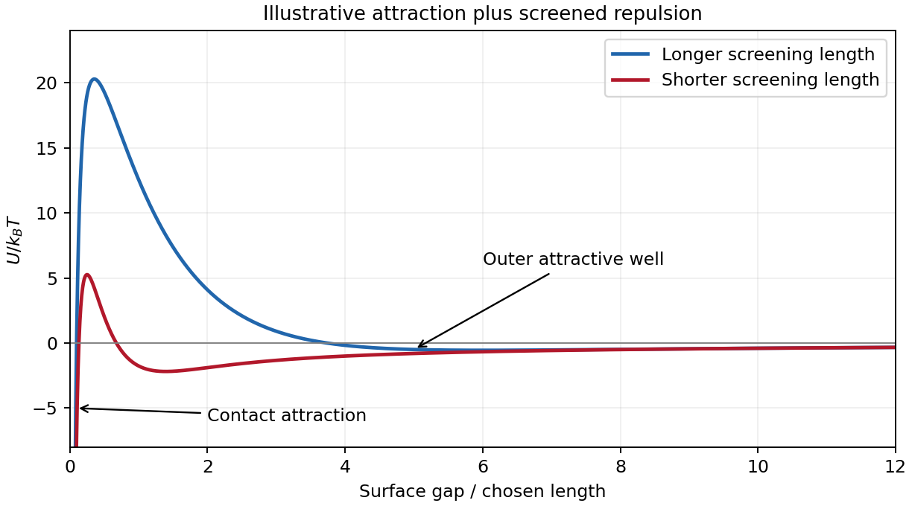

<h1 id="2/b/solution">Solution</h1>

↑ **Parent:** [B](../b.md)

[DLVO theory](../../../../../dlvo-theory.md) adds attractive [Van der Waals forces](../../../../../van-der-waals-force.md) and [electric double layer](../../../../../electric-double-layer.md) repulsion to obtain an effective [colloid](../../../../../colloid.md) pair potential. For two identical spheres of [radius](../../../../../radius.md) $b$ at a surface gap $h\ll b$, a useful schematic form is

$$
U(h)\simeq-\frac{A_Hb}{12h}+B e^{-\kappa_Dh},\qquad B>0.
$$

Here $A_H$ is the [Hamaker constant](../../../../../hamaker-constant.md). For a symmetric monovalent electrolyte with [number density](../../../../../number-density.md) $n$ of each ionic species, $\kappa_D^2=2ne^2/(\epsilon k_BT)$. The exponential is a simplified screened repulsion; its amplitude depends on [electric potential](../../../../../electric-potential.md) at the surface, [charge regulation](../../../../../charge-regulation.md) and geometry. Constant-charge and constant-potential [boundary conditions](../../../../../boundary-condition.md) need not produce the same close-approach law.

A primary attractive [minimum](../../../../../minimum-of-a-subset-of-a-total-order.md) near contact may be separated from dispersed configurations by an [energy](../../../../../energy-split.md) barrier; a shallower secondary [minimum](../../../../../minimum-of-a-subset-of-a-total-order.md) can produce loose reversible aggregation. A barrier much larger than $k_BT$ can give long-lived kinetic stabilization without making the dispersed state the global free-energy [minimum](../../../../../minimum-of-a-subset-of-a-total-order.md). Adding salt shortens the [Debye–Hückel screening length](../../../../../debye-huckel-screening-length.md) and can lower the barrier, allowing [colloidal coagulation](../../../../../colloidal-coagulation.md). Changing [pH](../../../../../ph.md) can alter surface ionization, so screening alone does not determine stability.

One can vary salt [concentration](../../../../../concentration.md) while holding particle [concentration](../../../../../concentration.md), [temperature](../../../../../temperature-split.md) and [pH](../../../../../ph.md) fixed, then follow [particle aggregation](../../../../../particle-aggregation.md) using [light scattering](../../../../../scattering-of-light.md) or [microscopy](../../../../../microscopy.md). A solvent-only control and an independently measured surface-charge indicator help distinguish a change of screening from [adsorption](../../../../../adsorption.md) or [charge reversal](../../../../../charge-reversal.md). Classical [DLVO theory](../../../../../dlvo-theory.md) omits [steric stabilization](../../../../../steric-stabilization.md), [hydration forces](../../../../../hydration-force.md) and strong ionic correlations; the formal attraction diverging at contact is cut off by molecular-scale physics.

**[Figure 2](#2/b/image-original-schematic-pair-potentials-showing-how-a-shorter-screening-length-lowers-a-repulsive-barrier). Original schematic pair potentials showing how a shorter screening length lowers a repulsive barrier**.

## ↑ Ancestors (14)

1. [B](../b.md)
2. [2](../../2.md)
3. [Paper 1](../../../paper-1-split.md)
4. [2013](../../../split.md)
5. [Past exam of the soft condensed matter course of the University of Cambridge](../../../../split.md)
6. [Soft Condensed Matter course of the University of Cambridge](../../../../../soft-condensed-matter-course-of-the-university-of-cambridge.md)
7. [Physics course of the year 3 of the natural sciences course of the University of Cambridge](../../../../../physics-course-of-the-year-3-of-the-natural-sciences-course-of-the-university-of-cambridge.md)
8. [Year 3 of the natural sciences course of the University of Cambridge](../../../../../year-3-of-the-natural-sciences-course-of-the-university-of-cambridge.md)
9. [Year of the natural sciences course of the University of Cambridge](../../../../../year-of-the-natural-sciences-course-of-the-university-of-cambridge.md)
10. [Natural sciences course of the University of Cambridge](../../../../../natural-sciences-course-of-the-university-of-cambridge.md)
11. [Course of the University of Cambridge](../../../../../course-of-the-university-of-cambridge.md)
12. [University of Cambridge](../../../../../university-of-cambridge-split.md)
13. [List of universities](../../../../../list-of-universities.md)
14. [Codex Wiki](../../../../../split.md)
