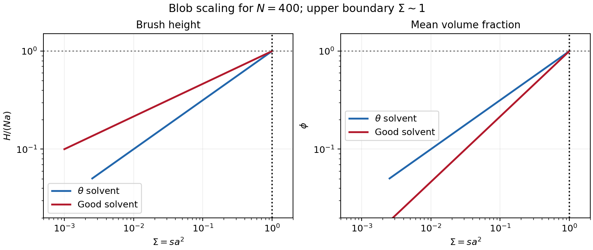

<h1 id="3/solution">Solution</h1>

↑ **Parent:** [3](../3.md)

Write $s$ for the number of grafted chains per unit [area](../../../../surface-area.md) and $\Sigma=sa^2$ for its dimensionless form; this separates the physical [grafting density](../../../../grafting-density.md) from a dimensionless coverage. A free dilute chain has size $R_0\sim aN^\nu$, with $\nu=1/2$ in a [theta solvent](../../../../theta-solvent.md) and approximately $3/5$ in a [good solvent](../../../../good-solvent.md). An isolated end-grafted chain loses translations and configurations that cross the substrate, but retains the same leading size exponent if the surface is nonadsorbing. When the lateral graft spacing $D\sim s^{-1/2}$ exceeds $R_0$, the layer consists of [polymer mushrooms](../../../../polymer-mushroom.md). When coils overlap, crowding stretches the chains away from the surface into a [polymer brush](../../../../polymer-brush.md).

The [polymer mushroom-to-brush crossover](../../../../polymer-mushroom-to-brush-crossover.md) is

$$
\boxed{s_*\sim R_0^{-2},\qquad \Sigma_*\sim N^{-2\nu}.}
$$

For the stipulated statistical-segment interpretation of $N$ and $a$, the scaling estimates are

$$
\begin{array}{c|ccc}
 &R_0&D_*&s_*\;(\mathrm{nm^{-2}})\\\hline
\theta&14\,\mathrm{nm}&14\,\mathrm{nm}&5.10\times10^{-3}\\
\text{good}&25.5\,\mathrm{nm}&25.5\,\mathrm{nm}&1.54\times10^{-3}
\end{array}
$$

Thus $\Sigma_*\simeq2.50\times10^{-3}$ and $7.54\times10^{-4}$ respectively. The numerical constants are scaling conventions: using a [radius of gyration](../../../../radius-of-gyration.md) rather than an end-to-end size changes order-one amplitudes, not the powers of $N$.

In the [Alexander-de Gennes brush model](../../../../alexander-de-gennes-brush-model.md), take blobs of lateral size $D$. Within a blob, $D\sim ag^\nu$; beyond it, the $N/g$ blobs are aligned away from the wall. Thus

$$
g\sim(D/a)^{1/\nu},\qquad
\boxed{H\sim ND/g=Na\Sigma^{(1-\nu)/(2\nu)}.}
$$

With coarse-grained segment [volume](../../../../volume.md) $a^3$, conservation gives the [polymer-brush volume fraction](../../../../polymer-brush-volume-fraction.md) through $\phi H\sim Na^3s$, hence

$$
\boxed{\phi\sim\Sigma^{(3\nu-1)/(2\nu)},\qquad
\begin{array}{c|cc}
&H&\phi\\\hline
\theta&Na\Sigma^{1/2}&\Sigma^{1/2}\\
\text{good}&Na\Sigma^{1/3}&\Sigma^{2/3}
\end{array}}
$$

The [theta-solvent brush height](../../../../theta-solvent-brush-height.md) includes three-segment repulsion even though the effective two-segment interaction vanishes. These are scaling estimates for a roughly uniform brush, not an assertion that every chain end lies at the same height in an actual brush.

The many-segment-blob requirement $g\gg1$ gives $D\gg a$, or $\Sigma\ll1$. Together with overlap, the regime is **$N^{-2\nu}\ll\Sigma\ll1$**. At the [dense-brush packing limit](../../../../dense-brush-packing-limit.md), $\phi\sim1$, $g\sim1$ and $H\sim Na$. Here $s\sim a^{-2}=2.04\,\mathrm{nm^{-2}}$ and $H\sim280\,\mathrm{nm}$. If one formally continues a dense incompressible layer above this boundary, conservation would instead give

$$
\boxed{\phi\simeq1,\qquad H\simeq Na^3s=Na\Sigma.}
$$

This is the requested formal dense-layer expression, but for $\Sigma>1$ it gives $H>Na$, which violates [finite extensibility of a polymer chain](../../../../finite-extensibility-of-a-polymer-chain.md). **There is no physically admissible continuation above this limit in the stated segment-volume model.** A [Kuhn length](../../../../kuhn-length.md) segment is not necessarily a cube of material: with an independently specified material [volume](../../../../volume.md) $v_0$ per counted segment, the dense-layer law is $H=Nv_0s$, and the packing bound is $s\leq a/v_0$. The data do not determine $v_0$ separately. The simple model therefore establishes its own breakdown, rather than a universal microscopic maximum [grafting density](../../../../grafting-density.md).

[grafting-to](../../../../grafting-to.md) uses preformed chains whose [lengths](../../../../length.md) and dispersities can be characterized before attachment. As coverage rises, each incoming coil must penetrate a crowded brush and lose [conformational entropy](../../../../conformational-entropy.md) to bring its end to the surface; the growing insertion barrier limits achievable coverage. [grafting-from](../../../../grafting-from.md) supplies small [monomers](../../../../monomer.md) to surface-bound growing chains and avoids insertion of a whole coil. **Choose [grafting-from](../../../../grafting-from.md) for high [grafting density](../../../../grafting-density.md).** Initiator coverage and reaction control still matter, and inaccessible active sites, termination and unequal growth can broaden the resulting chain-length distribution. Neither route removes the elastic and packing costs of the final brush.

A generic application is [steric stabilization](../../../../steric-stabilization.md) of synthetic [colloids](../../../../colloid.md) in a [good solvent](../../../../good-solvent.md). Bringing coated particles together compresses and interpenetrates their brushes, increasing [osmotic pressure](../../../../osmotic-pressure.md) and conformational free-energy cost. This repulsion can oppose aggregation. The chains must remain attached and sufficiently cover the surface; poor-solvent collapse, sparse coverage or interparticle bridging can defeat stabilization.

**[Figure 3](#3/image-original-brush-height-and-volume-fraction-scaling-showing-the-segment-packing-limit). Original brush-height and volume-fraction scaling, showing the segment-packing limit**.

## ↑ Ancestors (13)

1. [3](../3.md)
2. [Paper 1](../../paper-1-split.md)
3. [2013](../../split.md)
4. [Past exam of the soft condensed matter course of the University of Cambridge](../../../split.md)
5. [Soft Condensed Matter course of the University of Cambridge](../../../../soft-condensed-matter-course-of-the-university-of-cambridge.md)
6. [Physics course of the year 3 of the natural sciences course of the University of Cambridge](../../../../physics-course-of-the-year-3-of-the-natural-sciences-course-of-the-university-of-cambridge.md)
7. [Year 3 of the natural sciences course of the University of Cambridge](../../../../year-3-of-the-natural-sciences-course-of-the-university-of-cambridge.md)
8. [Year of the natural sciences course of the University of Cambridge](../../../../year-of-the-natural-sciences-course-of-the-university-of-cambridge.md)
9. [Natural sciences course of the University of Cambridge](../../../../natural-sciences-course-of-the-university-of-cambridge.md)
10. [Course of the University of Cambridge](../../../../course-of-the-university-of-cambridge.md)
11. [University of Cambridge](../../../../university-of-cambridge-split.md)
12. [List of universities](../../../../list-of-universities.md)
13. [Codex Wiki](../../../../split.md)
