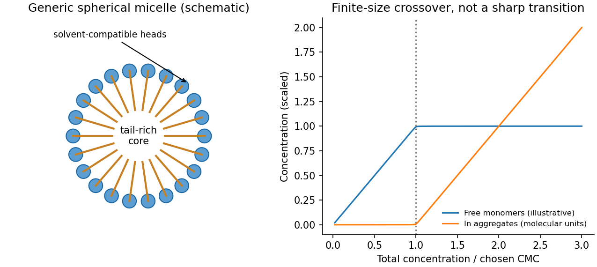
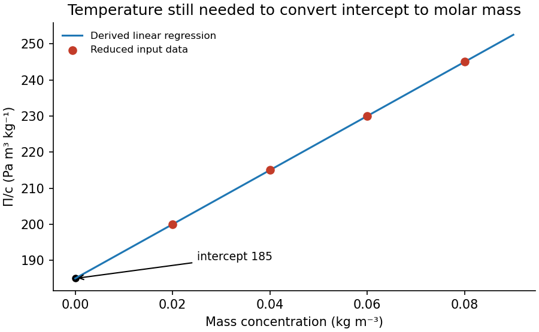

# Paper 1

↑ **Parent:** [2014](../2014.md)

Original paper: [31 May 2014, physical PDF pages 316–319](https://www.whatdotheyknow.com/request/natural_science_tripos_physics_e_2/response/2340776/attach/2/FOI%202023%20399%20Zahid%20materials.pdf?cookie_passthrough=1#page=316).

**Table of contents**

- [1](#1)
  - [a](#1/a)
    - [Solution](#1/a/solution)
  - [b](#1/b)
    - [Solution](#1/b/solution)
  - [c](#1/c)
    - [Solution](#1/c/solution)
- [2](#2)
  - [a](#2/a)
    - [Solution](#2/a/solution)
  - [b](#2/b)
    - [Solution](#2/b/solution)
  - [c](#2/c)
    - [Solution](#2/c/solution)
- [3](#3)
  - [Solution](#3/solution)
- [4](#4)
  - [Solution](#4/solution)

## 1

↑ **Parent:** [Paper 1](paper-1.md)

<h3 id="1/a">a</h3>

↑ **Parent:** [1](#1)

<h4 id="1/a/solution">Solution</h4>

↑ **Parent:** [A](#1/a)

TODO: user-deferred biology application. This part has not been solved.

<h3 id="1/b">b</h3>

↑ **Parent:** [1](#1)

<h4 id="1/b/solution">Solution</h4>

↑ **Parent:** [B](#1/b)

[Young's equation](../../surface-tension.md#young-s-equation) gives $\gamma_{SV}-\gamma_{SL}=\gamma_{LV}\cos\theta$. The [interfacial-energy difference from two contact angles](../../surface-tension.md#interfacial-energy-difference-from-two-contact-angles) follows by subtracting the two equilibrium contact-angle equations, which eliminates the common solid–air energy:

$$
\boxed{\gamma_{S,\mathrm{water}}-\gamma_{S,\mathrm{decane}}
=\gamma_{\mathrm{decane},V}\cos25^\circ-\gamma_{\mathrm{water},V}\cos102^\circ
\simeq3.67\times10^{-2}\,\mathrm{J\,m^{-2}}.}
$$

The water–solid interface has the larger energy. This assumes the same clean solid surface and equilibrium angles, without swelling or strong [contact-angle hysteresis](../../surface-tension.md#contact-angle-hysteresis).

<h3 id="1/c">c</h3>

↑ **Parent:** [1](#1)

<h4 id="1/c/solution">Solution</h4>

↑ **Parent:** [C](#1/c)

Use a [freely rotating chain](../../mathematical-biology.md#freely-rotating-chain): fixed bond length $b$, fixed angle $\vartheta$ between forward bond vectors, and independently random torsion angles. Then $\langle\hat t_0\cdot\hat t_n\rangle=(\cos\vartheta)^n=e^{-nb/\ell_p}$, giving the [orientational persistence length of a freely rotating chain](../../mathematical-biology.md#orientational-persistence-length-of-a-freely-rotating-chain)

$$
\boxed{\ell_p=-\frac b{\ln\cos\vartheta}\simeq3.48\,\mathrm{nm}.}
$$

The equivalent long-chain [Kuhn length](../../mathematical-biology.md#kuhn-length) divided by two, $b(1+\cos\vartheta)/[2(1-\cos\vartheta)]\simeq3.48\,\mathrm{nm}$, is nearly equal here but is a distinct discrete-chain convention. A chemical internal bond angle is supplementary to the forward-vector angle used above.

Synthetic examples are relatively stiff [poly(p-phenylene terephthalamide)](../../polymer.md#poly-p-phenylene-terephthalamide) and flexible [polydimethylsiloxane](../../polymer.md#polydimethylsiloxane). Light scattering and viscometry established rodlike solution conformations for the former; single-chain mechanical measurements support the latter's flexibility. Persistence is solvent- and model-dependent, so no universal numerical value is inferred for either example.[publisher abstract, dilute-solution light scattering and viscometry](../../chemistry-bibliography.md#properties-of-some-rodlike-polymers-in-solution-by-c-p-wong-and-others)[abstract, single-chain atomic-force measurements and flexibility](../../chemistry-bibliography.md#understanding-the-extraordinary-flexibility-of-polydimethylsiloxane-through-single-molecule-mechanics-by-song-lu-and-others)

## 2

↑ **Parent:** [Paper 1](paper-1.md)

<h3 id="2/a">a</h3>

↑ **Parent:** [2](#2)

<h4 id="2/a/solution">Solution</h4>

↑ **Parent:** [A](#2/a)

A [Couette rheometer](../../rheology.md#couette-rheometer) measures the [torque](../../momentum.md#torque) required to rotate one coaxial cylinder relative to another. With inner radius $R_i$, outer radius $R_o$, wetted length $L$, inner [angular velocity](../../rigid-body-dynamics.md#angular-velocity) $\Omega$ and stationary outer wall, laminar Newtonian flow has

$$
v_\theta(r)=\frac{\Omega R_i^2}{R_o^2-R_i^2}\left(\frac{R_o^2}{r}-r\right),\qquad
\boxed{\mathcal T=\frac{4\pi\eta L\Omega R_i^2R_o^2}{R_o^2-R_i^2}.}
$$

The [shear stress](../../viscous-fluid-flow.md#shear-stress) at the inner wall is $\tau_i=\mathcal T/(2\pi LR_i^2)$. In a narrow gap $d=R_o-R_i\ll R_i$, $\dot\gamma\simeq\Omega R_i/d$, so $\eta\simeq\mathcal T d/(2\pi L\Omega R_i^3)$.

Measuring [torque](../../momentum.md#torque) over a range of speeds gives a flow curve: constant [viscosity](../../dynamic-viscosity.md) identifies a Newtonian regime; decreasing or increasing apparent [viscosity](../../dynamic-viscosity.md) indicates [shear thinning](../../rheology.md#shear-thinning) or thickening. A yield-stress fit needs a genuine low-rate regime and must not be confused with bearing drag or [wall slip](../../fluid-mechanics.md#wall-slip). Small oscillatory strain also probes [viscoelasticity](../../rheology.md#viscoelasticity), with $\tau=\gamma_0[G'\cos\omega t-G''\sin\omega t]$ for imposed $\gamma=\gamma_0\cos\omega t$.

Control [temperature](../../temperature.md), calibrate instrument [torque](../../momentum.md#torque) and end effects, and check gap dependence or roughened surfaces for slip. Keep inertia small enough to avoid Taylor vortices. The exact Newtonian profile is a calibration model; a non-Newtonian material needs its own stress–rate relation.

**[Figure 1](#2/a/image-original-couette-geometry-and-dimensionless-newtonian-velocity-and-shear-rate-profiles). Original Couette geometry and dimensionless Newtonian velocity and shear-rate profiles**.

<h3 id="2/b">b</h3>

↑ **Parent:** [2](#2)

<h4 id="2/b/solution">Solution</h4>

↑ **Parent:** [B](#2/b)

TODO: user-deferred biology and biological membrane fluctuations. This option has not been solved.

<h3 id="2/c">c</h3>

↑ **Parent:** [2](#2)

<h4 id="2/c/solution">Solution</h4>

↑ **Parent:** [C](#2/c)

An [amphiphile](../../physical-chemistry.md#amphiphile) contains a solvent-compatible head and a solvent-avoiding tail. In water, aggregation hides hydrocarbon tails while leaving heads exposed. This reduces the free-energy cost of tail–water contact, competing with loss of [translational entropy](../../entropy.md#translational-entropy), headgroup repulsion and chain packing. A [micelle](../../physical-chemistry.md#micelle) is a finite equilibrium aggregate, not necessarily a permanently bound particle.

Equality of molecular [chemical potentials](../../chemical-potential.md) controls aggregation. For a large preferred aggregation number, $\mu_1=\mu_1^0+k_BT\ln x_1$ approaches an aggregate value $\mu_*^0$, giving

$$
\boxed{x_{\rm CMC}\simeq\exp[(\mu_*^0-\mu_1^0)/(k_BT)].}
$$

Above the [critical micelle concentration](../../physical-chemistry.md#critical-micelle-concentration), added [surfactant](../../surface-tension.md#surfactant) mainly increases aggregate population while [monomer](../../polymer.md#monomer) activity changes relatively little. Finite aggregation numbers give a smooth crossover rather than an exact bulk phase transition. The [amphiphile packing parameter](../../physical-chemistry.md#amphiphile-packing-parameter) $p=v/(a_0l_c)$ compares tail volume, preferred head area and chain length; small $p$ favours spherical [micelles](../../physical-chemistry.md#micelle), while larger values favour less curved aggregates. These geometric criteria are approximate, not universal shape phase boundaries.[1976, packing/free-energy model of generic hydrocarbon surfactant aggregates](../../chemistry-bibliography.md#theory-of-self-assembly-of-hydrocarbon-amphiphiles-by-jacob-n-israelachvili-and-others)

Surface-tension or conductivity changes with [concentration](../../mathematical-physics.md#concentration) locate an operational CMC; scattering probes size and aggregation number. [temperature](../../temperature.md), impurities and salt must be controlled, and independent methods help distinguish aggregation from precipitation. In an ionic [surfactant](../../surface-tension.md#surfactant), salt screens headgroup repulsion and can change both the CMC and aggregate shape. This discussion concerns generic synthetic [surfactants](../../surface-tension.md#surfactant) only.

**[Figure 2](#2/c/image-original-generic-micelle-schematic-and-an-explicitly-illustrative-aggregation-crossover). Original generic micelle schematic and an explicitly illustrative aggregation crossover**.

## 3

↑ **Parent:** [Paper 1](paper-1.md)

<h3 id="3/solution">Solution</h3>

↑ **Parent:** [3](#3)

Interpret the stated [free energy](../../thermodynamic-potential.md#thermodynamic-free-energy) as per lattice site of volume $v_0$. [Flory–Huggins solution theory](../../mixture.md#flory-huggins-solution-theory) counts [polymer](../../polymer.md) chains, giving the [entropy](../../entropy.md) term $(\varphi/N)\ln\varphi$, and [solvent](../../mixture.md#solvent) molecules, giving $(1-\varphi)\ln(1-\varphi)$. The interaction term penalizes unlike contacts when $\chi>0$; a simple contact model has $\chi=z[\epsilon_{ps}-(\epsilon_{pp}+\epsilon_{ss})/2]/(k_BT)$. Connectivity reduces [polymer](../../polymer.md) [translational entropy](../../entropy.md#translational-entropy) relative to independent [monomers](../../polymer.md#monomer). This is an incompressible mean-field model with composition-independent $\chi$ for the calculations below.[1942, connected-chain combinatorial entropy and mixing free energy](../../chemistry-bibliography.md#thermodynamics-of-high-polymer-solutions-by-paul-j-flory)

Expanding the dilute [osmotic pressure](../../cell-membrane.md#osmotic-pressure) identifies the effective second virial coefficient. A [good solvent](../../mixture.md#good-solvent) has $\chi<1/2$ and positive [excluded volume](../../statistical-physics.md#excluded-volume), promoting swollen chains. A [poor solvent](../../mixture.md#poor-solvent) has $\chi>1/2$, favouring contraction and potentially phase separation. The theta-solvent condition is $\chi=1/2$ in this long-chain mean-field description: the second virial term vanishes, but higher terms remain. For finite $N$, this condition is not the exact critical point, which instead has $\chi_c=(1+N^{-1/2})^2/2$.

Let $g=f_{\rm mix}/(k_BT)$. The [osmotic pressure in Flory-Huggins solution theory](../../mixture.md#osmotic-pressure-in-flory-huggins-solution-theory) is

$$
\boxed{\Pi=\frac{k_BT}{v_0}(\varphi g'-g)
=-\frac{k_BT}{v_0}\left[\ln(1-\varphi)+(1-1/N)\varphi+\chi\varphi^2\right].}
$$

Thus $\Pi=(k_BT/v_0)[\varphi/N+(1/2-\chi)\varphi^2+\varphi^3/3+\cdots]$. For [mass](../../classical-mechanics.md#mass) [concentration](../../mathematical-physics.md#concentration) $c=\rho_p\varphi$ and chain molar [mass](../../classical-mechanics.md#mass) $M_n=N\rho_pv_0N_A$,

$$
\frac\Pi c=\frac{RT}{M_n}+B c+O(c^2).
$$

[osmometry](../../cell-membrane.md#osmometry) uses a membrane permeable to [solvent](../../mixture.md#solvent) but retaining every [polymer](../../polymer.md) chain, at known uniform [temperature](../../temperature.md). Extrapolate $\Pi/c$ to zero [concentration](../../mathematical-physics.md#concentration) to remove interactions; the intercept gives the [number-average molar mass](../../chemistry.md#number-average-molar-mass). Aggregation, leakage of small chains, [ions](../../chemistry.md#ion) with a Donnan contribution, or a poor-solvent two-phase sample invalidate the simple molecular-weight interpretation.

The measured ratios give an exactly linear reduced-pressure fit:

$$
\boxed{\Pi/c=185+750c\quad\text{in the stated SI concentration units},\qquad
M_n=\frac{RT}{185}.}
$$

The [reduced osmotic-pressure intercept](../../cell-membrane.md#reduced-osmotic-pressure-intercept) is $185\,\mathrm{Pa\,m^3\,kg^{-1}}$. The data determine **$M_n/T=0.04494\,\mathrm{kg\,mol^{-1}\,K^{-1}}$**; the measurement [temperature](../../temperature.md) is needed to convert this into an absolute [molar mass](../../chemistry.md#molar-mass). For an explicitly assumed room [temperature](../../temperature.md) $T=300\,\mathrm K$, **$M_n\simeq13.5\,\mathrm{kg\,mol^{-1}}=1.35\times10^4\,\mathrm{g\,mol^{-1}}$**. The boxed expression is the general answer for an arbitrary experimental [temperature](../../temperature.md).

**[Figure 3](#3/image-original-reduced-osmotic-pressure-regression-and-its-zero-concentration-intercept). Original reduced-osmotic-pressure regression and its zero-concentration intercept**.

## 4

↑ **Parent:** [Paper 1](paper-1.md)

<h3 id="4/solution">Solution</h3>

↑ **Parent:** [4](#4)

Balancing buoyant weight with [Stokes drag](../../stokes-flow.md#stokes-s-law) gives

$$
\frac{4\pi r^3}{3}\Delta\rho g=6\pi\eta rU_s,\qquad
\boxed{U_s=\frac{2\Delta\rho gr^2}{9\eta}.}
$$

This needs isolated spherical particles, low [Reynolds number](../../dynamic-viscosity.md#reynolds-number) and negligible wall corrections. The supplied settling measurement gives $\Delta\rho\simeq99.1\,\mathrm{kg\,m^{-3}}$, hence **$\rho_p\simeq1.10\times10^3\,\mathrm{kg\,m^{-3}}$**. Its [Reynolds number](../../dynamic-viscosity.md#reynolds-number) is about $7\times10^{-5}$, consistent with the approximation.

Compare gravitational work over one radius with [thermal energy](../../thermodynamics.md#thermal-energy), or use $\mathrm{Pe}_g=U_sr/D$ with $D=k_BT/(6\pi\eta r)$. The [gravitational Peclet number](../../mixture.md#gravitational-peclet-number) gives

$$
\mathrm{Pe}_g=\frac{4\pi\Delta\rho gr^4}{3k_BT},\qquad
\boxed{r_c\sim\left(\frac{3k_BT}{4\pi\Delta\rho g}\right)^{1/4}\simeq1.0\,\mathrm{\mu m}.}
$$

Below this [sedimentation-Brownian crossover radius](../../mixture.md#sedimentation-brownian-crossover-radius) [Brownian motion](../../brownian-motion.md) dominates settling on the particle-size scale. It does not eliminate gravity: the [sedimentation scale height](../../brownian-motion.md#sedimentation-scale-height) is $\ell_g=k_BT/[(4\pi r^3/3)\Delta\rho g]$. For negligible [concentration](../../mathematical-physics.md#concentration) gradients across a sample height $H$, the stronger condition is $\ell_g\gg H$. No universal permanently nonsedimenting size follows without a length/time criterion.

Brownian encounters bring small particles into contact; van der Waals attraction can then bind them. Surface charge can create a repulsive barrier through [Debye screening of colloid repulsion](../../mixture.md#debye-screening-of-colloid-repulsion). For a monovalent salt reservoir with [number density](../../statistical-physics.md#number-density) $n$ of each ionic species, Poisson–Boltzmann theory has

$$
n_\pm=n e^{\mp e\psi/(k_BT)},\qquad
\nabla^2\psi=\frac{2en}{\epsilon}\sinh\frac{e\psi}{k_BT}.
$$

For $|e\psi|\ll k_BT$, linearization gives $\nabla^2\psi=\kappa^2\psi$, with **$\kappa^{-1}=\sqrt{\epsilon k_BT/(2ne^2)}$**. If $n$ instead means total [ion](../../chemistry.md#ion) [density](../../fluid-mechanics.md#density), the factor two is absent. The planar potential decays as $e^{-\kappa h}$; a sphere has an additional $1/r$ factor. This mean-field approximation neglects specific adsorption, [ion](../../chemistry.md#ion) correlations and finite [ion](../../chemistry.md#ion) size.

[DLVO theory](../../mixture.md#dlvo-theory) adds screened repulsion to dispersion attraction. At small surface separation $h$ for equal spheres of radius $r$, a useful schematic form is

$$
U(h)\sim C e^{-\kappa h}-\frac{A_Hr}{12h},
$$

with a short-range repulsive core needed outside the continuum model. Low salt can leave a barrier many times $k_BT$, giving kinetic stability. Higher salt shortens the repulsion and can lower or remove the barrier, allowing coagulation into a deep primary minimum. The [primary and secondary DLVO minima](../../mixture.md#primary-and-secondary-dlvo-minima) have different consequences: a shallow secondary minimum permits looser, sometimes reversible aggregation. The surface boundary condition affects $C$; screening length alone is not a complete measured interaction law. Non-DLVO hydration or steric forces can matter at contact.

**[Figure 4](#4/image-original-schematic-dlvo-potentials-showing-barrier-reduction-with-increased-screening). Original schematic DLVO potentials showing barrier reduction with increased screening**.

## ↑ Ancestors (11)

1. [2014](../2014.md)
2. [Past exam of the soft condensed matter course of the University of Cambridge](../../past-exam-of-the-soft-condensed-matter-course-of-the-university-of-cambridge.md)
3. [Soft Condensed Matter course of the University of Cambridge](../../university-of-cambridge.md#soft-condensed-matter-course-of-the-university-of-cambridge)
4. [Physics course of the year 3 of the natural sciences course of the University of Cambridge](../../university-of-cambridge.md#physics-course-of-the-year-3-of-the-natural-sciences-course-of-the-university-of-cambridge)
5. [Year 3 of the natural sciences course of the University of Cambridge](../../university-of-cambridge.md#year-3-of-the-natural-sciences-course-of-the-university-of-cambridge)
6. [Year of the natural sciences course of the University of Cambridge](../../university-of-cambridge.md#year-of-the-natural-sciences-course-of-the-university-of-cambridge)
7. [Natural sciences course of the University of Cambridge](../../university-of-cambridge.md#natural-sciences-course-of-the-university-of-cambridge)
8. [Course of the University of Cambridge](../../university-of-cambridge.md#course-of-the-university-of-cambridge)
9. [University of Cambridge](../../university-of-cambridge.md)
10. [List of universities](../../README.md#list-of-universities)
11. [Codex Wiki](../../README.md)
