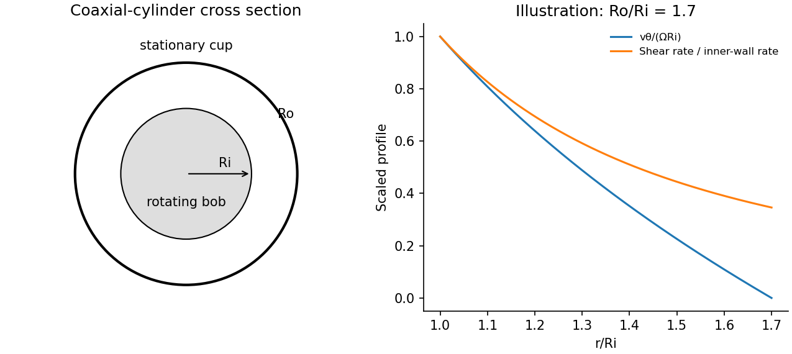

<h1 id="2/a/solution">Solution</h1>

↑ **Parent:** [A](../a.md)

A [Couette rheometer](../../../../../couette-rheometer.md) measures the [torque](../../../../../torque.md) required to rotate one coaxial cylinder relative to another. With inner radius $R_i$, outer radius $R_o$, wetted length $L$, inner [angular velocity](../../../../../angular-velocity.md) $\Omega$ and stationary outer wall, laminar Newtonian flow has

$$
v_\theta(r)=\frac{\Omega R_i^2}{R_o^2-R_i^2}\left(\frac{R_o^2}{r}-r\right),\qquad
\boxed{\mathcal T=\frac{4\pi\eta L\Omega R_i^2R_o^2}{R_o^2-R_i^2}.}
$$

The [shear stress](../../../../../shear-stress.md) at the inner wall is $\tau_i=\mathcal T/(2\pi LR_i^2)$. In a narrow gap $d=R_o-R_i\ll R_i$, $\dot\gamma\simeq\Omega R_i/d$, so $\eta\simeq\mathcal T d/(2\pi L\Omega R_i^3)$.

Measuring [torque](../../../../../torque.md) over a range of speeds gives a flow curve: constant [viscosity](../../../../../dynamic-viscosity-split.md) identifies a Newtonian regime; decreasing or increasing apparent [viscosity](../../../../../dynamic-viscosity-split.md) indicates [shear thinning](../../../../../shear-thinning.md) or thickening. A yield-stress fit needs a genuine low-rate regime and must not be confused with bearing drag or [wall slip](../../../../../wall-slip.md). Small oscillatory strain also probes [viscoelasticity](../../../../../viscoelasticity.md), with $\tau=\gamma_0[G'\cos\omega t-G''\sin\omega t]$ for imposed $\gamma=\gamma_0\cos\omega t$.

Control [temperature](../../../../../temperature-split.md), calibrate instrument [torque](../../../../../torque.md) and end effects, and check gap dependence or roughened surfaces for slip. Keep inertia small enough to avoid Taylor vortices. The exact Newtonian profile is a calibration model; a non-Newtonian material needs its own stress–rate relation.

**[Figure 1](#2/a/image-original-couette-geometry-and-dimensionless-newtonian-velocity-and-shear-rate-profiles). Original Couette geometry and dimensionless Newtonian velocity and shear-rate profiles**.

## ↑ Ancestors (14)

1. [A](../a.md)
2. [2](../../2.md)
3. [Paper 1](../../../paper-1-split.md)
4. [2014](../../../split.md)
5. [Past exam of the soft condensed matter course of the University of Cambridge](../../../../split.md)
6. [Soft Condensed Matter course of the University of Cambridge](../../../../../soft-condensed-matter-course-of-the-university-of-cambridge.md)
7. [Physics course of the year 3 of the natural sciences course of the University of Cambridge](../../../../../physics-course-of-the-year-3-of-the-natural-sciences-course-of-the-university-of-cambridge.md)
8. [Year 3 of the natural sciences course of the University of Cambridge](../../../../../year-3-of-the-natural-sciences-course-of-the-university-of-cambridge.md)
9. [Year of the natural sciences course of the University of Cambridge](../../../../../year-of-the-natural-sciences-course-of-the-university-of-cambridge.md)
10. [Natural sciences course of the University of Cambridge](../../../../../natural-sciences-course-of-the-university-of-cambridge.md)
11. [Course of the University of Cambridge](../../../../../course-of-the-university-of-cambridge.md)
12. [University of Cambridge](../../../../../university-of-cambridge-split.md)
13. [List of universities](../../../../../list-of-universities.md)
14. [Codex Wiki](../../../../../split.md)
