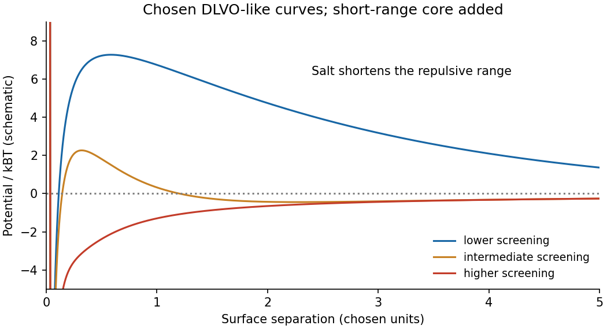

<h1 id="4/solution">Solution</h1>

↑ **Parent:** [4](../4.md)

Balancing buoyant weight with [Stokes drag](../../../../stokes-s-law.md) gives

$$
\frac{4\pi r^3}{3}\Delta\rho g=6\pi\eta rU_s,\qquad
\boxed{U_s=\frac{2\Delta\rho gr^2}{9\eta}.}
$$

This needs isolated spherical particles, low [Reynolds number](../../../../reynolds-number.md) and negligible wall corrections. The supplied settling measurement gives $\Delta\rho\simeq99.1\,\mathrm{kg\,m^{-3}}$, hence **$\rho_p\simeq1.10\times10^3\,\mathrm{kg\,m^{-3}}$**. Its [Reynolds number](../../../../reynolds-number.md) is about $7\times10^{-5}$, consistent with the approximation.

Compare gravitational work over one radius with [thermal energy](../../../../thermal-energy.md), or use $\mathrm{Pe}_g=U_sr/D$ with $D=k_BT/(6\pi\eta r)$. The [gravitational Peclet number](../../../../gravitational-peclet-number.md) gives

$$
\mathrm{Pe}_g=\frac{4\pi\Delta\rho gr^4}{3k_BT},\qquad
\boxed{r_c\sim\left(\frac{3k_BT}{4\pi\Delta\rho g}\right)^{1/4}\simeq1.0\,\mathrm{\mu m}.}
$$

Below this [sedimentation-Brownian crossover radius](../../../../sedimentation-brownian-crossover-radius.md) [Brownian motion](../../../../brownian-motion-split.md) dominates settling on the particle-size scale. It does not eliminate gravity: the [sedimentation scale height](../../../../sedimentation-scale-height.md) is $\ell_g=k_BT/[(4\pi r^3/3)\Delta\rho g]$. For negligible [concentration](../../../../concentration.md) gradients across a sample height $H$, the stronger condition is $\ell_g\gg H$. No universal permanently nonsedimenting size follows without a length/time criterion.

Brownian encounters bring small particles into contact; van der Waals attraction can then bind them. Surface charge can create a repulsive barrier through [Debye screening of colloid repulsion](../../../../debye-screening-of-colloid-repulsion.md). For a monovalent salt reservoir with [number density](../../../../number-density.md) $n$ of each ionic species, Poisson–Boltzmann theory has

$$
n_\pm=n e^{\mp e\psi/(k_BT)},\qquad
\nabla^2\psi=\frac{2en}{\epsilon}\sinh\frac{e\psi}{k_BT}.
$$

For $|e\psi|\ll k_BT$, linearization gives $\nabla^2\psi=\kappa^2\psi$, with **$\kappa^{-1}=\sqrt{\epsilon k_BT/(2ne^2)}$**. If $n$ instead means total [ion](../../../../ion.md) [density](../../../../density.md), the factor two is absent. The planar potential decays as $e^{-\kappa h}$; a sphere has an additional $1/r$ factor. This mean-field approximation neglects specific adsorption, [ion](../../../../ion.md) correlations and finite [ion](../../../../ion.md) size.

[DLVO theory](../../../../dlvo-theory.md) adds screened repulsion to dispersion attraction. At small surface separation $h$ for equal spheres of radius $r$, a useful schematic form is

$$
U(h)\sim C e^{-\kappa h}-\frac{A_Hr}{12h},
$$

with a short-range repulsive core needed outside the continuum model. Low salt can leave a barrier many times $k_BT$, giving kinetic stability. Higher salt shortens the repulsion and can lower or remove the barrier, allowing coagulation into a deep primary minimum. The [primary and secondary DLVO minima](../../../../primary-and-secondary-dlvo-minima.md) have different consequences: a shallow secondary minimum permits looser, sometimes reversible aggregation. The surface boundary condition affects $C$; screening length alone is not a complete measured interaction law. Non-DLVO hydration or steric forces can matter at contact.

**[Figure 4](#4/image-original-schematic-dlvo-potentials-showing-barrier-reduction-with-increased-screening). Original schematic DLVO potentials showing barrier reduction with increased screening**.

## ↑ Ancestors (13)

1. [4](../4.md)
2. [Paper 1](../../paper-1-split.md)
3. [2014](../../split.md)
4. [Past exam of the soft condensed matter course of the University of Cambridge](../../../split.md)
5. [Soft Condensed Matter course of the University of Cambridge](../../../../soft-condensed-matter-course-of-the-university-of-cambridge.md)
6. [Physics course of the year 3 of the natural sciences course of the University of Cambridge](../../../../physics-course-of-the-year-3-of-the-natural-sciences-course-of-the-university-of-cambridge.md)
7. [Year 3 of the natural sciences course of the University of Cambridge](../../../../year-3-of-the-natural-sciences-course-of-the-university-of-cambridge.md)
8. [Year of the natural sciences course of the University of Cambridge](../../../../year-of-the-natural-sciences-course-of-the-university-of-cambridge.md)
9. [Natural sciences course of the University of Cambridge](../../../../natural-sciences-course-of-the-university-of-cambridge.md)
10. [Course of the University of Cambridge](../../../../course-of-the-university-of-cambridge.md)
11. [University of Cambridge](../../../../university-of-cambridge-split.md)
12. [List of universities](../../../../list-of-universities.md)
13. [Codex Wiki](../../../../split.md)
