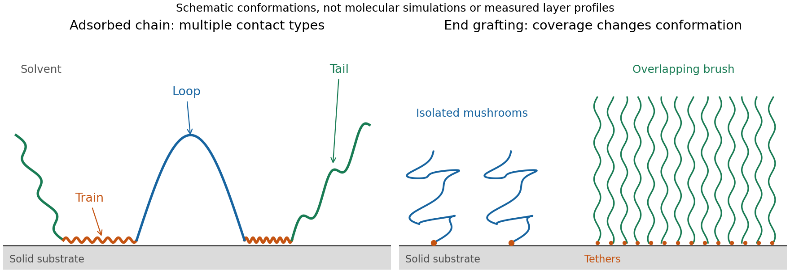

<h1 id="2/b/solution">Solution</h1>

↑ **Parent:** [B](../b.md)

[polymers at interfaces](../../../../../polymers-at-interfaces.md) balance favorable surface contacts against lost [conformational entropy](../../../../../conformational-entropy.md) and interactions among neighboring chains. At an attractive solid–liquid interface, an [adsorbed polymer train](../../../../../adsorbed-polymer-train.md) consists of consecutive bound segments. An [adsorbed polymer loop](../../../../../adsorbed-polymer-loop.md) leaves the surface and returns to it, while an [adsorbed polymer tail](../../../../../adsorbed-polymer-tail.md) extends to a free chain end. A chain can contain all three, so [adsorption](../../../../../adsorption.md) does not imply a completely flattened molecule. Surface affinity, [solvent quality](../../../../../solvent-quality.md), [persistence length](../../../../../persistence-length.md), chain [length](../../../../../length.md) and [concentration](../../../../../concentration.md) control the balance and the resulting segment-density profile.

**[Figure 1](#2/b/image-original-schematic-of-adsorbed-trains-loops-and-tails-and-the-crossover-from-isolated-grafted-mushrooms-to-an-overlapping-polymer-brush). Original schematic of adsorbed trains, loops and tails, and the crossover from isolated grafted mushrooms to an overlapping polymer brush**.

[adsorption](../../../../../adsorption.md) gains [energy](../../../../../energy-split.md) of order $\epsilon k_BT$ per bound segment but reduces the number of accessible chain configurations. Weak [adsorption](../../../../../adsorption.md) can be described through [adsorption blobs](../../../../../adsorption-blob.md) whose thickness exceeds the statistical segment [length](../../../../../length.md); each blob loses an [energy](../../../../../energy-split.md) of order $k_BT$ through [confinement](../../../../../confinement.md). Stronger attraction generally creates more contacts and a more compact layer, while loops and tails can still dominate its outer extent. A measurement of adsorbed mass alone therefore does not determine layer thickness or conformation.

End-grafted chains are different: their attachment is fixed at one end. At [grafting density](../../../../../grafting-density.md) $\sigma_g$, the mean lateral spacing is $D\sim\sigma_g^{-1/2}$. At low coverage the chains behave as isolated [polymer mushrooms](../../../../../polymer-mushroom.md). The [polymer mushroom-to-brush crossover](../../../../../polymer-mushroom-to-brush-crossover.md) occurs when $\sigma_gR_G^2\sim1$. At higher coverage in a [good solvent](../../../../../good-solvent.md), crowding makes chains extend away from the surface. A free-energy balance per chain,

$$
\frac{F}{k_BT}\sim\frac{H^2}{Nb^2}+\frac{vN^2\sigma_g}{H},
$$

combines stretching [entropy](../../../../../entropy-split.md) with repulsive [excluded volume](../../../../../excluded-volume.md) $v>0$. Minimization gives $H^3\sim vN^3b^2\sigma_g$, or

$$
\boxed{H\sim Nb(\sigma_gb^2)^{1/3}\quad\text{when }v\sim b^3.}
$$

This is a scaling result with an undetermined order-one coefficient, valid for overlapping chains stretched below their contour [length](../../../../../length.md). In a compact poor-solvent layer, a roughly fixed internal [polymer](../../../../../polymer-split.md) [volume fraction](../../../../../volume-fraction.md) instead gives $H\propto N\sigma_g$.

Small-angle neutron scattering on end-grafted polydimethylsiloxane layers on porous silica has distinguished the good- and poor-solvent [density](../../../../../density.md) exponents. The chemical system and scattering contrast matter: changing [solvent quality](../../../../../solvent-quality.md) should be separated from changing graft coverage, chain [molar mass](../../../../../molar-mass.md) or [adsorption](../../../../../adsorption.md) strength.[Physical Review Letters 66, 719–722 (1991), abstract: actual polymer/substrate system, neutron-scattering method and the two thickness scalings](../../../../../characterization-of-the-brush-regime-for-grafted-polymer-layers-at-the-solid-liquid-interface-by-p-auroy-and-others.md)

An interface can also localize chains of a [block copolymer](../../../../../block-copolymer.md) when its blocks prefer different media. Such layers change [interfacial tension](../../../../../interfacial-tension.md) and can stabilize dispersed droplets or particles through [steric repulsion](../../../../../steric-repulsion.md). Overlapping layers in a [good solvent](../../../../../good-solvent.md) cost osmotic and conformational [free energy](../../../../../thermodynamic-free-energy.md); incomplete [adsorption](../../../../../adsorption.md) can instead produce [polymer bridging](../../../../../polymer-bridging.md) between particles. Nonadsorbing chains can cause depletion attraction. Thus the presence of a [polymer](../../../../../polymer-split.md) does not by itself guarantee stabilization.

## ↑ Ancestors (14)

1. [B](../b.md)
2. [2](../../2.md)
3. [Paper 1](../../../paper-1-split.md)
4. [2015](../../../split.md)
5. [Past exam of the soft condensed matter course of the University of Cambridge](../../../../split.md)
6. [Soft Condensed Matter course of the University of Cambridge](../../../../../soft-condensed-matter-course-of-the-university-of-cambridge.md)
7. [Physics course of the year 3 of the natural sciences course of the University of Cambridge](../../../../../physics-course-of-the-year-3-of-the-natural-sciences-course-of-the-university-of-cambridge.md)
8. [Year 3 of the natural sciences course of the University of Cambridge](../../../../../year-3-of-the-natural-sciences-course-of-the-university-of-cambridge.md)
9. [Year of the natural sciences course of the University of Cambridge](../../../../../year-of-the-natural-sciences-course-of-the-university-of-cambridge.md)
10. [Natural sciences course of the University of Cambridge](../../../../../natural-sciences-course-of-the-university-of-cambridge.md)
11. [Course of the University of Cambridge](../../../../../course-of-the-university-of-cambridge.md)
12. [University of Cambridge](../../../../../university-of-cambridge-split.md)
13. [List of universities](../../../../../list-of-universities.md)
14. [Codex Wiki](../../../../../split.md)
