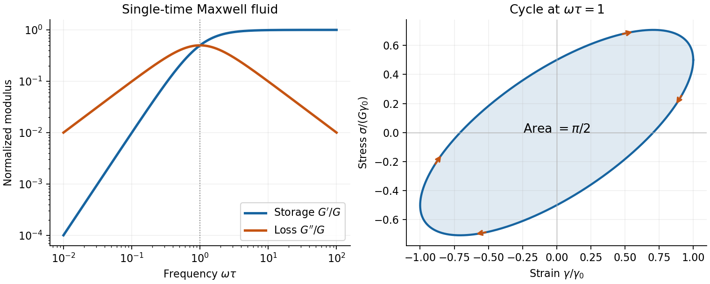

<h1 id="2/c/solution">Solution</h1>

↑ **Parent:** [C](../c.md)

A viscoelastic material stores part of the [work](../../../../../work.md) of deformation and dissipates part. In the linear regime its [stress](../../../../../stress.md) depends on the [strain](../../../../../strain.md) history, not just the instantaneous [strain](../../../../../strain.md) or [shear strain rate](../../../../../shear-strain-rate.md). For simple shear, a causal [relaxation modulus](../../../../../relaxation-modulus.md) $G(t)$ gives $\sigma(t)=\int_{-\infty}^tG(t-t')\dot\gamma(t')dt'$. A sudden [strain](../../../../../strain.md) then probes [stress relaxation](../../../../../stress-relaxation.md), while a constant imposed [stress](../../../../../stress.md) probes [material creep](../../../../../creep-deformation.md); these are different experiments.

For steady sinusoidal [strain](../../../../../strain.md) use the convention $\gamma(t)=\gamma_0\cos\omega t$ and $e^{i\omega t}$ complex amplitudes. The [complex viscoelastic modulus](../../../../../dynamic-modulus.md) is

$$
\boxed{G^*(\omega)=\frac{\widetilde\sigma}{\widetilde\gamma}
=G'(\omega)+iG''(\omega),}
$$

so $\sigma(t)=\gamma_0[G'\cos\omega t-G''\sin\omega t]$. The [storage modulus](../../../../../storage-modulus.md) $G'$ is the in-phase elastic component. The [loss modulus](../../../../../loss-modulus.md) $G''$ multiplies the component in phase with [shear strain rate](../../../../../shear-strain-rate.md); [stress](../../../../../stress.md) leads [strain](../../../../../strain.md) by $\delta=\operatorname{atan2}(G'',G')$. The [loss tangent](../../../../../loss-tangent.md) is $\tan\delta=G''/G'$ when $G'>0$.

Multiplying [stress](../../../../../stress.md) by [shear strain rate](../../../../../shear-strain-rate.md) and averaging gives $\langle P\rangle/V=\tfrac12\omega G''\gamma_0^2$. Hence the [dissipated energy per oscillatory shear cycle](../../../../../dissipated-energy-per-oscillatory-shear-cycle.md) is

$$
\boxed{\frac{W_{\rm cycle}}{V}=\pi G''\gamma_0^2.}
$$

The elastic contribution returns its [work](../../../../../work.md) over the cycle. A passive material has nonnegative [dissipation](../../../../../dissipation.md), which fixes the sign of the loss term in the chosen Fourier convention. This [complex viscoelastic modulus](../../../../../dynamic-modulus.md) is a response function, not the mathematical absolute value of a complex number.

A [Maxwell model](../../../../../linear-maxwell-fluid.md) places a [spring](../../../../../spring.md) of [shear modulus](../../../../../shear-modulus.md) $G$ in series with a [dashpot](../../../../../dashpot.md) of [viscosity](../../../../../dynamic-viscosity-split.md) $\eta$, so the [strains](../../../../../strain.md) add at common [stress](../../../../../stress.md):

$$
\dot\gamma=\frac{\dot\sigma}{G}+\frac{\sigma}{\eta},
\qquad\tau=\frac{\eta}{G}.
$$

The [Maxwell fluid dynamic modulus](../../../../../maxwell-fluid-dynamic-modulus.md) is

$$
G^*=\frac{G\,i\omega\tau}{1+i\omega\tau},\qquad
\boxed{G'=\frac{G(\omega\tau)^2}{1+(\omega\tau)^2},\quad
G''=\frac{G\omega\tau}{1+(\omega\tau)^2}.}
$$

At $\omega\tau\ll1$ the response is predominantly viscous, $G''\simeq\eta\omega$ and $G'\simeq G(\omega\tau)^2$. At $\omega\tau\gg1$ it approaches the elastic plateau $G'=G$. The two moduli cross, and $G''$ reaches its maximum, at $\omega\tau=1$. A [Kelvin-Voigt model](../../../../../kelvin-voigt-model.md) instead has the [spring](../../../../../spring.md) and [dashpot](../../../../../dashpot.md) in parallel, giving $G^*=G+i\eta\omega$ and no fluid-like zero-frequency terminal flow. Real materials often need a spectrum of [relaxation times](../../../../../relaxation-time.md) rather than one Maxwell time.

**[Figure 2](#2/c/image-original-maxwell-storage-and-loss-moduli-with-a-stress-strain-cycle-whose-enclosed-area-measures-dissipated-work). Original Maxwell storage and loss moduli, with a stress–strain cycle whose enclosed area measures dissipated work**.

Oscillatory [rheometry](../../../../../rheometry.md) measures [stress](../../../../../stress.md) amplitude and phase while imposing a small [strain](../../../../../strain.md). An [oscillatory-shear amplitude sweep](../../../../../oscillatory-shear-amplitude-sweep.md) first identifies a linear regime; an [oscillatory-shear frequency sweep](../../../../../oscillatory-shear-frequency-sweep.md) then measures $G'$ and $G''$. Repeat at controlled [temperature](../../../../../temperature-split.md), suppress evaporation, check [wall slip](../../../../../wall-slip.md) and sample aging, and correct instrument [inertia](../../../../../inertia.md) at high [frequency](../../../../../frequency.md). Frequency-dependent structure and a nonlinear response cannot be inferred reliably by fitting one [spring](../../../../../spring.md) and [dashpot](../../../../../dashpot.md) to one point.

## ↑ Ancestors (14)

1. [C](../c.md)
2. [2](../../2.md)
3. [Paper 1](../../../paper-1-split.md)
4. [2015](../../../split.md)
5. [Past exam of the soft condensed matter course of the University of Cambridge](../../../../split.md)
6. [Soft Condensed Matter course of the University of Cambridge](../../../../../soft-condensed-matter-course-of-the-university-of-cambridge.md)
7. [Physics course of the year 3 of the natural sciences course of the University of Cambridge](../../../../../physics-course-of-the-year-3-of-the-natural-sciences-course-of-the-university-of-cambridge.md)
8. [Year 3 of the natural sciences course of the University of Cambridge](../../../../../year-3-of-the-natural-sciences-course-of-the-university-of-cambridge.md)
9. [Year of the natural sciences course of the University of Cambridge](../../../../../year-of-the-natural-sciences-course-of-the-university-of-cambridge.md)
10. [Natural sciences course of the University of Cambridge](../../../../../natural-sciences-course-of-the-university-of-cambridge.md)
11. [Course of the University of Cambridge](../../../../../course-of-the-university-of-cambridge.md)
12. [University of Cambridge](../../../../../university-of-cambridge-split.md)
13. [List of universities](../../../../../list-of-universities.md)
14. [Codex Wiki](../../../../../split.md)
