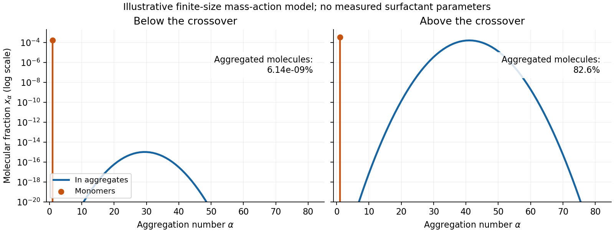

<h1 id="3/solution">Solution</h1>

↑ **Parent:** [3](../3.md)

An [amphiphile](../../../../amphiphile.md) has a solvent-affine part and a solvent-averse part within one molecule. In water these are commonly called [hydrophilic](../../../../hydrophilicity.md) head and [hydrophobic](../../../../hydrophobicity.md) tail. Two nonbiological examples are [sodium dodecyl sulfate](../../../../sodium-dodecyl-sulfate.md), with a twelve-carbon tail and an anionic sulfate head, and [cetyltrimethylammonium bromide](../../../../cetrimonium-bromide.md), with a sixteen-carbon tail and a cationic quaternary-ammonium head. Their [counterions](../../../../counterion.md) balance the ionic head-group charge; the head and tail do not have interchangeable interactions with water.

Aggregation reduces unfavorable exposure of [hydrocarbon](../../../../hydrocarbon.md) tails to water but loses molecular translational [entropy](../../../../entropy-split.md). Interfacial [free energy](../../../../thermodynamic-free-energy.md), head-group [solvation](../../../../solvation.md) and electrostatic repulsion, chain packing and [conformational entropy](../../../../conformational-entropy.md) determine the preferred aggregate. The [hydrophobic effect](../../../../hydrophobic-effect.md) is a solvent-mediated free-energy balance, rather than a literal attractive bond between tails.

The [amphiphile packing parameter](../../../../amphiphile-packing-parameter.md)

$$
P=\frac{v}{a_0\ell_c}
$$

compares tail [volume](../../../../volume.md) $v$, effective head-group [area](../../../../surface-area.md) $a_0$ and maximum tail [length](../../../../length.md) $\ell_c$. A spherical core of radius $R$ obeys $v/a_0=R/3$, and a long cylindrical core obeys $v/a_0=R/2$. The condition $R\leq\ell_c$ gives the conventional spherical window $P\lesssim1/3$ and cylindrical window $1/3\lesssim P\lesssim1/2$. Less strongly curved bilayers become compatible for $1/2\lesssim P\lesssim1$, with planar packing near one; values above one can favor inverse [curvature](../../../../curvature.md) in an appropriate nonpolar surrounding medium. These windows are geometric guides rather than exact phase boundaries.

A larger hydrated or electrostatically repelling head increases $a_0$ and favors positive [curvature](../../../../curvature.md). Screening of charged heads or a smaller head can lower $a_0$ and favor rods or sheets. Multiple tails increase the tail [volume](../../../../volume.md) relative to head [area](../../../../surface-area.md) and can favor bilayers. Tail [length](../../../../length.md), branching, [temperature](../../../../temperature-split.md) and [solvent](../../../../solvent.md) selectivity alter both geometry and interaction [free energy](../../../../thermodynamic-free-energy.md), so one cannot predict a unique aggregate from hydrophobicity alone.[1976, pp. 1525–1568: coupled thermodynamics, molecular packing constraints and globular, cylindrical and bilayer aggregates](../../../../theory-of-self-assembly-of-hydrocarbon-amphiphiles-by-jacob-n-israelachvili-and-others.md)

In the supplied chemical-potential expression, $\mu$ is the [equilibrium](../../../../equilibrium-point-of-a-dynamical-system.md) [chemical potential](../../../../chemical-potential-split.md) per [amphiphile](../../../../amphiphile.md), $\mu_\alpha^0$ the standard [free energy](../../../../thermodynamic-free-energy.md) per [amphiphile](../../../../amphiphile.md) within an aggregate of size $\alpha$, and $x_\alpha$ the dimensionless molecular fraction belonging to that size class. The [aggregate molecular fraction versus aggregate number fraction](../../../../aggregate-molecular-fraction-versus-aggregate-number-fraction.md) distinction explains the logarithm: the aggregate count fraction is $x_\alpha/\alpha$, and dividing its translational [chemical potential](../../../../chemical-potential-split.md) by $\alpha$ gives a per-molecule value. Thus

$$
\alpha\frac{\mu-\mu_\alpha^0}{k_BT}=\ln(x_\alpha/\alpha),
\qquad
\boxed{x_\alpha=\alpha\exp\!\left[\frac{\alpha(\mu-\mu_\alpha^0)}{k_BT}\right].}
$$

Here $k_B$ is the [Boltzmann constant](../../../../boltzmann-constant.md), $T$ absolute [temperature](../../../../temperature-split.md), and $\alpha$ a positive integer. The logarithm acts on a dimensionless ideal activity; a concentrated nonideal solution would require [activity coefficients](../../../../activity-coefficient.md).

[equilibrium](../../../../equilibrium-point-of-a-dynamical-system.md) exchange of [amphiphiles](../../../../amphiphile.md) gives the same per-molecule $\mu$ for every size. For monomers, $\mu=\mu_1^0+k_BT\ln x_1$. Substitution yields the [finite-micelle aggregation-number distribution](../../../../finite-micelle-aggregation-number-distribution.md)

$$
\boxed{x_\alpha=\alpha x_1^\alpha
\exp\!\left[\frac{\alpha(\mu_1^0-\mu_\alpha^0)}{k_BT}\right],\qquad
x_{\rm tot}=\sum_{\alpha\ge1}x_\alpha.}
$$

This formula by itself does not prescribe a preferred [micelle](../../../../micelle.md) size: the size dependence of $\mu_\alpha^0$ must include the competing packing and interaction terms. If their balance favors a finite size $\alpha_*$, a monomer population and a peak around that size can coexist. Dividing by $\alpha$ would instead plot the distribution of aggregate counts.

At very low $x_{\rm tot}$, the factors $x_1^\alpha$ suppress large aggregates and most molecules remain monomers. As $x_1$ rises, a favorable aggregate class grows extremely rapidly because of this high [power](../../../../power.md). The [critical micelle concentration from standard chemical potentials](../../../../critical-micelle-concentration-from-standard-chemical-potentials.md) has the large-size estimate

$$
x_{1,*}\simeq\exp\!\left[\frac{\mu_{\alpha_*}^0-\mu_1^0}{k_BT}\right].
$$

More precisely, the illustrative crossover condition $x_{\alpha_*}=x_1$ gives

$$
\ln x_{1,*}=
\frac{\alpha_*(\mu_{\alpha_*}^0-\mu_1^0)/(k_BT)-\ln\alpha_*}{\alpha_*-1}.
$$

Added material above the crossover enters aggregates predominantly. Monomer [concentration](../../../../concentration.md) then increases slowly rather than being exactly pinned: its logarithm enters $\mu$, while aggregate populations respond with a large factor $\alpha_*$. For finite [micelles](../../../../micelle.md) this is a sharp association crossover, not an absolute prohibition on aggregates below one exact [concentration](../../../../concentration.md).

**[Figure 3](#3/image-original-illustrative-molecular-fraction-distributions-over-aggregation-number-below-and-above-a-micellization-crossover). Original illustrative molecular-fraction distributions over aggregation number below and above a micellization crossover**.

The drawing uses a declared illustrative standard-free-energy model favoring aggregates near $\alpha=40$. It is not an inferred distribution or critical [concentration](../../../../concentration.md) for either named [surfactant](../../../../surfactant.md). The separate monomer peak is at $\alpha=1$; a distribution of molecular fractions weights each aggregate by its number of molecules.

For the general physics of a nearly planar [fluid](../../../../fluid.md) sheet, let $h(x,y)$ be a small-slope displacement, $\kappa$ [membrane bending rigidity](../../../../membrane-bending-rigidity.md) and $\sigma$ mechanical tension. At fixed topology and symmetric reference [curvature](../../../../curvature.md), the quadratic [Helfrich energy](../../../../helfrich-energy.md) is

$$
F[h]=\frac12\int d^2x\,[\kappa(\nabla^2h)^2+\sigma|\nabla h|^2].
$$

The bending term is the small-slope curvature-elastic [energy](../../../../energy-split.md); additional spontaneous-curvature or boundary terms require extra information.[Section II.C, p. 695, equation (12): curvature-elastic energy and coefficients with units of energy](../../../../elastic-properties-of-lipid-bilayers-theory-and-possible-experiments-by-wolfgang-helfrich.md)

For Fourier amplitudes $h_{\mathbf q}=A^{-1}\int_Ah(\mathbf x)e^{-i\mathbf q\cdot\mathbf x}d^2x$, equipartition gives the [membrane fluctuation spectrum under tension](../../../../membrane-fluctuation-spectrum-under-tension.md),

$$
\boxed{\langle|h_{\mathbf q}|^2\rangle=
\frac{k_BT}{A(\kappa q^4+\sigma q^2)}.}
$$

Higher [temperature](../../../../temperature-split.md) increases fluctuations, while greater [membrane bending rigidity](../../../../membrane-bending-rigidity.md) or tension suppresses them. Short-wavelength modes are predominantly bending-controlled; longer wavelengths can be tension-controlled. Finite sheet size, supports, [confinement](../../../../confinement.md) and imposed [area](../../../../surface-area.md) set [boundary conditions](../../../../boundary-condition.md) and [infrared cutoffs](../../../../infrared-cutoff.md); continuum elasticity also needs a short-distance cutoff. [solvent](../../../../solvent.md) [viscosity](../../../../dynamic-viscosity-split.md) affects relaxation rates, although it does not enter this [equilibrium](../../../../equilibrium-point-of-a-dynamical-system.md) amplitude at fixed elastic parameters.

**TODO: user-deferred biology. The requested importance of these fluctuations for bodily function is deferred.** The preceding result covers only the independent continuum and thermal physics.

## ↑ Ancestors (13)

1. [3](../3.md)
2. [Paper 1](../../paper-1-split.md)
3. [2015](../../split.md)
4. [Past exam of the soft condensed matter course of the University of Cambridge](../../../split.md)
5. [Soft Condensed Matter course of the University of Cambridge](../../../../soft-condensed-matter-course-of-the-university-of-cambridge.md)
6. [Physics course of the year 3 of the natural sciences course of the University of Cambridge](../../../../physics-course-of-the-year-3-of-the-natural-sciences-course-of-the-university-of-cambridge.md)
7. [Year 3 of the natural sciences course of the University of Cambridge](../../../../year-3-of-the-natural-sciences-course-of-the-university-of-cambridge.md)
8. [Year of the natural sciences course of the University of Cambridge](../../../../year-of-the-natural-sciences-course-of-the-university-of-cambridge.md)
9. [Natural sciences course of the University of Cambridge](../../../../natural-sciences-course-of-the-university-of-cambridge.md)
10. [Course of the University of Cambridge](../../../../course-of-the-university-of-cambridge.md)
11. [University of Cambridge](../../../../university-of-cambridge-split.md)
12. [List of universities](../../../../list-of-universities.md)
13. [Codex Wiki](../../../../split.md)
