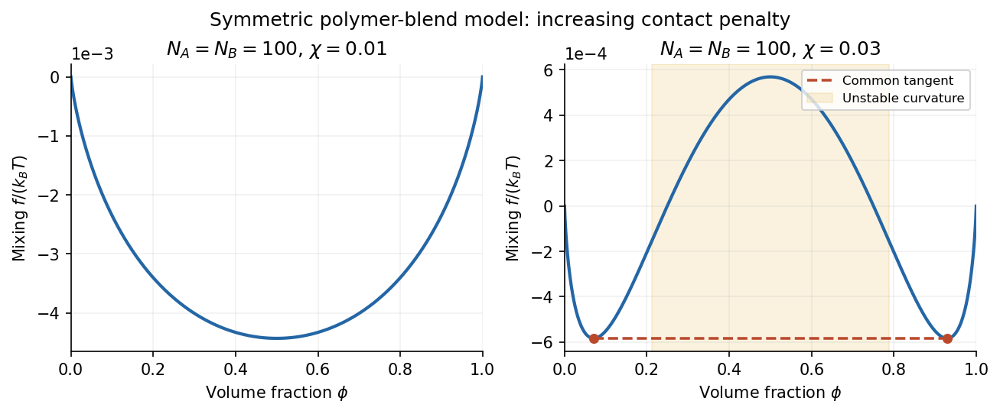
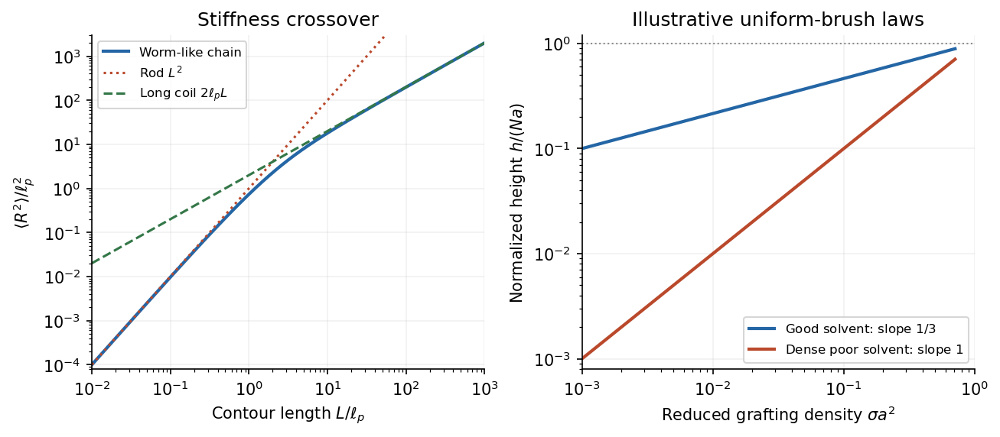

# Paper 1

↑ **Parent:** [2016](../2016.md)

[Original public PDF, physical pages 413–416; exam dated 28 May 2016](https://www.whatdotheyknow.com/request/natural_science_tripos_physics_e_2/response/2340776/attach/2/FOI%202023%20399%20Zahid%20materials.pdf?cookie_passthrough=1#page=413).

All optional physics questions are covered. The protein application in 1(c) and the bacterial application in 2(a) are **TODO: user-deferred biology**; the ordinary physics portions are retained.

**Table of contents**

- [1](#1)
  - [a](#1/a)
    - [Solution](#1/a/solution)
  - [b](#1/b)
    - [Solution](#1/b/solution)
  - [c](#1/c)
    - [Solution](#1/c/solution)
- [2](#2)
  - [a](#2/a)
    - [Solution](#2/a/solution)
  - [b](#2/b)
    - [Solution](#2/b/solution)
  - [c](#2/c)
    - [Solution](#2/c/solution)
- [3](#3)
  - [Solution](#3/solution)
- [4](#4)
  - [Solution](#4/solution)

## 1

↑ **Parent:** [Paper 1](paper-1.md)

<h3 id="1/a">a</h3>

↑ **Parent:** [1](#1)

<h4 id="1/a/solution">Solution</h4>

↑ **Parent:** [A](#1/a)

Use the [amphiphile packing parameter](../../physical-chemistry.md#amphiphile-packing-parameter) $P=v/(a_0\ell_c)$, where $v$ is tail [volume](../../geometry-and-topology.md#volume), $a_0$ the effective head-group [area](../../differential-geometry.md#surface-area) and $\ell_c$ the maximum tail extension. The conventional cylindrical-[micelle](../../physical-chemistry.md#micelle) window is $1/3\lesssim P\lesssim1/2$. Its upper limit follows directly from [cylindrical micelle geometry](../../physical-chemistry.md#cylindrical-micelle-geometry): a long core of radius $R$ has volume-to-area ratio $R/2$, so $v/a_0=R/2\leq\ell_c/2$. The spherical packing limit is $P=1/3$; above it a filled spherical core cannot accommodate the assumed head-group [area](../../differential-geometry.md#surface-area) and chain length.

Inverting both positive inequalities gives

$$
\frac{2v}{\ell_c}\lesssim a_0\lesssim\frac{3v}{\ell_c},\qquad
\boxed{0.246\,\mathrm{nm^2}\lesssim a_0\lesssim0.369\,\mathrm{nm^2}.}
$$

Thus the useful estimate is **a head-group area of approximately $0.25$–$0.37\,\mathrm{nm^2}$**. If phase-boundary configurations are excluded, use strict inequalities. These endpoints are geometric morphology crossovers, rather than exact thermodynamic phase boundaries: chain conformations and head-group interactions also affect which [micelle](../../physical-chemistry.md#micelle) minimizes the [free energy](../../thermodynamic-potential.md#thermodynamic-free-energy). The supplied molecular [volume](../../geometry-and-topology.md#volume) is interpreted as the tail-core [volume](../../geometry-and-topology.md#volume) required by this packing model.[1976, aggregate packing theory; cylindrical and spherical core constraints](../../chemistry-bibliography.md#theory-of-self-assembly-of-hydrocarbon-amphiphiles-by-jacob-n-israelachvili-and-others)

<h3 id="1/b">b</h3>

↑ **Parent:** [1](#1)

<h4 id="1/b/solution">Solution</h4>

↑ **Parent:** [B](#1/b)

For an equilibrium [contact angle](../../surface-tension.md#contact-angle) measured through the [liquid](../../thermodynamics.md#liquid), [Young's equation](../../surface-tension.md#young-s-equation) balances the tangential interfacial forces:

$$
\gamma_{SV}-\gamma_{SL}=\gamma_{LV}\cos\theta.
$$

The pure-[ethanol](../../biology.md#ethanol) measurement therefore fixes the solid–vapour [surface energy](../../surface-tension.md#surface-energy) as

$$
\gamma_{SV}=(21.0+21.4\cos23^\circ)\times10^{-3}
=40.699\times10^{-3}\,\mathrm{N\,m^{-1}}.
$$

**The inferred surface energy is $40.7\,\mathrm{mJ\,m^{-2}}$**, equivalently $40.7\,\mathrm{mN\,m^{-1}}$. The equality of these units follows because creating interfacial [area](../../differential-geometry.md#surface-area) costs [energy](../../energy.md).

For the equal-fraction [mixture](../../mixture.md), the stated linear relations give $\gamma_{SL}=20.5\,\mathrm{mN\,m^{-1}}$ and $\gamma_{LV}=28.5\,\mathrm{mN\,m^{-1}}$. Holding the solid–vapour [surface energy](../../surface-tension.md#surface-energy) fixed,

$$
\cos\theta_{1/2}=\frac{40.699-20.5}{28.5}=0.70873,
\qquad \boxed{\theta_{1/2}\simeq44.9^\circ.}
$$

The small decrease in $\gamma_{SL}$ increases the numerator of [Young's equation](../../surface-tension.md#young-s-equation), but the increase in $\gamma_{LV}$ has the larger relative effect and reduces $\cos\theta$. Consequently **the contact angle increases and the mixture wets the surface less well**. This inference uses equilibrium [wetting](../../surface-tension.md#wetting) on an unchanged smooth solid; a changing surface composition or [contact-angle hysteresis](../../surface-tension.md#contact-angle-hysteresis) would require additional measurements.

<h3 id="1/c">c</h3>

↑ **Parent:** [1](#1)

<h4 id="1/c/solution">Solution</h4>

↑ **Parent:** [C](#1/c)

**TODO: user-deferred biology. The protein-specific haemoglobin displacement requested here is deferred; no species-specific numerical answer has been calculated.**

The ordinary physics is [Stokes settling velocity](../../suspension-chemistry.md#stokes-settling-velocity). For a generic isolated rigid [sphere](../../euclidean-geometry.md#sphere) of radius $a$, particle [mass density](../../fluid-mechanics.md#density) $\rho_p$ and surrounding-fluid [mass density](../../fluid-mechanics.md#density) $\rho_f$, balance the buoyancy-corrected body [force](../../force.md) against [Stokes law](../../stokes-flow.md#stokes-s-law):

$$
\frac{4\pi a^3}{3}(\rho_p-\rho_f)g_{\rm eff}=6\pi\eta aU,
\qquad U=\frac{2a^2(\rho_p-\rho_f)g_{\rm eff}}{9\eta}.
$$

Here $\eta$ is the [dynamic viscosity](../../dynamic-viscosity.md). If the effective acceleration is approximately constant over the displacement and the terminal regime has been reached, $s=Ut$. In an actual centrifuge $g_{\rm eff}=\Omega^2r$, so a sufficiently large radial change requires integrating $dr/dt\propto r$ instead of assuming constant $U$. This generic relation does not resolve the deferred biological application.

## 2

↑ **Parent:** [Paper 1](paper-1.md)

<h3 id="2/a">a</h3>

↑ **Parent:** [2](#2)

<h4 id="2/a/solution">Solution</h4>

↑ **Parent:** [A](#2/a)

**TODO: user-deferred biology. The bacterial-motion application is deferred. The following covers the Reynolds number and its general fluid-mechanical implications.**

The [Reynolds number](../../dynamic-viscosity.md#reynolds-number)

$$
\boxed{\mathrm{Re}=\frac{\rho UL}{\eta}=\frac{UL}{\nu}}
$$

compares advective [inertia](../../classical-mechanics.md#inertia) with viscous [force](../../force.md) on a specified [length](../../physics.md#length) scale $L$ and [velocity](../../classical-mechanics.md#velocity) scale $U$. Here $\rho$ is fluid [mass density](../../fluid-mechanics.md#density), $\eta$ is [dynamic viscosity](../../dynamic-viscosity.md) and $\nu=\eta/\rho$ is [kinematic viscosity](../../dynamic-viscosity.md#kinematic-viscosity). In the [Navier-Stokes equation](../../viscous-fluid-flow.md#navier-stokes-equation), advective acceleration scales as $U^2/L$, while the viscous term per unit [mass](../../classical-mechanics.md#mass) scales as $\nu U/L^2$; their ratio is [Reynolds number](../../dynamic-viscosity.md#reynolds-number).

When $\mathrm{Re}\ll1$ and unsteady fluid [inertia](../../classical-mechanics.md#inertia) is also negligible, the [incompressible flow](../../fluid-mechanics.md#incompressible-flow) equations reduce to [Stokes flow](../../stokes-flow.md):

$$
-\nabla p+\eta\nabla^2\mathbf u+\mathbf f=\mathbf0,
\qquad \nabla\cdot\mathbf u=0.
$$

Thus [pressure](../../pressure.md), applied body [forces](../../force.md) and viscous stresses balance at each instant. For a translating rigid [sphere](../../euclidean-geometry.md#sphere), [drag](../../fluid-mechanics.md#drag-physics) is proportional to [velocity](../../classical-mechanics.md#velocity), $F_D=6\pi\eta aU$, rather than the inertial scale $\rho a^2U^2$. Given the same instantaneous geometry, reversing the imposed boundary velocities reverses the [Stokes flow](../../stokes-flow.md); there is no fluid-inertial coasting in this approximation. This statement concerns the fluid limit and does not discard a separately significant particle [inertia](../../classical-mechanics.md#inertia).

A low steady [Reynolds number](../../dynamic-viscosity.md#reynolds-number) alone does not justify dropping rapid unsteady acceleration. For forcing frequency $\omega$, the additional dimensionless ratio is $\rho\omega L^2/\eta$. No organism-specific sizes, velocities or propulsion mechanism are assumed here.

<h3 id="2/b">b</h3>

↑ **Parent:** [2](#2)

<h4 id="2/b/solution">Solution</h4>

↑ **Parent:** [B](#2/b)

The [Flory interaction parameter](../../mixture.md#flory-interaction-parameter) $\chi$ measures the excess cost of unlike segment contacts. In a simple lattice with coordination number $z$, contact [energies](../../energy.md) $\epsilon_{AA},\epsilon_{BB},\epsilon_{AB}$ and [temperature](../../temperature.md) $T$,

$$
\chi=\frac{z}{k_BT}\left[\epsilon_{AB}-\frac{\epsilon_{AA}+\epsilon_{BB}}2\right].
$$

A positive [Flory interaction parameter](../../mixture.md#flory-interaction-parameter) penalizes unlike contacts; a negative value favors them. Mixing still depends on the balance with [entropy of mixing](../../mixture.md#entropy-of-mixing), rather than the sign of $\chi$ alone.

For two [polymers](../../polymer.md) of degrees of polymerization $N_A,N_B$, let $\phi$ be the [volume fraction](../../continuum-mechanics.md#volume-fraction) of species $A$. The [binary Flory-Huggins polymer blend](../../mixture.md#binary-flory-huggins-polymer-blend) has mixing [free energy](../../thermodynamic-potential.md#thermodynamic-free-energy) per lattice site

$$
\frac{f(\phi)}{k_BT}=\frac\phi{N_A}\ln\phi+
\frac{1-\phi}{N_B}\ln(1-\phi)+\chi\phi(1-\phi).
$$

The logarithmic terms favor mixing. Their factors $1/N_A$ and $1/N_B$ arise because an entire chain translates as one object; connecting many segments greatly reduces the mixing [entropy](../../entropy.md) per segment. Hence long [polymers](../../polymer.md) can demix for a much smaller positive [Flory interaction parameter](../../mixture.md#flory-interaction-parameter) than small [molecules](../../molecule.md).

For composition-independent $\chi$, the local stability criterion is

$$
\frac{f''(\phi)}{k_BT}=
\frac1{N_A\phi}+\frac1{N_B(1-\phi)}-2\chi.
$$

Positive curvature means stability to small composition fluctuations, zero curvature locates the [spinodal](../../critical-phenomenon.md#spinodal), and negative curvature means spontaneous growth of fluctuations. Actual two-phase coexistence is determined by the [common-tangent construction](../../critical-phenomenon.md#common-tangent-construction), or equality of both species' [chemical potentials](../../chemical-potential.md); its boundary is the [binodal](../../critical-phenomenon.md#binodal). A locally stable but globally unfavourable homogeneous [mixture](../../mixture.md) can lie between the [binodal](../../critical-phenomenon.md#binodal) and [spinodal](../../critical-phenomenon.md#spinodal).

Setting the second and third [derivatives](../../calculus.md#derivative) of $f$ to zero gives

$$
\phi_c=\frac{\sqrt{N_B}}{\sqrt{N_A}+\sqrt{N_B}},\qquad
\chi_c=\frac12\left(N_A^{-1/2}+N_B^{-1/2}\right)^2.
$$

For the [symmetric Flory-Huggins polymer blend](../../mixture.md#symmetric-flory-huggins-polymer-blend), **$\phi_c=1/2$ and $\chi_c=2/N$**. For a [polymer solution](../../mixture.md#polymer-solution) with $N_B=1$ and long chains of species $A$, $\chi_c\to1/2$, consistent with the [theta solvent](../../mixture.md#theta-solvent) limit. An effective [Flory interaction parameter](../../mixture.md#flory-interaction-parameter) can depend on [temperature](../../temperature.md) and composition; in the simple energetic case $\chi\propto1/T$, heating encourages mixing, but that temperature trend is not universal.

**[Figure 1](#2/b/image-increasing-the-flory-interaction-parameter-can-destroy-stability-of-a-symmetric-polymer-blend). Increasing the Flory interaction parameter can destroy stability of a symmetric polymer blend**.

The original illustration uses stipulated $N_A=N_B=100$. At $\chi=0.01$ the mixing [free energy](../../thermodynamic-potential.md#thermodynamic-free-energy) is convex, whereas at $\chi=0.03$ a central unstable region appears. The horizontal [common-tangent construction](../../critical-phenomenon.md#common-tangent-construction) in the latter case joins the symmetric coexisting compositions; its contacts differ from the [spinodal](../../critical-phenomenon.md#spinodal) boundaries. These are model curves, not supplied experimental data.

<h3 id="2/c">c</h3>

↑ **Parent:** [2](#2)

<h4 id="2/c/solution">Solution</h4>

↑ **Parent:** [C](#2/c)

The [critical micelle concentration](../../physical-chemistry.md#critical-micelle-concentration) is the approximate [surfactant](../../surface-tension.md#surfactant) [concentration](../../mathematical-physics.md#concentration) above which added [amphiphile](../../physical-chemistry.md#amphiphile) predominantly joins [micelles](../../physical-chemistry.md#micelle). Isolated [amphiphiles](../../physical-chemistry.md#amphiphile) expose their tails to the surrounding [solvent](../../mixture.md#solvent); aggregation can reduce the unfavorable exposure, while losing translational [entropy](../../entropy.md) and incurring head-group and chain-packing costs. The favored aggregate minimizes the total [free energy](../../thermodynamic-potential.md#thermodynamic-free-energy).

A [mass-action model of micellization](../../physical-chemistry.md#mass-action-model-of-micellization) makes the concentration dependence explicit. For aggregation of $q$ monomers into one [micelle](../../physical-chemistry.md#micelle), equilibrium requires

$$
q\mu_1=\mu_q,\qquad
\mu_1=\mu_1^\circ+k_BT\ln a_1,\qquad
\mu_q=\mu_q^\circ+k_BT\ln a_q.
$$

The dimensionless [thermodynamic activities](../../chemical-potential.md#thermodynamic-activity) therefore obey

$$
\boxed{a_q=K_q a_1^q,\qquad
K_q=\exp\!\left[-\frac{\mu_q^\circ-q\mu_1^\circ}{k_BT}\right].}
$$

For a large [aggregation number](../../physical-chemistry.md#aggregation-number) $q$, a modest increase in monomer activity produces a steep increase in [micelle](../../physical-chemistry.md#micelle) abundance. In an ideal dilute approximation with the same reference [concentration](../../mathematical-physics.md#concentration) $c^\circ$ for both species, the amphiphile balance is

$$
\frac{c_{\rm tot}}{c^\circ}=a_1+qK_qa_1^q.
$$

Well below the crossover almost every [amphiphile](../../physical-chemistry.md#amphiphile) is isolated. Above it, most additional [amphiphile](../../physical-chemistry.md#amphiphile) enters [micelles](../../physical-chemistry.md#micelle), so the free-monomer [concentration](../../mathematical-physics.md#concentration) rises only slowly. It is not exactly constant for a finite $q$, and a small aggregate population can exist below the nominal [critical micelle concentration](../../physical-chemistry.md#critical-micelle-concentration). **The experimentally sharp change is an association crossover, not an assertion that aggregation is absolutely absent below one concentration.**

**[Figure 2](#2/c/image-a-finite-aggregation-mass-action-model-of-micellization-produces-a-concentration-crossover). A finite-aggregation mass-action model of micellization produces a concentration crossover**.

In the original illustrative model, $q=50$ and $qK_q=1$ after choosing the arbitrary reference [concentration](../../mathematical-physics.md#concentration). The normalization is a teaching choice, not a measured [critical micelle concentration](../../physical-chemistry.md#critical-micelle-concentration). The monomer curve flattens relative to total [concentration](../../mathematical-physics.md#concentration), while the aggregated fraction rises rapidly.

An experimental [critical micelle concentration](../../physical-chemistry.md#critical-micelle-concentration) can be estimated from a change of slope in [surface tension](../../surface-tension.md) against the logarithm of total [surfactant](../../surface-tension.md#surfactant) [concentration](../../mathematical-physics.md#concentration), as interfacial coverage approaches saturation and bulk aggregation becomes important. Changes in [electrical conductivity](../../electric-charge.md#electrical-conductivity) for ionic [surfactants](../../surface-tension.md#surfactant), or in [light scattering](../../optics.md#scattering-of-light), supply other probes. Different observables can give slightly different operational values because the crossover has finite width. Molecular structure, [temperature](../../temperature.md) and ionic conditions affect the balance of [chemical potentials](../../chemical-potential.md); screening charged head groups can reduce repulsion and favor aggregation, but no universal sign of the temperature dependence should be assumed.

## 3

↑ **Parent:** [Paper 1](paper-1.md)

<h3 id="3/solution">Solution</h3>

↑ **Parent:** [3](#3)

A [colloid](../../mixture.md#colloid) has dispersed constituents whose relevant dimensions are mesoscopic: roughly $1\,\mathrm{nm}$ to $1\,\mathrm{\mu m}$ in at least one direction. Interfaces and [Brownian motion](../../brownian-motion.md) are consequently important. The size range is a useful convention, not a sharp boundary separating all physical behaviour. A [sol](../../mixture.md#sol) of fine [silicon dioxide](../../chemical-substance.md#silicon-dioxide) particles in [water](../../chemical-substance.md#water) illustrates solid in [liquid](../../thermodynamics.md#liquid); an oil-in-water [emulsion](../../mixture.md#emulsion) illustrates [liquid](../../thermodynamics.md#liquid) in another immiscible [liquid](../../thermodynamics.md#liquid); and a [foam](../../mixture.md#foam) illustrates [gas](../../thermodynamics.md#gas) dispersed in a [liquid](../../thermodynamics.md#liquid), with thin intervening films supplying the small structural dimension. A [colloid](../../mixture.md#colloid) need not be a [thermodynamic equilibrium](../../thermodynamics.md#thermodynamic-equilibrium) state.[Definition and classification of colloids: approximate size range, colloidal dispersions, sols, emulsions and foams](../../chemistry-bibliography.md#definition-and-classification-of-colloids-by-international-union-of-pure-and-applied-chemistry)

Unprotected particles attract through [Van der Waals forces](../../force.md#van-der-waals-force). For two equal [spheres](../../euclidean-geometry.md#sphere) of radius $a$ with a small surface gap $H$, the [near-contact van der Waals attraction of spheres](../../mixture.md#near-contact-van-der-waals-attraction-of-spheres) is

$$
U_{\rm vdW}(H)\simeq-\frac{A_Ha}{12H},\qquad H\ll a,
$$

where the [Hamaker constant](../../mathematical-biology.md#hamaker-constant) $A_H$ is positive for the attractive case. The large number of interacting constituent [molecules](../../molecule.md) can give a well much deeper than $k_BT$, even though individual molecular attractions are weak. [Brownian motion](../../brownian-motion.md) brings particles together, and a sufficiently deep attractive well makes separation unlikely. This gives [particle aggregation](../../mixture.md#particle-aggregation); solid particles can remain distinct within a cluster rather than merging into one continuous solid. [Emulsion](../../mixture.md#emulsion) droplets can additionally coalesce if the separating film ruptures.

[Charge stabilization of colloids](../../mixture.md#charge-stabilization-of-colloids) supplies a repulsive barrier. Like-charged surfaces carry compensating [counterions](../../chemistry.md#counterion) and [electric double layers](../../electrostatics.md#electric-double-layer); bringing the layers together costs [free energy](../../thermodynamic-potential.md#thermodynamic-free-energy). [DLVO theory](../../mixture.md#dlvo-theory) combines this repulsion with [Van der Waals forces](../../force.md#van-der-waals-force). A barrier large compared with $k_BT$ can make aggregation slow, even when sticking would lower the final [free energy](../../thermodynamic-potential.md#thermodynamic-free-energy). Adding salt generally shortens the [Debye–Hückel screening length](../../mathematical-biology.md#debye-huckel-screening-length) and can lower the barrier; surface charge regulation and specific ion interactions also matter. A negatively charged particle and a positively charged particle need not repel.

[Steric stabilization](../../mixture.md#steric-stabilization) instead coats each particle with adsorbed or grafted [polymer](../../polymer.md) chains. In a [good solvent](../../mixture.md#good-solvent), overlap and compression of these layers raise the [osmotic pressure](../../cell-membrane.md#osmotic-pressure) and reduce chain [entropy](../../entropy.md), opposing close contact. [Electrosteric stabilization](../../mixture.md#electrosteric-stabilization) combines the two mechanisms. Dense, securely bound layers matter: incomplete adsorption can allow [polymer bridging](../../mixture.md#polymer-bridging), while nonadsorbing dissolved [polymers](../../polymer.md) can create an attractive [depletion force](../../mixture.md#depletion-force). Poor solvent quality can collapse a protective layer. Reducing the density mismatch slows sedimentation but does not remove the interparticle attraction, so uniform suspension and resistance to aggregation are different requirements.

**[Figure 3](#3/image-an-illustrative-interaction-barrier-and-the-radial-concentration-field-around-a-growing-sphere). An illustrative interaction barrier and the radial concentration field around a growing sphere**.

The left panel is an original qualitative potential with arbitrary coefficients: it illustrates a barrier and its reduction by shorter-ranged repulsion, without fitting an experimental [DLVO theory](../../mixture.md#dlvo-theory) curve or extrapolating the continuum attraction to molecular contact. The right panel plots the derived quasi-steady [concentration](../../mathematical-physics.md#concentration) profile in dimensionless variables.

In **diffusion-controlled growth**, attachment is rapid and delivery through the surrounding medium is the bottleneck. The growing surface depletes the neighboring [solute](../../mixture.md#solute), so a substantial [concentration gradient](../../mathematical-physics.md#concentration-gradient) develops. In **reaction-controlled growth**, arrival is fast compared with incorporation; many arrivals fail to attach, and the surface [concentration](../../mathematical-physics.md#concentration) stays near the reservoir value. The analogous distinction for [particle aggregation](../../mixture.md#particle-aggregation) is between near-unit sticking probability in [diffusion-limited cluster aggregation](../../mixture.md#diffusion-limited-cluster-aggregation) and barrier-suppressed sticking in [reaction-limited cluster aggregation](../../mixture.md#reaction-limited-cluster-aggregation). Here the subsequent calculation concerns accretion onto one growing particle, rather than a collision kernel for two mobile clusters.

The printed time-dependent equation is the **diffusion equation**, not the usual [Poisson equation](../../partial-differential-equation.md#poisson-s-equation). For constant [diffusion coefficient](../../brownian-motion.md#diffusion-coefficient) $D$, no bulk sources and negligible [advection](../../fluid-mechanics.md#advection), [Fick's laws](../../mathematical-physics.md#fick-s-laws) give the number [flux](../../mathematical-physics.md#flux) $\mathbf j=-D\nabla c$. Local [conservation of mass](../../continuum-mechanics.md#mass-conservation), expressed here as conservation of the accreting constituent, then gives

$$
\frac{\partial c}{\partial t}+\nabla\cdot\mathbf j=0
\quad\Longrightarrow\quad
\frac{\partial c}{\partial t}=D\nabla^2c.
$$

An arbitrary time-independent exterior profile does not solve the full moving-boundary problem exactly. The required elementary result uses a quasi-steady approximation: [diffusion](../../thermodynamics.md#diffusion) establishes the exterior profile much faster than the particle radius changes. At each instantaneous radius $a$, set $\partial c/\partial t\simeq0$. Thus the exterior field solves the homogeneous [Laplace equation](../../partial-differential-equation.md#laplace-equation),

$$
\nabla^2c=\frac1{r^2}\frac{d}{dr}\left(r^2\frac{dc}{dr}\right)=0,
\qquad c(a)=c_s,\quad c(\infty)=c_\infty.
$$

Two integrations give $c=A+B/r$. The two [boundary conditions](../../differential-equation.md#boundary-condition) fix

$$
\boxed{c(r)=c_\infty-(c_\infty-c_s)\frac ar,\qquad r\geq a.}
$$

For growth, $c_\infty>c_s$, so the profile increases outwards. Its radial [flux](../../mathematical-physics.md#flux) is negative, and the positive inward arrival rate is

$$
\dot n=4\pi a^2D\left.\frac{dc}{dr}\right|_{a^+}
=4\pi aD(c_\infty-c_s).
$$

A material density is needed to turn an arrival rate into a radial [velocity](../../classical-mechanics.md#velocity). Introduce the constant constituent [number density](../../statistical-physics.md#number-density) $c_p$ inside the particle, using the same units as $c_s,c_\infty$. The sharp-interface balance, neglecting exterior [advection](../../fluid-mechanics.md#advection), is

$$
4\pi a^2(c_p-c_s)\dot a=4\pi aD(c_\infty-c_s).
$$

The difference $c_p-c_s$ accounts for material already present in the volume swept by the growing interface. In the usual dilute-feed approximation $c_s\ll c_p$, it can be replaced by $c_p$. With constant reservoir and surface [concentrations](../../mathematical-physics.md#concentration), integration from radius $a_0$ gives the [constant-reservoir diffusion-controlled particle growth](../../critical-phenomenon.md#constant-reservoir-diffusion-controlled-particle-growth) law

$$
\boxed{a^2(t)=a_0^2+\frac{2D(c_\infty-c_s)}{c_p-c_s}\,t.}
$$

Consequently **$a\propto t^{1/2}$ when the growth contribution dominates $a_0^2$**. For a finite seed at the literal limit $t\to0$, the increment $a-a_0$ is instead initially proportional to $t$. Here “early time” means before appreciable reservoir depletion or interactions with other particles, while already beyond the rapid initial establishment of the [diffusion](../../thermodynamics.md#diffusion) field. Indeed, the ratio of diffusion-adjustment time $a^2/D$ to radial-growth time $a/\dot a$ is $(c_\infty-c_s)/(c_p-c_s)$; small supersaturation relative to the particle density makes the quasi-steady approximation self-consistent. No initial concentration field was specified, so an exact transient solution is not uniquely determined.

For comparison, let a finite surface-attachment coefficient be $k_s$ and the equilibrium surface [concentration](../../mathematical-physics.md#concentration) be $c_{\rm eq}$. In the dilute-feed approximation, the [Robin boundary condition](../../differential-equation.md#robin-boundary-condition) $Dc'(a)=k_s[c(a)-c_{\rm eq}]$ gives

$$
\dot a\simeq\frac{D(c_\infty-c_{\rm eq})}{c_p(a+D/k_s)}.
$$

For $k_sa/D\gg1$ this recovers transport control; for $k_sa/D\ll1$, the [surface-reaction-controlled particle growth](../../critical-phenomenon.md#surface-reaction-controlled-particle-growth) has approximately constant $\dot a=k_s(c_\infty-c_{\rm eq})/c_p$. Thus **reaction control gives $a-a_0\propto t$**, in contrast to the diffusion-controlled square-radius law. No numerical $c_p$ or $k_s$ is supplied or needed for these scaling results.

## 4

↑ **Parent:** [Paper 1](paper-1.md)

<h3 id="4/solution">Solution</h3>

↑ **Parent:** [4](#4)

[Polydispersity](../../mixture.md#polydispersity) means that a sample contains chains of different [molar masses](../../chemistry.md#molar-mass) or lengths. Let $n_i$ count chains with [molar mass](../../chemistry.md#molar-mass) $M_i$. The [number-average molar mass](../../chemistry.md#number-average-molar-mass) gives every chain equal weight, while the [weight-average molar mass](../../chemistry.md#weight-average-molar-mass) weights a chain population by its contribution to total [mass](../../classical-mechanics.md#mass):

$$
\boxed{M_n=\frac{\sum_i n_iM_i}{\sum_i n_i},\qquad
M_w=\frac{\sum_i n_iM_i^2}{\sum_i n_iM_i}.}
$$

Writing $w_i=n_iM_i/\sum_jn_jM_j$ makes the latter interpretation explicit: $M_w=\sum_iw_iM_i$. Large chains therefore influence $M_w$ more strongly. If brackets denote an average over chain number,

$$
\frac{M_w}{M_n}=\frac{\langle M^2\rangle}{\langle M\rangle^2}
=1+\frac{\operatorname{Var}(M)}{\langle M\rangle^2}\geq1.
$$

The ratio is [molar-mass dispersity](../../mixture.md#molar-mass-dispersity), conventionally written Đ. It equals one only when every chain has the same [molar mass](../../chemistry.md#molar-mass). Different distributions can share the same ratio, so it does not specify the full distribution.

For a [freely jointed chain](../../mathematical-biology.md#ideal-chain), write the end-to-end vector as the sum of $N$ independently oriented steps $\mathbf b_i$, each of fixed length $a$. [Isotropy](../../continuum-mechanics.md#isotropy) gives $\langle\mathbf b_i\rangle=\mathbf0$, and [independence](../../random-variable.md#independent-random-variables) gives $\langle\mathbf b_i\cdot\mathbf b_j\rangle=0$ for $i\ne j$. Hence

$$
\langle R^2\rangle=
\sum_{i,j=1}^N\langle\mathbf b_i\cdot\mathbf b_j\rangle
=\sum_{i=1}^N a^2,
\qquad \boxed{\langle R^2\rangle=Na^2.}
$$

The root-mean-square [end-to-end distance of a polymer chain](../../polymer.md#end-to-end-distance-of-a-polymer-chain) is $a\sqrt N$, although the mean vector is zero. Its [polymer contour length](../../polymer.md#polymer-contour-length) is $L=Na$, an upper bound on extension; it is not the typical unforced end-to-end length.

Stiffness correlates neighboring bond directions, so the discarded cross terms need not vanish. A [freely rotating chain](../../mathematical-biology.md#freely-rotating-chain) fixes the angle $\theta$ between successive forward bond vectors but leaves torsion uniformly distributed. Set $q=\cos\theta$, so $\langle\mathbf b_i\cdot\mathbf b_{i+s}\rangle=a^2q^s$. Then

$$
\langle R^2\rangle=Na^2+2a^2\sum_{s=1}^{N-1}(N-s)q^s
=Na^2\left[\frac{1+q}{1-q}
-\frac{2q(1-q^N)}{N(1-q)^2}\right],\qquad |q|<1.
$$

For a chain long compared with its orientational correlation range, the [characteristic ratio of a freely rotating chain](../../mathematical-biology.md#characteristic-ratio-of-a-freely-rotating-chain) approaches $C_\infty=(1+q)/(1-q)$. Positive forward persistence increases the mean-square size and gives the [Kuhn length of a freely rotating chain](../../mathematical-biology.md#kuhn-length-of-a-freely-rotating-chain) $b_K=aC_\infty$. A chemical internal bond angle is supplementary to the forward-vector angle used here, so substituting that internal angle requires $q=-\cos\theta_{\rm internal}$. For $q\to1$ at fixed $N$, the finite sum tends to $N^2a^2$, the rigid-rod result; taking the long-chain limit first would incorrectly predict an unbounded size. Real torsional energy preferences can be represented by a [rotational isomeric state model](../../polymer.md#rotational-isomeric-state-model), with weighted torsional states and correlations beyond independent free rotations.

A [worm-like chain](../../mathematical-biology.md#worm-like-chain) describes continuously varying local orientation. For unit tangent $\mathbf t(s)$ and bending stiffness $\kappa$, its elastic [energy](../../energy.md) is $E_b=(\kappa/2)\int_0^L|d\mathbf t/ds|^2ds$. In three spatial dimensions the [persistence length](../../mathematical-biology.md#persistence-length) is $\ell_p=\kappa/(k_BT)$ and

$$
\langle\mathbf t(s)\cdot\mathbf t(s')\rangle=e^{-|s-s'|/\ell_p}.
$$

Since $\mathbf R=\int_0^L\mathbf t(s)\,ds$, integrating the tangent correlation gives the [end-to-end distance of a worm-like chain](../../mathematical-biology.md#end-to-end-distance-of-a-worm-like-chain):

$$
\boxed{\langle R^2\rangle=
2\ell_pL-2\ell_p^2(1-e^{-L/\ell_p}).}
$$

For $L\ll\ell_p$, expansion gives $\langle R^2\rangle=L^2-L^3/(3\ell_p)+\cdots$, approaching a straight rod. For $L\gg\ell_p$, it gives $\langle R^2\rangle\simeq2\ell_pL$, the long-chain [ideal chain](../../mathematical-biology.md#ideal-chain) result with [Kuhn length](../../mathematical-biology.md#kuhn-length) $2\ell_p$. These models isolate stiffness; long-range [excluded volume](../../statistical-physics.md#excluded-volume) can additionally swell an isolated chain in a [good solvent](../../mixture.md#good-solvent). When coarse-graining, a chemical repeat count and a count of independent statistical steps must not be silently interchanged.

**[Figure 4](#4/image-stiff-chain-crossover-and-distinct-polymer-brush-density-scalings). Stiff-chain crossover and distinct polymer brush density scalings**.

The first panel shows the exact [worm-like chain](../../mathematical-biology.md#worm-like-chain) crossover between a rod and a long flexible coil. The second compares original normalized scaling curves for a uniform [polymer brush](../../polymer.md#polymer-brush); their prefactors have been chosen for illustration and do not fit the exam's experimental points.

For a [good solvent](../../mixture.md#good-solvent), consider long flexible [grafted polymer chains](../../polymer.md#grafted-polymer-chain) with [grafting density](../../polymer.md#grafting-density) $\sigma$ and lateral spacing $D\sim\sigma^{-1/2}$. At high coverage, $D$ is smaller than the isolated coil size, and adjacent chains cannot retain their unperturbed conformations. A scaling model divides each chain into [concentration blobs](../../mixture.md#concentration-blob) of diameter $D$. Inside one blob the chain retains good-solvent statistics,

$$
D\sim ag^{3/5},\qquad g\sim(D/a)^{5/3},
$$

using the [Flory approximation](../../polymer.md#flory-approximation) exponent $3/5$. The $N/g$ blobs per chain form a stretched sequence approximately normal to the surface. The [good-solvent brush height](../../polymer.md#good-solvent-brush-height) therefore obeys

$$
h\sim\frac NgD\sim Na^{5/3}D^{-2/3},\qquad
\boxed{h\sim Na(\sigma a^2)^{1/3}.}
$$

Here $a$ and $N$ refer to consistently chosen effective segments, whose microscopic properties are held fixed as chain length changes. The result is a scaling law with an undetermined order-one prefactor, not a fully specified height in nanometres.

A complementary free-energy balance per chain is

$$
\frac{F}{k_BT}\sim\frac{h^2}{Na^2}+\frac{vN^2\sigma}{h},
$$

where $v>0$ is effective segment [excluded volume](../../statistical-physics.md#excluded-volume). The first term is the chain [entropy](../../entropy.md) cost of stretching and the second is the cost of crowding segments into a layer of volume $h/\sigma$ per chain. Minimization gives $h^3\sim vN^3a^2\sigma$; with $v\sim a^3$ it recovers the same height. The blob argument incorporates good-solvent correlations more directly. Both descriptions require overlapping chains, many segments per chain, and heights below the [polymer contour length](../../polymer.md#polymer-contour-length); the power law cannot be extrapolated to infinite grafting density.

In the printed experimental graph, the vertical axis is $hD^2/(10^6\,\mathrm{\mathring A^3})$ and the horizontal axis is $M/10^5$. The approximately straight trend through the origin therefore means **$hD^2\propto M$**. Since $D^{-2}\sim\sigma$ and $M$ is proportional to chain length for a fixed repeat chemistry,

$$
\boxed{h\propto M\sigma\propto N\sigma\qquad\text{(poor solvent).}}
$$

The dashed guide rises by roughly $1.8$–$1.9$ vertical units over six horizontal units, corresponding to $hD^2/M$ of order $3\,\mathrm{\mathring A^3}$ per unit of the plotted $M$. This is an approximate graphical slope, not a fitted material constant; the graph does not specify a numerical monomer count or a repeat-unit volume from which an absolute brush height could independently be calculated.

The [poor-solvent brush height](../../polymer.md#poor-solvent-brush-height) has a simple volume argument. Let $v_0$ be the volume per repeat and $\phi$ the roughly fixed polymer [volume fraction](../../continuum-mechanics.md#volume-fraction) within a dense uniform layer. There are $N\sigma$ repeats per substrate [area](../../differential-geometry.md#surface-area), so

$$
\phi h=N\sigma v_0,\qquad
\boxed{h\simeq\frac{Nv_0\sigma}{\phi}.}
$$

For fixed poor-solvent conditions, $\phi$ is approximately independent of $N$ and $\sigma$, giving the observed linear grafting-density dependence. Polymer–polymer contacts are favored and the layer becomes relatively compact; in a [good solvent](../../mixture.md#good-solvent), favorable solvent contact and segment repulsion instead produce a swollen layer whose stretching and osmotic costs balance at the weaker $\sigma^{1/3}$ dependence. Sparse isolated [polymer globules](../../mixture.md#polymer-globule) or lateral segregation fall outside the uniform-brush model.

The cited experimental paper's abstract independently reports these two scaling laws, but identifies polydimethylsiloxane chains on porous [silicon dioxide](../../chemical-substance.md#silicon-dioxide), rather than the [polystyrene](../../polymer.md#polystyrene) system named in the exam. The solution uses the printed axes to infer the exponents and does not treat that material identification as verified experimental provenance.[Physical Review Letters 66 (1991), 719–722, abstract: neutron-scattering measurement, chemical system, and good- versus poor-solvent thickness scaling](../../physics-bibliography.md#characterization-of-the-brush-regime-for-grafted-polymer-layers-at-the-solid-liquid-interface-by-p-auroy-and-others)

## ↑ Ancestors (11)

1. [2016](../2016.md)
2. [Past exam of the soft condensed matter course of the University of Cambridge](../../past-exam-of-the-soft-condensed-matter-course-of-the-university-of-cambridge.md)
3. [Soft Condensed Matter course of the University of Cambridge](../../university-of-cambridge.md#soft-condensed-matter-course-of-the-university-of-cambridge)
4. [Physics course of the year 3 of the natural sciences course of the University of Cambridge](../../university-of-cambridge.md#physics-course-of-the-year-3-of-the-natural-sciences-course-of-the-university-of-cambridge)
5. [Year 3 of the natural sciences course of the University of Cambridge](../../university-of-cambridge.md#year-3-of-the-natural-sciences-course-of-the-university-of-cambridge)
6. [Year of the natural sciences course of the University of Cambridge](../../university-of-cambridge.md#year-of-the-natural-sciences-course-of-the-university-of-cambridge)
7. [Natural sciences course of the University of Cambridge](../../university-of-cambridge.md#natural-sciences-course-of-the-university-of-cambridge)
8. [Course of the University of Cambridge](../../university-of-cambridge.md#course-of-the-university-of-cambridge)
9. [University of Cambridge](../../university-of-cambridge.md)
10. [List of universities](../../README.md#list-of-universities)
11. [Codex Wiki](../../README.md)
