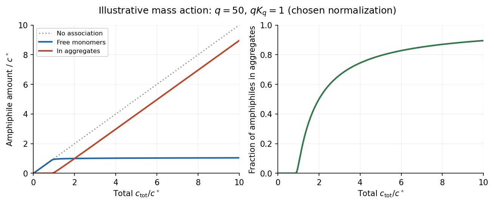

<h1 id="2/c/solution">Solution</h1>

↑ **Parent:** [C](../c.md)

The [critical micelle concentration](../../../../../critical-micelle-concentration.md) is the approximate [surfactant](../../../../../surfactant.md) [concentration](../../../../../concentration.md) above which added [amphiphile](../../../../../amphiphile.md) predominantly joins [micelles](../../../../../micelle.md). Isolated [amphiphiles](../../../../../amphiphile.md) expose their tails to the surrounding [solvent](../../../../../solvent.md); aggregation can reduce the unfavorable exposure, while losing translational [entropy](../../../../../entropy-split.md) and incurring head-group and chain-packing costs. The favored aggregate minimizes the total [free energy](../../../../../thermodynamic-free-energy.md).

A [mass-action model of micellization](../../../../../mass-action-model-of-micellization.md) makes the concentration dependence explicit. For aggregation of $q$ monomers into one [micelle](../../../../../micelle.md), equilibrium requires

$$
q\mu_1=\mu_q,\qquad
\mu_1=\mu_1^\circ+k_BT\ln a_1,\qquad
\mu_q=\mu_q^\circ+k_BT\ln a_q.
$$

The dimensionless [thermodynamic activities](../../../../../thermodynamic-activity.md) therefore obey

$$
\boxed{a_q=K_q a_1^q,\qquad
K_q=\exp\!\left[-\frac{\mu_q^\circ-q\mu_1^\circ}{k_BT}\right].}
$$

For a large [aggregation number](../../../../../aggregation-number.md) $q$, a modest increase in monomer activity produces a steep increase in [micelle](../../../../../micelle.md) abundance. In an ideal dilute approximation with the same reference [concentration](../../../../../concentration.md) $c^\circ$ for both species, the amphiphile balance is

$$
\frac{c_{\rm tot}}{c^\circ}=a_1+qK_qa_1^q.
$$

Well below the crossover almost every [amphiphile](../../../../../amphiphile.md) is isolated. Above it, most additional [amphiphile](../../../../../amphiphile.md) enters [micelles](../../../../../micelle.md), so the free-monomer [concentration](../../../../../concentration.md) rises only slowly. It is not exactly constant for a finite $q$, and a small aggregate population can exist below the nominal [critical micelle concentration](../../../../../critical-micelle-concentration.md). **The experimentally sharp change is an association crossover, not an assertion that aggregation is absolutely absent below one concentration.**

**[Figure 2](#2/c/image-a-finite-aggregation-mass-action-model-of-micellization-produces-a-concentration-crossover). A finite-aggregation mass-action model of micellization produces a concentration crossover**.

In the original illustrative model, $q=50$ and $qK_q=1$ after choosing the arbitrary reference [concentration](../../../../../concentration.md). The normalization is a teaching choice, not a measured [critical micelle concentration](../../../../../critical-micelle-concentration.md). The monomer curve flattens relative to total [concentration](../../../../../concentration.md), while the aggregated fraction rises rapidly.

An experimental [critical micelle concentration](../../../../../critical-micelle-concentration.md) can be estimated from a change of slope in [surface tension](../../../../../surface-tension-split.md) against the logarithm of total [surfactant](../../../../../surfactant.md) [concentration](../../../../../concentration.md), as interfacial coverage approaches saturation and bulk aggregation becomes important. Changes in [electrical conductivity](../../../../../electrical-conductivity.md) for ionic [surfactants](../../../../../surfactant.md), or in [light scattering](../../../../../scattering-of-light.md), supply other probes. Different observables can give slightly different operational values because the crossover has finite width. Molecular structure, [temperature](../../../../../temperature-split.md) and ionic conditions affect the balance of [chemical potentials](../../../../../chemical-potential-split.md); screening charged head groups can reduce repulsion and favor aggregation, but no universal sign of the temperature dependence should be assumed.

## ↑ Ancestors (14)

1. [C](../c.md)
2. [2](../../2.md)
3. [Paper 1](../../../paper-1-split.md)
4. [2016](../../../split.md)
5. [Past exam of the soft condensed matter course of the University of Cambridge](../../../../split.md)
6. [Soft Condensed Matter course of the University of Cambridge](../../../../../soft-condensed-matter-course-of-the-university-of-cambridge.md)
7. [Physics course of the year 3 of the natural sciences course of the University of Cambridge](../../../../../physics-course-of-the-year-3-of-the-natural-sciences-course-of-the-university-of-cambridge.md)
8. [Year 3 of the natural sciences course of the University of Cambridge](../../../../../year-3-of-the-natural-sciences-course-of-the-university-of-cambridge.md)
9. [Year of the natural sciences course of the University of Cambridge](../../../../../year-of-the-natural-sciences-course-of-the-university-of-cambridge.md)
10. [Natural sciences course of the University of Cambridge](../../../../../natural-sciences-course-of-the-university-of-cambridge.md)
11. [Course of the University of Cambridge](../../../../../course-of-the-university-of-cambridge.md)
12. [University of Cambridge](../../../../../university-of-cambridge-split.md)
13. [List of universities](../../../../../list-of-universities.md)
14. [Codex Wiki](../../../../../split.md)
