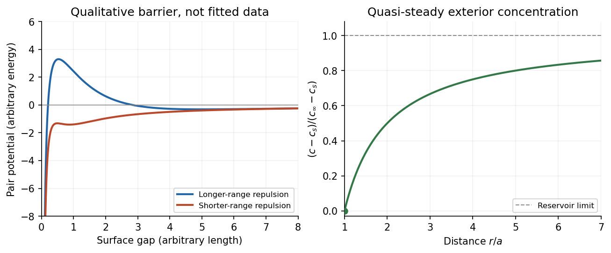

<h1 id="3/solution">Solution</h1>

↑ **Parent:** [3](../3.md)

A [colloid](../../../../colloid.md) has dispersed constituents whose relevant dimensions are mesoscopic: roughly $1\,\mathrm{nm}$ to $1\,\mathrm{\mu m}$ in at least one direction. Interfaces and [Brownian motion](../../../../brownian-motion-split.md) are consequently important. The size range is a useful convention, not a sharp boundary separating all physical behaviour. A [sol](../../../../sol.md) of fine [silicon dioxide](../../../../silicon-dioxide.md) particles in [water](../../../../water.md) illustrates solid in [liquid](../../../../liquid.md); an oil-in-water [emulsion](../../../../emulsion.md) illustrates [liquid](../../../../liquid.md) in another immiscible [liquid](../../../../liquid.md); and a [foam](../../../../foam.md) illustrates [gas](../../../../gas.md) dispersed in a [liquid](../../../../liquid.md), with thin intervening films supplying the small structural dimension. A [colloid](../../../../colloid.md) need not be a [thermodynamic equilibrium](../../../../thermodynamic-equilibrium.md) state.[Definition and classification of colloids: approximate size range, colloidal dispersions, sols, emulsions and foams](../../../../definition-and-classification-of-colloids-by-international-union-of-pure-and-applied-chemistry.md)

Unprotected particles attract through [Van der Waals forces](../../../../van-der-waals-force.md). For two equal [spheres](../../../../sphere.md) of radius $a$ with a small surface gap $H$, the [near-contact van der Waals attraction of spheres](../../../../near-contact-van-der-waals-attraction-of-spheres.md) is

$$
U_{\rm vdW}(H)\simeq-\frac{A_Ha}{12H},\qquad H\ll a,
$$

where the [Hamaker constant](../../../../hamaker-constant.md) $A_H$ is positive for the attractive case. The large number of interacting constituent [molecules](../../../../molecule-split.md) can give a well much deeper than $k_BT$, even though individual molecular attractions are weak. [Brownian motion](../../../../brownian-motion-split.md) brings particles together, and a sufficiently deep attractive well makes separation unlikely. This gives [particle aggregation](../../../../particle-aggregation.md); solid particles can remain distinct within a cluster rather than merging into one continuous solid. [Emulsion](../../../../emulsion.md) droplets can additionally coalesce if the separating film ruptures.

[Charge stabilization of colloids](../../../../charge-stabilization-of-colloids.md) supplies a repulsive barrier. Like-charged surfaces carry compensating [counterions](../../../../counterion.md) and [electric double layers](../../../../electric-double-layer.md); bringing the layers together costs [free energy](../../../../thermodynamic-free-energy.md). [DLVO theory](../../../../dlvo-theory.md) combines this repulsion with [Van der Waals forces](../../../../van-der-waals-force.md). A barrier large compared with $k_BT$ can make aggregation slow, even when sticking would lower the final [free energy](../../../../thermodynamic-free-energy.md). Adding salt generally shortens the [Debye–Hückel screening length](../../../../debye-huckel-screening-length.md) and can lower the barrier; surface charge regulation and specific ion interactions also matter. A negatively charged particle and a positively charged particle need not repel.

[Steric stabilization](../../../../steric-stabilization.md) instead coats each particle with adsorbed or grafted [polymer](../../../../polymer-split.md) chains. In a [good solvent](../../../../good-solvent.md), overlap and compression of these layers raise the [osmotic pressure](../../../../osmotic-pressure.md) and reduce chain [entropy](../../../../entropy-split.md), opposing close contact. [Electrosteric stabilization](../../../../electrosteric-stabilization.md) combines the two mechanisms. Dense, securely bound layers matter: incomplete adsorption can allow [polymer bridging](../../../../polymer-bridging.md), while nonadsorbing dissolved [polymers](../../../../polymer-split.md) can create an attractive [depletion force](../../../../depletion-force.md). Poor solvent quality can collapse a protective layer. Reducing the density mismatch slows sedimentation but does not remove the interparticle attraction, so uniform suspension and resistance to aggregation are different requirements.

**[Figure 3](#3/image-an-illustrative-interaction-barrier-and-the-radial-concentration-field-around-a-growing-sphere). An illustrative interaction barrier and the radial concentration field around a growing sphere**.

The left panel is an original qualitative potential with arbitrary coefficients: it illustrates a barrier and its reduction by shorter-ranged repulsion, without fitting an experimental [DLVO theory](../../../../dlvo-theory.md) curve or extrapolating the continuum attraction to molecular contact. The right panel plots the derived quasi-steady [concentration](../../../../concentration.md) profile in dimensionless variables.

In **diffusion-controlled growth**, attachment is rapid and delivery through the surrounding medium is the bottleneck. The growing surface depletes the neighboring [solute](../../../../solute.md), so a substantial [concentration gradient](../../../../concentration-gradient.md) develops. In **reaction-controlled growth**, arrival is fast compared with incorporation; many arrivals fail to attach, and the surface [concentration](../../../../concentration.md) stays near the reservoir value. The analogous distinction for [particle aggregation](../../../../particle-aggregation.md) is between near-unit sticking probability in [diffusion-limited cluster aggregation](../../../../diffusion-limited-cluster-aggregation.md) and barrier-suppressed sticking in [reaction-limited cluster aggregation](../../../../reaction-limited-cluster-aggregation.md). Here the subsequent calculation concerns accretion onto one growing particle, rather than a collision kernel for two mobile clusters.

The printed time-dependent equation is the **diffusion equation**, not the usual [Poisson equation](../../../../poisson-s-equation.md). For constant [diffusion coefficient](../../../../diffusion-coefficient.md) $D$, no bulk sources and negligible [advection](../../../../advection.md), [Fick's laws](../../../../fick-s-laws.md) give the number [flux](../../../../flux.md) $\mathbf j=-D\nabla c$. Local [conservation of mass](../../../../mass-conservation.md), expressed here as conservation of the accreting constituent, then gives

$$
\frac{\partial c}{\partial t}+\nabla\cdot\mathbf j=0
\quad\Longrightarrow\quad
\frac{\partial c}{\partial t}=D\nabla^2c.
$$

An arbitrary time-independent exterior profile does not solve the full moving-boundary problem exactly. The required elementary result uses a quasi-steady approximation: [diffusion](../../../../diffusion.md) establishes the exterior profile much faster than the particle radius changes. At each instantaneous radius $a$, set $\partial c/\partial t\simeq0$. Thus the exterior field solves the homogeneous [Laplace equation](../../../../laplace-equation.md),

$$
\nabla^2c=\frac1{r^2}\frac{d}{dr}\left(r^2\frac{dc}{dr}\right)=0,
\qquad c(a)=c_s,\quad c(\infty)=c_\infty.
$$

Two integrations give $c=A+B/r$. The two [boundary conditions](../../../../boundary-condition.md) fix

$$
\boxed{c(r)=c_\infty-(c_\infty-c_s)\frac ar,\qquad r\geq a.}
$$

For growth, $c_\infty>c_s$, so the profile increases outwards. Its radial [flux](../../../../flux.md) is negative, and the positive inward arrival rate is

$$
\dot n=4\pi a^2D\left.\frac{dc}{dr}\right|_{a^+}
=4\pi aD(c_\infty-c_s).
$$

A material density is needed to turn an arrival rate into a radial [velocity](../../../../velocity.md). Introduce the constant constituent [number density](../../../../number-density.md) $c_p$ inside the particle, using the same units as $c_s,c_\infty$. The sharp-interface balance, neglecting exterior [advection](../../../../advection.md), is

$$
4\pi a^2(c_p-c_s)\dot a=4\pi aD(c_\infty-c_s).
$$

The difference $c_p-c_s$ accounts for material already present in the volume swept by the growing interface. In the usual dilute-feed approximation $c_s\ll c_p$, it can be replaced by $c_p$. With constant reservoir and surface [concentrations](../../../../concentration.md), integration from radius $a_0$ gives the [constant-reservoir diffusion-controlled particle growth](../../../../constant-reservoir-diffusion-controlled-particle-growth.md) law

$$
\boxed{a^2(t)=a_0^2+\frac{2D(c_\infty-c_s)}{c_p-c_s}\,t.}
$$

Consequently **$a\propto t^{1/2}$ when the growth contribution dominates $a_0^2$**. For a finite seed at the literal limit $t\to0$, the increment $a-a_0$ is instead initially proportional to $t$. Here “early time” means before appreciable reservoir depletion or interactions with other particles, while already beyond the rapid initial establishment of the [diffusion](../../../../diffusion.md) field. Indeed, the ratio of diffusion-adjustment time $a^2/D$ to radial-growth time $a/\dot a$ is $(c_\infty-c_s)/(c_p-c_s)$; small supersaturation relative to the particle density makes the quasi-steady approximation self-consistent. No initial concentration field was specified, so an exact transient solution is not uniquely determined.

For comparison, let a finite surface-attachment coefficient be $k_s$ and the equilibrium surface [concentration](../../../../concentration.md) be $c_{\rm eq}$. In the dilute-feed approximation, the [Robin boundary condition](../../../../robin-boundary-condition.md) $Dc'(a)=k_s[c(a)-c_{\rm eq}]$ gives

$$
\dot a\simeq\frac{D(c_\infty-c_{\rm eq})}{c_p(a+D/k_s)}.
$$

For $k_sa/D\gg1$ this recovers transport control; for $k_sa/D\ll1$, the [surface-reaction-controlled particle growth](../../../../surface-reaction-controlled-particle-growth.md) has approximately constant $\dot a=k_s(c_\infty-c_{\rm eq})/c_p$. Thus **reaction control gives $a-a_0\propto t$**, in contrast to the diffusion-controlled square-radius law. No numerical $c_p$ or $k_s$ is supplied or needed for these scaling results.

## ↑ Ancestors (13)

1. [3](../3.md)
2. [Paper 1](../../paper-1-split.md)
3. [2016](../../split.md)
4. [Past exam of the soft condensed matter course of the University of Cambridge](../../../split.md)
5. [Soft Condensed Matter course of the University of Cambridge](../../../../soft-condensed-matter-course-of-the-university-of-cambridge.md)
6. [Physics course of the year 3 of the natural sciences course of the University of Cambridge](../../../../physics-course-of-the-year-3-of-the-natural-sciences-course-of-the-university-of-cambridge.md)
7. [Year 3 of the natural sciences course of the University of Cambridge](../../../../year-3-of-the-natural-sciences-course-of-the-university-of-cambridge.md)
8. [Year of the natural sciences course of the University of Cambridge](../../../../year-of-the-natural-sciences-course-of-the-university-of-cambridge.md)
9. [Natural sciences course of the University of Cambridge](../../../../natural-sciences-course-of-the-university-of-cambridge.md)
10. [Course of the University of Cambridge](../../../../course-of-the-university-of-cambridge.md)
11. [University of Cambridge](../../../../university-of-cambridge-split.md)
12. [List of universities](../../../../list-of-universities.md)
13. [Codex Wiki](../../../../split.md)
