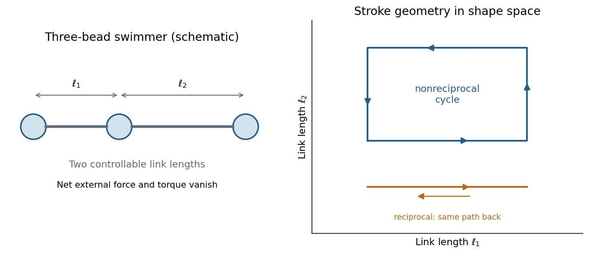

<h1 id="2/a/solution">Solution</h1>

↑ **Parent:** [A](../a.md)

The [Reynolds number](../../../../reynolds-number.md) compares inertial and viscous terms in the momentum equation:

$$
\boxed{\mathrm{Re}=\frac{\rho UL}{\eta}.}
$$

Here $\rho$ is fluid [mass density](../../../../density.md), $U$ a characteristic speed, $L$ a swimmer or flow length, and $\eta$ the [dynamic viscosity](../../../../dynamic-viscosity-split.md). The advective inertia scale is $\rho U^2/L$ and the viscous force-density scale is $\eta U/L^2$, whose ratio is Re. For an illustrative micron-scale swimmer with $L=2\,\mathrm{\mu m}$ and $U=20\,\mathrm{\mu m\,s^{-1}}$ in water, taking $\rho=10^3\,\mathrm{kg\,m^{-3}}$ and $\eta=10^{-3}\,\mathrm{Pa\,s}$ gives $\mathrm{Re}\sim4\times10^{-5}$.

At such low Re, [Stokes flow](../../../../stokes-flow-split.md) is the useful approximation. For an incompressible [Newtonian fluid](../../../../newtonian-fluid.md) it obeys $-\nabla p+\eta\nabla^2\mathbf u=0$ and $\nabla\cdot\mathbf u=0$, with negligible inertia. Swimming is not a sequence of propulsive impulses followed by coasting: drag balances propulsive [forces](../../../../force-split.md) almost instantaneously. For example, the drag on a slowly translating sphere is $6\pi\eta aU$. A freely swimming organism has approximately zero total external [force](../../../../force-split.md) and [torque](../../../../torque.md); its body motion balances the [forces](../../../../force-split.md) and [torques](../../../../torque.md) generated by its appendages.

The linear equations have [kinematic reversibility of Stokes flow](../../../../kinematic-reversibility-of-stokes-flow.md): reversing the boundary velocities reverses the fluid motion. A reciprocal stroke that retraces exactly the same sequence of shapes therefore retraces its displacement. This is the [scallop theorem](../../../../scallop-theorem.md). A single hinge opening and closing along the same shape path cannot propel an ideal swimmer through an otherwise quiescent Newtonian Stokes fluid, regardless of merely changing how quickly it opens relative to closing.

**[Figure 1](#2/a/image-a-three-bead-swimmer-can-use-a-nonreciprocal-loop-in-its-two-length-shape-space-unlike-a-retraced-one-parameter-stroke). A three-bead swimmer can use a nonreciprocal loop in its two-length shape space, unlike a retraced one-parameter stroke**.

A useful design has at least two shape coordinates driven out of phase, so the stroke follows a loop rather than a retraced line in shape space. In the three-bead example the two link lengths change in a cycle; hydrodynamic interactions differ at different points of the cycle, allowing net translation. The drawing illustrates this mechanism without assigning a particular swimming speed.

Biological routes include continuous rotation of a chiral helical flagellum, nonreciprocal ciliary strokes, and traveling bending waves along a flagellum. An elongated filament generally has greater drag for motion normal to itself than along itself; this drag anisotropy helps convert those motions into propulsion. The body may counterrotate to balance appendage [torque](../../../../torque.md). **Micro-organisms must exploit nonreciprocal shape changes, rotation or another mechanism consistent with viscous [force](../../../../force-split.md) balance; inertia-based swimming intuition fails.** Viscoelastic surroundings or appreciable inertia can invalidate the particular Newtonian assumptions behind the simple scallop result.

## ↑ Ancestors (13)

1. [A](../a.md)
2. [2](../../2.md)
3. [2017](../../../2017-split.md)
4. [Past exam of the soft condensed matter course of the University of Cambridge](../../../split.md)
5. [Soft Condensed Matter course of the University of Cambridge](../../../../soft-condensed-matter-course-of-the-university-of-cambridge.md)
6. [Physics course of the year 3 of the natural sciences course of the University of Cambridge](../../../../physics-course-of-the-year-3-of-the-natural-sciences-course-of-the-university-of-cambridge.md)
7. [Year 3 of the natural sciences course of the University of Cambridge](../../../../year-3-of-the-natural-sciences-course-of-the-university-of-cambridge.md)
8. [Year of the natural sciences course of the University of Cambridge](../../../../year-of-the-natural-sciences-course-of-the-university-of-cambridge.md)
9. [Natural sciences course of the University of Cambridge](../../../../natural-sciences-course-of-the-university-of-cambridge.md)
10. [Course of the University of Cambridge](../../../../course-of-the-university-of-cambridge.md)
11. [University of Cambridge](../../../../university-of-cambridge-split.md)
12. [List of universities](../../../../list-of-universities.md)
13. [Codex Wiki](../../../../split.md)
