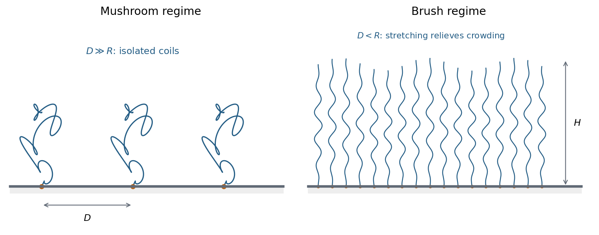

<h1 id="2/b/solution">Solution</h1>

↑ **Parent:** [B](../b.md)

A [grafted polymer chain](../../../../grafted-polymer-chain.md) is tethered to a surface at one end. Let its isolated coil size be $R\sim bN^\nu$, where $N$ is the number of statistical units and $b$ their [statistical segment length](../../../../statistical-segment-length.md). For a [good solvent](../../../../good-solvent.md), the [Flory approximation](../../../../flory-approximation.md) gives $\nu\simeq3/5$; an [ideal chain](../../../../ideal-chain.md) has $\nu=1/2$. Let $\sigma_g$ be the number of tethers per unit [area](../../../../surface-area.md), distinct from the [membrane tension](../../../../membrane-tension.md) in Question 1. Their typical lateral separation is $D\sim\sigma_g^{-1/2}$.

At low coverage, $D\gg R$, the chains hardly overlap. Each forms a [polymer mushroom](../../../../polymer-mushroom.md), retaining roughly the isolated-coil conformation apart from the constraint of the solid surface. Raising coverage until $D\sim R$ makes neighboring coils overlap. The crossover criterion is

$$
\boxed{\sigma_gR^2\sim1,\qquad
\sigma_g^*\sim R^{-2}\sim b^{-2}N^{-2\nu}.}
$$

For $D<R$ in a [good solvent](../../../../good-solvent.md), maintaining isolated coil shapes would crowd segments into the same lateral regions, increasing excluded-volume and osmotic [free energy](../../../../thermodynamic-free-energy.md). Chains stretch predominantly away from the surface to relieve that crowding, at the cost of their conformational [entropy](../../../../entropy-split.md). The resulting dense tethered layer is a [polymer brush](../../../../polymer-brush.md).

**[Figure 2](#2/b/image-sparse-grafted-coils-form-mushrooms-overlap-at-higher-grafting-density-stretches-chains-into-a-brush). Sparse grafted coils form mushrooms; overlap at higher grafting density stretches chains into a brush**.

A simple scaling estimate makes the balance explicit. For brush height $H$, the monomer concentration is of order $N\sigma_g/H$. The [free energy](../../../../thermodynamic-free-energy.md) per chain in units of $k_BT$ is

$$
\frac{F_{\rm chain}}{k_BT}\sim
\frac{H^2}{Nb^2}+\frac{vN^2\sigma_g}{H},
$$

where $v>0$ is the effective segment [excluded volume](../../../../excluded-volume.md). The first term is Gaussian stretching; the second is the cost of segment crowding in a [good solvent](../../../../good-solvent.md). Minimizing with respect to height gives

$$
\boxed{H\sim Nb\left(\frac{v\sigma_g}{b}\right)^{1/3}.}
$$

When $v\sim b^3$, this is $H\sim Nb(\sigma_gb^2)^{1/3}$. Height increases with chain length and grafting density, while the lateral spacing is fixed by the attachment points. The estimate assumes stretching strong compared with an isolated coil but still much smaller than contour length $Nb$; it does not describe fully extended chains. Poor-solvent attraction can instead collapse the layer, so solvent quality must be specified before using the good-solvent formula.

The mushroom-to-brush change is a crowding crossover for finite chains, rather than automatically a sharp thermodynamic [phase transition](../../../../phase-transition.md). A swollen brush can provide [steric stabilization](../../../../steric-stabilization.md): bringing two coated surfaces together further compresses and crowds their chains, producing a repulsive free-energy cost. **The controlling comparison is tether separation versus isolated coil size, and the brush height follows from competition between chain stretching and segment interactions.**

## ↑ Ancestors (13)

1. [B](../b.md)
2. [2](../../2.md)
3. [2017](../../../2017-split.md)
4. [Past exam of the soft condensed matter course of the University of Cambridge](../../../split.md)
5. [Soft Condensed Matter course of the University of Cambridge](../../../../soft-condensed-matter-course-of-the-university-of-cambridge.md)
6. [Physics course of the year 3 of the natural sciences course of the University of Cambridge](../../../../physics-course-of-the-year-3-of-the-natural-sciences-course-of-the-university-of-cambridge.md)
7. [Year 3 of the natural sciences course of the University of Cambridge](../../../../year-3-of-the-natural-sciences-course-of-the-university-of-cambridge.md)
8. [Year of the natural sciences course of the University of Cambridge](../../../../year-of-the-natural-sciences-course-of-the-university-of-cambridge.md)
9. [Natural sciences course of the University of Cambridge](../../../../natural-sciences-course-of-the-university-of-cambridge.md)
10. [Course of the University of Cambridge](../../../../course-of-the-university-of-cambridge.md)
11. [University of Cambridge](../../../../university-of-cambridge-split.md)
12. [List of universities](../../../../list-of-universities.md)
13. [Codex Wiki](../../../../split.md)
