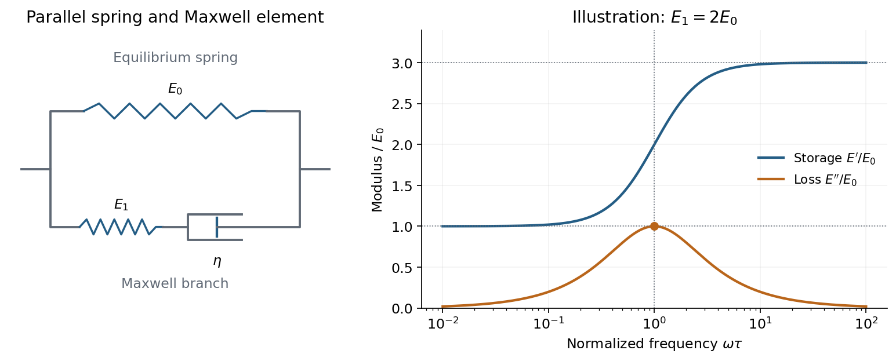

<h1 id="2/c/solution">Solution</h1>

↑ **Parent:** [C](../c.md)

The requested model is the [standard linear solid model](../../../../standard-linear-solid-model.md): a [spring](../../../../spring.md) of modulus $E_0>0$ in parallel with a Maxwell branch consisting of a [spring](../../../../spring.md) $E_1>0$ in series with a [dashpot](../../../../dashpot.md) of [viscosity](../../../../dynamic-viscosity-split.md) $\eta>0$. Both parallel branches have the same [strain](../../../../strain.md); their stresses add. In the Maxwell branch the [spring](../../../../spring.md) and [dashpot](../../../../dashpot.md) have the same [stress](../../../../stress.md) and their strains add. The equilibrium [spring](../../../../spring.md) prevents indefinite flow at long times.

For harmonic [strain](../../../../strain.md) $\epsilon(t)=\operatorname{Re}[\epsilon_0e^{i\omega t}]$, define the [dynamic modulus](../../../../dynamic-modulus.md) by $\widetilde\sigma=E^*(\omega)\widetilde\epsilon$. The Maxwell branch has compliance $1/E_1+1/(i\omega\eta)$. Defining $\tau=\eta/E_1$ therefore gives

$$
\boxed{E^*(\omega)=E_0+\frac{i\omega\eta E_1}{E_1+i\omega\eta}
=E_0+E_1\frac{i\omega\tau}{1+i\omega\tau}.}
$$

The same mechanical model can represent a [shear modulus](../../../../shear-modulus.md) if the appropriate shear stresses and strains are used consistently.

**[Figure 3](#2/c/image-a-spring-parallel-to-a-maxwell-element-gives-finite-low-and-high-frequency-storage-moduli-and-one-loss-modulus-peak). A spring parallel to a Maxwell element gives finite low- and high-frequency storage moduli and one loss-modulus peak**.

Writing $E^*=E'+iE''$, its [storage modulus](../../../../storage-modulus.md) and [loss modulus](../../../../loss-modulus.md) are

$$
\boxed{E'=E_0+E_1\frac{(\omega\tau)^2}{1+(\omega\tau)^2},
\qquad E''=E_1\frac{\omega\tau}{1+(\omega\tau)^2}.}
$$

With this time convention the physical [stress](../../../../stress.md) is $\epsilon_0[E'\cos\omega t-E''\sin\omega t]$ and leads the [strain](../../../../strain.md) by the loss angle. The dissipated energy per unit volume per cycle is $\pi E''\epsilon_0^2\ge0$. Thus $E'$ describes elastic storage and $E''$ describes dissipation.

At low [frequency](../../../../frequency.md), $\omega\tau\ll1$, the [dashpot](../../../../dashpot.md) flows during a cycle and relaxes the Maxwell [spring](../../../../spring.md), leaving $E'\to E_0$, $E''\sim E_1\omega\tau$. At high [frequency](../../../../frequency.md), $\omega\tau\gg1$, the [dashpot](../../../../dashpot.md) hardly deforms within a cycle, so both springs carry elastic load: $E'\to E_0+E_1$, while $E''\sim E_1/(\omega\tau)$. The [loss modulus](../../../../loss-modulus.md) is maximal at $\omega\tau=1$, with peak value $E_1/2$.

The equivalent constitutive equation is

$$
\sigma+\tau\dot\sigma=E_0\epsilon+\tau(E_0+E_1)\dot\epsilon.
$$

After a sudden [strain](../../../../strain.md) $\epsilon_s$ is imposed and held, the [stress](../../../../stress.md) relaxes as $\sigma(t)=\epsilon_s[E_0+E_1e^{-t/\tau}]$. It falls from the instantaneous modulus $E_0+E_1$ to the nonzero relaxed modulus $E_0$. This single-time relaxation is the simplest improvement over a purely elastic solid or a Maxwell fluid with zero long-time modulus.

The [loss tangent](../../../../loss-tangent.md) is $\tan\delta=E''/E'$. Its maximum need not coincide with the loss-modulus maximum: the [peak frequencies in a standard linear solid](../../../../peak-frequencies-in-a-standard-linear-solid.md) give $\omega\tau=\sqrt{E_0/(E_0+E_1)}$ for the [loss tangent](../../../../loss-tangent.md). **The model captures one viscoelastic crossover between two finite elastic plateaux, with dissipation concentrated near the relaxation [frequency](../../../../frequency.md).**

## ↑ Ancestors (13)

1. [C](../c.md)
2. [2](../../2.md)
3. [2017](../../../2017-split.md)
4. [Past exam of the soft condensed matter course of the University of Cambridge](../../../split.md)
5. [Soft Condensed Matter course of the University of Cambridge](../../../../soft-condensed-matter-course-of-the-university-of-cambridge.md)
6. [Physics course of the year 3 of the natural sciences course of the University of Cambridge](../../../../physics-course-of-the-year-3-of-the-natural-sciences-course-of-the-university-of-cambridge.md)
7. [Year 3 of the natural sciences course of the University of Cambridge](../../../../year-3-of-the-natural-sciences-course-of-the-university-of-cambridge.md)
8. [Year of the natural sciences course of the University of Cambridge](../../../../year-of-the-natural-sciences-course-of-the-university-of-cambridge.md)
9. [Natural sciences course of the University of Cambridge](../../../../natural-sciences-course-of-the-university-of-cambridge.md)
10. [Course of the University of Cambridge](../../../../course-of-the-university-of-cambridge.md)
11. [University of Cambridge](../../../../university-of-cambridge-split.md)
12. [List of universities](../../../../list-of-universities.md)
13. [Codex Wiki](../../../../split.md)
