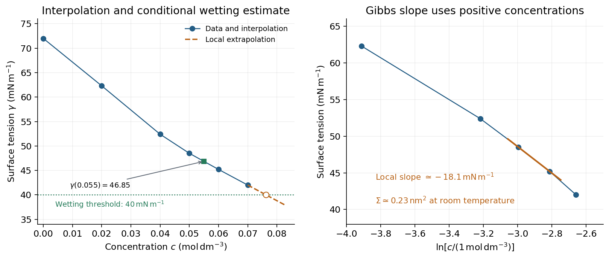

<h1 id="3/a/solution">Solution</h1>

↑ **Parent:** [A](../a.md)

**Molecular [area](../../../../surface-area.md) from the [adsorption](../../../../adsorption.md) slope.** The supplied [Gibbs adsorption equation](../../../../gibbs-adsorption-equation.md) identifies the [surface excess](../../../../surface-excess.md) [number density](../../../../number-density.md) $\Gamma=1/\Sigma$ through

$$
\Gamma=-\frac1{k_BT}\frac{d\gamma}{d\ln c},\qquad
\Sigma=-\frac{k_BT}{d\gamma/d\ln c}.
$$

The logarithm is understood relative to a fixed concentration unit or reference concentration; only concentration ratios enter its differences. The pure-water point $c=0$ supplies a baseline [surface tension](../../../../surface-tension-split.md), but cannot be included in $\ln c$.

An estimate near the later working concentration $0.055\,\mathrm{mol\,dm^{-3}}$ uses its two bracketing points:

$$
\frac{d\gamma}{d\ln c}\simeq
\frac{(45.2-48.5)\times10^{-3}}{\ln(0.06/0.05)}
=-1.810\times10^{-2}\,\mathrm{N\,m^{-1}}.
$$

Taking room [temperature](../../../../temperature-split.md) as $298\,\mathrm K$,

$$
\boxed{\Sigma\simeq\frac{4.11\times10^{-21}\,\mathrm J}
{1.810\times10^{-2}\,\mathrm{J\,m^{-2}}}
=2.27\times10^{-19}\,\mathrm{m^2}\simeq0.23\,\mathrm{nm^2}.}
$$

This corresponds to about $4.4$ adsorbed molecules per $\mathrm{nm^2}$. The data are not perfectly linear in $\ln c$, so the inferred molecular [area](../../../../surface-area.md) depends somewhat on the concentration range: a fit to all five positive-concentration points gives about $0.26\,\mathrm{nm^2}$, while the higher-concentration region gives roughly $0.22\,\mathrm{nm^2}$. An effective [area](../../../../surface-area.md) of order **$0.2$–$0.3\,\mathrm{nm^2}$** is justified; a concentration-independent exact value is not.

**[Figure 4](#3/a/image-surface-tension-interpolation-and-extrapolated-wetting-threshold-alongside-the-local-gibbs-adsorption-slope). Surface-tension interpolation and extrapolated wetting threshold, alongside the local Gibbs adsorption slope**.

**[Contact angle](../../../../contact-angle.md).** Linear interpolation between $0.05$ and $0.06\,\mathrm{mol\,dm^{-3}}$ gives $\gamma_{LV}(0.055)=(48.5+45.2)/2=46.85\,\mathrm{mN\,m^{-1}}$. For an ideal equilibrium [contact angle](../../../../contact-angle.md) measured through the liquid, [Young's equation](../../../../young-s-equation.md) is

$$
\gamma_{SV}-\gamma_{SL}=\gamma_{LV}\cos\theta.
$$

The supplied solid-vapour and solid-liquid values have difference $40\,\mathrm{mN\,m^{-1}}$. Hence

$$
\boxed{\theta=\cos^{-1}\left(\frac{300-260}{46.85}\right)
=31.4^\circ.}
$$

This assumes clean homogeneous equilibrium interfaces, negligible contact-angle hysteresis, and the stated solid interfacial energies applicable to the solution.

**Complete wetting.** The [spreading coefficient](../../../../spreading-coefficient.md) is $S=\gamma_{SV}-\gamma_{SL}-\gamma_{LV}=40\,\mathrm{mN\,m^{-1}}-\gamma_{LV}$. The onset of [complete wetting](../../../../complete-wetting.md) occurs at $S=0$, or $\gamma_{LV}=40\,\mathrm{mN\,m^{-1}}$, if the solid interfacial energies remain unchanged. The last measured value is still $42.0\,\mathrm{mN\,m^{-1}}$, so this requires extrapolation beyond the table.

Continuing the last local slope in concentration, $(42.0-45.2)/(0.07-0.06)=-320\,\mathrm{mN\,m^{-1}}$ per $\mathrm{mol\,dm^{-3}}$, gives

$$
\boxed{c_{\rm wet}\simeq0.07+\frac{42.0-40.0}{320}
=0.0763\,\mathrm{mol\,dm^{-3}}.}
$$

Continuing a constant local Gibbs slope in $\ln c$ instead gives approximately $0.078\,\mathrm{mol\,dm^{-3}}$. Thus the data suggest a threshold near **$0.08\,\mathrm M$ under continued-trend assumptions**, rather than fixing one exactly. A surface-tension plateau caused by micellization, or a change in $\gamma_{SL}$, could prevent or shift this threshold; no such extra data are given.

**Capillary rise.** For a circular capillary of radius $a$, vertical surface-tension [force](../../../../force-split.md) $2\pi a\gamma_{LV}\cos\theta$ balances the weight $\rho g\pi a^2h$. Thus [capillary action](../../../../capillary-action.md) gives

$$
h=\frac{2\gamma_{LV}\cos\theta}{\rho ga}
=\frac{2(\gamma_{SV}-\gamma_{SL})}{\rho ga}.
$$

Using $a=0.5\,\mathrm{mm}=5.0\times10^{-4}\,\mathrm m$, $\rho=10^3\,\mathrm{kg\,m^{-3}}$ and $g=9.81\,\mathrm{m\,s^{-2}}$,

$$
\boxed{h=\frac{2(0.040)}{(10^3)(9.81)(5.0\times10^{-4})}
=1.63\times10^{-2}\,\mathrm m\simeq16\,\mathrm{mm}.}
$$

This is the height above the reservoir level in the ideal static capillary approximation; meniscus-volume corrections and contact-angle hysteresis are neglected. The positive $\cos\theta$ gives a rise, rather than a depression.

## ↑ Ancestors (13)

1. [A](../a.md)
2. [3](../../3.md)
3. [2017](../../../2017-split.md)
4. [Past exam of the soft condensed matter course of the University of Cambridge](../../../split.md)
5. [Soft Condensed Matter course of the University of Cambridge](../../../../soft-condensed-matter-course-of-the-university-of-cambridge.md)
6. [Physics course of the year 3 of the natural sciences course of the University of Cambridge](../../../../physics-course-of-the-year-3-of-the-natural-sciences-course-of-the-university-of-cambridge.md)
7. [Year 3 of the natural sciences course of the University of Cambridge](../../../../year-3-of-the-natural-sciences-course-of-the-university-of-cambridge.md)
8. [Year of the natural sciences course of the University of Cambridge](../../../../year-of-the-natural-sciences-course-of-the-university-of-cambridge.md)
9. [Natural sciences course of the University of Cambridge](../../../../natural-sciences-course-of-the-university-of-cambridge.md)
10. [Course of the University of Cambridge](../../../../course-of-the-university-of-cambridge.md)
11. [University of Cambridge](../../../../university-of-cambridge-split.md)
12. [List of universities](../../../../list-of-universities.md)
13. [Codex Wiki](../../../../split.md)
