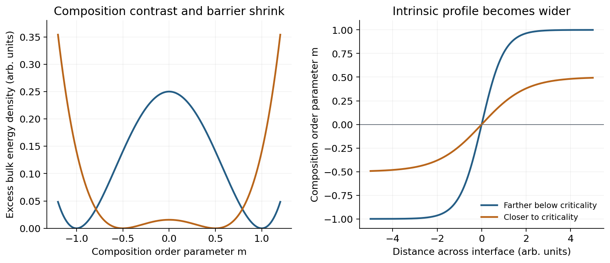

<h1 id="3/b/solution">Solution</h1>

↑ **Parent:** [B](../b.md)

**Diffuse-interface [free energy](../../../../thermodynamic-free-energy.md).** A sharp boundary assigns one mathematical surface to two uniform fluids. Molecular mixing instead changes composition over a finite distance. In [square-gradient theory of a liquid interface](../../../../square-gradient-theory-of-a-liquid-interface.md), let $\phi(\mathbf r)$ be a dimensionless local composition and write

$$
F[\phi]=\int\left[f_b(\phi,T)+\frac K2|\nabla\phi|^2\right]dV,
\qquad K>0.
$$

The bulk free-energy density $f_b$ favors the equilibrium phase compositions, while the [gradient](../../../../gradient.md) term penalizes changing composition too abruptly. Since $f_b$ has units $\mathrm{J\,m^{-3}}$ and $\phi$ is dimensionless, $K$ has units $\mathrm{J\,m^{-1}}$. The theory balances bulk mixing cost against this smoothness cost, rather than imposing a zero-width surface from the start.

At coexistence the two compositions $\phi_-,\phi_+$ have a [common-tangent construction for phase coexistence](../../../../common-tangent-construction-for-phase-coexistence.md). Subtract this tangent from $f_b$ to define an excess grand-potential density $\Delta\omega(\phi)$, zero at both bulk compositions. For a planar profile varying along $z$, minimizing the excess [free energy](../../../../thermodynamic-free-energy.md) gives

$$
K\phi''=\frac{d\Delta\omega}{d\phi}.
$$

Multiply by $\phi'$ and integrate using $\phi'\to0$ in the bulk:

$$
\boxed{\frac K2(\phi')^2=\Delta\omega(\phi).}
$$

It follows that the interfacial [surface tension](../../../../surface-tension-split.md) is

$$
\gamma=\int_{-\infty}^{\infty}
\left[\Delta\omega+\frac K2(\phi')^2\right]dz
=\int_{-\infty}^{\infty}K(\phi')^2dz
=\int_{\phi_-}^{\phi_+}\sqrt{2K\Delta\omega(\phi)}\,d\phi.
$$

This connects a continuous composition profile to a positive interfacial energy per [area](../../../../surface-area.md).

**Broadening near criticality.** Close to a symmetric mean-field [thermodynamic critical point](../../../../thermodynamic-critical-point.md), an [order parameter](../../../../order-parameter.md) $m$ measuring departure from the critical composition has bulk density

$$
f_b(m)=\frac r2m^2+\frac u4m^4,\qquad
r\propto T-T_c<0,\quad u>0.
$$

The coexistence values are $m=\pm m_0$, $m_0=\sqrt{|r|/u}$. The [scalar quartic domain wall](../../../../scalar-quartic-domain-wall.md) profile is

$$
\boxed{m(z)=m_0\tanh(z/w),\qquad
w=\sqrt{\frac{2K}{|r|}}.}
$$

The curvature at either bulk minimum is $f_b''(m_0)=2|r|$, so the bulk [correlation length](../../../../correlation-length.md) is $\xi=\sqrt{K/(2|r|)}$ and this convention gives $w=2\xi$. As $T\to T_c^-$, the bulk distinction between phases weakens, its free-energy curvature and barrier decrease, and composition can vary gradually over an increasing distance at little bulk cost. The [gradient](../../../../gradient.md) penalty then favors a wider profile:

$$
\boxed{w\propto(T_c-T)^{-1/2}\quad\text{in mean-field theory}.}
$$

The same model gives $\gamma=2\sqrt{2K}|r|^{3/2}/(3u)$, which vanishes at criticality. The exponents here are mean-field results, not universal exact values for every real mixture.

**[Figure 5](#3/b/image-approaching-criticality-reduces-the-composition-contrast-and-broadens-the-equilibrium-diffuse-interface). Approaching criticality reduces the composition contrast and broadens the equilibrium diffuse interface**.

The figure uses two illustrative parameter values in this quartic model, not experimental parameters supplied by the paper. In addition to the intrinsic gradient-theory width, thermal [capillary waves](../../../../capillary-wave.md) move and roughen an interface. Their increasing [amplitude](../../../../wave-amplitude.md) as [surface tension](../../../../surface-tension-split.md) decreases can broaden the spatially averaged measured profile further. Thus a measured broad interface can include both intrinsic composition smoothing and long-wavelength interface-position fluctuations.

## ↑ Ancestors (13)

1. [B](../b.md)
2. [3](../../3.md)
3. [2017](../../../2017-split.md)
4. [Past exam of the soft condensed matter course of the University of Cambridge](../../../split.md)
5. [Soft Condensed Matter course of the University of Cambridge](../../../../soft-condensed-matter-course-of-the-university-of-cambridge.md)
6. [Physics course of the year 3 of the natural sciences course of the University of Cambridge](../../../../physics-course-of-the-year-3-of-the-natural-sciences-course-of-the-university-of-cambridge.md)
7. [Year 3 of the natural sciences course of the University of Cambridge](../../../../year-3-of-the-natural-sciences-course-of-the-university-of-cambridge.md)
8. [Year of the natural sciences course of the University of Cambridge](../../../../year-of-the-natural-sciences-course-of-the-university-of-cambridge.md)
9. [Natural sciences course of the University of Cambridge](../../../../natural-sciences-course-of-the-university-of-cambridge.md)
10. [Course of the University of Cambridge](../../../../course-of-the-university-of-cambridge.md)
11. [University of Cambridge](../../../../university-of-cambridge-split.md)
12. [List of universities](../../../../list-of-universities.md)
13. [Codex Wiki](../../../../split.md)
