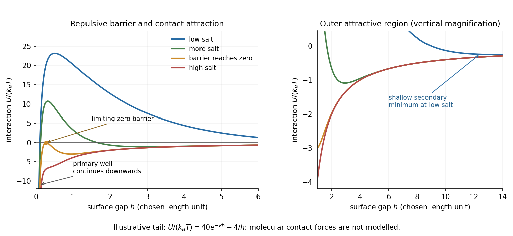
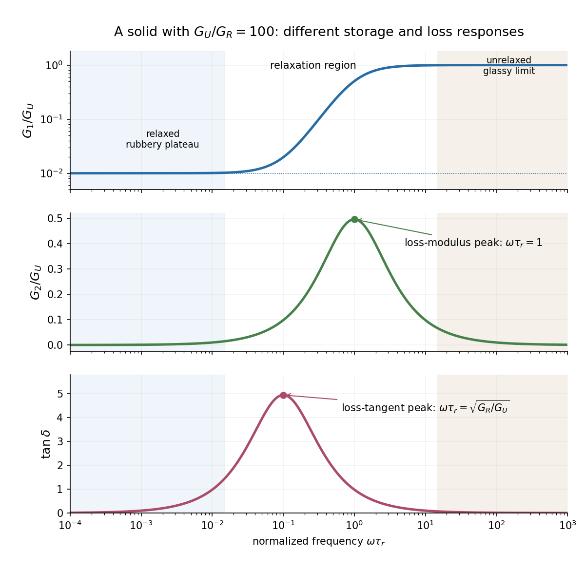
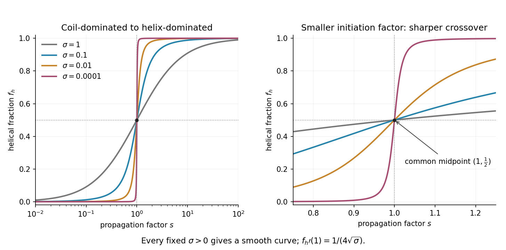

# 2018

↑ **Parent:** [Past exam of the soft condensed matter course of the University of Cambridge](../past-exam-of-the-soft-condensed-matter-course-of-the-university-of-cambridge.md)

[Original paper, released PDF pages 336–339](https://www.whatdotheyknow.com/request/natural_science_tripos_physics_e/response/2127325/attach/3/FOI%202022%20639%20Sullivan%20materials.pdf?cookie_passthrough=1#page=336)

**Table of contents**

- [Section A](#section-a)
  - [1](#section-a/1)
    - [a](#section-a/1/a)
      - [Solution](#section-a/1/a/solution)
    - [b](#section-a/1/b)
      - [Solution](#section-a/1/b/solution)
    - [c](#section-a/1/c)
      - [Solution](#section-a/1/c/solution)
- [Section B](#section-b)
  - [B2](#section-b/b2)
    - [Solution](#section-b/b2/solution)
  - [B3](#section-b/b3)
    - [Solution](#section-b/b3/solution)
  - [B4](#section-b/b4)
    - [Solution](#section-b/b4/solution)

## Section A

↑ **Parent:** [2018](2018.md)

<h3 id="section-a/1">1</h3>

↑ **Parent:** [Section A](#section-a)

<h4 id="section-a/1/a">a</h4>

↑ **Parent:** [1](#section-a/1)

<h5 id="section-a/1/a/solution">Solution</h5>

↑ **Parent:** [A](#section-a/1/a)

Assume steady fully developed laminar flow of a [Newtonian fluid](../viscous-fluid-flow.md#newtonian-fluid) in a long circular tube, with no slip at a rigid wall. The [Hagen-Poiseuille equation](../viscous-fluid-flow.md#hagen-poiseuille-equation) gives the volume flow rate

$$
Q=\frac{\pi R^4\Delta p}{8\eta\ell},
$$

where $R$ is the lumen radius, $\ell$ the tube length, $\eta$ the [dynamic viscosity](../dynamic-viscosity.md) and $\Delta p$ the pressure drop. If $\Delta p$, $\ell$ and $\eta$ remain fixed, then

$$
\frac{Q_{\mathrm{new}}}{Q_{\mathrm{old}}}=\left(\frac{R_{\mathrm{new}}}{R_{\mathrm{old}}}\right)^4.
$$

Thus doubling the flow requires

$$
\boxed{R_{\mathrm{new}}=2^{1/4}R_{\mathrm{old}}\simeq1.189R_{\mathrm{old}},\qquad
\frac{\Delta R}{R_{\mathrm{old}}}\simeq18.9\%}.
$$

This estimate neglects pulsation, arterial compliance, entrance losses, the detailed shape of a stenosis and changes in the rest of the circulatory resistance. It treats [blood](../physiology.md#blood) as a homogeneous [Newtonian fluid](../viscous-fluid-flow.md#newtonian-fluid) and assumes that enlarging the artery does not change its applied pressure drop. These assumptions supply the intended fourth-power scaling; an actual circulation need not keep that pressure drop fixed.

<h4 id="section-a/1/b">b</h4>

↑ **Parent:** [1](#section-a/1)

<h5 id="section-a/1/b/solution">Solution</h5>

↑ **Parent:** [B](#section-a/1/b)

At terminal speed, the downward excess weight is balanced by [Stokes's law](../stokes-flow.md#stokes-s-law) drag:

$$
\frac{4\pi a^3}{3}(\rho_p-\rho_w)g=6\pi\eta av_t.
$$

The subtraction of the displaced water mass includes [buoyancy](../fluid-mechanics.md#buoyancy). Hence the [Stokes settling velocity](../suspension-chemistry.md#stokes-settling-velocity) is

$$
\boxed{v_t=\frac{2(\rho_p-\rho_w)ga^2}{9\eta}}.
$$

A density is needed but is not supplied. For the estimate, take a dense iron oxide represented by [magnetite](../chemical-substance.md#magnetite), with $\rho_p\simeq5.2\times10^3\,\mathrm{kg\,m^{-3}}$, and water with $\rho_w\simeq10^3\,\mathrm{kg\,m^{-3}}$. This gives

$$
v_t\simeq\frac{2(4.2\times10^3)(9.81)(10^{-6})^2}{9(10^{-3})}
=\boxed{9.2\times10^{-6}\,\mathrm{m\,s^{-1}}\simeq9\,\mu\mathrm{m\,s^{-1}}\quad\text{downwards}}.
$$

Using the diameter for the [particle Reynolds number](../suspension-chemistry.md#particle-reynolds-number) gives $\mathrm{Re}\simeq\rho_wv_t(2a)/\eta\simeq1.8\times10^{-5}$, which supports the creeping-flow assumption. The model assumes a dilute isolated sphere far from walls and no imposed flow. The precise numerical speed depends on the unspecified oxide phase and particle density; the estimate is of order $10\,\mu\mathrm{m\,s^{-1}}$.

<h4 id="section-a/1/c">c</h4>

↑ **Parent:** [1](#section-a/1)

<h5 id="section-a/1/c/solution">Solution</h5>

↑ **Parent:** [C](#section-a/1/c)

The [polymer overlap concentration](../mixture.md#polymer-overlap-concentration) is reached when there is roughly one chain per coil volume. If $M$ is the chain [molar mass](../chemistry.md#molar-mass), choose the explicit geometric convention $V_{\mathrm{coil}}=4\pi R_g^3/3$, where $R_g$ is the [radius of gyration](../polymer.md#radius-of-gyration). Then

$$
\boxed{c^*\simeq\frac{M}{N_A(4\pi/3)R_g^3}}.
$$

Here $c^*$ is mass per solution volume and $N_A$ is the [Avogadro constant](../physics.md#avogadro-constant). A [good solvent](../mixture.md#good-solvent) gives $R_g\propto N^\nu$ with $\nu\simeq0.588$, approximated by $3/5$ in the [Flory approximation](../polymer.md#flory-approximation). With a [polystyrene](../polymer.md#polystyrene) repeat-unit molar mass of about $104.15\,\mathrm{g\,mol^{-1}}$, the chain has approximately $N=960$ repeat units. This fixes the chain length but not the size amplitude: the problem supplies no statistical segment length or measured coil size.

For a numerical estimate, use the [good-solvent size calibration for polystyrene](../polymer.md#good-solvent-size-calibration-for-polystyrene),

$$
\frac{R_g}{\mathrm{nm}}\simeq0.0123\left[\frac{M}{\mathrm{g\,mol^{-1}}}\right]^{0.593}.
$$

This empirical calibration is quoted for benzene or toluene near room temperature at molar masses above $2\times10^5\,\mathrm{g\,mol^{-1}}$; using it here is a modest extrapolation to $M=10^5\,\mathrm{g\,mol^{-1}}$. It gives $R_g\simeq11.3\,\mathrm{nm}$. Thus

$$
c^*\simeq\frac{100\,\mathrm{kg\,mol^{-1}}}{(6.022\times10^{23}\,\mathrm{mol^{-1}})(4\pi/3)(11.3\times10^{-9}\,\mathrm m)^3}
\simeq\boxed{3\times10^1\,\mathrm{kg\,m^{-3}}\simeq3\times10^1\,\mathrm{g\,L^{-1}}}.
$$

The unrounded calibration gives about $27\,\mathrm{g\,L^{-1}}$. This is an estimate under a stated extra material input, not a unique number determined solely by molecular weight and the phrase good solvent. Choosing a different coil-volume convention changes its prefactor. The robust chain-length dependence is $c^*\propto M^{1-3\nu}\simeq M^{-4/5}$ for a flexible good-solvent coil.

## Section B

↑ **Parent:** [2018](2018.md)

<h3 id="section-b/b2">B2</h3>

↑ **Parent:** [Section B](#section-b)

<h4 id="section-b/b2/solution">Solution</h4>

↑ **Parent:** [B2](#section-b/b2)

**Two stabilization mechanisms.** [Steric stabilization](../mixture.md#steric-stabilization) coats each [colloid](../mixture.md#colloid) with adsorbed or grafted polymer layers. Bringing two particles close overlaps or compresses those layers, increasing their [free energy](../thermodynamic-potential.md#thermodynamic-free-energy) through loss of chain conformations and, in a suitable solvent, increased local [osmotic pressure](../cell-membrane.md#osmotic-pressure). The resulting repulsion can keep the cores apart. A well-solvated nonionic coating can remain effective when added salt would screen electrostatic forces. Coatings can fail through desorption, poor solvent conditions or bridging, so simply adding arbitrary free polymer does not guarantee stabilization.

[Charge stabilization of colloids](../mixture.md#charge-stabilization-of-colloids) instead uses similarly charged surfaces and their diffuse [electric double layers](../electrostatics.md#electric-double-layer). Their approach costs electrostatic and ionic [free energy](../thermodynamic-potential.md#thermodynamic-free-energy). In [DLVO theory](../mixture.md#dlvo-theory), that repulsion competes with attractive [Van der Waals forces](../force.md#van-der-waals-force). It is particularly sensitive to salt concentration, counterion valence and surface ionization.

**Bjerrum length.** The standard [Bjerrum length](../electrostatics.md#bjerrum-length) is the separation at which the Coulomb interaction energy of two elementary charges equals thermal energy:

$$
\frac{e^2}{4\pi\varepsilon_0\varepsilon_r\ell_B}=k_BT,\qquad
\boxed{\ell_B=\frac{e^2}{4\pi\varepsilon_0\varepsilon_rk_BT}}.
$$

At $T\simeq298\,\mathrm K$ and $\varepsilon_r=78$, this is

$$
\boxed{\ell_B\simeq7.2\times10^{-10}\,\mathrm m=0.72\,\mathrm{nm}}.
$$

It compares ionic electrostatic coupling with thermal agitation. For ions of signed valences $z_1,z_2$, $U/(k_BT)=z_1z_2\ell_B/r$. The standard reference length uses $e$, not the whole colloid charge: assigning a colloid charge $Ze$ does not change the solvent's tabulated $\ell_B$.

**Screening and the printed normalization.** In a symmetric $z:z$ electrolyte, $z$ is the ionic valence magnitude, $e$ the elementary [electric charge](../electric-charge.md), $n_\infty$ the bulk [number density](../statistical-physics.md#number-density) of each ionic species, $\varepsilon_0$ the [vacuum permittivity](../permittivity.md#vacuum-permittivity), $\varepsilon_R$ the solvent's [relative permittivity](../quantum-mechanics.md#relative-permittivity), $k_B$ the [Boltzmann constant](../thermodynamics.md#boltzmann-constant) and $T$ absolute [temperature](../temperature.md). Mobile ions rearrange around a charged surface; the [Debye–Hückel screening length](../mathematical-biology.md#debye-huckel-screening-length) $\kappa^{-1}$ sets the range of the resulting weak potential.

There is an SI normalization error in the original PDF. Combining the [Boltzmann distribution](../thermodynamics.md#boltzmann-distribution) $n_\pm=n_\infty e^{\mp ze\psi/(k_BT)}$ with the SI [Poisson equation](../partial-differential-equation.md#poisson-s-equation) and linearizing at $|ze\psi|\ll k_BT$ gives

$$
\nabla^2\psi=\kappa_{\mathrm{SI}}^2\psi,\qquad
\boxed{\kappa_{\mathrm{SI}}^2=\frac{2z^2e^2n_\infty}{\varepsilon_0\varepsilon_Rk_BT}=8\pi\ell_Bz^2n_\infty}.
$$

The extra $4\pi$ in the PDF denominator is inconsistent with those SI charge, permittivity and density conventions. Keeping the printed algebra would make its screening length $\sqrt{4\pi}$ times the SI value at the same ion density. No numerical screening length is required here, and the qualitative dependence $\kappa^{-1}\propto n_\infty^{-1/2}$ is the same in either normalization. Added salt shortens the range of repulsion, allowing the attractive potential to capture particles more readily.

**Interaction-potential sketches.** Let $h$ be the surface separation between two spheres of radius $a$. A useful schematic [DLVO theory](../mixture.md#dlvo-theory) potential has the form

$$
U(h)\simeq B e^{-\kappa h}-\frac{A_Ha}{12h},
$$

away from the microscopic contact region. Here $A_H>0$ is a [Hamaker constant](../mathematical-biology.md#hamaker-constant); excluded-core repulsion and molecular details regularize contact. The exponential is the double-layer repulsion and the inverse-gap term the short-gap [Van der Waals force](../force.md#van-der-waals-force) contribution. A fixed $B$ illustrates the changing screening range; actual charge regulation can change the repulsive amplitude as well.

At low salt there is a high positive barrier between a deep primary minimum near contact and the dispersed state at $U(\infty)=0$. A shallow secondary minimum can occur outside the barrier and support weak reversible association. Increasing salt narrows the repulsive range and lowers the barrier. Thermally activated primary aggregation becomes appreciable when the barrier is only a few $k_BT$; the idealized barrier-free condition defines the fast-aggregation threshold associated with the [critical coagulation concentration](../mixture.md#critical-coagulation-concentration). Above that threshold, collisions can result in rapid capture in the primary minimum.

**[Figure 1](#section-b/b2/image-original-schematic-dlvo-potentials-as-screening-increases). Original schematic DLVO potentials as screening increases**. Illustrative dimensionless amplitudes show the barrier and outer attractive minimum; the near-contact primary well extends below the plotted range. These curves do not determine a material-specific coagulation concentration.

**Aggregate structures.** Well above the [critical coagulation concentration](../mixture.md#critical-coagulation-concentration), the sticking probability is close to one. In [diffusion-limited cluster aggregation](../mixture.md#diffusion-limited-cluster-aggregation), the first encounter attaches particles or clusters at accessible outer branches before they can explore many alternative configurations. The result is an open, tenuous structure. Typical ideal three-dimensional cluster models have [mass fractal dimension](../geometry-and-topology.md#mass-fractal-dimension) $d_f\simeq1.8$.

Near the threshold on its lower-salt, slow-aggregation side, a remaining barrier makes most encounters unsuccessful. [Reaction-limited cluster aggregation](../mixture.md#reaction-limited-cluster-aggregation) then permits repeated approaches and orientations before attachment, commonly giving denser clusters with $d_f\simeq2.1$. Since particle count scales as $N\propto(R_g/a)^{d_f}$, the larger exponent means more particles at a given large cluster size. This explanation does not require already formed bonds to rearrange: unsuccessful encounters themselves alter which configurations eventually bind.

The side of the threshold matters. At the ideal barrier-free threshold itself, or just above it, aggregation can already be diffusion limited; proximity to the [critical coagulation concentration](../mixture.md#critical-coagulation-concentration) alone does not universally imply a denser reaction-limited structure. The quoted dimensions are typical of irreversible approximately isotropic cluster models, not exact values for every colloid. Strong bond rearrangement or anisotropic attractions can change this comparison.

<h3 id="section-b/b3">B3</h3>

↑ **Parent:** [Section B](#section-b)

<h4 id="section-b/b3/solution">Solution</h4>

↑ **Parent:** [B3](#section-b/b3)

**Oscillatory response.** A material with [viscoelasticity](../rheology.md#viscoelasticity) stores some deformation energy and dissipates some over a loading cycle. In [small-amplitude oscillatory shear](../rheology.md#small-amplitude-oscillatory-shear), represent the strain by $\gamma(t)=\operatorname{Re}(\gamma_0e^{i\omega t})$. The shear-stress amplitude is related to the strain amplitude by the [complex viscoelastic modulus](../rheology.md#dynamic-modulus)

$$
\boxed{G^*(\omega)=G_1(\omega)+iG_2(\omega)},\qquad
\tau(t)=\gamma_0\bigl[G_1\cos\omega t-G_2\sin\omega t\bigr].
$$

Here $G_1=G'$ is the [storage modulus](../rheology.md#storage-modulus), the component in phase with strain, and $G_2=G''$ is the [loss modulus](../rheology.md#loss-modulus), the dissipative quadrature component. Both have units of [pressure](../pressure.md). The stress leads the strain by an angle $\delta$, with

$$
\boxed{\tan\delta=\frac{G_2}{G_1}}.
$$

For this $e^{i\omega t}$ convention, a passive material has $G_2\geq0$ at positive frequency. Integrating $\tau\dot\gamma$ over one period gives dissipated energy per unit volume $\pi\gamma_0^2G_2$, and the average input power per unit volume is $\omega\gamma_0^2G_2/2$. Thus the [loss tangent](../rheology.md#loss-tangent) compares the dissipative and elastic parts of the response. The frequency dependence reflects which internal relaxation processes can follow the imposed deformation.

**Torsional measurement.** Use $\rho$ for radial position inside the rod, reserving $r$ for its outer radius. A small angular displacement $\theta$ of one end relative to the fixed other end gives shear strain

$$
\gamma(\rho)=\frac{\rho\theta}{\ell}.
$$

In harmonic amplitude notation, the shear stress is $G^*\rho\Theta/\ell$. Its restoring [torque](../momentum.md#torque) is obtained by multiplying by the lever arm and integrating over the circular section:

$$
\mathcal T=-\int_0^r \rho\frac{G^*\rho\Theta}{\ell}\,2\pi\rho\,d\rho
=-\frac{\pi r^4}{2\ell}G^*\Theta.
$$

The factor $J=\int_A\rho^2dA=\pi r^4/2$ is the polar [second moment of area](../elasticity-physics.md#second-moment-of-area); it is not the disc's mass [moment of inertia](../rigid-body-dynamics.md#moment-of-inertia) $I$. The [torsional spring constant](../classical-mechanics.md#torsion-constant) becomes the complex stiffness $K^*=JG^*/\ell$. Angular [Newton's second law](../force.md#newton-s-second-law) therefore gives the paper's compact representation

$$
\boxed{I\ddot\theta+\frac{\pi r^4}{2\ell}(G_1+iG_2)\theta=0}.
$$

Its precise interpretation is a [torsional measurement of a complex shear modulus](../rheology.md#torsional-measurement-of-a-complex-shear-modulus). At a specified frequency, with complex angular amplitude $\Theta$, the driven response obeys

$$
\left[-I\omega^2+\frac{\pi r^4}{2\ell}G^*(\omega)\right]\Theta=\mathcal T_{\mathrm{external}}.
$$

Setting the external torque to zero supplies the free-mode condition, whose damped frequencies are generally complex. A dissipative free oscillator does not execute a sustained nonzero oscillation at a real frequency without driving. In real time, a general frequency-dependent [complex viscoelastic modulus](../rheology.md#dynamic-modulus) represents a causal memory response, rather than a complex instantaneous force on a real displacement. The derivation assumes a uniform slender circular rod, small twist, negligible rod inertia relative to the disc, and no additional bending, slip or external damping.

**Frequency regimes and sketches.** A permanently crosslinked [elastomer](../polymer.md#elastomer) has a low-frequency [rubbery plateau](../rheology.md#rubbery-plateau) $G_R>0$. Slow chain rearrangements can follow the strain, so the network is relatively compliant but still elastic. At high frequency the relevant segmental motions are frozen, giving a much larger unrelaxed or glassy stiffness $G_U$. Between these regimes the motions lag behind the loading and dissipate strongly.

A [standard linear solid model](../rheology.md#standard-linear-solid-model) supplies a consistent illustrative sketch of this process. Put $x=\omega\tau_r$, where $\tau_r$ is the stress [viscoelastic relaxation time](../rheology.md#viscoelastic-relaxation-time), and $\Delta G=G_U-G_R>0$. Then

$$
G^*=G_R+\Delta G\frac{ix}{1+ix},\qquad
\boxed{G_1=G_R+\Delta G\frac{x^2}{1+x^2},\quad
G_2=\Delta G\frac{x}{1+x^2}},
$$

so

$$
\boxed{\tan\delta=\frac{\Delta Gx}{G_R+G_Ux^2}}.
$$

At very low frequency, $G_1\to G_R$, $G_2\sim\Delta Gx$ and $\tan\delta\to0$. Through the relaxation region $G_1$ rises, $G_2$ has a maximum and $\tan\delta$ has a loss peak. At high frequency, $G_1\to G_U$, $G_2\sim\Delta G/x$ and $\tan\delta\to0$ again. Real polymers usually have a spectrum of relaxation times, so these features are broader and can have further structure.

**[Figure 2](#section-b/b3/image-storage-modulus-loss-modulus-and-loss-tangent-across-a-viscoelastic-relaxation). Storage modulus, loss modulus and loss tangent across a viscoelastic relaxation**. Original standard-linear-solid illustration with a nonzero rubbery modulus and a larger unrelaxed modulus; frequencies and moduli are normalized, not fitted to a particular polymer.

The two kinds of loss peak need not coincide. The [peak frequencies in a standard linear solid](../rheology.md#peak-frequencies-in-a-standard-linear-solid) are

$$
\boxed{\omega_{G_2}\tau_r=1,\qquad
\omega_{\tan\delta}\tau_r=\sqrt{G_R/G_U}}.
$$

The first follows by differentiating $x/(1+x^2)$; the second by differentiating $x/(G_R+G_Ux^2)$. This is why the sketch marks the peaks separately. If the polymer is an uncrosslinked melt rather than a permanent network, there is an additional ultimate low-frequency terminal-flow regime, with $G_1\propto\omega^2$ and $G_2\propto\omega$; a permanent [elastomer](../polymer.md#elastomer) does not have that zero-frequency fluid limit.

**Interstitial atoms in a metal.** A suitable mechanism is the [Snoek effect](../rheology.md#snoek-effect), a form of [anelasticity](../rheology.md#anelasticity). An [interstitial defect](../physical-chemistry.md#interstitial-defect) distorts its local [crystal structure](../physical-chemistry.md#crystal-structure) anisotropically. Different site orientations become unequally favorable under an applied [stress](../continuum-mechanics.md#stress), so hopping atoms redistribute towards the preferred orientations and supply additional strain. The hopping time is thermally activated, approximately $\tau_a=\tau_0e^{E_a/(k_BT)}$, with [activation energy](../chemical-kinetics.md#activation-energy) $E_a$.

At low frequency, $\omega\tau_a\ll1$, the populations nearly equilibrate during each cycle. The defect contribution to strain is nearly in phase with stress, giving a relaxed compliance and little dissipation. At intermediate frequency, $\omega\tau_a\sim1$, redistribution lags behind the stress and energy dissipation is largest. At high frequency, $\omega\tau_a\gg1$, the populations are effectively frozen; the extra relaxation strain cannot develop, and the response approaches the stiffer unrelaxed elastic limit. For weak single-mode relaxation, the [loss tangent](../rheology.md#loss-tangent) is approximately proportional to $\omega\tau_a/[1+(\omega\tau_a)^2]$. The metal remains a solid in the low-frequency regime: the extra delayed strain is recoverable, not unrestricted viscous flow.

<h3 id="section-b/b4">B4</h3>

↑ **Parent:** [Section B](#section-b)

<h4 id="section-b/b4/solution">Solution</h4>

↑ **Parent:** [B4](#section-b/b4)

**Ideal and self-avoiding walks.** An [ideal chain](../mathematical-biology.md#ideal-chain) has independent isotropic coarse-grained steps and permits self-intersections in its mathematical model. For $N$ steps of length $b$, the cross terms average to zero, so its root-mean-square [end-to-end distance of a polymer chain](../polymer.md#end-to-end-distance-of-a-polymer-chain) obeys

$$
\boxed{\langle R^2\rangle=Nb^2,\qquad R_{\mathrm{rms}}\propto N^{1/2}}.
$$

A [self-avoiding walk](../combinatorics.md#self-avoiding-walk) excludes repeated occupancy or intersection at the segment scale. This represents positive [excluded volume](../statistical-physics.md#excluded-volume) in a dilute [good solvent](../mixture.md#good-solvent). The nonlocal constraint correlates otherwise distant portions of the chain and swells it:

$$
\boxed{R_{\mathrm{rms}}\propto bN^\nu,\qquad \nu\simeq0.588\quad\text{in three dimensions}}.
$$

The [Flory approximation](../polymer.md#flory-approximation) replaces this exponent by $3/5$, by balancing stretching free energy $R^2/(Nb^2)$ with an interaction contribution $vN^2/R^3$. The result is a more extended and less internally dense coil than the ideal walk; self-avoidance changes the statistics, not merely the local step length.

**Two ideal-chain regimes.** At the [theta temperature](../mixture.md#theta-temperature) for a dilute polymer–solvent pair, leading effective segment attractions and repulsions cancel. Large-scale chain statistics are approximately ideal, even though microscopic atoms still have finite size. In a homogeneous [polymer melt](../polymer.md#polymer-melt), surrounding chains screen long-range [excluded volume](../statistical-physics.md#excluded-volume) interactions of a chosen chain, again making its equilibrium large-scale size approximately ideal. Local bond-angle correlations must be included in an effective statistical length such as the [Kuhn length](../mathematical-biology.md#kuhn-length). [Polymer entanglements](../polymer.md#polymer-entanglement) can slow the dynamics without invalidating this leading equilibrium size law.

**Semiflexible DNA.** The [nucleic acid double helix](../polymer.md#nucleic-acid-double-helix) gives double-stranded [DNA](../polymer.md#deoxyribonucleic-acid) a bending stiffness and substantial local orientational persistence. Independent step orientations are therefore a poor description on short scales, while self-avoidance alone does not specify the energy cost of bending. The [worm-like chain](../mathematical-biology.md#worm-like-chain) describes the molecule as a continuously bendable, locally inextensible curve $\mathbf r(s)$ parameterized by [arc length](../riemannian-geometry.md#arc-length) $s$, with unit tangent $\mathbf t(s)=d\mathbf r/ds$. Its bending energy is

$$
E_b=\frac A2\int_0^L\left|\frac{d\mathbf t}{ds}\right|^2ds,\qquad |\mathbf t|=1,
$$

where $A$ is [bending stiffness](../elasticity-physics.md#bending-stiffness). In the free three-dimensional model, the [persistence length](../mathematical-biology.md#persistence-length) is $\ell_p=A/(k_BT)$ and

$$
\boxed{\langle\mathbf t(s)\cdot\mathbf t(s+u)\rangle=e^{-u/\ell_p}}.
$$

Thus $\ell_p$ is the contour separation over which tangent alignment falls by the factor $e^{-1}$; it quantifies stiffness relative to thermal bending. The model bridges locally rod-like and globally coil-like conformations. It omits long-range self-avoidance in its simplest form, so sufficiently long dilute DNA can require excluded-volume corrections.

**Flexible and rigid limits.** Integrating the tangent correlation over the two contour positions gives the [end-to-end distance of a worm-like chain](../mathematical-biology.md#end-to-end-distance-of-a-worm-like-chain):

$$
\langle R^2\rangle=2\int_0^L(L-u)e^{-u/\ell_p}du
=2\ell_pL-2\ell_p^2(1-e^{-L/\ell_p}).
$$

For a very flexible chain on the scale of its total length, $L/\ell_p\gg1$, the exponential is negligible and

$$
\boxed{\langle R^2\rangle\simeq2\ell_pL,\qquad R_{\mathrm{rms}}\simeq\sqrt{2\ell_pL}\ll L}.
$$

This is the [ideal chain](../mathematical-biology.md#ideal-chain) result with [Kuhn length](../mathematical-biology.md#kuhn-length) $b_K=2\ell_p$ and effective step count $N_K=L/(2\ell_p)$. Many persistent sections have decorrelated orientations. The flexible limit means a large ratio $L/\ell_p$ within the continuum model's range, not an extrapolation of the persistence length below all molecular length scales.

For a nearly rigid chain, $L/\ell_p\ll1$, the constant and linear terms in the exponential cancel those outside it. The [Taylor series](../calculus.md#taylor-series) gives

$$
\langle R^2\rangle=L^2-\frac{L^3}{3\ell_p}+\frac{L^4}{12\ell_p^2}+\cdots,
$$

so

$$
\boxed{R_{\mathrm{rms}}\simeq L\left(1-\frac{L}{6\ell_p}+\cdots\right)\longrightarrow L}.
$$

This is the expected rod limit: all tangents are nearly aligned, and the end-to-end distance approaches the [arc length](../riemannian-geometry.md#arc-length).

**Helix–coil curves.** A [helix-coil transition model](../mathematical-biology.md#helix-coil-transition-model) allows ordered helical runs and disordered coil regions. Use $s$ and $\sigma$ with exactly the free-energy conventions defined in the paper. A negative $\Delta F_{\mathrm{hc}}$ gives $s>1$ and favors the helical state; a positive junction cost gives $0<\sigma<1$ and penalizes starting new domains. The supplied helical fraction is the long-chain form associated with the [Zimm-Bragg model](../mathematical-biology.md#zimm-bragg-model).

Its main features follow directly without assuming a sharp transition. Put $Q=(s-1)^2+4s\sigma$. For every $\sigma>0$,

$$
\boxed{\lim_{s\downarrow0}f_h(s)=0,\qquad f_h(1)=\frac12,\qquad\lim_{s\to\infty}f_h(s)=1},
$$

and differentiating gives

$$
\boxed{\frac{df_h}{ds}=\frac{\sigma(s+1)}{Q^{3/2}}>0,\qquad
\left.\frac{df_h}{ds}\right|_{s=1}=\frac1{4\sqrt\sigma}}.
$$

Thus all curves rise monotonically and cross at $(1,1/2)$. Increasing the boundary free-energy cost reduces $\sigma$, suppresses frequent coil–helix boundaries and makes longer runs favorable. The transition region becomes narrower and steeper: balancing $(s-1)^2$ against $4s\sigma$ gives a width of order $\sqrt\sigma$ near $s=1$.

**[Figure 3](#section-b/b4/image-helical-fraction-and-the-sharpening-of-a-helix-coil-crossover). Helical fraction and the sharpening of a helix-coil crossover**. Original plots of the supplied fraction for several positive initiation parameters, with a magnified view near the common midpoint.

For $\sigma=1$, the fraction simplifies to $\boxed{f_h=s/(1+s)}$, the noncooperative two-state result. For $0<\sigma\ll1$, the steep curve describes cooperative helix formation. In the singular limit $\sigma\downarrow0$, it approaches zero for $s<1$ and one for $s>1$; its midpoint remains $1/2$ when approached through positive $\sigma$. Setting $\sigma=0$ directly makes the formula indeterminate at $s=1$. For any fixed positive $\sigma$, the given long-chain curve is smooth: it is a cooperative crossover, not a true discontinuity. The plot varies $s$ at fixed $\sigma$; in an actual temperature scan both parameters may change, and a finite chain can further round the crossover.

## ↑ Ancestors (10)

1. [Past exam of the soft condensed matter course of the University of Cambridge](../past-exam-of-the-soft-condensed-matter-course-of-the-university-of-cambridge.md)
2. [Soft Condensed Matter course of the University of Cambridge](../university-of-cambridge.md#soft-condensed-matter-course-of-the-university-of-cambridge)
3. [Physics course of the year 3 of the natural sciences course of the University of Cambridge](../university-of-cambridge.md#physics-course-of-the-year-3-of-the-natural-sciences-course-of-the-university-of-cambridge)
4. [Year 3 of the natural sciences course of the University of Cambridge](../university-of-cambridge.md#year-3-of-the-natural-sciences-course-of-the-university-of-cambridge)
5. [Year of the natural sciences course of the University of Cambridge](../university-of-cambridge.md#year-of-the-natural-sciences-course-of-the-university-of-cambridge)
6. [Natural sciences course of the University of Cambridge](../university-of-cambridge.md#natural-sciences-course-of-the-university-of-cambridge)
7. [Course of the University of Cambridge](../university-of-cambridge.md#course-of-the-university-of-cambridge)
8. [University of Cambridge](../university-of-cambridge.md)
9. [List of universities](../README.md#list-of-universities)
10. [Codex Wiki](../README.md)
