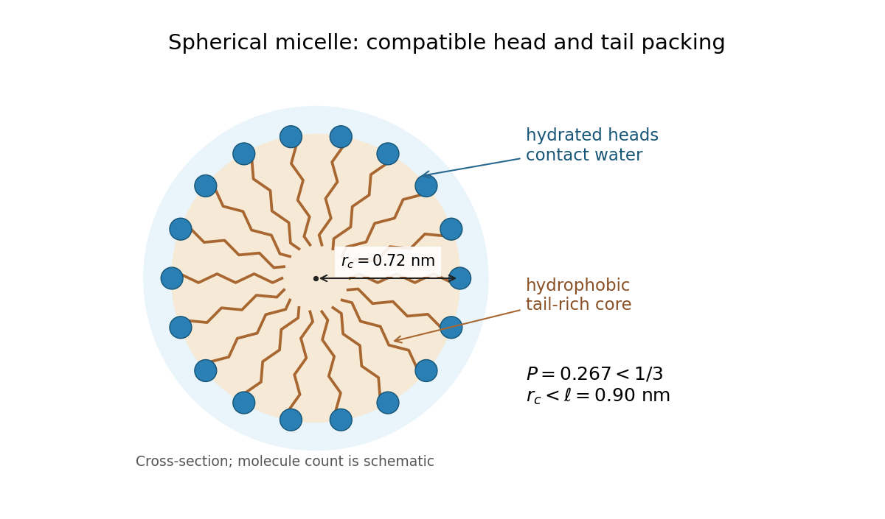

<h1 id="section-a/3/solution">Solution</h1>

↑ **Parent:** [3](../3.md)

Two examples are [sodium dodecyl sulfate](../../../../sodium-dodecyl-sulfate.md), with a negatively charged sulfate head and a hydrocarbon tail, and [cetrimonium bromide](../../../../cetrimonium-bromide.md), with a positively charged ammonium head and a hydrocarbon tail. Both are [amphiphiles](../../../../amphiphile.md): one region is [hydrophilic](../../../../hydrophilicity.md) and another is [hydrophobic](../../../../hydrophobicity.md).

In [water](../../../../water.md), the [hydrophobic effect](../../../../hydrophobic-effect.md) favors association of the tails into a core, reducing their exposed area while the hydrated heads remain outside. This can lower the total [Gibbs free energy](../../../../gibbs-free-energy.md) despite loss of translational [entropy](../../../../entropy-split.md). Head-group repulsion, interfacial cost and chain-packing constraints oppose unlimited growth, so finite [micelles](../../../../micelle.md) are favored under suitable conditions above the [critical micelle concentration](../../../../critical-micelle-concentration.md).

The appropriate geometric measure is the [amphiphile packing parameter](../../../../amphiphile-packing-parameter.md):

$$
P=\frac{v}{a_0\ell}=\frac{0.12}{0.5\times0.9}=\boxed{0.267}.
$$

For a spherical [micelle](../../../../micelle.md) with $n$ tails and core radius $r_c$, the volume and area relations are $nv=4\pi r_c^3/3$ and $na_0=4\pi r_c^2$. Dividing gives $r_c=3v/a_0$, so a sphere fits without overextending a tail if $P\leq1/3$. Here $P<1/3$ and

$$
r_c=\frac{3v}{a_0}=0.72\,\mathrm{nm}<\ell.
$$

Thus the packing model predicts **spherical [micelles](../../../../micelle.md)**. This is a preferred aggregate geometry, not a claim that concentration, temperature or ionic conditions can never alter the morphology.

**[Figure 1](#section-a/3/image-an-original-cross-section-of-spherical-micelle-packing). An original cross-section of spherical micelle packing**. Hydrophilic heads face the water and hydrophobic tails fill the core; the drawing illustrates packing geometry rather than a measured aggregation number.

## ↑ Ancestors (13)

1. [3](../3.md)
2. [Section A](../../section-a.md)
3. [2019](../../../2019-split.md)
4. [Past exam of the soft condensed matter course of the University of Cambridge](../../../split.md)
5. [Soft Condensed Matter course of the University of Cambridge](../../../../soft-condensed-matter-course-of-the-university-of-cambridge.md)
6. [Physics course of the year 3 of the natural sciences course of the University of Cambridge](../../../../physics-course-of-the-year-3-of-the-natural-sciences-course-of-the-university-of-cambridge.md)
7. [Year 3 of the natural sciences course of the University of Cambridge](../../../../year-3-of-the-natural-sciences-course-of-the-university-of-cambridge.md)
8. [Year of the natural sciences course of the University of Cambridge](../../../../year-of-the-natural-sciences-course-of-the-university-of-cambridge.md)
9. [Natural sciences course of the University of Cambridge](../../../../natural-sciences-course-of-the-university-of-cambridge.md)
10. [Course of the University of Cambridge](../../../../course-of-the-university-of-cambridge.md)
11. [University of Cambridge](../../../../university-of-cambridge-split.md)
12. [List of universities](../../../../list-of-universities.md)
13. [Codex Wiki](../../../../split.md)
