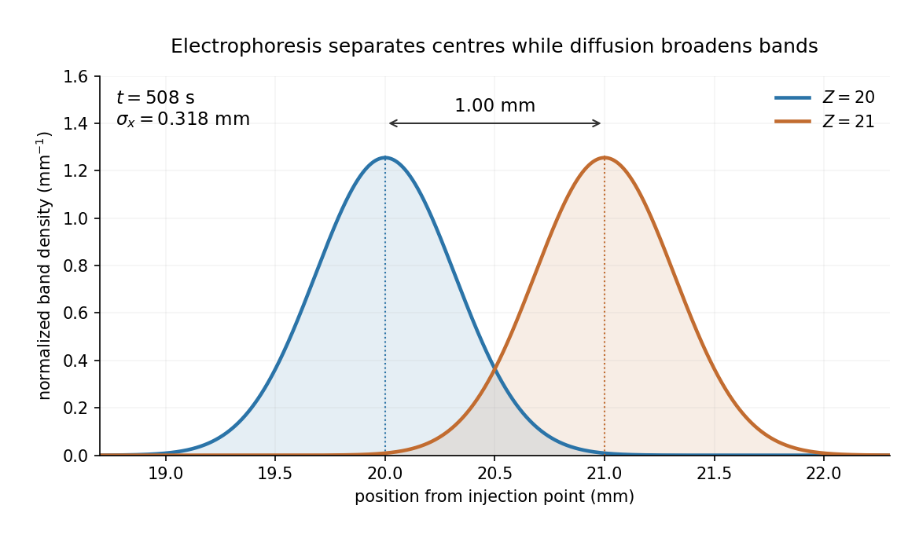

<h1 id="section-b/b4/solution">Solution</h1>

↑ **Parent:** [B4](../b4.md)

**Diffusion and mobility.** For a dilute isolated sphere in a [Newtonian fluid](../../../../newtonian-fluid.md), [Stokes's law](../../../../stokes-s-law.md) gives the drag magnitude $F_{\mathrm{drag}}=6\pi\eta Rv=\xi v$, where $\eta$ is the [dynamic viscosity](../../../../dynamic-viscosity-split.md) and $R$ is the [hydrodynamic radius](../../../../hydrodynamic-radius.md). The [mechanical mobility](../../../../mechanical-mobility.md) is therefore $1/\xi$; the translational [hydrodynamic mobility matrix](../../../../hydrodynamic-mobility-matrix.md) is $\xi^{-1}I$.

To relate mobility to [diffusion](../../../../diffusion.md), put the particles in a weak external [potential energy](../../../../potential-energy.md) $U(x)$. Their drift speed is $-U'(x)/\xi$. For [number density](../../../../number-density.md) $n(x)$, the sum of drift and [Fick's first law](../../../../fick-s-first-law.md) fluxes is

$$
J=-\frac{nU'}\xi-D\frac{dn}{dx}.
$$

At [thermal equilibrium](../../../../thermal-equilibrium-split.md), the [Boltzmann distribution](../../../../boltzmann-distribution.md) gives $n\propto e^{-U/(k_BT)}$, and the net flux is zero. Substituting $n'=-nU'/(k_BT)$ into $J=0$ yields $D=k_BT/\xi$. Thus the [Stokes–Einstein relation](../../../../stokes-einstein-relation.md) is

$$
\boxed{D=\frac{k_BT}{6\pi\eta R}}.
$$

Here $k_B$ is the [Boltzmann constant](../../../../boltzmann-constant.md) and $T$ is absolute [temperature](../../../../temperature-split.md). The assumptions include a no-slip approximately spherical particle, a continuum fluid, a small particle [Reynolds number](../../../../reynolds-number.md), and negligible hydrodynamic interactions with other particles or boundaries.

**Gravitational sedimentation.** The [buoyant force](../../../../buoyancy.md) must be included, since the mass of displaced water is comparable to the protein mass. Using $1\,\mathrm{Da}=1.66054\times10^{-27}\,\mathrm{kg}$ gives

$$
m=6.1108\times10^{-23}\,\mathrm{kg},\qquad
V_p=\frac{4\pi R^3}{3}=4.2213\times10^{-26}\,\mathrm{m^3},
$$

so the buoyant mass in the stated spherical model is

$$
m_b=m-\rho_wV_p=1.8894\times10^{-23}\,\mathrm{kg}.
$$

The drag coefficient is $\xi=6\pi(10^{-3})(2.16\times10^{-9})=4.0715\times10^{-11}\,\mathrm{kg\,s^{-1}}$. At terminal speed, $\xi v_g=m_bg$, so

$$
\boxed{v_g=\frac{(m-\rho_wV_p)g}{6\pi\eta R}=4.55\times10^{-12}\,\mathrm{m\,s^{-1}}\quad\text{downwards}}.
$$

Ignoring [buoyancy](../../../../buoyancy.md) would give $1.47\times10^{-11}\,\mathrm{m\,s^{-1}}$ and would not use the supplied water density. This calculation treats the stated radius as both the hydrodynamic radius and the radius determining displaced volume; a real hydrated [protein](../../../../protein-split.md) can require a separately measured partial specific volume.

**Electrical drift.** In the specified simple [electrophoresis](../../../../electrophoresis.md) model, terminal force balance is $Ze\mathbf E=\xi\mathbf v$. Therefore

$$
\boxed{\mathbf v=\frac{Ze}{6\pi\eta R}\mathbf E},\qquad
\boxed{\mu=\frac{Ze}{6\pi\eta R}},
$$

where $\mu$ is the [electrophoretic mobility](../../../../electrophoretic-mobility.md) and $e$ the elementary [electric charge](../../../../electric-charge-split.md). For the given positive [beta-lactoglobulin](../../../../beta-lactoglobulin.md) charge,

$$
\boxed{v_{20}=3.94\times10^{-5}\,\mathrm{m\,s^{-1}}=39.4\,\mu\mathrm{m\,s^{-1}}},
$$

in the direction of the [electric field](../../../../electric-field-split.md). This exceeds the gravitational [sedimentation](../../../../sedimentation.md) speed by about $8.6\times10^6$.

**Separation time.** The two populations have equal drag coefficients because their radii are equal. Their difference in drift speed is therefore set by one elementary charge:

$$
\Delta v=v_{21}-v_{20}=\frac{eE}{6\pi\eta R}=1.97\times10^{-6}\,\mathrm{m\,s^{-1}}.
$$

Starting with coincident band centres, their separation is $\Delta v\,t$. Hence

$$
\boxed{t=\frac{10^{-3}}{\Delta v}=5.08\times10^2\,\mathrm s\simeq8.47\,\mathrm{min}}.
$$

At that time the original band has travelled $20\,\mathrm{mm}$ and the mutant $21\,\mathrm{mm}$. Their masses do not enter this ideal electrical force balance: equal-radius particles with different masses but the same charge would have equal [electrophoretic mobility](../../../../electrophoretic-mobility.md) in this model.

**Practical discrimination.** A one-charge difference is enough for the stipulated separation, so the method is sensitive to mutations that change effective charge or friction. It cannot distinguish every mutation: substitutions that preserve charge and hydrodynamic size need not separate. Buffer [pH](../../../../ph.md) changes protein ionization, and realistic [electrophoresis](../../../../electrophoresis.md) also involves the ionic atmosphere, [electro-osmosis](../../../../electro-osmosis.md), walls or gel interactions, and finite band widths.

For example, the [Stokes–Einstein relation](../../../../stokes-einstein-relation.md) at $293.15\,\mathrm K$ gives $D=9.94\times10^{-11}\,\mathrm{m^2\,s^{-1}}$. For an initially narrow band, [diffusive broadening of electrophoretic bands](../../../../diffusive-broadening-of-electrophoretic-bands.md) gives

$$
\sigma_x=\sqrt{2Dt}=0.318\,\mathrm{mm}
$$

at the calculated separation time. Thus the centres are about $3.15$ diffusion standard deviations apart, rather than forming infinitely sharp bands. The stated $1\,\mathrm{mm}$ centre-separation criterion is achievable in the model, but actual resolution also depends on the loading width and other dispersion mechanisms.

**[Figure 2](#section-b/b4/image-predicted-band-centres-and-diffusion-widths-after-508-seconds). Predicted band centres and diffusion widths after 508 seconds**. Original Gaussian drift-diffusion calculation for initially narrow bands, using the stipulated equal-radius model.

**Equivalent centrifugal acceleration.** For the original protein to attain its electrical drift speed by [sedimentation](../../../../sedimentation.md), its buoyant centrifugal force must equal $20eE$:

$$
m_ba_{\mathrm{eff}}=20eE.
$$

Consequently

$$
\boxed{a_{\mathrm{eff}}=\frac{20eE}{m_b}=8.48\times10^7\,\mathrm{m\,s^{-2}}\simeq8.64\times10^6g}.
$$

This is the acceleration at the protein's position in the rotating solution; no rotation rate can be assigned without a centrifuge radius. If the intended comparison is instead the relative separation speed of the two bands, use $\Delta m_b=600\,\mathrm{Da}$, since their displaced volumes are equal. Matching $|\Delta m_b|a_{\mathrm{eff}}=eE$ then gives $8.04\times10^7\,\mathrm{m\,s^{-2}}$. In that separation experiment the heavier original protein moves faster centrifugally, whereas the more highly charged mutant moves faster electrically.

## ↑ Ancestors (13)

1. [B4](../b4.md)
2. [Section B](../../section-b.md)
3. [2019](../../../2019-split.md)
4. [Past exam of the soft condensed matter course of the University of Cambridge](../../../split.md)
5. [Soft Condensed Matter course of the University of Cambridge](../../../../soft-condensed-matter-course-of-the-university-of-cambridge.md)
6. [Physics course of the year 3 of the natural sciences course of the University of Cambridge](../../../../physics-course-of-the-year-3-of-the-natural-sciences-course-of-the-university-of-cambridge.md)
7. [Year 3 of the natural sciences course of the University of Cambridge](../../../../year-3-of-the-natural-sciences-course-of-the-university-of-cambridge.md)
8. [Year of the natural sciences course of the University of Cambridge](../../../../year-of-the-natural-sciences-course-of-the-university-of-cambridge.md)
9. [Natural sciences course of the University of Cambridge](../../../../natural-sciences-course-of-the-university-of-cambridge.md)
10. [Course of the University of Cambridge](../../../../course-of-the-university-of-cambridge.md)
11. [University of Cambridge](../../../../university-of-cambridge-split.md)
12. [List of universities](../../../../list-of-universities.md)
13. [Codex Wiki](../../../../split.md)
