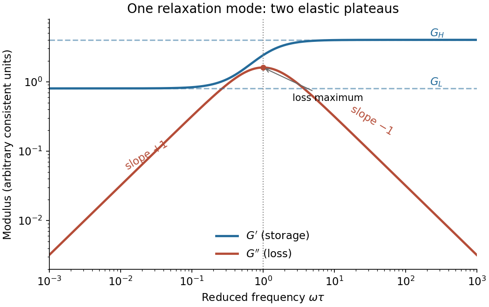

<h1 id="section-b/4/d/solution">Solution</h1>

↑ **Parent:** [D](../d.md)

For elements in series the [stress](../../../../../stress.md) is common and the [strains](../../../../../strain.md) add. If $\widehat\epsilon_K$ and $\widehat\epsilon_1$ are the Kelvin element and added spring amplitudes, then

$$
\widehat\epsilon=\widehat\epsilon_K+\widehat\epsilon_1
=\frac{\widehat\sigma}{G_0+i\omega\eta_0}+\frac{\widehat\sigma}{G_1}.
$$

The compliances therefore add, yielding

$$
\boxed{G^*(\omega)=\left[\frac1{G_0+i\omega\eta_0}+\frac1{G_1}\right]^{-1}
=\frac{G_1(G_0+i\omega\eta_0)}{G_0+G_1+i\omega\eta_0}.}
$$

This is a [standard linear solid model](../../../../../standard-linear-solid-model.md). Define

$$
G_L=\frac{G_0G_1}{G_0+G_1},\qquad G_H=G_1,\qquad
\Delta G=G_H-G_L=\frac{G_1^2}{G_0+G_1},\qquad
\tau=\frac{\eta_0}{G_0+G_1}.
$$

Writing $x=\omega\tau$, its [storage modulus](../../../../../storage-modulus.md) and [loss modulus](../../../../../loss-modulus.md) are

$$
\boxed{G'=G_L+\Delta G\frac{x^2}{1+x^2},\qquad
G''=\Delta G\frac{x}{1+x^2}.}
$$

Thus $G'$ increases from the low-frequency plateau $G_L$ to the high-frequency plateau $G_H$. The [loss modulus](../../../../../loss-modulus.md) has low-frequency slope $+1$ and high-frequency slope $-1$ on a [log-log plot](../../../../../log-log-plot.md), with maximum $\Delta G/2$ at $\omega=1/\tau$. At that frequency $G'=(G_L+G_H)/2$. There need not be a crossing of the two curves for arbitrary spring constants.

**[Figure 1](#section-b/4/d/image-storage-modulus-and-loss-modulus-of-the-standard-linear-solid-model). Storage modulus and loss modulus of the standard linear solid model**. Original log-log plot of the derived formulas, with illustrative $G_0=1$, $G_1=4$ and frequency expressed as $\omega\tau$. The chosen spring ratio is not specified by the exam. Dashed horizontal lines mark $G_L$ and $G_H$, and the dotted vertical line marks the loss maximum.

## ↑ Ancestors (14)

1. [D](../d.md)
2. [4](../../4.md)
3. [Section B](../../../section-b.md)
4. [2021](../../../../2021-split.md)
5. [Past exam of the soft condensed matter course of the University of Cambridge](../../../../split.md)
6. [Soft Condensed Matter course of the University of Cambridge](../../../../../soft-condensed-matter-course-of-the-university-of-cambridge.md)
7. [Physics course of the year 3 of the natural sciences course of the University of Cambridge](../../../../../physics-course-of-the-year-3-of-the-natural-sciences-course-of-the-university-of-cambridge.md)
8. [Year 3 of the natural sciences course of the University of Cambridge](../../../../../year-3-of-the-natural-sciences-course-of-the-university-of-cambridge.md)
9. [Year of the natural sciences course of the University of Cambridge](../../../../../year-of-the-natural-sciences-course-of-the-university-of-cambridge.md)
10. [Natural sciences course of the University of Cambridge](../../../../../natural-sciences-course-of-the-university-of-cambridge.md)
11. [Course of the University of Cambridge](../../../../../course-of-the-university-of-cambridge.md)
12. [University of Cambridge](../../../../../university-of-cambridge-split.md)
13. [List of universities](../../../../../list-of-universities.md)
14. [Codex Wiki](../../../../../split.md)
