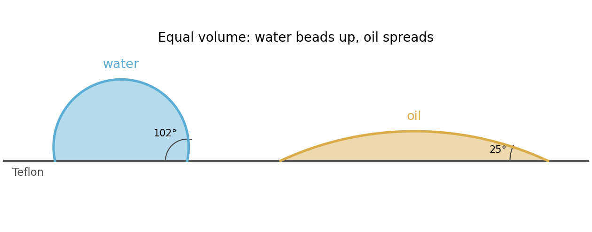

<h1 id="section-b/5/b/solution">Solution</h1>

↑ **Parent:** [B](../b.md)

On [Teflon](../../../../../teflon.md), the [water](../../../../../water.md) drop has an obtuse [contact angle](../../../../../contact-angle.md) and beads up, whereas the oil drop has an acute [contact angle](../../../../../contact-angle.md) and spreads into a shallower patch. For small drops with negligible [Bond number](../../../../../bond-number.md), both can be drawn as [spherical caps](../../../../../spherical-cap.md).

To compare shape at equal volume $V$, let $R$ denote the generating sphere radius. The cap height and footprint radius are

$$
h=R(1-\cos\theta),\qquad s=R\sin\theta,\qquad
V=\frac\pi3 R^3(2-3\cos\theta+\cos^3\theta).
$$

For a fixed $V$, these relations give a taller, narrower drop for the larger [contact angle](../../../../../contact-angle.md). The angles are measured inside the liquid, including the obtuse angle of the water drop.

**[Figure 2](#section-b/5/b/image-equal-volume-spherical-caps-on-teflon). Equal-volume spherical caps on Teflon**. Original cross-sections comparing water at $102^\circ$ with oil at $25^\circ$. The same liquid volume is used to expose the difference in shape; no particular drop size or volume was supplied in the paper.

## ↑ Ancestors (14)

1. [B](../b.md)
2. [5](../../5.md)
3. [Section B](../../../section-b.md)
4. [2021](../../../../2021-split.md)
5. [Past exam of the soft condensed matter course of the University of Cambridge](../../../../split.md)
6. [Soft Condensed Matter course of the University of Cambridge](../../../../../soft-condensed-matter-course-of-the-university-of-cambridge.md)
7. [Physics course of the year 3 of the natural sciences course of the University of Cambridge](../../../../../physics-course-of-the-year-3-of-the-natural-sciences-course-of-the-university-of-cambridge.md)
8. [Year 3 of the natural sciences course of the University of Cambridge](../../../../../year-3-of-the-natural-sciences-course-of-the-university-of-cambridge.md)
9. [Year of the natural sciences course of the University of Cambridge](../../../../../year-of-the-natural-sciences-course-of-the-university-of-cambridge.md)
10. [Natural sciences course of the University of Cambridge](../../../../../natural-sciences-course-of-the-university-of-cambridge.md)
11. [Course of the University of Cambridge](../../../../../course-of-the-university-of-cambridge.md)
12. [University of Cambridge](../../../../../university-of-cambridge-split.md)
13. [List of universities](../../../../../list-of-universities.md)
14. [Codex Wiki](../../../../../split.md)
